# 【华盛顿大学】神经科学入门 ｜ Introduction To Neuroscience ｜ Bing Wen Brunton p05 P05_动作电位-有髓鞘轴突 -BV1i3qWBXEDH_p5-

Welcome back to another lecture from Introduction to neurourscience。

 we have an action pact sequence today we're talking about the action potential。

 and that is the neuron solution to how to pass messages without fail across really long distances。😊。

If we were to review what we talked about in the last couple of segments。

 what I've really told you is that according to what we know about the passive and active properties of neurons。

 whenever something changes like you inject current of some kind。

 the cell responds by exponential depolarization and hyperpolarization and also exponential decay in space In other words。

 whenever something changes， the cell most certainly does respond。

 it can respond quickly can respond solely responds but then that response decays in time and in space exponentially so this is kind of a problem we cant we can't pass messages this way。

 this is never going to get anywhere if you're an animal and you actually need to get a message from one side of your body to another to a made of predator to hunt for prey to search for home to find food to find your mate these messages are going to get lost if all that's happening is exponential decay in all different kindss so the solution here is that we're not going to rely an exponential decay。

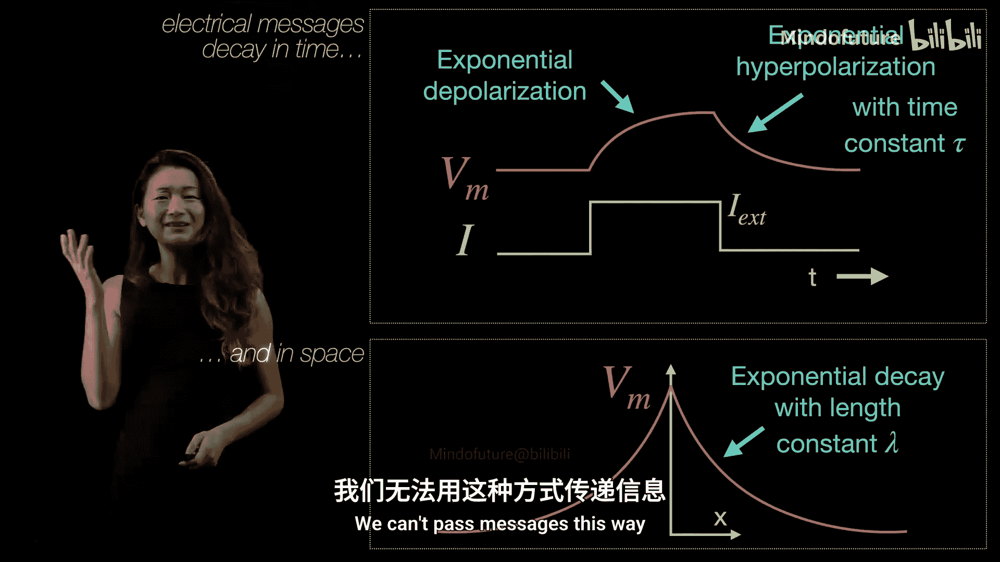

We are going to invent a whole new way of encoding and representing electrical messages that is more like looking at and making a self re reforcing wave packet a packet of electrical potential so that as it travels throughout the cell it actually doesn't change and it reinforces itself itself so this lecture is going to be all about the mechanisms of how that happens。

 how do we make a self- reforcing wave packet and have it passed for the cell so in summary we're going to be going through and unpacking this diagram here by looking at the feedback mechanisms that sustain the action potential both in terms of positive feedback and negative feedback so let's get into it this is an action potential this is the iconic picture that everyone thinks about when we think about an action potential。

 the action potential has this very characteristic shape it differs somewhat depending on the animal in the cell but it always has the following shape where it starting from rest it goes up comes back down。

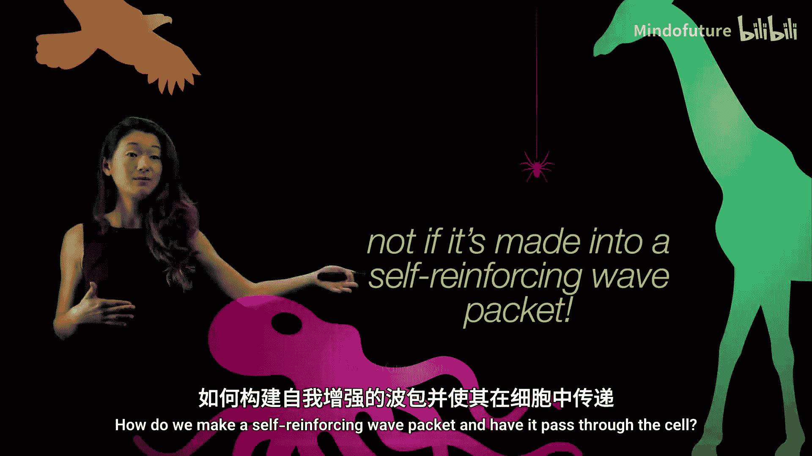

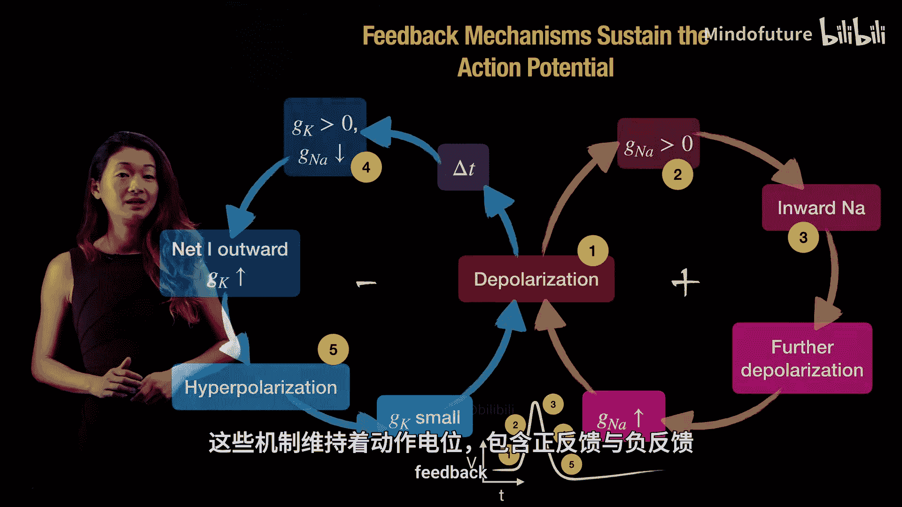

hoot a little bit and then over a slightly longer time frame goes back to resting now here you'll notice that i've drawn everything in terms of the resting potential being negative relative to zero right so the membrane voltage is always zero。

We have down here the N potential potassium and the nerve potential for sodium because they're opposites。

 as we talked about in the lecture on the resting potential because they have they have opposite resting equilibrium concentrations and they're both positively charged ions they essentially have opposite nerve potentials and these are the electrical forces where all things being equal if you lead it potassium is going to want to make the cell membrane more negative and sodiums going want to make the cell membrane more positive because there's so much of on the outside and so much of this one on the inside so we're starting from rest because at rest the cell is more permeable to potassium only slightly permeable to sodium and so the resting potential of a cell tends to be pretty negative and close to the。

😊，To the nerve potential of potassium。 So that's where we start。

 okay we start at something that's kind of negative and close to this nerve potential of potassium。

 The first thing that happens in this action sequence is that we need to introduce a whole new type of ion channel Now everything we've talked about so far has been passive ion channels I've used the analogy of a door a door that's just it's open all the time it's a resting channel which just kind of stays open and you know if you're the right type of ion you can go in and out as you want to and what we're looking at here is something that is similar in that it is an ion channel and it has specificity for ions just like the resting ion channels do if you have to be the right type of ion if you are sodium。

 not a potassium， you can't go through the potassium ion and so forth and it even has a similar structure in which it has these four components。

😊。

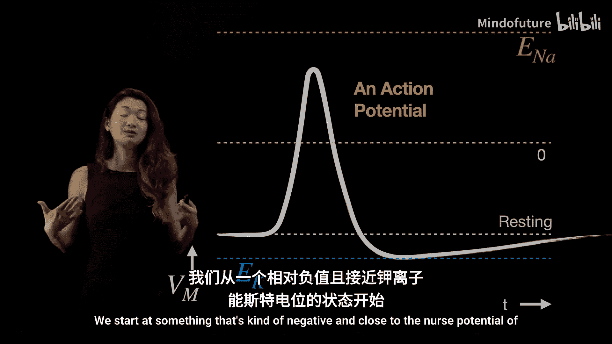

Forming a helical pore and the ion is supposed to go through the middle of the pore okay so that's all the same so far as the other other ion channels we talked about and its selected mechanism is also approximately similar by looking at the size of the pore these ion channels are able to be selective for one type of ion instead of another one because they just don't fit because they're too big or if they're too small then they're not well stabilized by the side chains that are lining the side of the helical pore again so far so good these are same ion channels the magic here is that these。

😊，Ion channels have an additional part， they have a special trick up their sleeve。

 which is what they have an activation gate， they are not open all the time and they're only open when the cell is already depolarized。

That's a terminology here， that's why it's called voltage gated these ion channels are open。

When the voltage of the cell is already depolarized。

This is instantiated by what's called the activation gate。

 which is at the location in the protein as's pointed to there， it is essentially a voltage sensor。

 it's closed and when a depolarization comes along。

 either because I've injected current as an experimenter or my neighboring patch of cell is depolarized or there's a shining of light and there's sensitivity of some kind。

 a variety of reasons， for whatever reason if a cell is already depolarized， this S4 domain here。

 as the voltage sensor knows that that's happened and it swings the pore open。

 the ion channel opens in response to voltage depolarization。

It has the same parts as some of the others ion pores that we talked about。

 there's a selectivity filter， which makes it so that only the correct ion goes through this particular pore。

And it has one more trick up of sleeve this one's a little bit fancier than the other on their own channels in addition to being voltage gate is when only opens when there's depolarization。

 it also has what's called an inactivation gate which is essentially on a timer when the pore has been open for a little while the inactivation gate moves in and blocks the channel so even if the cell is still depolarized this ion channel will close so it's got two fancy features in addition to the ion voltage we talked about before。

 it has an voltage gate at sensor， so it has an activation gate and it has an inactivation gate。

 so when there's a depolarizing event in the neighborhood this ion channel will open。

Let the ions through。 And then after a little while， it will close。 That's what it's going to do。

Okay， so armed with this knowledge， what we're going to do is think about once again。

 the action potential by going through the different steps and thinking about what's actually happening at each and every different phase of this action potential because what that voltage gated。

😊。

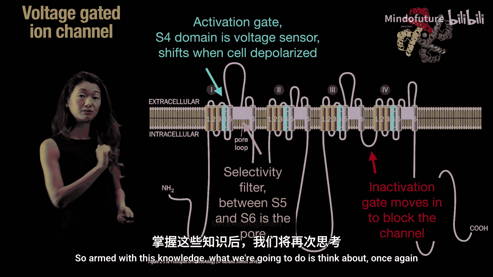

IO channel does for us is allow us to think about what's happening in terms of the membrane voltage when G。

 the conductance is not constant， it's actually changing and it's changing as a function of the membrane voltage。

In the first step， what's happening is that we're at rest。Okay？

And there is a huge difference between the membrane voltage。And the nurse potential， I mean。

 we're talking about like you know， 60 plus 80 millivolts here， really big， right， however。

 because there's no sodium channels open， there is nothing happening sodium channels are relatively closed。

 most of them are closed at rest and so even though there's this huge voltage difference between the membrane potential and the nurse potential of sodium。

 nothing is happening because we're at rest。Next， what's going to happen is a little bit of depolarization is going to come along。

Okay， for now， let's just pretend that the neighboring patch of the cell is depolarized and that those ions are spreading over a little bit。

 and so I'm over here feeling a little depolarization。

That's what's going to cause a positive feedback loop because that depolarization is going to cause some sodium channels to open。

 the voltage gated sodium channels or start to open as they open because of this huge difference between where I am and where the sodium wants to be。

 Sodium is going to come rushing inside the cell。 And as sodium comes rushing inside the cell。

 the cell is going become further depolarized， which opens more voltage gated sodium channels。

 And so everyone gets really excited， more and more channels open and sodium's coming in faster and faster and faster。

 and the cell gets more and more depolarized。 And that's this rising phase of the action potential。

 But all things must come to an end。😊，This can't last forever。

 this party can't last forever because what's going to happen is we're going to get to near the top of the actual potential。

And here， what's going to happen is that as the voltage of the membrane。

 the membrane voltage takess closer and closer to the nurse potential of sodium。

 the driving force is going to decrease， and so even though those voltagege sodium channels are still open。

 there are no longer as many sodium ions rushing inside the cell because we're getting close to that happy equilibrium sodium nerve potential。

Okay， so that。Current due to sodium is going to get smaller。

 even though all the voltage gated sodium channels are still open。

What's going to happen next is that the opposite thing is going to happen。

Because we talked about voltage gated sodium channels， what I didn't tell you。

 what I didn't tell you is that there's also voltage gated potassium channels， I know it's crazy。

 right？The voltage gated potassium channels have a special property。

 which is that instead of the voltage gated sodium channels being really。

 really excited and they open quickly， the voltage gated potassium channels have a delay。

 They will open， but only after a little while。 So coinciding with the time where the sodium currents are slowing down。

 the potassium gates。 the voltage gated potassium channels are going to start to open。

 and that's going to cause what's called the。😊，Falling phase of the action potential in this phase。

 what's going to happen is that the sodium channels。

 the multi sodium channels are going to start becoming inactivated。

 remember that inactivation gate I told you about they're going to start closing because they've been open for a while and they just don't want to party anymore。

At the same time， the voltage gated potassium channels are opening because the cell is still depolarized。

 so the same mechanism applies we have these potassium channels are voltaged， they're opening。

The membrane voltage is up here， which means that there's a huge difference between where we are and where potassium actually wants to be。

 and so theres now a large outward current of potassium potassium now rushes out of the cell。

 which causes the cell to hyperpolarize。And theres still a small inward sodium current。

 but that's getting smaller and smaller as all of the voltage gauged sodium channels are closing。

So that causes the falling phase and everything goes back down okay。

 just like before as we get closer to the nerve potential potassium。

 the eluux of potassium is going to slow down as well because it's getting closer to where it wants to be equilibrium anyway。

 but it's going to overshoot resting。In what's called the after hyperpolarization phase of the action potential in this phase。

 all of the voltage gated channels have closed so the voltage gated sodium channels are closed the voltageated potassium channels are closed but we've overshot resting for a little bit and so now all that's really active are the leaky potassium channels that are kind of just on all the time there's no more sodium current and there's only a tiny bit of outward potassium current and over a longer period of time that's going to bring us back to the resting potential and it's called the a after hyperpolarization because this is the depolarization followed by the polarlarization and this phase is what's happening after the hyper hyperpolarization。

That's the action potential that's a lot of action in a really short period of time。

 so in a typical neuron the width of this part of the action potential。

 the big action packed part where it goes up and down is approximately a millisecond so it goes by really quickly and we can summarize all of this information by the following two feedback loops where we have a positive feedback loop that's largely mediated by the voltage gated sodium channels and then with some time delay the negative feedback loop that brings us back down that's mediated by the voltage gated potassium channels followed by the leak potassium channels and that gets us back to the beginning so if you understand these two feedback loops and the different actors that are involved in the action potential this is fairly generic and it explains every single phase that we love in the action potential。

😊。

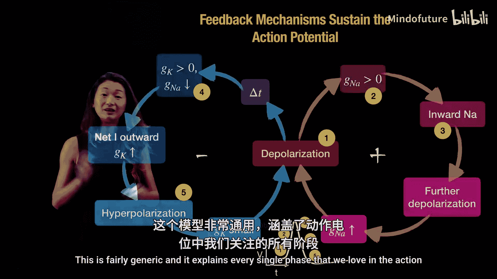

So I'm going to review again， what's happening ares a few key concepts to understanding the Ash potentialent because there's like I said there's a lot of action going on and it's going on very very quickly。

 but to be clear there's a few things I wanted to emphasize the first is that the action potential is caused by transient changes in conductance these are the G subks and G suboddiums。

 so it's G sub potassium G suboddiums。😊，That are changes in conductance。

 but they're not the resting conductance， these are voltage gated conductances， they change in time。

 they change in time really quickly and they're mediated by ion channels that are not the same ones as the leaky ones we' were talking about before these are special property ion channels that are voltage gated and in a case of sodium also inactivate after a certain time so there's a variety of different channels we' talking about different channels and the ones we talked about in the previous section when we're talking about the resting potential so that's what we have to do to get an action potential you couldn't have had this happen if all you had were the resting channels we talked about in a previous couple of lecture segments。

😊，The second point is that even though there's a lot of action and it's happening really quickly in the grand scheme of things。

 very few ions are actually crossing the membrane， we're talking about tiny。

 tiny local changes right at the membrane where there's huge amount of sodium ions flooding in。

 but it doesn't actually change the ion concentration of either the inside with the outside of the cell。

That's a consequence。 So as a corollary of this， because the ion concentrations do not actually change during the action potential。

 therefore， the equilibrium nerve potentials of sodium and potassium also do not change during action potential This is super important right because all along we had plotted the nurse potential to potassium and negative 80 and the nurse potential of sodium at something really crazy high positive。

 forgot exactly what it is because they don't actually change during the a potential。

 the driving forces of the two ions in and out of the cell are the same If you think about the flow of ion as being a small transient change。

 it kind of makes sense because relative to the entire volume of the extracellular space and the entire volume of this gigantic cell that could be either really big or really long。

 It makes sense that a small transient change in the local concentration of。

A couple of ions do not change during the action potential。And then last。

 these ion concentrations are going to be still actively maintained by the same sodium potassium ATPAs pumps that we talked about previously in the other lecture。

 and so these are going to be on all the time and when there's a huge influx and eluux of sodium and potassium。

 they're going to be immediately and actively restored back to equilibrium。

 very actively by the same sodium potassium ATPAs pumps that take energy they burn energy in the form of hydrolyzing ATP to pump the sodium back out of the cell and pump the potassium back into the cell。

 so these are really key concepts to remember to understand the actual potential。

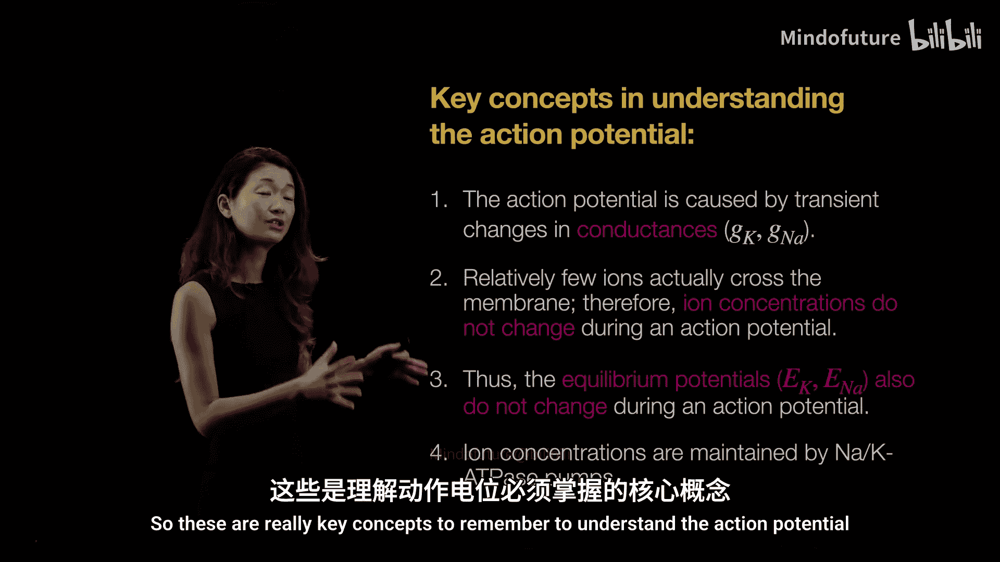

But you will notice that everywhere we talked about we told you what happened。

 I just described the action potential this is what it is right once again it's interesting to think about what we didn't always know this right we as a scientific community didn't always know these were the steps that under that underlie the action potential how do we come to this knowledge what crazy experiments that people have to do what crazy insights did they have back then to come this to come to this understanding well like a lot of other things the full understanding as I just explained to you we came upon kind of slowly but the first description of action potential was work pioneering worked by Hodgekin Huxley this is back in the 40s and 50s。

 1940s and 1950s where they did a bunch of experiments in the marine biological laboratory on the squid giant axon Now I'm just take a moment to talk about the squid giant axon because this is a fascinating story of how they were able to do this both in terms of the scientific content。

Experiments they had to do as well as the theoretical insights he came up with in this collaboration So Hachikin and Huxley were working with a squid giant axon for a particular reason Now for embarrassingly for many years when I first learned about this I think this is a common mistake I didn't know that it was a squid giant axon I thought it was a giant squid axon like an axon in the giant squid but no in fact they worked with regular size。

 quite reasonably sized squids， the squids or regular size it was the axon that was gigantic in the squid Now remember we talked earlier about the conductance length constants。

😊，Of of the active properties of neurons and how the extent to which the de de polarlarization spreads is proportion to the diameter of the axon so larger diameter means it spreads farther while this is why the squid has a giant axon it has this one gigantic axon because it's super du or important for it to be able to escape quickly from predators is it's the escape response you'll see how gigantic this axon is especially relative to all of the other axon that are next to it in this particular nerve here so this is a crosssection of the giant axon you can see how gigantic it is and every other little circle around it is all of the other nerves whose cross-section should not nearly as big this is in fact a pretty common feature of nervous systems where the nerves that tend to be really fast and need to be fast for a good reason for the survival of the animal would also tend to be a little bit bigger so Hochkin Huxley。

 especially needed experimental。Access to these squid giant axons because back then they needed to be able to measure the difference between the intracellular and extracellular size of the cell。

 I sort of glossed over that earlier because result all pretend that you can do that pretend you can stick in an electrode in and s electrode out and definitely just measure the electrode potential This is easy right Well it't easy and it was never easy and back then it was actually impossible。

 they didn't know how to do that back then the only way they could do it is by sticking a actual wire and they had to get the entire wire inside the inside of the cell。

 which is why they needed access to the giant axon。

 it was the only axon that was large enough for them to reliably experimentally get one side of the electrode inside the giant axon leaving the outside in the salt water and measure the potential difference between the inside of the outside of the cell And for that reason they went out in the boat and caught their squids every day and came back and stuck electrodes in them and measured these beautiful action potentials like the one you see over there it looks quite a bit like that diagram we had。

😊。

er it has that lovely characteristic shape where it lasted approximately a millisecond and went depolarizing。

 hyperpolarizing overshot a little bit and came back to rest after a certain period of time and so if they only did this experiment。

 it would already be really impressive experimentally speaking。

 but Hokin Huxley had an additional insight that made their discovery particularly satisfying from a theoretical understanding perspective because not only did they measure the action potential。

 they also developed a satisfying mathematical model but how you might actually get an actual potential of that particular shape。

In a series of papers， they described both the experiment how they measured the ash potential as well as the following set of equations that eventually became known as the Hotchkin Huuxley equations。

 we've spent a little bit of time talking about these Hotchkin Husley equations and what kinds of insights they had here so you'll see the first Hotchkin Huxley equation is slightly should be slightly familiar to you because you've seen it before when we were talking about the active properties of neurons so you'll see that here's I this is a capacitor DVDT we've seen that before right and then each of these terms here has a conductance in it along with the V terms so this one is for potassium。

😊，All， this is the potassium one， we're talking about the voltage difference to the neuro potential potassium。

By G here， and then there's this end to the fourth term this polynomial term we'll come back to that later。

 so this is the one for potassium， here's one for sodium。

 of which again where we have a V times conductance term。This here， M and H are two。Filler variables。

 We'll get back to that in a little bit。 But once again。

 we have a fourth word of polynomial because it's M to the third times H。

 And here they also have a leakage term， which does not have a polynomial attached。 Okay。

 so let's just focus on these terms for a little bit because we've been talking a lot about sodium and potassium recently。

 So this part of the equation along with the fact that there's DVDDT and the capacitance of the membrane。

 This should look pretty familiar to you already from looking at the previous couple of lectures about the active and passive properties of neurons。

What they were able to do was write down these equations and they did not derive them from physical principles。

 they kind of did it brutefor numerically。And this is really interesting because the way they ended up doing the numerical integration is by using one of these hand cranked computational machines like you see down here。

😊，Because this history of it， the timing of these experiments。

 the Hochkin and Huuckley started these experiments at the marine Biological Laboratory。

Before War II broke out and before they were able to finish the experiments。

 the war happened and so they were both drafted into the war effort and because of their scientific background and facility with numbers。

 both of them ended up working in different capacities。

 working with numerical integration machines of that kind to compute parabolic trajectories of rockets。

 so that they were able to figure out at what angle they had to be aimed to land where they were supposed to aim。

 so they are really good at using numerical integration machines at that kind to integrate ordinary differential equations of the physical kind。

 not of the kind for describing neurons， but after the war， both of them survived。

 came back to their scientific studies and their collaboration and they used they used the skills that they had learned integrating rocketish trajectories to integrate these equations。

 and they did it brute force by cranking on this machine with gloves on because。

It was the winter and it was cold by the ocean Now for comparison。

 if I were to implement the numerical integration of this set of four ordinary dimensional equations now on my laptop it would take a trivial fraction of a second to do what they did over laborious work over days to produce the following result where they're comparing a real actual potential versus an actual potential as modeled by their equations and you can see that they are remarkably similar this is a really fascinating story how they came upon this particular set of equations like I said the first equation looks familiar because these are terms that we've seen from derivations of the passive and active properties of neurons。

 these three are you know have a less straightforward physical have a physical interpretation but there is a really interesting thing here that's been pointed out to me so I'm just gonna to share with you because I think it's interesting it's a connection between these differential equations and protein chemistry。

😊，Because what Kchka and Huxley most certainly did not know back then is what we know now。

That these ion channels。Come in helices of four。Okay， but as you can see。😊，They fit the data。

 and in order to fit the data， there are polynomial fourth word polynomial terms for both the sodium and the potassium currents。

This makes sense in the context of the confirmation of the protein because these four proteins have a cooperative opening mechanism and so when there's four of them。

 when there's a complex of four， there's often in protein biochemistry。

 a polynomial of order four proportional to the number of different subunits that contribute to that protein because they all four have to open for the voltage- gated sodium and voltage gated potassium channels to open so I thought that there was really cool that they came upon this by fitting the data because they had to。

 they had to do that， you know they probably tried to the power of three and power of five and it didn't work as well they were like oh power of four looks so good and to some extent predicted the fact that these voltage- gated channels ended up being polymers that had four helices as part of the ion pour that was pretty cool I thought。

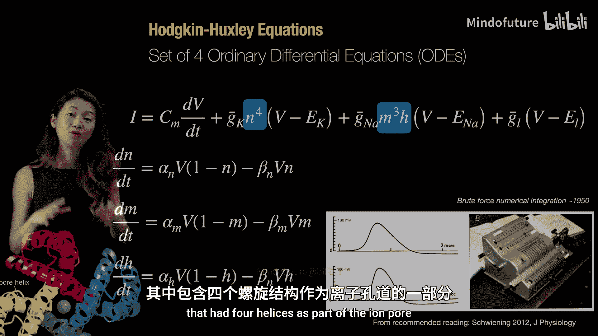

Okay， so now comes the part of the lecture where we talk about voltage gated sodium channels and when things go wrong because things always go wrong right anytime something is really important in biology。

It also goes wrong and so we can tell stories about what happens when voltage datad sodium channels go wrong。

 voltage gd sodium channels are so crucial to your bodily function。

 they underlie everything having to do with nerve activation and muscle activation and so when things go wrong。

 they can go really catastrophically wrong okay so here's a couple of examples of pathologies and things going wrong with voltage gated sodium channels。

😊。

The first totrotooxin so this toxin is made by the puffer fish。

 it is made in a couple of different organs of the puffer fish。

 specifically the intestines ovaries liver of the blowfish and totroto tooxin has to follow molecular structure and it is 1。

200 1200 times deadlier than cyanide it's so deadly that a single fish has enough poison to kill 30 people and the reason it's so potent is because it is a blocker of voltage gad sodium channels。

 can you imagine what would happen to all the different parts of your body if all of your voltaged sodium channels stopped working。

 well the answer is you die very very quickly。And so that's why it's really important when you're eating a plate to Fugu that is prepared correctly。

 so you're not ingesting anytetrotra toxin。So that's lovely。

 but beyond being something is something that that is an that is an interesting poison and interesting toxin tooxxin is also a very powerful experimental tool in neuroscience because it allows us to separate the relative contributions of sodium currents and potassium currents we're thinking about the action potential so this is really important in the context of neuroscience because oftentimes especially when there's so much feedback in these systems when we talked about the positive and feedback loops that underlie the action potential everything is everyone influences everyone else right and so when you're thinking about what's happening as a scientist you want to be able to manipulate one aspect of the feedback loop without necessarily thinking about the other aspect of the feedback loop because they're confounding variables so tools like tooxin are really useful in experimental neuroscience because we can pipepe it onto your experimental。

😊，And temporarily shut down all the voltage gated sodium channels so that we can then separately measure what's happening with the voltage- gated potassium channels there's a variety of tools like this。

 so there's a whole catalog of poisons and toxins and assassin's friends where we can pipe them onto our experimental apparatus and figure out what's happening with various different kinds of ion channels hopefully in a way that we can associate them from each other。

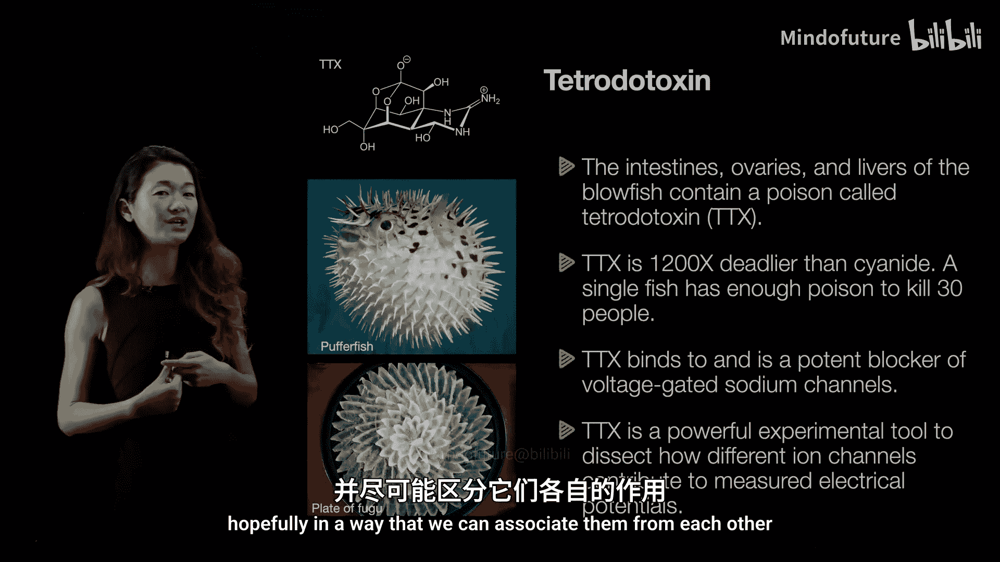

In another impressive news， there is an autoomal dominant disease in horses called hypercolimic periodic paralysis。

 this unlike a poison is a misens mutation in a voltage sense of potassium channel that is specifically expressed in the skeletal muscles of horses。

 this is the SCN4A mutation okay so the SCN4 a protein in this particular disease in this paralysis disease causes horses who experience periodic muscle trimmers followed by paralysis because they're voltageto sodium channels don't work so that's not very good because without  voltage sodium channels。

 you can't really control your muscles that well because your because because your muscles aren't able to respond correctly when they're being commanded by motor neurons to move now。

The observation is that every single horse that's ever been diagnosed with his disease has been descended from a horse named impressive。

 who was very impressive indeed because he sird over 2000 foulwls。

 he was a 1974 well champion and which is very， very successful and that's why he was bred so much and gave rise to all of these descendants so what probably happened is that that there was a spontaneous mutation in the SCN4A gene in impressive and it was a spontaneous mutation because it didn't affect him but it affected all of his descendants and also it explains why we have not seen other racehors with the same disease。

 all of the ones we've ever seen had been ascended from this one particular horse。

On the topic of the SCN4A gene there's another lovely story where there's an evolutionary arms race between nus and snakes。

 so pufffish are not the only ones that express the todooxxin nus also express to todo toxin so these nus as a defense mechanismism just like topperfish produce very large quantities of to todooxxin because they don't want to be eaten and they don't want to be eaten by snakes they secreted onto their skin and so they're actually safe to handle as long as you don't eat them right you actually touch them they're totally fine just don't lick your finger afterwards and definitely don't lick the nut。

But snakes want to eat the newt， and so in order to defend themselves against Trodooxin。

 which remember earlier is a potent antagonist and blocks voltage ga sodium channels， okay？

The snakes in response have evolved a resistance to Tratodooxxin specifically by a mutation in the SCN4A gene。

 so they have a version of a voltagetic shaded sodium channel that does not bind totrodooxin so they can eat as much newt as they want to you can kind of imagine what happen over evolutionary time here as news produce more motrodooxin snakes became more and more resistant to it and made further and further mutations to the SCN4A gene and so this is another story where necessarily it's not a delicious story but I think it's kind of a lovely story too where by looking at the molecular mechanisms of these toxins and there are methods of activation you can then trace them down to the proteins that are affected and the mutations since there's proteins that produce either undesirable in the case of those horses or actually kind of desirable effects in the case of these snakes because they get to snack on nots where the rest of us cannot。

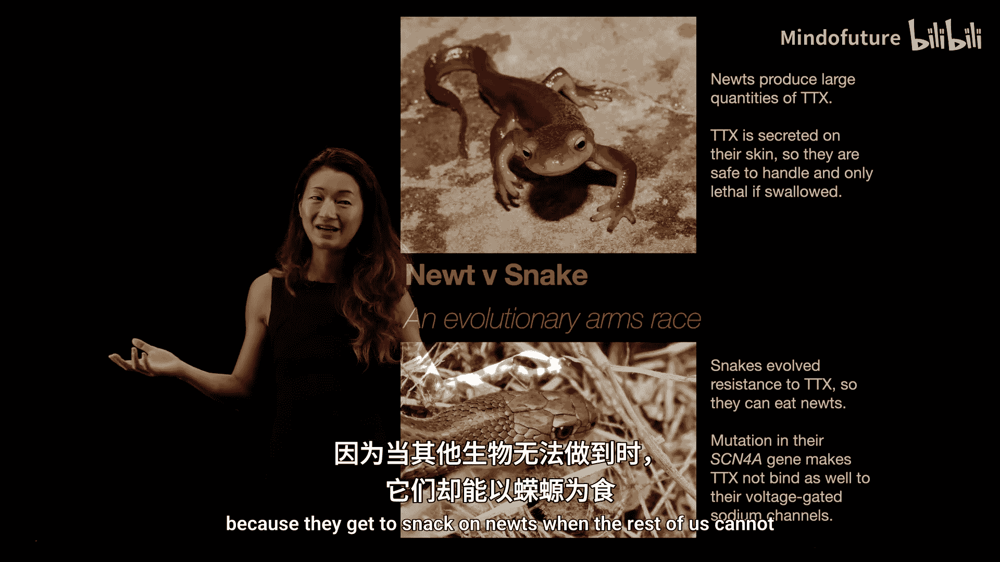

Okay， so we talked a lot about the action potential and so far we've only really talked about the action potential in time Okay so you know what's coming youve see my other lecture so you know what I'm about to say next。

😊。

The actual potential propagates in space， and it propagates in space like a wave propagates in the ocean。

 so it's a wave of depolarization that goes along the cell in the cylindrical approximation。

largely unchanged in shape so unlike the case before。

 where we were looking at propagations that decayed exponentially and the action potential。

 because it is actively maintained by the positive and negative feedback loops mechanisms we talked about in explaining the shape of the actual potential。

 the action potential is regenerated by that mechanism。So it maintains the same shape。

 no matter how far it goes， as long as you have the correct voltage gated。Sodium potassium channels。

Along the way。 So let's walk through how that would happen。 Okay， so here's my cylindrical axon。

At rest it's relatively negative， so there's negative on the inside positive on the outside and we're going to suppose that the action potential is going over there okay so it's traveling in that direction So what's going to happen is that the peak of the action potential is going to be right here where there's an influx of sodium super big。

 right？😊，Because the action potential was traveling to the right。

 the piece of membrane that follows it has already reached the hyperpolarization phase of the action potential。

 so it's actually already recovering where there's an e fluxux of potassium here。At the same time。

 these sodium neurons， sodium ions as they enter the cell are going to diffuse into this fresh piece of membrane here that's never seen the actual potential yet。

 at least not for the past couple of milliseconds， at least。

And it's going to cause the voltage gated sodium channels to open right here。

In this patch of membrane B， and it's going to start the positive feedback loop portion what we were talking about。

 So this diagram actually closely mirrors the positive and negative feedback loop diagram we had earlier right where there's positive feedback loop coming on over here in this patch of membrane。

And in time， there's a delay right， also in space because of spatial propagation。

 so this patch remembering is already in the negative feedback portion of the feedback loop。

 So the positive feedback over here， negative feedback over here。😊，And remember。

 this patch also has the sodium channels， so voltage gate sodium channels inactivated。

 so it can't initiate another action potential。So the action has to go that way because these are fresh voltage gated sodium channels that haven't opened yet。

 they can still open。 if you depolarize them， the ones over here are tired。 they just open。

 They're going to take a nap。 Okay， so that's why everything's going to go that way。

 And every single time it moves a little bit farther along。

The shape of the action potential is regenerated by voltageated sodium channels and then reinforced by voltaged potassium channels。

 and that's why just like a wave in the ocean。Before it hits as shorere， that's different。

 just like a wave in the ocean， this wave actually potential is going to propagate without degradation over very long distances because it keeps getting regenerated。

😊。

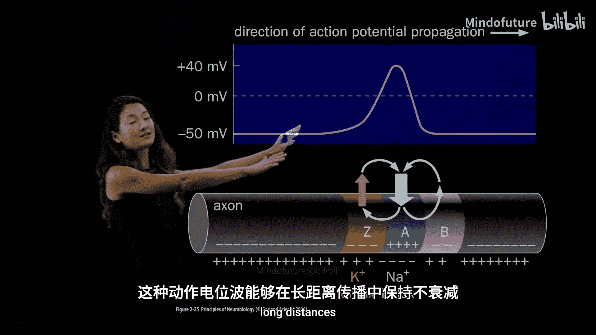

But we still have a limiting factor。Because the way in which one piece of membrane excites the next piece of membrane。

 remember that was A to B in the previous slide。It's still limited by the rate at which sodium ions as they go into the cell。

Diffuss and then goes to the next piece of cell。That's still a limitation。Right。

 that because the one piece of depolarization at one position in the cell has to sufficiently depolarize the neighboring cell until it's able to regenerate and activate its own voltage gated sodium channels。

 that's still a limitation in speed。Remember， by the cable equation from the active properties of the neurons lecture。

 that portion of the regeneration process of the action potential is still limited by the extra decay length constant Lada。

😊，And that lambda is still proportional to a， which is a diameter of the neuron of the axon so we talked about the giants squid I keep saying it。

 the squid giant axon， which solves this problem by having a really large A so that the action potential can actually go really fast。

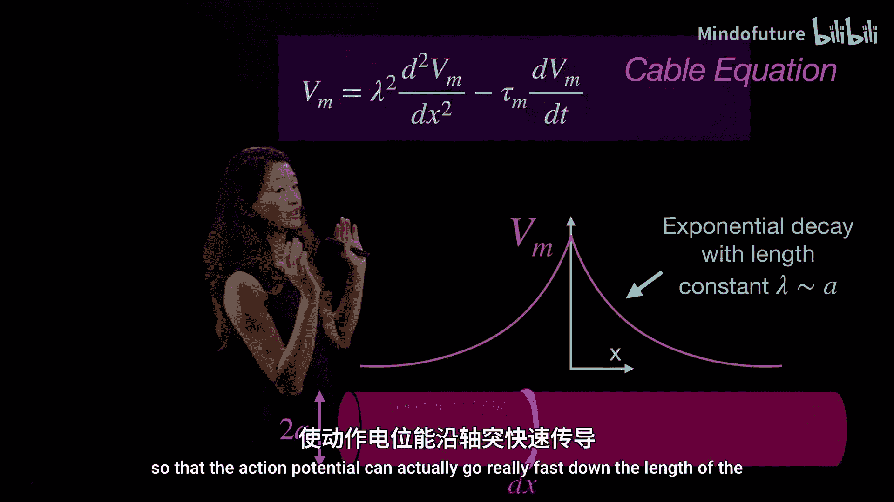

Down the length of the axon。There is a need for speed and the solution is Cor De， not really。

 but this picture will make sense to you in a second because the other solution besides having a gigantic axon is to wrap your axon in what's called myelin okay I'm going explain what that is and we're going to work through the mathematics using the derivation we had earlier why it is the myelin makes a difference in in action potential speed conduction。

😊，So this is a solution that a lot of mammalian systems have come to in the same way that the squid has come to the solution of just having one gigantic axon。

 the way this works in a lot of mammalian cells is that you have your axon in the middle。

 this is again a crosssection of the axon for scale I mean giant axon was much much bigger。

 this is going to be a reasonably sized axon but it's not going to be alone so my neuron is a regular neuron。

 it's going to have a regular reasonably sized axon but it's not going to be by itself。

 what's going to happen is it's going to be wrapped。😊。

With glial cells。And it's going to wrap it a lot。 So glial cells here is a kind of a generic catch all term for all the cells associated with your brain and nervous system that are not actually neurons。

 of which there are many。 and there's different types of glia。 So glia is kind of a catch all term。

 It's like everything else in your brain that does something important。

 but isn't actually a neuron is called glia。 Okay so this particular type of glia has a very special purpose。

 And its only purpose is to wrap around and insulate the axon。😊。

It does so by wrapping itself around the axon and then wrapping yourself again and then wrapping it again just the same way that you might make pastry dough or phlo dough by making yourself really flat folding it。

 you roll it again you fold it again and you roll it and kick so yous saying exact same thing is what happened here with the growing of the myelin and so zooming in what you'll see there is that effectively instead of the cell membrane being whatever thickness a regular cell membrane is is effectively that thick times the number of times a glio cell has wrapped itself around the axon。

Going back to our derivations of the cable equation， what we can see is that without myelation。

 the speed of my propagation is determined by this ratio， just like before。

 the ratio between the membrane resistance divided by the internal resistance of the inside of the cell so so far so good without myelination and the mammalian neuron usually the speed of conduction is something on the order of one meter per second that's kind of a typical know speed conduction。

 how quickly you can go from one side from one how quickly an actual potential will be able to go from one end of the cell to another so。

😊，For reference here， let's think about what this actually means in the context of an animal right like humans are approximately a meter tall。

 so most of us are between one and2 meters tall like I'm 1。

7 something meters tall so let's just go in one meter all right so if the speed of conduction without myelination it's approximately 1 meter per second that means if something hits by toe。

It's going to take my brain about a second to realize it。It's really slow， it's not good enough。

 I really want to know something hit my toe a lot faster than a second later after it happened because I'm a meter tall。

 okay so this is not good I need to go faster。With myelination。

 with this kind of phlodo wrapping of the axons， what we end up with is an effective increase in the resistance of the membrane。

 so it is now the regular resistance of the membrane times n。

 and being the number of times the glial membrane has wrapped around the myelinche。

 this is called the myelincheath。At the same time， it also decreases the capacitance of the membrane。

 and so the capacitance goes down by a factor of n。Effectively。

 everything cancels out with the time constant， so the time constants of response is actually still exactly the same。

The cell can respond to changes just as quickly as it could before， before we had myelination。

The length constant of the propagation is significantly larger。

 which means the same message can actually go farther in the cell without having to be regenerated。

Let's think about what this means okay it comes with about a one or even two times order magnitude speed up in speed。

 so now we're going to like 100 meters per second rather than 1 meter per second this is looking more like it rather I can definitely feel something if something hit my toe or I like kick something when I was hiking or something I can most certainly know about it before1 meter per second it's more like 100 meters per second。

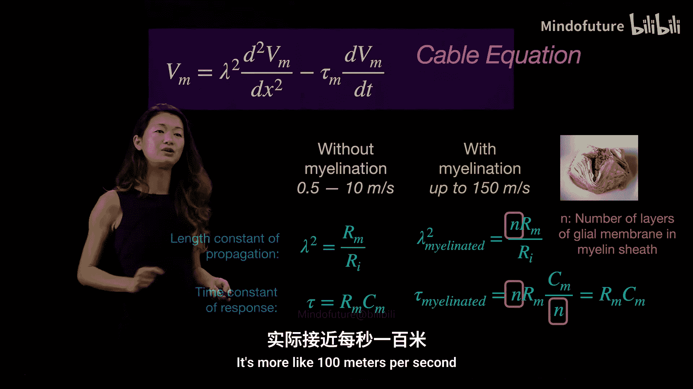

Let's take a look at what's happening here okay， we have the axon of the neuron， which is my pipe。

 my wire through which I want to pass information right about something that just happened like I just kicked something。

 I should probably do something about that。And this axon， instead of being propagating by itself。

 is actually going to be wrapped in a series of glial cells that form these segments of myelin sheaths。

 Okay there's these little segments of it。 It's a little' like a little hot dog with a bun It's like a really long hot dog with a series of buns are wrapped around it。

 Now the places in between the myelin sheath wrapping are what's called nodes of Ron V。😊。

And that's where all of the voltage ga sodium and potassium channels live。

 they're all concentrated right there。There are very few of them in the middle where the myelin sheath has wrapped the axon。

So when you have。What ends up happening is that the。

Conduction of the actual potential actually is able to skip。The wrapped portions。

The active properties we talked about over the action potential。

 where there's voltage gated channels and actual potential regeneration。

 all of that happens to the nose aroundvi in between the myelin。

 so we would go from here and then jump directly to over here。

 gets regenerated and then jumps the next one and gets regenerated again。

In between where there's no voltage gated channels。

 we have passive properties of the cell so the cable equation supply here with the stipulation that it's the version that we had we you just arrived in a couple of slides ago where everything is proportional to n and being the number of times the myelin has just wrapped around my axon so my action potential I'm going to say this in a slightly different way if there were no myelin my action potential generated here would be able to be passed down and it would need to be regenerated right here right so I havem to do it again and it could pass along this far I'm going to do it again with myelin because the effect length constant of that potential。

Diffusing inside the neuron is lengthened。Instead of having to regenerate them every this muchishh。

 we can regenerate it much longer in between。 thus。

 skipping whole sections of axon and then only regenerating the positive and negative feedback loop that we for the actual potential only at the nodes ofron V。

This is not without cost right we talked about a little bit about the cost of growing a gigantic axon by by a squid solution right so in order to have a really really fast cable there by having a giant axon。

 the cost of the animal is that you now have to spend all of the material of growing a large axon。

And then also maintaining that axom by feeding it， maintaining the ionic potential there and keeping the cell alive。

 so that's one solution that evolution is found in a variety of animals。This is another solution。

 and it is not without its costs The costs of the neuron itself might be smaller because not only are my neurons not running a really thick cable。

 I'm running the same thin cable。 I actually save a little bit because I only have to express a voltaged sodium and potassium channels at the nodes。

 So I I don't have I don't have to line the entire thing with voltaged sodium channels。

 I can only have them at the nodes and that's cool because that's actually savings the cost then is that I have to grow a fleet of these other glial cells whose entire purpose is to wrap themselves like phlo dough around my axon。

 I have to keep those cells alive now。 And this's actually quite a few of them we talked about over here that these in a mamalia cell once again。

 these nodes tend to be you know a few hundred microns to a few millimeters in length So let's just let's say one millimeter let's say that these the space between the nodes around here like one millmeter。

 And that means if I were。😊，ha to wrap a pain receptor that goes from the tip of my finger all the way up to my spine whatever the spinal portion that innervates my fingers this once again I'm going to round here it's like a meter okay it's less than a meter when I'm around to a meter and that means to wrap to myelinate that entire axon to get the pain information from the tip of my finger to my spine and if every myelin if every glial cell can wrap about a millimeter of axon and I have a meter that means I have to grow a thousand extra support cells just to support that one axon to get information quickly about pain from the tip of my finger to my nose。

So。traoffs right these are two different solutions they're totally valid not all cells in your not all axons in your nervous system are myelinated lots and lots of them are not myelination is used with caution because it is actually kind of costly in its own way and so what we tend to find is especially in peripheral systems it's only the really crucial signals that need to get somewhere really quickly that have dedicated myelinated axons with them and so some of them travel quickly。

 some of them travel more slowly there's actually a diversity of axon diameters as well as myelination in your body right now and in a ways that that people have rules and we'll talk about a little bit about that when we talk about sensory motor systems in a later portion of the course。

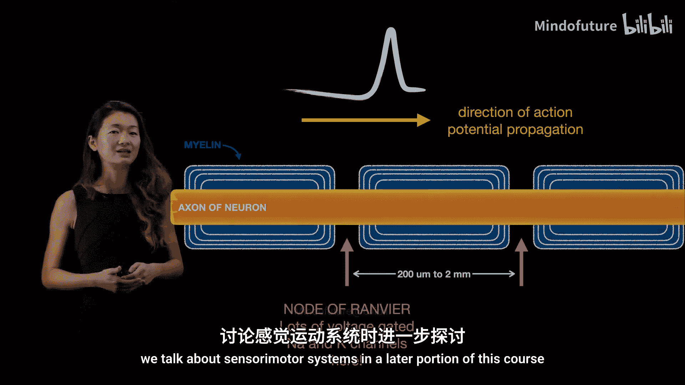

So。Of course， like always， when something is really important。

Things always go wrong right so here's a couple of examples when things go wrong with myelinated axons and so I'm going to highlight two clinical conditions where the pathologies are known to involve pathologies of myelination so the first one is multipleccosis which is an inflammatory disease and it is a demyelinating disease of the central nervous system and because it is a progressive demyination disease。

 the symptoms tend to be mysterious and progressive and so that's why MS has been notoriously difficult to diagnose as well as to treat because it's a demyination disease it doesn't target a particular system and it is not localized to a part of the nervous system it really can't show up in a variety of different systems at different times and so that makes it really like I said difficult to treat as well as to diagnose。

There's another disease known as a charcoal Marie tooth disease， a CMT disease。

 and this one is a deviation disease that targets the peripheral nervous system。

 and so this one is really interesting because not only is it devastating as a disease。

 but from a neuroscience perspective， it's interesting because it targets the peripheral nervous system。

And it's a demyination disease， so like I talked about earlier， right？

The part of the axon that innervs to tip light my finger is longer than the part that innervates the part of my arm that's much closer to my spine。

So if I have a disease that affects a myelination。It's going to affect the more distal parts more than it affects the proximal parts and so the deficits that patients experience in sensation and movement are in severity length dependent。

 so the more distal it is your toes are going to feel it more than your calf for example。

 and then they're going to feel it more than your thigh were if you are somebody who had CMT disease so that's sort of an interesting observation that also supports this observation that it is a myelination disease which has to do the speed of conduction from peripheral parts of your body back to the central nervous system。

So in summary， here's a couple of key concepts that I think are really crucial。

 I'm going to remind you， these are things that we learned about that I think are really important to remember we're understanding the action potential。

The first is to remember that the actual potential is a self reinforcing packet a voltage potential and it is critically enabled by a new class of ion channels that we're introducing in this lecture the voltage gated channels they ion channels just like the other ones except they have the special property in that they're not open all the time and they only open when there's already a depolarization in the neighborhood so this is the。

😊，Feedback loops， right， positive and negative feedback loops。

 voltaged sodium and potassium channels。The action potentials。

 not only are they self- reinforcing in time， they are selfreinforcing in space。

 which allows them to propagate just as a wave when to propagate along long distances。

 so a wave in the middle of the ocean will pass largely unchanged over hundreds of kilometers it's the same wave itll just keep going so the same mental image applies here for action potentials。

 it is the same shape and it will travel like a wave across long distances along the neuron。

Unlike an ocean wave， it has to be actively maintained and regenerated。

 so I don't want to take that analogy too far， it's more of like an mental image and less like an actual physical analogy because we do need active maintenance by those voltage gated sodium and potassium channels to regenerate the shape。

And that feedback is crucial so and the speed of actual potential。

 even though it is super cool and self-regenerating is still fundamentally limited by physics in the cable equation。

 so you can speed it up by one of two ways and we derived how you would see the effects of these two different solutions to the speed up problem。

 you can speed it up by having a larger cell diameter。😊，Or you can speed it up by violationination。

 both of which effectively increase the length constant of propagation of the active potential。

And then finally， the myelin effectively increases the effective resistance and decreases the effective capacitance of the cell membrane and because those two terms cancel out in the time constant。

 but they don't cancel it out in the La constant， that's why myelination works okay so that's the actual potential。

 hopefully you'll come back next time when we start talking about what happens with the actual potential gets the end of the line and the cell ends。

 what happens next， see the next video to find out。

