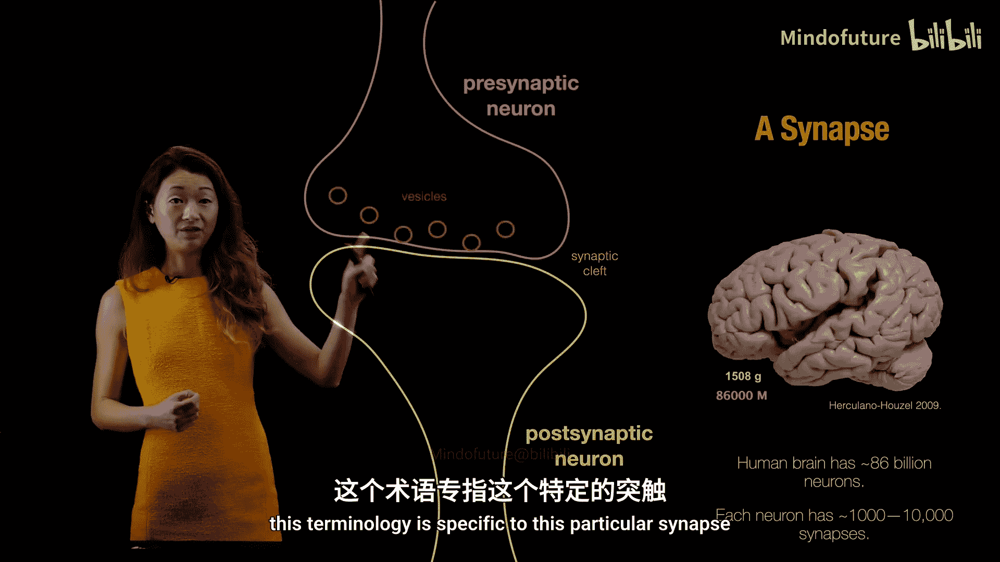
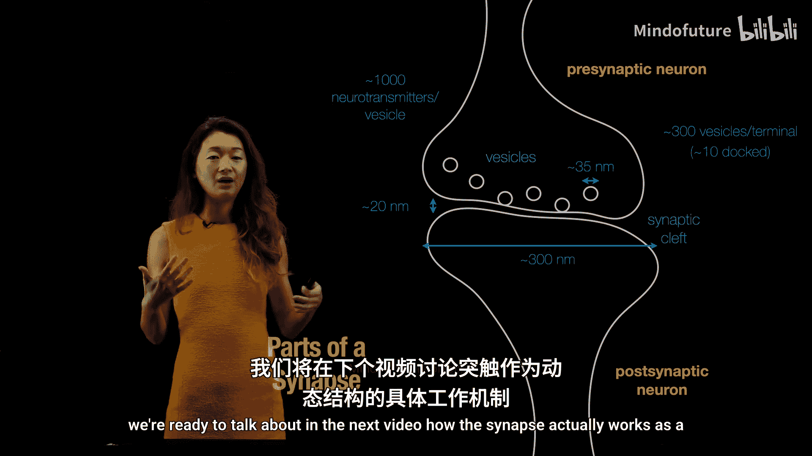

# 【华盛顿大学】神经科学入门 ｜ Introduction To Neuroscience ｜ Bing Wen Brunton p06 P06_神经元解剖-突触组成部分 -BV1i3qWBXEDH_p6-

Welcome back to this next section of introduction to neuroscience。

 where we're going to continue on our journey to understand how it is that the cells of your brain。

 the neurons in your brain are able to process and represent information that allows you to do all the things that you do with your normal lives including watch this video So in the last sections of videos what we did was derive a set of passive as well as active properties of neurons as electrical cells and at the end of it we made the approximation of the cell as a cylindrical body and that allowed us to have an actual potential this all or nothing cellreinforcing wave of electroactivity that is able to very fictionally transmit down the length of an axon this part of the cell here without loss of information Now this was really great。

 super cool right and we've already learned about different pathologies of the process of generating this actual potential that's been relevant in different types of diseases of human relevance as well as different targets of toxins。

This actually leaves us with even more questions。 So it's really cool that we have a cell that's not just a cylinder。

 but actually has more shape。 So we have an action potential。

 but where action potentials generated in the last section of the videos， we basically said。

 assume there starts an action potential， it can keep going， but how do we start one？😊。

At the same time， there's the question of what happens when the actual potential gets to the end of the cell。

 right， According to the neuronoc， cells are distinct cellular structures and they are not connected to each other in some kind of weird continuum。

 And so surely there must be an end of the a， the end of actual potential。

 So what happens at the end of the actual potential when when when the actual potential actually gets to the end of the line。

 Okay， there's a train station down there。 what happens， Everyone has to get off。

So the short answer is that the cell， this neuron is going to connect to another neuron in a set of structures that is known as a synapse and so we're going to be talking about synapses。

 but then that's the question are all synapses the same Are there different types of synapses we'll learn about that and we are going to be asking about how can a synapse change because after all。

 the synapse is a fundamental unit of communication between one cell and another cell and so being able to change the strength and dynamic to the synapse is one of the reasons that your brain is actually able to change and learn in time。

 so that you're not the same person that you were a year ago and have you have new experiences and new things that you've learned and you can grow throughout your lifetime。

 So if you are ready to come on this trip with me， here is the plan。

 Here's our itinerary for the next couple a couple videos So in this video we're first going to start with just the basics。

 but by looking at neurons and the anatomy of a neuron and a synapse so that we know the parts of neuron that。

We're talking about next we're going to be talking about neurotransmission at the synapse。

 what happens when the actionent gets down the end of the line and there's synapse that has to get to the next cell we're going to be talking about different types of synapses as well as different types of receptors that happened to receive this information on the next cell over so these are broadly called aotropic and metaottroic receptors so there's the large classes of receptors we'll be talking about so there's a video on exactly what those are and the different types that are relevant for your brain。

All of that leads us to a couple of tangential topics that are of interest to lots of people。

 this include topics like recreational drugs in the brain。

 it turns out that a lot of recreational drugs in the brain target parts of synnaca transmission and we're also going to be talking about drug addiction and learning。

So that's the plan。 We're going to go back and start with the cell。 All right， Here's a neuron。

 And what you'll notice here is that the neuron has a lot of different processes and different compartments。

 rather than being a single compartment that is well approximated by a sphere or even with sphere that has a couple of little little dendrites and little things coming off of it。

 it has a lot of different complicated structures。 So generically speaking。

 a mammale neuron that you might start looking at in an intro to neuroscience class like this one is has the following components。

 there is the cell body， which is this blobby lurth thing in the middle here。

 neurons tend to be relatively large cells because they're metabolically very active。

 the cell body tends to be pretty big。 they're kind of on the big side as e kotic cells go。

 And that is where the nucleus is going to live。 and that's where the nucleus is going to stay now generically what happens is that there is a set of processes coming off of one end of the cell body the cell body is also equivalently sometimes called the cellma。

 So when I say cell body or so much。

really mean exactly the same thing One side of the cell。

 one side of the cell body has a set of processes coming out。

 These are branches that we call dendrites and those tend to be the inputs of the cell will' talk a little bit more about exactly what that means in a in a couple of minutes and then the other side of the cell we have a different process coming out that is called the axon which are the outputs of the cell。

 This is where it's going to go and talk to other cells。

 Now these cellular compartments are not only anatomically distinct。

 they look different in most cases they are also physiologically distinct。

 They express specific proteins that supports their relative function。

 We talked about myelin sheath and myelination in a previous video and so myelin sheaths are one of the ways that you can wrap some axons。

 not every axons， some axons are wrapping myelin sheaths so that they are able to conduct action potentials even faster in cases where you might be having to communicate in the distal part of your body all the way down towards towards the middle。

So those are the basic parts of a cell。 But I wanted to show you a couple more real examples of what cells actually look like in your body。

 because that was kind of a cartoon， right， So cartoons are really great。 We like looking at them。

 But let's look at a couple of real cells for a little bit。

 So here is a praidal neuron of the cerebral cortex。

 These are the major excitatory cells in your cerebral cortex。

 And what they have as a cell body along with a bunch of a bunch of dendrites。

 What's pointed out here is that these dendrites can actually be quite large。

 The arborization can expand quite a bit far from the cell body。

 And so sometimes we talk about apocoenddrites versus basalenddrites。

 because these different dendrites because of their location and relative geometry to each other also has computational implications。

 That's something that we'll talk about in a following lecture。😊，And then there's also an axons。

 So you'll see that in this particular case， that's a variety of different processes that are the output of this particular pa neuron。

 There are some proximal axons where it might make synapses with close by cells。

 And sometimes you can have a very long axon that goes to lots on lots of far away places in distant lands on other parts of your brain。

So that's praidal neuron and here is a neuron that you might find in your spine so this is a spinal motor neuron of the kind that innervates the muscles in your limbs so the kind that might be innererving the muscles in my arm so that I can flex and move my arm in this particular way So you can see here that colored in the way that I colored it with dendrites are orange and axons are and axons are are blue it's really hard to it's really easy to tell them apart that there's dendrites in theyre axons but if you're looking at it just under the microscope where you have the cell stained。

 but you don't have this clear distinction and sometimes in these spinal motor neurons it's actually difficult to tell which of the processes coming off the cell are dendrites and which of them they're axons so that could be really complicated you can see in this example cell here there's actually lots of processes coming off of the cell body。

 most of them are dendrites and only one of them is an axon so that's one thing that we see sometimes。

Here's another type of neuron that we see。 This one happens to be a sensory neuron that also lives in your spine。

 It's in the dorsal root ganglion cell of the spine and so in here there's a funky set of geometry here where the cell body lives in your spine。

 one end of the axon goes towards your central nervous system goes towards your brain the other end of the axon goes towards the porphyry。

 and then it terminates in a set of neuro endingendings that takes in sensory information from distal parts of your body like the tips of your fingertips or maybe the tips of your toes and stuff like that。

 This is the neuron that is the example of the longest cell in your body so for comparison。

 what we're looking at here is there is one particular set of neurons which are sensory neurons and the dorsal root of the gangion and your spine that is responsible for innererving your tippy toes and so its cell body is going to live in the last vertebrae in the bottom of your spine。

 one end of this axon goes all the way to your toe。

And the other end of the axon goes to your brainstem。

 so this cell is practically as long as you are now from what we understand about vertebrate neuroanatomy。

 not only do humans have this cell， it's quite likely that even extinct vertebrates also have the same cell and so even though this cell has not been reserved because we can't really do live paleo neurourscience even though it desperately want to。

It's quite likely that the cell in one of these really large extinct dinosaurs here。

 we're looking at the Argeninaurus is the longest cell that has ever existed。

 We have no direct evidence that the cell did exist。

 but we have fossil evidence that these dinosaurs exist。 and they were， in fact， this large。

 And so if their neuroanatomy looks like every other neuroanatomy that we know in other vertebrates。

 presumably it had a cell of this kind either also。 So that's kind of cool。😊，Okay。

 so those are some vertebrate cells。 I wanted to show you at least one example of a neuron from an invertebrate in this particular case。

 this is an invertebrate neuron in the fruit fly ventral nerve cord which its computational equivalent of a spine instead of having a spine in the back of their body flies flies are examples of invertebrates that their nervous system is actually in the belly and their digestive tract is in the back and so this is the ventral nerve cord and this particular motor neuron。

 you'll see that it looks a little bit different than the motor neuron that we had in the mammalian spinal system。

 it has a cell body and it has only one process coming out of it。

There's some sub branchesches of that one branch， those are the dendrites and then the branch keeps going。

 that's the axon where it terminates in the muscle and commands the flies。

 legs or wings to move just like the way it does in us。

 So there's a lot of commonalities and also some subtle differences and what we're going to do now is think about the flow of information in the generic sense。

 We're going back to the cartoon version of the neuron。

 And what we're going to see here is that the flow of information generally speaking。

 there are exceptions generally speaking goes from the very ends of the dendrites。

To the cell body down the axon。 That's the flow of information。 And this is the flow of information。

 the majority of the time。 So let's talk about this case first。

 and then we can talk about exceptions later。 So the majority of time。

 what happens is that this cell is going to be receiving input information from the rest of the nervous system。

 So， for example， at one tip of the dendrite， you might be receiving a positive input from another cell causing some kind of depolarization。

 we're seeing here a small depolarization where the membrane voltage is going more positive。

 So depolarization from this particular branch of the dendrite。

 Maybe you have something that is what's called an inhibitory synapse where you're receiving a hyperpolarization and the membrane voltage at this location is actually going more negative and so on and so forth。

 you can have lots and lots of these neurons that are having that are having the effect of having suming inputs into the dendrite tree of the cell。

 now。As we learned about in a earlier video， the passive and active properties of the neuron tell us what happens when you have。

Either depolarizations or hyperpolarizations from the resting memory potential。

 What's going to happen is that the time course of the depolarization or the hyperpolarization is going to be exponential following ohm's law。

 a derivation of ohm's law， you solve that differential equation over there。

 you can review that video for details。 if that's something you would like to know more about。

 And because these depolarizations are then in the membrane in the cell they're local。

 they're going to be propagating down the branches of the dendrite。

 following the cable's equation when they're going to be propagating outwards And when they meet each other。

 they're going to add so two positives are going to be become more positive and a positive and negative might cancel each other out to some extent。

Now， when all of that goes all the way down and propagates down all of the various axons。

 I'm drawing three here， but in reality there's thousands of these things for every cell。

It's going to go down， hit the cell body。 And there's a special spot at the very base of the axon where the axon initially comes out of the cell body comes out of the soma。

 It's a special spot called the axon hillock。 And the axon hillock is special because this is the point at which an axon。

😊，Either generates an action potential or don't。 This is an all or nothing event。 Now。

 you can kind of imagine that if you got a depolarizing， a small。

 depolarizing potential some kind kind of in a faraway distant part of the dendrite。

 By the time it's made its way follow the cable equations all the way down to the cell body。

 It's pretty darn small， right， So if it's really small， and it doesn't pass some kind of threshold。

 then an action potential will not be triggered。 There'll be no action potential。

 But if you had a really big depolarization。 and it's kind of close the cell body。😊。

Now maybe the version of that depolarization that propagated all the way down to the axon hillock will be large enough。

 maybe when combined with a couple of other ones that also happened at the same time to actually pass some kind of threshold to trigger the voltage- gated sodium channels at the axon hillock。

 thus generating the feedback loops。To initiate an action potential once an action potential was generated。

 then it maintains its shape and it passes as a wave all the way down the axon and reaches other parts of wherever the cell is trying to talk to so that's cool。

 And if you want to review the details of exactly how an action potential is generated as well as regenerated as a self-reinforcing set of feedback loops。

 please see the video on the action potential。 So to summarize。

 we have inputs coming to the dendrites， where you have passive and active properties of neurons that apply here。

 but we don't have voltage gated sodium potassium channels。 And so generically speaking。

 even though there's exceptions， there are no action potentials in dendrites action potentials are generated at the base of the cell body called the axon hillock。

 this is where there's a large concentration of voltage gated sodium channels。

 and so we can get once you pass the threshold a self-reinforcing wave of action potential。

 which then propagates all the way down the axon。 That's the generic version of what happens。

 Like I said， exception do exist。😊，As we learned about in the action potential video。

 these action potentials because the voltageated sodium channels are inactivating cannot propagate backwards so once it's generated at the axon hillock it's going to go forwards and it's unable to travel backwards upwards towards the cell body This is a generic version of what happens we're going to be looking this we're going to be looking at this diagram and this idea of information flow a couple of different times throughout the next throughout the next couple of videos and we're going to be building on this intuition to try to make the equivalency of what happens between biology and biochemistry and protein chemistry and also the mathematical analogies between what the neuron is actually doing when it's computing in this particular way。

😊，So that is what happens。 I've walked you through the process of the cell receiving inputs。

 deciding whether or not to generate an action potential and then the action potential propagating all the way down to the end of the axon terminal。

 So what happens at the end。 I've already giving you a preview here。

 What happens at the end is a special set of structures in your brain called the synapses。 Now。

 recall that the human brain has approximately 86 billion neurons and is about the size of two of your fists put together。

 Now， on average， at least in the human brain， each neuron makes about 1000 to 10000 synapses。 Now。

 if you just do that multiplication in your head， that is a heck of lot of synapses。

 instead of talking about all of them， we're just going focus on a couple of different ones。

 and in particular， I'm going to show you an electron micrograph of just one synapse right now。

 So here is what a synapse looks like。 if you zoom way in and you look at the structure of it。

 So what we're seeing here is a place。😊，Where two cells are so close to each other that they've actually met。

 they're touching because they're associated with basically protein velcro that's making sure that they stay together。

 however they're not the same cell， they remain distinct cellular cytoplasm。

 so they're distinct cells， but they're held together at the synapse okay。

Now we can see a couple of curious things about the synapse here already by looking at this electron micrograph。

 The first thing is that we see， oh， there's a mitochondria at the synapse。

 Now this is going to make sense because as we'll talk about a lot of the action that happens to the synapse is extraordinarily energy intensive And so if you're gonna to have a really energy intensive thing happening at the synapse。

 you might have bring your power plant closer。 And so there's a mitochondria that we can see the synapse because it's just live live streaming ATP so that we can use them without having to transport them really far。

 This is also something that's very commonly seen in both the axons and also the dendrites of the cell。

 so like we said earlier， the cell body houses the nucleus nucleus stays that the cell body it doesn't really move but lots and lots of other things are actually sent far away onto the far processes of the dendrites in the axons and one of them is the mitochondria。

 There's power plants all over the neuron because it's so power hungry。

 The second thing that we can see is that the synapse despite the diagrams that I'm going to be showing you。

The next couple of minutes is actually full of stuff。

 It is not at all empty This is one of the really remarkable things about cells if you think about it because we draw all these diagrams。

 we have these dioramas， we all these cartoons and it seems like there's a lot of space theres a lot of water around in the cell right This is not the case in reality in reality。

 the cell doesn't really want to waste space and so the synapse because it's such an active zone of activity also has tons and tons of proteins What are they Well we're going start the process of talking through some of them and thinking about what they do。

 but this is an extraordinarily active area of research and neuroscience。

 people thinking about the various types of synapses and the different proteins that are active in them what they do and how they change in time。

😊，So to review， we have a synapse and we're going to be doing some terminology here just so we kind of on the same page where I use certain words。

 I want you to be comfortable using these particular words。

 the synapse refers to the entire structure where one neuron is connecting with another one。

The one from which the communication is coming from is called the preynaptic cell。

 because that's where the information is flowing。 right， So in this diagram。

 the information is flowing down。 So there's a presynaptic neuron。 And then on the receiving end。

 the other neuron is called the postynaptic neuron。

 This terminology is specific to this particular synapse because somewhere else in the brain could even be。

 you know， a couple of microns away， this yellow cell could be making a synapse onto the pink cell。

 the other way around， right， And so in that case， for that synapse the yellow cell might be the presaptic neuron and the pink neuron might be the postsynaptic neuron。

 So this terminology to be clear is specific to this particular synapse。

OkayOne thing that is also something that is a hard to see in cartoon sometimes is the synaptic cleft the space between the presynaptic neuron and the postsynact neuron is extraordinarily thin right it's not some v water where things are kind of floating around and molecules are floating around is actually really thin and it spacing is actively maintained by a set of proteins for reasons that hopefully will become clear in a little bit now one more piece of terminology here in the presepaptic neuron we have a set of vesicles vesicles is just a generic term to mean small membrane bound compartments in the cell in this particular case we're going to see in the next couple of videos what it is that these vesicles do and how their function is so crucial and pivotal to the function of the synapse and how they mediate the transmission of electrical activity for the presynaptic cell to the activity in the postssynaptic cell So preview is that the vesicles are actually full of chemicals and so instead。

having all electrical to electrical activity， we're actually going to have an intermediary step in the middle where there's chemical transmission。

 which is why this type of synapse is called a chemical synapse。Okay。

A little bit more on parts of the synapse because I always really like knowing what sizes of things are like I've tried to emphasize throughout this series of videos already。

 so it's just a couple of numbers to orient you in terms of how big roughly speaking things are so a synapse again in the mammalian central nervous system tends to be hundreds of nanometers across it can get bigger or smaller so there's definitely synapses that are much larger than this and they can be smaller than this。

 but we're talking about the order hundreds of nanometers here。In comparison。

 the synoppy cleft is very thin， so we're talking about 20 nanoms about a very small space that spans the space between the postssynaptic neuron and the presynaptic neuron。

Each vesicle is going to be something like 35 nanometers of which they are usually but hundreds of them that are ready to go in the priest andopic neuron at in any given moment each of those vesicles might be holding you know about 100 neurotransmitter molecules that are packed up and ready to go okay so this is what the sizes of things are and now were ready to talk about in the next video how the synapse actually works as a dynamic structure so to review。

What we have a mnemonic here， which is I like to think about here in Seattle。

 we can look at a map of Seattle and what you'll notice is that this is the map of Seattle where downtown Seattle is here there is a body of water we call the cut that goes from the Pugeic Sound saltwater to Lake Washington。

 which is fresh water here， the University of Washington we're right here in the University district and there is a lake called Green Lake which is in in North Seattle I like looking at this picture because I think it's actually a diagram of a synapse so it's got the presynaptic terminal in the northern side。

 the postynaptic terminal on the southern side and there's even there's a little vestesicle that's doed there so if you have trouble remembering the synapse and the different parts of it and you happen to know a little bit about the geography of Seattle this is what the Seattle basically looks like a synapse to me。

Okay， so key concepts that we have talked about that I will review very quickly to understand the neuron the anatomy of the neuron and the parts of a synapse。

 we talked about how neurons have multiple distinct compartments。

 and they have very different functional roles， the most relevant ones for us to remember are the dendrite。

 the cell body， the axon heock and the axon， and they're distinct both anatomically and also in terms of their function because they express different proteins。

So the dendrites， generally speaking， are the inputs they take in sensory inputs and these are either from the external world like photoreceptors near eye or touch receptors in your hands or their inputs from other neurons and there's lots and lots of them so generically speaking dendrites take inputs and these electro potentials propagate in a passive way without generating actual potentials towards a cell body also known as aoma Now when these action potentials are action potentials are then generated as all or nothing events at the axon hillock and once they're generated if they're generated they then propagate along the axon in the same way that we learned about in a previous video about axonal action potential propagation。

And the axon is where all of the voltage gated sodium andasium channels are。

 which is what allows it to stay in action potentials this is also where we would define myelination if the cell had any。

And at the end of the axon， the cell communicates with other axons or other electrically active cells。

 for example， muscles at structures that we call synapses and we talked about the structure of those synapses and so to be clear the from neuron is always the presynaptic neuron which talks to the postsynaptic neuron and these terminology。

 these words are specific to that particular synapse。

 there's something intrinsic about a cell that makes it presynaptic or postssynaptic every neuron is talking to lots of other neurons and neurons and not exist in isolation and so they'll take turns being the presynaptic neuron or the postsynaptic neuron depending on the structure that we're talking about so we are all set now we have the stage that we have the terminology we have the anatomy and in the next video we're going to get to the action of what happens at the synapse when the gastro potential arrives。

 what happens when it arrives to an end for the next video。

