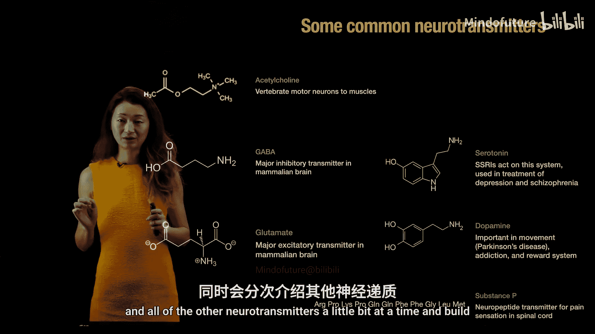
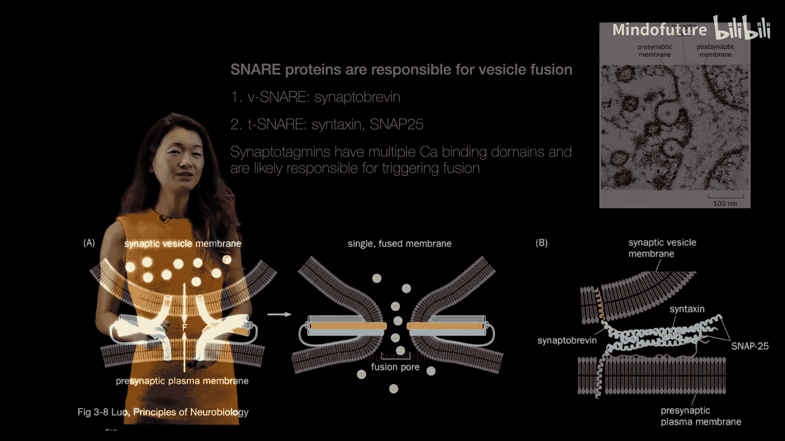
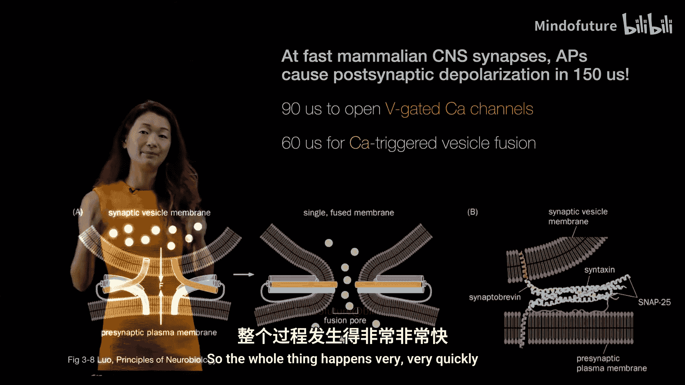
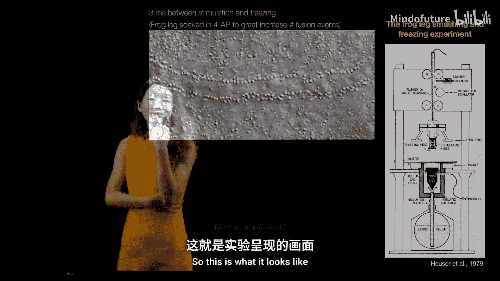
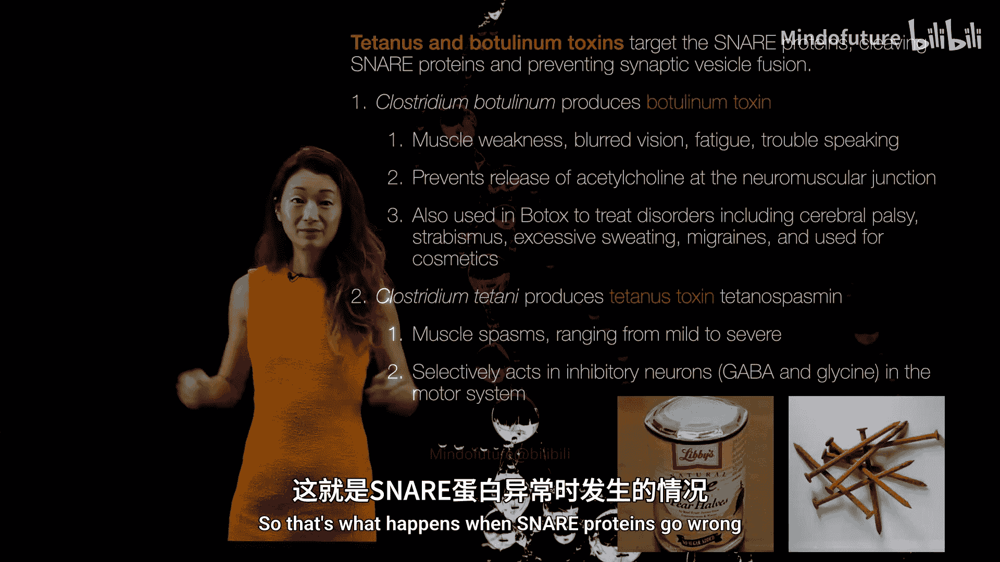
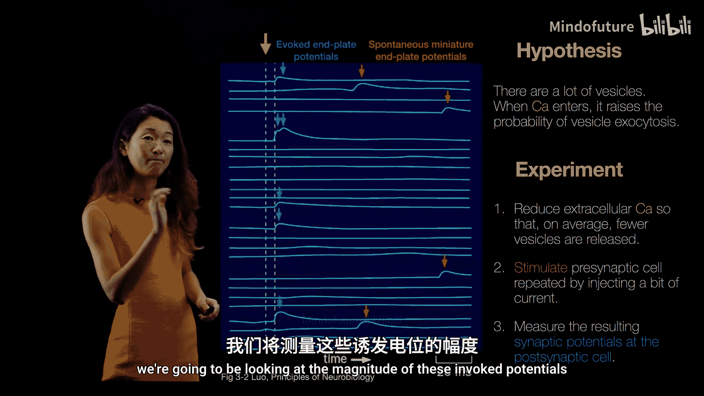
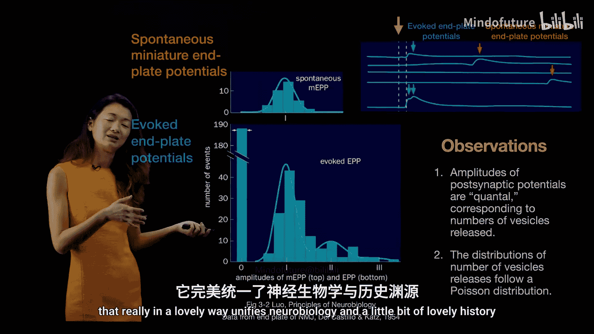

# 【华盛顿大学】神经科学入门 ｜ Introduction To Neuroscience ｜ Bing Wen Brunton p07 P07_化学突触的突触传递-神经递质量子释放 -BV1i3qWBXEDH_p7-

This video is going to be all about the chemical synapse。

 the process by which an electrical potential of an action potential and the presynaptic neuron gets transmitted through chemical communication and then elicits another electro potential at the postsynaptic neuron so in the last video we got to the point where we have understood this cartoon diagram of the different anatomical parts of the cell where inputs come into the dendrites triggers an all or nothing event of an actual potential。

 the action potential goes all the way down the axon and so now we finally arrived at the very end of the axon and the actual potential arrives at the end of the cell there's nothing down there there's no more there's no more axon。

 there's no more cell membrane。 so what's going to happen。

So what we're going to look at is the anatomy of this one particular synapse。 Now。

 if we talked about earlier， human brains have a lot of neurons and each of those neurons makes。

Thouous0 to 10，000 these synapses， so we're going to be looking at each of them one at a time。

 so here's my presnastic neuron and my post synaptic neuron。

And I'm going to draw this as this version of a diagram。

 so we'll be seeing this diagram over and over in the next couple of videos。

 and so I'm going to go through the steps of what's going to happen when an actual potential arrives at the chemical synapse So step one is an actual potential arrives so the preynaptic neuron is now depolarized so far nothing is happening yet on the postynaptic side because these are separate cells and they're electrically isolated。

 so the actual potential of the presynaptic side has no effect on the postynaptic side just yet。

What's going to happen is that there's another different very special set of voltage gad channels and this is the first time we're hearing about them。

 We've already heard about voltage gated sodium potassium channels。

 those are the channels that enable the triggering of this all or nothing action potential so we have the feedback loops。

 a positive and negative feedback loops that sustain the action potential Similarlyly you have voltage- gated calcium channels and in this case these calcium channels are only found at this part of the preynaptic terminal and what they do in response to the arrival of the action potential is they open and allow calcium to flow inside the cell。

 calcium， just like sodium is maintained at high concentration on the outside of the cell and there's very little of it on the inside of the cell which is one reason that makes it a really effective way of using calcium as a signaling molecule as you'll see in neuroscience as well as other physiological systems。

 calcium is very commonly used as a signaling molecule intracellularly so that's the same thing here where you have these voltage gated calcium channels that open。

Calcium is really high on the outside of the cell and low on the inside。

 so the nurse potential of calcium is also really high just like it is for sodium。

 and this causes a quick influx of calcium inside the cell。Now。

 this calcium inside the cell triggers what's called exocytosis of these vesicles。 These vesicles。

 these little green diamonds that I've drawn here are full of small molecules that we're going to call neurotransmitters。

 We're going to be going into a lot about specific types of neurotransmitters and what they all do yet。

 But generically speaking at generic chemical synapse。

 Let's just consider that they're small molecules for now。 Okay。

 What happens with calcium enters the cell is that it triggers what's called a fusion event where one of these vesicles because they are membrane bound just like the cell membrane they're going to dock。

At the presynaptic terminal and then fuse with the terminal。

 and then they're going to fuse to such extent that it actually opens。

 so it's like a bag opening and when the bag of neurotransmitters opens。

 we're going to get neurotransmitters that are going to get dumped into the synaptic cleft。

After they get dumped to the synaptic cleft， diffusion takes over。

 So this is no longer an electrochemical event。 This is just a process that's dictated by diffusion and the rate at which neurotransmitters are going to diffuse across the synaptic cleft is also dictated by the laws of diffusion just like everything else diffusing around。

 There's no more electricity involved。 these neurotransmitters are generically speaking not charged particles there are small organic molecules。

 Some of you heard of We'll talk about that just a little bit and they're going to go all the way across the synaptic cleft。

 and that is how information about the action potential。 first reaches the postsynaptic cell。 Now。

 just like all messages， the fact that you're shouting doesn't mean anyone's actually listening。

 And so the fact that the presynaptic cell is now shouting that action potentials arrived。

 it doesn't mean anything actually happens unless there's a set of things on the postssynaptic cell that are listening for that signal。

 So what's going to happen is that these transmittters are going to bind to receptors on the postssynap。

I'm using that term kind of generically speaking receptors to mean this set of proteins that are listening for that are sensitive to neurotransmitters and they're going to bind to these different receptors the variety of different receptors is quite large and extraordinarily fascinating so that's going to be the topic of a later video in a couple of minutes and after the neurotransmitters bind to these postsynaptic receptors is when something actually happens in the postssynaptic cell now exactly what happens is entirely dependent on what these receptors are so it could be。

 for example， opening an ion channel， in which case we can get electrical potential really quickly in the postssynaptic cell it could also trigger so far away changes for example。

 we can trigger a change of gene expression all the way down to the nucleus of the cell that message is going to get passed down and we can also do other things like change the local concentration of these receptors at the postssynaptic cell at the postssynaptic side of the synapse。

For example， like we talked about in the passive properties of the neuron。

 the conductance of ions going in and out of the cell is proportion to the number of channels that are open and so one of the changes that can occur is that these lien gated these receptors that are also ion channels if you added more of them。

 then the whole thing becomes more receptive， it's like tuning up the volume on what you are listening to for the presynaptic side and so you can have immediate changes in the postsynaptic cell and or these are not exclusive because you can have lots of different receptors。

 you can have long-term changes as well， that fundamentally changes the nature of the synapse up to and including actually the cell this particular synapse going away and dying you probably have other synapes left over so it's okay so the message has arrived the presynaptic side。

 calcium has rushed in neurotransmitters or release in the vesicles。

And the postsynaptic cell has heard the message。 What happens to the message afterwards。 Remember。

 these are small molecules that are diffusing in the extracellular space of synaptic cleft。

 What happens next is that were going to not waste because it takes energy to make these neurotransmitters we are going to recycle them。

 And theres another set of proteins that are transporters。

 these are now pumps because they're going be pumping against the concentration gradient。

 These are transporters thatuptake their neurotransmitters and clear out the neurotransmitters from the synaptic cleft because as long as the neurotransmitters hanging out in the cleft。

 they're going to continue binding to the receptors can continue activating them。

 So in order to clean house and make sure that the postssynaptic cells is ready to hear the next message comes along cleaning up the neurotransmitters from the synaptic cleft is an active process that's undertaken by these transport of molecules and they're going to get pump back into the preynaptic cell。

 Now， to be clear， generically speaking， this is what happens。

 And this is a really good conceptual framework thinking about how we clean up neuroreceptors。😊。

Also be done by the postsynaptic neuro sometimes they suck up the transmittters as well and just like with every other part of the neuro system。

 we're talking about neurons here， but around this empty space kind of where I'm standing。

 there's gonna to be a set of other nonneurnal cells that we call generically speaking glial cells and they can also play a really pivotal role in reuptaking and recycling these neurotransmitters and they can make that process more efficient as well So again waste not once the neurotransmitters are packed back into the presynaptic neuron there are another set of pumps and are also these are Apases just like the sodium potassium hpas that maintain the concentration of sodium potassium in and out of the cell there's a set of ATpces for vesicles that pack the neurotransmitters back into the vesicles so that we can use them again and they'll be ready to go for next time that's it these are the steps of the chemical synapse and we'll be teasing part every single part of this probably an excruciating detail for the next couple of。

For the next couple of videos because this is generically what happens。

 but there's a lot of details here that are super fascinating of direct relevance for human health。

 for neuroscience， and for probably even your sense of identity itself。

 a lot of it is packed into this type of structure of how one neuron is talking to another。

Okay but first， let's talk about one of the steps here。 I kind of just told you as a generic factor。

 okay oh there there's calcium's a new player here。 I never mentioned calcium before。

 we've only talked about sodium potassium and chlorine， but now we're talking about calcium。

 how do we even know calcium is key at the presynaptic terminal So again。

 this is another story where the set of experiments were undertaken over a long period of time that conclusively demonstrated that calcium is in fact something that is not that is both necessary and sufficient for synaptic release of neurotransmitters at the presynaptic terminal。

 So I'm going to summarize some of those experiments here。

 one of them is because the calcium is maintained at a high concentration on the outside of the cell。

 If you artificially bathe the synapse in some kind of solution of laboratory and you remove calcium from the extracellular solution。

 those channels are still going to open， the conductance is still going to go up。

 but there's gonna be no concentration gradient because there's no calcium on the outside。

 and if you do that， the voltage。😊，Calcium channels are still going to open。

 but there's going to be no flow of calcium inside the cell in that scenario we observe that there is no neurotransmitter release so that's one experiment demonstrating that we actually need calcium on the outside of the cell。

The second one is demonstrating that we need these voltage gated sodium channels if you artificially using a pharmacological rules by making some kind of drug ortoxin that blocks that voltage gated calcium channel then even though there is calcium on the outside of the cell and the action potential does arrive because those voltage- gated calcium channels cannot open once again we are blocking neurotransmitter release thus demonstrating that you actually need those voltage- gated calcium channels as well。

 and then finally we can do something even more direct。

 if you inject calcium artificially just injecting it into the presynaptic cell。

 you also cause neurotransmitter release and so those are the type of experiments that were undertaken to actually convince us that the picture I showed you on the previous slide is in fact the steps of what happens during neurotransmission at the synaptic at the chemical synapse。

So synaptic vesicle。 I've drawn it at a circle so far。

 It will not surprise you that like every other part of the cell。

 it is extraordinarily complicated and packedful of action proteins。

 And so I will not go into all of the proteins here。

 except to show you that there's a couple of them that are particularly interesting。

 So here this is the APA I was talking about earlier。

 This is the one that uses another concentration gradient in case。

 this is actually a proton gradient that's as a driving force for this Apa。

 it uses that Apa to pump neurotransmitters back into the cell because it's going to have a really high concentration of neurotransmitters packed inside each vesicle。

 And that's pretty crucial for its function。😊，So we've talked a lot about neurotransmitters。

 but we haven't told you what they are yet。 So here's a couple of common ones that you may have heard about and we'll hear a lot more about them in this next series of videos。

 the identity of these neurotransmitters is really important and different ones are used at different times throughout different parts of your body so that you can have a lot of specificity in terms of what one neuron is saying to another depending on which neurotransmitter language it's speaking so a couple of common ones that you'll see very very very you commonly hear about them The first one is acettocholine。

 acettocholine is the favorite neurotransmitter that's used at the neuromuscular junction where your motor neurons connect to your muscles which are also electrically active。

So that you can command these muscles to contract and to move so acetocholine is super duper important because it's the reason that we can command our bodies and move in space In the central nervous system。

 the two major ones that we see in the mammalian brain are two neurotransmitters that are known as Gaba and glutamate Now as youll see if you've taken biochemistry organic chemistry。

 the chemical structures of all three of these neurotransmitters are heck of a lot similar to amino acids and that's because they're actually directly derived from amino acids sometimes we call these the monoine neurotransmitters because they resemble very closely in chemical structure。

 single amino acids that you would see。Gba is known as the primary inhibitory neurotransmitter of the mammalian brain for reasons they'll become clear in a little bit。

 and glutamate is known as the major excitatory neurotransmitter in the mammalian brain。

 so this is primarily the way in which neurons in your brain are shouting each other to either talk more or to talk less。

 so Gaba and glutamate tend to be somewhat opposite。

But that's not all because there are all other types of neurotransmitters that are distinct in terms of molecular structure as well as neuro localization in different parts of the brain regions as well as how they're used so two that that we're going to be talking a little bit more about that are pretty important are serotonin and dopamine these two。

 as you'll see， are not looking like monoamines， they're not neurotransmitters that are directly derived from these amino acids In fact they have these really lovely ring structures that make them stable and hold their particular shape。

 serotonin is important because they the seroonergtic system is the targets of SSRI selective serotonin reuptake inhibitors these are medications that are commonly used to treat depression bipolar and schizophrenia for example so you may have heard about serotonin in that context and dopamine is super duperportly important as well because they're implicated in pathologies including Parkinson's disease and as we'll see in a couple of videos we'll talk about how dopamine is really important our attempt。

Understand addiction and reward。 So these are small molecules that are common neurotransmitters。

 but that's not all because you could have other molecules that act as neurotransmitters as well at chemical synapsis very much like the one we just saw in the cartoon earlier。

 For example， we have this thing called substance P which is used as a neurotransmitter or pain in the spinal cord。

 Now substance P And so'll see here is not the size of one amino acid。

 It is actually a small chain of neuropeptide that is a bunch of small amino acids strung together。

 So this molecule substance P is quite a bit larger than glutamate and gaba。

 And that has implications because it also affects its diffusion coefficient。 So when this molecule。

 because it's like 10 times bigger than glutate is diffusing in the extracellular space in the synapticcleeft is not going to diffuse as quickly。

 The other thing that's cool about a neuropeptide being used as a neurotransmitter is as you know from the central dogma。

 you can actually specify that。Protein chain by a gene in the way that you can with Gaa and glutamate in order to change gla and glutamate。

 you can actually have to change the metabolic pathways。

 Where you can actually change a neuropeptite change just by changing the corresponding gene。

 Okay so there's some common neurotransmitters。 I know it's a little overwhelming。

 but just stay with me for a little bit because we're going to unpack all of this。

 all of everything's really tangled up together right now。

 But we're going unpack all of it and talk about the different steps of the chemical synapse and all of the other neurotransmitters a little bit at a time and build a knowledge throughout the next couple of videos。

Okay so there's one more thing that's super cool about the vesicle because I love these vesicles。

 It's just like the coolest things ever， right So I told you about vesicle exocytosis。

 the process by which a vesicle and lipid bilayer of the vesicle  fuses with the cellular membrane and then allow the neurotransmitters to come out when they fuse and open So the proteins that allow that to do so is a set of proteins that are really cool and they're kind of shown schematically right here。

 So we know that there are proteins that actually exert quite a bit of mechanical force because what's actually happening is you take these two proteins。

 protein complexes and you bring the two sets of lipid mibras close together and you apply force and you squeeze them and if you squeeze them close enough。

 they fuse chemically thus allowing the fuseed membranes to open and neurotransmitters to come down these proteins we call them snare proteins and it's become known that they are responsible for vesicle。

😊，fusion。In particular there's two sets of proteins that are pretty crucial here。

 the V snares like synaptorevin， as well as T snares， like syntaxin and Sap 25。

 these are just names of proteins if you don't remember them it's not particularly important what the names are what I do want you to know is that they hold at this confirmation where there's a set of helices and it's actually the process of them twisting relative to each other that applies force and if they twist and then apply force across two different membranes。

 that's what brings them close together biomechanically and allow them to fuse and then open and pour then opens and we can have neurotransmitters pouring out into the extracellular space。

Okay。So。This is how calcium signals vasculares fusion。 These proteins have domains a bind to calcium。

And that's why they're actually holding ready there when there's no calcium in the cell。

When there's no calcium， the presynaptic terminal， the vesicles。

 there's a bunch of them that are called dock because they're kind of like boats at a dock。

 right they're sitting at the presynaptic plasma membrane kind of hanging out。

 associated with snare proteins and just ready and they're kind of in this confirmation and it is when calcium floods into the presynaptic terminal that they bind to the calcium binding domains of these snare proteins。

 which then causes of the change confirmation， twist and then then fuse the synaptic membranes together。

So this process is very， very fast and this is really good because when that action potential comes down the presynaptic side。

 you really want to respond quickly， you don't be waiting around to tell the prosynap cell hey actually times to arrive。

 something's happening here this is so fast that the mammalian central nervous system and actual potential at the presynaptic side can cause postynaptic depolarization is as little as 150 microseconds specifically it takes about 90 microseconds to open the voltage gated calcium channels。

 essentially it's the slow step once the calcium comes inside the cell it takes about 6 microseconds for the calcium to trigger vs fusion。

 the whole thing happens very， very quickly。

Okay so we have known about vesicular fusion for a long time。

 so I wanted to share with you one of the first experiments that convinced us that vesicles actually existed at preynaptic terminal and that vesicular fusion is the mechanism is the biophysical mechanism whereby neurotransmitters are released into the synaptic cleft and so this really clever experiment was done quite a while ago and I just love the drawing of the apparatus I'm just talk about it for a little bit so what you're gonna to do is take take a dead frog you've heard this before。

 pretty a lot of neurosciences about frogs step one get yourself a dead frog so so you gave yourself a dead frog and you build yourself this really really awesome chamber where the frog muscle the frog muscle is held on the top and what you're going to do is you're going to make a really fastpllunging device where when you were ready and this is happening with sub millisecond precision you're going to freeze that。

Frog muscle and its synapses at the precise moment that you want and the order to freeze that frog muscle that frog synapse really really quickly what you're going to do is you get yourself a little bulb of liquid helium liquid helium is at four kelvin。

 something like that okay and liquid helium is going to be cooling this copper head so that it's super duper cold。

And when you're ready， you're going to take your。That frog， super cold liquid helium temperature。

 metal copper block over here and you're going smash it。

 you smash it really quickly and thereby preserving the dynamic process of vesicles fusion in its moment of action。

 All right， super cool experiment， let's see what they found。

 So this is what it looks like when the frog is right before the vesicle fusion。

 So you can see that there's a bunch of little dots here。

 whichion which are the diffussion which are the vesicles that are docked at the membrane。

 but right before they actually fuse。😊。

Two milliseconds later， what you'll see is that they have now converted into this shape where you see this little little pitted shape It almost looks like a craters on a lunar landscape or something。

 that's exactly topologically what it is these vesicles have fused with a membrane and what we're seeing now is actually the crossse of those vesicles that have fused so super cool experiment that demonstrated that membrane perturbations are observed at the active zone of the neuromuscular junction So neuromuscular junction is a special word that we call the synapse between the motor neuron and the muscles it's called the neuromuscular junction we like studying it and we also like really like frogs partially because it's so big so synapses that are really big or more reliable because it' it's bigger it's got more postsynaptic receptorors and experimentally that makes them a lot more tractable because it's easier to smash them a look at them because they're really big and what we see here are direct evidence that there are pores from fused vesicles。

 pretty cool experiment。 All right so your favorite part of these videos is every time I talk about something。

tellll you what happens when things go wrong。 So we talked a lot about ves fusion。 Of course。

 vesicle fusion， superd importantant。 And when something is really important， they also go wrong。

 So here are some things can go wrong in ves fusion。 All right。

 we have two common toxins that used to be pretty devastating， but now really careful。

 They're not as big of a deal anymore。 We have vaccines。

 and they're the tetanus and the botu lineum toxins。 both of them target the snare proteins。

 remember， the snare proteins are the ones that are responsible ves fusion。

 they're the ones that twist and then smash the two of the membrane together in order to fuse s vesicles。

 So that's the process where your motor neurons command your muscles。

 if you don't have those snare proteins because they bound to tetanus or bottulinum toxins。

 terrible things happen。 So in particular， a bacterium called clotriium botulinum。

 produces what's called the botulinumin。 The bo lineum toxin。

 toxin if it gets inside your body causes muscle weakness or vision。Tatigue， trouble speaking。

 all symptoms of your inability to control your muscles。

And it does so because it's preventing the fusion of the asoceylcholine neurotransmitter vesicles from being released into the neuromuscular junction in small doses。

 the bottulinum toxin is also used in botox， to treat a variety of different disorders。

 including cerebral palsy，ps strepba， your inability to control the orientation of your eye。

 excessive sweating， migraines， and it's also used cosmetically。So that's bottulinum toxin。

 There is also another bacterium called a clotridium tetani， which produced the tetanus toxin。

tetanus toxin is similar to the bottulinum toxin in that it also targets the snare proteins but it targets snare proteins at a slightly different subset of synapses。

 So instead of targeting the acetocholine neuromuscular junction synapses that we talked about for the bottulinum toxin。

 the tetanus toxin targets the inhibitory neurons of the motor system。

 and these are these are gaba synapses and glycine synapses。 And so there the symptoms are similar。

 but they're a little bit different just because the molecular target is a little bit different。

 it's also targeting the muscle system， but the symptoms of tetanus also known as lo jawaw are muscle spasm and it can range from very mild to quite a bit more severe than that as well。

 So that's what happens when snare proteins go wrong。

Okay there's one more thing that's super cool about neurotransmitters。

 and this is the last story I'm going to tell you in this section of the video we talked about before how you have usually hundreds of these vesicles that are in the presynaptic side and you usually have like tens of them that are docked and ready to go with a snare proteins kind of like ready to go ready to receive calcium okay。

But how does this actually happen， right， How is it that calcium triggers their release。

 So there's a hypothesis here。That there's a lot of different vesicles and they're all doctrine ready to go。

 like we said before and when calcium enters， it actually raises the probability of a secular exocytosis in other words。

 this is not a deterministic event。 It's not like you need calcium to fuse at all because theres thermodynamics and where a body temperature instead of absolute zero。

 there is a chance there's a non-zero chance that that fusion event can actually happen even the absence of calcium and so what happens to the calcium。

 the hypothesis goes is that it increases the probability of a secular oxocytosis。

 so we're going to go through the set of experiments that were designed to test this hypothesis。

So in particular what we're going to do is we're going to get ourselves a neuromuscular junction。

 just like we had before in the dead frog could even be a frog neuromuscular junction。

 it doesn't really matter though， and what we're going to do is we are going to wait。😊。

we're going to wait for fusion events to happen by measuring the extracellular potential。

 So these are these are voltage as a function of time of the post synaptic terminal。

 We're measuring now the potential at the post synaptic side。

 we're seeing what happens as as a function of whatever messages that the preynaptic side is talking about。

 And we're going to make a couple of experimental manipulations just to make the interpretation of the experiment a little bit more easy We're going to reduce the extracellular calcium so that on average。

 if fewer things are happening just so we can kind of isolate them。 Now， if you do that。

 What we're going to do is we're going to do two different things。 We are going to first。

 we're we're going to stimulate the preynaptic cell by injecting with a tiny bit of current to encourage it to release vesicles And then we're also going to wait for spontaneous and plate potentials。

 So two things are happening when we stimulate the presynaptic cell。😊，It's going to activate。

 It's going it's going to depolarize the postsynaptic cell。 So that's the depolarization goes up。

 right， So these are the these are the synap potential of postsynaptic cell they're going to go up Depolarization。

 We're going to wait for stimulated。Potentials at the post of Excel。

 And we're going to wait for spontaneous miniature and play potentials。

 These are ones that are just kind of happening spontaneously。 Okay。

 so we're going to be looking at both the， we're going to be looking at the magnitude of these invoked potentials as well as the spontaneous potentials by doing the following。

 We're going to be making。😊。

A couple of different histograms by colllating all the events that we see and looking at how big they are Now。

 if you do that， what you'll see is that the magnitude。

In terms of voltage of the spontaneous mini paid potentials are a Gaussian distribution that kind of follows this shape。

 and they're generally speaking this big kind of unit of one， whatever that is。

 it doesn't really matter what it is right now。Interestingly。

 if you look at the magnitude the evoked end potentials。

They're not totally different from the spontaneous ones。 In fact。

 they have this multimodal shape where a lot of them are exactly the same size as the miniature ones。

 Some of them are twice as big， others of them are three times as big。In other words。

Each vesicle is one unit of communication and you either fuse a vesicle or you don't fuse the vesicle。

 You can't like fuse one and a half vesicles。 This kind of make sense in retrospect based on what I told you earlier。

 right， But at the time， this is a really really cool revolutionary experiment that was done in the neuromuscular junction that conclusively demonstrated that release of neurotransmitters by vesicles。

 It is actually this quant event。 In the other words， this is all or nothing event。

 either you dump all the vesicles， contents into the synaptic lefteft or you dump't。 So to summarize。

 we have the amplitude of the postynaptic potentials are corresponding to the number of vesicle released。

 so these spontaneous ones， presumably that's one vesicle。 And when you evoke them。

 you can dump one or two or three or four。 but you can't dump one and a half。And because of this。

 we were able to fit the distribution。Of these potentials as what's called a poisson distribution。

So the proton distribution has a really fascinating history。

 so I'll take a small historical detour here so we can talk a little bit more about the mathematics。

 the proton distribution that really in a lovely way unifies neurobiology and a little bit of lovely history as well。

😊。

We're going to go back to the 1800s where in the Prussian army there's a bunch of Calvary and these these groups of soldiers that wrote around on horses and what happens when you work with horses a lot and especially you're fighting and going to war is that occasionally somebody gets kicked in the chest by a horse and they die so death of people by kicking in the chest by a horse so what happened in the Prussian armies that one there they realized that there was one particular group of Calvalry where four different individuals died of being kicked in the chest by a horse and they were scratching their heads。

 looking themselves going what's going on here are these men abusing the horses doing something wrong。

 like what's going on here， how come four people died occasionally one two people died。

 but how come four people died and so in an analysis that was undertaken by an economist brokeowwis he analyzed the data of again looking at the histogram of number of army course sorted by number of death per corps per year by looking at historical。

Data over the last couple of decades in the historical records。

 and what he found is that the majority of the time nobody died， less of the time one person died。

 and the less than that two people died and three people and in four people， etc cea。In particular。

 this followed what's called a Poisson distribution that determines the distribution of random catastrophic events that are completely independent from each other。

In other words， the fact that there was one group of Army Corps where four men died in a particular year is exactly what you expect based on the Poisson distribution。

 in other words they didn't do anything wrong， this is just kind of what happens occasionally something really bad happens and if youll wait around long enough four of them will happen the same year to the same group of people and this is exactly the same distribution that describes the relative magnitudes of the evoked extracellular postsynaptic potentials that we measure from the evoked potentials on the postssynaptic side in other words this fusion event of the vesicles just like being kicked in the chest and dying by a horse is a random schastic event that has a fixed probability and if you wait around long enough you'll see two or three or four of them happen in a way that is completely predictable by the mathematics of the Poisson distribution。

Okay， so to review here are some key concepts to understand synaptic transmission at a chemical synapse。

 we learned first that we have these chemical synapses where action potentials arrive at the presynaptic terminal。

 which trigger ves fusion events， this dumps neurotransmitters into the synaptic cleft。

 and the process is mediated by a huge influx of calcium enabled by voltage gated calcium channels。

This fusion is a probabilistic event that's described at fson distribution。

 and calcium acts as a way of increasing the chance that it might actually happen。

These neurontransmitter molecules then diffuse across synaptic cleft until they reach the postssynaptic side once again。

 once they get to the postssynaptic side， everything that happens is determined by the identity of the receptors that happen to be on the postssynaptic membrane we're going to be looking at the identity of those receptors in the very next video because so far I've left in theory receptors haven't talked too much about them so the next video is going to be all about all the different receptors and what they can possibly do。

And the transmission is finally terminated when the neurotransmitters are recycled either by being sucked back into the presynaptic cell or otherwise removed by any of the other cells that happen to be in the vicinity。

 so we're at the end of the line the potential has arrived at the synaptic cleft。

 we have bound our neurotransmitters at the postssynaptic potential they are now receptors involved。

 what have we received the next video we'll be talking about what have we received。

