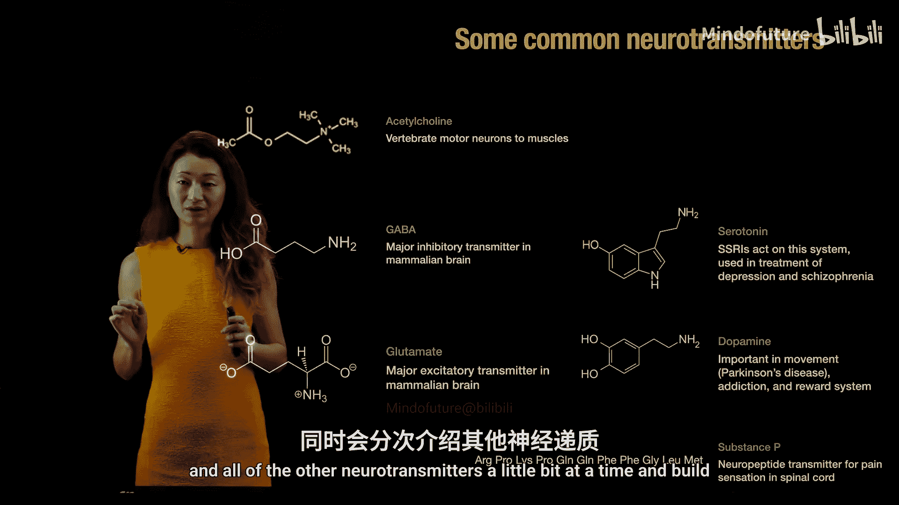
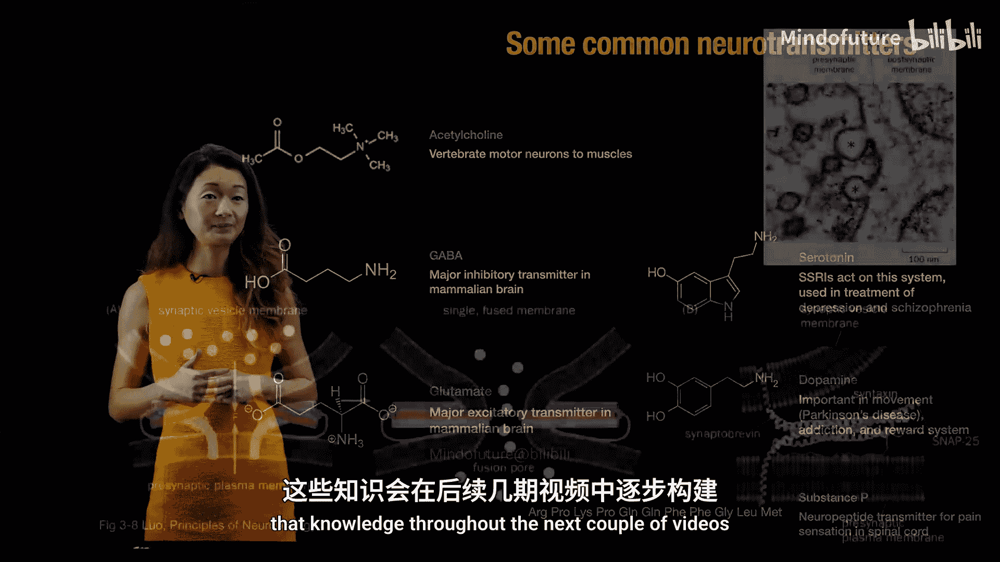
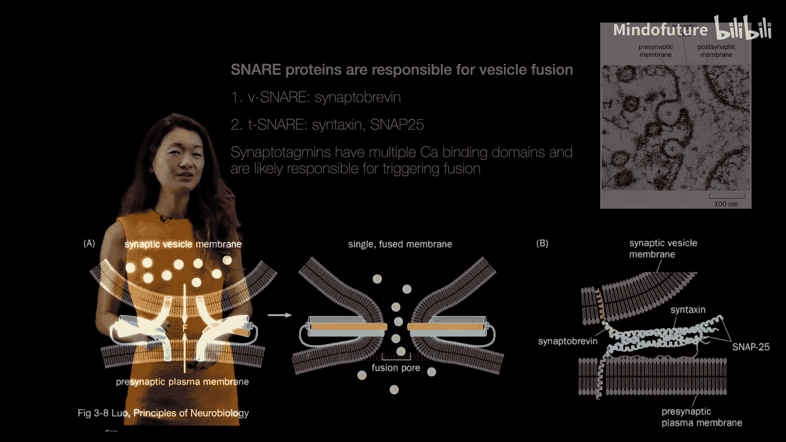
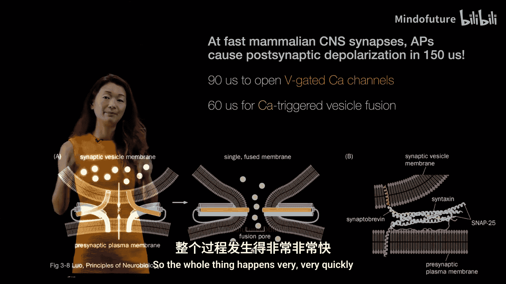
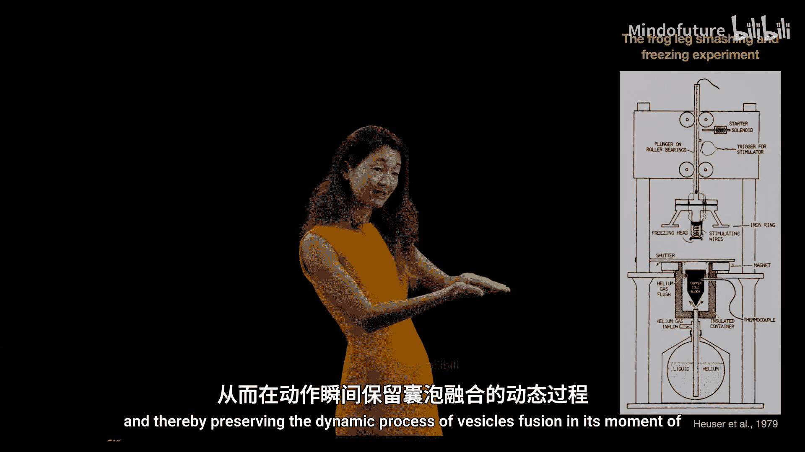
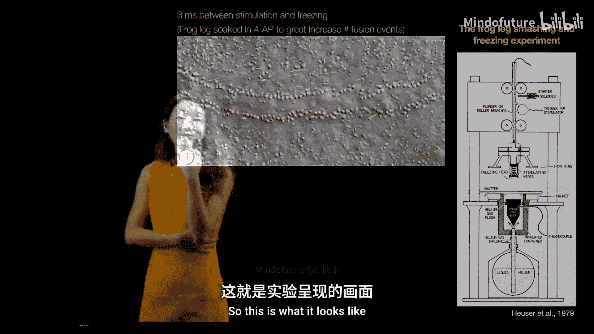
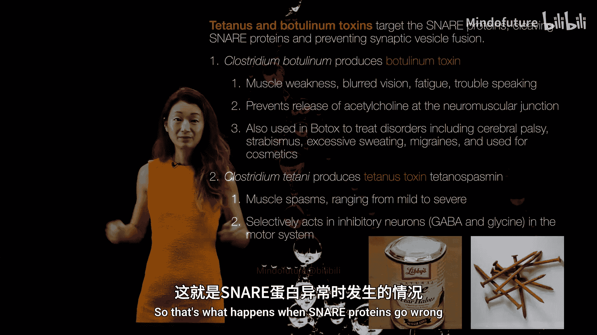
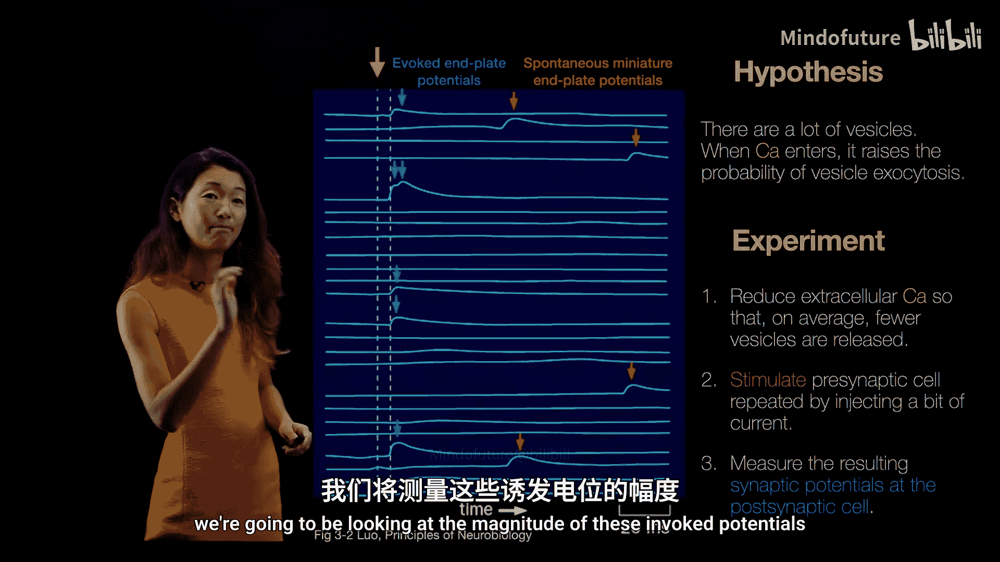
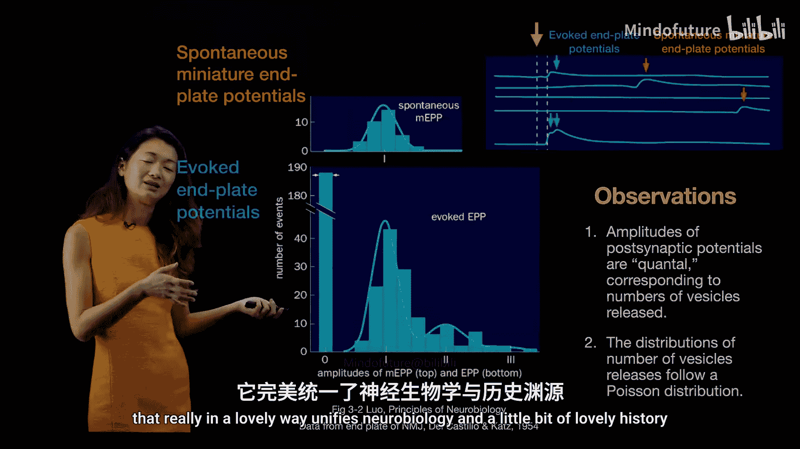
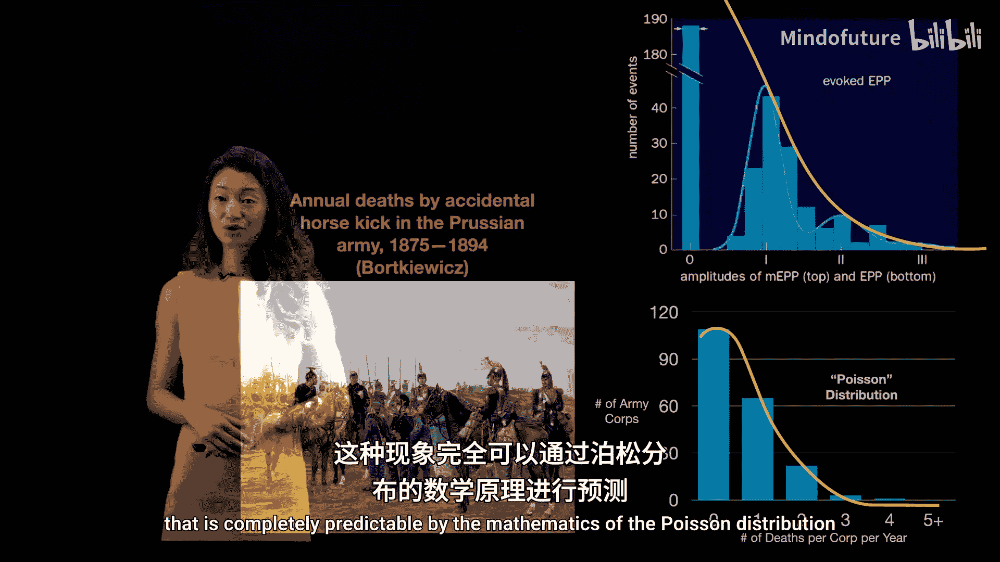

# 神经科学入门：P07：化学突触的突触传递-神经递质量子释放 🧠

在本节课中，我们将要学习化学突触的详细工作机制。化学突触是神经元之间进行信息传递的关键结构，它将一个神经元产生的动作电位（电信号）转化为化学信号，并传递给下一个神经元，从而再次引发电信号。我们将从突触的解剖结构开始，逐步拆解信号传递的每一步，包括钙离子的关键作用、囊泡的量子化释放以及神经递质的回收过程。

## 化学突触的解剖结构

上一节我们介绍了动作电位沿轴突传导的过程。现在，动作电位终于到达了轴突的末端。轴突末端之外没有更多的细胞膜，那么接下来会发生什么呢？

我们将聚焦于单个突触的解剖结构。人脑拥有海量的神经元，每个神经元会形成数千到上万个这样的突触。我们每次只分析其中一个。

以下是突触传递的基本步骤示意图，我们将在接下来的视频中反复看到它。现在，我们来逐步解析当动作电位到达化学突触时会发生什么。

## 突触传递的步骤

### 第一步：动作电位到达

动作电位到达突触前神经元，使其去极化。目前，突触后侧尚未发生任何变化，因为这是两个独立的细胞，它们在电学上是隔离的。突触前侧的动作电位暂时对突触后侧没有影响。

### 第二步：钙离子内流

接下来发生的是，这里存在另一类非常特殊的电压门控通道——这是我们第一次听说它们。我们已经了解过电压门控钠通道和钾通道，它们是触发“全或无”动作电位的基础。同样，这里也存在**电压门控钙通道**。

这些钙通道只存在于突触前末端的这个特定区域。它们响应动作电位的到达而开放，允许钙离子流入细胞内。与钠离子类似，钙离子在细胞外浓度很高，细胞内浓度很低。这种浓度差使得钙离子成为一种非常有效的细胞内信号分子，在神经科学和其他生理系统中都很常见。

当这些电压门控钙通道开放时，细胞外高浓度的钙离子会快速内流进入细胞。

### 第三步：囊泡胞吐

现在，进入细胞的钙离子会触发这些囊泡的**胞吐作用**。图中这些绿色的菱形小囊泡充满了我们称之为**神经递质**的小分子。目前我们暂不深入讨论特定类型的神经递质及其功能，仅将其视为通用的小分子。

钙离子进入细胞后，会触发一个**融合事件**。这些囊泡本身也是膜结构，它们会停靠并融合到突触前膜上。融合程度会达到囊泡膜打开，就像袋子开口一样，将其中的神经递质“倾倒”进**突触间隙**。

### 第四步：神经递质扩散

神经递质被释放到突触间隙后，**扩散**过程接管了后续步骤。这不再是一个电化学事件，而是完全由扩散定律支配的物理过程。神经递质扩散穿过突触间隙的速率也遵循扩散定律。此时不再涉及电学，这些神经递质通常是不带电的小有机分子。

它们将一路扩散穿过突触间隙，这就是关于动作电位的信息首次抵达突触后细胞的方式。

### 第五步：与突触后受体结合

就像所有信息传递一样，发送方“大喊”并不意味着接收方在“倾听”。因此，突触前细胞发出动作电位到达的信号，除非突触后细胞有一系列结构来“侦听”这个信号，否则不会发生任何事情。

接下来，这些神经递质将与突触后膜上的**受体**结合。我在这里泛泛地使用“受体”这个词，指的是一类对神经递质敏感的蛋白质。神经递质会与这些不同的受体结合，受体的种类非常繁多且极为有趣，这将是后续视频的主题。

在神经递质与这些突触后受体结合之后，突触后细胞才会真正发生反应。具体发生什么，完全取决于这些受体的类型。例如，它可能打开一个离子通道，从而快速在突触后细胞产生电变化；也可能触发更深远的变化，例如一路传递到细胞核，改变基因表达；还可能改变突触后侧这些受体的局部浓度。

正如我们在神经元的被动特性中讨论过的，进出细胞的离子电导与开放的通道数量成正比。因此，可能发生的一种变化是：如果增加了这些配体门控受体（同时也是离子通道）的数量，整个突触后膜就会变得更具响应性，就像调高了“收听”突触前信号的音量。所以，你可以在突触后细胞产生即时变化和/或长期变化（这两者并不互斥，因为可以存在多种不同的受体），这些变化可能从根本上改变突触的性质，甚至包括这个特定突触消失。

### 第六步：神经递质的回收

至此，信息已经抵达：突触前侧钙离子涌入，囊泡释放神经递质，突触后细胞接收到了信息。那么信息之后会怎样？记住，这些是在突触间隙细胞外空间中扩散的小分子。

接下来，我们不会浪费它们，因为合成这些神经递质需要能量。我们将回收它们。这里有另一类蛋白质——**转运体**。这些转运体实际上是**泵**，因为它们将逆浓度梯度工作。这些转运体会摄取神经递质，并将其从突触间隙清除。因为只要神经递质还停留在间隙中，它们就会持续结合并激活受体。

为了“打扫房间”，确保突触后细胞准备好接收下一条信息，从突触间隙清除神经递质是一个由这些转运分子主动执行的过程。神经递质将被泵回突触前神经元。

需要明确的是，以上描述的是一个通用的过程，是思考我们如何清理神经递质的一个很好的概念框架。清理工作有时也由突触后神经元完成，它们也会吸收神经递质。并且，就像神经系统的其他部分一样，我们这里谈论的是神经元，但在这个空隙（突触间隙）周围，还存在一系列我们统称为**胶质细胞**的非神经元细胞，它们也能在再摄取和回收神经递质方面发挥关键作用，使这个过程更高效。

再次强调，不要浪费。一旦神经递质被重新包装回突触前神经元，还有另一组泵（也是ATP酶，就像维持细胞内外钠钾离子浓度的钠钾泵一样）存在，它们将神经递质重新打包回囊泡，以便下次使用。

以上就是化学突触传递的步骤。我们可能会在接下来的几个视频中以近乎“折磨人”的细节来剖析其中的每一个部分，因为虽然这是通用过程，但其中包含大量与人类健康、神经科学甚至你的自我意识直接相关的迷人细节。许多奥秘都蕴含在这种一个神经元与另一个神经元对话的结构中。

## 钙离子关键作用的实验证据

首先，让我们谈谈其中的一个步骤。我刚才只是把它作为一个通用事实告诉你：“哦，钙离子是个新角色。”我之前从未提及钙离子，我们只讨论过钠、钾和氯，但现在我们谈到了钙。我们究竟如何知道钙离子在突触前末端是关键的呢？

这又是一个通过长期实验最终确凿证明钙离子对于突触前末端神经递质释放既是**必要条件**也是**充分条件**的故事。我在此总结其中一些实验：

1.  **移除细胞外钙**：由于钙离子在细胞外维持高浓度，如果你在实验室中用某种溶液浸泡突触，并从细胞外液中移除钙离子，那些通道仍然会开放，电导仍然会增加，但由于外部没有钙离子，将没有浓度梯度。在这种情况下，我们观察到没有神经递质释放。这个实验证明我们实际上需要细胞外的钙离子。

2.  **阻断电压门控钙通道**：如果你使用药理学方法，通过某种药物或毒素来阻断电压门控钙通道，那么即使细胞外存在钙离子，动作电位也到达了，但由于那些电压门控钙通道无法开放，我们再次阻断了神经递质释放。这证明你实际上也需要那些电压门控钙通道。

3.  **人工注射钙离子**：最后，我们可以做更直接的实验：如果你人工将钙离子注射到突触前细胞内，同样会引起神经递质释放。

正是这些类型的实验使我们确信，上一张幻灯片展示的图景确实是化学突触处神经传递发生的步骤。

## 突触囊泡与SNARE蛋白

我目前把囊泡画成圆圈。但就像细胞的每个其他部分一样，它极其复杂且充满了行动蛋白，这不会让你感到惊讶。我不会在这里介绍所有的蛋白质，只展示其中几个特别有趣的。

我之前提到的ATP酶就在这里。它利用另一种浓度梯度（实际上是质子梯度）作为驱动力，使用ATP将神经递质泵回囊泡，因为每个囊泡内部包装的神经递质浓度会非常高，这对它的功能至关重要。

我们已经谈了很多神经递质，但还没有告诉你它们是什么。以下是一些你可能听说过的常见神经递质，我们将在接下来的系列视频中更多地了解它们。这些神经递质的身份非常重要，不同的递质在你身体的不同部位、不同时间被使用，这样神经元之间可以根据它使用哪种神经递质“语言”来进行非常特异性的交流。

以下是几种非常常见、你会经常听说的：

*   **乙酰胆碱**：是神经肌肉接头处最常用的神经递质。你的运动神经元通过它连接到同样具有电活性的肌肉，从而命令肌肉收缩和运动。乙酰胆碱极其重要，因为它是我们能指挥身体在空间中运动的原因。
*   **GABA和谷氨酸**：在哺乳动物大脑的中枢神经系统中，我们看到两种主要的神经递质，称为GABA和谷氨酸。如果你学过生物化学或有机化学，会发现这三种神经递质的化学结构与氨基酸非常相似，因为它们实际上直接来源于氨基酸。有时我们称这些为**单胺类神经递质**，因为它们在化学结构上非常接近单个氨基酸。
    *   **GABA** 被称为哺乳动物大脑中主要的**抑制性**神经递质。
    *   **谷氨酸** 被称为哺乳动物大脑中主要的**兴奋性**神经递质。
    因此，这主要是你大脑中神经元相互“喊话”以使其说得更多或更少的主要方式。所以GABA和谷氨酸的作用在某种程度上是相反的。
*   **血清素和多巴胺**：但这还不是全部，还有其他类型的神经递质，它们在分子结构、大脑不同区域的神经定位以及使用方式上都有所不同。我们将更多讨论的两个非常重要的神经递质是**血清素**和**多巴胺**。正如你将看到的，它们看起来不像单胺类，不是直接来源于这些氨基酸的神经递质。事实上，它们具有非常漂亮的环状结构，使其稳定并保持特定形状。
    *   **血清素** 很重要，因为血清素能系统是SSRI（选择性血清素再摄取抑制剂）类药物的靶点。这些是常用于治疗抑郁症、双相情感障碍和精神分裂症等疾病的药物。你可能在这个背景下听说过血清素。
    *   **多巴胺** 也极其重要，因为它与包括帕金森病在内的病理学有关。我们将在接下来的视频中看到，多巴胺对于我们理解成瘾和奖励机制非常重要。

这些是常见的小分子神经递质，但还不止这些，因为其他分子也可以在化学突触中充当神经递质，就像我们刚才在卡通图中看到的那样。例如，我们有一种叫做**P物质**的东西，它在脊髓中用作疼痛的神经递质。P物质的大小不是一个氨基酸，它实际上是一个小的神经肽链，由一串氨基酸连接而成。因此，P物质分子比谷氨酸和GABA大得多。这具有影响，因为它也影响其扩散系数。当这个分子（因为它比谷氨酸大10倍左右）在突触间隙的细胞外空间扩散时，它不会扩散得那么快。使用神经肽作为神经递质的另一个很酷的地方是，正如你从中心法则中所知，你实际上可以通过基因来指定那个蛋白质链，而对于GABA和谷氨酸，要改变它们，你必须改变代谢途径。改变神经肽只需改变相应的基因即可。

好了，这些是一些常见的神经递质。我知道这有点让人应接不暇，但请稍安勿躁，因为我们将逐一解开所有这一切。目前所有内容都纠缠在一起，但我们将逐步拆解化学突触的不同步骤以及其他神经递质，并在接下来的几个视频中逐步构建知识。

---

关于囊泡还有一件非常酷的事情，因为我太爱这些囊泡了，它们简直是最酷的东西，对吧？我告诉过你囊泡胞吐作用，即囊泡的脂质双层与细胞膜融合然后让神经递质出来的过程。实现这一过程的蛋白质是一组非常酷的蛋白质，这里示意性地展示了它们。

我们知道，实际上有一些蛋白质施加了相当大的机械力，因为实际发生的是：你取这两个蛋白质复合体，将两套脂质膜拉近，并施加力挤压它们。如果你将它们挤压得足够近，它们就会发生化学融合，从而使融合的膜打开，神经递质得以释放。这些蛋白质我们称之为**SNARE蛋白**，已知它们负责囊泡融合。

特别地，这里有两组蛋白质至关重要：**V-SNARE**（如突触小泡蛋白）和**T-SNARE**（如突触融合蛋白和SNAP-25）。这些只是蛋白质的名称，如果你不记得它们，名字本身并不特别重要。我希望你知道的是，它们保持在这种构象下：有一组螺旋，实际上是它们彼此相对扭转的过程施加了力。如果它们扭转并对两个不同的膜施加力，这就是在生物力学上将它们拉近并允许它们融合的原因，然后打开，我们就可以让神经递质涌入细胞外空间。

这就是钙信号如何触发囊泡融合。这些蛋白质具有结合钙的结构域。这就是为什么当细胞内没有钙时，它们实际上已经准备就绪。当没有钙时，在突触前末端，有一批囊泡被称为“停靠”囊泡，就像停泊在码头的船一样，它们位于突触前质膜旁，与SNARE蛋白相关联，随时待命，并处于这种构象。正是当钙离子涌入突触前末端时，它们与这些SNARE蛋白的钙结合结构域结合，从而导致构象改变、扭转，进而将突触膜融合在一起。

这个过程非常非常快，这非常好，因为当动作电位沿着突触前侧下来时，你真的希望快速响应，而不是等待告诉突触后细胞“嘿，时间到了，有事情发生了”。这个过程如此之快，以至于在哺乳动物中枢神经系统中，突触前侧的动作电位可以在短短150微秒内引起突触后去极化。具体来说，打开电压门控钙通道大约需要90微秒，这本质上是较慢的步骤。一旦钙离子进入细胞，钙触发囊泡融合只需要大约6微秒。整个过程发生得非常非常迅速。

## 囊泡融合的实验证据与量子化释放

我们了解囊泡融合已经很久了，所以我想与你分享最初说服我们囊泡确实存在于突触前末端、并且囊泡融合是神经递质释放到突触间隙的生物物理机制的实验之一。这个非常聪明的实验是很久以前完成的，我特别喜欢这个装置的绘图，我们来稍微谈谈它。

你要做的是：取一只死青蛙（你以前听说过这个，很多神经科学都关于青蛙），第一步，给自己弄一只死青蛙。然后，你建造一个非常非常棒的小室，青蛙肌肉被固定在上面。你要做的是制造一个非常快速的 plunging 装置，当你准备好时（这发生在亚毫秒精度），你将在你想要的精确时刻冻结那只青蛙肌肉及其突触。为了非常非常快地冻结那只青蛙肌肉和它的突触，你要做的是：准备一小球液氦。液氦的温度大约是4开尔文。液氦将冷却这个铜头，使其超级冷。当你准备好时，你将拿起你的青蛙，用这个超冷的、液氦温度的金属铜块猛砸它，从而在动作发生的瞬间保存囊泡融合的动态过程。非常酷的实验，让我们看看他们发现了什么。

这就是青蛙在囊泡融合即将发生前的样子。你可以看到这里有一堆小点，这些就是停靠在膜上的囊泡，但就在它们实际融合之前。两毫秒后，你会看到它们现在已经转变为这种形状，你看到这些小小的凹陷形状，几乎像月球景观上的陨石坑之类的东西。从拓扑学上讲，这正是囊泡与膜融合后的样子。我们现在看到的实际上是那些已融合囊泡的横截面。这个超级酷的实验证明了在神经肌肉接头的活动区观察到了膜扰动。

神经肌肉接头是我们对运动神经元和肌肉之间突触的特殊称呼。我们喜欢研究它，也真的很喜欢青蛙，部分原因是它很大。较大的突触更可靠，因为它更大，拥有更多的突触后受体，这在实验上使它们更容易处理，因为更容易“猛砸”并观察它们。我们在这里看到的是融合囊泡形成孔道的直接证据。非常酷的实验。

好了，这些视频中你最喜欢的部分可能是我每次谈论某事时，都会告诉你当事情出错时会发生什么。我们谈了很多关于囊泡融合的内容。当然，囊泡融合极其重要。而当某件事非常重要时，它们也会出错。

以下是囊泡融合可能出错的一些情况。我们有两种曾经相当具有破坏性、但现在由于非常小心已不那么严重的常见毒素：**破伤风毒素**和**肉毒杆菌毒素**。两者都以SNARE蛋白为靶点。记住，SNARE蛋白是负责囊泡融合的蛋白质，它们通过扭转并将两个膜挤压在一起来融合囊泡。这就是你的运动神经元指挥肌肉的过程。如果这些SNARE蛋白因为结合了破伤风或肉毒杆菌毒素而失效，可怕的事情就会发生。

具体来说：
*   一种叫做肉毒梭菌的细菌会产生**肉毒杆菌毒素**。如果这种毒素进入你的体内，会导致肌肉无力、视力疲劳、说话困难等无法控制肌肉的症状。它之所以如此，是因为它阻止了乙酰胆碱神经递质囊泡在神经肌肉接头处的融合释放。小剂量的肉毒杆菌毒素也被用于**肉毒杆菌（Botox）**，用于治疗多种疾病，包括脑瘫、斜视、多汗症、偏头痛，也用于美容。
*   另一种叫做破伤风梭菌的细菌会产生**破伤风毒素**。破伤风毒素与肉毒杆菌毒素相似，也以SNARE蛋白为靶点，但它靶向的是稍微不同的一组突触。与肉毒杆菌毒素靶向乙酰胆碱神经肌肉接头突触不同，破伤风毒素靶向运动系统的抑制性神经元，这些是GABA和甘氨酸突触。因此，症状相似，但由于分子靶点略有不同，症状也略有不同。它也靶向肌肉系统，但破伤风的症状（也称为牙关紧闭症）是肌肉痉挛，其严重程度可以从非常轻微到相当严重。

这就是SNARE蛋白出错时发生的情况。

---

关于神经递质还有一件非常酷的事情，这是我在本节视频中要讲的最后一个故事。我们之前谈过，通常在突触前侧有数百个这样的囊泡，通常有几十个停靠并准备就绪，SNARE蛋白也准备好接收钙离子。

但这实际上是如何发生的呢？钙是如何触发它们释放的？这里有一个假说：有很多不同的囊泡，它们都停靠准备就绪，就像我们之前说的那样。当钙离子进入时，它实际上**提高了囊泡胞吐的概率**。换句话说，这不是一个确定性事件。并不是说你需要钙才能融合，因为在体温下（而不是绝对零度），即使没有钙，融合事件也有非零的概率发生。因此，假说认为，钙的作用是增加囊泡胞吐的概率。

我们将通过一组为检验这一假说而设计的实验。具体来说，我们要做的是：获取一个神经肌肉接头（就像之前死青蛙的神经肌肉接头，甚至可以是青蛙的，这并不重要），然后我们将等待。我们将通过测量细胞外电位来等待融合事件的发生。这些是突触后末端随时间变化的电压。我们现在测量的是突触后侧的电势，观察突触前侧传递信息时发生的情况。

为了使实验解释更容易，我们将进行一些实验操作：我们将减少细胞外钙离子浓度，这样平均而言，发生的事件会更少，以便我们能更好地分离它们。现在，如果你这样做，我们将做两件不同的事情：
1.  首先，我们将通过注入微小电流来刺激突触前细胞，以促使它释放囊泡。
2.  然后，我们还将等待自发的微型终极电位。

当我们刺激突触前细胞时，会发生两件事：它将激活并使突触后细胞去极化。所以这些是突触后细胞的突触后电位，它们会上升（去极化）。我们将等待刺激引起的突触后电位，以及自发的微型终极电位（那些只是自发发生的）。

我们将通过制作几个不同的直方图来观察，收集我们看到的所有事件，并观察它们的大小。如果你这样做，你会看到：自发微型终极电位的电压幅度呈高斯分布，大致遵循这种形状，它们通常有“一个单位”那么大（具体单位现在不重要）。有趣的是，如果你观察诱发的终极电位的幅度，它们与自发的并非完全不同。事实上，它们具有这种多峰形状：其中很多与微型电位大小完全相同，有些是两倍大，另一些是三倍大。

换句话说，**每个囊泡是一个单位的通讯**。你要么融合一个囊泡，要么不融合。你不能融合一个半囊泡。根据我之前告诉你的内容，这在回顾时是有道理的，对吧？但在当时，这是在神经肌肉接头进行的一个非常非常酷的革命性实验，它确凿地证明了囊泡释放神经递质实际上是一个**量子化事件**。换句话说，这是一个“全或无”事件：你要么将囊泡的全部内容物倾倒进突触间隙，要么不倾倒。

总结一下：突触后电位的幅度对应于释放的囊泡数量。因此，这些自发的，推测是一个囊泡。当你诱发释放时，你可以释放一个、两个、三个或四个，但不能释放一个半。正因为如此，我们能够将这些电位的分布拟合为所谓的**泊松分布**。

泊松分布有一段非常迷人的历史，因此我将在这里做一个小小的历史旁白，以便我们可以更多地谈谈数学，泊松分布以一种可爱的方式统一了神经生物学和一些美好的历史。

我们将回到19世纪，在普鲁士军队中，有一群骑兵，这些骑着马的士兵团体。当你经常与马打交道，尤其是去打仗时，偶尔会有人被马踢中胸部而死。普鲁士军队中发生了一件事：他们意识到有一个特定的骑兵部队，有四名不同的士兵因被马踢中胸部而死亡。他们挠着头想：这是怎么回事？是这些人在虐待马吗？做错了什么？怎么会死四个人？偶尔死一两个人，但怎么会死四个人？

一位名叫博特基维茨的经济学家进行了一项分析，他再次查看了数据，通过查看过去几十年的历史记录，分析了每年每个军团死亡人数的直方图。他发现，大多数时候没有人死亡，较少的时候死一个人，更少的时候死两个人，然后是三个人、四个人等等。特别是，这遵循了所谓的**泊松分布**，它描述了彼此完全独立的随机灾难性事件的分布。

换句话说，有一个军团在某一年死了四个人，这正是你根据泊松分布所预期的。也就是说，他们没有做错任何事，这只是偶尔会发生的事情，如果你等待足够长的时间，同样的事情会在同一年发生在同一群人身上。这正是描述我们从突触后侧诱发电位测量到的诱发细胞外突触后电位相对幅度的相同分布。换句话说，囊泡的融合事件，就像被马踢中胸部而死一样，是一个具有固定概率的随机事件，如果你等待足够长的时间，你会看到两个、三个或四个事件以泊松分布的数学完全可预测的方式发生。

## 总结与回顾 🎯

本节课中我们一起学习了化学突触处突触传递的关键概念。

我们首先了解到，化学突触是动作电位到达突触前末端、触发囊泡融合事件、从而将神经递质“倾倒”进突触间隙的结构。这个过程由电压门控钙通道介导的大量钙离子内流所驱动。

这种融合是一个概率性事件，由泊松分布描述，而钙离子的作用是增加其发生的可能性。

这些神经递质分子随后扩散穿过突触间隙，直到到达突触后侧。一旦到达突触后侧，发生的一切都由突触后膜上受体的身份决定。我们将在下一个视频中详细研究这些受体的身份，因为到目前为止，我只是泛泛地提到了“受体”，没有过多讨论它们。所以，下一个视频将全部关于各种不同的受体以及它们可能的功能。

最后，当神经递质被回收（要么被吸回突触前细胞，要么被附近的其他细胞清除）时，传递过程终止。

至此，我们已经到达了终点线：电位已抵达突触间隙，我们的神经递质已结合到突触后电位，受体已经参与其中。我们接收到了什么？下一个视频，我们将讨论我们接收到了什么。