# 【华盛顿大学】神经科学入门 ｜ Introduction To Neuroscience ｜ Bing Wen Brunton p08 P08_神经递质-突触的离子型与代谢型受体 -BV1i3qWBXEDH_p8-

Presaptic neurons sure can talk a lot， but exactly what they're actually communicating depends on who's listening on the postssynaptic side。

 so in this video we're going to be talking about different types of postssynaptic receptors。

 what they do will give you some examples of them as well as what happens when they're targeted by various different toxins and mutations。

So the first type of receptor we'll talk about is what's called ionottroic receptor。

 It's so named because it is an ion channel， just like the leakage channels that we talked about as well as the voltage gated channels we talked about。

 In this particular case， instead of being gated by a depolarization voltage。

 it's gated by the binding of a neurotransmitter that is bounding to the extracellular side。

 So these are neurotransmitter gated ion channels。 but otherwise。

 it functions almost exactly like every other ion channel that we've talked about。

 The conductance changes the function of time， depending on the presence of neurotransmitters。

 And when they open it directly opens the ion channel that's not directional。

 ions can flow in and out。 and the net effect on the postyntic cell depends on the permeability of the channel as well as driving force as determined by the species of the ion。

 as well as its neurons potential in that particular system。 So that's the first one。

 It gets a little more complicated in that the nextco flow length。 The second type will' talk about。

 It's what's called one of the metatropic。Receptors these receptorors are instead of being an ion channel themselves is kind of like a two step process。

 So there is a primary protein that's called a G protein coupled receptor GCR will talk a little bit about GCs a little bit because it just really important and you see them all over biology all over your body for now。

 all you need to know is that it's the G protein coupled receptor。

 the GCR that actually binds to the neurotransmitter。

 not the ion channel itself but once active the GCR releases a part of a G protein that activates or deactivates an ion channel。

 So once again， the effect on the postynaptic cell depending depends on the identity of the ions that are able to pass through the channel as well as a driving force and the nurse potential of that ionic species at that particular time。

 So here we have a ionottropic receptor that's directly opens ion channel and the metatroic ion channel that's opened somewhat indirectly as extra。

the process where there's a GPCR that binds to the liandd， the ligan being different neurotransmiter。

 and then opens up the transmitter， and open ups up the ion channel that lets some kind of ion flow through。

But as long as we have metatroic receptors， they don't necessarily have to actually even depolarize the cell or do anything of that kind at all。

 there doesn't have to be an ion channel involved in a depolarization on the postsynapic side you can also have a G protein coupled effector system that does not directly involve any kind of ion channel instead when the ion channel when the G protein coupled receptor binds to the ligan binds to the neurotransmitter。

 it triggers a cascade of biochemical processes that can range from biochemical to protein expression to insertion of proteins to the plasma membrane。

 lots and lots of things can happen。 This is probably the most flexible of the postynaptic receptor systems that we're talking about in part because the varieties of different GPCs that can bind to neurotransmitters is quite large。

And their downstream partners can also go all over the cell。

 an effect change not only at the postynact terminal of this particular synapse。

 but perhaps neighboring synapsis or even all the way across the cell。

 remember the cell could be quite large we can travel all the way down to the cell to the cell body and trigger novel gene expression。

 for example， from the nucleus and so to summarize we have ionottropic receptors and two different types of metatroic receptors。

 so anytime I say ionottroic receptor， you can immediately think that this is an ion channel because an ion channel that's directly bound to the neurotransmiter。

 the effect is going to be really fast， it's either going to be a depolarization or a hyperpolarization depending on if it's an excitatory or an inhibitory effect。

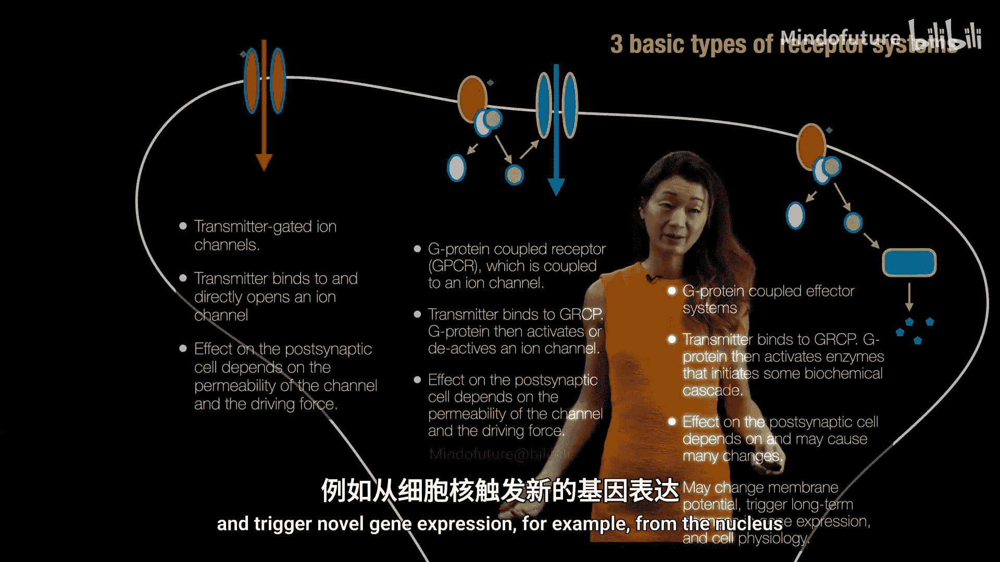

The metatroic receptors are all going to be GCs。 and the GCR can either directly bind to some kind of directly directly open the ion channel。

 or it can do something a little more sophisticated and mass been long time。

 So unlike the idottroic receptors， the metatroic receptors have the downside that they' are slower。

 but also as a consequence of them being slower And there's different parts of the protein cascade。

 they can have very long last implications。 And this is also a really good way of amplifying the signal。

 so that a small number of neurotransmitters bound at the postsynaptic side to one or two GC could become amplified and become a much。

 much larger signal that travels all over the cell and has long last implications。 So in reality。

 what we have in the nervous system is a variety of all of the above。 Okay。

 so we're going to go through a couple of them now in the next couple of slides。😊。

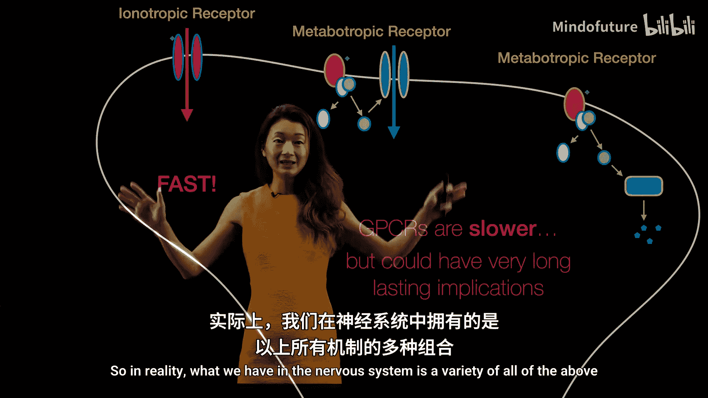

First we're going to look at a couple of key amino acids， amino acid neurotransmitters。

 like we talked about in the previous lecture， we talked about how there's a variety of different neurotransmitters that are really important in the nervous system and in the central mammalian nervous system the two key ones are Gaba and glutamate typically Gaba is inhibitory and typically glutamate is excitatory now be careful here I'm going to say typically inhibitory and typically excitatory because there's nothing inherently excitatory or inhibitory about either gabaug glutamate right。

😊，They're just small molecules that are released by the presynaptic terminal。

 They're going to drift across aaptic cleft。 And depending on the identity oftrans of the receptor that's on the postssynaptic side。

 they can either have anory or an excitatory effect depending on if you're letting in sodium or chloride or something like that。

 So typically inhibitory and typically exc satatory means that in the mamalian central nervous system。

 the receptors for Gaba tend to have an inhibitory effect， causing hypo depolarization。

 and the receptors with glutdate typically are excitatory causing thepolarization so this is a pretty good proxy。

 but we're going to look at some we're going to look at some exception to this in a little bit as well。

Okay， so first， let's review， we talked about how there is dendrites that take in inputs。

 Okay so now we're kind of at the dendritic parts of the dendrite that receive inputs that had the impact of an actual potential coming from some other neuron the presynaptic ones。

 So this is now we're looking at the postsynaptic side of this neuron。

 And if you think about it that way。 we're going to be going through a set of ionic troic receptors。

 And I'm just going to go through a set of them that are really common in the mammalian nervous system and we're going to look at each of them and what。

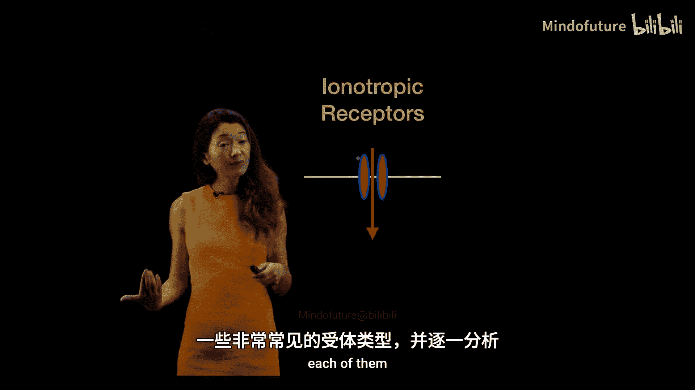

Okay， so let's get started。 I told you that Gaba and glutate are really important。 let's start there。

 These are the glutamate ionottroic receptors and it's already gotten a little bit complicated because it turns out that there are two main types of aottroic receptors for glutamate that are both found very commonly in the mammalian nervous system。

 The first one， let's just focus on the first one for now the first one is called ammppa。

 and this one is kind of your prototypical relatively simple glutamate activated channel。

 So it's an ion channel through which sodium can flow。 remember this is the ion channel。

 So when it's open， it does not determine the directionality of the flow。😊，OkayIn other words。

 it's not even stipulating that ions have to flow in that sodium has to flow into the cell causing depolarization and it's not even actually selective for sodium this particular channel is open to sodium and potassium and so the net effect of having one of these glutamate activated。

 ampatchan is open is dependent on the membrane voltage at the time as well as the nerve potential of potassium and sodium in that particular part of the cell but so far so good right we have a channel it is a catation channel so it's permeable to both sodium and potassium not to calcium。

😊，And it is activated by glutamate， so far so good， right？At resting。

 because the resting potential of the cell is so negative， if you have glutamate come along。

 bind to the ampa receptor， it's going to open and because we are so far away from the nurse potential of sodium。

 sodium' is going to rush into the cell more than potassium is going to come out。

 which means that we're going to end up depolarizing the cell。

 so that's what's going to happen with ampa here。But AMmpA is not the only player in the game。

 There is another set of ionottroic receptor glutamate that is often found at the same time as ammpA and these are called NMDA receptors these NDA receptors are significantly more complicated and so I'm just going to talk a little bit about the various parts of the NDA receptor and what makes it really cool okay one of the things that makes it really cool is that there is a magnesium here that makes it so that these NDA channels can only open if the cell is already depolarized let me say that one more time the NDA channels is kind of like a coincide detector。

😊。

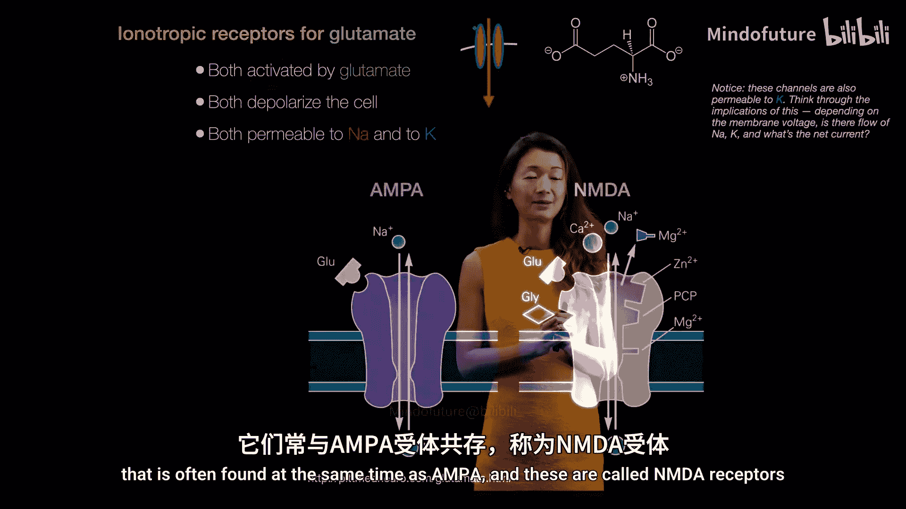

The cell has to be already depolarized and glutamate has to come along in order for it to be activated。

 So we're already kind of layering in a little more logic here in these receptors， right。

 so the ampa is pretty straightforward if there's glutamate， it opens。With nmda。

It has this additional property that it can only open if the cell is RDD polarized and in addition to being permeable to just sodium and potassium。

 it is also permeable to calcium calcium important here because as we talked about in the previous section of the lecture calcium is present in such a low concentrations inside the cell normally speaking that is very commonly used as a signaling molecule and so the fact that calcium can flow inside the NMDA channel can be used as a downstream syncing device caused all kinds of things to happen including the insertion of amporeceptors into into the cell membrane so this feedback loop here。

 which is a really crucial feature of almost all biological systems that I know of is happening to every single scale description so the NFD receptor because of its molecular properties is a coincidence detector。

And when there is a coincidence of the presence of glutamate and a cell that is already depolarized。

 calcium comes inside the cell， so in addition to causing a depolarization of the postidic terminal。

 we can also then initiate cascades of other molecular processes that can happen causing longer acting change so the way in which it is detect texting in the coincidence is by this magnesium binding domain and resting potential theres a magnesium ion that sits there kind of blocking the way so nothing's getting through none of the other ks can possibly go through because magnesium is in the po itself during depolarization。

 the magnesium gets kicked out which makes it possible for the glutamate to then change the confirmation of the NF channel making it open to all of the other ca ion so just like the voltage gated sodium channels and voltage gated calcium channels。

 there is a vulture sensitivity here， but the mechanism for how it implements is a little bit different there's a calcium ion that blocks the channel。

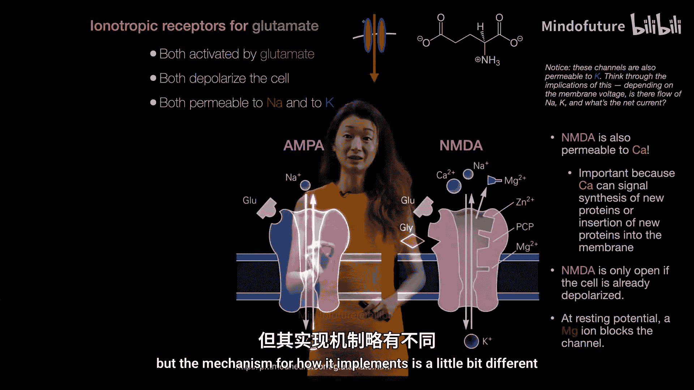

So those are the AMmpA and NMDA receptors and even with just those receptors we haven't even talked about any other type of neurotransmitters yet。

 even with just those， we can start to play with it and see how complexity of behavior at this one terminal can occur even if you just had AMmppa and NMDA channels so in this hypothetical scenario let's walk through the following thought experiment we have a we have a postynaptic gas potential that comes along just a single one。

Calcium comes in。Vesaco is released。Gluamase released into the cleft， binds to the ample receptor。

 which causes an excitatory post synaptic potential。Because as we talked about earlier。

 the N potential of sodium makes it so that it's going to flow inside the cell more than potassium is going to leave。

 causing a net depolarization。 And so that's why I'm drawing here。 there's a net depolarization。

 And after a certain time， it dies down according to the solution to the ordinary differential equation that we derive from theelms Law。

 We also call this EPSP for excitatory postsynaptic potential just for short。

 It's a bit of terminology。 I'll try not to use it too much。 but if you ever hear EPSP。

 that's what it means it's a small excitatory potential that we measure at the postssynaptic side in response to something like a glutemate binding to ample receptor。

 that's so good。 That's scenario1。

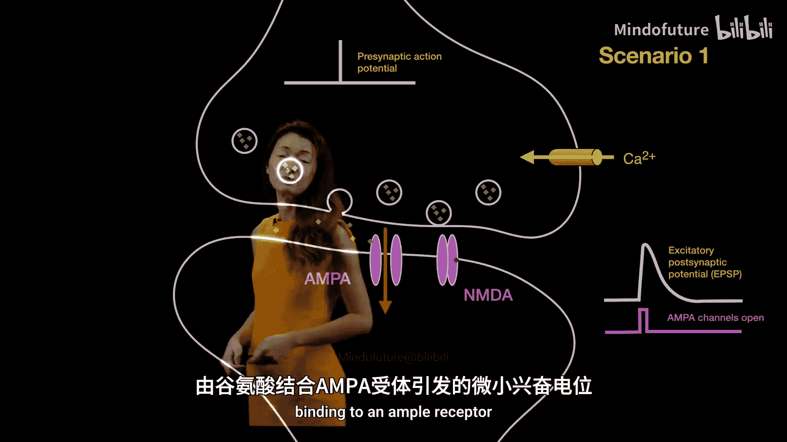

In the second scenario， what we have is not just one action potential。

 but a train of action potentials that comes in rapid succession to the presynaptic side。

 so let's work through what's going to happen here right so at each action potential。

 calcium is going to come in and glutamate is going to come out now because they're really coming in rapid succession。

AAPcepts are going to open for every single action potential， but after the first one。

 this postsynaptic cell is already depolarized， which means a magnesium in the NA channel is kicked out。

And the Nfda receptors are now recruited to be responding also to the next a potentials。

To reiterate at the first action potential， amper channels open， potassium comes in。

 cell gets a little bit depolarized before it gets all the way back down to resting however。

 the second action potential comes， amP channels open again。

 but at this time the NFDA channels also open。causing more depolarization and so on and so forth now we have a runaway process where there's a positive feedback loop where the more these channels open。

 the more the excitatory postsynaptic potentials get larger and larger and larger and then this way。

 the sum of these four presynaptic action potentials is significantly more depolarizing for the postssynaptic cell than just for separate presynaptic action potentials coming along In other words。

 this process of having the positive feedback loop between the ample receptors and MDD receptors is a way of amplifying that signal so that depending on the relative timing of the presynaptic action potentials。

 you can get a response that is much larger than the mere sum of its different parts。

So that's second scenario， but it gets more fun。 Okay， so so far， we really talked about one synapse。

 Let's add more synapses and see what happens。 So in the third scenario。

 let's say that there are now two different synapses。 We have three cells。

 and we are paying attention to what happens to the postynaptic cell， which is cell C。

 and C or cell C is going to be innervated by synapses from A and B。

 So we're talking about the A C synapse as well as the B C synapse。

 and our goal is to figure out what happens to C when A fires。 Okay， So in the beginning。😊。

Let's suppose in a hypothetical scenario that the AC synapse only has NMDA receptors and the BC synapse only has ample receptors。

 so when a fires alone if fires a single action potential。

 there is nothing that can happen at the AC synapse because you only have NDA receptors。

 N receptors have to be activated by depolarization and so if there's just one actual potential that comes along。

 nothing happens okay so far so good。Now let's suppose for the next little while。

 A and B are both firing Now I've drawn the geometry of this on purpose here where these two synapses are in close proximity。

 I didn't draw them on opposite of the sides of the dedri tree。

 they're actually really close together so you can see that there's computation by geometry going on and what happens when A and B both fire repeatedly is that the depolarization from the B synapse。

Allows the AC synapse to also be active because that depolarization is going to spread in the postssynaptic neuron all the way over to the AC synapse。

 so even though nothing has yet happened in the AC synapse。

 the depolarization is going to be spreading according to the cable equations from the BC synapse thus activating the NADA receptors Now we have NAD receptors that are active at the AC synapse which in addition to triggering depolarization also triggers the influx of calcium。

 this calcium triggers a bunch of different things and in my hypothetical scenario I get to make it up it's mine we're going to say that the calcium triggers the insertion of amphores and the AC synapse In other words。

 I have modified the nature of the of the AC synapse based on the interaction between the ampa and the NMD ottroic glututeromy receptors and the physical proximity of these two sps of synapses next to each other。

Next， afterwards， even if B is not firing， because I now have ample receptors。

 amphi glutamine receptors at the AC synapse， I can trigger C。

Without be firing by just allowing a to fire。This type of modification in a synapse is a type of synaptic plasticity。

 synaptic plasticity be generic term that means anytime the nature of a synapse， its weight。

 its associations with other things can be changing and so we've looked through just like a simple thought experiment of how the coincidence of A and B firing at the same time can cause this type of synaptic plasticity。

 even if we only have two different receptors that are disposal。

 the ample receptors and the NA receptors and what happens here is that you have a system where the AC synapse has learned the association between A and B and C in a way that was not really possible for and if you think about pavloian conditioning or different types of simple learning of that kind。

 it is exactly this type of modification to the synaptic weights that's necessary to associate one thing to another So here。

 for example， B is something that is intrinsically associated with C in the pavloviian context maybe that is a food rank causing salivvation A would be the bell。

Initially A is not associated with C， but because A and B are coming together there's always a bell in the term food after a while。

 there's the association that's then learned between the bell and the salivation。

 so that's just an analogy of what's happening here。

 obviously that type of system requires way more synaptic modification than just two cells and two synapses but I hope what you can see through the simple thought experiment is that this type of modification because of the way that signals can amplify through this variety of different proteins can lead to associative learning。

😊，The topic of synaptic plasticity is huge and fascinating。

 we'll be talking a lot more about synaptic plasticity in a later video。

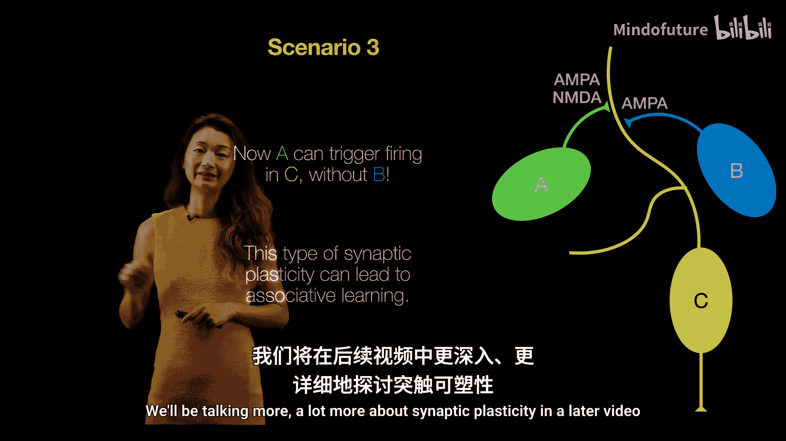

For now， though， let's go back to Gaba as they neurotransmitters。

 We talked a lot about glutamate already。 So let's talk about Gaba now。 Gaba， as you remember。

 is primarily an inhibitory neurotransmitter in the central nervous system。

 it opens instead of sodium channels， It opens chloride channels。

 So chloride is usually associated withoddium。 So it's there's more chloride on the outside of the cell than the inside。

 when this chloride channels open， chloride rushes into the cell。😊。

But because chloride is a negatively charged ion whereas sodium is a potly charged ion。

 this influx of chloride has a net inhibitory effect。 other words。

 rushing of chloride into the cell causes a hyperpolarization instead of a depolarization of the cell Bers of the gaba receptors this particular type of receptor for gaba is called the gaba A receptors。

 they arere aottroic receptors for gaba that are chloride channels blockers of these gaba A receptors include piortxin and agonists is another word for activators。

 activators of the gaba A receptors include barbituates and benzodiaazzepines So keep the logic straight here。

 you have to think in terms of what agonists means agonists means activates。😊。

If a barbituate activates a GA A channel， that means that there is more activation of chloride channels。

 which means that there is more inhibition， so even though it's an agonist because it's an agonist for a inhibitory channel。

 the net effect is more inhibition Barbituates are named after St。

 Barbara who is the patron saint of I think miners they are so named because when they were first synthesized。

 apparently this was celebrated the pub on St。 Barbara Day and so that's why they're named barbituates。

Glycine is similarly a primarily inhibitory neurotransmitter that's primarily found in the spinal cord as opposed to the brain。

 just like the Gaba A chloride channels， these glycine channels tend to be chloride channels。

And they are blocked by Strine。

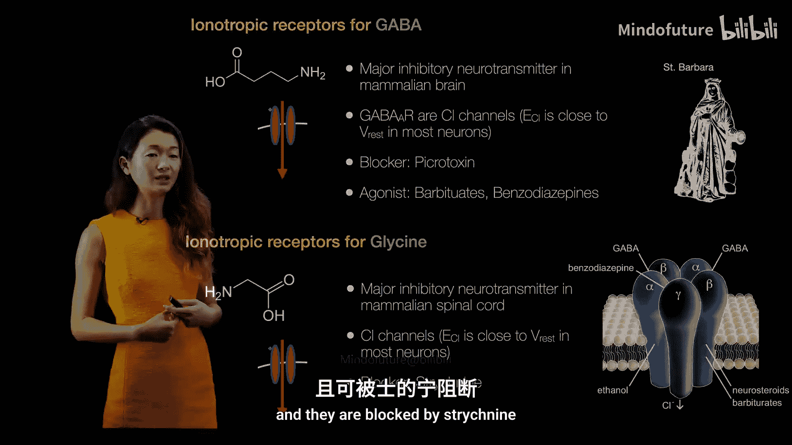

Fine。Okay， there are more Ga A agonists that are really cool to think about。

 This one is called a musal。 Musimal is a selective gaa A agonist。

 and it causes a variety of different symptoms， including euphoria out of body experiences and a really cool one called macro microxia and microxia。

 which is seeing things as larger or smaller than they are。 So musal is found in mushrooms。

 such as this ammonita mascaria mushroom right here。

 And this is one plausible mechanism through which Alice was able to go to。😊。

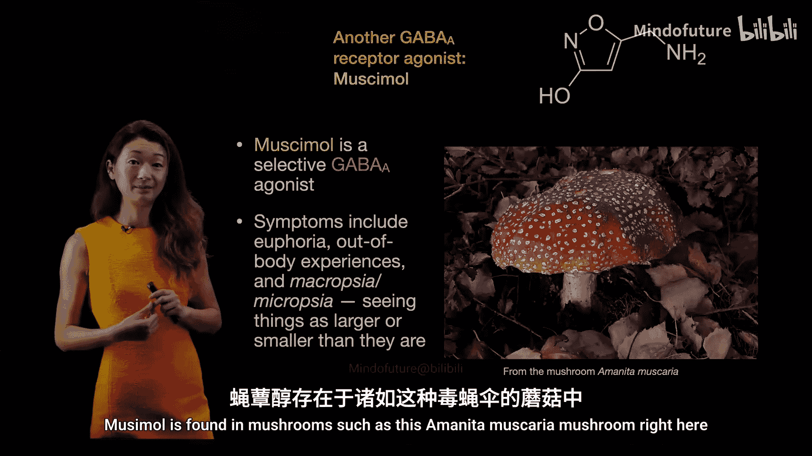

To Wonderland and so in this passage of Alice in Wonderland。

 the caterpillar tells Alice to eat the mushroom right and he says one side will make you grow taller and the other side will make you grow shorter。

 In other words if there's musal inside that mushroom。

 it could give Alice the symptoms of microxia a microxia feeling like she is actually bigger or smaller than she actually is in reality。

Kind of a trip。Okay， there are more aottroic receptors we're going to march through we where we talked about aottroic receptors in the central nervous system we talked about in the spine here we now are in the periphery。

 we're talking about innervation of the neuromuscular junction。

 these synapses between motor neurons and muscles， these are the same synapses that we talked about in the dead frog smashing into a cold block experiment。

 so the neuromuscular junction， it's primary primary neurotransmitter is acettocholine。

And the primary receptor on the muscle side when it's receiving astroatentils from the motor neurons is called the nicotinic acettocholine receptor and it's so named because nicotine is the primary agonist of the receptor I'll say it again。

 it's an agonist of the receptor， which means that nicotine activates the nicoinnic aceylcholine receptor its blocker is curri。

 which， as you can imagine， if you're blocking the action of acettocholine on your muscles it means you can't move your muscles anymore。

 you're paralyzed， kind of bad right and because this is such a quick response synapse。

You have two special properties so the neuromuscular junction one of them is shown in this picture here where you can see that there's actually a giant set of axons that come down from the same motor neuron that innervs the different muscle fibers and each of each of these synapses actually has a ton of different terminals that are clustered together because the synaptic vesicle fusion process is stochastic。

 if you want it to happen for sure， one way of getting that to happen is to just have many。

 many of them， if the probability of each one happening is small， you multiply that by 100。

 then the chances of bunch of them happening at the same time is significantly larger and that's why we see these giant clusters of stains at the axon terminals at the neuromuscular junction。

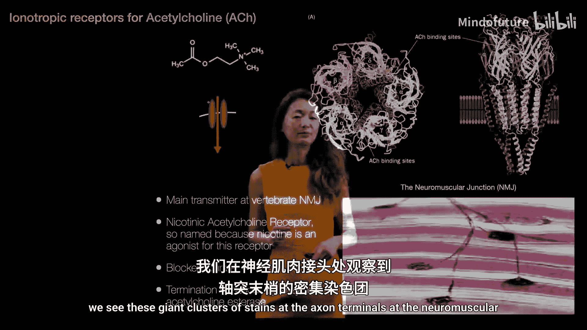

The other thing that's kind of cool about the neuromuscular junction as I told you about earlier。

 where in the central nervous system， a lot of the neurotransmitters are taken away by reuptake into the presynaptic cell and they're recycled that way。

Now it turns out for the muscles， that process is just too slow they needed a more active process because they didn't want the acettocholine sticking around and continuing to activate those muscle fibers。

 you needed to go away really really quickly so I can do it again in a nice cycle so the termination of action of the neuromuscular junction is an active enzyme called acetocholine essterase and this is an enzyme and estuase that actively breaks down acettocholine so that they can stop activating the neuromuscular junction。

 stop activating the nicotineticcetcholine receptors without waiting for it to be reuptaken by some of the neighboring cells。

So I've talked about Qri and how devastating it is if you were to be blocking this。

 so for your consideration， let's talk a little bit more about Qri Qri is fatal in the bloodstream because it can get to your neuromuscular junctions。

 but it happens to be not to be fatal if you ingest it because it actually can't pass through the stomach to blood barrier if you ingest it it doesn't actually inhibit your neuromuscular junctions Qri in small quantities can also be used as a muscle relaxing during surgery so we're going to talk about a recipe for Qri I can't voouuch for this。

 but I've been told this is a fivestar recipe， so if you wanted to make Qri。

 here's what you would do。

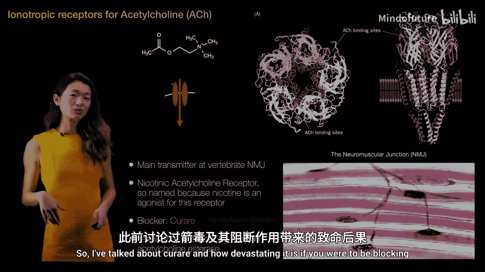

Step1， you take some leaves from the strictyucose tuxifphora plant。 What a name， right。

 tells you everything you need to know about it。 The strictucos tuifphora plant Get yourself some leaves and you simmer it in water for a couple of hours。

 Next， you add one cup of poison ants。😊，And you reduce until it's a viscous paste Next we're going to adjust the seasoning by dipping the dart in a paste and seeing how long it takes to kill a small bird。

 it should take approximately one to two minutes if it takes too long then you it takes too long you want to concentrate it further if takes if it takes if it takes too short。

 you can dilute it a little more and then you can use that to kill small mammals。

 that's how you make Q。

Okay， so we've now talked about the major inhibitory and excitatory neurotransmitter systems in the mammalian brain。

In reality， it's not just one synapsis excitatory or one synapsis inhibitory。

 Every neuron in your brain is receiving a huge number of synapses at any particular time。

 I told you before that the estimate is something like each neuron is receiving about 1000 to 10000 synapses。

 Some of these synapses are going to be excitatory， and some of them are going to be inhibitory。

By counting them， by looking at them， the best estimate that we have now is approximately 20% of the neurons in the mammalian cortex are inhibitory。

 which means that 80% of them approximately are excatory， in other words。

 there's a huge excess of excitatory neurons in the cell in the brain and not nearly as many inhibitory ones。

This is a problem， this is a problem because if you are not receiving。

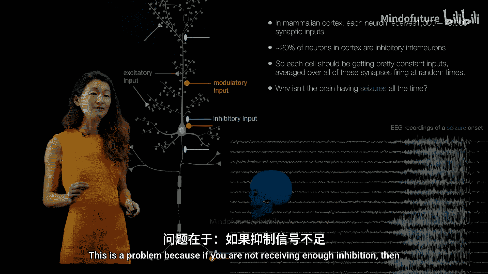

If you're not receiving enough inhibition， then you're going to be overwhelmed by excitation and when one is overwhelmed by excitation。

 that is what is a seizure， so the brain is having seizures all the time。

Unless something else is happening。The solution to this problem is what's called the balance of inhibition and excitation。

 EI balance， excitation and inhibition balance in individual cells。

 it turns out there's just a different set of different processes that are tuning the relative weights of the excitatory synapses and the inhibitory synapses so that are always roughly balanced in any given time。

 so even though you're receiving 1000 inputs， 800 excitatory ones and 200 inhibitory ones。

 the net effect is actually close to zero， and this balance that is actively maintained is fundamental to regulation of neural activity。

Okay， I've talked a lot about excitatory and inhibitory neurotransmitters。

 but I want to be careful here。 I'm going to say this now。 I've said it before。

 we're going to say it again。 There is nothing intrinsically excitatory or inhibitory about any neurotransmitter。

 It's just the message。 how that message is heard。 It depends on a variety of different factors。

 so it depends on the identity of the neurotransmitter， obviously。

 but in addition to the identity of the atransmitter。

 It depends on the specific neurotransmitter receptors that are present on the postsynaptic side and there specific effects。

😊，And because a lot of these effects are ion channels opening and ion channels are not selected for directionality。

 the net effect in terms of are we going to depolarize or hyperpolarize also depends on the nurse potential of the relevant ions just like we derived in the video lecture about the active and passive properties of neurons。

So let's walk through one example of that that I found particularly surprising。

 So I talked about how in。In Gaba， the mammalian central nervous system is typically an inhibitory neurotransmitter because it tends to cause hypopolarization。

And their chloride channels， this is true。Except in immature developing mammalian neurons。

 there's a lovely story here where in immature mammalian neurons。😊。

There is a gene that's active that's called the NKCC1 pump。And that pump is pumping sodium。

 potassium， and chloride into the cell， tons of it。

 which means that in matureature mammalian neurons。

 there is actually a higher concentration of chloride on the inside than the outside。

 unlike the case in adult cells。In other words， the nerve potential of chloride in this particular configuration is actually positive。

So that when gaba。Bins the gaba A receptors and chloride channels open。

Chloride actually exits the cell。In other words， in this configuration。

 because of the local concentrations of chloride， Gaba can be considered an excitatory neurotransmitter in the immateter mammalian neurons。

During development， the NKCC1 pump stops being expressed and instead we gets what's called the expression of the KCC2 pump。

 and that's what happens during adulthood in adulthood chloride channels。

 chloride channels' opening causes chloride to flow inside the cell and it is hyperpolarizing and so that's why we want to be really careful here to think about not only the identity of the neurotransmitters。

The nature of the receptors that are listening to the signals。

 but also pay attention to especially ion am pump case the Ns potential of the ionionic species。

 because when the environment changes， net effect of the different receptors can very well change as well and that has important effects for development and for the organization and the nervous system during development。

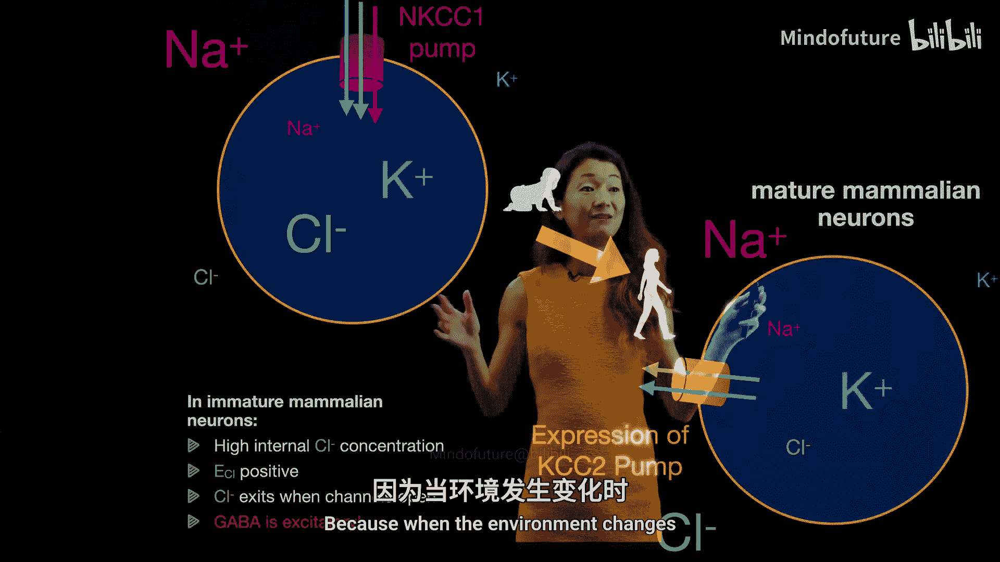

Okay so that was a wild tour of a bunch of different ionottroic receptors。

 Now we're gonna to talk about metatroic receptors。

 Now metatroic receptors are special because they are G protein coupled receptors。

 GCrs So I'm going to say gCs quite a bit because it' it's kind of a short word for that The details don't particularly matter but GCs are actually one of the coolest things in molecular and cell biology I remember when I first learned about Gcrs when I was an undergrad I took a cell biology class where we had a couple of weeks on GCs and at no point did I realize how important they were and it was not until I learned what I'm about to tell you that I realize oh my goodness GCs are everything cool about everything about neurobiology and that's when I fell in with GCs So GCs are an ancient class of transmembrane proteins that are found in eukaryotic cells they are membrane receptors and they have seven transmembrane domains they have these helices and crosses the membrane seven times So seven transmembrae domains。

clearlyly that's what they are Now there is a huge variety of GCRs that's active in a variety of different systems and these proteins are literally the reasons why we have not only synaptic transmission it is a basis of vision it is the basis of olction and it is a basis of so much more that we are going to be talking about for the remainder of the course so learn about GCRs because this class of proteins are super du important humans have approximately 1 thousand0 gCR genes in our genomes and each of them bind to very specific ligans and targets and have different downstream effects and so the class of proteins is responsible for a lot of how your body functions not only in the brain and nervous system but the remainder of the other parts of the system as well there was an estimate that about a third or even a half of pharmaceuticals that are active today that are being used medicinally actually target parts of different different GPCR and we'll see some of them here today as targets of various things。

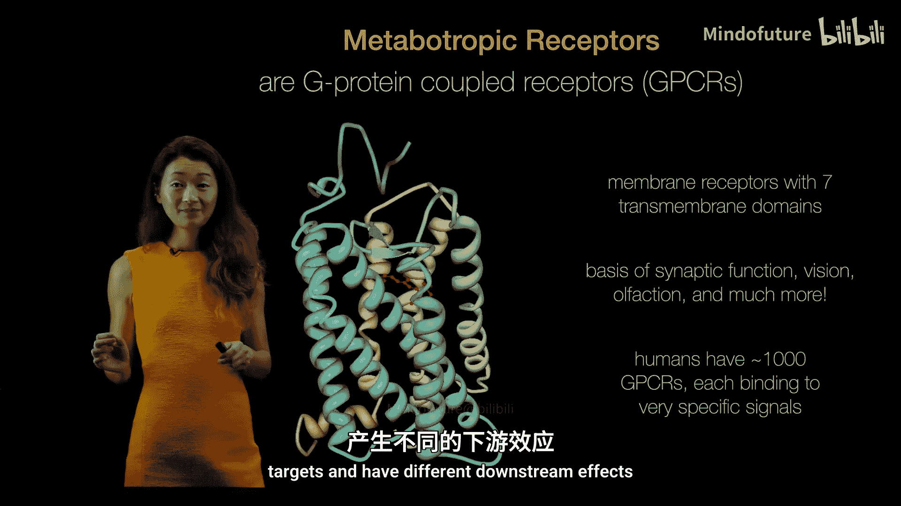

So G protein coupled receptors， so like what the heck is that， why is it called that。

 So GPPCRs are called G protein coupled receptors because they are receptor。

7 transme remains so are so good， they are a coupled to what's called a G protein。

 This is a G protein。G proteins have three domains， alpha， beta， and gamma。Okay。

 and they're called G proteins because they're bound to a GDP or GTP。

 guossine diphosphate or a gunisine trihosphate， this is a related molecule to ATP and ADP。

 but instead of adenosine it's a guanine okay so the guniine diphosphate right here。

What happens in rest is that the GPCR is bound to the G protein in its inactive state when the GPCR received its ligand and this could also be a light by the way this is exactly how vision works。

 so GPR could be opin and so in which case instead of binding into a ligand。

 it's actually being hit by photons but anyway in the postsynaptic side generically speaking we're talking about a ligan which is a neurotransmitter so a neurotransmitter binds the GPCR and once it's bound to the GPCR。

 it's able to release that G protein that's been bound to。

The Alpha subunit loses its GPT and swaps it out for GTP。

And the beta gamma subunits are bound to the membrane， so it's going to stay bound to the membrane。

 but it's then free to diffuse away from the GPCR。Both of those sets of molecules are potential signals for downstream effects。

 You can either have the alpha subunit， diffuse away in acetool and do lots of other things。

 And you can also use the beta gamma subunit to signal different things downstream as well。

 So the specifics of exactly what one particular GR does depends on what it binds to。

As well as what else is present in the system that's listening to the signal from the different G protein activated components that's causing its effect later on。

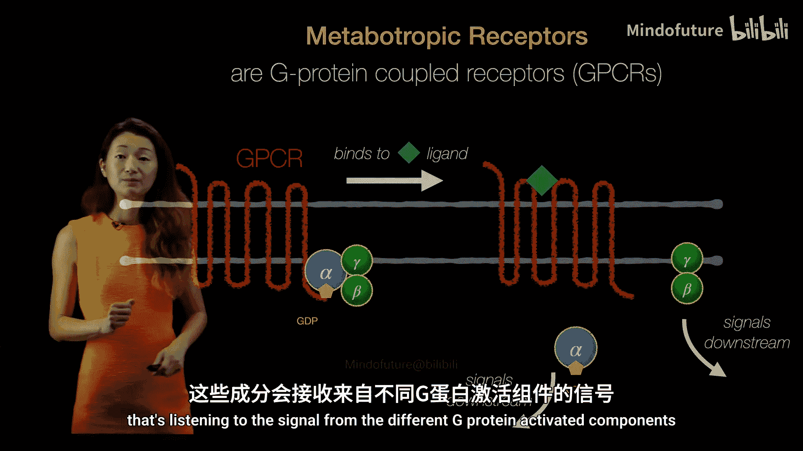

So here are some examples of metabotroic receptors remember metatroic receptor just means that this receptor is a GPCR。

 so here is a GPCR that is the beta adrenerrgic receptor whose ligand that is listening to is adrenaline adrenaline binds the GPCR and activates addenyl cyclase。

A denlo cyclase makes cyclic GM and cyclic A activates protein kinase A。

 The details don't really matter。 But what's happening here is after a couple of cascades the proteins。

 we have phosphorylation of voltaged calcium channels in the cardiac muscles。

 And this makes a more sensitive to depolarization。

 because we have a larger concentration of voltaged calcium channels。

 The net effect of this protein cascade， the signaling cascade is heart rate speeds up。

 And so the force of contraction increases because more calcium enters with each action potential。😊。

That's what happens when you have adrenaline and causes your heart rate to speed up and causes your heart to actually increase contractile force as well。

 so a GPCR pathway is responsible for that whole thing。

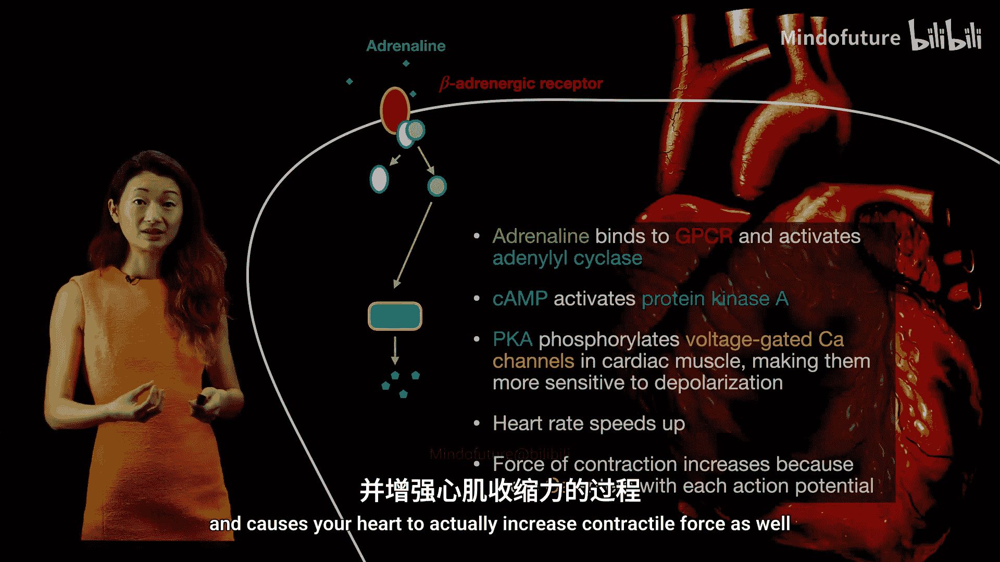

Another version of the story has to do with a vagal nerve。

 the vagus nerve as the vagrant is's a wander is， so this vagus nerve is actually wandering around。

 it goes all the way from the top of your head， it goes around the aic origin comes back up and it uses the neurotransmitter acetylcholine。

 but instead of using acettocholine like the neuromuscular junction does using nicoinnic acettocholine receptors in the vagus nerve the same molecule。

 the same neurotransmitter acettocholine is being listened to by metabotroic muscarinic acettocholine receptors。

 so the two types are acecholine nicotinniccettocholine receptors， are aottroic， their ion channels。

Muscularinnic acettocholine receptors are metatroic， they' GPCRs。

Here's a story about these muscarinnic acetocholine receptors， when acettocholine receptors。

 when acetocholine binds to the muscarinnic atocholine receptor。

The G protein releases the beta gamma sub unit， which then drifts out and activates resting potassium channels in cardiac muscle cells。

 which makes them less excitable because by increasing the concentration and the permeability of cardiac cells to potassium。

 you are making the cells more hypopolarized closer to the resting nerve potential potassium thereby slowing heart rate so this is one mechanism by which we have two different metatroic receptors in cardiac muscles responding to either adrenaline or acetylcholine and they have the net effect of either increasing heart rate or decreasing heart rate。

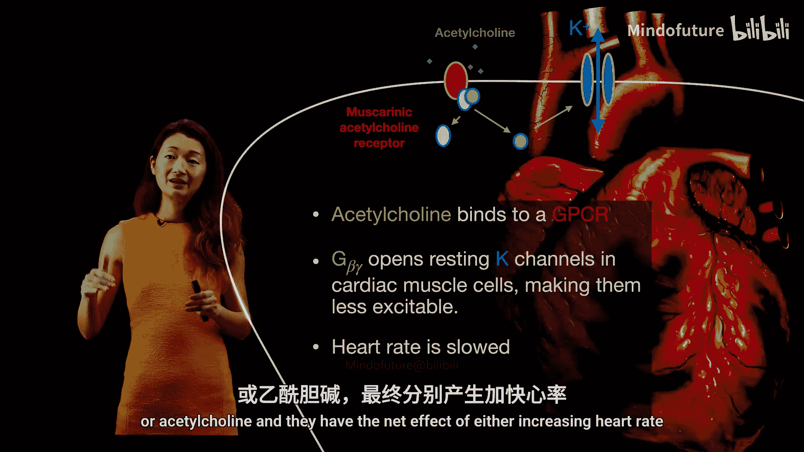

Atropine is also a blocker amongst of the muscarinonic acetocholine receptor Now Atropine is named after Atroppo。

 who is one of the three fates in Greek mythology， in particular Atroppo is a sister that's responsible for cutting the string ending life。

 so Atropine comes from the plant aroppa Badonna and it is a deadly nightsh So Badonna means beautiful women and it's so named because people women in Greece used to use beadonna to rub it in their eyes as a cosmetic because it caused pupil dilation and pupil dilation was considered to be beautiful at the time。

So that's atropine in large concentrations， it's extraordinarily poisonous because ingesting it。

Makes your heart stop。So you kind of need that in small doses。

 you can use atropine to treat bradycardia and it's because atropine once again is a blocker of the muscarinnicaccettocholine receptor。

 the muscarinnic acettocholine receptor slows the heart and when you block it then the whole thing kind of stops and that's not very good。

Okay， so there's the whirlwind tour of some of the interesting neurotransmitters and the receptor systems。

 but your nervous system uses a lot of different neurotransmitters。

 some of which we haven't even mentioned yet。 and we will in the following lectures。

 and there's even more different types of receptors that we have not even mentioned。

 So as as just a preview， this is like a very non-exhausive list。

 here are some neurotransmitter receptors that are encoded by the human genome。

 we see here on the lefthand side the neurotransmitters。

 a lot of them have both ionottroic receptors as well as metatroic receptors。

 they have different types of aottropic receptors like glutamate does。

 And even among the ample receptors and N ofD receptors for glutamate。

 there's multiple genes coding for them that can be differentially regulated depending on what the specific consequences and context of those cells are for expressing each of these different types of neurotransmitters。

 So it's by differentially regulating the localization。

 quantity and identity of these neurotransmitter receptor systems that we can very。

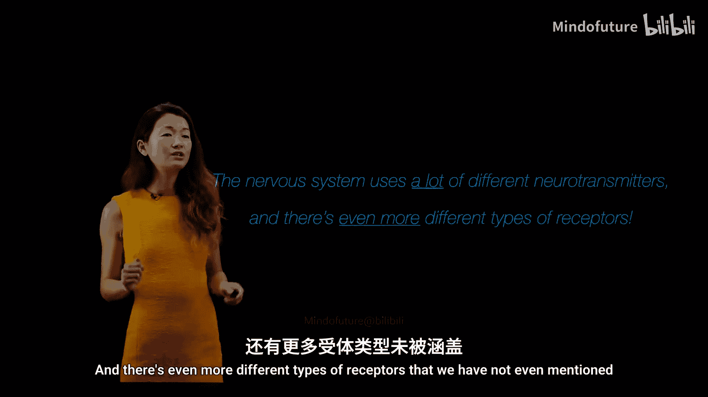

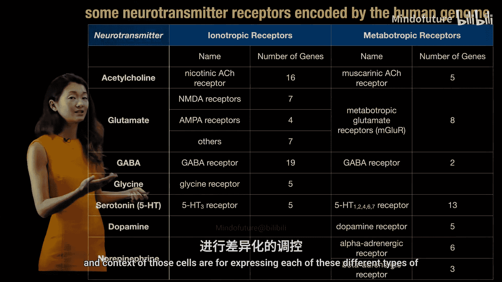

Finally tune the regulation of the nervous system Okay so in summary。

 we talked about different types of postssynaptic receptors The key concepts here are that receptors of neurotransmitters can either be ionotropic or metatroic Iottroic receptors are lien gated ion channels and so they act very quickly In contrast metatroic receptors are liganated GPpCs G protein coupled receptors and they're either coupled to ion channels or lots of other things they are more slow they're not as fast as aottroic receptors but they can lead to much longer lasting effects。

There's a huge variety of different receptors and different common neurotransmitters and even uncommon neurotransmitters and they're really cool to think about。

 and there's nothing intrinsically inhibitory or excitatory about any neurotransmitter and the overall function with synapse acquire us us to pay attention to what the neurotransmitter is which are the receptor systems that are listening to those signals and the equilibrium potential of the relevant ions。

 So those are different types of postsnetic receptors if you keep them straight and keep the terminology straight。

 you can actually understand a really huge variety of fundamental neurobiology at the cellular and molecular levels by cataloging the different types of effector systems that may or may not be active in different parts of your nervous system。

