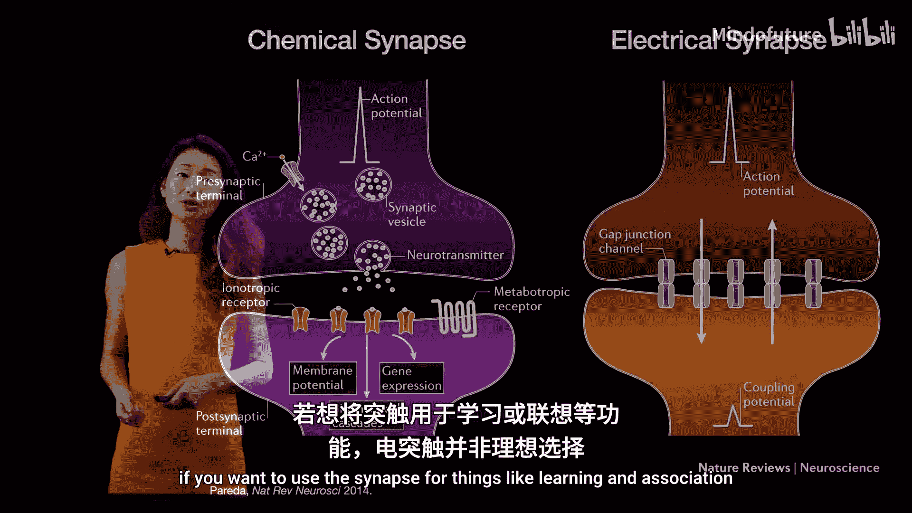
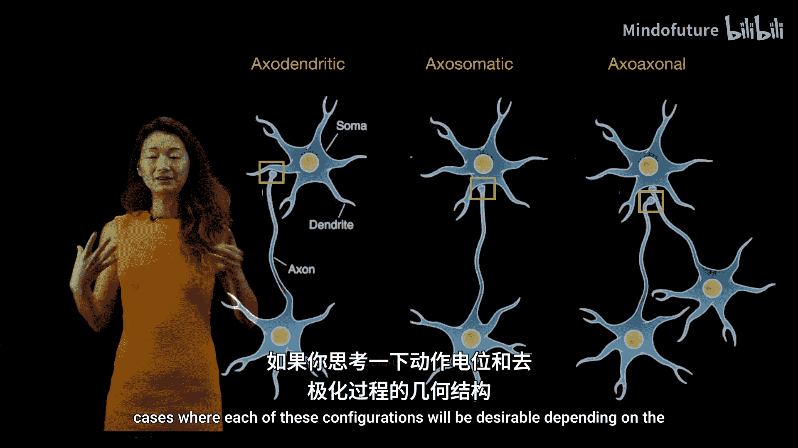
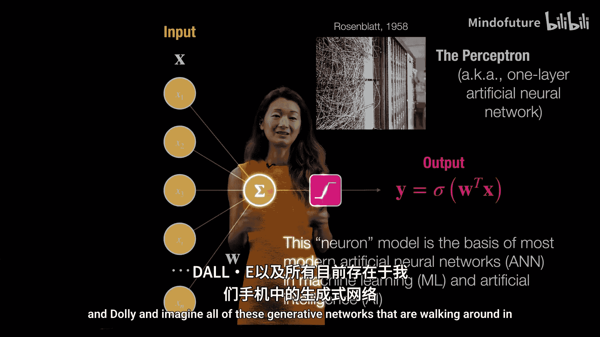
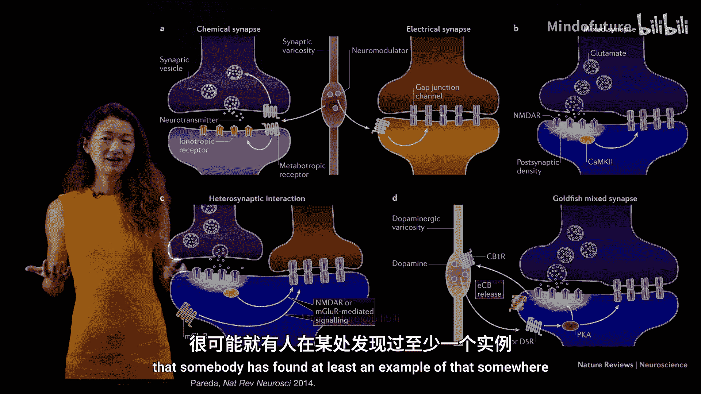
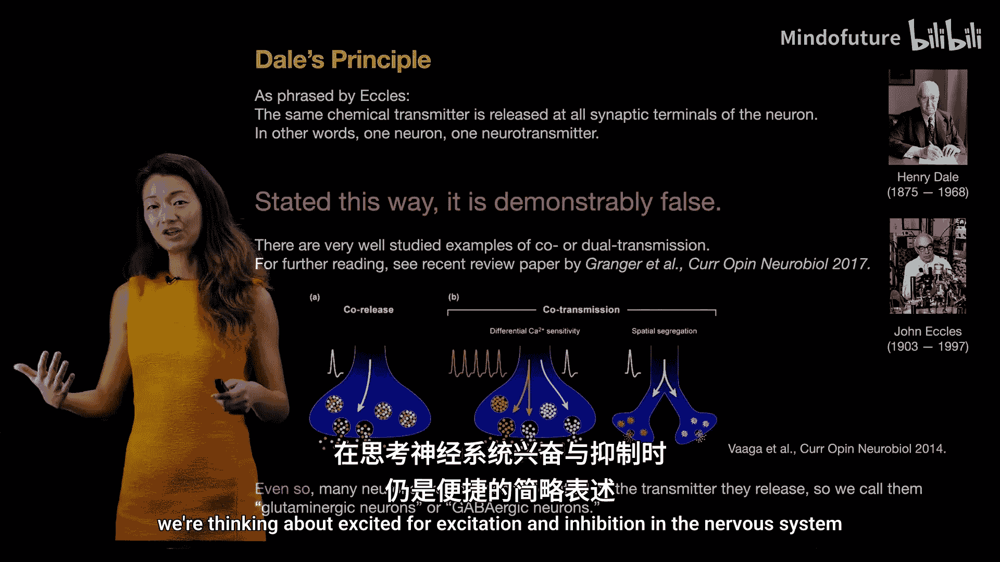

# 【华盛顿大学】神经科学入门 ｜ Introduction To Neuroscience ｜ Bing Wen Brunton p09 P09_突触类型 -BV1i3qWBXEDH_p9-

In the last couple of videos weve spent a lot of time talking about the chemical synapse and I don't want to mislea you to think that that's the only type of synapses that there is and so in this video we're going to be going through different types of synapses in addition to the chemical synapses and just getting a feeling for the complexity of the subject of synapses and all the different ways in which different neurons can be talking to each other that is not a canonical way that we typically think of in the chemical synapse So the first difference is that in addition to the chemical synapse we have what's called the electrical synapse we said earlier that these cells are not actually connecting with each other and I kind of fudge a little bit because sometimes they do so in the chemical synapse we have a presynaptic cell and a postsynaptic cell that are actually separate cells plasma membranes。

 their cell membranes are not touching any particular time and no electrical activity directly passing through this synapse here。

All of these things are not really true in the electrical synapse。

 There are these electrical synapses where the two sides of the cell where the preynaptic and the postsynaptic cell are actually gathered and held together by what are called gap junctions and these gap junction channels are semi permanent protein channels through which ions can flow are these are not ion channels in which case something either open or not。

 I mean， there is basically a continuous between the intracellular space of these two cells because they're held together by these gap gap junction channels。

 So in the electrical synapse， if you think about what's happening here is that rather than the you know。

100 microseconds or so it might take for a action potential to cause something to happen in the postsynaptic side in the electrical synapse。

 it is instantly it is nearly instantaneous。 All you need is for the actual potential to basically directly propagate across that synapse in order for that to happen。

 So in terms of pros and cons and you might want to。😊。

And electrical synapse when you want something to happen really， really quickly and very reliably。

On the other hand， the tradeoff is that you really don't get to change that synapse very much because everything is held together in a very structural。

 pretty permanent way。 We spend the last video talking a lot about ionottroic metabotroic receptors different things that can happen on the postsynaptic side。

 All of that means and you have a whole lot of control over the downstream consequences of this synapse by just modulating the nature and the numbers of all of these receptors in the postsynaptic side。

 Lots and lots of different things can happen here。 very flexible chemical synapse。

 The electrical synapse， on the other hand， it's very fast， but you can't change it very much。

 And so it's not nearly flexible， and you probably don't want to use it if you want to use the synapse for things like learning and association。

😊。

So。Axons can terminate at synapses and generically speaking。

 we talked about in the previous couple of lectures about how generically speaking axons terminate at dendrites。

 and that's how they receive inputs and then dendrite sum。

 all that information they go to the axon hillock initiatedit the action potential and that is generically what happens but the axon to dendrite synapse is also not the only way you can make a synapse。

 So that is what's called an aodendritic synapse， axon to dendrite synapse you can also have what's called an axossomatic synapse where the synapse the axon directly synapses onto the soma cell body of the postsynaptic cell you can even synapse onto the axon of another cell。

 you can have an aoaxonal synapse All of these configurations are possible And if you think about the geometry of action potentials and polarlarizations。

 the hypopolarizations propagating through the electrical neuron。

 you can think about cases where each of these configurations will be desirable depending on the computation you want to happen between the。

😊。

Synaptic cell and the presynaptic cell。We're gonna zoom in a little bit though on the aodenddritic synapse because that I think that is like the most textbook synapse that everyone learns about So we're gonna to learn about it too So this is a zoomed in picture of the dendrite and the first thing you'll notice about it is that it is not smooth。

 It is not well approximated as a smooth cylinder。 In fact， if you zoom in。

 you'll see that it has these little blubby blobby things that are coming off of it these are dendritic spines and dendritic spines are post synaptic terminals onto which the presynaptic axon terminals will actually make that synapse and so it is through these structures that then have a localized environment these spines are formed because instead of then forming a synapse of a axon onto a cylindrical part of the dendrite you form the synapse onto these spine structures which allows the postsynaptic cell to quickly modulate things like how big that spine is if you enlarge the size of the spine you enlarge。

😊，The synapse and you can have more proteins there that are receptors。

 you can also modulate the local environment， the local electrical。

 as well as the local chemical environment at the spine in a way that does not quickly affect all of its neighbors okay so those are spines and they're super cool and you can actually watch them change in size in real time doing some experiments that we may talk about a little bit later。

So to review here are the different steps of the chemical synapse that we talked about earlier。

And one of the things that we talked about is that when sodium enters the postssynaptic cell。

 the depolarizes， the synapse is called excitatory。

 and when chloride enters the postssynaptic cell and it hypopolarizes。

 we call that synapse inhibitory。So。Whenk can think about the way this adds together。

 Let's just look back on this diagram and just look at it for one more time， okay。We have here。

A bunch of dendrites that receive inputs。These inputs can be excitatory or can be inhibitory。

 in case they're either depolarizing or they're hyperpolarizing。

 all of them propagate according to the cable equations。Through the dendritic tree。

they're added together and the summed， positive and negative inputs both。

And if the sum passes some crucial threshold。Then the neuron fires an active potential and becomes active。

Say this a couple of different ways because this is a really crucial concept here， if the addition。

 if the sum of all of the inputs does not pass a threshold。😊，The cell does not fire。

 and so nothing happens。 There's no record of having a small net input。 Nothing happens。Conversely。

 the neuron can only fire active potential so fast。

There is a limit to how fast it can fire action potentials because the voltage gated sodium and potassium channels need time to recover and for the local electrical gradient of the respective ions to recover to resting concentrations before an action potential can be generated again。

 so a neuron is a device that sums inputs positive and negative。

It passes through a threshold because below that threshold nothing happens。

And there's also a ceiling to this activity because it just physically and physiologically cannot fire very much faster than that。

And that leads us back to the problem of the mindbody problem and dualism where philosophically speaking for hundreds and thousands of years。

 people have thought about the fact that maybe your mind and yourself is different than the physics of your body。

 the physical instantiation of your body and that leads to this idea that the ontological question are mental states and physical states suinct and the causal question of how do physical states and mental states influence each other is it one directional。

 is it both directional and if so how this is a question that was all around for a long time。

The process of addition， summation， and thresholdholding that we talked about in the previous slide essentially killed dualism。

And this happened by the semiole this very influential paper in 1943 by my collican Pis。

 and they were the first to articulate this idea that you can think of the activity of neurons as a computational logical machine。

😊，This sounds obvious to us now， because we all talk about how minds are like machines。

 how your brains like a computer， right， So the analogies is very popular。 Now。

 Everyone's heard of it by this point。 But the 1940s， this is a brand new idea。

 This is the first time has anyone has ever thought about the equivalency。😊。

Of the electrical activity that we have been observing doing experimenting neurons and the fact that it can actually perform logical operations in the same way that you can compute logical operations。

 either in abstraction of mathematics or in logical machines。

And the intellectual history of how we got from this moment in 1943 and the idea of the calculus of the mind。

And there's a direct path between that idea and artificial intelligence and machine learning algorithms as they affect us now in 2023。

So this is a topic of a future lecture I'm looking forward to digging a lot more into it but I couldn't help myself we have the necessary bonus now to give you a preview of what that's all about so I'm going to draw this following diagram here which is kind of like the same diagram we drew the neuron but now in artificial neural network speak so the inputs here I'm going to line them up these are input cells just like we have those input cells forming expitatory and inhibitory synapses on the previous diagram the dendrites。

😊，They're either excitatory or inhibitory， in which case theres a W vector here that is the encapsulation of to what extent those synapses are positive or negative and by how much。

The cell then sums them up， this artificial neural network。

 this artificial neuron sums them up just like the real neuron does， if it doesn't pass a threshold。

 nothing happens just like the real neuron， and especially in historical versions of these artificial neural network。

 there was also a ceiling above which the cell cannot fire faster。In other words。

 every single part of an artificial neural network。

 this neuron model is the basis of all modern artificial neural networks and these ideas came directly from our knowledge decades ago of how real neurons worked So we're going to be thinking to a lot more about this and thinking about how we got from knowledge of neurons and the fact that we have action potentials to these simple artificial neural networks to things like chat DP and Dolly and imagine all of these general networks that are walking around in our phones right now。

 we're going talking about in the future lecture。 Well for now though we're going go back to synapis because we're talking about exceptions here So these are all exceptions that are not at all in artificial neural networks they are in reality they're in biology but you can program them in is possible to instantiate our artificial neural networks that have these properties but it's unclear they'll actually be helpful and they're certainly more complicated and so people haven't really it hasn't become popular yet although people have tried in the field of。

For computing to implement different versions of more complicated synapses so we talked about the chemical synapse right so it's good。

 We talked about the electrical synapse They are not also exclusive。

 it is possible to have a mixed synapse that is partially chemical and partially electrical this happens you can also have what's called a heterosynaptic collection where one postynaptic terminal。

 one postsynaptic spine for example， can receive both a chemical synapse for one cell and a gap junction electrical synapse from a different cell and you can also have things like the following where you have the goldfish mixed synapse where you have a mixture of chemical synapses。

 electrical synapses as well as neuromodulation by some other cell that's kind of in the facility just sprinklely neurotransmitters in your direction all of these things are observed and have function in different systems in different nervous systems and they're really interesting to think about so I just want to I don't want to dwell on the details here and look at all the different examples of which there are many I as a biologist I am a lumper not a splitter but I did。

want to point out that like lots of lovely things in biology。

 oftentimes there's no hard and fast rules of oh， something can't happen if you can kind of articulate it。

 it's very likely that somebody has found at least an example of that somewhere and that is the case in these different types of synapses。

So we also talked about glutamamineerrgic cells and gaerrgic cells as being excitatory cells and inhibitory cells in the central nervous system in mammals。

 there is a principle that came to be known as Dale's principle named after neuroscientist Henry Dale。

 but it was actually articulated by a different neuroscientist on Es。 It is phrased by Eccs。

 Dale's principle is the following。 The same chemical neurotransmitter is released by all chemical terminals of the neuron。

 In other words， one neuron， one neurotransmitter。 Every neuron has its own neurotransmitter。

 it only speaks in language of that neurotransmitter， that's Dale's principle。

As it is stated in the following way in this particular way， it is quite demonstrably false。

 There are very well studied examples of co transmissionmission and dual transmission of one neuron packing different neurotransmitters in the same vesicles and releasing them at the same time。

 and you can also have cotransmission where the same presynaptic cell packs totally different vesicles with different neurotransmitters and also released them at the same time。

 These are all things that we have observed in special systems and they have really cool functions as well。

 So I recommend you read some review articles if this is of interest to you。😊，And so even so。

 I want to emphasize that these things do exist， however。

 we still talk about glutamaminegic neurons and gaerrgic neurons because that is the preponderance of the case and is still a shorthand that's really convenient if we're thinking about excited for excitation and inhibition in the nervous system。

So to summarize， we talked about different types of synapses。

There are chemical synapses and electrical synapses。 One of them is more flexible。

 a little bit slower， the other one is faster， but less flexible。

 it can't really change all that easily。 synapsis can be found in many different parts of the cell。

 you can synapse onto dendrites so must axon basically every part of the cell is a potential target for a synapse so the cartoon picture of all of the inputs coming in the dendrites that's not quite correct either。

 as we talked about in the propagation of potential electrical potential is down the cell。

 the location of the synapse actually has a pretty big impact on its function。

 if the synapse is far away from the axon hillock， then it has a really far away to travel before it influences that all or nothing action potential initiation event。

 but if your synapse is much closer like the synapsing directly onto the cell body and you have a big strong inhibitory synapse。

 then that synapse has a disproportionate vote not only because of its size but because of its proximity and geometry with respect to the site of action potential localization initiation。

We then talked about the overall function of a synapse which is determined by a variety of different factors in this case we talked about how neurotransmitters are released by the presynaptic cell so whether or not it is tend to be typically excitatory。

 typically inhibitories neurotransmitter and also the receptors that are present on the postssynaptic cell I know I've said this before but it's super du important so you're going to hear me say it multiple times。

😊，Synapses can also be a mixed time so it doesn't have to be only a chemical synapse or electrical synapse and you can even have synapsis release of multiple different types of neurotransmitters。

 even so we still persist in saying that neurons are identified but the neurotransmitter say release and so if you see that there is a neurotransmitter that a neuron releases primarily glutamine as a neurotransmitter we can call that glutamaminergic neuro。

 so that terminology is something that will persist in using for the rest of these lectures。

