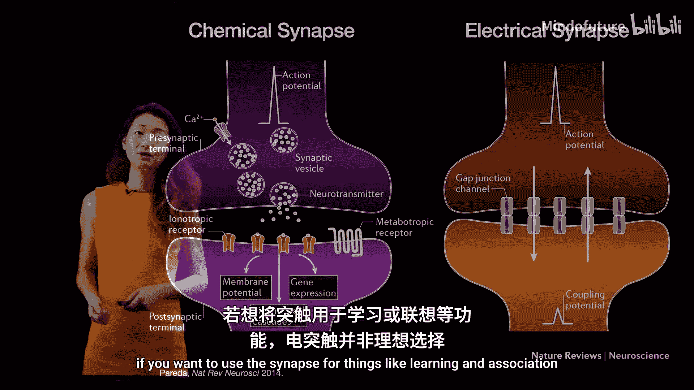
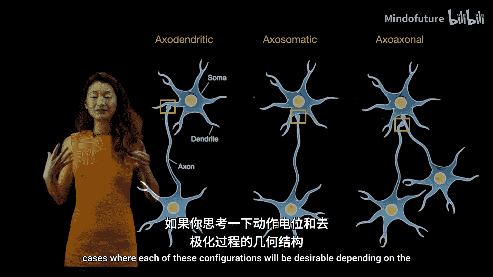
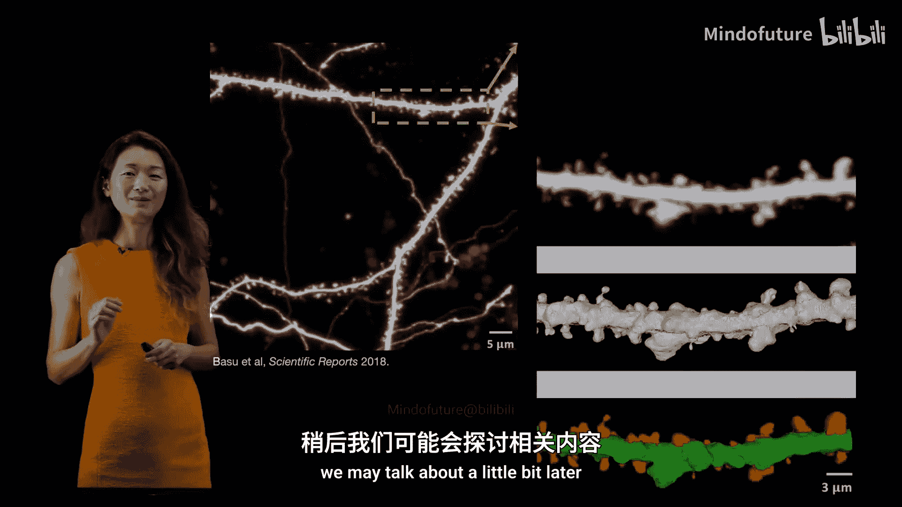
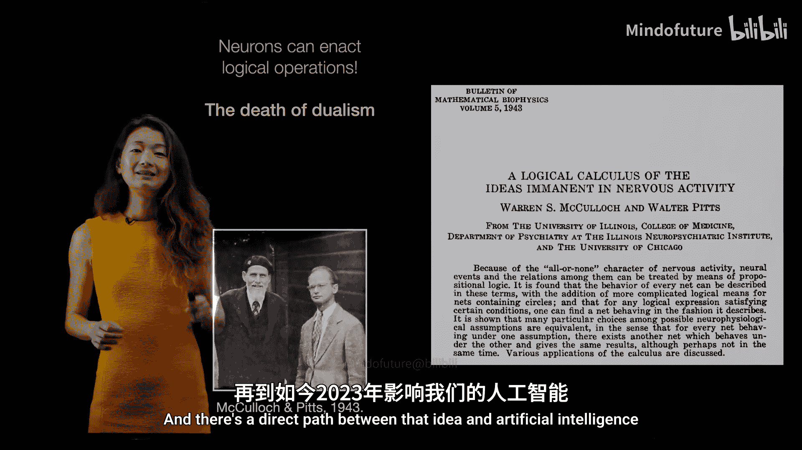
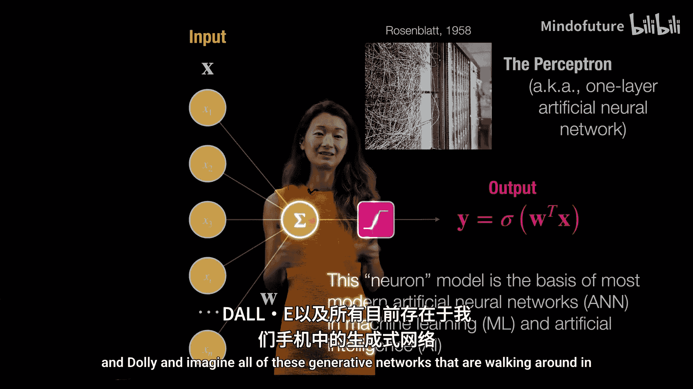
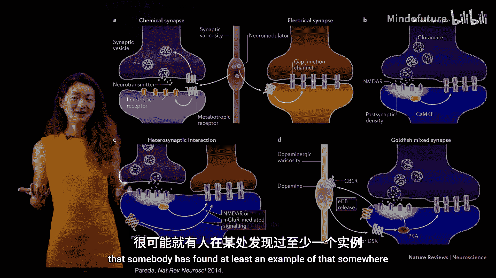
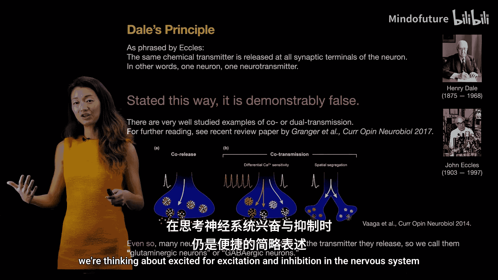

# 神经科学入门：09：突触类型 🧠

在本节课中，我们将学习神经系统中不同类型的突触。在前几节视频中，我们详细讨论了化学突触，但突触的世界远不止于此。本节将介绍电突触等其他类型，并探讨突触连接的复杂性，以及神经元之间除经典化学突触外的多种“对话”方式。

## 化学突触与电突触 ⚡

上一节我们重点介绍了化学突触，但请不要误以为它是唯一的突触类型。除了化学突触，我们还有电突触。了解不同类型的突触，能让我们感受到这个主题的复杂性，以及神经元之间非经典的多种交流方式。

首先，最主要的区别在于，除了化学突触，还存在电突触。之前我们提到，在化学突触中，细胞并非真正连接在一起。这种说法其实不够精确，因为有时它们确实会连接。在化学突触中，**突触前细胞**和**突触后细胞**是独立的细胞，它们的细胞膜在特定时刻并不接触，也没有电活动直接通过这个突触传递。

然而，在电突触中，上述情况并不成立。电突触的两侧，即突触前细胞和突触后细胞，实际上通过**缝隙连接**紧密地聚集并固定在一起。这些缝隙连接通道是半永久性的蛋白质通道，离子可以从中流动。它们不像离子通道那样有明确的开放或关闭状态。由于这些缝隙连接通道的存在，两个细胞的细胞内空间基本上是连续的。

因此，在电突触中，电信号传递几乎是瞬间完成的。一个动作电位无需像在化学突触中那样等待约100微秒才能在突触后侧引发反应，而是可以直接、几乎即时地传播过去。

接下来，我们看看两者的优缺点。当你需要某个反应发生得非常快且非常可靠时，可能会想要使用电突触。另一方面，其代价是你很难改变这个突触，因为一切都是以一种非常结构化、近乎永久的方式固定在一起的。

上一节我们花了很多时间讨论离子型受体、代谢型受体以及突触后侧可能发生的不同变化。所有这些都意味着，通过仅仅调节突触后侧这些受体的性质和数量，你就能对突触的下游后果拥有极大的控制力。化学突触非常灵活，可以发生多种多样的变化。

相比之下，电突触速度非常快，但难以改变。因此，它远不如化学突触灵活。如果你希望突触用于学习、联想等功能，可能就不会选择使用电突触。

## 突触的位置与几何结构 📍

轴突可以在突触处终止。一般来说，我们在前几讲中谈到，轴突通常在树突处终止，这是它们接收输入的方式。然后树突汇总所有信息，传递到轴丘，在那里引发动作电位。这是一般情况，但轴突-树突突触并非形成突触的唯一方式。

轴突-树突突触被称为**轴树突触**。此外，你还可以有**轴体突触**，即轴突直接与突触后细胞的胞体形成突触。你甚至可以将突触建在另一个细胞的轴突上，形成**轴轴突触**。所有这些配置都是可能的。

考虑到动作电位和极化/去极化在神经元中的电传播几何特性，你可以设想，根据你希望在突触后细胞和突触前细胞之间发生的计算类型，每种配置都可能成为理想的选择。

不过，我们将稍微放大观察轴树突触，因为我认为这是教科书中最经典的突触类型，我们也需要学习它。

这是一张放大的树突图片。你首先会注意到它并不光滑，不能很好地近似为一个光滑的圆柱体。事实上，放大后你会看到它有许多小小的、凸起的结构，这些就是**树突棘**。

树突棘是突触后终端，突触前的轴突终末会在此处形成突触。通过这些结构，形成了一个局部化的微环境。形成这些棘状结构，而不是在树突的圆柱形部分形成突触，使得突触后细胞能够快速调节，例如改变棘的大小。如果你增大了棘的尺寸，也就增大了突触的规模，可以在那里容纳更多的受体蛋白。

你还可以调节棘的局部环境，包括局部的电环境和化学环境，而这种调节不会迅速影响到其邻近区域。这些树突棘非常酷，通过一些实验，你甚至可以实时观察它们大小的变化，我们可能在后面会稍微谈到。

## 突触的整合与阈值机制 ⚖️

现在我们来回顾一下之前讨论的化学突触的不同步骤。我们曾谈到，当钠离子进入突触后细胞并使其去极化时，该突触被称为**兴奋性突触**；当氯离子进入突触后细胞并使其超极化时，该突触被称为**抑制性突触**。

我们可以思考这些输入是如何叠加的。让我们再看一下这个示意图。这里有许多接收输入的树突。这些输入可以是兴奋性的（去极化），也可以是抑制性的（超极化）。它们都根据电缆方程在树突树中传播。

它们在树突树中被加总，正负输入一起求和。如果总和超过某个关键阈值，那么神经元就会触发动作电位并变得活跃。

这一点至关重要，需要从几个不同角度来理解。如果所有输入的总和没有超过阈值，细胞就不会放电，什么也不会发生。微小的净输入不会被记录，没有任何结果。

反之，神经元触发动作电位也有速度上限。由于电压门控钠通道和钾通道需要时间恢复，以及局部离子浓度梯度需要恢复到静息状态后才能再次产生动作电位，因此神经元放电存在物理和生理上的极限速度。

所以，神经元是一个对正负输入进行求和的装置。它有一个阈值，低于阈值则无反应；同时也有一个活动上限，因为它无法超过生理极限更快地放电。

## 从神经元到人工神经网络 🤖

这让我们回到了心身问题和二元论的哲学议题。数百年来，人们一直在思考，也许你的心灵和自我与你身体的物理实体是不同的。这引出了本体论问题（心理状态和物理状态是否截然不同）和因果问题（物理状态和心理状态如何相互影响，是单向还是双向，如果是双向，如何影响）。这是一个长期存在的问题。

我们在上一张幻灯片中讨论的加法、求和与阈值处理过程，本质上终结了二元论。

这得益于1943年我同事的一篇极具影响力的论文。他们首次阐明了这一观点：你可以将神经元的活动视为一种计算逻辑机器。这在今天听起来显而易见，因为我们都在谈论心灵如何像机器，大脑如何像计算机。这个类比现在非常流行，每个人都听说过。

但在20世纪40年代，这是一个全新的想法。这是人们第一次思考我们通过实验在神经元中观察到的电活动，与它实际上可以执行逻辑操作这一事实之间的等价性。这种逻辑操作既可以在抽象的数学中计算，也可以在逻辑机器中实现。

从1943年的这个时刻、“心灵演算”的概念，到如今2023年影响我们的人工智能和机器学习算法，其思想发展史有着直接的脉络。

这是未来一讲的主题，我期待深入探讨。但现在我们已经具备了必要的基础知识，可以给大家预览一下相关内容。我将在这里画出下面的示意图，它类似于我们之前画的神经元，但现在是用人工神经网络的语言来描述。

这里的输入我将排列起来，这些是输入细胞，就像上一张图中在树突上形成兴奋性和抑制性突触的输入细胞一样。它们要么是兴奋性的，要么是抑制性的。这里有一个**权重向量 W**，它封装了这些突触在多大程度上是正或负，以及程度如何。

然后，这个人工神经元对它们进行求和，就像真实的神经元一样。如果求和结果不超过阈值，则什么都不发生，也像真实的神经元一样。特别是在这些人工神经网络的历史版本中，也存在一个细胞无法更快放电的上限。

换句话说，人工神经网络的每一个部分，这个神经元模型，是所有现代人工神经网络的基础。而这些想法直接来源于几十年前我们对真实神经元工作原理的认识。未来我们将更多地思考这一点，思考我们如何从对神经元和动作电位的认识，发展到这些简单的人工神经网络，再到像ChatGPT、DALL-E以及我们手机中运行的各种通用网络。这将是未来讲座的内容。

不过现在，让我们回到突触，因为我们正在讨论例外情况。

## 生物学中的复杂性与例外 🧬

以下都是人工神经网络中完全不存在的例外情况，它们存在于现实中，存在于生物学里。当然，你可以在人工神经网络中编程实现这些特性，但尚不清楚它们是否真的有益，而且它们无疑更复杂。因此，尽管该领域的研究者已经尝试过，但尚未真正流行起来。

例如，在计算领域，人们尝试实现更复杂突触的不同版本。我们讨论了化学突触，很好。我们也讨论了电突触。但它们并非互斥的。

有可能存在**混合突触**，它部分是化学的，部分是电的。这种情况确实存在。你还可以有所谓的**异突触集合**，例如，一个突触后棘可以同时接收来自一个细胞的化学突触和来自另一个细胞的缝隙连接电突触。

你还可以有像下面这样的情况，比如金鱼的混合突触，其中混合了化学突触、电突触，以及由附近其他细胞进行的神经调节（只是朝你的方向“撒”一些神经递质）。所有这些都在不同神经系统的不同部分中被观察到并具有功能，思考它们非常有趣。

我不想在此赘述细节，也不想列举所有众多的例子。作为一名生物学家，我倾向于“合并”而非“拆分”。但我想指出，就像生物学中许多美妙的事物一样，通常没有硬性规定说“某事不可能发生”。如果你能描述它，很可能有人在某个地方至少找到了一个例子。在不同类型的突触中，情况正是如此。

## 戴尔原则与共传递 🧪

我们还谈到，在哺乳动物的中枢神经系统中，谷氨酸能细胞和GABA能细胞分别是兴奋性细胞和抑制性细胞。这里有一个后来被称为**戴尔原则**的原理，以神经科学家亨利·戴尔命名，但实际上是由另一位神经科学家埃克尔斯阐述的。

埃克尔斯阐述的戴尔原则如下：**同一化学神经递质由该神经元的所有化学终端释放**。换句话说，一个神经元，一种神经递质。每个神经元都有自己的神经递质，它只使用那种神经递质的“语言”进行交流。这就是戴尔原则。

如果按照这种特定方式表述，它显然是错误的。已有充分研究的例子表明存在**共传递**和**双重传递**，即一个神经元在同一囊泡中包装不同的神经递质并同时释放它们。你也可以有共传递，即同一个突触前细胞包装完全不同的囊泡，内含不同的神经递质，并同时释放它们。我们在特殊系统中观察到了所有这些现象，它们也具有非常酷的功能。如果你对此感兴趣，我推荐你阅读一些综述文章。

尽管如此，我想强调这些现象确实存在。然而，我们仍然谈论谷氨酸能神经元和GABA能神经元，因为这是普遍情况，并且在思考神经系统中的兴奋和抑制时，这仍然是一种非常方便的简写方式。

## 总结 📝

本节课中，我们一起学习了不同类型的突触。

我们讨论了**化学突触**和**电突触**。其中一种更灵活但速度稍慢，另一种速度更快但灵活性较差，不易改变。突触可以出现在细胞的许多不同部位，你可以将突触建在树突、胞体甚至轴突上。基本上，细胞的每个部分都是突触的潜在目标。因此，所有输入都进入树突的卡通图景也并不完全正确。

正如我们在电位传播中讨论的，电位沿着细胞向下传播，突触的位置实际上对其功能有相当大的影响。如果突触距离轴丘很远，那么在影响那个“全或无”的动作电位起始事件之前，它需要传播很长的距离。但如果你的突触更近，比如直接突触到胞体上，并且是一个强大的抑制性突触，那么这个突触就拥有不成比例的“投票权”，这不仅是因为它的大小，还因为它相对于动作电位起始部位的接近程度和几何位置。

然后我们讨论了突触的整体功能，它由多种不同因素决定。在本例中，我们讨论了神经递质如何由突触前细胞释放，因此它通常是兴奋性还是抑制性神经递质，以及突触后细胞上存在的受体类型，都至关重要。我知道我之前说过这一点，但它超级重要，所以你会听我说很多次。

突触也可以是混合型的，不一定只是化学突触或电突触。你甚至可以有突触释放多种不同类型的神经递质。即便如此，我们仍然坚持认为神经元可以通过其释放的主要神经递质来识别。因此，如果你看到一个神经元主要释放谷氨酸作为神经递质，我们可以称其为谷氨酸能神经元。这种术语我们将在后续课程中继续使用。