# 【华盛顿大学】神经科学入门 ｜ Introduction To Neuroscience ｜ Bing Wen Brunton p10 P10_(娱乐性)药物与大脑 -BV1i3qWBXEDH_p10-

The next step in our adventure today is talking about recreational drugs and what they do to your brain In other words。

 now that we put in all the work in thinking about all the different neurobiology。

 synaptic transmission， we can talk about how to hack it。So before we start。

 we're going to be talking about the molecular targets of recreational drugs。

 here's a diagram of chemical synapse that you've already seen many different times in the previous videos。

 if you want to review of the different steps of chemical synaptic transmission。

 please review those videos now。But once you've figured out what all of these molecules are。

 perhaps it will not surprise you that every single one of them is a molecular target of recreational drugs before we start and dig into each of these。

 I want to say a disclaimer upfront to please not alter your pattern or prescription drug compliance as a result of any thing you see in this video we're talking about fun neurobiology。

 please don't make any decisions based on it and please consult a medical care professional prefer further guidance about your prescription drugs okay with that out of the way。

 let's talk about drugs。All right， so these are the drugs that we're going to be talking about today。

 morphine， tihydrocannabinol， THC， ethanol， which is an alcohol that we drink caffeine。

 which I am currently on right now， which is why I'm talking so fast， fcyclating PCP。

 LSClysic aciddiaphla amide which was a halluccinogen， nicotine， which is found in cigarettes。

 cocaine found in cocaine and amphetamines which is a class of molecules that are also known as speed all right so that's the plan we're going to talk about all of these today。

First but for drugs to get into your blood， it has to cross what's called the stomach to blood barrier which is an lipid membrane just like every other barrier in your body and so there's a story here that is actually a story of chemistry and we've be talking about a couple of different biochemistry and organic chemistry story today in this drug section and the story goes the following the cocaine in its native form is actually a salt cocaine hydrochloride and in order for cocaine hydrochloride because it's a charged particle to pass through the lipid niple barrier into your blood it actually has to become a slightly different form and that is why chewing cocoa leaves with lime basically takes cocaine hydrochloride into cocaine base otherwise known ass crack cocaine and that has a much easier time of passing through from the stomach to blood barrier and into your blood so if you were wondering why crack cocaine is so much more effective than cocaine and chewing cocoa leaves also makes cocaine more effective this piece of chemistry。

Is what explains that observation？Going back to the molecular targets of recreational drug and now that you're in the blood now that you're in the brain。

 where are we going next， let's take let's take the tour here。

 the THCs and morphinees and nicotines and all of these different recreational drugs we're talking about。

 a large number of them are actually found in nature。 they're disills for plants。

 and so they've been known to human history and natural history for a very long time。

 People have used different versions of these chemicals。

 both additionally as well as recreationally for a long time。

 and a lot of these molecules are actually really important in the cultural histories of lots of different cultures。

 There' are some of them though， that are actually synthetics。

 So amphetamine and synthetic PCP synthetic molecule MmaA is also ayn molecule。

 and so they didn't really exist before the modern era where we actually had organic chemistry。

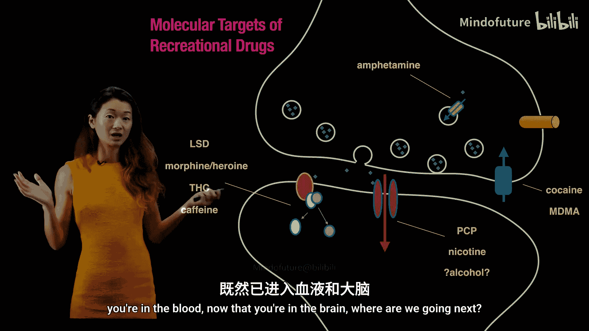

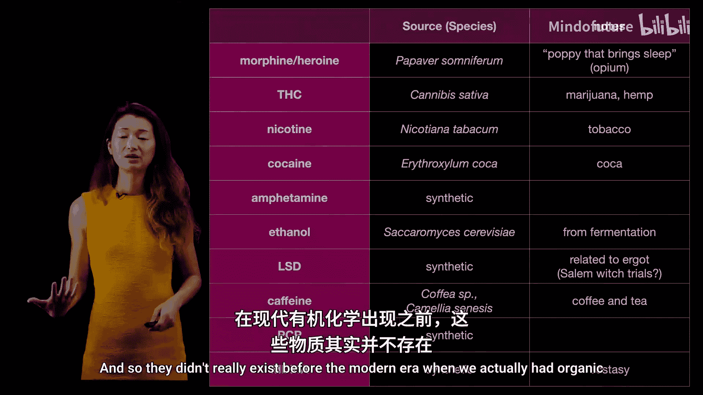

So。To talk about drugs of abuse and also recreational drugs。

 we have to talk about the pleasure reward system so far in these lectures。

 we haven't talked too much about the different parts of the brain and what they do。

 that's more the focus in the next set of lecture videos that we'll be talking about。

 but I'm just gonna to give you a preview here because it's really fascinating to get you a preview of not only the different molecules are involved。

 but also the different molecular systems that are involved in different parts of your brain。

 So the pleasure reward system is a really powerful one in your brain。

 This is a picture of a what's called a sagial section and in this particular case the rat brain。

 but there's a very similar version of this for human brain。

 a sagial section is basically a side view where I'm cutting my head in half kind of this way。

 So I'm seeing the left and the right half of the brain separately。

 So what you're seeing here is a satgial view of the rat brain。

 the left is the front the righthand in its back and so the spine and the rest of the rat's going to go back that way。

 Allright。The Psure reward system involves a couple of key areas。

 it includes what's called the nucleus accumbentens， the amygdala， and the VTA。

 the ventral Techegmental area。And it is a large set of systems that tell you when you've done something right and you want to reward and also gives you a feeling of dread and unpleasantness when you do something that you don't want to do next time in particular。

 the information about pleasure and reward is carried through a large nerve bundle that crosses the medial prefrontal cortex the nuucleo aumbens and the VTA。

 the ventnstrual techmental area in what's called the medial forbrain bundle。

 this is literally the wire that carries all sense of pleasure in your brain。

So to give you an idea of how powerful the system is I'm going to show you a couple of examples of what happens for the medial4brain bundle If you tapped into the medial4brain bundle。

 this is a nerve bundle here so it's a bunch of axons that are electrically active you can build yourself a robo rat so in this paper what they did is they implanted an electrical device that directly simulated by passing current through the medial4 brain bundle of my little rat down there carrying a backpack so it has a battery attached to it。

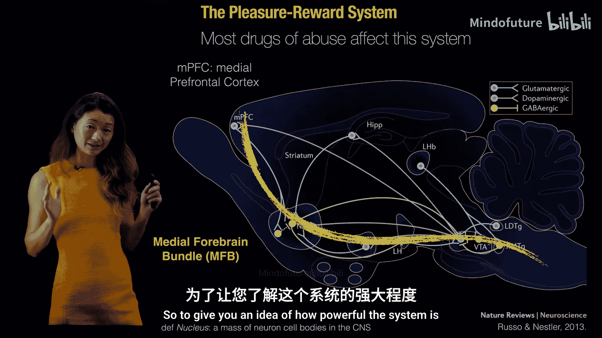

And when it stimulates the more media fibrae bundle， the rat feels like oh。

 something good to go forward and then they also implanted two other wires。

 one corresponding to the part of the brain for the left whiskers and one corresponding to the part of the brain for the right whiskers that's if something was touching the rat on the left side or the right-hand side so now you have a robo rat because you have three buttons。

 one of them makes it go forward， the other one makes it go left and the other one makes it go right and so here's a couple of demonstrations where without training by pressing those buttons of which when we're stimulating mediafurbrae bundle。

 the left whisker cortex or right whisker cortex， the rat was able to navigate this relatively complicated set of mazees without training just by being stimulated in the correct places。

 its correct respective places in its brain so that's cool。

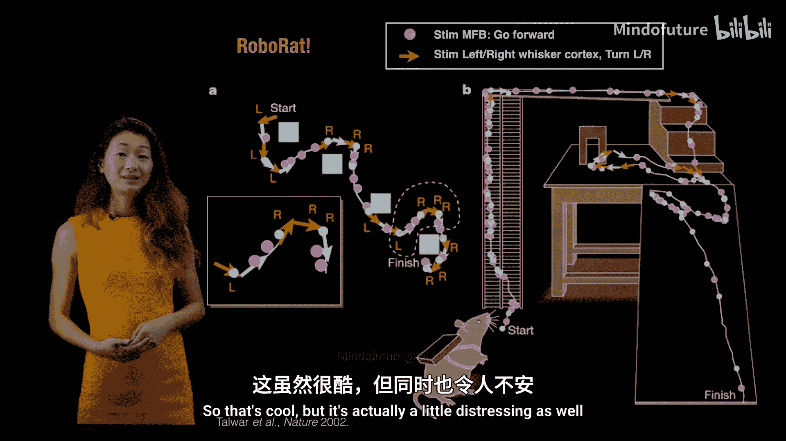

But it's actually a little distressing as well。 There's what's called a set of Dr a self administration experiments that have also been done with rats where the the the rat is given the option of having either food or a direct simulation to its medial forebrain bundle。

 So it has a choice。 It can either eat food or。Get a simulation directly in its medial forebrain bundle。

Can either have cake or not real cake？Distressingly， in the majority of the experiments。

 because the simulation of the media4brain bundle is so pleasurable。

 oftentimes the rat would keep pressing that button to simulate the medial4brain bundle and starve to death。

 so that is how powerful the system is。

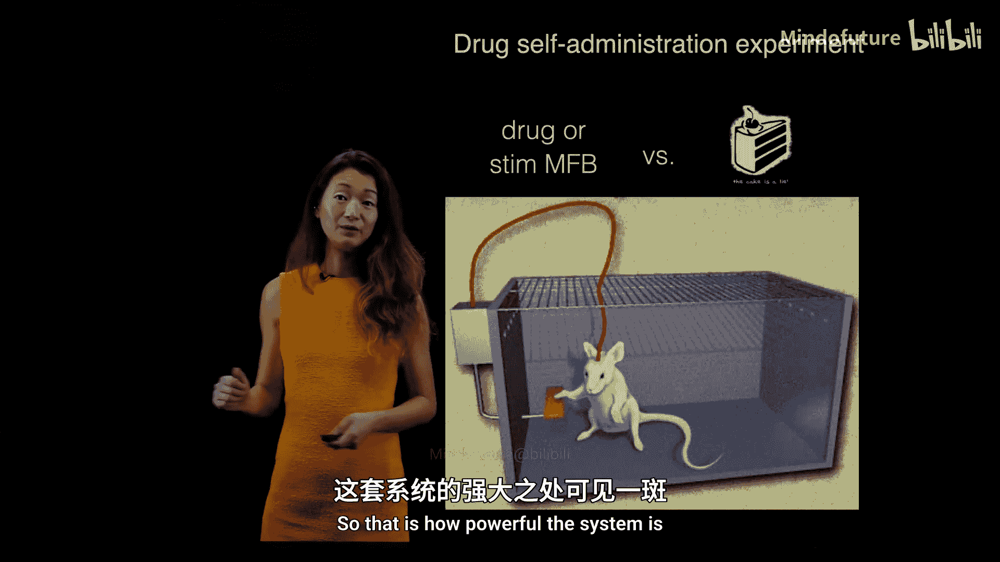

The reason it's so powerful is because it reflects unexpected reward In other words this is the part of the brain that becomes active when something good happens and you weren't expecting it。

 which is you know the unexpected pleasure of good things happening right not only do the part of your brain called the VTA。

 the ventralte mental area reflects this type of unexpected reward。

 individual dopamine cells also can reflect unexpected reward。

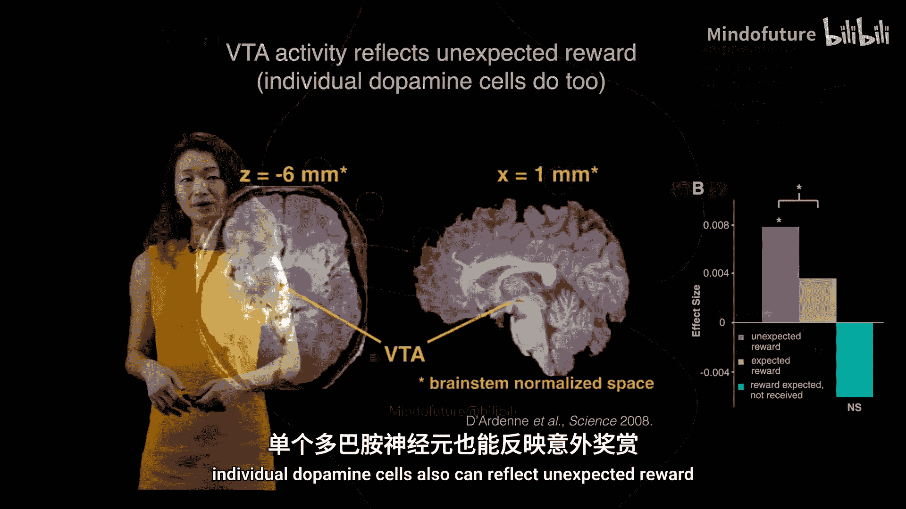

And that is the basis of amphetamines and cocaine， so the dopamine system is a target of cocaine where the cocaine is an antagonist of the dopamine reuptake transporter。

 let's unpack that for a little bit your dopamine cell and when the dopamine is released。

 it is one of the ways that the body codes for the fact that there is a pleasure and unexpected reward。

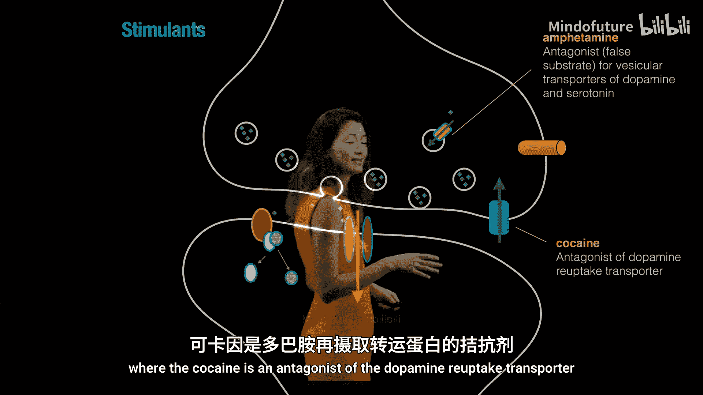

Cocaine， because it is an antagonist shuts down， the dopamine reuptake transporter。

 it means that cocaine makes it so that the dopamine is not leaving the synaptic cleft。

 it would normally be taken up by these transporters and get recycled and get removed from the synaptic cleft。

 but because there's cocaine， it's an antagonist which blocks the dopamine re-uptake transporters effectively we have more dopamine because every molecule dopamine that the dopamine cells release sticks around for longer。

 and that explains one of the reasons why cocaine is so pleasurable and also so addictive。Similarly。

 amphetamines targets a different transporter system。

 instead of targeting the dopamine reuptake transporter system。

 it targets the vicular transport system for dopamine and serotonin。

So what that's basically going to mean is that it's actually an antagonist in that it's a false substrate。

 so amphetamines makes it so that instead of packing more dopamine and serotonin back into those vesicles。

 it's packing amphetamines into those vesicles instead and amphetamines don't really do anything when you release them and this increases the local presynaptic terminal concentrations of dopamine and serotonin in these cells。

 there's a little more complicated explanation of why this actually leads to the stimulant effects of amphetamines。

 but this is known to be one of the molecular targets of amphetamines。

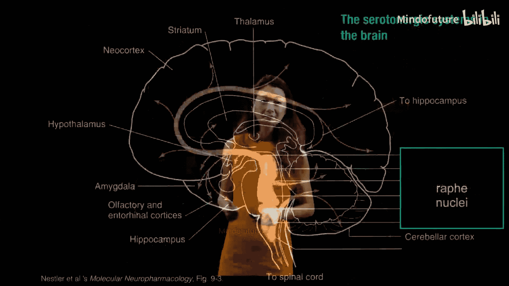

We also already talked a little bit about not only the dopamine system， but the serotonrgic system。

 the serotonrgic system is related to the dopamine system， but anatomically is a little bit distinct。

 so instead of having to do with the nucleo accumbens and the VT dementtechmental area now we're talking about a series of brain structures that are collectively known as the raffi nuclei in this part of the brain we are once again looking at a satgial section of the brain this happens to be a human brain rather than the rat brain so it's more like what your brain and my brain looks like and the serotonin cells live。

 their cell bodies are in the rai nuclei but then they project through their axons all over the brain this is not go to one place it basically goes everywhere one analogy that I heard of in describing the serotonrgic system of the brain is that it is more like it's more like a sprinkler system where you have you have these little sprinklers of serotonin that just kind of go all over and so it's a slower acting more of a neuromodulator effect rather than kutamate or gaba that turns things on and off kind of rapidly so that's kind of what serotonin does。

The serotonin system is a target of hallucinogens， including PCP and LSC and psilocybins。

 so PCP is an antagonist of the NDA glutamomy receptors of the serotonrgic system。

LSD and psilocybins， instead target the metatroic receptors of the 5HT receptors。

 5HT is another way of saying serotonin， so it's an agonist of the serotonin receptors。

Think about what that happens。 just unpack that for a little bit， I know it's a lot of words。

 a lot of jargon。 let's unpack that for a little bit。 serotonin receptors。Cause feelings of pleasure。

 for example， and connection。LSD and psilocybins activate those same serotonin receptors so that the action of serotonin is mimicked by taking these hallucinos。

So here we have examples of two different types of gluccigens that target the metaottroic receptors as well as the ionionotropic receptors of the serotonin system。

We can look at other types of psyellylics right so it's not just the postynaptic receptors at our targets of these recreational drugs。

schedellics like MDMA is an antagonist or false substrate of the serotonin rate uptake reuptake transporters just like dopamine reuptakeers are blocked by cocaine。

 MDMA blocks the reuptake of serotonin。This causes a net serotonin elux there's more serotonin coming out in large concentrations。

 though beware because it has been documented the MDMA can be neurotoxic and lead to serotonin cell death you do not want your serotonin cells to die。

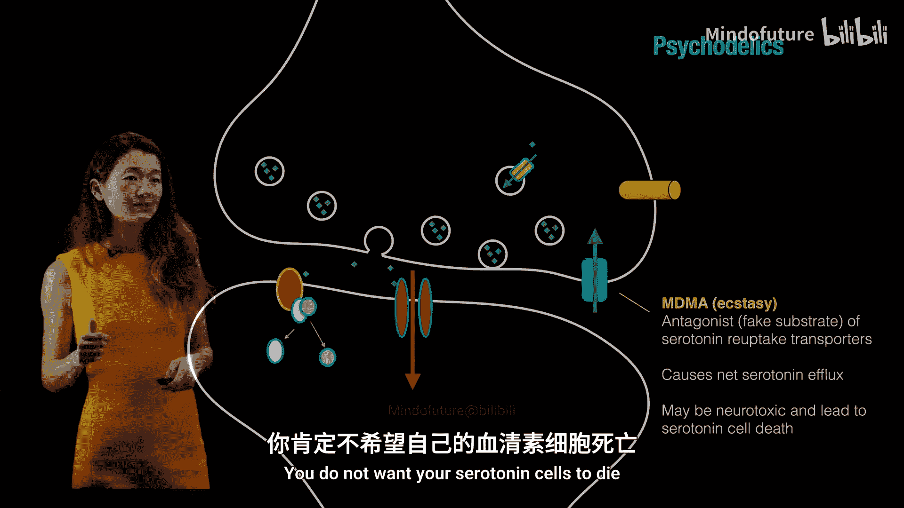

Okay。At a global level we talked a lot about molecular targets of these recreational drugs and a global level。

 there's actually a really vibrant field now of neuroscientists studying at a holistic systems level。

 what happens when your brain is on various types of hallcis here's an earlier study of comparing what your brain activation looks like when you're not an LSD and when you are an LSD I'm just going to read here a quote from one of the authors。

 normally our brain consists of independent networks that perform separate specialized functions so your visual system and your auditory system and your motor system are somewhat distinct。

But under LSD， the separateness of these networks breaks down。 and instead。

 you see a more integra or unified brain。 So from a brain imaging level。

 this is the kind of thing that we might see when at a more systems level once again。

 rather than at a molecular level， what happens under the influence of LSD。😊。

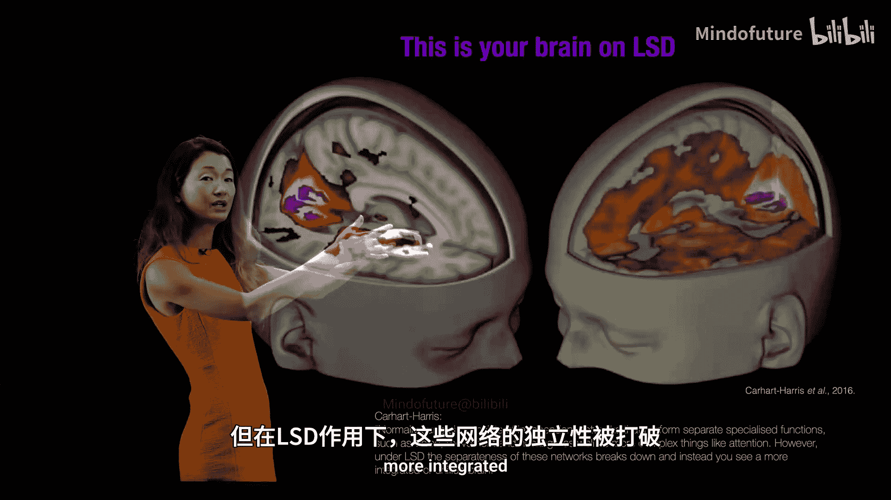

There's also more a little more we talked mostly about serotonin and dopamine and glutamate right these are common neuro neurotransmitters。

 there's a couple of more uncommon neurotransmitters that are targets of a recreational drugs。

 so caffeine targets again metabotroic receptors， and in this case it's an antagonist of GPCRs whose endogenous liganist adenine so adens in their neurotransmitter we haven't talked about but it is the target of caffeine THC is an agonists of CB1 receptors which are not surprisingly GCRs and their endogenous ligands is adoetamine。

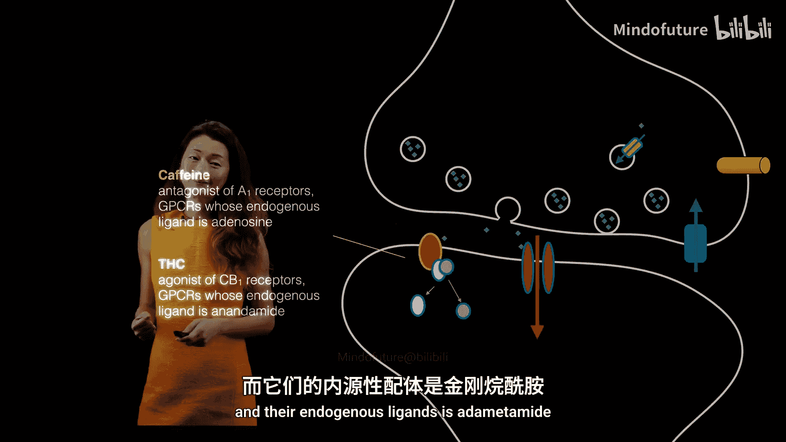

THC is but a single example of a large class of cannabinoid molecules。

 so ones that you may have heard about include tetrahydroconnabinol THC as well as CBD cannabidiol but in reality there's actually hundreds of these cannabinoid family of compounds that would be found naturally in different cannabis plants and they are accompanied by a correspondingly complex array of cannabinoid receptors in your brain。

 so depending on the specific mixture of compounds and the specific mixture of receptors that are listening to it。

 you can get a host of various effects by takingnabin cannabinoid family of compounds into your nervous system。

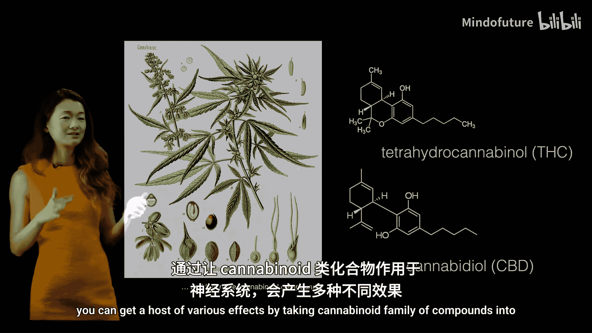

So it a short summary， don't take this too literally this is attempt at oversimpling some very。

 very complicated things。 These are some of the drugs of recreation that we talked about as well as which of the systems that they affect so we have the dopamine pleasure system emphasis on the quotes there's a neuroaddrenaline readiness system there's a perception association system。

 which is a little more handwavy and then there are ones that kind of just generally decrease neuronal activity ethanol actually falls in this category it is a very small molecule so ethanol is two carbons and an O age group and a couple of hydrogens and so unlike all of these other molecules it doesn't really it's not very specific it has a generalized effect on your nervous system and so one of the things that it does that it generally decreases neuronal activity That's one of the things that it does。

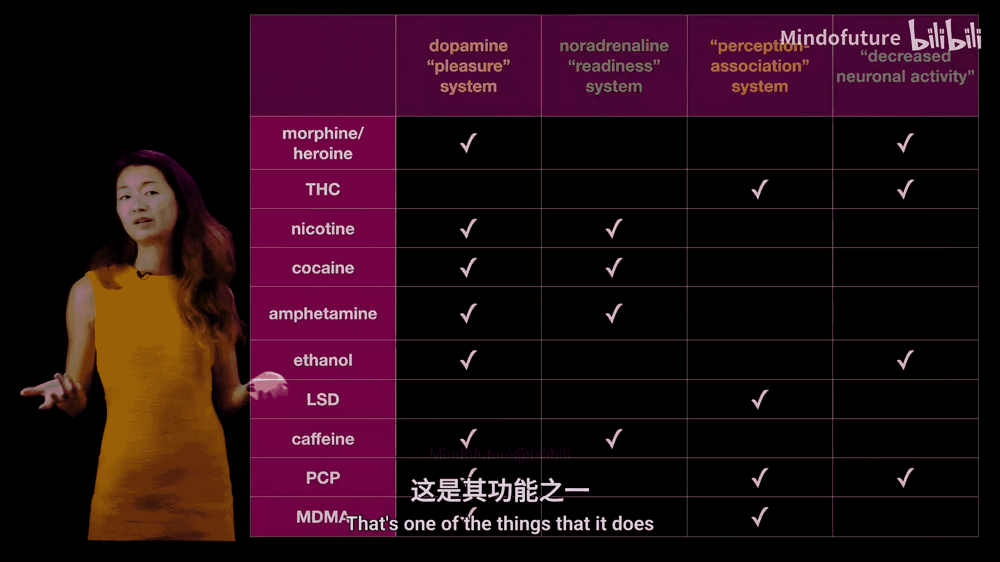

So that is our whirlwind tour of the molecular targets of recreational drugs。

 I hope this gives you some insights into the different steps of synaptic transmission as well as different ways that they can be modulated to have very complex effects that manifest in sometimes interesting ways in your nervous system。

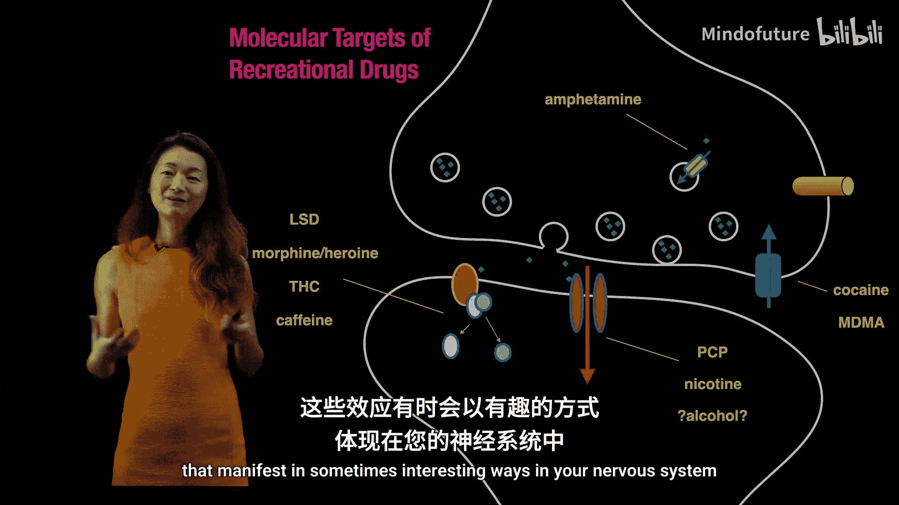