# 【华盛顿大学】神经科学入门 ｜ Introduction To Neuroscience ｜ Bing Wen Brunton p11 P11_药物成瘾与学习 -BV1i3qWBXEDH_p11-

Drugs might be fun until they get out of control， so in this section of the video we're going to be talking about drug addiction and in particular its connections to learning。

So once again， as a disclaimer， I feel obligated to say that please do not alter your pattern of prescription drug compliance as a consequence of anything I say ever and especially as a consequence of anything I say in this video。

 and to please consult with a medical care professional if you need further guidance about your prescription drug use。

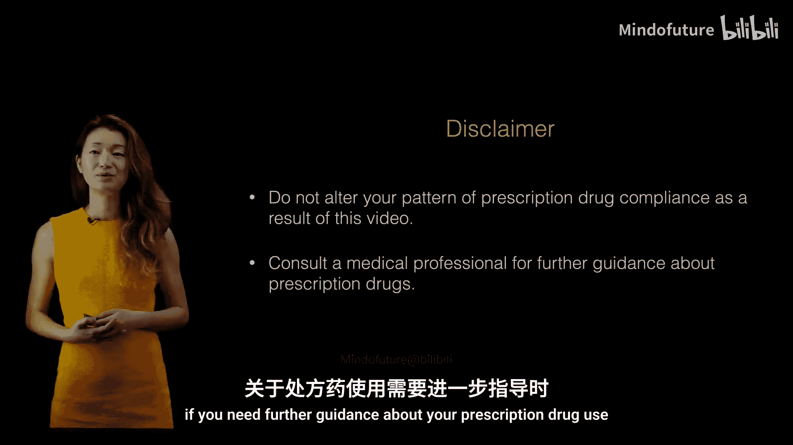

So with that said， we're talking about drug addiction。

 so I want to just take a moment and think about what that means to you。

 how would you define it So this could be a really sensitive topic。

 so I want you to make some space for yourself to really reflect。

 especially if this is a topic that is of personal significance to you and try to come up with a definition。

 positive video if you want to come up with a definition that is not only has a scientific content。

 but something that might be used in a clinical social context or especially in the justice system because there's a lot of things that are wrapped up in our sigma of drug addiction。

So I looked at the definition of drug addiction and according to the US government。

 addiction is a chronic， relapsing brain disease。Characterized by compulsive drug taking。

 despite adverse health， social or legal consequences。

 There's a couple of pieces that I want to unpack here。

 And the first one is addiction is defined as a chronic and relapsing brain disease。 In other words。

 there's no judgment here in terms of addiction being a personal or moral failing。

 It is a brain disease in the same way that let's say multiple sclerosis is a brain disease。

In particular， it has the following symptoms， there is compulsive drug taking。And in particular。

 it's not just possible drug takingking you know one is taking a lot of drugs。

 but it's compulsive drug takingking despite adverse consequences and these consequences could be adverse consequences to one's health。

 once social one's social circle or having legal ramifications and so in this definition there's a lot of things that are wrapped up together and we're going to be talking a little bit about how it is it might be possible from a molecular perspective。

 given now what we know about how drugs like cocaine and heroin can affect the molecular targets of your nervous system。

 how it is that you can end up behavior in such a way that you're taking you're having compulsive drug seekingeeking behavior despite negative consequences I'm going to take a really abstract view with this。

 and so bear with me， I think this is a really interesting story that has some interesting computational consequences as well。

So the story here is that we have this hypothesis that drug addiction assesses the same neurophysological mechanisms as natural learning。

 And that's why it makes it so pervasive and so dangerous because it's actually tapping and hacking into a system that is。

 in fact， quite useful for the rest of our lives。 So what do I mean by natural learning。 So let's。

 let's think about a simple version of natural learning。

 Let's say that you eat cake and it tastes good。 You learn that it is good to eat cake。

 And the next time you see cake。 You might have cake seeking behavior。

 You learn this because it's good。😊。

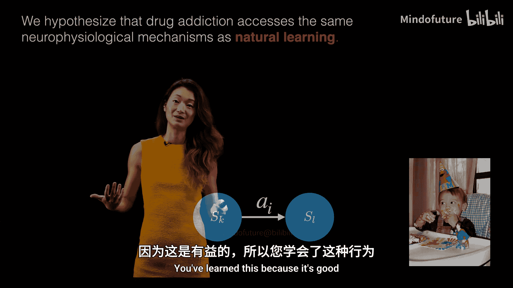

AtThe same time， maybe you have touched a hot stove。 You didn't know what it was。

 the first time you touched it and you burnt your hand。 This is painful。 and it was really bad。

 And you threw a mechanism， called a natural learning。 just learning regular learning。

 you learned that maybe next time I will not be putting my hand on the hot stove。

 especially when there's heat pouring off of it and it's glowing red。 Okay this is good。

 This is good because this is natural learning that makes it so that we are able to change and modulate our behavior as a function of environments changing so that not all of our behaviors are hardwired。

 we can learn things about our environment and change the ways we act so that we have more good things like and fewer bad things like burnt hands。

 So。😊，One way of thinking about natural learning is a theory of reinforcement learning Now the theory of reinforcement learning goes way back in lots of different disciplines。

 there's control theories that do it， especially learning people that do it。

 there's a lot of neuroscientists that think about reinforcement learning because it is such a successful model in our understanding of the nervous system as well as a really successful algorithm for designing of things like robotics and other things that we might want to control。

So there's a version of reinforcement learning that I'm putting up here。

 the details don't matter because I'm going just going to break apart this equation for you and this is what's called temporal difference learning and the way to interpret this equation is that this version of reinforcement learning says the value of some action A so a here might be oh I see cake I'm going to go grab cake。

 the action of grabbing a cake okay the value of that action is the sum of the expected reward。😊。

Of getting that cake， discounted by how long it's going to take for me to get to the cake。

I'm going to say that one more time， okay？I am here in the state K， state K is I'm sitting here。

 there's cake across the room， right， I want the cake， and so the action。

 the value of the action is how good is it going to be after I walk across the room and get the cake discounted by the time it's going to take me to make that action。

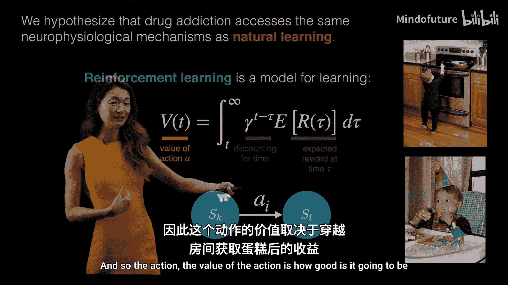

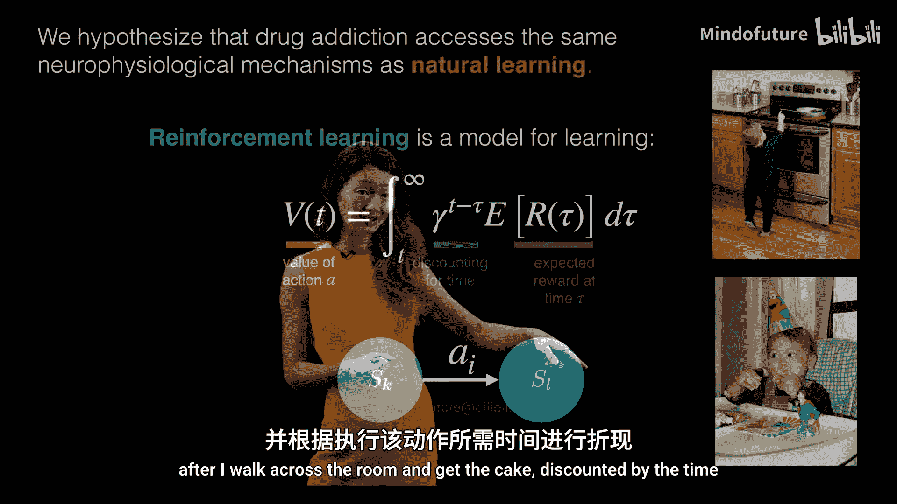

To take the steps across the room。 So if the cake is right in front of me。

 the value of getting the cake is actually going to be higher。

 then the value of the action of walking acrossroom to get the cake or maybe even across town to look my favorite cake shop。

 because it's the expectedor reward of getting the cake discounted by how long it's going to take me to get there。

Okay this works the other way around as well for negative rewards。

 so a negative reward like touching your hand on the big stove is a negative reward。

 it's discounted by how long it's going to be to get there so future pain that's far away in the future is going to be less bad and then immediate pain right now according to this model of learning。

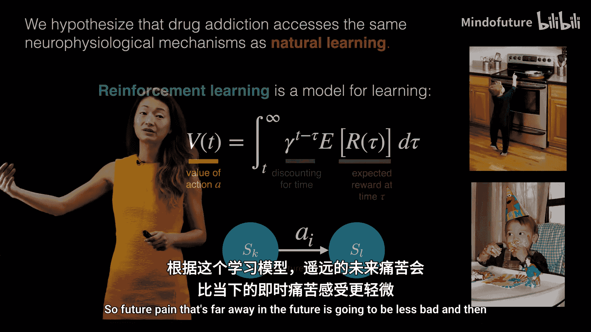

Now the reason that we can use this a model of learning is because baked in here is a way to update my value of action A。

 this is how I'm going to learn whether or not an action is something I actually want to do or I don't want to do by updating it in the following way we are going to have an update that is the difference between what happens if I take this action versus the value of what happened if I don't take this action。

 if I just stayed right here and didn't do anything at all， okay。

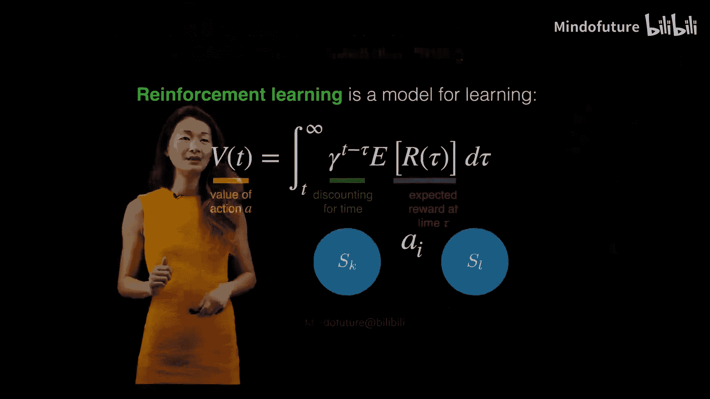

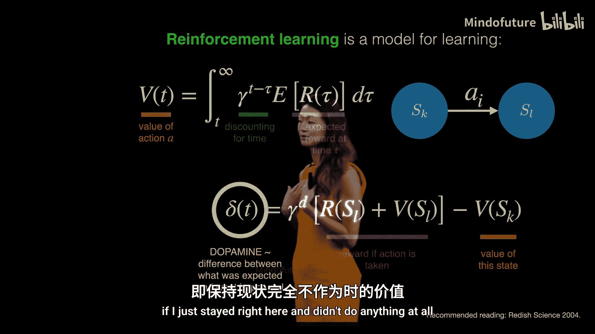

We talked about in the previous lecture about the dopamine Psure reward system in the recreational drugs in the brain lecture and about how your dopamine system is one of the ways that encodes this difference。

 this unexpected reward difference between what actually happened and what you were expecting to happen。

 this is exactly what this equation says， it's the difference between what actually happened if you were to do this and what happens now if you don't do anything。

Okay now remember from the reccreational drugs video that the dopamine system is exactly what drugs like cocaine tap into。

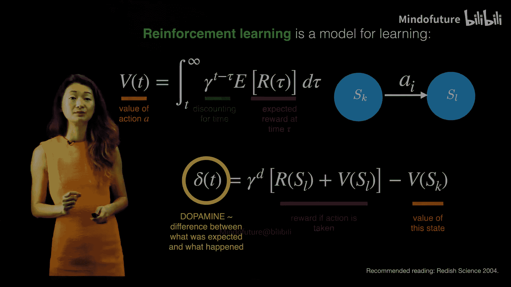

In other words， if you are on cocaine and you are your antagonist for the dopamine reuptake system so that dopamine sticks around for longer。

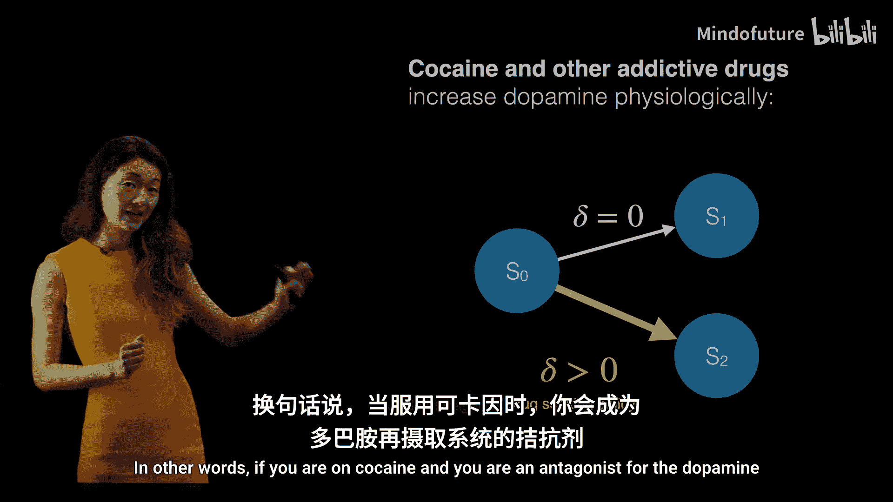

Instead of having a negative prediction reward saying like oh like you know last time I was on drugs。

 something bad happened， I don't want to do that again because you're tapping into and hacking into the dopamine system。

 the drug seekingee policy， the policy of let's go get more drugs always always has a positive dopamine and has a positive prediction of reward。

 and this is a handw the explanation not being too rigorous here about why cocaine and other addictive drugs can tap into the dopamine system and physiologically make it so that even though at some level somewhere in your brain。

 you know this is a bad thing they're adverse effects， having losing my friends， I'm losing my job。

 I don't actually even feel happy doing it， despite all of those adverse effects because every time you take the drug。

 there is a positive dopamine signal you persist in going down this path in taking the action that implement a drug seeking policy even though there's part of you that knows you really shouldn't and in this way is what makes drug addiction such as devastating disease。

Is because even one realizes that one wants to stop doing it。

 one physiologically cannot do it because a drug is tapping into this physiological system of dopamine。

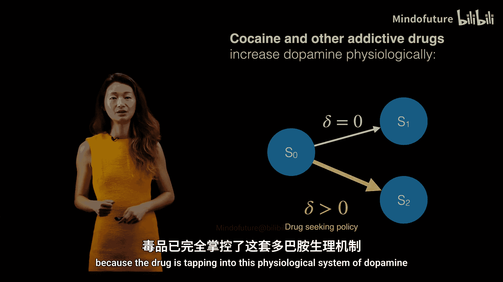

So we talked a little bit about the dopamine system okay and how we can hack into that and use reward and reinforcement learning as a moto of how to explain one way of explaining this drug seekingee behavior despite adverse effects next we're going to turn our attention to the opioid system which also taps into that system in a slightly different way and here I'm going to talk about a little bit of a story that goes back in history and I think this is more of is less of a social legal history and more more of a history of the drug industry so opioids are derived from the ppy pop over a summnium and has been used medicinally for probably all of human history right lots of lots of people have been distilling opioid compounds from poppies and using them and is annaesthetic for a very long time and it's medicinal properties are well knownn before the modern era。

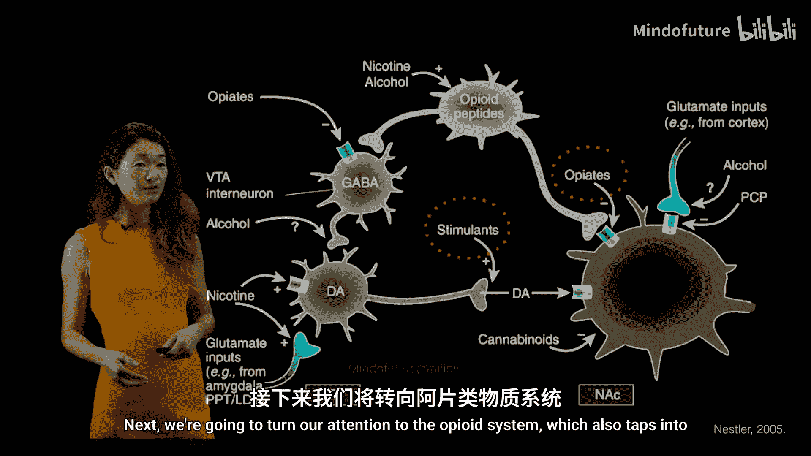

Now where we got off the rails is the following， so here I'm showing you two different molecules that are known to have pain killing anesthetic properties。

 there is morphine which is the from the poppy and salicyic acid which is developed from willow。

Both of them are used again， in terms of folk medicine all around the world， for medicinal purposes。

 for purposes in managing and curing pain okay？Now both of them had some undesirable properties。

 cellicin like acid， even though it was really effective at killing pain。

 was prone to upsetting the stomach。And so with the advent of modern chemistry。

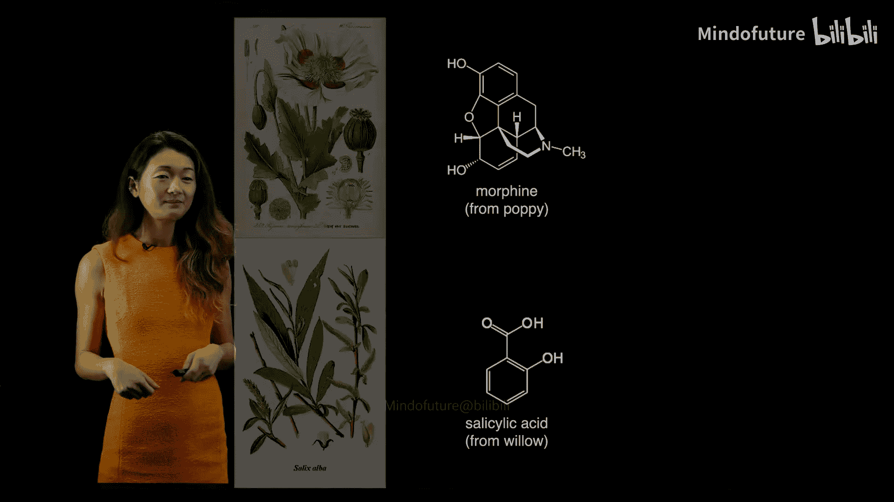

What happened was that a German company called Bayer， otherwise it spelled Bay。

Acettyated silillic acid from the willow and so instead of having sillicylic acid。

 you had acettosyillicylic acid， otherwise known as aspirin。

 so this is how the modern aspirin was invented by taking a compound that many people have used for all of human history and then're doing a little bit of chemistry on it so that you get a medicine that has the curator properties of killing pain but is less hard on the stomach。

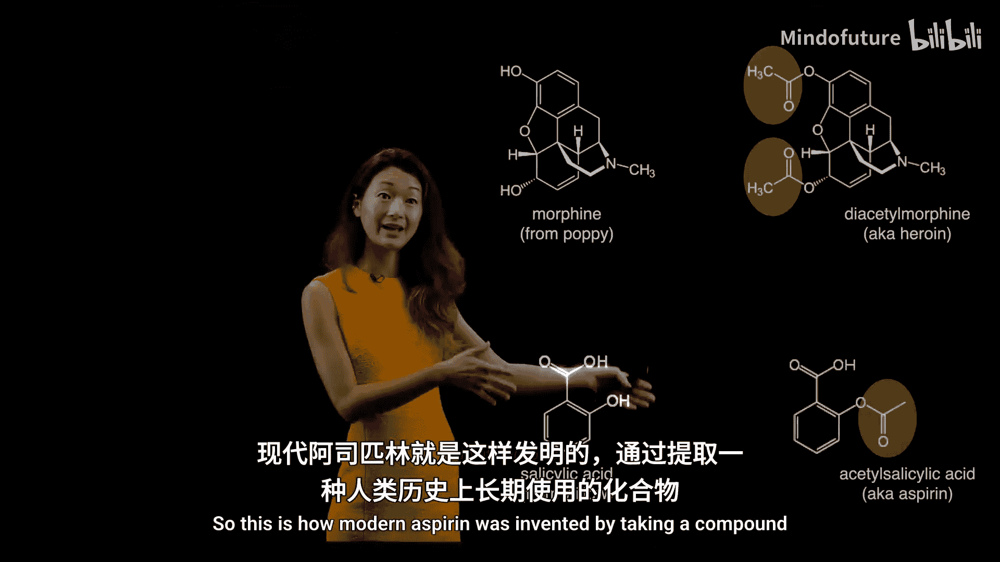

So this was such a successful invention at the time that they turned their eye to morphine and morphine from the poppy。

 as you know， was extraordinarily effective at killing pain。

 but it was also known to be really addictive so the logic was the following Wellcettyating sicylic acid works really well let's asytilate morphine too okay so they did that and they may die acetyl morphine otherwise known as heroin that is how heroin was invented。

 it was invented because aspirin worked so well that they thought they would do it to morphine too It was first synthesized by alderright in 1874。

😊。

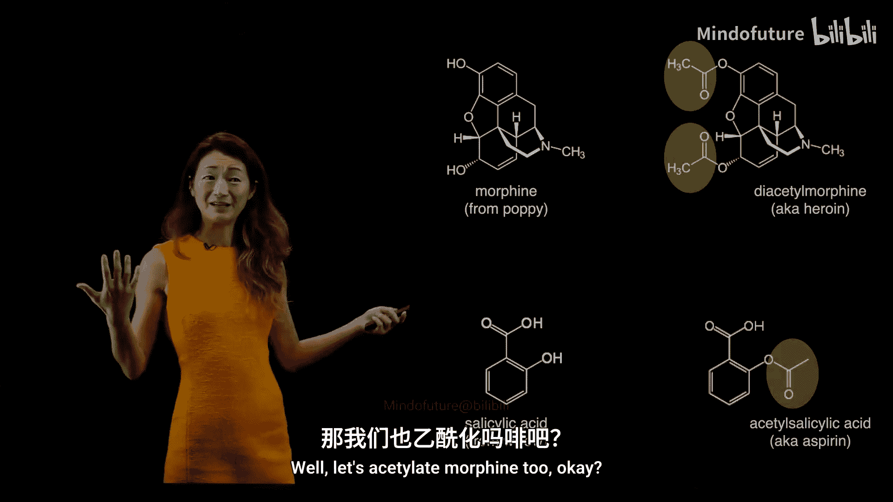

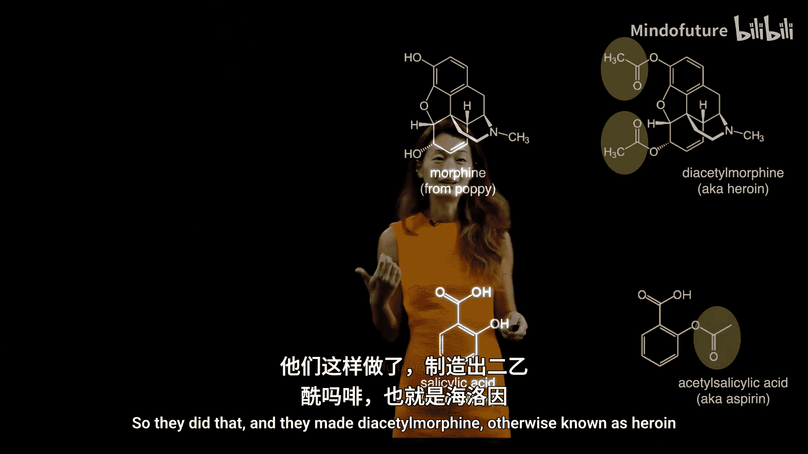

And without a lot of testing， it was marketed as a less addictive form of morphine。

 I think this is just like a really fascinating story of chemistry。

 but also of the pharmaceutical industry， so here's a really old ad from buyer where they are advertising literally aspirin and heroin on the same poster as if they were comparable things。

😊。

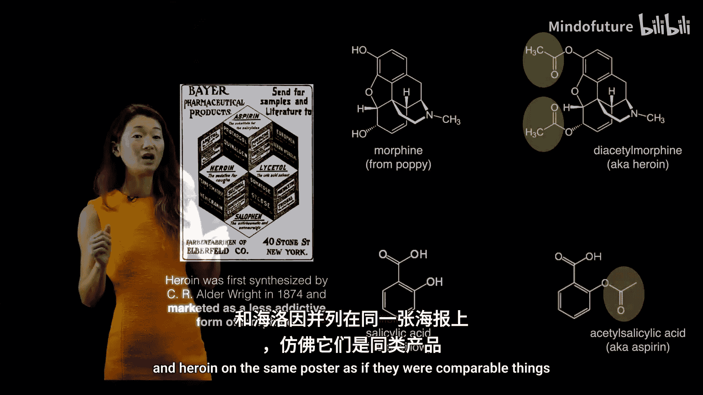

So。Marine is an opioid and there are other opioids now that are on the market， fentanyl， for example。

 one of them。Deadly overdose due to opioids， as many of you have probably heard。

 has become an epidemic in the United States and other parts of the world as well。

 it's become so devastating that it's something that I feel obligated to tell you all about because it is relevant for the chemistry of synaptic transmission because and also this chemistry survey we talked about。

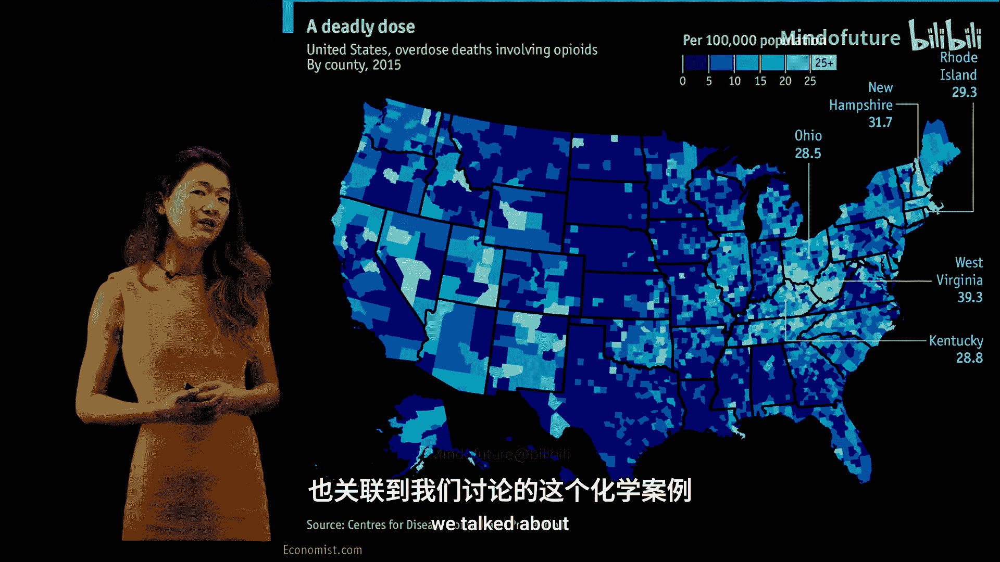

Deadly overdoses to morphine can be partially prevented by a drug known as naloxone and naloxone is a extremely effective competitive agonist for opioid receptors so if someone is at risk of overdosing from an opioid。

 very fast administration naloxone what it's going to do is that the opioid receptors are GPCs so what it's going to do is what a competitive antagonist means is that aid's going to compete for the same binding site。

 the opioids are going to bind on those opioid receptors and instead of binding to the opioids it's going to bind very quickly and tightly to naloxone instead it's going to kick them all out they by neutralizing this action this saves lives naloxone can be an injectable and it also actually comes in a nasal spray form that can be very easy to administer so if it is something that you would consider I encourage you。

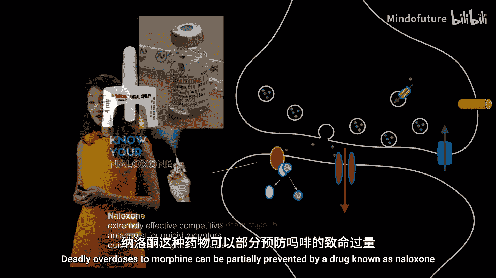

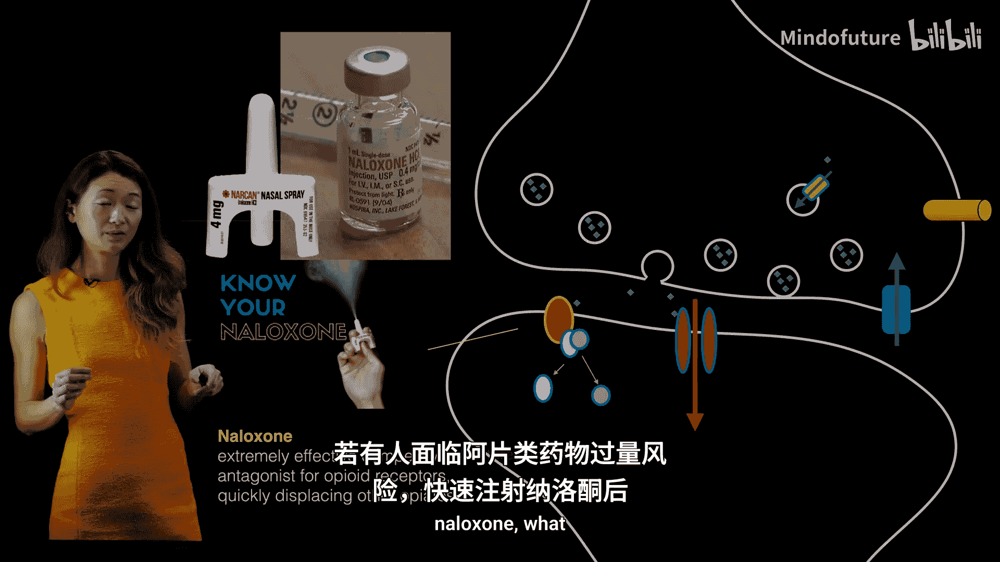

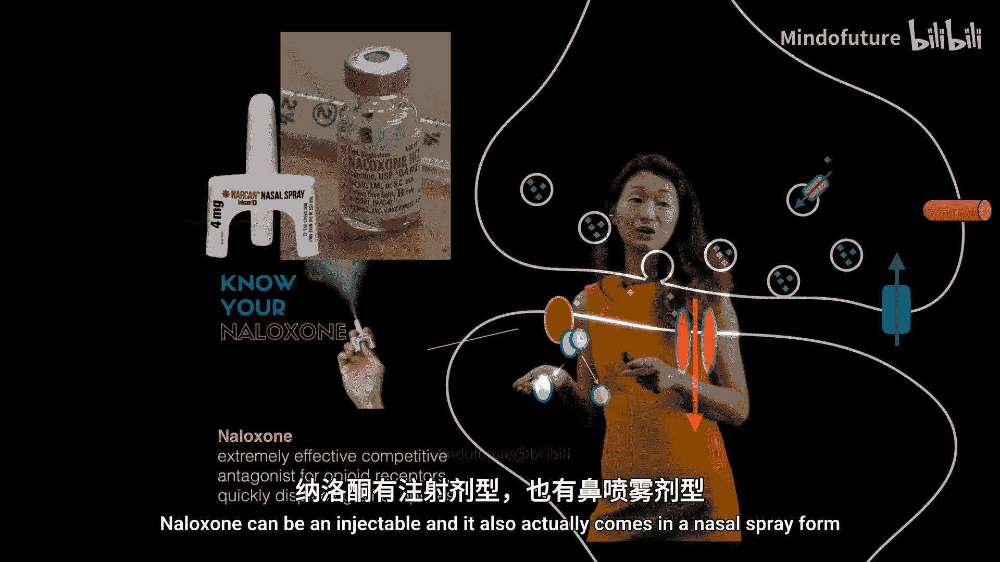

To look into your local laws and regulations and pharmacies in terms of how one might have the。

 have the permission to carry around an narcan or naloxone。

 It's an extremely effective way of saving somebody who might be at risk of dying of opioid overdoses。

 So Jerome Adams， a former Sur general of the United States。

 actually was advocating that we should think of naloxone kind of like epipenence and CPR as one of the frontline interventions that the general public should have and have be aware of because it really does save lots of lives。

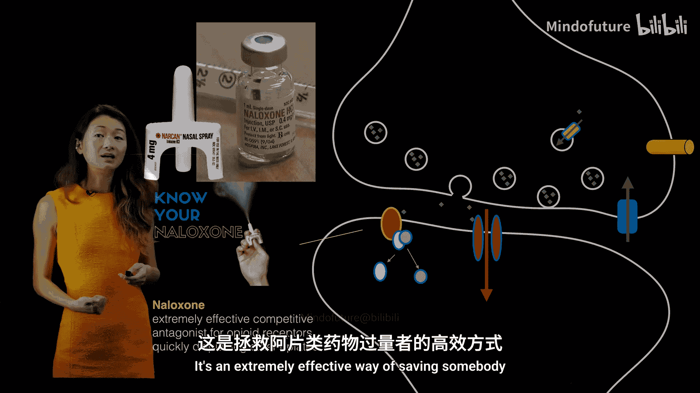

