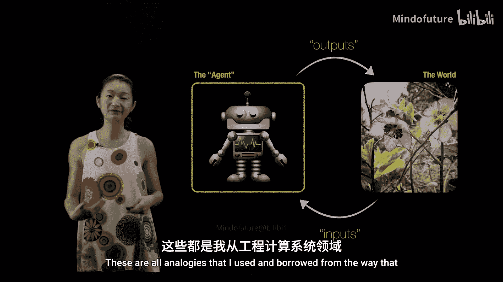
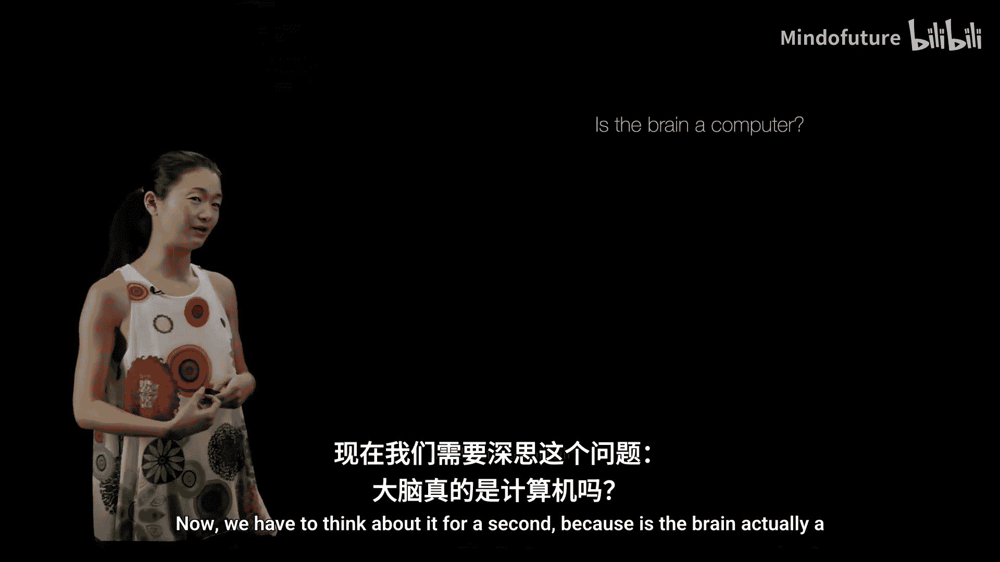
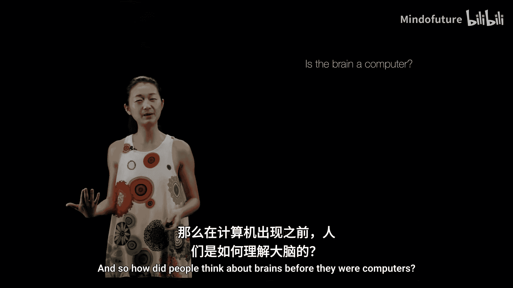
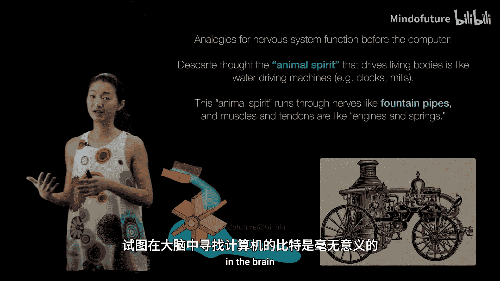
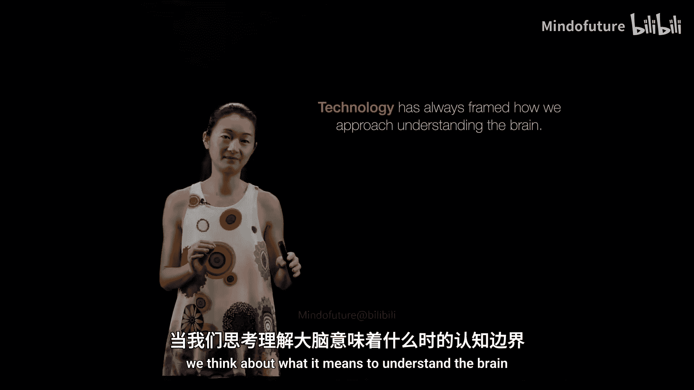
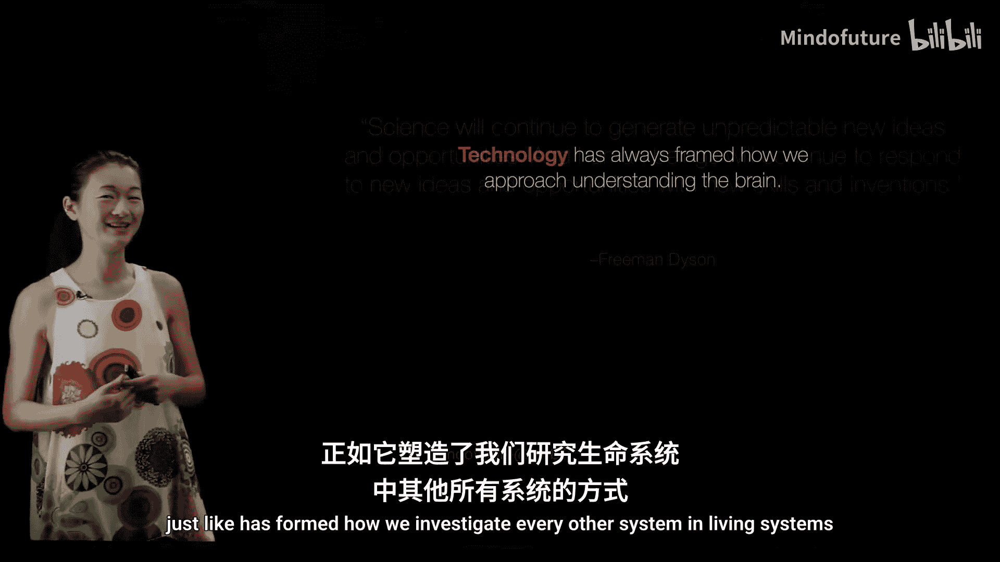
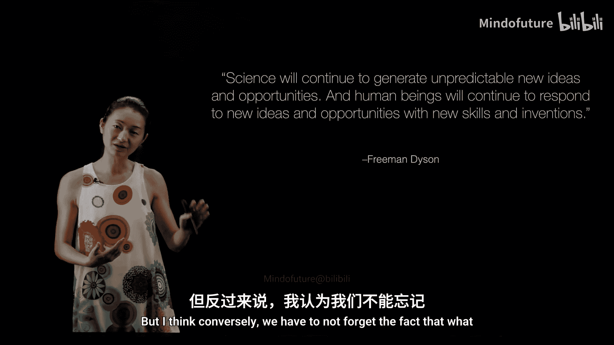
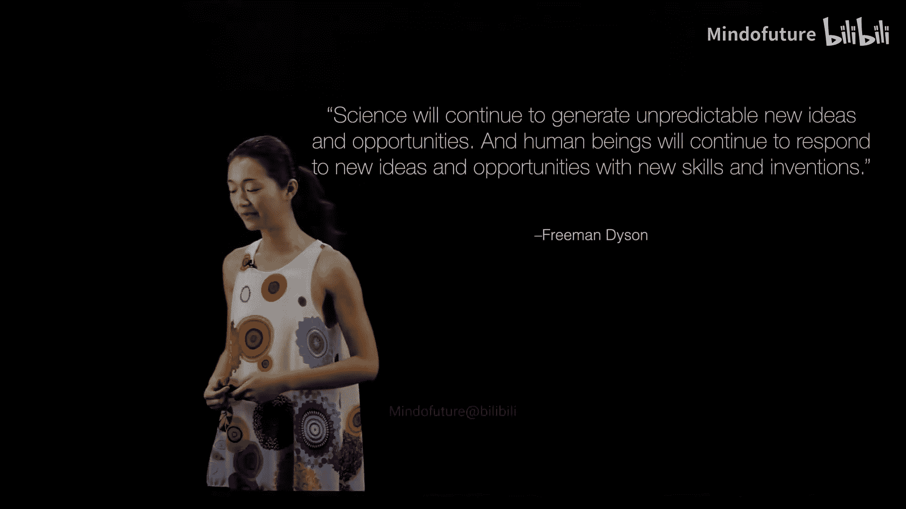
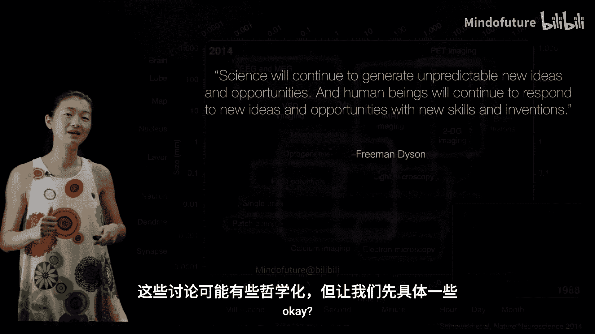
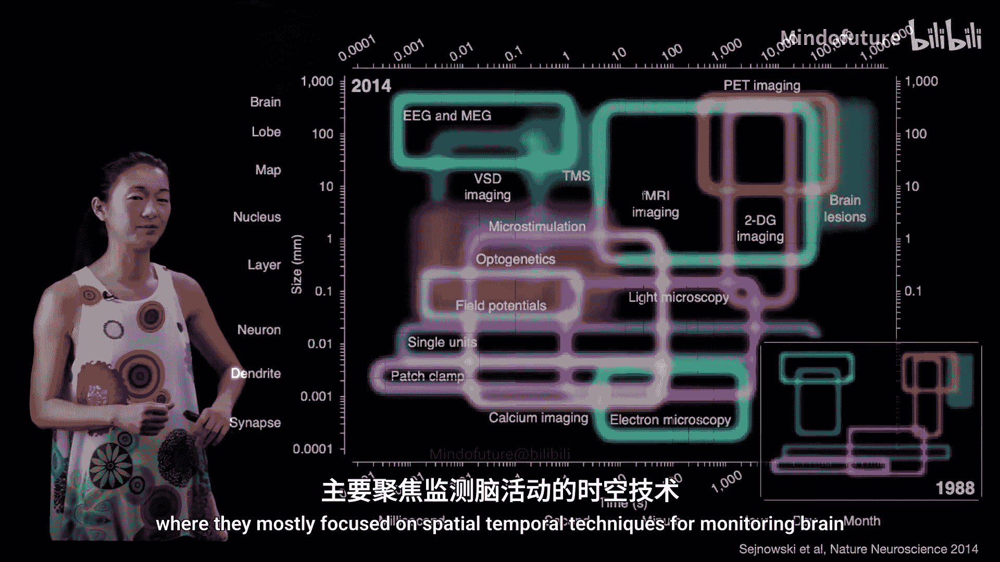

# 【华盛顿大学】神经科学入门 ｜ Introduction To Neuroscience ｜ Bing Wen Brunton p12 P12_大脑是计算机吗-大脑的感知与行动 -BV1i3qWBXEDH_p12-

Hi everyone and welcome back to the second set of lectures in introduction to neuroscience on sensing and action。

 My name is beinging Bton and I am a neuroscientist at the University of Washington and Seattle in the last section of videos we talked all about the active and passive properties of neurons how it is the communicate through action potentials pass down axons and synapses and we talked a lot about neurotransmitter systems and the different types of chemicals that are involved in your nervous system Now if you watch those videos in isolation you'd be thinking to yourself man this is super du complicated how does this even work altogether so that's we're going to try to tackle in this next set of lectures by looking at the system as a whole and thinking about not just how each subsystem works but how they work as a whole integrate it together so that each different sensory perception is integrated with each other to generate a set of actions that we use to interact with the external world here I'm introducing not just the world as a set of physical objects that you can manipulate but also other animals and other living things within it so this could be。

😊，Of the same species， animals of different species。

 things that are animal and objects like rocks that you can throw or trees that you can harvest and so this perspective here is not particularly controversial I think it anyone who studies animals will agree that obviously animals actions that interacts the world and then the world and then pushes back in terms of sensory perceptions but the way that I've drawn this diagram almost as engineering systems diagram does emphasize something that I think is really important in the section on sensing and action。

 which is that this is intrinsically a feedback loop system and it's really difficult to dissociate any single action from sensory perceptions and conversely it's really difficult to dissociate any sensory perception。

 any single sensory perception to any given moment from the actions that it eventually elicits after all。

 what is the point of sensing the world what is the point of seeing things and smelling things and touching things if it were not to guide our actions either at that particular moment or farther down in the future so in thinking about this。

I'm going to tell you a little bit more about the plan for the next set of lectures we're going to start by thinking about the organization of the nervous system because after all this is now a systems level understanding the nervous system we're going to zoom up from the level of single cells and synapses into groups of cells。

 large groups of cells and talking about the general organization of the nervous system because it's not just a blob of cells are all connected to each other far to the contrary there's a lot of architecture in the way that the nervous system is put together along the way we're going to talk a bit more about methods for measuring and manipulating the nervous system the tools of the trade that the we neuroscienceists used to think about how it is the nervous system is put together and what we can do to change it and both changing it in terms of manipulating its function as well as manipulating this function as a way of interrogating the system and figuring out how it actually works Next we're going to have use all of those tools and techniques now that we know what they are to understand different sensory perceptions and movements and motor control like in the previous diagram instead of having these be completely separate。

We're going to very much talk about each of them each at a time because it's impossible to talk about all of them together in the same lecture。

 but we're going to talk about them in terms of how they interact with each other and think about different ways that are similar to each other rather than how all the different ways that they are different because they actually do have a lot in common in terms of how the nervous system is organized。

So to go back to this picture of animal acting on the world and the world acting back。

 pushing back on us in terms of our sensory perceptions that we can use to measure the world。

 I'm going to do a little bit of a slide of hand here I'm going to change a couple of words in this diagram and can explore what happens here So instead of the animal I'm going to call it the agent and our actions are outputs and our sensory inputs or a measurements or inputs so again。

 this is becoming more like what you would think of as an engineering diagram and the agent here rather than being an animal could very well just be a robot of some kind with a computer inside that takes inputs。

 compute something and then has some kind of outputs on the external world In fact。

 this analogy of animals as if they were little little machines。

 little robots it's very popular one and it's one that I've actually used and kind of implicitly assumed in the last set of lecture I tended to talk about how neurons were computing about how access were like wires these are all analogies that I use and borrowed。

😊，From the way that we have engineered computing systems now we have to think about it for a second because is the brain actually a computer and why does this question matter？

 So this is an important point right we can ask the point and almost there's not really a right answer for this。

 you go on if you go on social media there's neuroscient is arguing on a periodic basis every year or so this question like well is the brain and computer。

 people say yes， people say no and there's a really a good argument to be made from both sides。

 but why does it matter that we either think of the brain as a computer or not。

 The reason we actually matters is because the mental framework that we use to try to understand the brain。

 these analogies we use very much formulates what we're looking for when we mean what we understand So if we think of the brain as a computer that means when we try to understand it。

 we're going to try to understand it like it's a computer What do I mean by that。 Well。

 I mean give you a concrete example。 computers represent information as bits and they have arithmetic operations on these bits like additions。

 so if we think the brain is。

then what we're going to do is we're going to go inside the brain。

 all of these neurons and look at the neurobiology of the brain。

 and we're going to be looking for how does a neuron represent a bit of information。

And then how does it do something about this bit of information like added this is exactly what people have done。

 people have gone into the brain and characterize how many bits of information a neuron can possibly represent and how does it add okay now。

It sounds obvious now that we can do these things。But in fact， if you think about it。

 computers have not existed for that long， in fact， neuroscience predates modern computers。

 and so how did people think about brains before they were computers？

Now not surprisingly， people had all kinds of analogies for thinking about computers and for thinking about brains for computers。

 Descartes had this kind of a water steam engine analogy for brains and he thought that there was something called an animal spirit that was driving living bodies like water-d machines and here his mental image instead of being computers was more like a water-drin clock or water-drin mill。

This animal spirit runs with nerves like fountain pipes and almost like steamm engines and the muscles and tendons are like engines in the springs this analogy。

made use of the best technology they had at the time and so I think this is actually a really cool thing about the brain is that the brain is so inscrutable that we almost always have an analogy of the brain working like the most complicated thing that we managed to build at a time so back then it was windmills and water millills and steamm engines and now it's more like computers and the reason this matters is because I think if you look at the history of the analogies that we have used in the past to try to understand the brain。

 it points out that it's likely the case， and none of them are particularly accurate。😊。

And so I want to think about the brain as a computer。 however。

 I want to remember that we don't want to think about this too literally because the brain is not literally a computer and we shouldn't be looking for all the different parts that are in the computer because that's kind of a。

Pointless exercise to try to look for bits of a computer that are in the brain because they came about in very。

 very different processes。

And what we can do is then think about how technology， the technology at the time。

 I mean both these analogies in terms of these analogies and what we think of the brain is it a sea engine。

 is it the computer， is it something else we're going to build in the next10 years。

 I don't really know technology has always framed how we approach understanding the brain。

 technologies， analogies that we bring。I framed what we mean when we think about what it means to understand the brain。

Okay。And technology is also at the core of all of the different ways that we investigate the brain。

 just like has formed how we investigate every other system in living systems and so when science continues to generate unpredictable new ideas and opportunities we as scientists and human beings will continue to respond to these new ideas with new skills and inventions。

 I really love the feedback here where a lot of technologies have been driven by the need to understand something but I think conversely we have to not forget the fact that what we mean to understand something is also driven by the technology at the time。

 so all of that it's bit philosophical， but let's go a little more concrete first what I mean here is that technology is something that we really need to pay attention to in launching into this next section of videos because we need to understand what are the technologies that are at our disposal。

 what are the tools are at our disposal because that very much limits frames and also inspires what we cant understand about systems neuroscience。

 this is a diagram from。

review paper that Terryowski wrote with a few of his colleagues and the axes here are hopefully a bit familiar to you because I've shown you this before in the intro video in the over video video these are times temporal time scales on the horizontal axis in logarithmic coordinates every tick mark is 10 times longer and the vertical axis we have size scales again logarithmic coordinates and so every tick mark up is 10 times larger I took my axsome Ter and so this is the same reason that you're seeing the same diagram here but in this diagram what the authors have highlighted instead of looking at what's happening at each of these spatial temporal scales are the technologies that are available for monitoring as well as manipulating neural activity at those spatial time scales and the lovely thing that they've done here they wrote this paper in 2014 is that they compared the state of the art in 2014 now we have a bit more than this from what it was in 1988 and I hope you can see even without paying attention to a lot of the details is that our ability。

To manipulate and record from neural activity in 1988 is substantially more restricted than what it was in 2014 You kind of imagine this diagram being a little more filled in now if we try to make another version for 2023。

And that is a really wonderful thing。 So Terry and his colleagues filled out this diagram where where they mostly focused on spatial temporal techniques for monitoring brain activity。

 and I'm attempting to make a slightly more complete。

 but still very incomplete list of all of the other tools that are using modern neuroscience。

 and these are tools that you might hear about。 if you went to a society for neuroscience conference。

 for example， people are going to be presenting posters using all of these different techniques from the level of cellular and molecular techniques。

 genome techniques。 Theres structural techniques that we can now use to look at the structure and architecture of of the different connectivity of different neurons in different brain regions。

 We have here a set of techniques on dynamic activities and neural networks。

 as well as manipulating the nervous system。 at more holistic systems level。

 we also have techniques for looking at animal behavior。 and of course。

 my favorite set of techniques are computational techniques。😊。

That really very much pertains to all of these different levels of description so in the next video we're going to do is dive into a subset。

 a small subset of these techniques a little more detail because I really want you to understand how all of these different techniques work because they're the most relevant ones to have a basic understanding of the next set of lectures on systems neuroscience and thinking about sensing and action and how all of those different systems function both in relative isolation as well as when they're working together I can't wait to get started with you。

😊。