# 【华盛顿大学】神经科学入门 ｜ Introduction To Neuroscience ｜ Bing Wen Brunton p13 P13_神经系统坐标系与切面 -BV1i3qWBXEDH_p13-

In this next video for introduction to neuroscience。

 we're going to be talking about the coordinates of the body and the nervous system The reason we have to do this is because in order to talk about anything。

 we need to have some lay of the land and a couple of different words that we know where we're at when we're talking about something in the same way that if you were lost and asking direction to somebody else you need to kind of agree on certain things like what is north and what is south what is west what is east and if you don't agree on these terms it's going to be really hard for you to understand and give directions to anyone so I'm going to give you the tools to understand the terminology for thinking about the different coordinate systems of the brain and once you have this terminology you'll be able to describe more precisely where we are in the brain and thinking about it at a systems level so we can start with a picture of a dog like the following one and the basic words we're going to learn are there is a front to back access which we call anterior forfront and posterior for back。

This is often sometimes called rotro coal as well， and these mean exactly the same thingstril is anterior rostrtro for nose。

 and caal itserior caal means tail， so this is known either as the AP anterior posterior axis where sometimes people equivalently call it the rotrootal axis。

 they mean the same thing。Next we have orthogonal axis， the AP axis， the DV axis。

 a dorsal ventral axis dorsal means back so it's towards the back of the dog and ventral means belly and so that is the other side。

 the downside of the dog okay so with AP axis anterior posterior DV axis dorsal to ventral if you think about the nervous system of the dog we have a little brain and we have the spinal cord the same thing applies to the organization and the coordinate system of the brain so there's the AP axis of the brain front to back there's also the dorsal and ventral axis of the brain from top to bottom okay everything works so far。

 this is totally good， everything's good here。The same thing applies。

 these four words and these axes apply anytime you have a reasonably bilateterally symmetric animal。

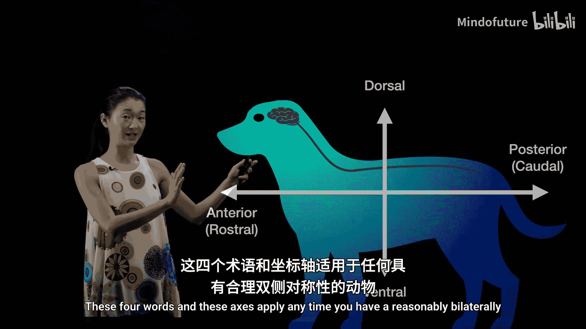

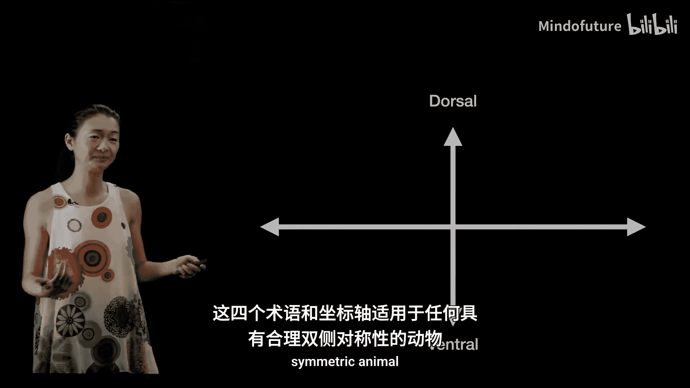

So these axes work perfectly well if you're talking about invertebrate insects for examples here we have a cr。

 it has an APp axis and a DV axis just like our dog did totally exactly the same wordss with exactly the same meanings it even has a very analogous system in its central nervous system with a brain which is in its head slightly different looking but it's in its head and instead of having a spine it has what's called eventral nerve cord now invertebrates like this insect here are different from vertebrates like us in that their spine instead of going down the dorsal back the dorsal end instead of going down their back。

 it's actually in their bellyllies， it's called the ventral nerve cord computationally and architecturally they have a lot in common。

 they just they evolve separately and so they're in the different part of their body our digestive tracts are in the ventral side and our nervous systems on the back for insects like this one it's the opposite but other than that that they opposite parts of the body it's actually exactly the same their digestive system is on the dorsal side instead。

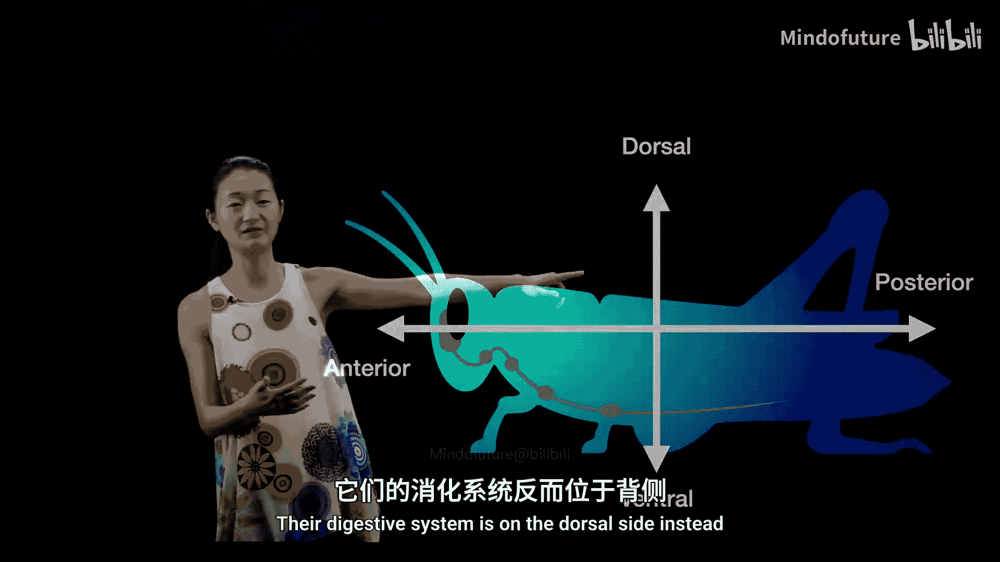

If you think about a human now we have the inconvenient fact that humans have decided to be bipedal as the terminology for a human。

 I always introduce after I introduce the terminology for animals that are kind of down in their feet like dogs and horses and bears。

 for example， because it's slightly more confusing now you kind of have to think about a human as if we were on the ground on all fours like if you're playing with your dog you're down in all fours playing with your dog right and so because we have stood up and become bipedal the orientation of our brains has remained the same with respect respect gravity and so you still have the anterior posterior axis of the brain this is exactly like the same as dogs and rats and all the rest and the dorsal ventral axis of the brain but what you've noticed is that these axes are now different from the rest of the body because dorsal ventral the back you know my back and ventral my belly is now pointed horizontally with respect gravity。

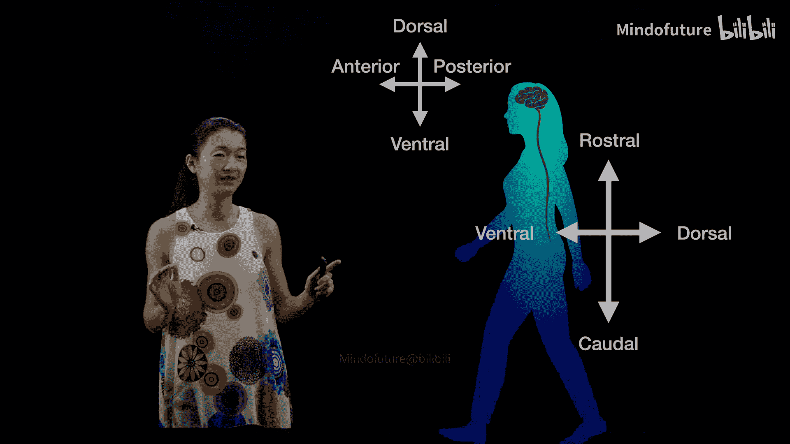

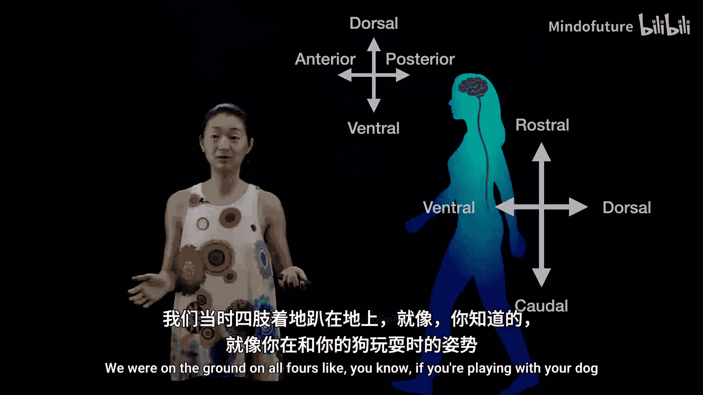

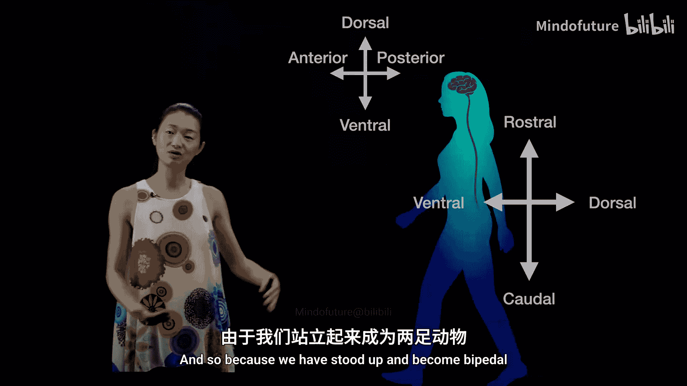

As opposed to the case of the dog where dorsal was up and ventral is down and my anterior posterior axis for the rest of my body that's not my head。

 the ratrocutttle axis is now also stood up on its end so it's no longer anterior and posterior I'm using slightly different words here and actually I've learned by talking to some of my human physiology colleagues that they actually have different words。

 sometimes that they use for describing this if you're talking about human anatomy here I'm primarily interested in the organization of the nervous system and so I'm emphasizing the coordinates we use describe the central nervous system。

 the brain and the spinal cord and so you just kind of have to to keep track of what's going on here。

 depending on which part of the nervous system you're talking about if you're talking about a human when I'm talking about it because I am a neuroscientist instead of an anatomist for humans。

 I'm mostly thinking about what human nervous systems having common with other animal systems and so to make this terminology most consistent I'm going to just of assume that human is on all fours just like a rat where dog would be rather than standing up。

So anterior is anterior with respect to the brain， and then anterior for the spine is actually pointing up。

 even though it kind of goes up and then it curves a little bit to sideways slightly confusing。

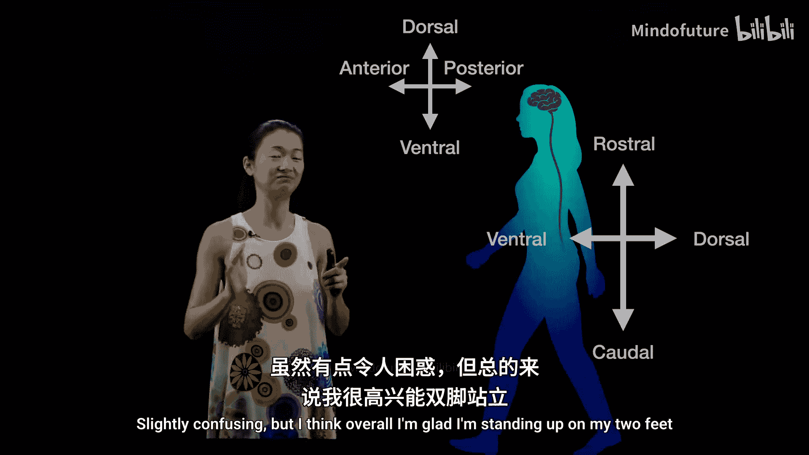

I think overall i'm glad I'm standing up on my two feet。Okay。

 there's one more axis that's relevant here， which is I pointed earlier that the applies for bilaterally symmetric animals like our cells。

 we have a left half and a right half， and that means that in addition to having the dorsal ventral axis and the anterior posterior axis。

 we have another axis， which points out the fact that there is a line。

 a midline where things are symmetric， the left and the right half of our bodies。

 they're pretty similar。

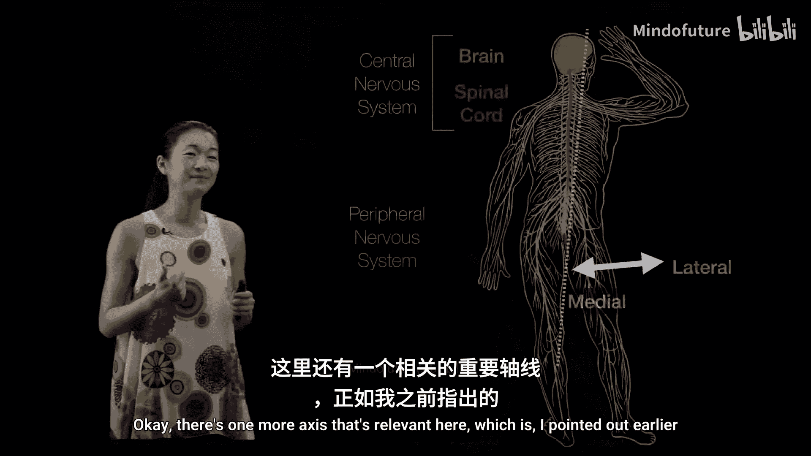

And so there's a media lateral axis， medial means closer to the middle and lateral means off to the heads。

 so there's a medial axis which everything towards the middle。

 and then there's lateral to the left and also lateral to the right。

The brain and the spinal cord highlighted in yellow and in pink there in that diagram is what we mean by definition as the central nervous system。

 the remainder of your nervous system， the nervous system that innererates the rest of your body is typically known as a peripheral nervous system that's a piece of terminology that will come in handy as we go down the next couple of lectures in thinking about systems neuroscience as well。

 so I just wanted to be clear what I mean by central nervous system and what I mean by the peripheral nervous system。

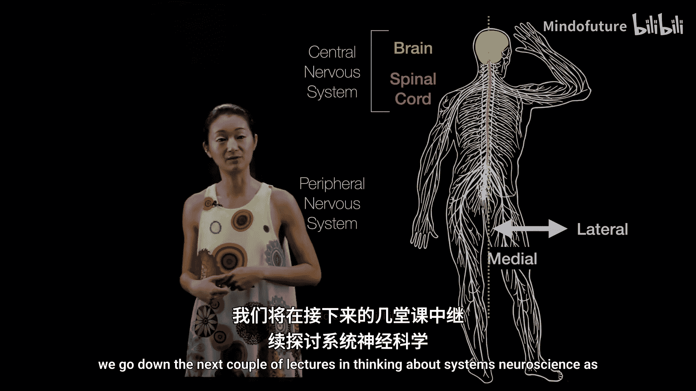

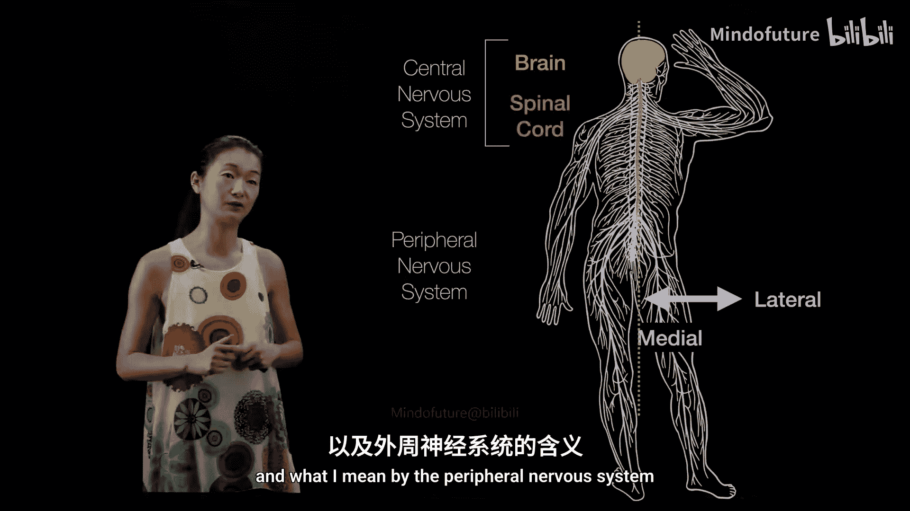

There's a bit more terminology here I'm gonna look at a picture of a brain and so in addition to establishing the axes。

 dorsal ventral anterior posterior， this is a side view of the brain so you can't really see the mediallateral because it's kind of inside the screen right now we also have a couple of words that are important to know because we're going to be looking at this threedimenal structure and cutting it into different slices and all of those slices have different names now because there's three orthogonal axes I also have three different slices for the brain and they all have different names I'm just going to go through them and tell you what they are the first one is what's called a coronal section and this is the diagram of what it looks like hopefully this is intuitive I'm going to try to demonstrate it on my own head right now by standing sideways。

 the coronal section is if I slice up my brain this way。

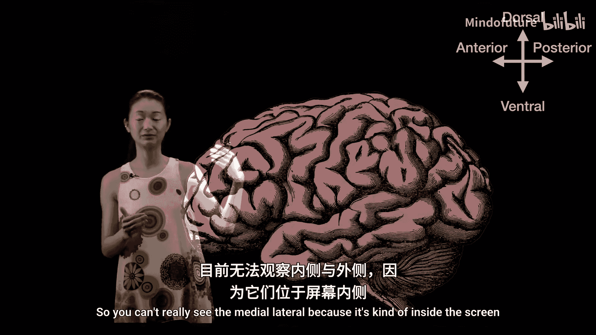

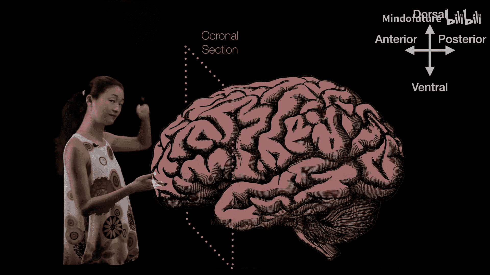

Okay。I can also ci my brain horizontally now this is horizontal with respect to gravity if you can kind of imagine that you can imagine your brain。

 and if I'm going to take a knife， don't recommend it。

 take a knife and slice your brain kind of parallel to gravity right here。

 this is called a coal section。

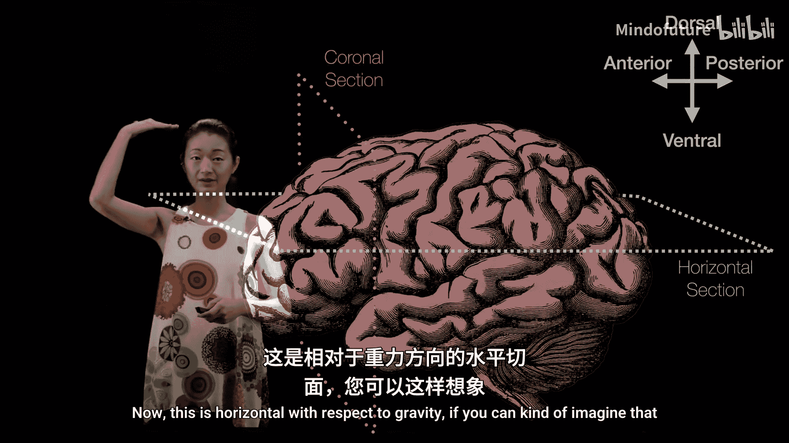

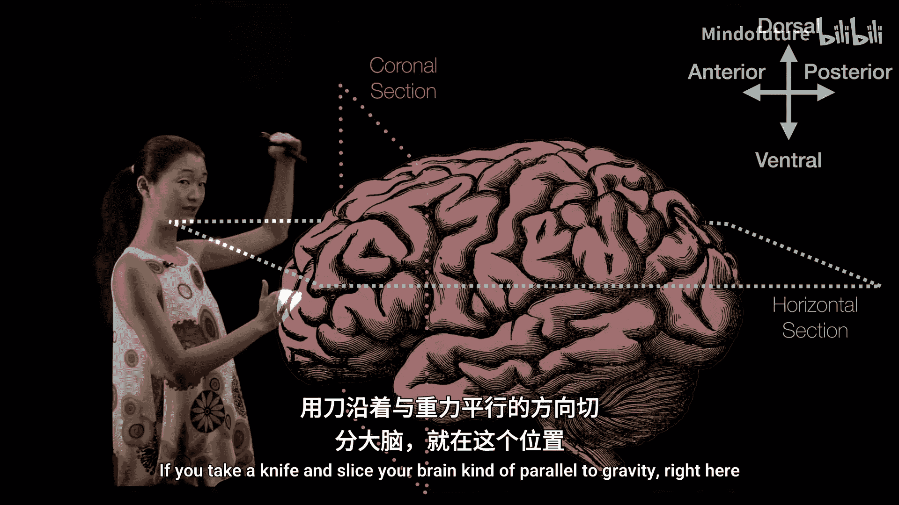

The only axis is left is the one where you're cutting the brain in half， left and right。

 kind of right down the midline right here。Any cut that's parallel to the midline？

Is going to be called a Satal section。 There's the midstal section if you kind right down the middle and if you cut parallel to the midstal section。

 but a little bit off to the side， you have what are called parasagal sections。

 So these are the terms。 we have coal section horizontal section and Satal section。

 these are the common sections that we talk about when we think about the brain and if you cut up different mammalian brains using the same sections。

 you actually see that they have a lot in common。 I've seen a lot of coronal sections of bats that look exactly like coronal sections of rats which look very similar to coronal sections of humans。

 for example， although they are some differences。

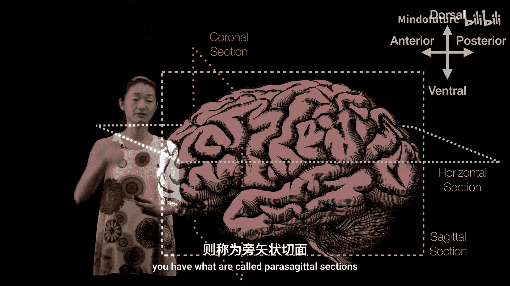

So there's a couple more things that are interesting to think about the brain。

Over there we see a side view of a human brain and there's a couple of anatomical parts that I just wanted to point out we're going to be talking about a lot of these different anatalal areas in more detail later。

 but I wanted to give you kind of the lay of the land kind of where the big landmarks are first。

 so that when we talk about it over and over again。

 you'll have building on that knowledge instead of just hearing with these words for the first time。

This is a MRI of a human brain in the mid Satal section， and so the Sagial section。

 because the brain's been cutting half kind of like this， get down the middle。

And what you'll see here is that it actually has a couple of different parts of it and that are distinct from each other and so I'm just going to name them and we'll talk about what they do a little bit later。

 so this is just the anatomy part。 You'll see here that the spine。

 the spinal cord is going down right here the spinal cord is connected to the very bottom of the brain。

 the brains stemem and the brains stemem then connects to kind of the midbrain areas。

What is in the very back of your brain is a structure a fascinating structure called a cerebellum。

 You can see the cerebellum kind of sticking out underneath the rest of the brain right here。

 this part of the brain is called a cerebellum。

And what's on top of all of those midbrain structures is the cortex， cortex moves outside。

 and that's kind of what all you see when you're looking at the side view， all you see is the cortex。

 the outside of the brain。

Now the cortex is wrinkly in humans because it is actually a two-dimensional sheet that is really large。

 it's about the size of a large di napian if if you shook it out and so the reason is wrinkly is because the two-dimensional sheet that got crumpled up and stuffed on top of the midbrain structures and so it has to berinkly otherwise it wouldn't fit not all mammalian brains arerinkly in fact lots of them aren't if the relative area is not that big that it just isn't wrinkly rats and mice for example。

 do not have wrinkly brains are totally smooth and you can see all of it as a two-dimensal sheet by looking at it and that's not the case with human brains there are even some primate brains that are not wrinkly that don't have salulai and gyri and so it's not necessarily something that is unique to humans so there are primates that have wrinkly brains and there's some primates that don't haverinkly brains。

 this is something that lots of people study。

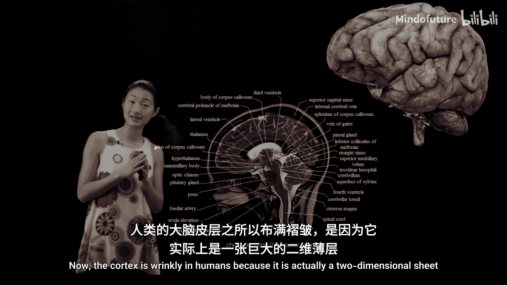

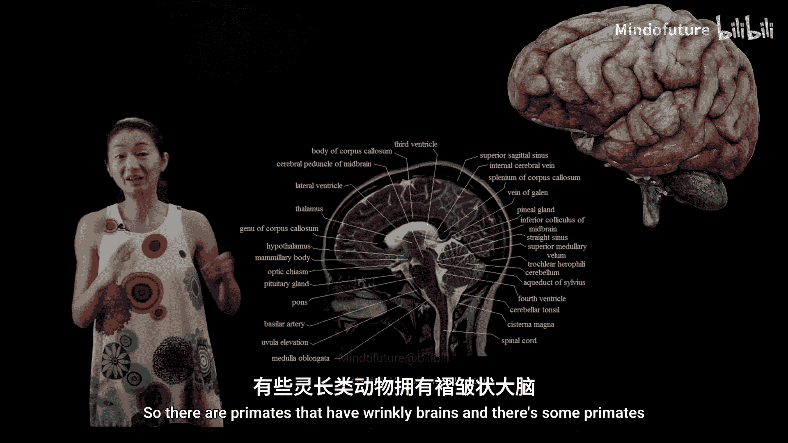

We are going to think a little bit about I'm going to talk about something that my students usually ask me in this class。

 which is what is so special about human brains this turns out to be a question that is surprisingly difficult to answer because it's been hotly debated for decades lots and lots of people have proposed lots and lots of things about what is so special about human brains and one of the things that you may have heard about that popularly talked about is the fact that we have prefrontal cortices。

 frontal cortices in the very front of our brain that's kind of associated with higher cognitive functions for example。

 is particularly well developed It turns out that there's not a lot of quantitative data to back up this hypothesis if you look closely enough because not only are you're looking at the actual area at the frontal cortex of the human brain。

 what really seems to matter is the relative area of the frontal cortex of the human being relative to the rest of the brain After all it wouldn't really matter because if you were had a smaller total area everything is smaller it doesn't make sense to be looking at the absolute area of the frontal cortex you should be looking。

the relative area and if you look the relative area of the human frontal cortex relative to both our closest ancestors or the other primates as well as some more distant relatives such as the mouse here。

 there is no consistent systematic trend in supporting the hypothesisses that we are more special than some of these other relatives because our frontal coriceses are bigger nevertheless it remains the case that humans do seem to be special as animals on earth because nobody has built cities and Lightboard studios and YouTube we're kind of special in that we have accomplished those things and so it's unclear the neuroanaatomical base。

 what makes us special， but I think maybe maybe I'm kind of full of it I'm full of myself I feel like I'm special and maybe you feel like you're special too and so the quest for figuring out what it is that makes human special remains but I did want to tell you that whatever it is it's not as simple as we have larger frontal cortices that doesn't seem to be the answer。

So before you feel too special， I also wanted to tell you this other thing which I think is a really curious observation on the topic of neuronatomy so here we have a kind of a typical brain scan of a typical neurotypical brain what you're seeing here is down here you should be recognize this is now a satgital section of a human brain and up here is what's called a horizontal section of human brain so this is the top one is a slice of the brain of this way and the bottom one is a midsagtal section where you're sliced the left and right hals and have and open it up a little bit virtually speaking okay now this is what a typical brain looks like。

😊。

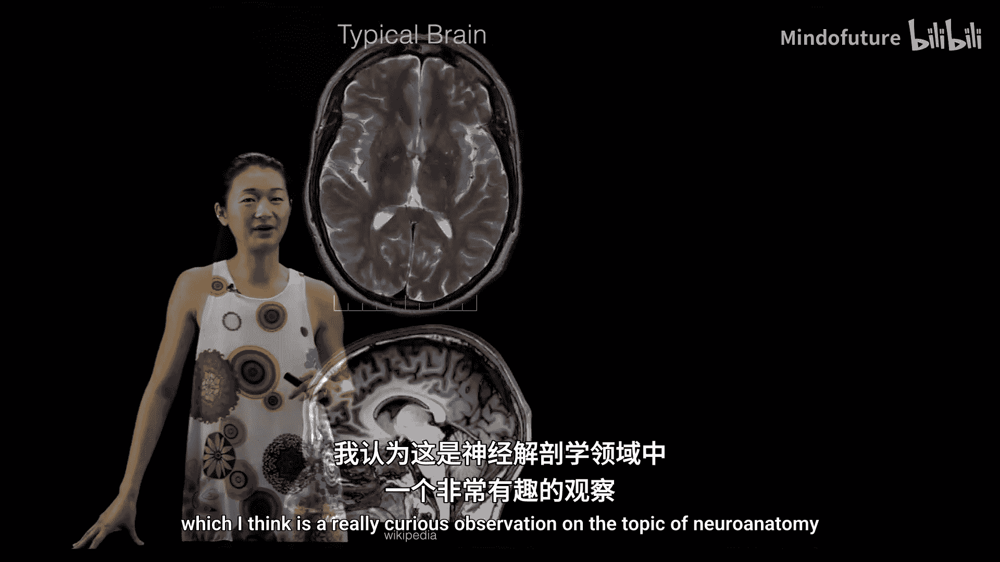

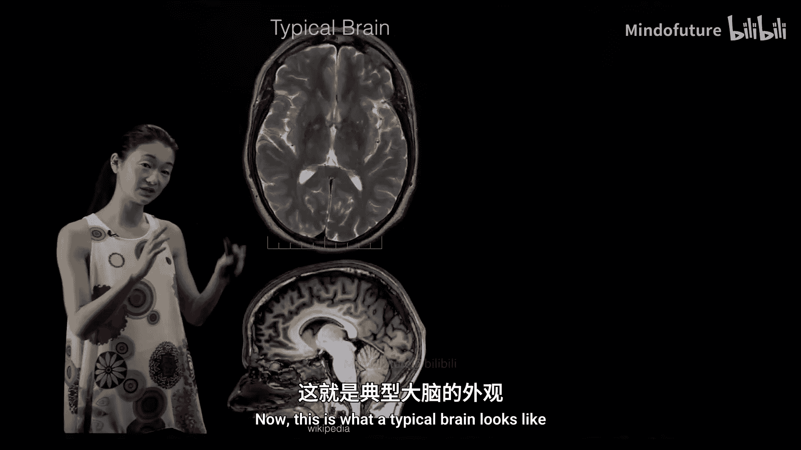

What I'm going to show you here is a case that was written up in the Lancet a little bit ago。

 and the title of the paper is Brain of a white collar Worker What is remarkable about this brain scan is that this person came in to their medical care professional complaining of some numbness of the arms this is a fascinating short article which is like a page I encourage you to read it if you really want to。

And they complained of some numbness in their arms， some amorphous symptoms， and they were like， oh。

 let's give you a brain scan， just make sure everything's okay， you know， and to their surprise。

It looked like this person had approximately no brain。

Those large black areas labeled LV LV stands are lateral ventricle， we all have lateral ventricles。

 you do and I do usually they're small fluid filled chambers。

 you can kind of barely see them in this picture， in this particular person， they lateral ventricles。

 they have a condition called hydrocephaly， which means the lateral ventricles usually produce superpinal fluid and in their case it was producing an excess to superpinal fluid。

 but so slowly that it was building up pressure over decades slowly squeezing out the rest of their brain so that they had almost no volume left for their brain。

 their entire brain as you can see is almost entirely filled with fluid from the lateral ventricle。

Now， you might think that things brain scan might be inconsistent with life。But in fact。

 this person is you know， has been living for decades。

 is holding down a job in the civil service in France。

 That's why it' title told the article's brain of a white collar worker。

 They have a perfectly within normal range IQ when they gave them the IQ tests， they have a family。

 they have friends they're walking around， like they seem perfectly normal within range of normal。

 at least despite the fact that their brain anatomy is very much not normal at all。

 So this when I saw this， first of all， this is fascinating And I think this is another case where it really mainly question。

 what is so special about the brain anyway。 It turns out that if you can marry slowly over the course of decades to squeeze your brain so that instead of taking up all the space inside the cavity of your head is taking up very little of it。

 it's still okay kind of speaks to their remarkableness and remarkable resilience of this organ that you carry around in your head。

😊，Okay， so I'm going to do the highlights here， and these are the key terminology to understand the cords of nervous system。

 keep these straight because if you get them confused。

 we're going confuse each other a lot we talk to each other。 there's the dorsal ventral axis。

 the anterior posterior axis。 I want to distinguish the difference between central nervous system and the nervous system and the peripheral nervous system。

 you need to know the difference between medial and lateral。

 Now there's one more thing I wanted to point out here about this picture of the peripheral nervous system。

 is they part the very， very back part， the very posterior part of your spine。

 instead of being a coherent cord，her spinal cord， it actually bifurcateates and spreads out in the structure called a co aquina because it resembles a horse tail。

 look up a picture of a co aquina it is。😊，Fascinating and slightly disturbing is the word that I thought when I first saw it It's really interesting structure anatomy。

 I like anatomy。 And speaking of anatomy， there's also kind of slices of the pre brain that you should know about the difference between a coronal section。

 horizontal section as well as a satgi section。 So the sort the cheat sheet。

 this is all the terms that you need to know。 And I'm going to be using them and if you read a paper。

 If you read a textbook on neuroscience。 These are often the terms that you need to be able to keep straight in thinking about where we are in the brain and you should be able to recognize the difference between。

 for example， a Saal section and a coronal section， because they're gonna to look really different。

 and you'll get really lost， if you don't know which one is which。 Okay。

 so these are all the coordinates we need。 Now that we have the map coordinates。

 we can get started and thinking about system neuroscience。😊。

