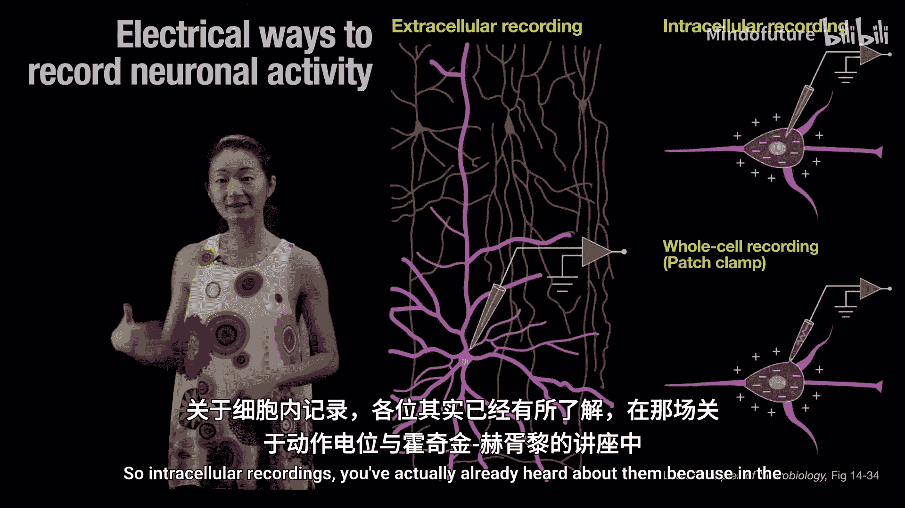
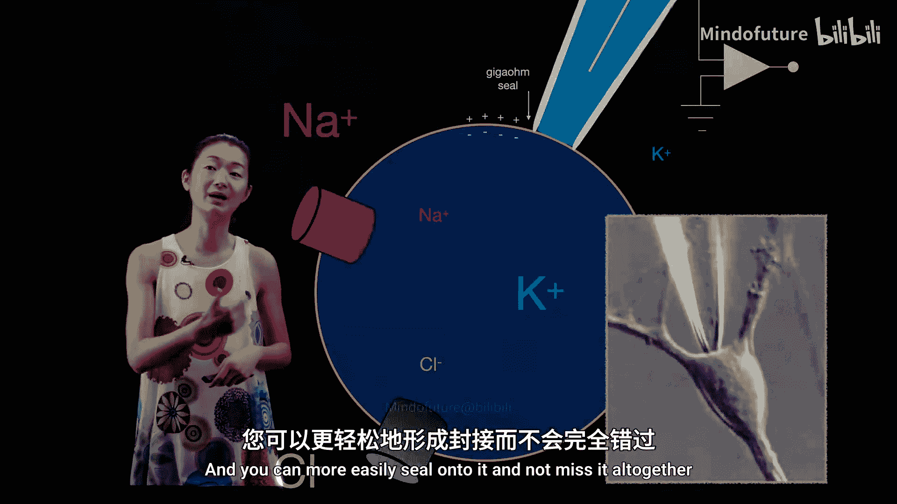
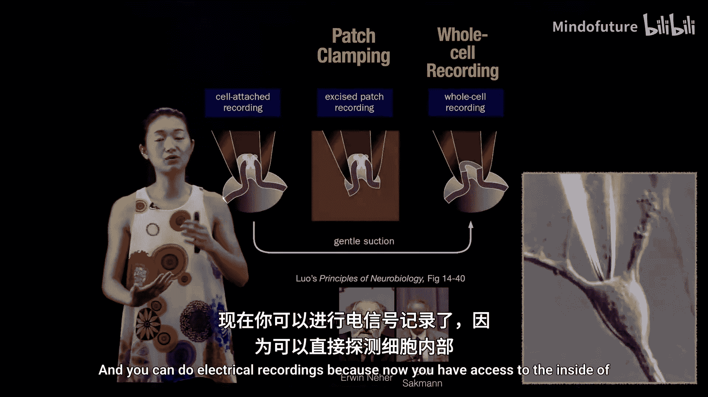
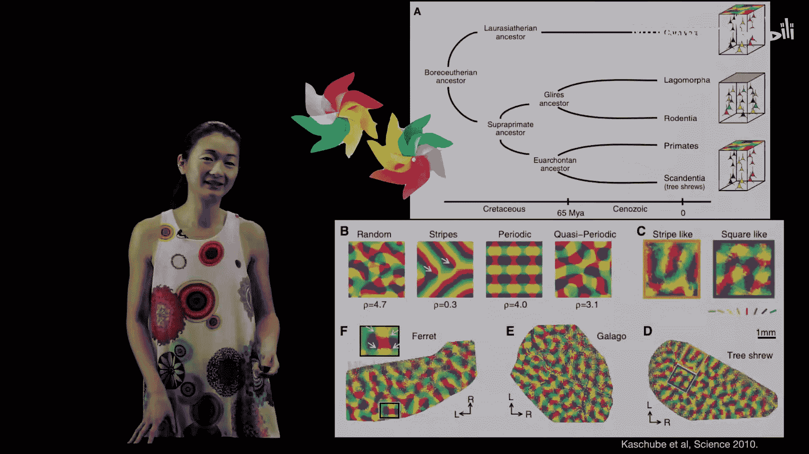
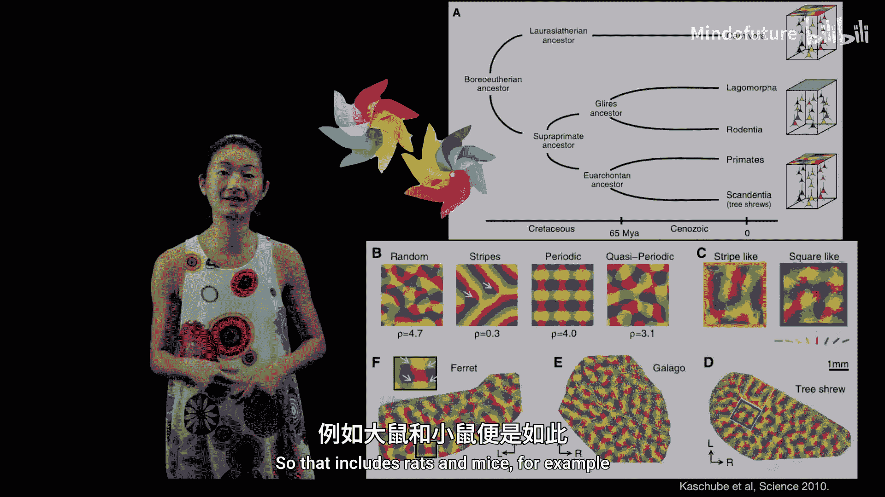
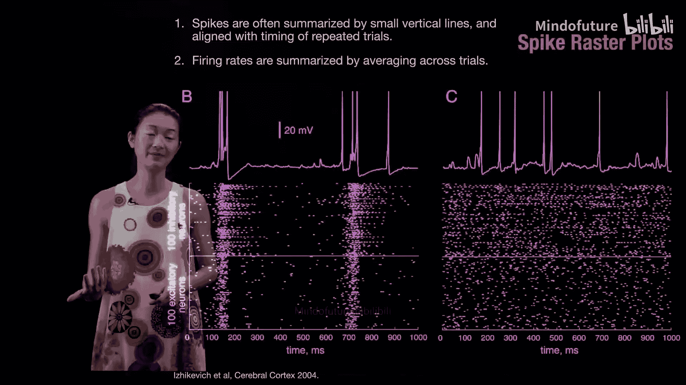
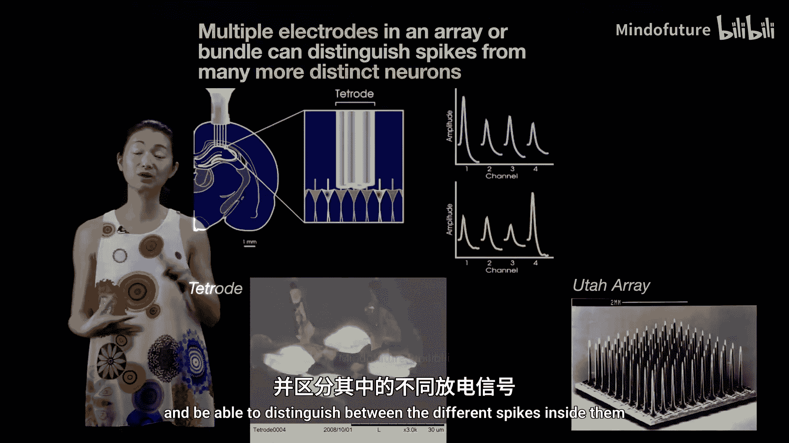
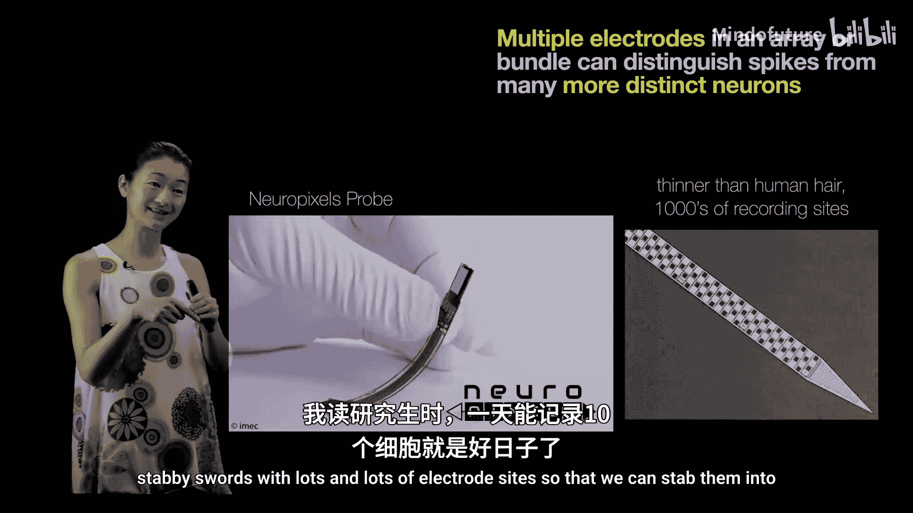
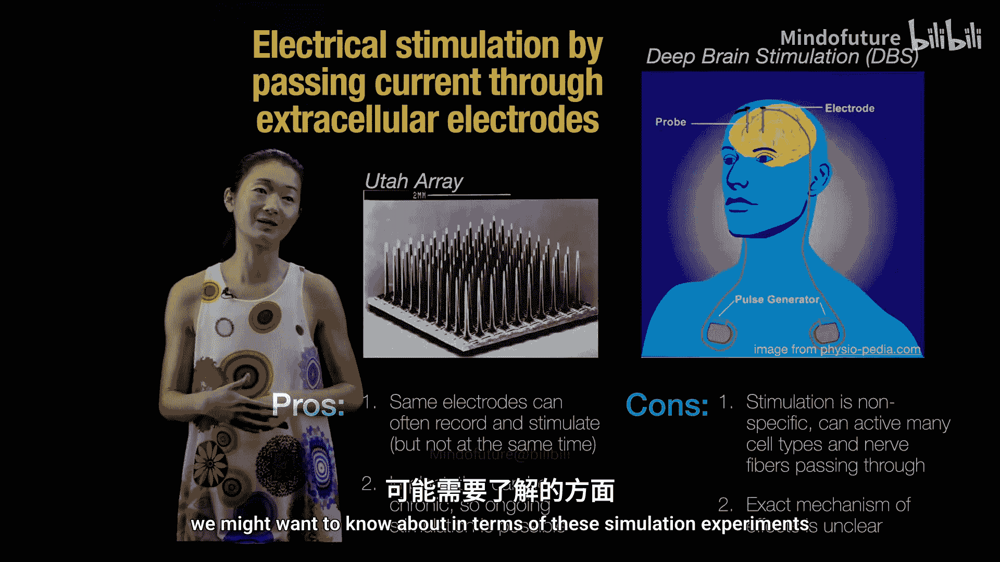

# 【华盛顿大学】神经科学入门 ｜ Introduction To Neuroscience ｜ Bing Wen Brunton p14 P14_神经科学电生理方法_多电极记录__峰电位排序__栅格图 -BV1i3qWBXEDH_p14-

This lecture is all about the electrical methodology using neuroscience to listen in on what neurons are saying。

 as well as being able to manipulate them using modern methods from electronics。

 we're going to start from historical methods of how we used to be able to do it and then walk towards the present moment in terms of all the technologies we have developed to listen to more cells more quickly and doing them at a larger scale faster and for longer period time。

 basically everything's bigger and faster now， but let's start well first。😊。

As a reminder of why we're doing this， why this is all possible。

 there's a series of lectures in the last section of the class and we talked about the fact that electricity is a fundamental unit of communication in the brain and so we had lectures on the passive and active properties of neurons。

 how it is that electrical potentials are generated and past both through time and in space。

 we talked at the propagation of an actual potential。

 the unit of communication of a neuron that is a large deflection in the membrane voltage and it is that very large deflection membrane voltage that we're going to be tapping into for these methods we're going to be talking about in this lecture if you want to review there's a series of video that we reviews and you understand the basis of electricity for communication in neurons。

😊，We're going to go back and think about electrical ways of recording neural activity now this is usually broken up into two large classes of techniques that are called intracellular recordings and extracellular recordings not surprisingly from the way they're named intracellular recordings are techniques that involve tapping into the inside of a cell。

And extracellular techniques are ones where we're not actually inadding the cell cell body anyway。

 we're just going to listen to it by getting close but not actually inside it So intracellular recordings you've actually already heard about them because in the lecture we had on the actual potential and Hochkin Huuxley。

 what we talked about was that squid giant axon and the fact that Hochkin and Huxley originally discovered the action potential and explained it in terms of voltage gated sodium potassium channels by using the giant axon in the squid and putting a intracellular electrode inside。

They were able were used to do this because the squid giant axon is so big that they could actually get a small thin wire through Now we can do a lot better now because we are no longer limited by the fact of having to get a wire inside of the cell。

 there's different techniques that I'm about to tell you about so that we can do this without actually having to thread thread a wire inside the cell。

So。The way this works， it's really a clever set of inventions I'm going to tell you about it so in the passive properties of the neuron we had this picture of a cell and it has these has sodium and potassium and chloride in different concentrations on the inside of the outside of the cell the net effect is that the resting potential is something that's negative on the inside and positive on the outside so what we can do is manufacture a glass pipet that has an extremely small opening。

😊，And we're going to fill the inside of that glass pipette with a physiological solution that mimics the intracellular environment of the cell。

It's not going to be the same， but we know the different ion concentrations that are inside the cell and so I can make in the laboratory a solution that very much resembles that。

 and so by the time I break through it's not going to be a shock to the cell it's going to be like oh this is a little different。

 but it's okay。How do you make one easy glass electrodes super cool So you take a glass pipe that's already really small And what you do is that you put it into this machine that super heats it in the middle so it gets super superper hot and once it gets hot enough。

 it pulls it really， really quickly and so the glass instead of shattering will get pulled very。

 very， very thin but it's straight and it's still hollow because it's a hollow glass pipe that you started with。

 if you then break it near the point at which it has actually fused and polish it very carefully what you end up with is a teeny。

 tiny little pipette tip like the one that I've drawn diagrammatically there。

 and what you do is you gonna lowered onto the cell。

 It can either do this in the visually guided away with a microscope。

 but it's also possible to do it without being able to see the cell as well。

 you lowered it onto the cell membrane。😊，And you apply some section。

To form what's called a giggaOm seal， a gigaom is a very large number， it's a very， very good seal。

And once the glass pipette has sealed itself to the cell membrane。

 you now have the ability to do a couple of different things that I'm going to tell you about in the next slide。

Now a picture what this looks like is the following here you see a cell and this is actually the cell body of looks like a pyraidal cell of some kind。

 you can see it dendrs coming up and it axon going down and that shadow of a triangle there is a picture of a glass pipette kind of in cell attachmo where it's actually onto the cell body of this neuron。

I'll point out that it is possible to do this type of technique， not on the cell body。

 people have done it in dendrs and axons， but because dendros axons are so much smaller。

 it's just a more technically challenging thing to do this。

 and so this is typically done on the cell body because the cell body is kind of the largest part of the cell and you can more easily seal onto it and not miss it altogether。

Once you form the seal， you have a couple of different options。

 your first option is that you just stop， you have what's called a cell attached recording because you have a gigoM seal with the cell membrane where your glass is sealed onto the glass membrane and so you can do electrical recordings in the cell attached mode The second thing you can do is that you can do what's called patch clamping by exccising the patch What you do is that after you form the gigM seal you pull up on the pipette the pipette is usually attached to a very very precise micromanipulator so you pull up on it and you rip that little piece of membrane off of the cell if you get really lucky and your pipette is really really small。

What you might be able to do is isolate a single ion channel this is an amazing amazing technique that was pioneered at the time it was awarded the Nobel Prize Senator Bt Sackman and they were able to actually record ion currents through individual ion channels thus's demonstrating that these were fact to the things that had made ions surss in and out of the cells so you can have what's called patch clamping and do this in a excess patch recording capacity。

The other thing that you could do instead， instead of ripping that patch up and ripping that piece of the cell up and separating from the rest of the cell。

 is that you can break that part of the cell。By applying gentle section the way that I was taught to do this when I was in graduate school is actually with mouth pipeippetting。

 I know this mouth peting is not a good idea usually we try not to do it。

 especially in chemistry but and it is possible to do it now with mouth pipepettting but you can do it you can do it a couple of other ways in any case when you have your cell attached recording you formed your seal you apply gentle section and if you are really lucky and you're really good at doing it you break that part of the cell but your pipette is still attached to the cell and what's happening here is that now you have a whole cell recording where that really wonderful solution that you made that looks like the intracellular environment now rushes into the cell and you have a continuous space between the inside of the cell in the inside of your pipette and so this is the electrical equivalent of sticking a wire inside the squid giantaxxon like hot and the Huuxxley did except now we're doing it with a glass pipepette and by breaking into the cell and having it in solid solution that's in the pipette instead so we have electrical access。

As if the inside of the pipette is the inside of the cell。

 it's really important you get a solution right， and you can do lecture recordings because now you have access to the inside of the cell。

😊。

Now in the patch clamping technique， we have something really impressive that I just wanted to show you that you can actually if you get really lucky like I said。

 you can isolate single ion channels and measure the stochastic opening and closing of single ion channels This is an example of what that kind of recording might look like what you can see here is the inward current is down and time is the horizontal axis it's really noisy because there's actually like I told you this is an ion channel and so there's some stochasticity to it and there's some noise in the recordings but what you can see is that that single ion channel is going to take on one of two different states。

 there's the closed state and then stochically occasionally it will open causing an inward current in this particular case so this ion channel is probably some kind of some kind of sodium channel because we're seeing inward current here it doesn't have to be but might as well be a sodium channel we can think of it a sodium channel and you can see that it's doing this at irregular intervals Every time it opens it does not open for the same amount of time sometimes it opens shorter。

 sometimes it opens longer。And those are all things that we can measure now that we have access to the current of a single ion channel。

 which is pretty cool technique。So that's a super fast survey of intracellular recordings。

 There's a lot more to it， but I just wanted to give you the lay of the land that and the terminology So getting that done is very difficult and you can really only do a couple of cells at a time I think the most impressive thing I've ever heard is having patch clamping done for eight cells simultaneously each one is difficult So getting eight difficult things done at the same time is very。

 very difficult What is more scalable is what's called extracellular recording and it's because extracellular recordings don't require you to gain electro glasses the inside of the cell extracellular recordings is down by what are called sharp electrodes the sharp electrode is basically a very tiny sword。

 very， very tiny sword very tiny stabbby sword that you can stab into the brain So it's usually a piece of metal that has an insulated shank that's electroally insulated and it's only has exposed metal tip at the very tip and so you make one as long as you need to depending on where you going in the brain you expose the brain and you start sta。

inside and you start lowering it and what's happening is because the cells are talking to each other。

 there's electrical potentials and if you get close enough to it in the same way that a radio antenna can pick up electrical radio waves in the air。

 your extracellular recording electrode because of an exposed metal tip will pick up the electroactivity in the cells that is immediately next to。

We're going to show you what that looks like So what that's going to end up looking like is an extracellular recording in time that looks something like this。

 so here you see about a second or about a second's worth of recording from this one example extracellular electrode and you'll see that there's these large deflections and voltage that correspond to action potentials from cells that are in the immediate incinity there's a lot more here so I'm going to point out a couple more features that are really interesting about this example trace of an extracellular recording The first one is that if you pay attention to the axes here。

You'll see that this is 50 microvolts。 remember， the breasting membrane potential of a cell is like negative 60 millivvolts。

 we're talking microvolts here。An extra potential is tens of millivolts in intracellularary recording。

But by the time you're recording it extracellularly。

 it is now a thousand times smaller in magnitude voltage。

And this is because you're not actually measuring the difference between the inside of the outside of the cell。

 you're only measuring the effective electric field that's induced by the action over here and you're measuring it over here that's why it's so much smaller the consequence of this is that doing this type of extracellular recording requires better electronics。

 better amplifiers and better signal processing techniques to be able to see individual action potentials clearly in extracellularly recording requires that you better you're better at actually processing this type of data and having everything be electrically isolated and having things not contaminate each other。

 It's also a separate set of challenges that are different from the challenges of an intracellularly recording so that's cool what you gain from this is because you can now have access to more than one neuron at a time you can just have you'll be able to listen to neurons that are being a close vicinity of your metal tip。

 not just the single one to which you have gained intracellular access what you've lost。

That you don't see any of the sub action potential fluctuations in the intracellular recordings。

 you can actually see single channels opening and closing。

 even though the cells is not firing at all you can see the postynaptic potentials that we were talking about in the previous lecture and synap transmission。

 the EpsP and the IPSP， the excitatory postsynaptic potentials and the inhibitory postsynaptic potentials。

 those are only accessible in the intracellularly recording techniques。

 you can't see those in the extracellular recording techniques because they're way too small to be picked up this way。

 you can pick up though in consequences the tradeoff。

 you can pick up not just extra potentialials in one cell。

 you can pick them up from multiple cells in this example here we can see that we are picking up approximately three different cells。

From this one electrode and you can tell they're different because they have slightly different shapes if you zoomed in so this trace up here in the middle。

 you can see vertical the horizontal axis is 500 milliseconds is about that long so this is half a second's worth of recordings if you zoomed way in to each of these little spiky things you'll see that some of the spikes are bigger so this is the biggest one here。

 some of them are smaller and we have a third one that's kind of an intermediate shape and they have slightly different shapes。

😊，What I mean by shape here is I see this one it goes up and down and back up really sharply。

Where this one here goes up， goes down， but when it comes back up， it comes back up more slowly。

 these subtle differences in magnitude and shape of an actual potential as observed。

By the electric tip allows us the ability to actually dissociate and separate different spikes from different cells out of the same electrode this process is called spike sorting and it's a whole thing in itself it gets complicated。

 but this is kind of the concept of we're looking at shapes of different spikes as they're picked up by the electrode now to be explicit。

 I want to be clear about this because we talked a lot about action potentials having exactly the same reproistible shape。

😊，This is true The reason these actual potentials， from different cells look different from each other is because they're different places in space relative to electrode shape。

 So if they moved a little bit， so you can have the same cell And if you move your electrode。

 maybe just a fraction of a millimeter down a little bit the shape of the cell would change as well。

 So the shape an actual potential in an extracellular recording is a direct function of the actual action potential as well as the relative position of that cell relative to my electrode And so this also means as a tradeoff that is prone to different movement artifacts。

 so if the animal kind of shakes it a little bit or your entire rig shapes a little bit。

 So this is really important。 we usually do these recordings an isolated surfaces where things aren't shaking too much because if things start shaking or the animal moves around then your electrode can move with respect to the cells and you either lose cells or the same cells don't be there。

 but it has a different shape。 So we can't tell exactly the same cell anymore。

 Those are kind of like the higher order considerations in thinking about xcellularary recordings。

 But you。in once again is the ability to see multiple cells at the same time and if you looked at it carefully。

 you'll see that these three cells are firing together。

 but at slightly different times as observed by this one electrode。For the remainder of the course。

 we talked a lot about action potentials， and I just want to be clear in the terminology here well I'm going to use the words action potentials and spikes interchangeably。

 they're called spikes because they literally look spike in extracellular recording。

And each neuron that is emitting an action potential or emitting a spike is said to fire。

 so cell that fires or the firing rate of that cell， these all mean the same things。

 action potential， spikes， cells firing， those all mean exactly the same thing。

 I'm going to use those words kind of interchangeably。

 especially in the context of extracellular recordings。

So this is a technique that was used by Hu and weasel to make a really cool observation that single neurons in a cat visual cortex V1。

 the primary visual cortex of cats show direction selectivity so this was a really really great technique because it really allowed them to focus on individual cells in the visual cortex of the cat in the back the aiplo the cat's brain。

 they stuck these electrodes in there and showed the cat various things on the screen to see what it responded to because they were trying to figure out what the heck this part of the brain even did and there's a story that I've heard told I'm not exactly sure it's precisely true but the spirit of it is true and so here's the version that I heard I'm going share it with you so he went a weasel had these sharp electrode recordings going they had the cat they had a cat in the lab they had the electrode in the cat V1 and they were trying to figure out what these neurons actually did and they weren't really doing the cells were rolling were firing and they were getting really frustrated they were showing it many pictures they were doing all these things and nothing was really working and the cell wouldn't really fire。

😊。

They couldn't cause a fire and they couldn't figure out why at some point。

 one of them got real frustrated and they walked in front of the screen。

They walked front the screen and wave their arms around going like，h。

 I don't care what happens and the cell fired。And it's because instead of responding to individual pictures。

 it turns out the cell was sensitive to movement when they move their arms in front of the eye of the cat and move their arms in a specific direction。

 it caused the cell to fire a lot。 and so this was a really lovely story again I don't even know if it's literally true。

 but something like this happened， and that's inspired them to design a whole different set of stimuli that had to do with direction of movement rather than objects and things and that they are right so not just stripes or vertical horizontal or whatever。

 but stripes moving in different directions what they showed in in this really classic paper here is that this particular cell in the visual cortex of the cat responded most to condition D here。

 which is a bar moving in the up direction。But not in the down direction。

 at exactly the same angle and you can see that by their extracellular recording sharp electrode recordings here。

 where you can see that when it's moving the up direction。

 you get tenns of spikes and when the same same oriented bar moved in the opposite direction moved down into the left。

 you get almost nothing at all。So then they systematically tested different bars of related orientations if you tilt the bar a tiny bit and moved it up。

 it causes fewer spikes。Tilt it further， fewer spikes at some point the cell no longer cares and doesn't fire at all。

 if you're rotated in the other direction same story。

 you can rotate it so fire a little bit but less keep firing it。

 keep rotating your bar eventually stops firing at all and it's direction selective。

 not only orientation selective because if you move the bar in the downward direction in any of these orientations。

 the cell barely cares at all。So this is one of the first really。

 really cool uses of the extracellular electrode where people were studying one cell at a time。

 and it turns out that this general organization where cells in the visual cortex of the cat cared about orientation an oriented movements into the bars is something that is is not something that we see in all mammalian visual systems。

 rats， for example， all rodents do not have orientation columns。

 neighboring cells in their each cell in their V1 has an orientation。

 but they're kind of mixed up together， whereas in primates as well as animals in the order carnivora。

 they have this really cool pattern where neighboring cells have neighboring direction select so I'm a cell right if I'm sensitive to movement in this direction if I move to the left。

😊。

The neighboring cell is going to be sensitive to a very close relationship， very very close cell。

 if I move to the other side， I'm going to have a cell that is selective in the opposite direction as if it were parts of a pinwhe。

So the way that was investigated here， you can see the diagram on the right hand side。

 that's kind of the key for these diagrams， so each of these diagrams is a sheet of cortex in the visual cortex is these respective animals。

 the fer and the galaggo and the tree shrew there。And you can see that there's these beautiful pinwheel patterns that form when neighboring cells represent neighboring phases。

 neighboring orientations in space， and the same is not true of lots of other animals like rodents。

 so that includes rats and mice for example。

Okay， so there's one more thing about these extracellularary recordings that you'll see as we go through the next couple of sections on Senensing in action。

 a lot of what we'll see represented is what's called a spike raster plot and the reason we have these spike raster plots is just another way of summarizing and collapsing information into a more digestible form because we can't always be looking at these these recordings in time。

 there's just too much of it。As I told you， you can actually spike sort and find the timing of individual neurons。

 and so what's the common thing to do in these neuroscience research papers and you'll see this in textbooks as well。

 is where you're seeing repeated trials。Where you're seeing either the same neuron or different neurons lined up where all you're seeing is a small vertical tick mark every time it fired。

 I'm ignoring everything else， so instead of looking at the voltage as a function of time。

 all I'm going to do is spike sort。And then I'm going to put a tiny。

 tiny little tick mark every time the cell fires， and we're going to line it up。

either by multiple neurons that are firing simultaneously so that's what we're seeing here right 10 and ti neurons。

100 excitatory neurons you're seeing that they're 10 to fire right here in time， 150 milliseconds。

 but there's some variability in time or we can line up the activity of a single cell in response to the same repeated stimulus so for example when the cat example we had one cell firing once what we can do is we show it the same oriented bar movement multiple times and we can line it up on the onset of that movement and you'll see the cell will respond the onset of the cell responding。

 we have a set offset to this onset of the oriented bar moving and you can see that by spec ra plot。

We can also summarize spike raster plots by doing what's called an average across the different trials and so we basically just collapse all of this information in space and what you'll end up with is instead of little tick marks in time you'll end up with a smoothly varying curve that is the average firing rate so you'll see that a along you say firing rate is usually average in time and smooth a little bit and it's smooth either in time or across different trials or oftentimes it's a mixture of both and that is another way of collapsing all of the information a voltage as a function of time into a form that is digestible and explainable in terms of what that particular cell happens to be doing。

So all of that is one electrode， which is already pretty cool right。

 but you can get in trouble with one electrode because sometimes you have cells that are so close to each other that you can't really tell them apart the simplest solution to that is add more electrodes you' hear me say this slide well this is the problem just add more electrodes。

😊，If you have multiple electrodes in an array and sometimes in a bundle that gains you the ability to distinguish between more numbers of neurons。

 so the cartoon of that is the following。 this is what's called atero so just like the sharper electrode it is made up of electrically insulated pieces of wire。

 so it's insulated on the outside and there's one exposed edge with the metal is exposed but instead of sticking in one of them。

 I'm going to actually make a bundle twisted together of four different wires to form a tero and we're going to lower all four of them down at the same time the cartoon of that is the following because a tro tips they electrical conductive tips are so close together。

 they're going to have the same neighbors， same neighboring cells。

 but depending on exactly where each electrode is relative to each cell the different cells action potentials。

 spikes are going to have slightly different amplitudes as a cartoon here where you'll see is that here's my bundle of four electrodes in my tro。

There are two cells that are firing this blue one here， as well as yellow  one。

 The blue one is closest to its closest electrode， and the yellow one is closest to a different electrode。

 And so if we look simultaneously over all four channels。

 you'll see that the the four electrodes are able to distinguish between the two different cells quite easily。

 even though on channel 2， they look really similar right on channel 1。

 blue one is really huge and the yellow one is not whereas on channelnel 4。

 the yellow one is really huge and the blue one is not。 And so gaining。😊。

U the ability to more accurately distinguish between neighboring cells is something that we can gain by having multiple electrodes in array or a bundle and then putting them down into the brain and recording altogether together。

Atero is one way of doing it， another way of doing it what's called a Utah array that like a tiny little bit of nails thing that is over there that is it's like 1 hundred electrodes in an array it's a10 by10 array of electrodes now teros are something that we have have often we often build in animal neuroscience they don't tend to work all that well for super deep structures that go down like a couple of millimeters but if you need to go down the size of a primate brain for example。

 they have to go down many， many centimeters Teetros don't don't tend to hold up Utah arrays are used most often in human brain recordings because they're actually FDA approved for used in human clinical contexts but the concepts is the same anytime you have multiple electrodes in an array or a bundle together。

 you'll gain the ability to record from a larger number of neurons and be able to distinguish between the different spikes inside them。

That's the concept here。So using those Utah arrays。

 we're gonna to have a whole lecture later on braincomp interfacing and I want to give you a preview what that's all about these Utah arrays are awesome and one of the reasons they're awesome is because reading from the activity of all of those electrodes and all of those neurons you can actually use them and build a computer decoder to then drive some kind of robotic device or the movement of some kind of computer device like a cursor on the screen for example。

 there's an example here of something that was done at the University of Pittsburgh where they demonstrated direct brain control of a robotic arm I'm going to tell you the story here。

 this is Jan Jann has a ttraplegic and then before this experiment before this clinical experiment that she took part in she had been a  ttraplegic for about a decade because she had a neurodegenerative disease that that she lost the use of all four of her limbs so she was not really able to do much for herself what you can see there on top of her head are those two gray boxes。

 each of them is connected to one of those Utah arrays。

So she's got two of them and they're implanted on the top of her head right near where the motor and sensory motor cortices are。

 so that's where they're reading out information from her head。That's plugged into a computer。

And the computer decodes our intentions to move。 We'll talk about how later in separate lecture on brain computer interfacing。

 And here she is operating that robotic arm with her thoughts and feeding herselfchocolate for the first time。

 So if I hadn't made a few myselfcholate for for the past decade or so。

 And this is the first time I'm doing so I would probably look about as happy as Jan does So feeding myselfchocolate is pretty cool。

 but then they kind of did a few more things with her and that was just kind of cool and one of them is that they had her trained her to to operate a flight simulator with her mind So this is kind of the same thing because you can operate a flight simulator with joystick using your arms she does have use of her arms so she's going to use the electrical activity of her brain cells read out directly by a decoding algorithm instead And so this is kind of a cool demonstration of brain computer interfacing using extracellular electrodes。

😊。

But that's kind of still even old technology at this point because now in 2023。

 the state of the art is what's called neuropixels probes Now neuropixels probes kind of take that idea of having multiple electrodes in an array or a bundle to an absurd extreme。

 so I told you about tetros， which is a bundle of four electrodes okay。

This is a neuralpixels probe and you might be I don't know what you're looking at。

 you might be looking at this part of the probe right now and thinking that's a neuralpixels probe。

 but that's not it。 that's the part of the probe that plugs into the computer to the head stage。

 the amplifiers The neuropixels probe is this thing right here， this teeny tiny thing。

It is thinner than a human hair， so it's tiny。And it has thousands of recording sites。

 not four or five or6 or tens or hundreds， thousands of recording sites。

 It is an absolute technological feat。 It is precision manufactured using the same technologies that we use to manufacture microchip technology。

 So this is the same thing that the same technology that's used for print the circuits that are in your phones and your computers。

 for example， So this has been developed to print very， very small stabby swords。

 Look lots and lots of electrode sites so that we can stab them into the brain。

What you gain here is the ability to measure from not just a couple of cells。 you know。

 when I was a graduate student， if I got 10 cells in a day， that was a good day。 Now。

 if you were using the version 2。0， bigor pixelels 2。0， which is even better。

It would be not unusual for a good day recording to be thousands， maybe even 10，000 cells。

Just think about that for a second。 This is astonishing。

 This technology that was borrowed from microelectronics manufacturing has enabled a。😊。

Three orders of magnitude increase in our ability to listen in to neurons in the brain instead of having the back in the days of Hu and weas they were doing one cell at the time。

 you know， I had done experiments when I was a grad student we were doing two， 10。

 20 cells at a time， now it's thousands of cells at a time on a routine basis。

So this is good news and bad news so the good news is we can listen to a lot more cells。

 a lot more cells than that we used to there's two things where this creates a challenge or the first one is well what do we do with all this data I mean we're talking about terabytes of data that are just streaming out of the brain on a regular basis iss really taxes our ability to store process as well as analyze and model the data set and that's something that is a challenge that we are happily taking on as a community in systems neurocience and the second thing is that this also brings up a really interesting thought experiment which is that。

😊，Thousands of cells is a lot if you think about it compared to two。

 but it's still really few compared to all the different cells in your body。

 all the different neurons in the brain， we're still only listening to maybe 1% of them optimistically I'm rounding here okay I'm pretty sure this is less than 1% of all the neurons in the brain。

And so this is the equivalent of trying to figure out if you're watching TV if you're watching a Netflix movie or're watching a movie on a screen。

 for example， instead of having all the pixels on the screen accessible to you。

 only1% of the pixels are working So you're there trying to figure out what's going on your TV show and only1% of the pixels are on because 99% of them blank you have no idea what's going on So that's kind of the challenge we're at right now it's much better than one pixel used to be one pixel now it's 1% of the pixels。

 but it's still relatively incomplete picture of what's going on as a whole and even as a further thought experiment you thought about it what if we could measure from every single neuron in the cell magically I have no idea how to do it。

 but let's pretend we could I think about future technologies， future technologies。

 we can actually measure from every single neuron in a let's say a mouse brain I just handed you that on a hard drive tomorrow in a big hard drive。

 very big hard drive。 What would you do with it。 This is an experiment that is not possible to do but even if we could do it if you talk to any person who analyzes neural data。

Of this kind， they will be completely baffled and have no idea how they would actually gain insight from the hard disk with the neural activity for an hour。

 let's say， of every single neuron and everything that the mouse either saw or her or did during that hour。

 we still have no idea what to do with it so that remains a challenge and for those of you who may be in the audience thinking about how much you love big data。

 this is a challenge of big data as well。😊。

Okay， so we can measure electrical activity using extracellular electrodes and intracellular electrodes。

😊，Really cool fact is that you can do the inverse as well in addition to just recording from electrodes。

 we can also use these extracellular electrodes passing current through them to simulate the brain。

 so instead of passively just listening to whatever the neurons are saying we can pass current between two electrodes you can pick two neighboring electrodes and sometimes you can pass it between one electrode in the ground that's kind of stuck in the scalp or something like that to stimulate neurons。

This is super cool because then you get to turn them on This is cool because the same electrodes can often record and simulate。

 but not simultaneously， usually we can turn them on like you can record from them for a little while and you turn them off and then you can stimulate the simulation usually causes a gigantic simulation artifact and so nobody can record for a couple of milliseconds and comes back can again。

 you can't do this simultaneously， but you can do them in the same electrodes。

 which is really cool right so with these Utah arrays and other types of arrays that people have implanted and humans and primates and mice and rats and all of the rest。

 we can stimulate and manipulate in real time the neural activity of the brain as we are listening to it。

😊，These implants can also be chronic and so ongoing simulation is possible。

 This is what's happening in brains deep brain deep brain stimulation。

 This is a procedure that is clinically very useful， for example。

 in treatment of Parkson's disease that's going to be the subject of a separate lecture later we can be talking about deep brain stimulation but I wanted to bring up the technology here because it's exactly the same extracellularary recording technology that we're talking about except the probe is slightly different shape and it's made up a slight different material because it's optimized for being in the brain for very long periods of time like years instead of experiment in lab it might last for a couple of hours or days or maybe weeks it will be long but here we're talking about electrode that's supposed to be in a human brain and last for many years the pulse generators there is really cool because they basically use the same technology for battery technology as pacemakers and so the electrodes and the probes go into the part of the brain that is that is stimulating it you can turn it on and off but simulating really helpful for parkingsons and other types of essential tremors。

 for example this is successfully used and the pulse generator。

With a battery kind of sits in the chest as an implanted device and it charges inductively I've seen these devices modern ones they kind of charge inductively just like you can put your phone on an inductive charger you can kind of charge your batteries by sitting there on the couch once every evening or something where you're just when you're chilling in the couch you can put the charger up to your chest and you can charge your pulse generator and you can also reprogram your pulse genderer and hook it up to by Bluetooth through your phone for example。

 so these deep brain simulator etc cetera are super cool and have very successful in treating all kinds of neurological illnesses。

The cons is that the simulation is nonspec。Let's think about what that means。 Okay。

 you have your electrodes， you have a little bed of nails， your deep brain， DBS electrodes。

 whatever it is， you stuck it into a side of the brain。

 you tried your best to hit the correct part of the brain。

 and let's say you succeeded even you've succeeded。

Those parts of the brain contain lots of different types of neurons。 Let's say you simplify。

 Let's just say they has excitatory neurons and inhibitory neurons。

 Exitatory neurons and inhibitory neurons have。Opposite effects on their postynaptic partners。

 but they all fire action potentials。 and when you simulate them by passing current through electrodes。

 they're both simulated。It's non specific。Okay， so we can drive cells in that general volume of the brain。

 we don't get to specify exactly which cell population we're driving。

 we don't even specify exactly it's that volume of brain we're stimulating because sometimes you have nerve fibers。

Axons from other parts of the brain going somewhere else and they're just passing through and you can excite those axons as well and so the simulation targets are kind of a bit of a trial and error right so in the case of DBS in treatment of parkingss。

 the empirical observation is that they work and they work really great but it's a little unclear what the exact mechanism is which cell population are we actually simulating and why does it work now like with lots of other things in neuroscience and neurology we're really happy that it works。

 but it's really important also that we understand why it works because that's going to tell us about why sometimes it fails。

 why for some individualss they fail and also as a tool for understanding neuroscience。

 we like to be able to simulate different parts of the brain and figure out what it is that part of the brain is doing and so having specificity in terms of the volume as well as the different types of cells that we're stimulating is something that we might want to know about in terms of these simulation experiments。

So I've told you a lot about these extracellular recordings。

 both in terms of recordings of simulation， to be clear。

 I wanted to tell you that you may have heard about this new startup company that Elon Mus cast neurolink。

 they've been kind of splashing themselves in news a lot and you might be wondering what are they doing that's different than what I told you that neuroscientists have been doing for the last couple of decades and the short answer is not a lot conceptually they're doing the same thing I told you that neuroscientists and neuroineers have been doing for decades。

 they can build extracellular electrodes， they can implant those extracellular electrodes in animals in their case they're doing a lot of monkeys。

 pigs， some humans also again we've done this before。They can record from lots of them。

 We've done that before too， and they can simulate， which has also been done。

 Each individual piece of the technology is conceptually not particularly new。 However。

 the thing that they have done is solved a lot of the scaling and engineering challenges associated with doing that in a really nice way and fast and a scalable and so in case you want to look more into it。

 there's a lot more to be dug into in terms of neurallink and what they are or not doing。

 they're definitely they're flashy， they're doing a lot of flashy things that it's super cool and at some level there's a neuroengineering part of me that feels really glad that they're doing it because any time startup funds。

 startup resources are put into solving an engineering problem of relevance to your science problems just kind of get solved faster and at some level I hope all of us get to benefit from this technology but I did want to be clear in terms of the problems they're solving。

 I think if you hear must talk about it they're solving these brand new problems than that was ever done before。

 but conceptually they're engineering better versions of。😊。

That neuroscientists and neuro engineerineers have been developing for a pretty long time and so I think my colleagues sometimes I talk to them and theyre of mixed feelings sometimes they're feeling critical one day。

 sometimes they're feeling optimistic the other day。

 but the technology behind neurallink is the same as what I had talked about in the previous sections of lecture in terms of extracellular recordings and simulation。

So to summarize here are the key concepts to understand electrical methods in neuroscience。

 both recording and manipulation， we talked about how electrodes and electronics are key technologies so we to measure these electrical potential。

 some neurons， neurons are electrical and so we can listen in by using electrodes and electronics。

 they are intracellularlar techniques like patch clamping。

 which is super cool because you can actually isolate individual channels and isolated cells and listen in to them closing and opening is's super cool that you can actually do that for single proteins and single neurons when they're actually active anytime you get to see something in action that's that small。

 I get really excited because it's something that we can't really see with their own eyes but with technology now we can。

We also talked about extracellular electrodes， which are listening in。

 but kind of at a faraway level， you're picking up near active neurons by picking up their electrical activity and what you've gained in terms of the tradeoff is that now you can do multiple multiple cells at the same time。

 patch claming you can only really do one cell you have to get separate glass pipettes to do multiple ones。

 each extracellular electrode can pick up potentially multiple cells and if you just had more extracellularll electrodes to4。

810000 you can record from thousands of neurons while the animal is simultaneously doing all the things that it normally does watching movies running around。

 listening to stuff interacting with each other， all those kinds of things so those are kind of really cool experiments that kind of hot off the press in neuroscience right now in terms of what is possible to accomplish with these multielectro recordings。

And with the same electrode， it is often possible to then instead of just listen to pass current through them。

 either through neighboring ones or through one electrode and then having the ground be somewhere else like sometimes there's a scalp electrode that you put into the back of the neck。

 for example， and if you pass current through those electrodes。

 you can electrically simulate nearby neurons and experimentally activate them。

 This can be used for experimental reasons as well as therapeutic reasons in clinical context and that's going to be the section the subjective of future lecture in a little bit。

 So these are the key concepts。 And next we're going to talk about optical methods of measuring the brain。

