# 神经科学入门：P14：神经科学电生理方法：多电极记录、峰电位排序与栅格图 🧠

在本节课中，我们将学习神经科学中用于“聆听”神经元活动的电生理方法，以及利用现代电子技术操控它们的手段。我们将从历史方法开始，逐步介绍当前用于更快、更大规模、更长时间记录更多细胞的技术。简而言之，现在的技术更强大、更快速了。让我们开始吧。

## 为什么使用电生理方法？

在上一章节的系列讲座中，我们讨论了电信号是大脑通信的基本单元。我们学习了神经元的被动和主动特性，以及动作电位如何在时间和空间中产生和传播。动作电位是神经元通信的单位，表现为膜电压的大幅偏转。本讲座中讨论的方法正是要利用这种膜电压的大幅变化来记录神经活动。如果你想复习神经元电通信的基础知识，可以参考相关的系列视频。

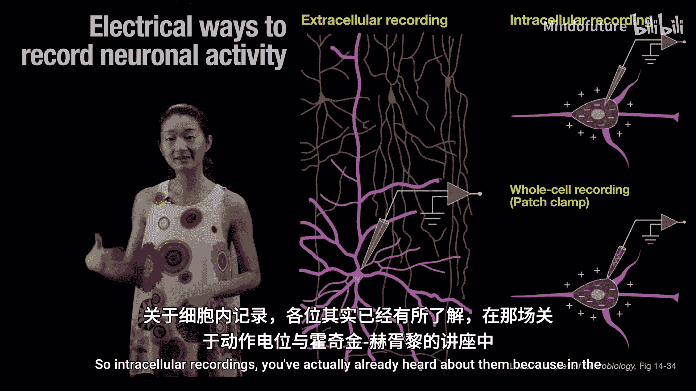

## 细胞内记录与细胞外记录

现在，我们回顾记录神经活动的电学方法。这些技术通常分为两大类：**细胞内记录**和**细胞外记录**。顾名思义，细胞内记录涉及将电极插入细胞内部，而细胞外记录则不需要刺入细胞体，我们只需靠近细胞来“聆听”其活动。

### 细胞内记录

你已经接触过细胞内记录。在关于动作电位和霍奇金-赫胥黎的讲座中，我们讨论了乌贼的巨大轴突。霍奇金和赫胥黎正是通过将细胞内电极插入乌贼的巨大轴突，发现了动作电位，并用电压门控钠钾通道解释了其机制。

他们能够这样做，是因为乌贼的巨大轴突非常大，足以容纳一根细金属丝。如今，我们有了更好的技术，不再受限于必须将金属丝插入细胞。接下来我将介绍不同的技术，使我们无需将金属丝穿入细胞就能进行记录。

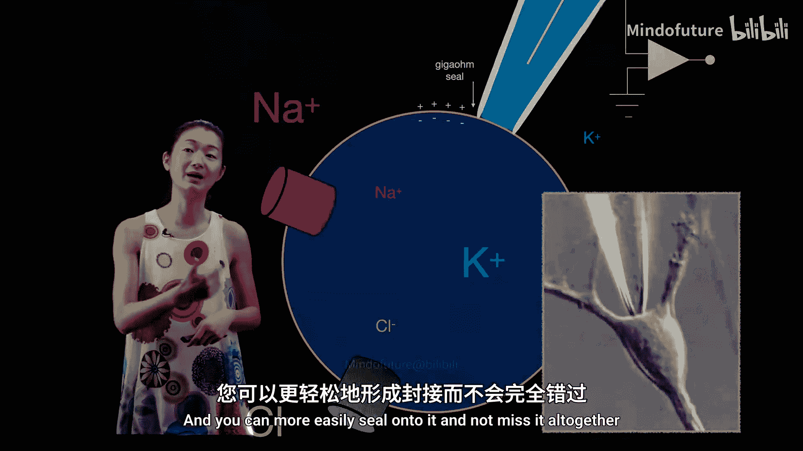

### 膜片钳技术

这种方法的工作原理非常巧妙。在神经元的被动特性中，我们有一张细胞图，其内外钠、钾、氯离子浓度不同，净效应是细胞内部相对于外部带负电。我们可以制造一个开口极小的玻璃微管。

我们将玻璃微管内部充满模拟细胞内环境的生理溶液。虽然不完全相同，但我们知道细胞内的离子浓度，因此可以在实验室配制非常相似的溶液。这样，当我们刺破细胞膜时，对细胞的冲击较小。

制作这种玻璃电极非常酷。你取一根已经很细的玻璃管，将其放入一台机器中，在中间部位超高温加热。当玻璃足够热时，迅速拉伸，玻璃不会碎裂，而是被拉得非常非常细，但仍保持中空。然后，在玻璃融合点附近将其折断并仔细抛光，最终得到如图所示的微小吸管尖端。

接着，你将吸管降低到细胞上。这可以在显微镜引导下进行，也可以在看不见细胞的情况下完成。当吸管尖端接触到细胞膜时，施加一些吸力，形成所谓的**吉欧封接**。吉欧是一个非常大的电阻值，意味着封接非常好。

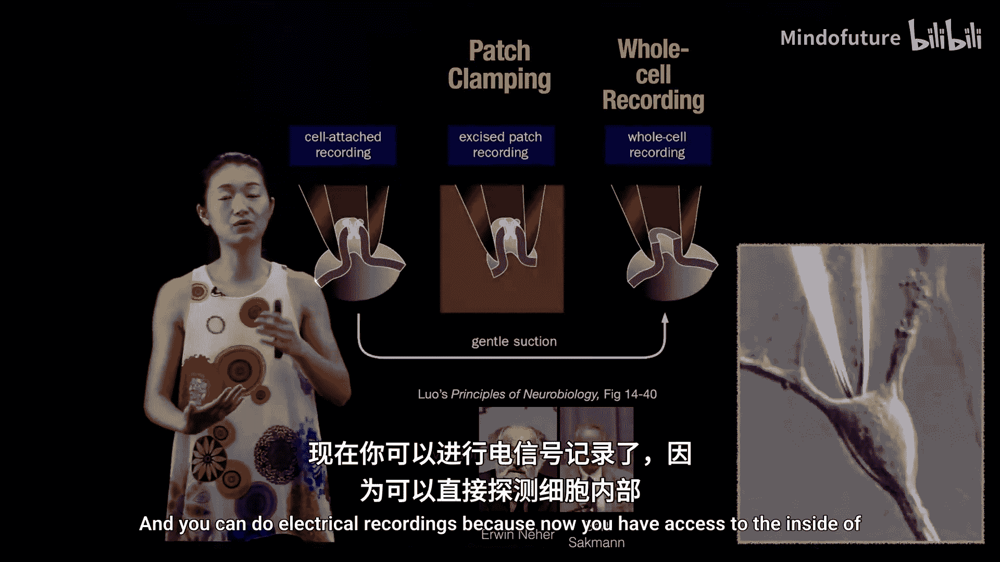

一旦玻璃吸管与细胞膜形成封接，你就可以进行几种不同的操作。

上图展示了一个细胞，看起来像某种锥体神经元，可以看到树突向上延伸，轴突向下延伸。那个三角形的阴影就是附着在该神经元胞体上的玻璃吸管图像。需要指出的是，这种技术不仅可以在胞体上进行，也可以在树突和轴突上进行，但由于树突和轴突小得多，技术挑战更大，因此通常是在胞体上进行。

一旦形成封接，你有几个选择。第一个选择是停止，进行**细胞贴附式记录**，因为你的玻璃吸管与细胞膜形成了吉欧封接，你可以在此模式下进行电记录。第二个选择是进行**膜片钳**，通过切除膜片来实现。形成吉欧封接后，你向上提起吸管（吸管通常连接在一个非常精密的微操纵器上），将那一小块细胞膜从细胞上撕下来。如果你非常幸运且吸管尖端非常小，你或许能分离出单个离子通道。这是一项惊人的技术，曾获得诺贝尔奖，由萨克曼等人开创。他们能够记录通过单个离子通道的离子电流，从而证明这些确实是离子进出细胞的通道。因此，你可以进行膜片钳，并以**切除膜片记录**模式操作。

另一种选择是，不将那块膜片撕下并与细胞分离，而是**打破**细胞的那部分。我在研究生阶段被教导的方法是使用口吸管。当然，口吸通常不是好主意，尤其是在化学实验中，但现在也可以通过其他方式实现。无论如何，当你有细胞贴附式记录并形成封接后，施加轻柔的吸力。如果你非常幸运且技术娴熟，你会打破那部分细胞，但吸管仍然附着在细胞上。此时，你就有了**全细胞记录**。你配制的那个模拟细胞内环境的溶液现在涌入细胞，细胞内部和吸管内部形成了一个连续的空间。这在电学上等同于像霍奇金和赫胥黎那样将金属丝插入乌贼巨大轴突，只不过现在我们使用的是玻璃吸管，通过打破细胞并利用吸管内的溶液来实现电学接入。

仿佛吸管内部就是细胞内部。确保溶液配制正确非常重要，现在你可以进行电记录，因为你已经能够接触到细胞内部。

在膜片钳技术中，有一项非常令人印象深刻的应用。如果你足够幸运，如前所述，你可以分离出单个离子通道，并测量其随机开启和关闭的过程。上图展示了这种记录可能的样子。你可以看到内向电流向下，时间在水平轴上。记录非常嘈杂，因为正如我所说，这是一个离子通道，具有随机性，记录中也有噪声。但你可以看到，这个单离子通道会处于两种不同的状态：关闭状态，以及偶尔随机开启，导致内向电流（在此特定情况下）。这个离子通道可能是某种钠通道，因为我们看到的是内向电流。每次开启的持续时间并不相同，有时短，有时长。现在我们能够测量单个离子通道的电流，这是一项非常酷的技术。

以上就是对细胞内记录的快速概述。其中还有很多内容，但我只想让你了解其概况和术语。进行细胞内记录非常困难，一次只能记录少数几个细胞。我听说过最厉害的是同时进行八个细胞的膜片钳记录，每一项都很困难，同时完成八项更是难上加难。

## 更具扩展性的方法：细胞外记录

更具扩展性的方法是**细胞外记录**。这是因为细胞外记录不需要获得细胞内部的电学通路。细胞外记录是通过所谓的**尖锐电极**完成的。尖锐电极基本上是一把非常微小的“剑”，你可以用它刺入大脑。它通常是一段金属，其杆部是电绝缘的，只有最尖端暴露金属。你可以根据需要制作不同长度的电极，暴露大脑后，将其刺入并降低。由于细胞之间相互通信会产生电信号，如果你的电极足够靠近细胞（就像无线电天线可以接收空气中的无线电波一样），你的细胞外记录电极（因其暴露的金属尖端）就能拾取紧邻细胞的电活动。

我们将展示这看起来是什么样子。最终，细胞外记录在时间上看起来会像下图这样。

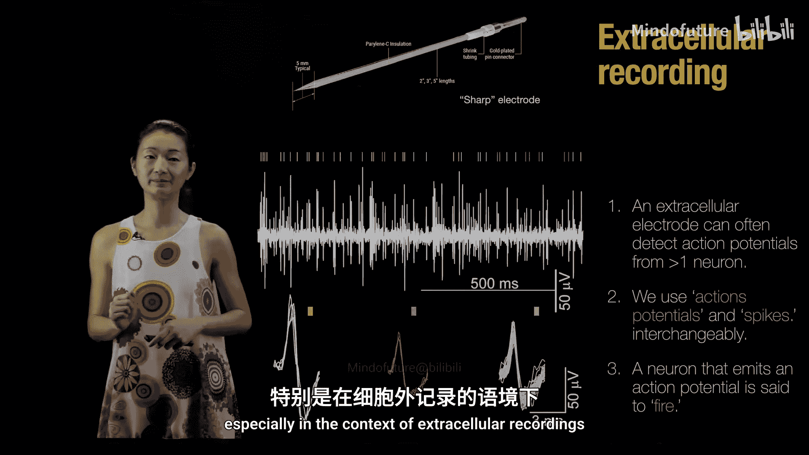

这里你看到了大约一秒钟的来自一个示例细胞外电极的记录。你会看到这些大的电压偏转，它们对应于紧邻区域细胞产生的动作电位。这里还有很多其他特征。首先，请注意坐标轴：这里是50微伏。记住，细胞的静息膜电位大约是负60毫伏，而这里我们讨论的是微伏。细胞内记录的动作电位是几十毫伏，但当你进行细胞外记录时，其电压幅度要小一千倍。这是因为你测量的不是细胞内外之间的电位差，而是动作电位在此处产生并在彼处测量到的有效电场，所以它小得多。因此，进行这种细胞外记录需要更好的电子设备、放大器和信号处理技术，以便清晰地看到单个动作电位。这是一套与细胞内记录不同的挑战。

你从中获得的好处是，现在可以同时访问多个神经元。你可以“聆听”金属尖端附近区域的神经元活动，而不仅仅是单个你获得了细胞内通路的细胞。你失去的是，你看不到任何亚阈值电位波动。在细胞内记录中，你实际上可以看到单个通道的开启和关闭，即使细胞完全不发放动作电位，你也能看到我们在上一讲突触传递中讨论的突触后电位（EPSP和IPSP）。这些只有在细胞内记录技术中才能访问，在细胞外记录技术中无法看到，因为它们太小了，无法以这种方式拾取。

作为交换，你可以拾取不止一个细胞的动作电位，而是多个细胞的动作电位。在这个例子中，我们可以看到我们从这个电极拾取了大约三个不同的细胞。你可以看出它们不同，因为它们有略微不同的形状。如果你放大看中间这个迹线，水平轴是500毫秒，大约是这么长，所以这是半秒钟的记录。如果你大幅放大每一个尖峰信号，你会看到有些尖峰更大（这里是最大的），有些更小，我们还有第三个形状居中的尖峰，它们有略微不同的形状。

我所说的“形状”是指，我看到这个尖峰上升、下降，然后非常迅速地再次上升；而那个尖峰上升、下降，但再次上升时更缓慢。动作电位被电极尖端拾取时，在幅度和形状上的这些细微差异，使我们能够从同一电极中分离和区分不同细胞发出的尖峰。这个过程称为**峰电位排序**，它本身就是一个复杂的领域，但这就是其基本概念：我们观察电极拾取到的不同尖峰的形状。

需要明确的是，我们讨论过动作电位具有完全相同的可重现形状，这是对的。不同细胞的动作电位看起来不同，是因为它们在空间上相对于电极的位置不同。所以，如果是同一个细胞，你稍微移动一下电极，也许只移动零点几毫米，该细胞动作电位的形状也会改变。因此，细胞外记录中动作电位的形状是动作电位本身以及该细胞相对于电极位置的直接函数。这也意味着它容易受到不同运动伪迹的影响。如果动物稍微晃动一下，或者你的整个装置稍微震动一下，电极相对于细胞的位置就会移动，你可能会丢失细胞，或者同一个细胞的形状发生变化，导致你无法再识别它。这些是在考虑细胞外记录时需要思考的更高级别的问题。

但你获得的好处再次是能够同时看到多个细胞。如果你仔细观察，你会看到这三个细胞一起发放动作电位，但时间略有不同，正如这个电极所观察到的那样。

在课程的剩余部分，我们会经常讨论动作电位。我想在这里明确一下术语：我将交替使用“动作电位”和“峰电位”这两个词。它们被称为“峰电位”，是因为在细胞外记录中它们看起来确实像尖峰。每个发放动作电位或峰电位的神经元被称为“发放”，所以“细胞发放”或“细胞的发放率”都意味着相同的事情。我将在细胞外记录的背景下交替使用这些词语。

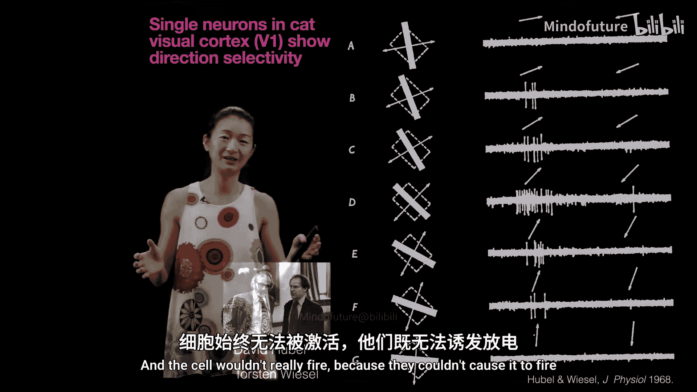

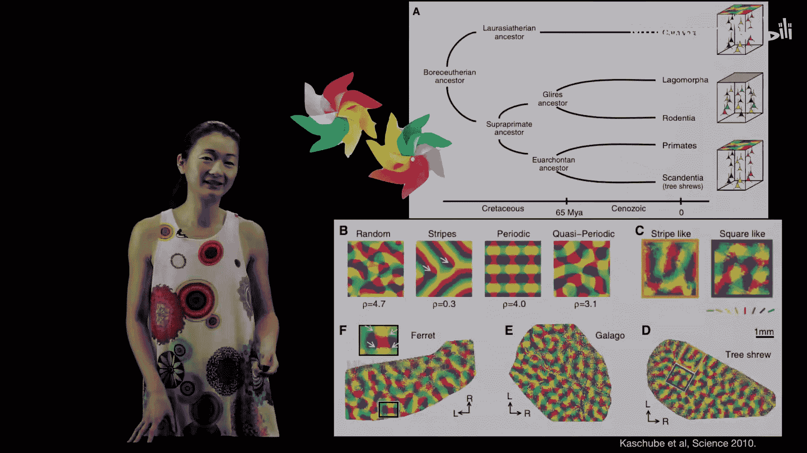

## 细胞外记录的应用实例

这项技术曾被休伯尔和维泽尔用来做出一个非常酷的观察：猫视觉皮层V1区的单个神经元表现出方向选择性。这是一项非常伟大的技术，因为它使他们能够专注于猫大脑后部枕叶视觉皮层中的单个细胞。他们将电极插入那里，在屏幕上向猫展示各种东西，以观察细胞的反应，因为他们试图弄清楚大脑的这个部分到底有什么功能。

我听过一个故事（不确定是否完全准确，但精神属实），版本如下：休伯尔和维泽尔正在进行尖锐电极记录，他们有一只猫在实验室，电极在猫的V1区。他们试图弄清楚这些神经元到底做什么，但细胞只是随机发放，他们感到非常沮丧。他们展示了许多图片，尝试了各种方法，但似乎没什么效果，细胞就是不规律地发放。他们无法使其规律发放，也搞不清楚原因。在某个时刻，其中一人非常沮丧，走到屏幕前，挥舞着手臂，心想“我不管发生什么了”，结果细胞发放了。原来，细胞不是对单个图片做出反应，而是对运动敏感。当他们在猫眼前以特定方向移动手臂时，导致细胞大量发放。这真是一个可爱的故事，它启发他们设计了一套完全不同的刺激，与运动方向有关，而不是物体本身。他们是对的。

他们在这篇经典论文中展示，猫视觉皮层中的这个特定细胞对这里的条件D反应最强烈，即一个向上移动的条形。但在完全相同的角度向下移动时，几乎完全没有反应。他们系统地测试了不同方向的条形。如果你将条形稍微倾斜并向上移动，它引起的尖峰减少；进一步倾斜，尖峰更少；到某个点，细胞不再关心，完全不发放。如果你向另一个方向旋转，情况类似：旋转一点，会发放一些但更少；继续旋转，最终完全停止发放。它是方向选择性的，而不仅仅是朝向选择性，因为如果你以任何这些朝向向下移动条形，细胞几乎完全不在乎。

这是细胞外电极最早、最酷的应用之一，人们一次研究一个细胞。事实证明，猫视觉皮层中细胞关心条形朝向和定向运动这种一般性组织，并非在所有哺乳动物视觉系统中都存在。例如，包括大鼠在内的所有啮齿动物都没有朝向柱。它们V1区的每个细胞都有朝向偏好，但它们是混合在一起的。而在灵长类动物和食肉目动物中，则有这种非常酷的模式：相邻细胞具有相邻的方向选择性。如果一个细胞对这个方向的运动敏感，那么向左移动，相邻细胞将对非常接近的方向敏感；向右移动，则会有对相反方向敏感的细胞，就像风车的一部分。

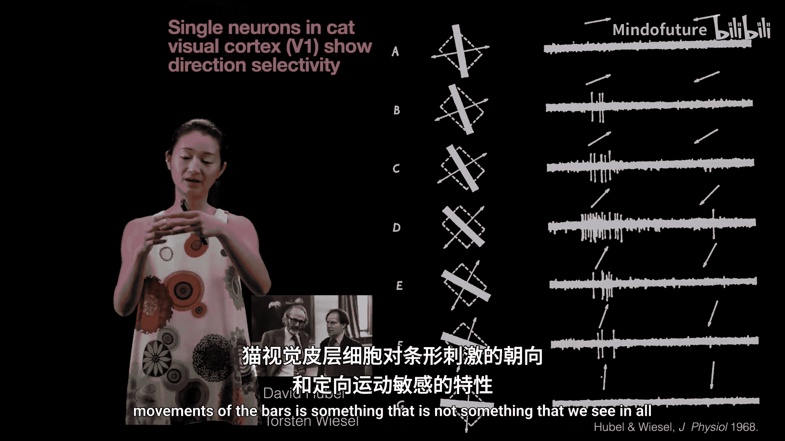

研究这种现象的方法如右图所示。每个图都是各自动物（雪貂、婴猴和树鼩）视觉皮层的一个切面。你可以看到，当相邻细胞代表空间中相邻的相位和朝向时，会形成这些美丽的风车图案。许多其他动物（如啮齿类动物）则不是这样。

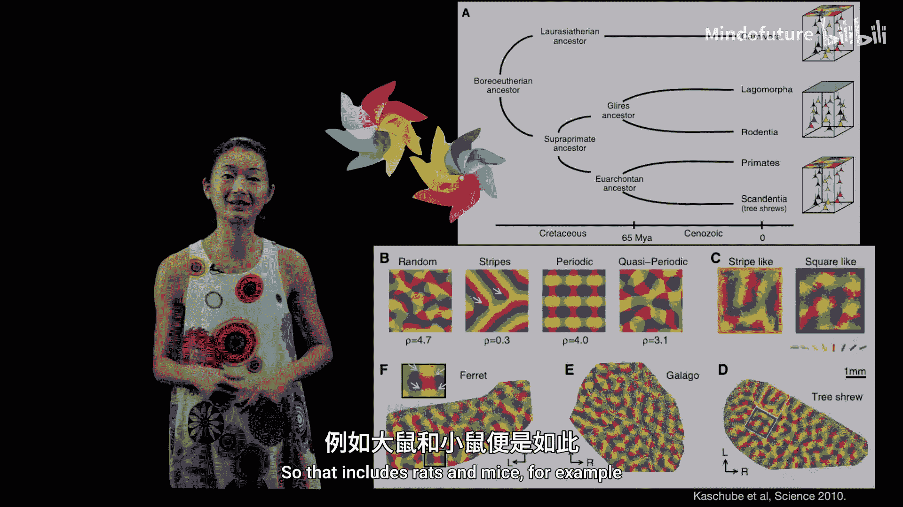

## 栅格图

关于这些细胞外记录，还有一件事你会在接下来关于感觉和行动的章节中看到，那就是很多信息会以所谓的**峰电位栅格图**的形式呈现。我们使用栅格图，是因为这是将信息总结和压缩成更易消化形式的另一种方式，因为我们不能总是查看这些随时间变化的记录，数据量太大了。

正如我告诉你的，你可以进行峰电位排序，找出单个神经元的发放时间。在神经科学研究论文和教科书中，常见的做法是展示重复试验的结果。你可以看到同一神经元或不同神经元的发放活动对齐排列，你所看到的只是在每次发放时的一个小垂直刻度标记。我忽略其他一切，所以我不再看电压随时间的变化，而是进行峰电位排序，然后在细胞每次发放时放一个微小的刻度标记，并按时间对齐。

这可以是多个神经元同时发放的情况（就像这里看到的10个、100个兴奋性神经元，它们在150毫秒左右发放，但在时间上有些变异性），也可以是一个细胞对相同重复刺激的反应。例如，在猫的例子中，我们有一个细胞发放一次。我们可以做的是，多次展示相同的定向条形运动，并将其对齐到运动开始的时间。你可以看到细胞会对运动开始做出反应。我们有一个相对于这个运动开始的偏移，通过栅格图可以看到。

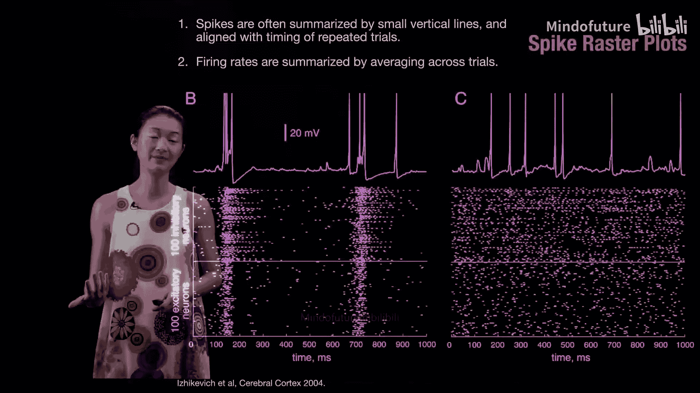

我们还可以通过对不同试验进行平均来总结栅格图。我们基本上将所有空间信息压缩，最终得到的不是时间上的小刻度标记，而是一条平滑变化的曲线，即平均发放率。所以你会看到，发放率通常在时间上平均并稍微平滑，它可以在时间上平滑，也可以跨试验平滑，或者通常是两者的混合。这是将电压随时间变化的所有信息压缩成可消化、可解释形式的另一种方式，用以说明该特定细胞正在做什么。

## 多电极阵列

以上都是关于单个电极的，这已经很酷了。但使用单个电极可能会遇到麻烦，因为有时细胞彼此非常接近，你无法真正区分它们。最简单的解决方案是**增加更多电极**。如果你有一个阵列（有时是捆绑在一起）的多个电极，你就能获得区分更多神经元的能力。

其示意图如下。这被称为**四极管**。就像尖锐电极一样，它由电绝缘的金属丝制成，外部绝缘，只有一处边缘暴露金属。但我不只插入一根，而是将四根不同的金属丝扭在一起形成一个四极管束，然后同时将它们降低。其示意图如下：因为四极管的导电尖端非常接近，它们将拥有相同的邻居，即相同的邻近细胞。但根据每个电极相对于每个细胞的确切位置，不同细胞的动作电位（尖峰）将具有略微不同的幅度。

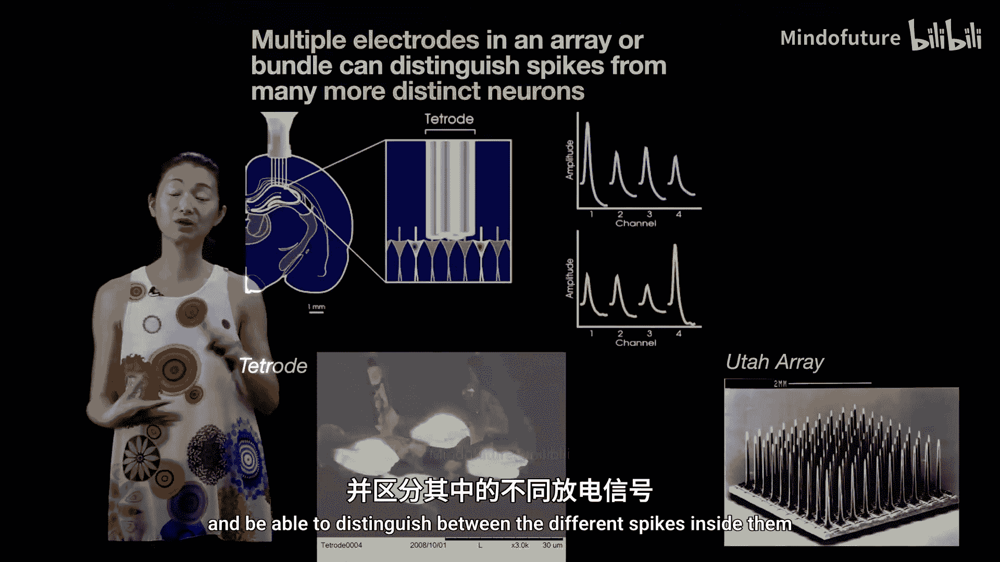

如上图所示，这里是我的四电极束（四极管）。有两个细胞在发放：蓝色的和黄色的。蓝色细胞最接近电极1，黄色细胞最接近电极4。因此，如果我们同时观察所有四个通道，我们会发现四个电极能够相当容易地区分两个不同的细胞，即使在通道2上它们看起来非常相似。在通道1上，蓝色细胞的信号非常大，而黄色细胞的信号不大；在通道4上，黄色细胞的信号非常大，而蓝色细胞的信号不大。因此，通过拥有阵列或捆绑的多个电极，并将它们插入大脑同时记录，我们获得了更准确区分邻近细胞的能力。

四极管是一种方式，另一种方式是所谓的**犹他阵列**，它像一个小小的钉床，是一个10x10的电极阵列。四极管在动物神经科学中常用，但对于需要深入几毫米的深层结构效果不佳。如果你需要进入像灵长类大脑那样深的地方（许多厘米），四极管往往无法胜任。犹他阵列最常用于人类大脑记录，因为它们实际上已获FDA批准用于人类临床环境。但概念是相同的：任何时候你拥有阵列或捆绑在一起的多个电极，你就能记录更多神经元，并能够区分其中的不同尖峰。

## 多电极记录的应用：脑机接口

使用这些犹他阵列，我们将在后面有一整节关于脑机接口的讲座。我想在这里给你一个预览。这些犹他阵列非常棒，原因之一是，通过读取所有这些电极和神经元的活动，你实际上可以使用它们构建一个计算机解码器，然后驱动某种机器人设备或计算机设备的运动，例如屏幕上的光标。

这里有一个匹兹堡大学完成的例子，他们展示了直接通过大脑控制机械臂。故事是这样的：Jan患有四肢瘫痪。在这次临床实验之前，她因患有神经退行性疾病已失去四肢功能约十年，无法为自己做太多事情。你可以看到她头顶上有两个灰色盒子，每个都连接着一个犹他阵列。所以她有两个阵列，植入在她头顶靠近运动和感觉运动皮层的位置。这样可以从她的大脑中读取信息。这些信息被输入计算机，计算机解码出她的运动意图（我们将在后面的脑机接口讲座中讨论如何实现）。在这里，她正用她的思想操作机械臂，并给自己喂巧克力。这是她十年来第一次这样做，她看起来非常开心。

给自己喂巧克力已经很酷了，但他们还和她一起做了更多事情，其中之一是训练她用思维操作飞行模拟器。这有点类似，因为你可以用操纵杆操作飞行模拟器，但她无法使用手臂，所以她将使用大脑细胞的电活动，通过解码算法直接读取。这是使用细胞外电极进行脑机接口的一个很酷的演示。

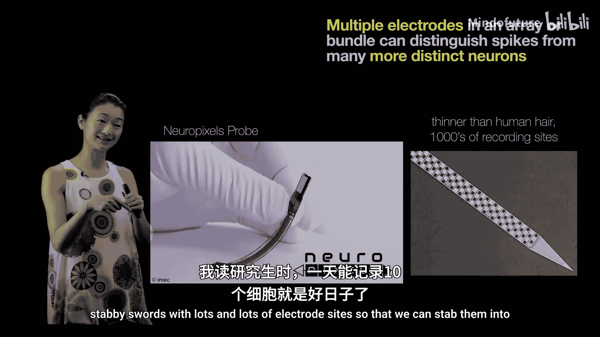

## 最新技术：神经像素探针

但这在某种程度上仍然是旧技术，因为在2023年，最先进的技术是所谓的**神经像素探针**。神经像素探针将多电极阵列或捆绑的想法推向了极致。我告诉过你四极管是四个电极的捆绑，而这是一个神经像素探针。你可能不知道你在看什么，你可能现在正看着探针的这个部分，以为那就是神经像素探针，但其实不是。那是探针连接到计算机头戴式放大器的一部分。神经像素探针是这里的这个小东西，它比人的头发还细，非常微小。它拥有数千个记录位点，不是四个、五个、六个、十个或几百个，而是数千个。这是一项绝对的技术壮举。它使用与我们制造微芯片技术相同的技术进行精密制造。这是用于打印手机和电脑中电路的同一种技术。现在，这项技术被开发用来打印非常非常小的“剑”，上面有大量电极位点，以便我们可以将它们刺入大脑。

你从中获得的是测量不止几个细胞的能力。在我读研究生的时候，如果一天能记录到10个细胞，那就是美好的一天。现在，如果你使用版本2.0（神经像素2.0，甚至更好），一次好的记录获得数千甚至上万个细胞并不罕见。想一想这一点，这令人震惊。这项借鉴微电子制造的技术，使我们聆听大脑神经元的能力提高了三个数量级。从休伯尔和维泽尔一次研究一个细胞的时代，到我读研究生时一次做两个、十个、二十个细胞的实验，到现在常规基础上一次记录数千个细胞。

这既是好消息也是坏消息。好消息是我们可以聆听比以前多得多的细胞。这带来了两个挑战：首先，我们如何处理所有这些数据？我们谈论的是太字节级别的数据从大脑中持续流出，这确实考验我们存储、处理、分析和建模数据集的能力。这是我们系统神经科学界乐于接受的一个挑战。其次，这也引发了一个非常有趣的思考实验：数千个细胞虽然比两个多很多，但与身体中所有不同的神经元相比仍然很少。我们仍然只聆听了其中可能1%的神经元（我在这里取整，乐观估计）。所以，这相当于试图弄清楚你在看什么，就像看电视或Netflix电影，但只有1%的像素在工作，99%是空白的，你根本不知道发生了什么。这就是我们目前面临的挑战。比一个像素好多了，现在是1%的像素，但相对于整体情况来说，仍然是一个相对不完整的画面。

更进一步思考，如果我们能神奇地测量到每一个神经元呢？我不知道如何做到，但假设我们可以。想想未来技术，我们实际上可以测量小鼠大脑中的每一个神经元。假设我明天给你一个存有这些数据的大硬盘。你会用它做什么？这是一个不可能完成的实验，但即使我们能做，任何分析这类神经数据的人都会完全困惑，不知道如何从存有一小时（假设）内每个神经元活动以及小鼠在那段时间内所见、所闻、所做的一切的硬盘中获得洞见。我们仍然不知道如何处理它，这仍然是一个挑战。对于那些热爱大数据的听众来说，这也是大数据的一个挑战。

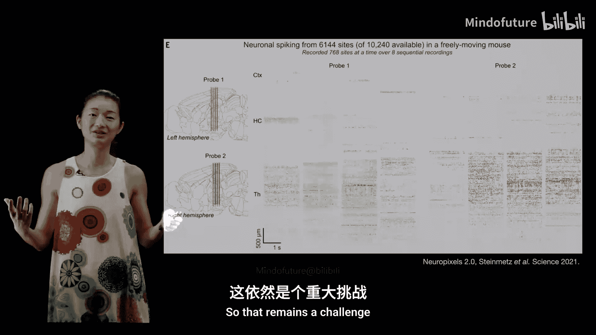

## 电刺激：记录的逆过程

好的，我们可以使用细胞外和细胞内电极测量电活动。一个非常酷的事实是，你也可以进行逆过程。除了仅仅用电极记录，我们还可以通过这些细胞外电极传递电流来**刺激**大脑。这样，我们不是被动地“聆听”神经元在说什么，而是可以主动“开启”它们。

这非常酷，因为同样的电极通常可以记录和刺激，但不能同时进行。通常我们可以先记录一会儿，然后关闭记录进行刺激。刺激通常会产生巨大的刺激伪迹，所以在几毫秒内无法记录，之后才能恢复。你不能同时进行，但你可以在相同的电极上交替进行，这真的很酷。因此，通过植入人类、灵长类、小鼠、大鼠等体内的这些犹他阵列和其他类型的阵列，我们可以在实时“聆听”大脑神经活动的同时，刺激和操控它。

这些植入物也可以是**慢性的**，因此可以进行持续刺激。这就是**深部脑刺激**中正在发生的事情。这是一种临床上非常有用的程序，例如用于治疗帕金森病，这将是后面单独一讲的主题。但我想在这里提及这项技术，因为它与我们正在讨论的细胞外记录技术完全相同，只是探针形状略有不同，材料也略有不同，因为它针对的是在大脑中停留很长时间（比如数年）而优化，而不是实验室实验中可能持续几小时、几天或几周的情况。我们谈论的是应该植入人脑并持续多年的电极。

脉冲发生器非常酷，因为它们基本上使用与起搏器相同的电池技术。电极和探针进入大脑的刺激部位，你可以打开和关闭它。刺激对帕金森病和其他类型的特发性震颤等非常有效。脉冲发生器带电池，作为一种植入设备放置在胸部，它可以感应充电。我见过这些现代设备，它们可以感应充电，就像你可以把手机放在感应充电器上一样。你可以每天晚上坐在沙发上时，将充电器放在胸前为脉冲发生器充电，也可以通过手机蓝牙等方式重新编程脉冲发生器。这些深部脑刺激器等超级酷，并且在治疗各种神经系统疾病方面非常成功。

缺点是刺激是**非特异性的**。想想这意味着什么。你有电极，你的深部脑刺激电极就像一个小钉床，无论它是什么，你把它插入大脑的某个部位，你尽力击中大脑的正确部分，假设你成功了。即使你成功了，大脑的这些部分包含许多不同类型的神经元。简单来说，假设有兴奋性神经元和抑制性神经元。兴奋性和抑制性神经元对它们的突触后伙伴有相反的作用，但它们都发放动作电位。当你通过电极传递电流刺激它们时，两者都会被刺激。这是非特异性的。所以，我们可以驱动大脑那个大致体积内的细胞，但我们无法精确指定我们正在驱动的是哪个细胞群体，甚至无法精确指定我们刺激的是那个大脑体积，因为有时你会有来自大脑其他部分、只是路过的神经纤维（轴突），你也可以兴奋那些轴突。因此，刺激目标有点像是试错。在治疗帕金森病的深部脑刺激案例中，经验观察是它有效，而且效果很好，但确切的机制是什么，我们实际上在刺激哪个细胞群体，以及为什么有效，目前还不太清楚。就像神经科学和神经病学中的许多其他事情一样，我们很高兴它有效，但理解它为什么有效也非常重要，因为这将告诉我们为什么有时它会失败，为什么对某些个体会失败。而且，作为理解神经科学的工具，我们希望能够刺激大脑的不同部分，并弄清楚那部分大脑在做什么。因此，在刺激实验中，我们可能希望了解刺激的体积特异性以及我们正在刺激的不同细胞类型的特异性。

## 关于Neuralink的说明

我已经告诉你很多关于这些细胞外记录（包括记录和刺激）的内容。需要澄清的是，你可能听说过埃隆·马斯克的新初创公司Neuralink，他们经常出现在新闻中。你可能想知道，他们做的与我告诉你的神经科学家过去几十年一直在做的事情有什么不同。简短的回答是：**概念上没太多不同**。他们正在做我告诉你的神经科学家和神经工程师几十年来一直在做的事情：构建细胞外电极，将其植入动物体内（他们主要用猴子、猪，也有一些人类——这以前也做过），从大量电极记录（这以前也做过），以及刺激（这也做过）。每一项技术单独来看，概念上都不是特别新。

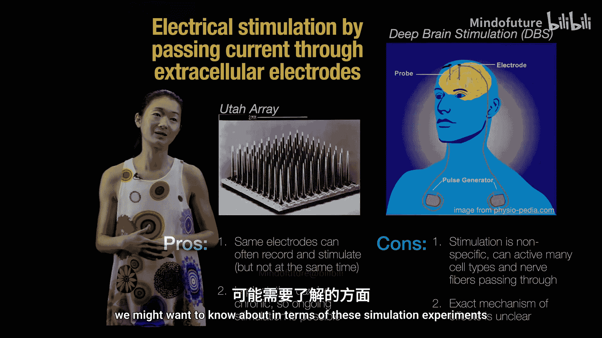

然而，他们所做的事情是以一种非常好的、快速且可扩展的方式，解决了许多与扩展和工程相关的挑战。如果你想了解更多，关于Neuralink在做什么或不做什么，还有很多可以挖掘。他们肯定很炫目，做了很多炫酷的事情。在某种程度上，作为神经工程领域的一员，我感到很高兴他们在做这件事，因为任何时候初创公司的资金和资源被投入到解决与你的科学问题相关的工程问题上，问题就会解决得更快。在某种程度上，我希望我们所有人都能从这项技术中受益。但我想明确的是，就他们解决的问题而言，如果你听马斯克谈论，他似乎在解决前所未有的全新问题，但概念上，他们是在制造神经科学家和神经工程师已经开发了相当长时间的技术的更好版本。

所以，我认为我的同事们有时对此感情复杂，有时一天持批评态度，另一天又持乐观态度。但Neuralink背后的技术与我在本讲座前面部分谈到的关于细胞外记录和刺激的技术是相同的。

## 总结

本节课我们一起学习了神经科学中电生理方法的关键概念，包括记录和操控。

我们讨论了电极和电子技术是测量神经元电信号的关键技术。神经元是电活动的，因此我们可以使用电极和电子技术来“聆听”它们。

我们介绍了**细胞内技术**，如膜片钳，它非常酷，因为你可以分离单个通道和细胞，监听它们的开启和关闭。能够看到如此微小的事物在活动，总是令人兴奋。

我们也探讨了**细胞外电极**，它们通过拾取邻近活动神经元的电信号来“聆听”。你获得的交换好处是，现在可以同时处理多个细胞。膜片钳一次只能做一个细胞，需要单独的玻璃吸管才能做多个。而每个细胞外电极可以潜在地拾取多个细胞，如果你有更多细胞外电极（4个、8个、1000个），你可以在动物同时进行所有正常活动（看电影、奔跑、听东西、彼此互动）时，记录数千个神经元。这些正是神经科学当下最热门的实验类型。

使用相同的电极，通常还可以进行逆操作：不是仅仅“聆听”，而是通过它们传递电流（通过相邻电极，或通过一个电极并以其他地方为地，比如有时在后颈放置一个头皮电极）。如果你通过这些电极传递电流，你可以电刺激附近的神经元，并在实验上激活它们。这可以用于实验目的，也可以用于临床治疗目的，这将是未来一讲的主题。

这些就是关键概念。接下来，我们将讨论测量大脑的光学方法。