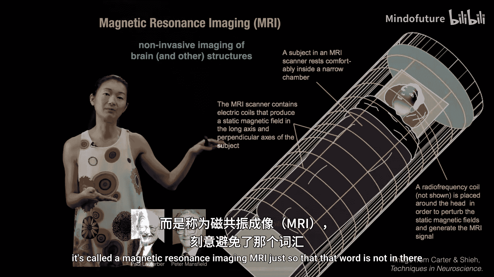
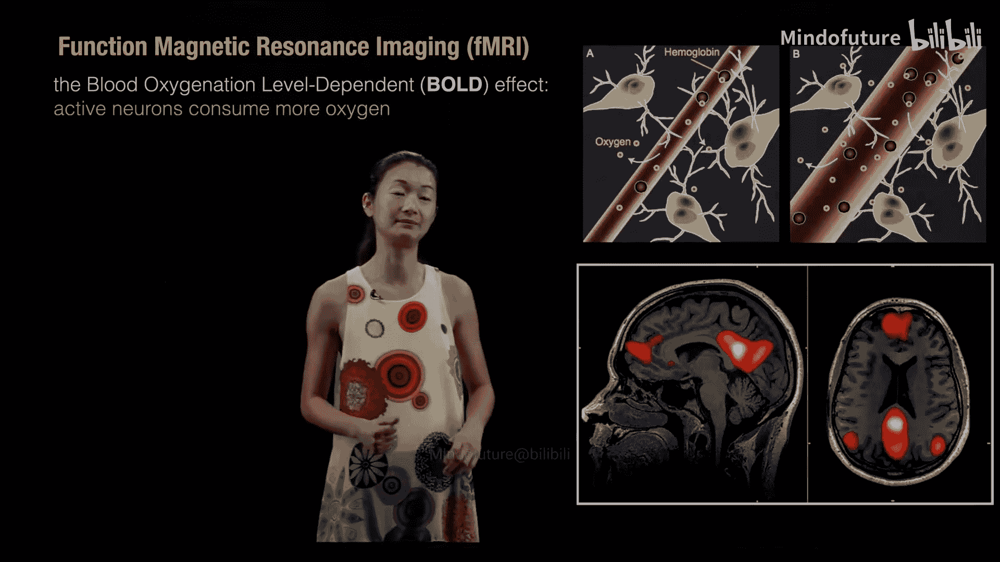
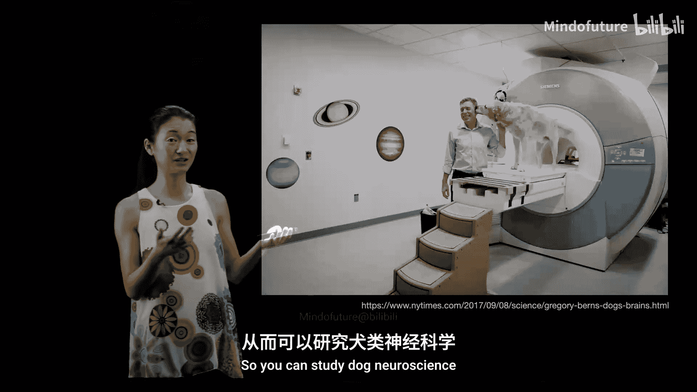
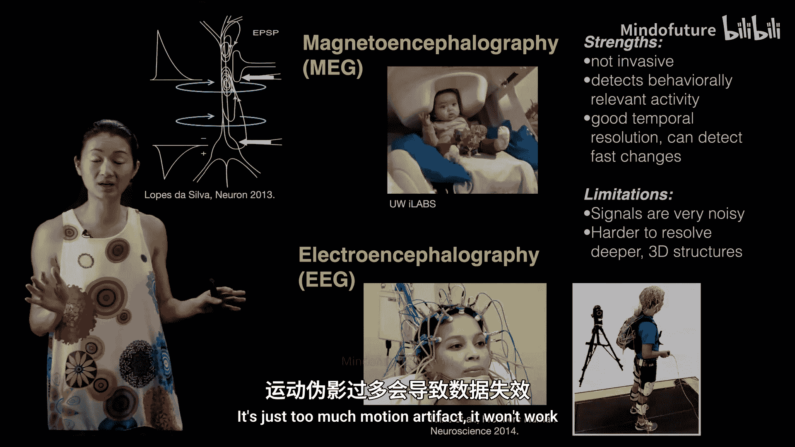
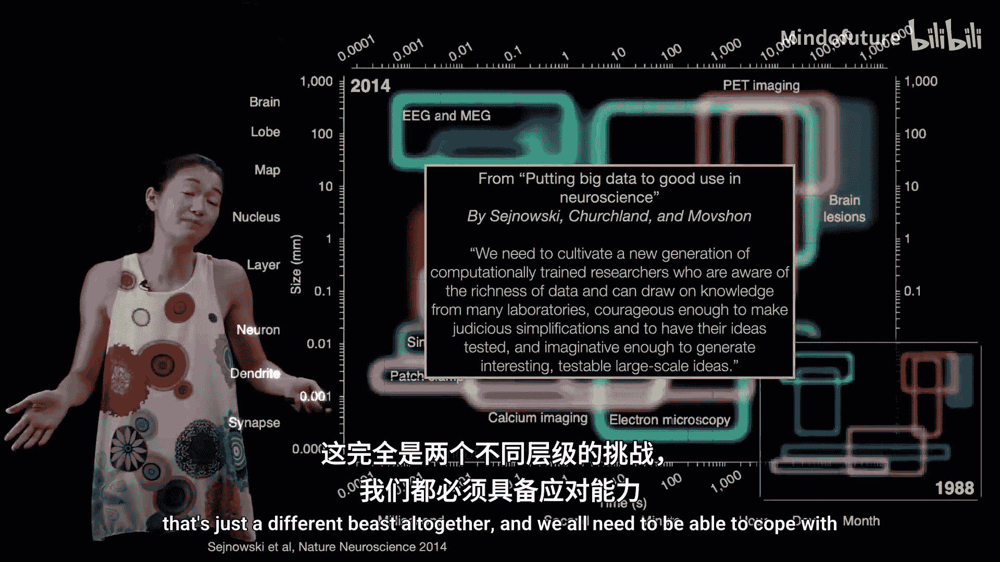

# 【华盛顿大学】神经科学入门 ｜ Introduction To Neuroscience ｜ Bing Wen Brunton p16 P16_神经科学无创方法__功能磁共振__脑磁图__脑电图 -BV1i3qWBXEDH_p16-

In this next video for introduction to neuroscience。

 we're going to be looking at non-invasive methods to measure neuroactivity in neuroscience In the last couple of lectures we talked at length about all the different really cool techniques that are invasive for measuring neuroactivity they have included different ways of opening up the skull putting in different electrodes stick them far inside the brain putting animals under microscope so that you can see transgenic animals that express different kinds of optionses that glow in the dark so you can see their neuroactivity as well as different toxins potentially toxic substances that you can pipet onto neurons so that you can see what's going on the manipulated activity so that's all really great especially if you're interested in animal organisms for which it is experimentally accessible and tractable for you to do those techniques in a laboratory setting what's not really doable is doing that for humans in the vast majority of the cases。

It is fortunate that some of these experiments are possible to do in humans because they piggyback on top of clinical applications that's the case we talked about with Jan where she had these BCI electrodes inside her inside her cortex and she was able to operate that robotic arm and and also fly an F35 flight simulator so that was really cool but that has to be piggyback on top of clinically relevant clinically relevant treatments what's happening when there is not a clinical need to do something super invasive like brain surgery is that we really need a set of techniques to study humans in other non-human species that are not invasive at all that don't require brain surgery。

 transgenic animals and all of the rest of it so what can we do here well one of the things that's really commonly done is this really cool technique called magnetic magnetic resonance imaging and in particular functional magnetic resonance imaging the insight here is that because the brain。

Communicates with electricity and electricity and magnetism E and M are dues of each other anytime you have electricalactivity it induces change in the field and so a magnet can actually pick up electricalactivity if you had a sufficiently large and strong one so that's the fundamental physical intuition behind why it is possible to image brain activity with a magnet so the magnetic resonance imaging machine is usually a long big machine like this you actually put the entire participant human inside of it and you're resting inside this chamber where you're surrounded by a giant magnet。

 the giant magnet makes a ton of noise you're in there and your brain is being imaged and this is super cool it is not only a tool for neuroscience but these MRIs are really commonly found in hospitals as well as a clinical diagnostic tool the same magnets can can be co-opted for use in neuroscience research sometimes this is done in off hours like at nights for example。

 a participant will go in and do an experiment in。One of these magnetic resonance imaging machines。

For those of you this is just a tidbit， for those of you who might know a little bit more about chemistry and physical chemistry。

 the MRI is' fundamentally exactly the same technology as an NR a nuclear magnetic resonance imaging system so NMR spectroscopy it's something that chemists used for imaging the spectroscopy of different small molecules and the only real difference is that the magnet for an NMR machine instead of being horizontal was usually vertical because you just put the vial inside because it's usually some chemicals we put inside instead of a human。

 a human doesn't really like being bound and stuck inside a chamber vertically and so we put it sideways and go down the reason they renamed it even though it's fundamentally the same physics is because they didn't want the word nuclear in this machine。

 and so instead of calling an NMR nuclear magnetic resonance it's called a magnetic resonance imaging MRI just so that that word is not in there and it doesn't elicit wrong associations in people's mind when they get inside one of these machines。

So functional magnetic resonance imaging， use the same machine， you're in the same magnet。

 person's laying in there， but you're using a slightly different observation。

 which is known as the bold effect， the blood oxygenation level dependent effect and the fundamental observation is that when neurons are active when they're firing a lot。

 doing something， doing something， whatever that means they consume more oxygen。

 which means the vasculature。The blood vessels that are supplying that part of the brain with oxygenated blood is going to have to deliver more oxygen。

 and those oxygenated molecules， hemoglobin is going to get consumed and stripped of their oxygen more quickly。

It turns out that under the right conditions oxygenated hemoglobin can be different from the oxygenated hemoglobin under magnetic simulation and so that by a clever trick the magnet is able to tell the difference between the areas of the brain that have relatively more or less oxygenated hemoglobin that's the reason functional fMRI works fRI works because deoxated hemoglobin and oxygenated hemoglobin appear differently under magnetic resonance imaging that's why we have these hotspots in there and that's really cool because it is not at all invasive a human can get inside this tube and have behaviorally relevant neural activity that can be imaged volumetally all the wayed deep structures without having anything invasive or any ill effects afterwards besides some people are claustrophobic and they can't get on the magnet it's also really loud so。

Whatever， so you can do this， it's not invasive and you can detect behaviorally relevant in your activity。

The limitations are because there's this huge level of complexity and proxies in terms of what's happening。

 you know how we talked about how intracellularly recordings have potentials that are larger than externalcellularly recordings because it's outside。

 if you imagine that in electrical activity now going through not only just right outside the cells now going through a bunch of other cells。

 there's through amount fluid， there's the menings and there's the skull and then there's this hair and then there's scalp and then there's this magnets outside of it。

 the signals that you're detecting。are extraordinarily small and so there's a lot of averaging that goes on in functional MRI and it's also unclear exactly how neuroactivity maps onto this blood oxygenation this is a subject of much debate and I think it is still unclear exactly what that means does more bold mean more neurons firing。

 it's unclear what the answer is。The other trade off here is that it's relatively slow。

 We know that in actual potential it takes up approximately 1 millisecond。

 so it's super fast right Gcam is already slower than that because we have this。

A decay effect but based on the convolutional filter of the molecular properties， the GcaM molecule。

 we talked about that in the optical imaging section of the lecture in the previous video。

FMRI is significantly slower than that。It has approximately a five second delay between the boltsing of going up and when you can actually see it in the scanner and it has a resolution of approximately one second which means anything that happens faster than a second you just can't tell you can't tell it all you can't tell that something is either changing or not changing when it's happening faster than one second Now people have been pushing the technology so there are better ways of doing magnetic scanning now that is faster and have better resolution than what I'm saying here so this is kind of a ballpark we're still orders a magnitude different than the intrinsic neural activity of a neuron which is on the order of a millisecond and the final limitation is obviously the participant must be lying down in a loud tube so this restricts the types of things that we can study you can study watching movies and that's what people do a lot you can put headphones on participants so you can study visual auditory integration stuff like that The person must be pretty still their head can't move and so you're obviously not going to be using MRI to study things like how do you walk and balance？

And they're not going to be doing anything that has to do with。

 let's say social interactions that involve the person having being able to interact with another person by sitting across for them and actually being able to see them。

 people have done experiments where you can put participants basically in a virtual conference。

 where they're each in their own tube and then kind of see each other with our screens。

 super cool experiments but still that's a little bit different than the actual interaction that we're having with each other if we were in the same room talking to each other and being able to look at each other。

😊，So those are the strength and weaknesses of FMRI。

 one other weakness is that only humans can be told to lay still in a tube so even though there are magnet bos that are designed for smaller animals and other species it's really difficult to get them to lay still and not struggle in this loud tube that's kind of weird and kind of weird except there have been attempts to train dogs to lay still so you can study dog neuroscience so there's these dog lovers I'm one of them who are saying this rules just really adorable that you can get these dogs to train them to lie still and they do extensive training to lie still and consent to have themselves be scanned by lying still inside one of these magnets so that's just a triming little story about fMRI and dogs。

The other story I really like to tell about FI is the subject of the Ig Nobel Prize in 2012 so the Ig Nobel Prize for those of you who don't know is it's a play on the Nobel Prize for research that is frivolous and kind of a funny and charming way so in this particular experiment a bunch of f researchers decided to do the following they decided to heat the same experiment and they usually doing humans in this case they showed the pictures of different faces of other humans and asked them what that person is feeling are they sad are they happy。

 stuff like that but instead of showing it to a human participant they decided I mean this actually happened because they were just calibrating the machine they're like put something in there so they put a dead salmon in there they literally went to the store to the grocery store and it got a whole Atlantic salmon and stuck the dead salmon inside the magnet and showed it the same experiment that they were showing the humans asking the sal in the question was the person happy or not the salmon of course did not actually behave it refused to participate in the study。

Nevertheless， when they ran the analytic tools afterwards and took the data from the FMRI machine。

 trying to correlate the brain areas that are associated with perception of the emotional state of the picture of the person that's being shown。

 they found that they were statistically significant voxels inside that dead salmon's brain。

That was that passed the test for having a representation of the emotional state of of the person whose picture was being shown。

 Now， they obviously knew what they were doing and they knew how silly this was。

 because they wrote up this very snarky paper and published in the journal of serendipitous and and expected resulting 2010。

 And the point here is not that this is full of Bs。

 it's that the version of the software they used and they know this It's why they wrote the paper did not properly account for what's called multiple comparisons correction。

 So this is a statistical term to me that when you are looking for something that is statistically significant。

 but you're looking for not in one measurement or two measurements。

 but a gigantic set of measurements like all the voxels in the brain。

 the chance is if you finding it。😊，Are not low， the chance of you finding in at least one of those tests because they're independent tests for every voxel is not low。

 so you actually have to correct for what passes the bar of being a significant result based on how many voxels you're making。

 how many multiple comparisons are you making and so this is a statistical result but wrote up in a really charming way by a bunch of fI researchers pointing out and poking fun at the fact that that this is a field in which just like lots of other fields we must be really careful with the analyses and the data analytic methods were choosing to use。

There's a couple more methods that I will point out that are of relevance for non-invasive technologies for measuring neural activity the most common ones you'll hear of are MEG and EG MEEG is magnetic andencephalography it is similar to FMRI in that it is intrinsically a magnetic way of measuring neural activity it is different because it's a smaller footprint and you can actually sit up you inside a giant magnet is not nearly nearly as loud and so you can do MEG for example in this case with babies because you have them sit there there they will not lay down an FRM machine for you this just won't do it right like try to take a baby and put them in a giant bore hole and put them in there they will not be happy but they can be made to be happy sitting in their little car seat and be put under a MEG machine。

The strengths are just like an f， it's not invasive， it does detect behaviorally irrelevant activity。

 it has pretty good temporal resolution， so it has much。

 much better temporal resolution than f does because it's actually measuring magnetic activity instead of this bold signal and it can detect much faster changes as a result。

The limitations are， as you may expect， the signals are really tiny so they can be quite noisy and unlike fMRI。

 because you're measuring the magnetic field on the outside， it doesn't penetrate on the inside。

 it gets a little bit harder to detect deeper three dimensional structures。

 so so the resolution spatially speaking is better on the outside of the brain than is on the inside。

EEG is very similar except that instead of having magnet。

 you're actually putting electrodes directly onto the scalp of the individual so electro psychoography。

 see a picture like this one where you see an array of electrodes usually with some kind of gel electricalally conductive gel that gets stuck onto the surface of the person's head Now this technology the tradeoffs are that it's super cheap is by far the cheapest type of way to non-invasively measure a neural activity and it is relatively more portable because as you can see each electrode is small and all you need to do is keep track of the wires and so unlike MEG and FMRI。

 it is possible to do EEG let's say a person who is running or walking and balancing on a treadmill it is possible to do that with EEG and that's categorically not possible to do with MEEG or FRI Now they can't be doing anything really fast and crazy like you probably can't put an EEG inside a football helmet and watch what happens。

When people hit their heads， it's just too much motion artifact， it won't work。

 but it is much more portable than MEG or FMRI would be。

So here is a picture again of what I showed a couple of videos ago in introducing the concept of why I'm spending so much time talking you to about technologies and different ways that we can look at brain activation。

 so this is the same picture again， where on the vertical axis。

 we have different size scales in logarithmic coordinates from the level of synapse all the way up to the brain。

And on the horizontal axis， we have different time scales from milliseconds to days and months to years。

 Okay， so in this paper， Terry Soowski and his colleagues。

I think it was Pat Churchland and Tony Mason they ended their paper。

 the review paper with the following sentence and I really like it。

 I'm just going to read it to you okay we talked a lot about different ways of manipulating and imaging and recording neural activity and I told you about how cool it is that we now can do this faster。

 bigger， longer and better resolution in time and space everything is getting better right and what that really means for us is that the challenge of what it means the bottleneck and understanding the brain is just moving forward and what they say here is we need to cultivate a new generation of computationally trained researchers who are aware of the richness of data and can draw on knowledge from many laboratories courageous enough to make judicious implications this is important because not every single thing is important and to have that ideas tested and imaginative enough to generate interesting testable largescale ideas so this I see as a charge to the community right and to charge not in。

Of not only in terms of those of us who are already doing research in neuroscience。

 but in terms of how we train the next generation of computationally fluent neuroscientists and biologists。

 and so this whirlwind tour through the different technologies。

 especially how much they have gotten better in the past decades and how this progress is only accelerating I think really underlines this point that's articulated here in how important it is for all of us to be able to be think a bit differently because analyzing a single neuron requires a very different mathematical and computational skill set as analyzing 10。

000 neurons and that's just a different beast altogether。

 and we all need to be able to cope with that。

So here's a summary of the non-invasive recording tech methods that we talked about for mostly for humans but you can use them for other animals as well。

 they don't require brain surgery， which is really good and the general tradeoff is that they have less specificity and more poor resolution we talked about FMRI which makes use of the bold effect and the blood oxygenation leveled effect to infer select in brain volumes。

 we can go all the way down which is really cool but you kind of have a tradeoff in that it has poor temporal resolution we have MEG which has better temporal resolution。

An EEG， which has really good temporal resolution， but it has tradeoffs that it generally is the least expensive and most portable of these techniques。

 but the tradeoff is that it has the worst signal quality you usually have to repeat the same trial over and over and over and over and really average to get a signal that rises from the noise and it's also like all of these other techniques prone to electrical noise and movement artifacts Now I chose to highlight these three techniques here。

 but there are actually a couple of other really cool emerging technologies in terms of noninvasive recording techniques that are relevant for example。

 people are working on infrared imaging technologies it is possible to use ultrasound to infer neural activity really there's a lot of really creative solutions being proposed and being tested and being actively developed right now so I think there's a lot of room for innovation in terms of applications of these non-invasive recording methods especially in humans。

 especially for clinical but as well as。😊，Recreational applications。

 the applications of what we can do if we can infer neuroactivity in healthy populations of individuals。

 participants that are not in a clinical context， that population is just much much larger than a clinical context and so for that reason I think it's really cool to be able to work on these technologies and really pushing the boundaries of data analysis to see how much we can overcome the challenges the intrinsic noisiness of the data and really infer what's going on underneath and use that in more and creative different ways。

