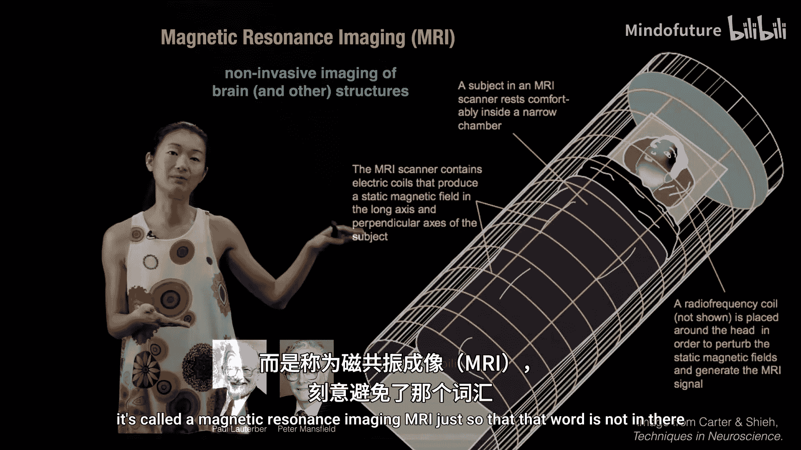
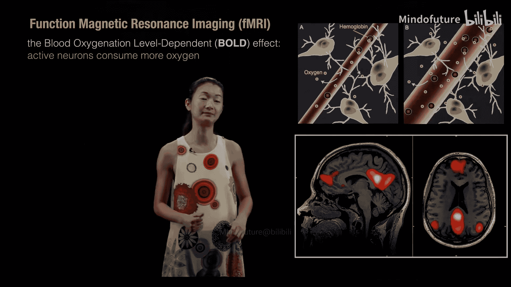
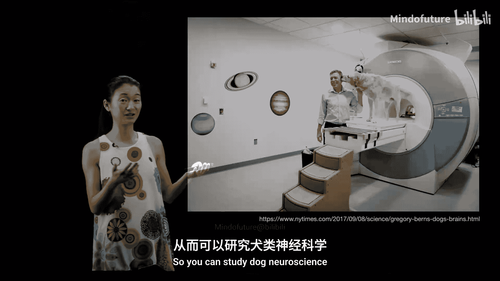
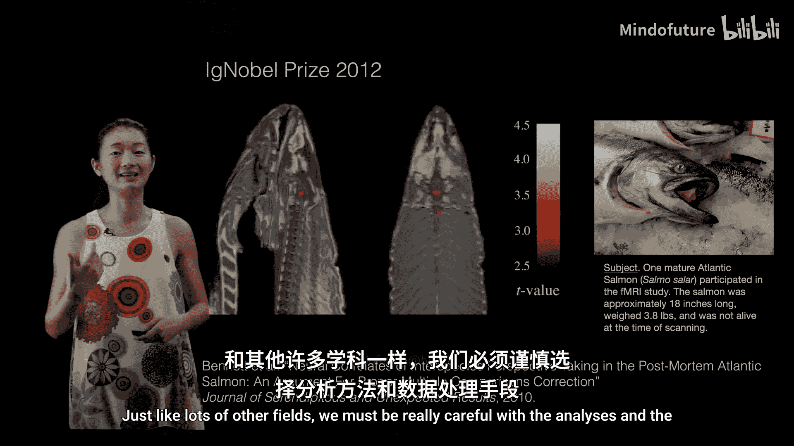
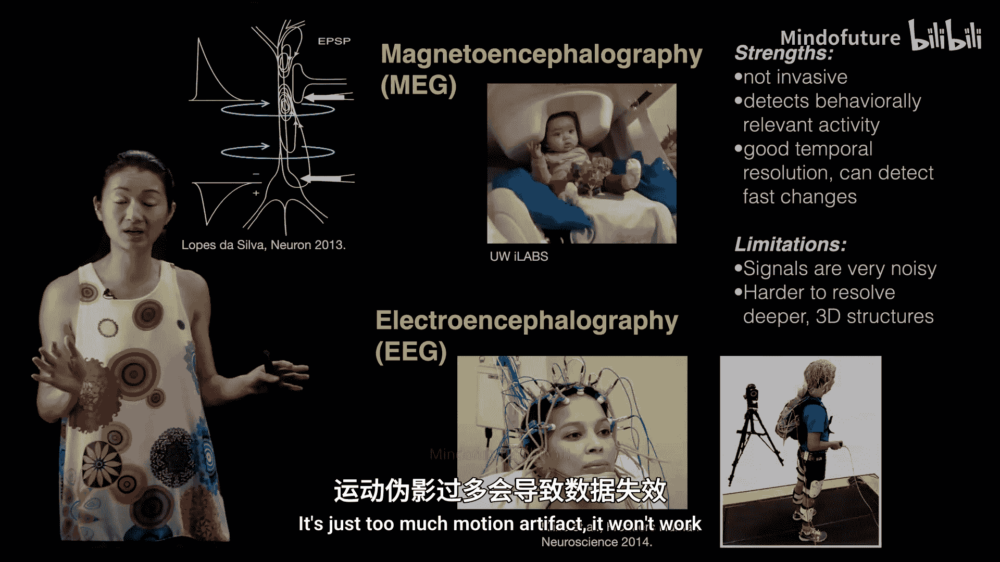
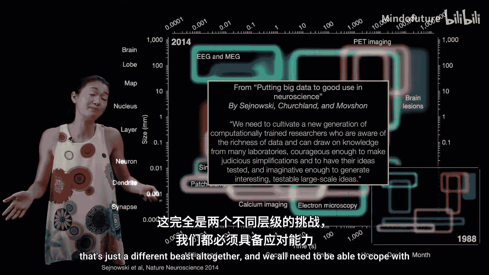

# 神经科学入门：P16：神经科学无创测量方法 🧠

在本节课中，我们将学习如何在不进行侵入性操作的情况下测量神经活动。我们将重点介绍三种主要技术：功能磁共振成像、脑磁图和脑电图，并探讨它们各自的原理、优势与局限。

在之前的几节课中，我们详细讨论了多种非常酷的侵入性技术来测量神经活动。这些技术包括打开颅骨、植入电极、在显微镜下观察转基因动物，以及使用毒素来操控神经元活动。这些方法对于在实验室环境下研究动物非常有效。

然而，对于人类而言，在绝大多数情况下进行这类侵入性实验是不可行的。幸运的是，一些实验可以借助临床治疗的机会在人类身上进行，例如我们之前讨论过的植入脑机接口电极的案例。但当没有临床需求进行脑部手术等超级侵入性操作时，我们就需要一套完全无创的技术来研究人类和其他非人类物种。

## 功能磁共振成像 🧲

那么，我们能做什么呢？一种非常常用的酷炫技术叫做磁共振成像，特别是功能磁共振成像。

其基本原理是：大脑通过电信号进行通信，而电与磁是相互关联的。任何电活动都会引起磁场的变化。因此，一个足够大、足够强的磁体实际上可以探测到电活动。这就是为什么可以用磁体来成像大脑活动的根本物理直觉。

磁共振成像仪通常是一个又长又大的机器。参与者需要整个人躺进去，置身于一个被巨大磁体包围的腔室内。这个巨型磁体会产生巨大噪音。这不仅是神经科学的工具，也是医院中常见的临床诊断工具。同样的磁体有时可以在非工作时间（例如夜间）被用于神经科学研究。

**一个有趣的知识点**：对于了解化学和物理化学的人来说，MRI 本质上与 NMR（核磁共振）光谱仪是相同的技术。化学家用 NMR 来成像小分子的光谱。主要区别在于，NMR 机器的磁体通常是垂直的，因为你只需要把装有化学品的试管放进去。而人类不喜欢被垂直塞进腔室，所以我们把它横过来放。改名（从 NMR 到 MRI）的原因是他们不希望机器名称里出现“核”这个字，以免引起人们不必要的联想。

### 血氧水平依赖效应

功能磁共振成像使用相同的机器和磁体，但观测的是另一种现象，即 BOLD 效应（血氧水平依赖效应）。

其基本观察是：当神经元活跃、大量放电时，它们会消耗更多氧气。这意味着为大脑该部分供血的血管必须输送更多氧气，而携带氧气的血红蛋白分子会被更快地消耗掉氧气。

事实证明，在适当条件下，含氧血红蛋白与脱氧血红蛋白在磁共振成像下的表现不同。通过一个巧妙的技巧，磁体能够分辨大脑中哪些区域含有相对较多或较少的含氧血红蛋白。这就是功能磁共振成像能够工作的原因。

这非常酷，因为它完全无创。人类可以进入这个管道，其与行为相关的神经活动可以被三维成像，甚至包括深层结构，而不会产生任何侵入性伤害或不良后遗症。当然，有些人有幽闭恐惧症，无法进入磁体，而且机器噪音也很大。

### 功能磁共振成像的局限

然而，这种方法也存在局限。由于信号传递过程复杂且经过多重代理（从细胞内到细胞外，穿过脑脊液、脑膜、颅骨、头发、头皮，再到外部的磁体），最终探测到的信号极其微弱。因此，功能磁共振成像需要进行大量的信号平均处理。

此外，神经活动如何精确映射到血氧水平上仍存在大量争议。更多的 BOLD 信号是否意味着更多神经元在放电？答案尚不明确。

另一个权衡是它的时间分辨率相对较慢。我们知道动作电位大约需要 1 毫秒，这非常快。基于分子特性的卷积滤波，GCaMP 成像已经比这慢了。而功能磁共振成像比 GCaMP 还要慢得多。从血氧信号上升到在扫描仪中实际观察到，大约有 5 秒的延迟，其时间分辨率大约为 1 秒。这意味着任何快于 1 秒的变化都无法被分辨。虽然技术正在进步，出现了更快、分辨率更高的扫描方法，但与神经元固有的毫秒级活动相比，仍有数量级的差距。

最后一个明显的限制是，参与者必须躺在一个嘈杂的管道里。这限制了我们可以研究的任务类型。我们可以研究观看电影（很多人这样做），可以给参与者戴上耳机研究视听整合等。参与者必须保持相当静止，头部不能移动。因此，显然无法用功能磁共振成像来研究行走和平衡等行为，也无法研究需要参与者与另一个人面对面互动、能看到对方的社交互动。虽然有人做过实验，让参与者各自在管道里通过屏幕进行虚拟会议，但这与实际在同一个房间交谈、对视的互动仍有不同。

### 关于功能磁共振成像的趣闻

功能磁共振成像的一个弱点是，只有人类能被要求安静地躺在管道里。尽管有针对小动物和其他物种设计的磁体，但很难让它们在这个奇怪且嘈杂的管道里保持静止不挣扎。不过，有人尝试训练狗保持静止来研究狗的神经科学，这非常可爱。

另一个我特别喜欢的故事是关于 2012 年搞笑诺贝尔奖的。在这个实验中，一群功能磁共振成像研究人员决定对一条死鲑鱼进行实验。他们将死鲑鱼放入磁体，并向它展示人类面孔的图片，询问图片中的人是快乐还是悲伤。当然，鲑鱼没有反应。然而，当他们事后运行分析工具时，发现死鲑鱼大脑中有些体素在统计上显著，似乎“代表”了图片中人物的情绪状态。他们当然知道这很荒谬，并撰写了一篇讽刺性的论文发表。这个实验的关键点在于，他们使用的软件版本没有正确进行“多重比较校正”。这是一个统计学术语，意思是当你在大脑所有体素中进行大量独立测试时，纯粹偶然发现“显著”结果的概率并不低。这篇论文以一种有趣的方式提醒我们，在这个领域（和其他许多领域一样），必须非常谨慎地选择数据分析方法。

## 脑磁图与脑电图 ⚡

接下来，我将指出另外几种相关的无创测量神经活动的技术。最常见的是脑磁图和脑电图。

### 脑磁图

脑磁图与功能磁共振成像相似，本质上也是一种通过磁信号测量神经活动的方法。不同之处在于，它的设备更小巧，参与者可以坐着进行，不需要进入巨大的磁体管道，噪音也小得多。因此，可以对婴儿进行脑磁图研究，因为你可以让他们坐在那里，而无法让他们安静地躺在功能磁共振成像仪里。

其优势与功能磁共振成像类似：无创、能检测与行为相关的活动，并且具有相当好的时间分辨率。因为它直接测量磁活动，而不是血氧信号，所以能检测到快得多的变化。

其局限也如你所料：信号非常微弱，因此可能相当嘈杂。并且，由于是在外部测量磁场，信号难以穿透到大脑内部，因此探测深层三维结构较为困难。在空间分辨率上，大脑外部优于内部。

### 脑电图

脑电图非常相似，不同之处在于它不是使用磁体，而是将电极直接放置在个体的头皮上。你会看到像这样的图片，电极阵列通常带有某种导电凝胶，粘在人的头皮表面。

这种技术的权衡在于：它超级便宜，是迄今为止最便宜的无创测量神经活动的方式，并且相对更便携。因为每个电极都很小，你只需要处理好电线。因此，与脑磁图和功能磁共振成像不同，用脑电图研究正在跑步机上行进或保持平衡的人是可能的，而这对于脑磁图或功能磁共振成像来说是完全不可能的。当然，参与者不能进行非常剧烈快速的运动（比如戴着脑电图设备进行橄榄球撞击），因为运动伪迹会太大，但它的便携性远胜于脑磁图或功能磁共振成像。

## 技术发展与未来挑战 🚀

这里再次展示了我几节课前介绍过的一张图，用以说明我为什么花这么多时间讨论技术和观察大脑激活的不同方式。

在这张图中，纵轴是对数坐标下不同的空间尺度，从突触水平一直到整个大脑。横轴是不同的时间尺度，从毫秒到数天、数月乃至数年。

在这篇由 Terry Sejnowski 及其同事（我想是 Pat Churchland 和 Tony Movshon）撰写的综述论文中，他们以这样一句话结尾，我非常喜欢：

> “我们需要培养新一代受过计算训练的研究人员，他们了解数据的丰富性，能够借鉴来自许多实验室的知识，有勇气做出明智的推断（因为并非所有事情都同等重要），并富有想象力，能够产生有趣的、可检验的大规模想法。”

我认为这是对科学界，不仅是对我们这些已经在从事神经科学研究的人，也是对我们如何培养下一代精通计算神经科学和生物学的学者的一个号召。

这次对各种技术，特别是它们在过去的几十年里如何变得更好，以及这种进步如何正在加速的旋风式介绍，我认为真正凸显了这里阐述的观点：我们所有人都需要能够以不同的方式思考，因为分析单个神经元与分析一万个神经元所需的数学和计算技能组合是截然不同的，这完全是不同的挑战，而我们都需要能够应对它。

## 总结 📝

本节课中，我们一起学习了主要用于人类（也可用于其他动物）的无创记录技术。它们不需要脑部手术，这非常好。普遍的权衡是，它们的特异性较低，分辨率也较差。

以下是三种主要技术的总结：

*   **功能磁共振成像**：利用 BOLD 效应（血氧水平依赖效应）来推断选定脑区的活动。优点是可以探测到大脑深层结构，但缺点是时间分辨率较差。
*   **脑磁图**：具有更好的时间分辨率，但信号微弱，且探测大脑深层结构的能力有限。
*   **脑电图**：具有非常好的时间分辨率，是这三种技术中最便宜、最便携的。但权衡在于它的信号质量最差，通常需要重复多次试验并进行平均才能从噪声中提取信号，并且也像其他技术一样容易受到电噪声和运动伪迹的影响。

我选择重点介绍这三种技术，但实际上还有其他一些非常酷的新兴无创记录技术，例如红外成像技术和利用超声波推断神经活动的技术。目前有很多富有创意的解决方案正在被提出、测试和积极开发中。因此，我认为在无创记录方法的应用，特别是在人类身上，无论是临床还是非临床（例如健康人群研究）的应用方面，都有很大的创新空间。能够研究更大规模的非临床人群是非常酷的，这也推动着我们不断突破数据分析的边界，以克服数据固有的噪声挑战，更深入地推断大脑内部的活动，并以更多富有创意的方式加以利用。