# 【华盛顿大学】神经科学入门 ｜ Introduction To Neuroscience ｜ Bing Wen Brunton p17 P17_视觉感知-视网膜__光感受器__视紫红质 -BV1i3qWBXEDH_p17-

Welcome back once again to introduction to neuroscience。

 where the topic for the next several lectures will be visual perception and vision。

 the neurobiology of how it is that our nervous system can detect light as well as process those visual information into a form that allows us to make sense of the visual world around us in talking about vision we're gonna to start at the beginning by talking about the retina and the retina is you know it's at the back of your eyeballs we' talk about the anatomy of the retina the second but I wanted to give you kind of a bigger view of the visual system to begin with So your eyeballs are I have two of them you're looking at them right now those eyeballs are going to be attached to the rest of your nervous system by the optic nerves this here is the ventral view of a human brain so kind of like know if you took opened up my brain and looked at it from underneath this is the ventral view and when you're seeing here are parts of the optic nerves So the eyeballs would actually be left and right up here on the top here and the two of them will be attached to these big thick cable。

Because there's going to be lots of wires that are connecting your eyeballs to the rest of your nervous system and they're going to actually cross over at this point right here。

 this little X here， which is called optic chiasm， the reason they cross over is because the left side of your visual field actually goes to the right half of your brain and the right side of your visual field goes to the left half of your brain if you think about what your eyeballs are seen because most of our eyeballs are facing forward。

 each of your eyeballs sees half of the left half of your brain visual scene and half of the right half of visual scene and so the cables actually have to cross over in this way because the left half of your left eye goes to the right side。

But the right half of your left eye goes to the left side。 Okay。

 so that's why there's this crossing here。 But it is two different eyeballs。

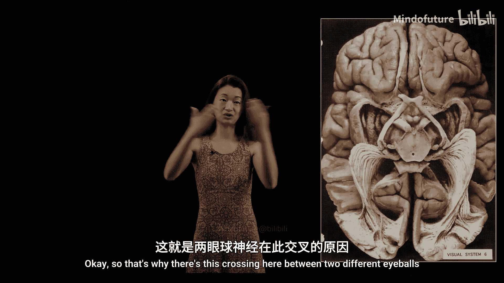

There's a diagrammatic view of the same thing here where you can see the retina。

 which is the piece of tissue， the piece of neural tissue at the very back of your eyeballs。

 that has the visual fields， they cross over at the optic chiasm where the left visual field goes to the right half of the brain。

 and the right half of your visual field goes to the left half of the brain。

 and so they have this path here where they start to diverge and then connect to the part of thethalamus called the lateral ordulate body。

 the LGN。This then， of course， then connects to the rest of your nervous system via the visual cortex。

 which is the part of cortex that's in the very back of your head in the accippiital lobe。 Now。

 I know there was just a lot of words， but I wanted to give you a lay of the land and kind of just give you a map of where we're headed。

 The rest of this lecture were mostly be to be concentrated on the eyeballs at the retina。

 but this is sort of where the rest of the lectures will go in the next several videos。So this here。

 we're going to summarize this pathway by this rather simplified diagram。 Now I show this diagram。

 not because it's actually correct， but because this is kind of a mental framework in which we're going to hang our knowledge of how visual computation works。

 photot detection， detection of actual photons of light starts of the retina。

 which pass this is information into a part of the midbrain called the thalamus in particular。

 it's a part of the thalamus called the LGN， the lateral geneticulate body， the LGN。

 We think of the thalamus somewhat as a relay station。

 So kind of intermediary for sensoring information in between wherever they're actually detected and where they're going in the in the different cortical areas。

 This is a generic feature of lots of different sensorory systems。

 not just vision And so you'll see this diagram throughout the rest of the lectures as well when we're talking about the other senses like auditory sensation and tactile sensation。

 etc。 So retina goes to LGN LGN and goes to cortex in particular for vision it goes to the part of cortex called V1 V1 for primary。

cortex from V1， it gets passed on to higher order visual areas。

 and they have fancy names like V2 and V3 and V4 and so on and so forth。

 You can kind of imagine the rest。 They also have other fancier names。

 but that's a topic for a later video For now though， I do want to preview one thing。

 which is a theme that we're going be coming back to in the rest of the lectures in this series and sensing and action。

 which is that this vastly simplified diagram is actually pretty wrong。

 I'm going to point out a couple of different ways in which we know it to be wrong。

 The retina does project to the Lgn that is part is correct。 The LgN does project the V1 in cortex。

 that part is also correct。 but what we were ignoring the previous diagram is the fact that V1 actually projects back to the LGN more than the Lgn projects the V1 Now。

 as you can see here， these feedback loops， is an essential feature of not only the visual system。

 but of every other system including sensory motor systems in the entire。

your entire nervous system and so I'm going to persist in talking about these visual pathways of communication in this overly simplistic way。

 but I did want to keep in mind that we already know that that to be wrong okay but this is kind of a mental framework for thinking about how process information is processed throughout the nervous system and we're going to be talking about first the retina which is the part of which is where it all starts right so the photo detection has to start at the retina so in the beginning there was a sun and the sun emitted photons。

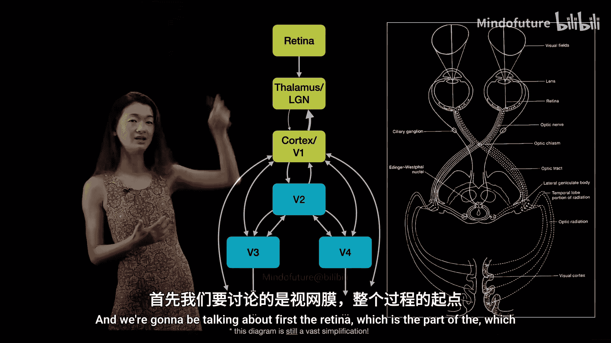

Okay， so that we know that to be true and we needed some kind of hardware apparatus。

 some kind of biological piece of machinery that's able to detect photons than the light。

 but let's talk first about what light actually is As you remember， probably from physics class。

 light is electromagnetic radiation and electromagnetic radiation actually comes in a variety of different wavelengths that are vastly larger than all of the different wavelengths of photons that we can actually perceive as humans the visual spectrum occupies this really thin region of all the possible different types of light that possibly exists we cannot build engineered detectors to detect all of these different types of light and also produce them but humans with their own eyes can only see this part of the visual spectrum with wavelengths that are approximately between 380 and 715 nanometers Now as you can see from this diagram here wavelength as it increases an equivalent wave。

😊。

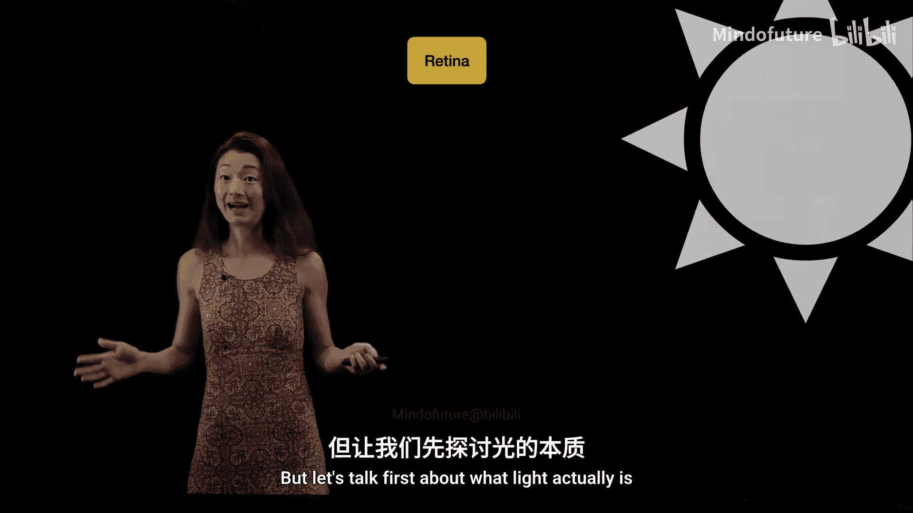

Describing that is saying that the frequency decreases， so increasing frequencies。

Means that light gets longer and longer a wavelength。

And longer wavelength is the same as lower as lower frequency。 Okay。

 those are exactly the same thing。 It's just one divided by the other。

 One divided by frequency gives you a wavelength， one divided wavelength gives you frequencies。

 So I kind of talk about those interchangeably。 The other thing that's easier that's important to remember here is that lower wavelength of light and higher and lower wavelength of light and higher frequencies of light Also correspond to higher energy。

😊，Okay， so when I say lower wavelength this way， it also means increased frequency。

 which also means higher energy。 Those are kind of equivalent concepts in the context of waves。

 including light， but also of other waves as well。So that's light right there's these photons flying around。

 but it's not obvious how we can turn that into electrical potential So if you remember in the series of lectures we had at the beginning of the course on electrical potentials and how cells maintain the electrochemical gradients and are electrically activable we talked about activating neurons in terms of depolarizations and hyperpolarizations and these events kind of just happen。

 they just kind of happen by themselves we didn't really talk about how a cell could be depolarized because something else was already depolarized now we're sort of at the beginning of that process in the context of vision。

 how it is that we can actually trigger a cell to become in the different excitable state when a external stimulus from the external world activates or deactivates that cell so the nature here of the thing that's doing the activating as light it's a photon and as we talked about here photons carry energy so we're going to use use that as a clue of how we can activate cells in the visual system。

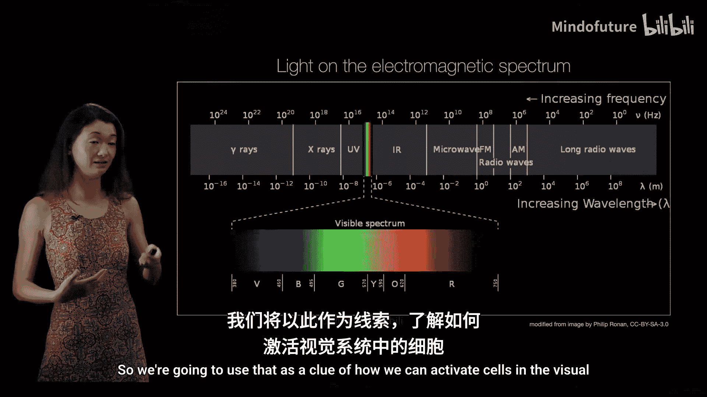

じゃ。So the retina is the very last back part of your brain of your eyeball。 So here's a human eyeball。

 you can see it has first of all it's beautiful to look at。

 but it also has a central portion that's black appears black in this picture。

 which is the pupil So light goes through the pupil。

 which is kind of like an aperture and it goes to the very back of the eyeball into a piece of photoactivable tissue called the retina So for this reason。

 a lot of people have made the analogy that your eye。

 your eyeball and all the lenses that go with it plus your retina is kind of like a camera so you have a shutter which is your eyelids。

 you have an aperture， which is kind of like your pupils and then there's a CCD。

 a light activable piece of machinery that that's photosensitive at the very back。

 which is your retina and that's something like a CCD in a camera And so this equivalency。😊。

And this analogy is not exactly untrue， but what I hope to convince you in the next several lecture is that in fact。

 the i plus the retina is significantly better than what you can have in a camera you can see this just by inspection like you can look at something you ever haven't looked at something It's like oh this is amazing This is a beautiful scene here let me take a picture of it you putting out your camera you take a picture of it and you disappointed by the result this is what I'm talking about here we're going to be talking about the neurobiological basis of what your eye and your retina and your visual system do that is so much more than what can possibly be achieved with modern shutters and apertures and CCD in camera technology and' talking about how that actually happens so here's your eyeball and now we're kind of looking at a slice of the vertical slice of it where we're looking at the lens which is on top I'm not talking about the physics of the lens very much because we're going to be focusing mostly on the neurobiological basis of vision and so just assume that there's。

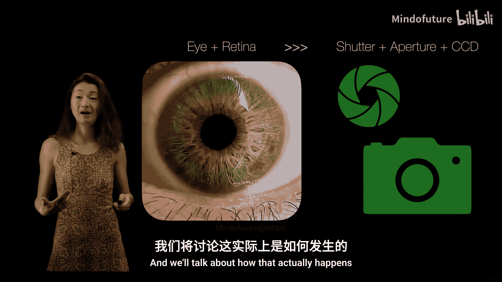

Lens up there that does actually focus lighting some way。

 the light then comes down through this viscous water filled region of the eyeball and it hits the very back of the eyeball where the retina lives。

 So this is a piece of tissue that contains all of the photoreceptors of your nervous system。

That are that contribute to image forming vision。 Okay so if you zoom in to a cross section of the retina now。

 you see that it's not only full of photoreceptors， got a couple of other different types of cells。

 too。 In fact， the photorecepts themselves cells are actually in the very back of the retinas in the very bottom layer。

 So I'm going tell you about the other layers of the retina in a second。

 But let's just think about this for a second。 The very back of the retina has the photoreceptors。

 which has two consequences。 the first consequences is。

 the light actually has to go through all of the other layers of cells before it hits a layer of cells that's actually responsible for actually absorbing those photons and detecting light。

 kind of a funny， funny thing that happens。😊。

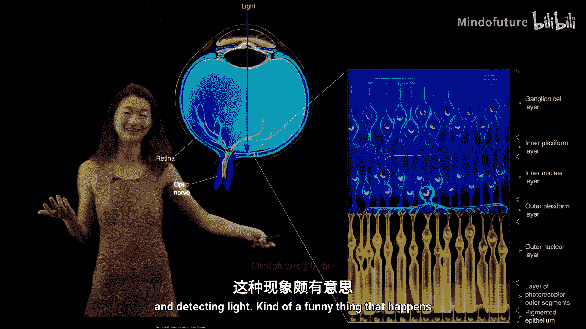

If we zoom in further and look at the different cell types here。

 there's actually a lot of different cell types actually going into the computations of what those different cell types do is a subject of the subsequent lecture。

 before now， I'm going to tell you about three large groups of cells that are in the retina。

 We've already talked about the photoreceptor cells， these are the cells that are photosensitive。

 We're talking about how they detect light。 These cells are connected to the bipolar cells which help separate the different channels of light that we are detecting into more informative。

 more interpretable pieces of information。😊，This information is then gathereded by ganglion cells。

 or retinal ganglion cells and these accomplish some additional processing and they're also the only ones that actually pass messages to the brain so none of these other cells have any outputs to the rest of the brain only the retinal ganglion cells have outputs to the rest of the brain so the axons from the retinal ganglion cells and then go up and then they go to the optic nerve。

 which we saw in the previous picture the optic nerves and converge from the two eyeballs into the optic chaasm。

 they split and do this thing which then they keep going into their respective parts of the LGN so that's kind of where that information is going in a human we have approximately a million axons from different retinal ganglion cells so that's approximately the number of channels of information that you can actually have from one eyeball in a human light as I talked about earlier actually goes through all of those layers of processing those extra cells before they hit the photoreceptor cells so。

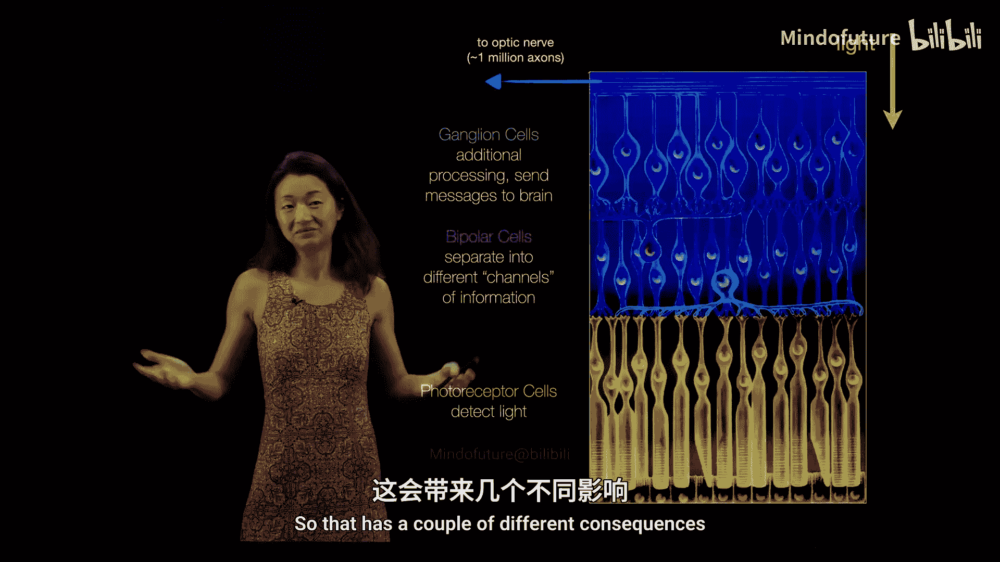

That has a couple of different consequences。So let's talk about the photoreceptor cells for a second。

 These are the primary sensory neurons that were responsible for detecting light and in humans we have two types of photoreceptors。

 we have our rods and our cones。 they're named because one of them looks like rods and the other one looks like cones I'm going see an electromicrograph of them on the right hand side there the rods tend to be much larger and the cones are a little bit smaller。

 but they're fundamentally detecting light in similar ways at the molecular levels。

 we're going to be talking about that in the next couple of slides。

 So the things that makes rods and cones different is that rods are not really color selective they're super fast and they're sensitive to very few neurons。

 We have very fewns few photons hitting them。 cones on their hand do have color selectivity。

 but they're much slower and they're only activated with way more photons So color vision is something that we have highlight situations and low light situations most of your vision is。

Reduce down to this more monochromatic， lights only light sensitive part because it's mediated by cones in high。

 imted by rods in low light situations。

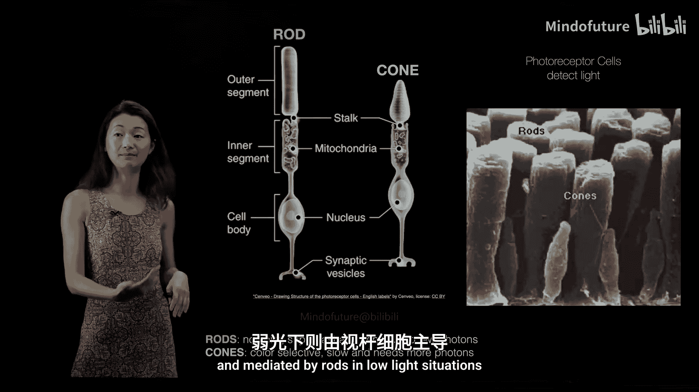

Now I talked about the fact that your photons actually have to go through all of the retinal ganglion cells and all of the bipolar cells and all of the other cell types in your retina before it hits the photoreceptors so kind of know an interesting design choice mostly because it wasn't designed that way and one of the other consequence of it is that because retinal ganglion cells have to send axons to the rest of your brain the axons have to go through in front of all of the photo detectorctorors and then they have to punch through the photo detectorors so that they can actually get to the rest of your head so that is why we have this bundle of optic nerves that has to interrupt the line of photoreceptors to the very back of your retina giving us the blind spot so there's a spot in the middle of your left eyeball and your right eyeball a little offcenter respectively where you don't have photoreceptors so you actually blind to that region you can't see that region of your visual scene The reason this doesn't bother us most of the time is that well there's two reasons one you have two eyes and so。

or blind spots and their left side and the right eye are not in the same spot。

 And so your brain kind of fills that in。 but even if you close one eye and look at it。

 it's not terribly obvious where the blind spot is。

 I don't really notice it and that again is an effect of higher visual processing our brains really good at filling in things as if it were there even though you can't actually see it but you can kind of see it if you close one eye and you very carefully hold something that is away from you by a certain amount and you'll eventually be able to find that there's a spot where you can't actually see that small object and that is where your are blind spot happens to be you don't really notice it most of the time but I sure most certainly is there this choice。

 it's not really a choice。 this idea that there's a blind spot in our eye because of the way that our photo detectorors are inverted where the photossensitive neurons are at the very bottom at very back of of your retina it's not necessarily true of all animals and octopus eye for example。

 has the opposite configuration or the photorecepts on the outside。

Like facing the lens and then the retinal ganglion cells are in deeper layers and so for octopus eyes。

 they don't have this issue， octopus eyes do not have a blind spot because theyre retina cell layers the retina is actually inverted So that's really cool。

 but there's also other cool animal visual cells that work really differently than ours。

 I won't go into a lot of the details here。 but I did want to acknowledge here that just because we see in a certain way doesn't mean it is the only way to see and by no means the best way to see So some examples of the diversity of visual systems I'm showing here are there's insect eyes that don't work like ours。

 they don't have a single lens and a retina in the back they have what's called a compound eye where each of those little dots is actually a little mini eye with an omatiddia so they kind of focused light individually they have kind of a pixelated vision just like we do。

 but they accomplish it using an entirely different mechanism Here are pictures of a scalop eye so scalllos have eyes and。

Ees are actually really cool as well and they have hundreds of them that are kind of on the outside of their scalloped edges and these eyes all have lenses。

 they have protypical lenses that actually do focus light。

 and people believe that it is possible that they have some image forming capabilities as well。😊。

Down here we have a mantis shrimp and the mantis shrimp have eyes that are able to see way more colors than we do and that's something that's really puzzling why they would do so they also see something called polarized light so if you have a pair of sunglasses I don't know if you've ever bought a pair of sunglasses they say polarized on them and if you take two polarized lenses you see that if you put them parallel to each other everything's fine if you start turning one of them so that theyre orthogonal to each other they actually block all light together and it's because light from the sun actually has polarization and it's something that our eyes don't see the reason you don't see it is because your eyes literally can't detect polar polarization and light well not true of mantis shrimp and lots of other invertebrate species have this capability of seeing polarized light we think it has something to do with being able to figure out where the horizon is when they're in the ocean and trying to hunt for example but that's a capability that they have that we also don't have in our visual system so that's all really cool I can give you a whole lecture on。

But for the moment， let's go back to the human eye okay so the human eye。

 I told you that has photorecepts and so here we're going to be digging a little bit more into the photoreceptors and thinking about how these photoreceptors actually work here are pictures of a couple of rod cells and the way the rod cells work is that they're packed full of these roopsins。

 these photosensitive proteins that detect photons and in order for these rods to be really sensitive to photons that are incident on the retina。

 you want to pack these photo photorecept photosensitive roopsins as many as possible really tightly packed and so not surprisingly the photoreceptor solution to this is to basically stack the membranes into this like really Swiss pancake eshape where there's tons of tons of membranes。

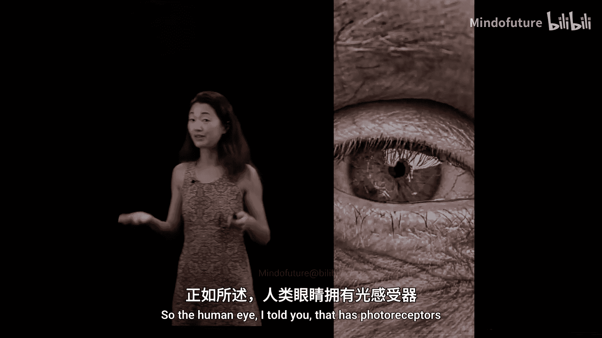

That are stacked really， really close together and there's a ton of them increasing the effective surface area of this membrane by a huge margin and all of those membranes these rhops and discs are just cho full of rhoppsin proteins now these rhopsin proteins are g coupleupd protein receptors GCs if that sounds familiar to you it should because as I told you for in in the lecture on metatroic postssynaptic receptors GCs are everywhere they are some of the most useful and versatile family of proteins that we know of not only the nervous system but the rest of the brain as well and so go back to that lecture if you want to of you want to review on what gCs are so the short version is that GPCs are family of proteins that are super adaptable and the transmebra proteins so they have to be bounding membranes and that's why these photorecepts have to have pancake layers of membranes so that you can pack these membranebound photorecepts in them。

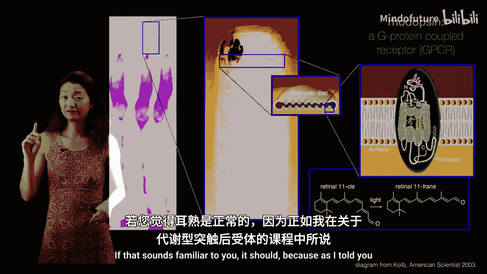

Cool， so that's rhopins okay now there are GPCRs， they' G protein coupled receptors so you already know that there's some kind of conformal change that's going to happen when a light hits it。

 so in the case of metaottroic receptors we already talked about how in response to being bound by a neurotransmitter like glutamate or whatever they will have undergo some kind of confirmationational change in the case of rhoppsin。

 that conformal change is going to be triggered not by the binding of some kind of small chemical。

 but by a photon hitting it。

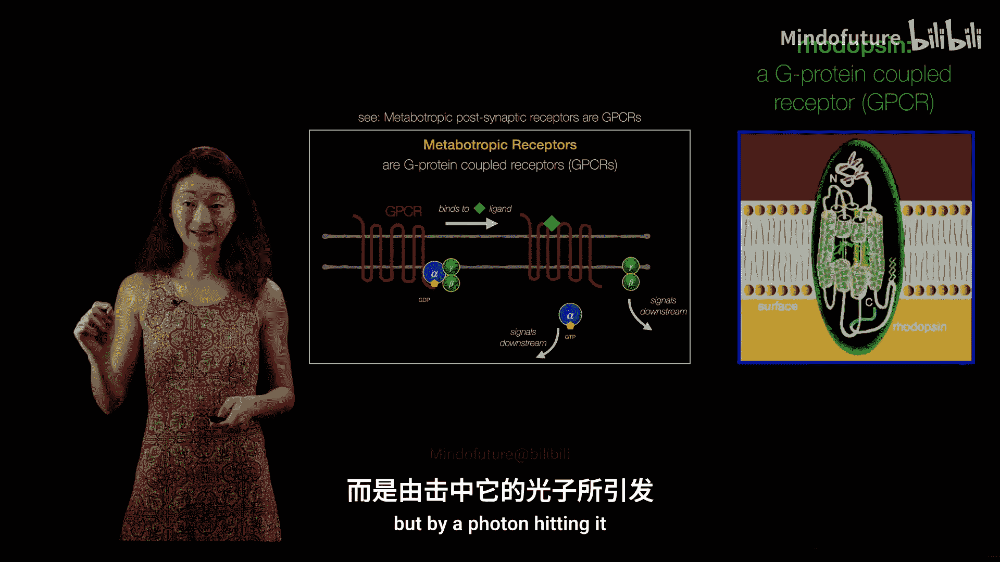

But proteins are not photossensitive by themselves， usually。

So there has to be some kind of photoactivable molecule that is working in concert with rhopsin to get this to happen in the case of rhopsin。

 that molecule is retinal Now retinal is that small molecule you see down there and it can take on one of two different confirmations in the absence of light retinal comes in 11 cis confirmation and that's what's bound to the rhopsin when there's no photon upon hitting it with a photon。

 the energy for the photon gets absorbed by the retinal。

 the cis retinal molecule and causes it to change confirmations into a trans confirmation a retinal that is the molecule that's actually the biochemical basis of photoreception fundamentally it's a photon hitting not the GCR itself。

 but a small molecule of retinal that's bound to the GPCR that causes this transformational change the cis retinal becomes a trans retinal that causes a confirmation。

Change in the rhopin protein and it's that signal that cascades down through a series of signal trans and that causes the photoreceptor to then respond oh there was a photon。

 I saw a photon。

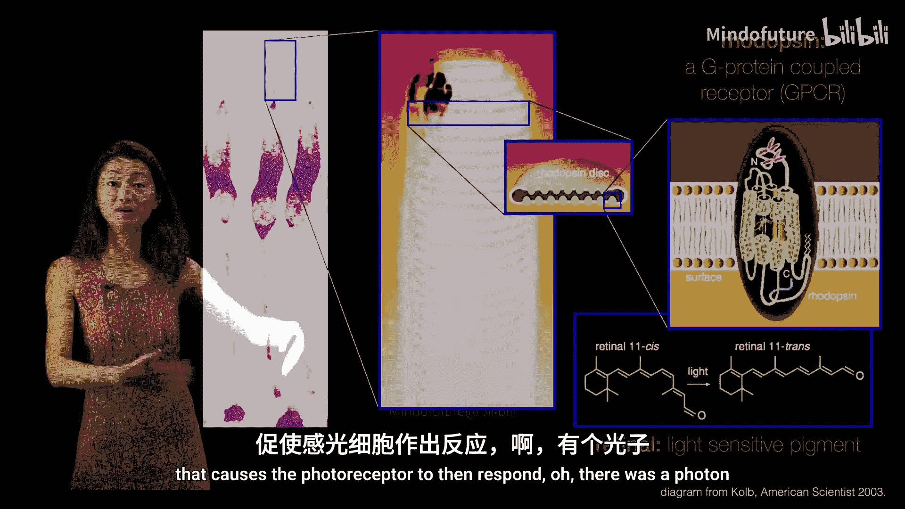

So the retinol pigment has a kind of an interesting story here。 you may have heard at some point。

 somebody tell you oh your carrots is good for your eyes Now why do we think eating carros is good for your eyes So the story here is that retinol in your body is made is metabolized from beta carotene and beta carerotene is this molecule that's found in abundance in carrots carrot are not the only ones that have it。

 you can get it from other different types of dietary foods and you can ingest but the bottom line is however you get it when you have beta carerotene。

 it becomes metabolized by your body and made into11 cyst retinol and you need to make 11s retinol to put it into your adoptionin so that you can actually detect light Now is more carrots and more beta carotene actually better up to a point if you don't have any of it then you won't be able to make retinal and you won't be able to see most of us have plenty of beta carotene in normal in our normal diet and so eating even more carrots does not make your vision。

Even better， even though this is the molecule that we need in order to be able to see。

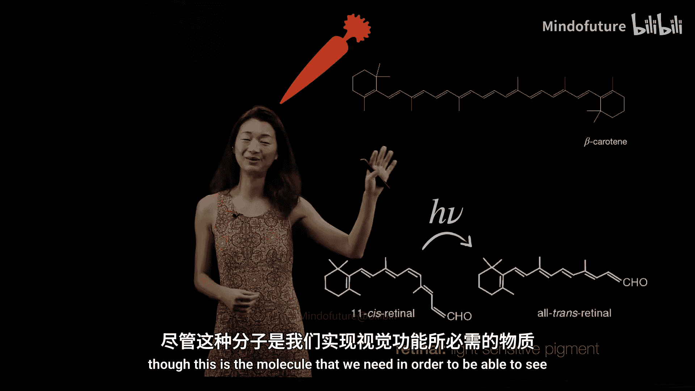

So we got we have a GCR， we have our rhopin。 it has a retinal that's bound to it。

 the conformational change triggers a change in the rhopin protein and the rhopin when it's activated so it goes from the dark configuration light hits it cis retinal becomes transretinal that activates the GPCR。

 which is a rhopin the GCR then activates the alpha subunit of the G protein and what ends up happening is something that's slightly counterintuitive can we talk about why in a second。

 but I' just going to tell you the fact of what happens photoreceptors are type of neurons don't spike they do not have action potentials。

 not only do they not spike， they have these graded potential。

 so they only are even more or less depolarized they don't depolarized in response to light they actually hyperpolarized in response to light the way that works is that in the absence of light there is a series of calcium and potassium ion channels that are open so when there's no。

There's actually a depolarization， a steady state depolarization of these photoreceptors you can see that because the resting potential of these photoreceptors is actually a negative 30 millivolts if you review the videos earlier about the resting potential of neurons you'll remember by our derivation with the neurons potential and the resting potential of the neurons that a typical neuron is closer to something like negative 60 millivolts and so photoreceptor is already substantially more depolarized at rest in the absence of light than a normal neuron that we talked about generic neuron had been so you have a neuron that is normally a little more depolarized than the generic neuron。

😊，When the light hits the rhopin。What happens is that instead of opening a cationion channel。

 it actually closes the cationion channel， it closes that channel stopping the flow of calcium and sodium into the cell。

kind of counterintuitive。 I'll say it again。 photoreceptors do not have spikes。

 They only get more or less depolarized。 and the way they signal that a light has been detected is actually by hyperpolarizing themselves rather than depolarizing themselves。

 Now the amount to which they hypopolarized is going to be proportional to to the magnitude of the photons。

 the magnitude of light， how many photons have hit that particular photoreceptors So if only a few photons have hit it is going to hyperpolarize a little bit less if a bunch of light just hit it。

 then is going to hope hyperpolarize a whole lot。 That's how that works。 Now these photons。

 as they hit it are going to cause the photoreceptor to photoreceptors glutamineerrgic neurons。

 And so they have a glutate synapsis where they are going to release glutamate is neurotransmitters onto the next layer of cells。

 But first， let's talk a little bit about how it is that with this infrastructure that we've just talked about。

 how we can actually see。

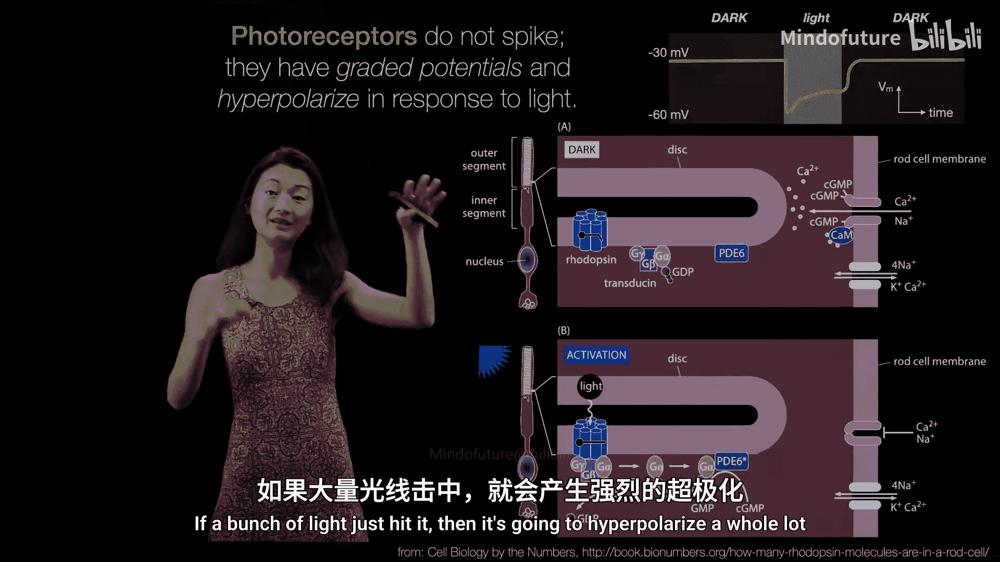

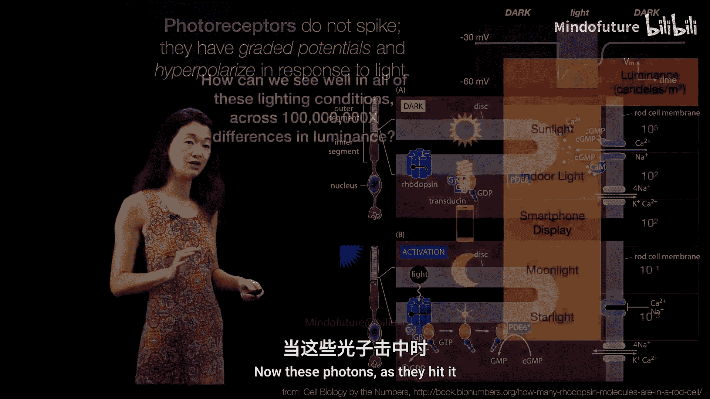

Relatively well across eight orders of magnitude in luminance in different conditions now and sunlight we have about 10 to the fifth luminance in term managing terms of canlas per square meter we can see in sunlight we can see indoor light we can see about the light of a smartphone display you can kind of read at night if you care to don't do it but we all do you can see in moonlight and you can also see in star light。

 you go at new moon in the middle of a desert and there's only stars in the sky you can actually see relatively well know you notice it a dark but you can see more than not at all and this is eight orders of magnitude difference in luminance and in terms of a performance of a CCD type apparatus this is absolutely astonishing in terms of their ability to flexibly and without really thinking that hard about it see quite well across eight magnitude of luminance in lighting conditions how is this possible😊。

T out that the mechanisms or how we can see so well across eight orders of magnitude are fourfold The first thing that happens and this is the fastest thing that happens is pupil dilation in low light conditions your pupil your aperture opens up wide and so you just literally have more photons going into your retina that causes it 10 times ability to adjust the different lighting conditions at lower light conditions you actually switch from cone based vision into rod base vision I've already told you that cones are less sensitive to light rods are more sensitive and so switching between cones and rods gets you about another100 x in terms of how much light you can actually see。

Over an even longer time scale， the retinol， the photo pigments in your retina actually adjust and that gets you another 10 times difference in lumin that you can account for So this happens over the course of approximately 30 minutes So 30 minutes is about how long it takes the human eye to fully adjust the low light conditions Think about that the next time you go stargazing if you want to go out and see mediateor shower or something if you spend even one minute turning the light on in your car or like reading news in your phone or something you have to spend another 30 minutes to fully adapt to the light to the dark conditions again。

 so just don't do it that's how long it takes so the pupil dis super fast less than a second switching from rods and cones takes a couple of minutes for your light to adjust for that long over the course of the next 10 or 20 minutes or so what's happening it photo receptors is that in response to this chronic dark condition your photo receptors or actually manufacturer and make more。

OrRdopson。Freshly loaded up with cis ttin， retinyl and loaded it up into your photoreceptor so they're ready to detect very。

 very small numbers of photons， that whole process takes about 30 minutes and so you know that's kind of a practical tip next time you goes alarm da。

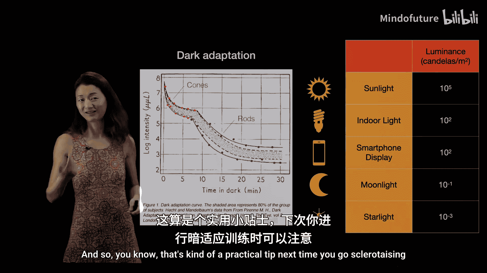

Okay， so the human eye， Laha told you has rods and cones。

 but they are distributed not at all evenly in the back of your retina。

 The cones are actually found in the very center of your retina in this area called the phoba。

' that's the name for the very， very middle of your retina。

 and it's so thin that it's actually only accounts for about the center one degree or so。

 that's the only place you really have any concentration of cones。

 that's where all of your color vision lives。The constant density of cones outside of the phovea decreases rapidly。

To compensate for all of that real estate taken up with cone cells。

 there's not really that many rod cells in your retina， so in the very center of your retina。

 you don't actually have that much light sensitivity In fact。

 the peak of your rod photoreceptors is a few degrees away from the center so that's actually your peak light sensitivity when things are relatively dark。

The other interesting thing here is if you count the total number of photoreceptors。

 the human retina has way more rod cells than it has cone cells。 cones are only found in the middle。

 they're densely packed。 there's tons of them， but they're not very light sensitive and the rest of your retina is actually tiled by a variety of different different cones and so your peripheral vision is largely mediated by cones instead by rods instead of cones。

 So that's what it looks like in a human that slightly dark spot in the middle is thephoba where we have a lot of acuity because we have tons of closely packed cones so that we can kind of see very small differences in the visual scene。

 not all animals have a phobia there's lots of animals that just don't have this dense region in the middle or anywhere altogether that has a lot of acuity and so lots of animals just don't have nearly the acuity that we humans and some other primates do。

There's also animals where their phovea is not so much a spot as a line。 And so a turtle retina。

 for example， looks like the following where there is a line of photoreceptors that are really closely packed。

 And so for them， it's not a spot phoba。 It's such called a visual streak。 so it's a line。

With closely packed photorecept。 So their acuity is really high。

 even in some of the peripheral regions。 they don't only have high visual acuity in the middle。

 They also have pretty high visual acuity in the sides as well。

 And that's something that is necessary for their ecology and to survive in the ecological niches that they survive in。

 unlike humans and other primates to whom we are most closely related。

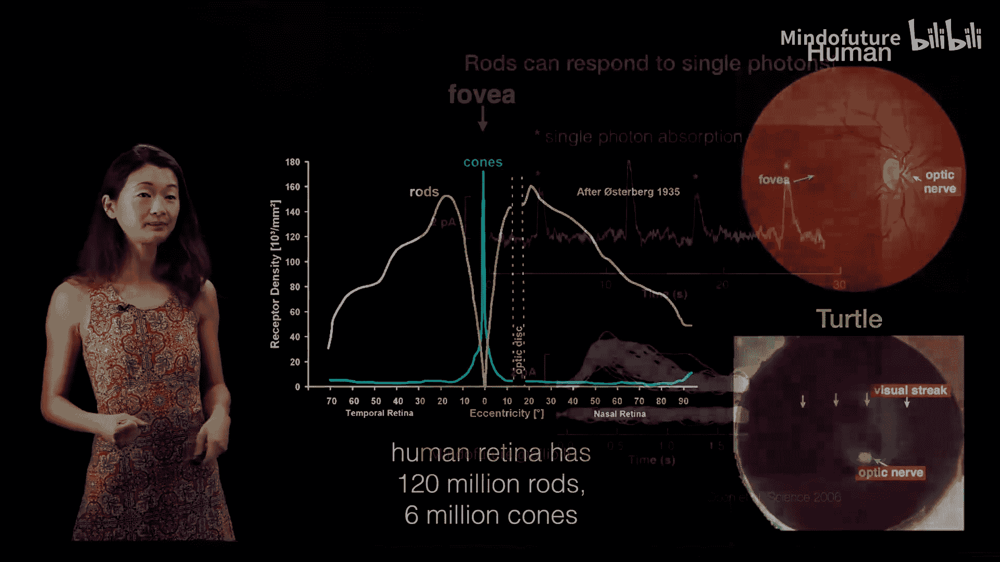

Rods are so sensitive to light that they have been demonstrated to be able to respond to single photons under fully dark adaptive situations。

 there are experiments that have been done， both psychophyically。

 as well as in terms of single photon absorption here you're seeing the response of one rod photoreceptor in response to single photons being absorbed。

 And so that's sort of the peak of the performance of these rod photoreceptors in fully dark adaptive situations。

 if you just wait around really long time and for one single photon to hit one photoreceptor in your eye。

 it is in theory possible for a rod to detect a single photon kind of remarkable if you think about how difficult it is to build even a engineered apparatus to detect a single photons。

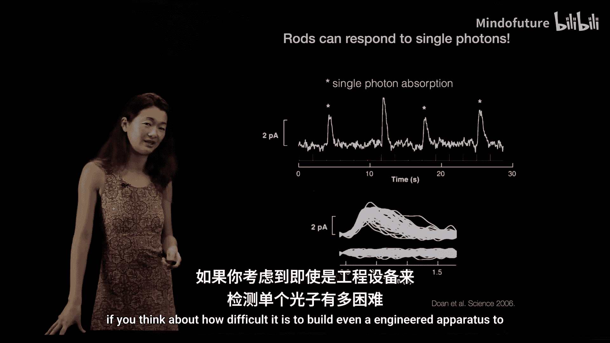

Another consequence of this is another practical tip the next time you' go climbing out in at night as one does。

 and you find that you can't quite see right in front of you the trick is actually you look slightly away from it you put what the thing you're trying to look at not in the middle of your eye where eup phobia is because you have no rods there。

 the peak phobia is a few degrees away from the center and so if you are trying to look at it and you can't see it because there's not enough enough photons look slightly away from it and you actually have a better chance of being able to resolve it because that's where the peak concentration of rod receptors in your writtent are。

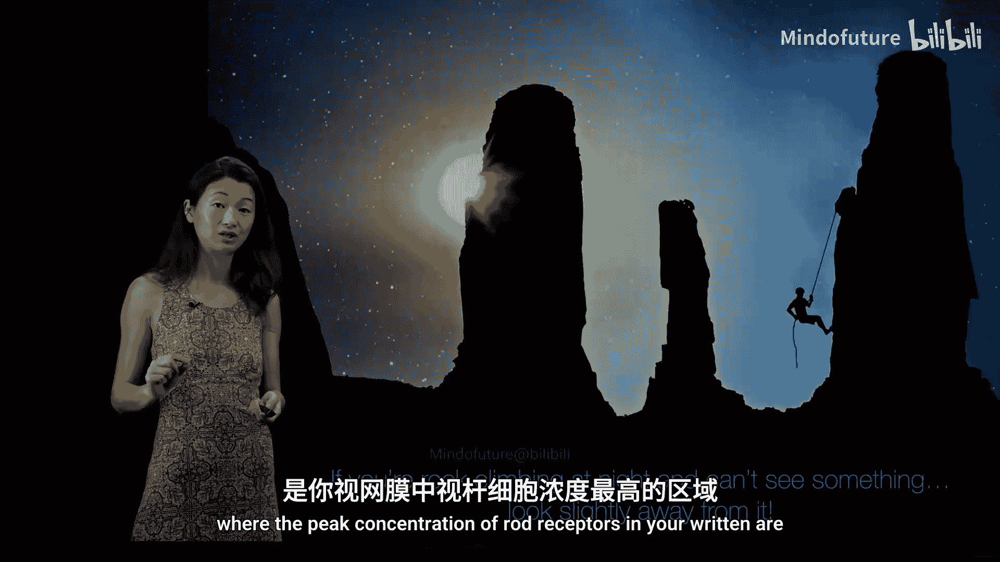

Okay so those are all the things that I thought to highlight about photoreceptors in the retina to review here are some key concepts the first is that we have photoreceptors in your retina these are specialized sensory neurons that are able to detect photons and they detect so by using two different types of photoreceptors we have the rods in the cones the rods are really fast and they're really sensitive but they're not really color selective for closer explanation of why they're not color selective and what color select is we're going to talk about that all about that in the very next lecture。

😊，Cones are slower and fewer， but they do have coloral activity。

And the humid retina has way more rods than cones， and rods are mostly found away from the phobia in the peripheral regions of your brain。

 of your retina。Photoreceptors are able to detect light by a molecule called rhopin。

 which is a light activated GPCR， GPCR relies on a small molecule called a retinal whose confirmation from pharmacist configuration to a trans configurationgu in response to absorption by a photon is the thing that actually causes rhopin it's a GPR CR to change confirmations and that's the first step in the phototransaction pathway in order for you to then perceive light。

Photoreceptors interestingly do not spike， they have no actual potentials。

 they have greater potentials and they're actually hyperpolarized by a photon rather than being depolarized like we sometimes generically think of neurons are this is not true the next stage of retinal transduction and that's going to be the focus of the next lecture as well。

😊。