# 【华盛顿大学】神经科学入门 ｜ Introduction To Neuroscience ｜ Bing Wen Brunton p18 P18_色觉-视网膜视杆细胞与视锥细胞 -BV1i3qWBXEDH_p18-

In the last lecture we talked all about the neurobiological basis of vision in photoreceptors in your retina and particularly we talked about how it is at these photoreceptor cells use redopsin a geoprotein coupleupd receptor that use retinal。

 the confirmational change from cyst transretinal in response to a of a photon to transduce photons into graded electro potentials in your visual system we talked mostly about just absorbings of any photons but how it is how we have color vision how are you actually able to resolve different types of photons and use that delete our perception that different things have different colors so that's the topic of today's this lecture right here so we talked about the different two different types of photoreceptors。

 the rods and the cones and last time we talked mostly about the rods and how they work this time we're going to be focusing more on different cones cones as we talked about last time is mostly found in the phovea of your retina the very center portion in the directly in the back in center one degree or so。

Of your visual acuity cones are the reason we have color reception as well as such great visual acuities that we can see lots and lots of detail in our visual scene Now these cones of course have GPSCs and in particular。

 they have a couple of different slight variations of rhopin that make them different from each other Now the rhopsins in the cone rores have different slightly different properties because they actually shift the absorption spectrum of retinol in a slightly different way。

 Now I talked to you about ret 11 ci retinol last time and how it has this conformal change that part's the same in terms of the cone and the rods they all have generally the same kind of rhopin and they all use retinol as the molecule that actually absorbs a photon What I didn't tell you is how the absorption spectrum works it turns out if you think about the rhopin and the retinal molecule by itself。

😊。

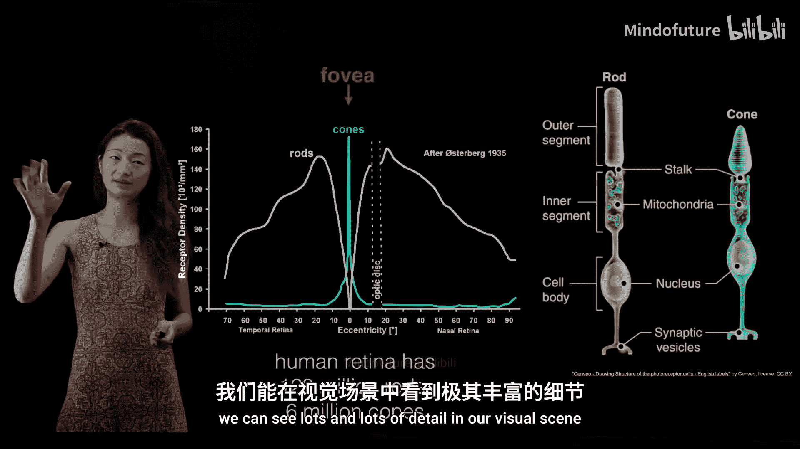

The peak absorption spectrum for a retinal molecule by itself is actually slightly in the UV。

 we can't see in the UV。 What thein rhopin does is actually forms this couple of different alpha helices that stabilize the retinal molecule and there's a couple of different base that are right next to where the retinal binds that changes the confirmation of the retinal shifting its absorption spectrum to be a little more red to be slightly longer wavelengths that's how we can see in the visible spectrum in the first place What happens with color vision is that we have a couple of different forms of the rhopin molecule that shift that absorption spectrum to slightly different amounts and that leads to the effect that we have a variety of different absorption spectrum for different molecule for different cone photoreceptors because they express different forms of this。

So there's one rhopin that ship that is found in rods that's this dashed line right here so I told you the rods are not sensitive to different colors but that's kind of a it's not exactly true it's because we don't actually perceive different colors using cones because there are different channel information the randomral molecules and and the rhopin in rods are sensitive to some wavelengths of light more than others they're shifted by the amount where there's a peak at 496 nanometers for the three different types of cones that we humans have they're shifted as you can see by this diagram here by more or less we typically most of us have three types some of us only have two some people actually have four most of us have three and so there is one thats we call this the shortest wavelength because it's shifted by the most amount of the shortest part of the color spectrum it has a peak at 419 nanometers and then we have two more different channels of light these two different cones are sensitive to 531。

559 nanoms of light respectively and so I just want to point out here that there's a mistake in thinking of these like this is not that the blue photoreceptor。

 this is not the blue cone because it's not only sensitive to blue light In fact。

 because it has a peak in the blue region doesn't mean that it can actually tell the difference between。

 for example I'm just going to point right here this shade of blue versus this shade of purple because if you think about it right。

 this is the absorption spectrum which means that light of this wavelength is going to activate that cone exactly the same amount as this photon right here。

This photoreceptor has no capability of discerning the difference between this photon and this photon。

The only way it can tell the difference between them is because it activates this other photoreceptor differently。

 so it's by looking at the relative activation of these three different channels of color that we can lead to the perception of color。

 each one by itself doesn't give us nearly enough information to be able to tell the difference which leads all of the spectrums of different light。

😊。

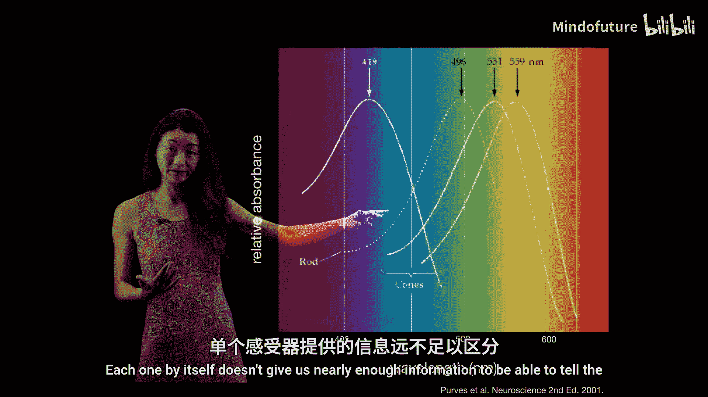

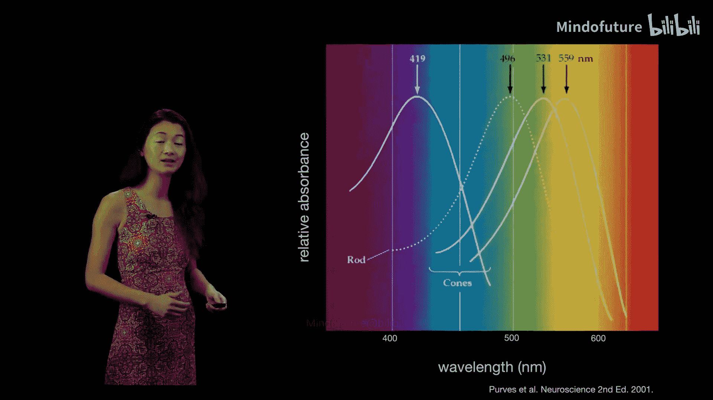

So let's talk about that a little bit more， I'm just going to break that down for you one more time。

Assuming you have three different cone photoreceptors that are sensitive to three different peaks in the electromagnetic spectrum。

 what ends up happening is that each of the relative activations of these three different cone photoreceptors gives you one piece of information about what light it possibly can be。

And so it's this three dimensional representation of light that we can use to infer the actual wavelength of the light that leads to the perception of color vision。

 so what happens here is that let's say you have purple light okay purple light is going to activate the short wavelength one a lot and the medium one less and then the long wavelength1 not at all so it's going to sit in this place in the three dimensional space that's how we know it's purple。

A blue one， even though it activates the short wavelength， not that differently。

 is going to activate the median wavelength when a lot more and the long wavelength went， not at all。

 And so that's how we know the difference between blue and purple。In contrast， a orange light。

 for example， is going to activate the long wavelength one a lot。

 and it's going to be a lot less active for the medium and the short wavelength ones。

 and so it's actually the relative activation of these three different types of combe photoreceptors that then leads to the perception of color。

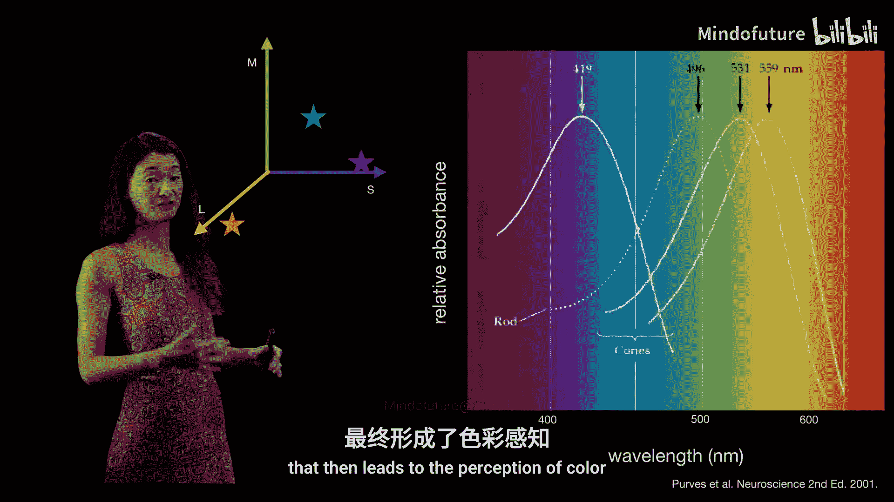

They don't actually tell you anything about the color themselves。

 so that's kind of an important point I wanted to make。Okay。

 so I told you that most of us have three photoreceptor types and that allows us to perceive the range of colors that we see in walking around the world in aroma lives。

 of course there are certain people who have a color blindness of a couple of different types now。

What that means is that because you don't have three channels of information。

 you only have two because you only have two different types of photoreceptors in your cones。

 there are certain colors that are ambiguous you can't tell them apart now there's a bunch of dots that are next to me on the screen over here。

If you don't see a number in the middle of these dots。

 you may have colorblindness this is what's called the Ihahara test for colorbldness and the dots in the middle of this picture should form a number if you see the number easily that means you have normal trichromatic vision normal for human trichromatic vision if you don't know what I'm talking about and think I'm just pointing to a field of random dots you may want to investigate whether or not you have a type of colorbldness it's pretty common and it's in fact something that I usually take into consideration when I'm making figures or making graphics。

 for example， I try not to use colors that are like these two colors confusing for pretty substantial part of the population who can't tell these different colors apart so there are different color schemes that we can use to make it easier for folks of colorblindness to still be able to tell apart different pieces of scientific information that I'm trying to convey to them。

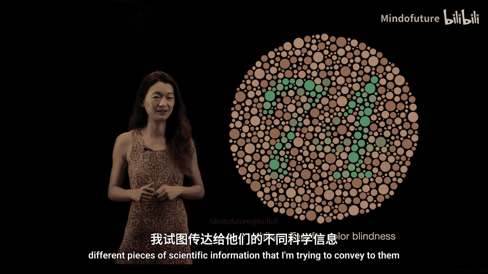

Okay so there's a related question here， which is a question that almost I mean seems like a philosophical question at some point why is a sky blue why is the sky blue this actually has a really interesting set of explanations that combines some explanations from physics but also has a little bit to do with what we just learned about human visual perception so as you all know the light from the sun is not blue right if you just look at the spectrum of the sun。

 it pretty much spans the entire visible spectrum and so if you add all of those different colors of light together。

 the perception of that type of light is usually white so why is it that when you look at the sky it doesn't look white。

 it looks blue instead so this is something that my kids ask me at some point and so I actually figured it out and so here's kind of the short explanation of why the sky is blue。

😊，The first thing we have to understand is this thing called rayley scattering。

 so the atmosphere is filled up of gaseous molecules， most of its nitrogen and oxygen。 Okay。

 these are teeny， tiny little gas molecules。 And so because they're so small for that size of gas of gas。

😊，Partorticle sizes when light comes down from the sun and hits the atmosphere。

The probability that it will hit one of these particles and scatter is not uniform with respect to wavelength。

 longer wavelengths of light are less likely to be scatter。

 they're more likely to just pass right through， whereas shorter wavelengths of light are much more likely to hit one of these gas molecules and be bounced around in change directions。

Let's think about this for a second。If you are a red light photon。

 you are much more likely to go directly down。But if you're a blue or a purple photon。

 you're more likely to be bouncing around the atmosphere and end up going sideways。

The consequence of this is that because you're standing on earth and you're normally not looking straight up at the sun。

In case nobody told you don't do that。 It's not a good idea。 don't look shapepher but sun。

 So when we look at the sky and we perceive the color of the sky， mostly we're looking at the sides。

 right we're not looking at the sun， we're looking at the sunlight reflected by the atmosphere so that it's now coming from the side rather than coming from the top and those photons have to have bounced quite a bit。

They arrived at my eye sideways， so they must have bounced around quite a bit in the atmosphere before they started going sideways and hit my eye when I'm sitting or standing on earth。

And because of railleigh scattering is so severe the likelihood of the scattering is actually proportional to one over the wavelength to the fourth power。

 so these shorter wavelengths of light are significantly more likely to be scattered and going sideways。

Okay， so that's why the spectrum of the sky， the perceived color of the sky。

 is much more skewed towards the blue， violet purple side of the spectrum than towards the red and orange side of the spectrum。

Now the sunset is a different thing that has a different type of scattering that's already really scattering we talk about it in a different day if you want to。

 but this is what happens at noon， not when we're talking about the sunset。

 that's why this is' maybe you look at a cloud a cloudless clear sky to most of us we perceive it as being blue。

 but this exc is actually so incomplete because this explains why the sky is lighter in color towards the shorter wavelengths part of the spectrum it doesn't explain why it's blue instead of violet to understand why humans perceive it as being blue instead of violet。

 we have to also look at the absorptionorption spectrum of the short wavelength photoreceptor cones in our retina so you can see here that the peak absorption spectrum is blue。

We can perceive shorter wavelengths of light， but the absorption spectrum goes way down in this part。

 so there's actually more photons of this type kind of towards the near ultraviolet when we look at the sky then actually blue photons。

 but because our visual system actually starts degrading towards that portion of the spectrum we can't really see ultraviolet light all that well。

 so we perceive the sky instead instead of being violet or ultraviolet we perceive the sky is being blue because that's kind of the peak of our absorption spectrum of the closest photoreceptors we have for looking at the sky。

 so that's kind of a short reason two reasons why the sky looks blue because really scattering and because the absorption spectrum of the short wavelength photorecepts in your retina。

Okay， so we talked about how cones are only in the phovea and rods are actually largely responsible for your peripheral vision。

 so anything really one degree， look at this， one degree is super short if you just put your finger out in front of you and kind of put two fingers together that's about where all of my cones are。

 everything else around here， I can't see them。With my cones， it's outside of my Pophobia。

 So everything out here is largely responsible for my the rods are largely responsible for my vision out here。

 So there's another illusion here， which is the illusion of being able to see the world in full color。

 If you look at a picture like this。 A bunch of beautiful scarves。

 You perceive at being it being a picture full of colorful scars。😊。

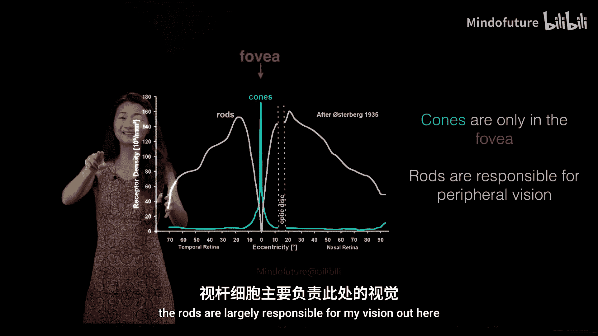

You walk around the real world， real world， you'll see oh there's green trees over there in my peripheral vision。

 there's a blue sky。 There's a person with a red scarf over there。

 you think you see the world in full color but that in fact。

 is also an illusion because what your retina sees is the following you can see a dot in the middle that is in full color because that's where all your cones are。

 you have no cones anywhere else what you're actually seeing that you're walking around is the rest of the world is in monochromatic vision it's only being seen by the rods in your peripheral vision。

 The fact that you don't perceive the world this way is not because of your retina is because the rest of the visual processing system is superbly good at filling it in because you know the rest of it does have color and you can kind of look over either with your eyeball by the entire body to see that there's something over there and when you focus on it you can see that it has color。

And so when you're not able to see it， you believe it has color because the last time I looked at it。

 it does have color and so just because I'm not staring at it now I'm just going to perceive that it does have color so this is something that's kind of a common theme in neuroscience your brains it's not really telling you what's out there and it's certainly not telling you what you're actually perceiving。

 It's telling you the information in such a way that makes it useful for you to make actions about what to do in the future and so your perception that this picture is full of color looking more like this is an illusion that is filled in by your brain。

 the hardware in your retina sees this and you fill in the rest。😊，So when you have diseases。

 a degeneration of the retina， there's a couple of different types that are particularly devastating but they are also fascinating from the perspective of neuroscience because it kind of points out this dichotomy between the different types of photoreceptors that are in your retina So for example folks with maculate degeneration has selective loss of cells in the phobia。

 which means that you actually have a kind of a blind spot a blank spot in the very very middle of your vision the rest of it is actually fine you can see still in the periphery so this picture is kind of like a diagram of what that that might look like even though as I just told you in the previous slide the stuff out here shouldn't really be in color because a phoba has all of your cone receptorcepts and so the stuff out here should actually be in black and white when you have maculaturegeneration is a pretty devastating disease because you can't see the thing you're trying to look at when youre trying to focus at it kind of the opposite almost im macaculate degen is a disease called retinitis picamentosa which is a selective loss of rod photorecepts rod photoreceptors as we talked about is mostly in the periphery and so're in the middle。

Just fine your phobia is just fine， those cones are just fine。

 but you can't really see stuff in the periphery nearly as well。

 so those are a couple of things that could go wrong with different photoreceptors in your retina。

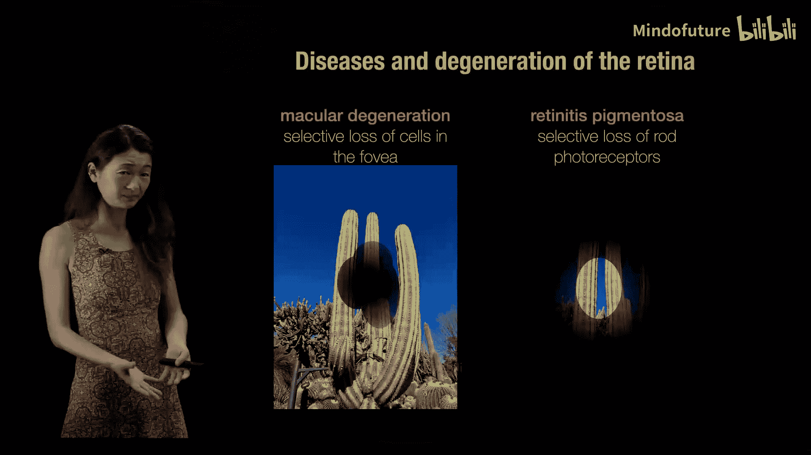

So we can see trichmatic vision， which is already pretty impressive because it's better than dichromatic vision。

 dogs have dichromatic vision and so they can't see as many colors as we can。

 it's kind of a mistake to think that they only see monochromatic。

 it's not like they don't see any colors at all。 It's just that they don't have the ability to discern as many colors as we do but we are by no means the most impressive visual creatures。

 the most impressive creatures in terms of their vision。

 there' are lots of weird ones but I think the mante has shrimp eye kind of takes the cake in terms of different channels of photorecepts instead of having three。

 they have 12 they have 12 different redops that see 12 different channels of light and they have slightly different spectra that as you can see here are largely overlapping with what we see as humans。

 they kind of go a little bit farther into the infrared and the ultraviolet than we do。

 but it's largely overlapping because that's sort of where the peak of the spectrum of the sun is that's where most of the animals in on earth are able to see。

 So why do they have so many channels do they actually see more colors。

We do now as we discussed earlier they don't actually right because with three channels of information。

 we can actually discern lots lots of different very fine differences in colors that if you just added another one it's not true that just see more color what they might do is be able to experience these colors in a different way I mean I've never talked to a mantisrimp so I don't really know what it feels like to see in three in 12 different channels of light instead of three different channels of light it's a little bit unclear what this is actually doing for them and why it is and people have speculated why it is they have such an extraordinary array of different photoreceptors that's way more than we do the idea is probably gives them a little more acuity in some of these areas so they're able to discern much smaller differences in wavelength but it doesn't necessarily give them a different perception of the world is like than we do I also to mention earlier that manti shrimp in addition to having 12 photoreceptors also see polarized light this is something the human eyes cannot discern I cannot tell the difference。

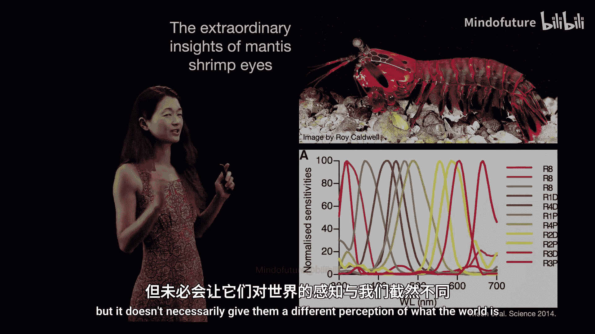

Light of one polarization versus another。 I have to wear polarized sunglasses to be able to tell them apart。

 manti can do it with their own eyes。 it's another exceptional adaptation in the animal kingdom in the visual domain。

There's another thing about human vision that is particularly useful and you are using it right now to listen to me and it's the the called flickr fusion。

 We talked mostly about light and photons as if this is a static thing you're looking at an image right but as you know when you're walking around when you're watching a movie it is dynamic。

 some things are changing。 and so when things are flashing。

 there's this thing called a flickr fusion， which is right now this dot is flashing at one flash per second。

 one flash per second another way of saying that is one hertz， one flash per second。

 one hers exactly the same thing and what you should have seen in the video is that you should have perceived this dot is flashing at one flash per second you can see it。

 you see it as flashes of light。 if I flash a little bit faster。

 this is now flashing at four hertz per second。Still， my perception is that it is flashing。

 I can see that it is flashing faster。If we flash it even faster at 60 hertz。

I no longer see flashing。 That is flashing。 I assure you it is。

 but you don't see it because what you do see is that when things are flashing fast enough。

 you don't perceive them as individual flashes， can you perceive it instead as a continuous perceived luminance as if it's a continuous thing rather than punate distinct things。

 This is something about that's a peculiarity of the visual system。

 different animals have different flickr fusion frequencies。

 and so we humans go up to you know depending on exactly how you measure it usually by the time you get to 30 hertz or so 30 flash per second。

 we start losing the ability to receive individual flashes and instead perceive it as a continuous flash continuous luminance that is the grand illusion of them all。

 I think this is probably the most common illusion that most of us experience on a regular basis because it is the illusion that underlies video。

 most of our monitors don't refresh at much faster than 30 to 60 Htz movies are film you know depending on the format。

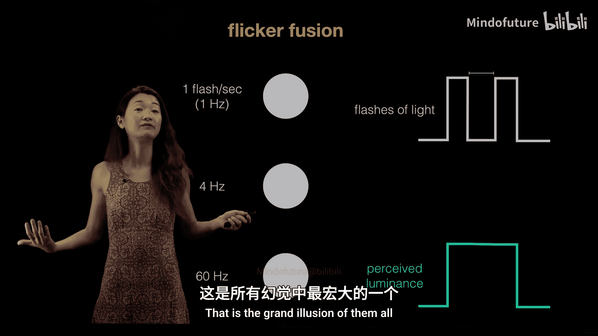

You're looking at 30 or360Htz above that we can't really tell the difference so if you play a series of images。

 still images at approximately that frequency， the perceptioncept the most humans have is that it's continuous motion rather than flashes of light when you have stop motion photography for example that's another instance where we kind of do it for artistic we do it for artistic sake right you kind of looks like you can kind of see that there's puncate individual frames that are a little bit slower than that and so we kind of perceive this as being this artsy thing that happens in real life things are actually in continuous motion on a video they are very closely approximated to that and because of the flickickr fusion rate of your visual system。

 you're unable to tell the difference but truly continuous versus continuous but versus distinct discrete but fast enough that's the illusion of videos。

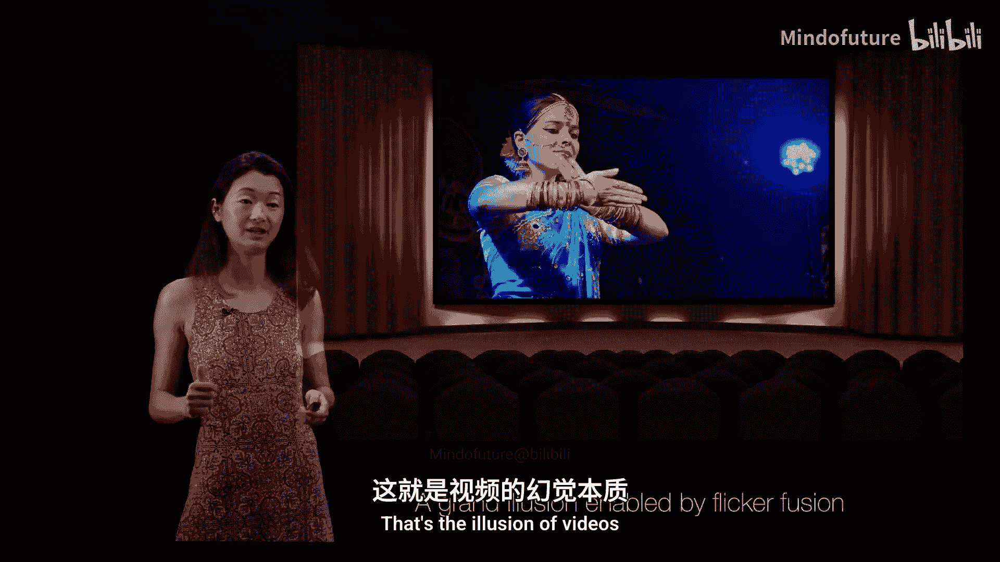

So。We've talked about a couple of different ways now in which the eyes and the retina are so much better and cooler than what we can do with videography and this is underline by a variety of different anatomical physiological and neurophysi computations and and that makes it so that our eyes are able to perceive vast differences in luminance and they're able to tell lots of different colors apart in ways that are superior to what we can do what we can achieve with engineered pieces of equipment so color vision。

 I'm going summarize here by a couple of key concept， humans have three types of cone photoreceptors。

 most of us different folks have color blinddness and they only have two different types of photoreceptors。

 most humans have three photoreceptors and each of them are sensitive to a shift range of wavelengthed light because they have slightly different rhopin proteins that shift the absorption spectrum of cyst or transretinal in different ways。

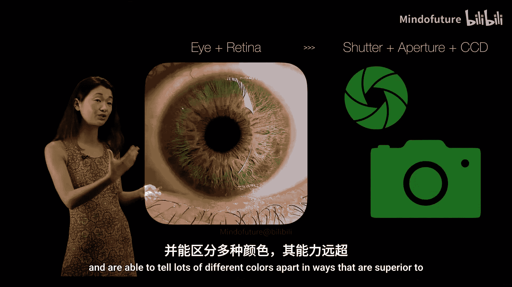

Cones are mostly found in of phoba， the retina you only really have color vision when you're directly looking at something not in the peripher at all。

And the relative activation of these three cones leads the perception of color。

 each of these photorecepts is not sensitive to a color， that's how it works。

 it is most sensitive to a peak， but it can't really tell the difference between the two sides of the shoulder at terms of the wavelength。

 so it's only by comparing the three different photorecepts and their relative activation do you have a perception of color。

And finally， humans cannot perceive rapid changes of light faster than the certain threshold and if you can play a movie on a monitor or a projector or smartphone or something faster than that rate。

 we perceive it as being continuous motion and that's what we do all the time because of all the time we spend sending out phones and being convinced of this grand illusion that things are actually moving in incontinuity so those are the key concepts we've now talked about photorecepts。

 rods and cones it's talked about color vision as well as a perception of light in general we're going to be talking about in the next couple of lectures is what happens after the photorecept because photoreceptors after all only the first step in the visual processing in the pathway the photoreceptors tell you something that there is light how the presence of light leads to you your perception of vision。

 how you understand what's actually going on in the world that's going to be the focus of the next several lectures in the series。

