# 【华盛顿大学】神经科学入门 ｜ Introduction To Neuroscience ｜ Bing Wen Brunton p19 P19_视觉计算与环路-感受野-稀疏编码假说 -BV1i3qWBXEDH_p19-

In the last couple of videos in this intro to neuroscience series we talked about the molecular and neurobiological basis of photoreception。

 how it is that individual photoreceptors near retina are able to detect photons we're going to be talking about in the next section of videos is how that information from lots and lots of photoreceptors are integrated into the perception of the real world that we all enjoy so the topic is visual computations and circuits and this is also one of the first lectures we're really talking about circuits of neurons not just individual neurons and how they can kind pass information down abstractly。

 but how we actually do computations， how do we have a meaningful things emerge from the ways that different neurons connect with each other by action potentials that leads to something that's actually interesting and interpretable and leads to all of the things that we do and enjoy and perceive and so I'm going to use this as an opportunity to also talk about computational implications of the ways that neurons are hooked up together and talk to each other and the way we refer to these canonical。

😊，Kits as being computationals that we can kind use themselves as computational Lego blocks for building to higher and have higher levels of perception than action。

 So we talked about the retina quite a bit and I told you that they were a lot of different cell types in the retina we kind of glossed over all of them except the very first type the photorecepts we talked a lot about cones and ros and the different kinds of redops the molecules and then we talked about biochemistry and molecular biology and it's all really great and at the end of it all you have a single photoreceptor that is telling the next layer of cells some light came so these are glutamate synapses and so the photoreceptors end up releasing glutamate and the signal to the next layer of cells that something was detected in terms of photons by the photorecepts this lecture is going to be more about all of these other cells that are in your retina because your retina is actually if you think about it it's less like a CCD where there's a bunch of pixels and photo detectors it's more like a mini brain and brain in miniature where there's detectors。

😊，And there's actually a bunch of stuff that's happening before it has an output that goes to the rest of the brain。

 goes the thalamus and the LGN。

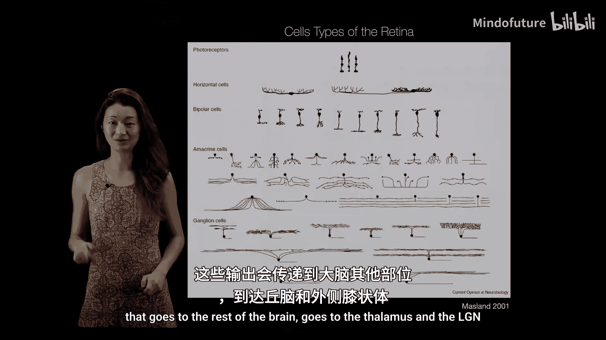

So this is the picture we were looking at before where light comes from the top。

 It goes through all of the stuff that we've ignored so far and hits the photoreceptors。

 so we're going to separate all these different cell types。

 It's actually lots of cell types I'm just going to lump them together into bipolar cells and then ganglion cells。

 retinal ganglion cells RrgCs and the RgCs are the only things that output from the retina。

 These are the only cells that have axons so go to the rest of the brain And so anything that happens here is not ever detect it not ever reported directly into the rest of the brain unless they change the activation of the retinal ganglion cells now I know it's really confusing but I'm just going to flip this thing upside down for a second。

 just bear with me here because the diagram is easy to draw from the top down where we go from photoreceptors down and so so just consider the diagram we happen looking at and just flip it upside down。

 Now we're looking at the inside of the retina on top with the photoreceptors and the outputs at the bottom with the retinal ganglion cells and I'm also going to represent the photoreceptors as。

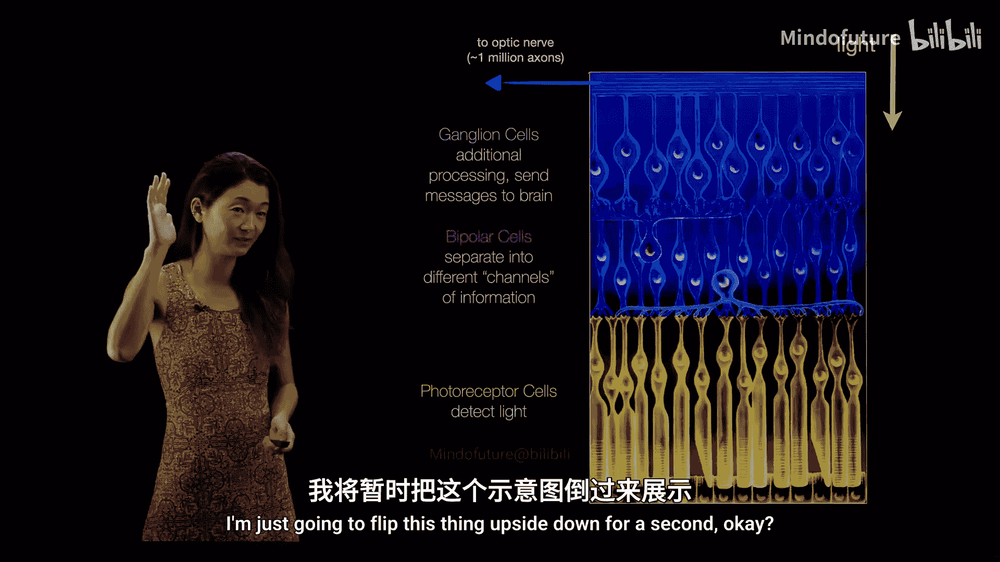

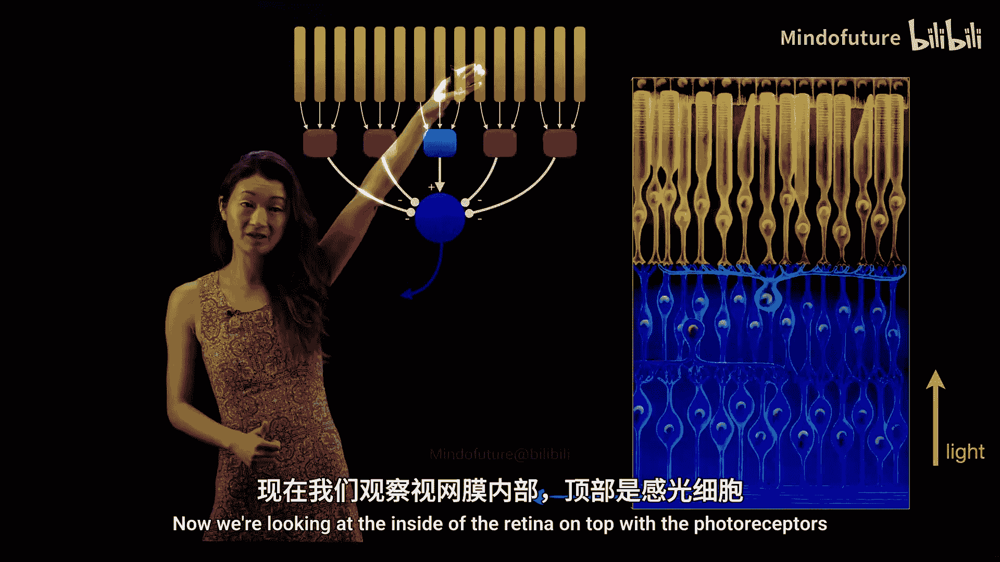

These yellow cells up here and then the middle layer is going to be these bipolar cells and then they're all going to have convergence onto these retinal ganglion cells at which theres many of them so let's just look at the circuit and try to break it down into what's actually happening here in terms of how a lot of different photoreceptors converge onto a single retinal ganglion cells because we're not actually ever able to you as a brain know what's happening the single photoreceptors we only know what retinal ganglion cells are doing If you look what the retinal ganglion cells are doing。

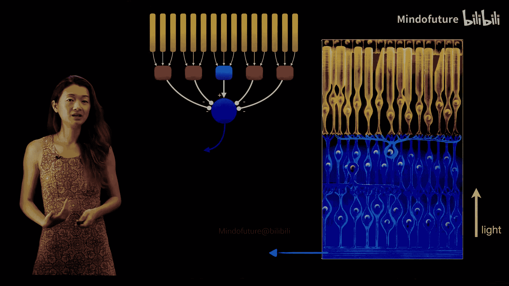

They come in a couple of different flavors。 and one of them is what we call the on centerretinal ganglion cell。

 I mean don explain what happens with that。 So the observation is that these ganglion cells。

 they're not like pixels in that the only report what's happening in the small patch of your retina they're already poorly information across a lot of different photoreceptors and they're actually mostly sensitive to when there's a spot of light in the middle and it's relatively dark in a donut right outside of it Sos not think it's not a pixel at all。

 a pixel is is that pixel on or off This is more like is that patch does it have contrast。

 is it lighter in the middle than it is on the outside。

 So to do that kind of computation the retina has this kind I'm oversimplifying here。

 but it kind of has this canonical circuitry What you have is a set of bipolar cells that come in two different flavors there's the on bipolar cells and the off bipolar cells and they use different neurotransmitters。

To either excite or inhibit the retinal ganglion cells that they're going to synapse on to later。

The on retinal ganglion cells pull all the activation from the photoreceptor cells。

 and so theyre more likely to be active when there's light in the middle。

And they're surrounded by a bunch of off bipolar cells。

 They're actually going to be kind of switching that sign of the light。

 So when there is more light up here， it's actually going to be negative。

 It's going to be inhibitory on the retinal ganglion cell。😊，Okay。

 so what happens is that if you have one of these in the middle and then you have a bunch of these off bipolar cells in the periphery and they're all connected to a on-cent retinal ganglion cell there。

 I think what you can intuit is that this retinal ganglion cell is going to be the most active when there's light in the middle but actually darkness on the outside if the whole thing is illuminated uniformly and everything is light。

 this thing is actually going to be less active because it's going to be inhibited by the light over here and light over here。

That's an on central retinal ganglion cell。Now， if we do the opposite。

 if we hook up the circuitry in kind of the opposite way。

 where there's an off bipolar cell in the middle and surrounded by a ring of on bipolar cells。

 you have the opposite。Effect。This retinal ganglion cell is going to now be most active when it's dark in the middle and there's a ring of light on the outside。

Okay， so this is now going to be an off center rot ganglion cell。

We're going to summarize all of this by a diagram that you'll see over and over。

 not only when we're talking about the visual system。

 but we're talking about lots and lots of other sensory and even motor systems as well。

 It's this concept of the receptive field。 This is a way that we neuroscientists used to characterize。

 as well as summarize what was the stimulus that is most likely to activate any particular neuron。

 This receptive field is a property of that neuron。

You can also make them from any other neuro you want to。

 you can make a receptive field of this neuron because it is a property of all of these photons that are hitting it's presynaptic partners。

 Now this receptive field of this one particular oncent retinal ganglion cell we can summarize by that diagram where you can see that it's a spot of light in the middle that's active so it's activated by light in the middle and inhibited and it's also a likes negative light on the ring that's around it。

 so you have a little donut where it's light in the middle and dark in the outside that is a receptive field that is going to make this particular oncent retinal ganglion cell the most happy。

 if you shine it exactly like that， it's going to activate the most。

 the more that my pattern of light deviates from that receptive field I'm going to be activating this oncent retinal ganglion cell even less so I'm going to introduce one more cell type here which is called the horizontal cell。

 this is another cell type that is in the retina and the ret。

 these horizontal cells have the special property。Of connecting to lots and lots of different photoreceptors。

 Now， they take input photoreceptors and then also project to other photoreceptors。In particular。

 they're going to be inhibiting the neighboring photoreceptors。 Why would they do such a silly thing？

 It's because it actually increases contrast。 Now， this type of lateral inhibition let's talk about it in the context of photoreceptors。

 but this is also a circuit level motif that we'll see over and over again in the visual systems later。

 but also in lots of other sensory motor systems as well。

 because it's the commo motif for increasing contrast。

 So what happens here is that let's say that this particular horizontal cell has a synapse has a syn snapapse that's activated by this particular photoreceptor And when this photoreceptor is receiving lots of light。

 it actually inactivates and inhibits all of its neighbors。

 So every photoreceptor has a suite of these horizontal cells so that everyone is inhibiting its neighbors。

😊，Again， this seems kind of silly Why would you do this The net effect is that it increases contrast It makes it so that you're more sensitive to looking at edges and less sensitive when things are changing continuously or not changing at all this is also a common feature of basically every sensory system so you'll see this type of horizontal cell and lateral inhibition for example in the auditory system this also happens in time so you have these all of these adaptations when your brain base basically not trying to report to you what's actually happening。

 it's often a change detector when something changes either in space or in time。

 so when there's a line of dark over here and then light over here。

 you are much more likely to pay attention to the interface where that contrast is changing than either side altogether。

 same thing with sound， same thing with smells same thing with even abstractly in decision making。

 we see these kinds of motifs where one decision will actually inhibit some of the stuff around it or。

cellsll when you're facing in some one direction， that cell sometimes is seen to inhibit the cells around it that represents when you're heading in different directions and so this generic motif of lateral inhibition to increase contrast is something that is first seen this is the first time you're seeing in this course in the context of photorecept is inhibiting as neighbors so increase visual contrast。

 but this is a motif that we'll see over and over again in lots of other systems as well。

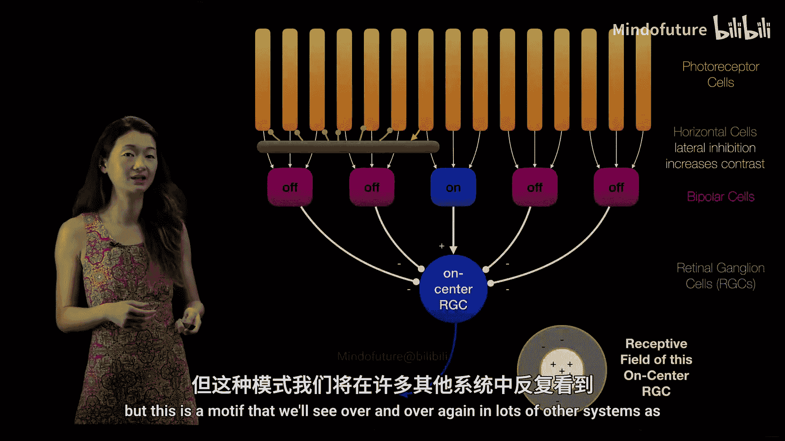

Okay， so that's all about the retina right and we talked about retinal computation of how there's already kind of a mini brain going on。

 there's already nontrivial computation going on inside the retina。

 we're going to then slowly now mar down this pathway by going from the next stop on the way is a part of the thalamus known as the lateralgeniculate nucleus and in the lateral den nucleus we can once again characterize the receptorive field of the LGN neurons by computing the visual stimulus to which it is the most sensitive。

Okay so the classic way of doing this in experimental neuroscience is to get some recordings from your LGA neuron LGN neuron。

 so here I'm kind of plotting it as a ra map of time so I've done some extracellular recording I've stuck a sharper electrode into my LGN and I've got an LGN neuron that's under that's under my recording and I can see when it's spiking so what I'm going to do now is that I'm going to show it a variety of different visual stimulusimi I'm going to flash different pictures at it here I'm just showing a bunch of random randomly generated visual stimulus to start and I'm going to show it a bunch of random visual stimulus and I'm going to record when the cell actually fired now taken together。

 it looks kind of random right but we can do over a long time is look at every single time the cell actually fired at the time of every spike and then we look at the stimulus right before it and say。

 okay。What just happened。 What was the thing that made that cell fire that one time。

 And we do that for a long time with lots and lots and lots of spikes。

 And then we take an average of all of the stimulus that came right before that spike。

 This is a way where we can compute a receptive field for that particular LGN neuron。

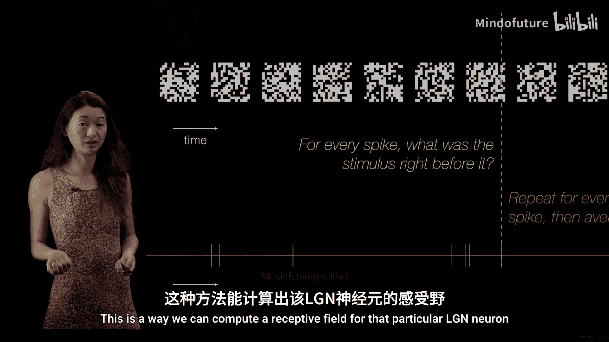

And especially in this particular case， the receptive field for that particular LgaN visual neuron not only has a spatial receptive field。

 remember we had the on and off cells in retinal ganglion cells。

 this particular neuron in the LgN actually has a spatial， temporal receptive field。

 Now what happened right before it spiked is that there was a donut of light。

 that it was dark in the middle and then surrounded by a ring of light so far so good that looks kind of like an off neuron。

 the retal ganglion like we talked about earlier， right But if you look forward in time backwards in time。

 So 12 time steps before the spike， nothing happened。 there was no correlations whatsoever。

 That's what the spatial temporal receptive field means。 But right before that donut。

 you actually see that there was an activation instead said of inhibition。

 And so it's when the sequence of movies looks like this where nothing， nothing， nothing happens。

 And then there's a spike followed by a peak and kind of a donut coming up。

 It's that spatial temporal。😊，Pattern of visual activation。

 that is kind of what kind of this particular neurons happy place。 That's what makes it happy。

 That's what makes it fire and spike。 So this is a general procedure we can use to figure out and characterize the receptive field a visual neuron by flashing at it lots and lots of different light。

 lots of different movies that are uncorrelated watching for a long time and then averaging over all the spikes we see to see what was the average stimulus to which the cell respondeds。

 This is something that works not only for visual neurons。 but for lots of other cells。

 you can do this with auditory neurons， mechanical sensorory neurons。

 is this general procedure of using random or even pseudo random stimulus and seeing what elicited a spike from that cell is a procedure for computing sometimes we call the spike trigger average and to characterizing these receptive fields。

 so that's kind of a natural a normal thing that happens。 Now。

 if there's any among you who are statisticians have taken a statistical statistics class。

 you may be thinking to yourself Why are we using。😊。

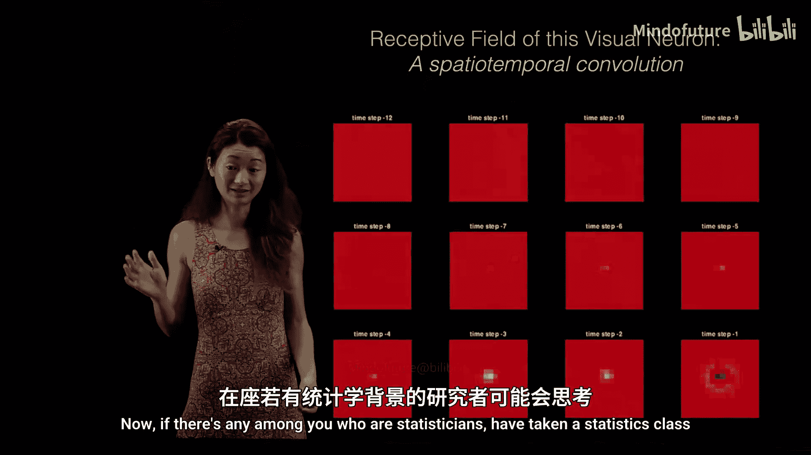

What's the point of using these random simulateimi lium， which is completely random white noise。

 okay the reason we do that is because this procedure works great as long as the stimulus input is completely uncorrelated with itself if it's random white noise。

If we were to show it stimulus that's not random white noise。

 but is correlated noise or even more difficult natural scenes。

 then there are certain statistical assumptions that we have to make correct in the computation of these convolution these receptive fields。

 there's a really vibrant active research area of different people trying to figure out different statistical corrections to do when the stimulus coming in is not uncorrelated。

 So this works， you can just do an average as long as the stimulus is uncorrelated。

 but if the stimulus is correlated with itself， then we have to do some corrections to figure out what's receptive field of the neurons had been。

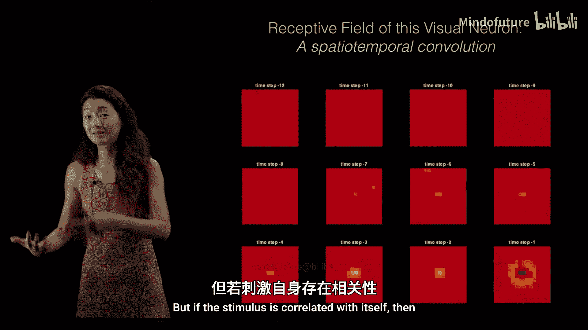

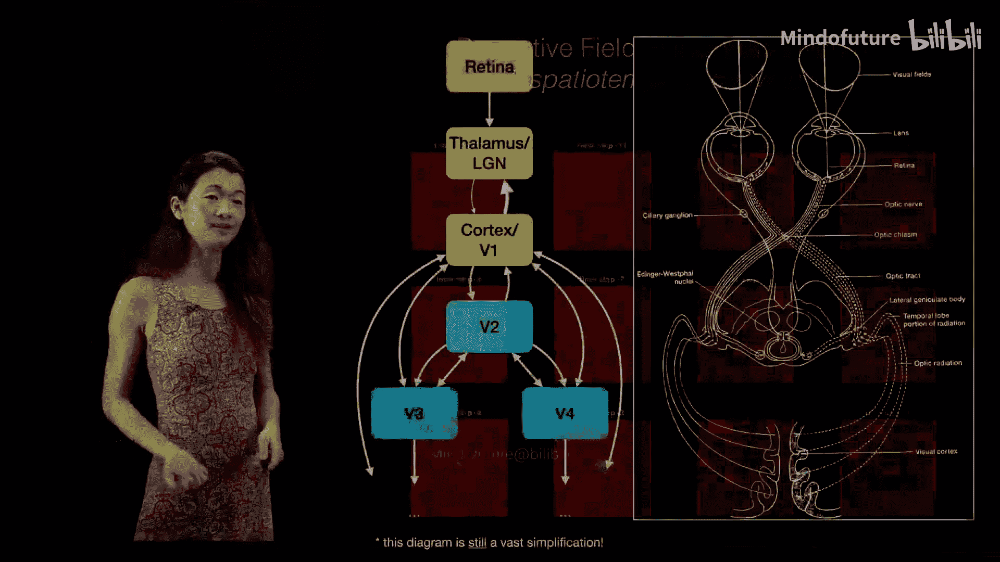

Okay so we talked about the LGN。 the next step in the process is V1 primary visual cortex。

 primary visual cortex is in the very back of your head in basically in the very back of your head kind of on the left and right side of the very midline right in the back here and it's tucked inside it's actually it's not quite on the surface for humans but as you'll see later for rats and rodents and different animals that don't have a sulci and gyri like humans do it's still in the same place is the very back but you'll be able to see it right on top because they don't have folds So this is something I showed you in the lecture on the electrocorre recordings and it is a classic result by Hubo and weasel where they characterized the receptive field of V1 neurons of neurons in the primary visual cortex So we talked about on off cells in the retinal ganglion cell in the retinal ganglion layer。

 we talked about receptive fields of cells in the LGN which are kind of similar and very similar so then you pass it on to the next。

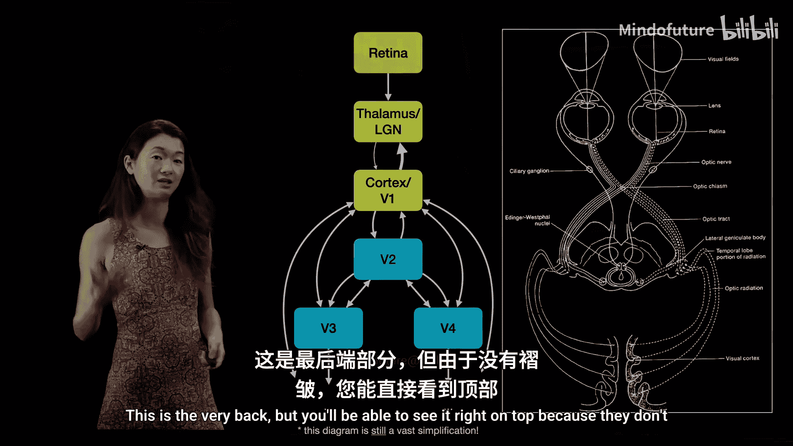

Step in the visual processing pathway reach we one。

 and we now have these cells that are direction sensitive。

 So instead of having spots of light that it's sensitive to and different ones will have like different spots one retal ganglion cell will be this is my spot right。

 a couple of neighbors over。 It's going to be sensitive to this spot of light。

 always going be I'm sensitive with this spot of light。😊，These cells。Similarly have locality。

 they'll have a part of visual space that they like。

 but instead of being responsive to spots of light， they are now direction and sensitive。

 they like things that are oriented bars， and they're moving in certain directions。

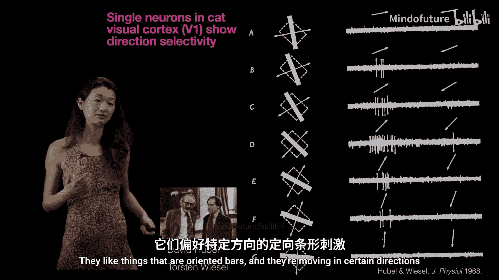

Now， this was all done using sharp electrodes， and so this is a simple kind of like circuit level diagram that's in an intuition for how that might work。

 We have these on center retinal ganglion cells that tile space。

 We have these neighboring ones where the center of the spot that they like is slightly shifted from each other Now imagine the following。

 We take a bunch of theses that have neighboring receptorive fields。 we hook them all up to LGN。

 and then we have a bunch of those LGN neurons all converge onto a single cell in V1。

What you can accomplish here is by titling the space this way。

 if you had a bar that's precisely in that orientation。

 it's going to activate all of those retinal ganglion cells and all of those LGN cells。

 and that's going to make my V1 shi。But because of the way I've wired it up。

 if my bar works the same orientation， but off a little bit， I will not be。

 I will now be inhibiting my neuron instead of activating it。 Similarlyly， if the bar were。

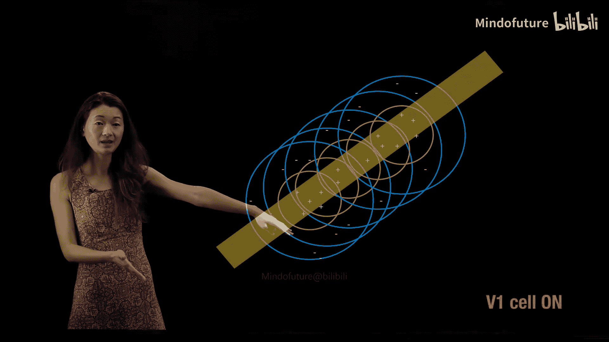

Overlappping with that region， but not at exactly the right angle， my VN cell would not be happy。

 This is going to make another VN cell very happy， just not this one。Similarly。

 if I had something that is of the wrong spatial frequency， it's not a narrow enough bar。

 it's actually activating this entire region because it's diffusely activating all of these retal ganglion cells and al GN cells。

 the V1 cell will also not be happy。 Okay， so it's very specific。

 It's specific to this particular angle。

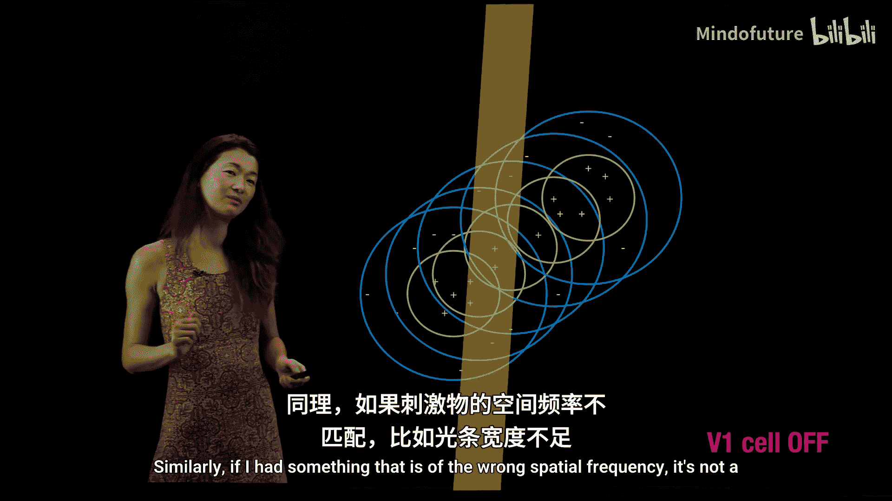

And if it's off by a little bit in space， it won't be happy and if it's off by a certain angle。

 it won't be happy， that's going to make someone else happy somewhere else because I'm going to have a different we V1 cell that's going to be adding together not these particular on receptive fields。

 but maybe like one that has a different angle so by using the array of these onreceptive fields in the retinal ganglion cells in LGN。

Depending on how I wire them together， I can accomplish the goal of getting V1 cells that are direction sensitive to different bars in different parts of space。

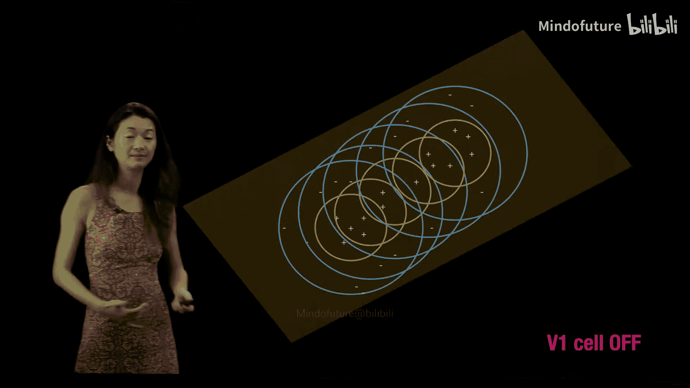

If you put that all together。You have something that essentially is a convolution filter right this here。

 the mathematical way of saying it is that this is a convolution filter in space， each of these。

Spatial receptive fields is equivalent to a convolution filter because we have a bunch of them and they're kind of a similar thing。

 you're just kind of moving them in space， okay。And when you wire them to up together in this way and add their activation into a V1 neuron。

 that's basically pooling。I'm using these terms on purpose。

 in case it makes some of you who have thought about artificial neural networks and especially convolutional neural networks。

 this is a Necognaron， a figure from the first paper to report a true modern convolution neural networks from Fukushima at colleagues publish in 1980。

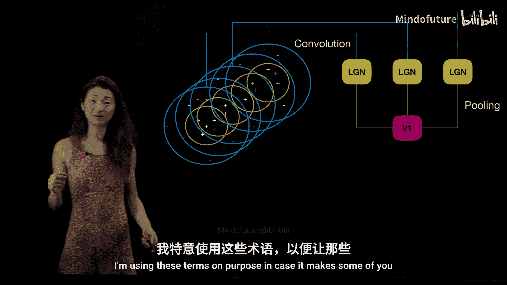

This is not an accident here。This is a convolutional neural network and the first convolutional neural network was inspired by the organization of the mammalian V1 system。

 It's in fact you can kind of even see it in this architecture here when you have a convolution followed by pooling in the first neocoron paper you can see that these layers that are stacked together S and C S and C S is actually for simple cells。

 which is this type of cell that's sensitive to oriented bar in V1 C is actually for complex cell which I haven't told you about。

 but that's the other major cell type class in V1 is a little more complicated this name indicates in simple cells but it's also something that you can make by a series of convolutions and pooling by stringing together these circuits from the visual system in this way and so Fukushima and colleagues were inspired by what we had known at the time from the neurobiology of the organization architecture circuitry of V1 to build this artificial neural network that eventually gave rise。

to the rise of artificial neural networks from 2012 or so。

 so that was the intellectual predecessor of Alex Ned and IageNeed and all of the technology that had been built on top of it is from this idea that we got from V1 to LGN to retina of the convolution followed by pooling and so on and so forth。

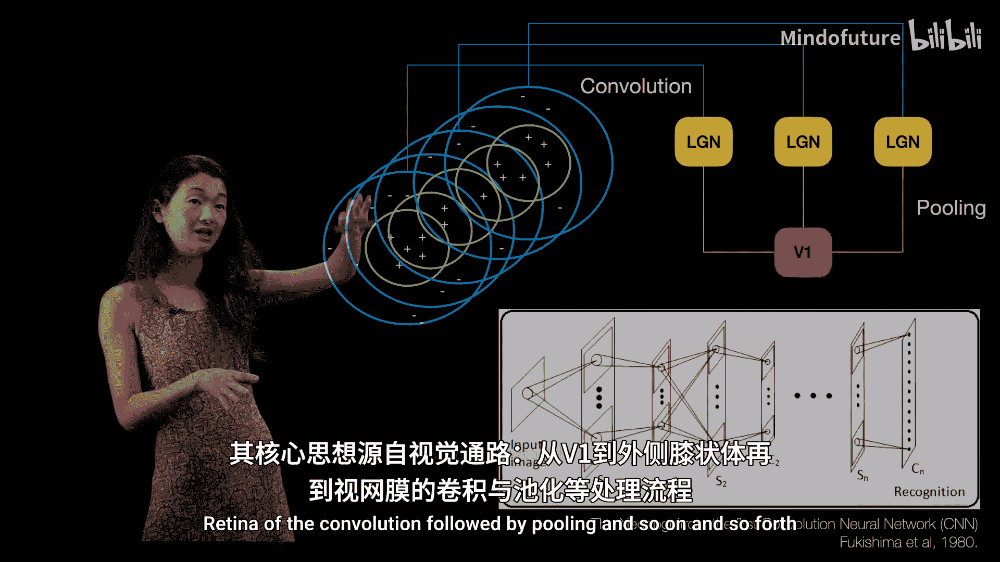

Kind of cool okay But V1 has more organization than that because it's not just about these oriented bars。

 oriented bars are actually found in another type of structure called retinotopy。

 So retinotopy is the observation that the relatively close areas in the retina also project a relatively close areas in the LGN as well as in V1 we can kind of see that here by if we divide it up the phoba into these quadrants right I told you that everything kind of crosses so left half of your visual field goes to the right half of your brain and same thing the other way around So in your phoba。

 both phovias， that these two patches of photoreceptors here will actually project to the opposite side of V1 and so three is close to4 and three is close to7。

 So they're gonna be close together So there's basically an inverted mirror image map of the visual space on your retina that's reflected in LGN and then also in V1 in the。

😊，ind of inverted way。Two concepts that I will emphasize here in preview for a couple of lectures later。

 this type of inversion is something that we see that's common across all visuals all sensory motor areas。

 So the left half of my arm is controlled by the right half of my brain in the motor cortex。

 So that inversion is something that we see a lot。 The other thing we see a lot is this mapping between the body and its representation in the brain。

 So here we're seeing a mapping between the visual scene in the retina and the visual cortex。

 Sam thing for auditory cortex。 when we have a mapping between different frequencies of tones right where the piano keys are。

 and that maps onto your auditory cortex。 There's also a mapping of different patches of tactile sensors on your skin。

 So different neighboring areas of the skin。Are innervated by these tactile sensors and they go to neighboring places on your brain as well。

 kind of in but also like in an upside down inverted way。

 like these principles are something that we see in lots and lots of sensory motor regions so the general principle where there's some kind of there's kind of there's a mapping and it's mirror image。

But it preserves the relative locality of neighboring areas。

 so neighboring areas of the leg will map neighboring areas in the brain。

 neighboring areas in your visual field or map to neighboring areas in your visual cortex。

 that's something that we have in common。

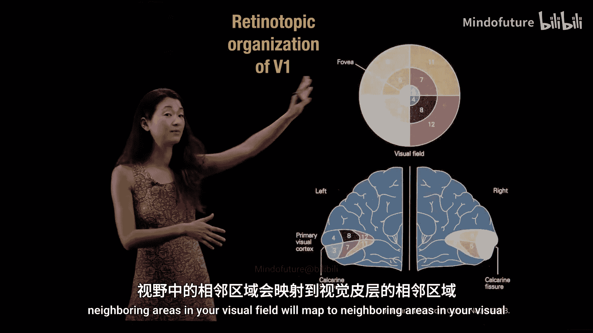

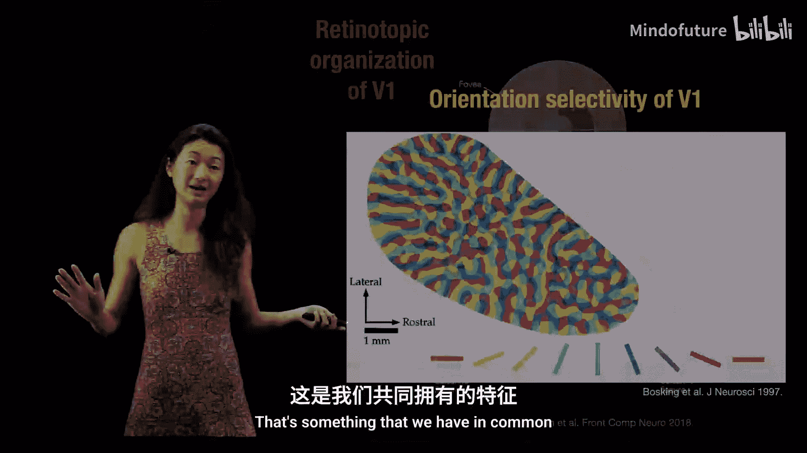

And so in addition to having neighboring areas covered adjacent places in the visual space。

 we also see what's called orientation selectivity。

 I told you that different cells in V1 are sensitive to different oriented bars so forms this beautiful pinwheel pattern where neighboring cells that cover adjacent places in space are also adjacent to each other in phase in the orientation of the bars to which they are sensitive this type of pinwel pattern is what we typically see for primates including humans。

 it is not true of all mammals even and certainly not true of lots of other animals that are not mammals and so looking at the evolutionary origins and looking at the comparative patterns of these selectivity patterns in V1 across the phylogenetic tree is another fascinating area and thinking about how it is that they arise during development。

 I mean this is something that I can probably do a lecture on later。

 but that's something I just wanted to mention even that we won't dig too much into it right now。

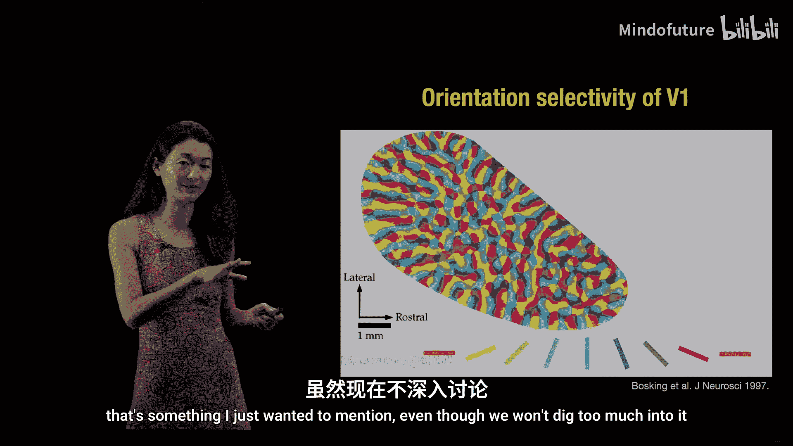

Okay so that's a lot about the organization of V1 cells。

 but I wanted to talk a little bit about why we think V1 cells aret organized this way。

 So this is a why question， which is always slightly dangerous to answer a neuroscience because I can tell you what happened I just told you what happened This is how it is organized but why is it organized this way what is it good for So there's a lot of attempts to have answered this over the years and this is a kind of a classic now classic paper by all cells in one field where they propose what's called the sparse coding hypothesis and so the idea is the following your eye is not at all。

 your visual systems is not at all like a CCD is not just an array of pixels where I tell you in an X Y grid here's how many photons so hit each part of the eye that's not at all what happens instead the image is represented in a functional basis and it's turned into a representation that is not in terms of pixels and activation of pixels but instead of which patterns are being activated that's kind of what happens in the visual system at least by the time you get to V1。

And so they made the following mathematical model and say okay let's suppose for every image Xy coordinates。

 you have let's say a square image of some kind I'm going to suppose that I can decompose this image into those superposition of a bunch of functional bases so that's fees over there and those A's are the coefficients the relative activations of all of those basis functions now so far this is rather generic so for example those basis functions may as well be Fourier modes for example it could be hat of our modes could be anything right so engineering wise we have people have written down different basis functions and it doesn't really matter which ones you use you pick one that's convenientvening for your purposes so it may as well be forier it could be principal component modes you be all kinds of different things but what they did it was that they say okay so this is the composition we want but instead of saying what those basis functions are we're actually going to learn what they are in particular we're going to try to learn what they are by making the following assumption we're going to minimize。

😊。

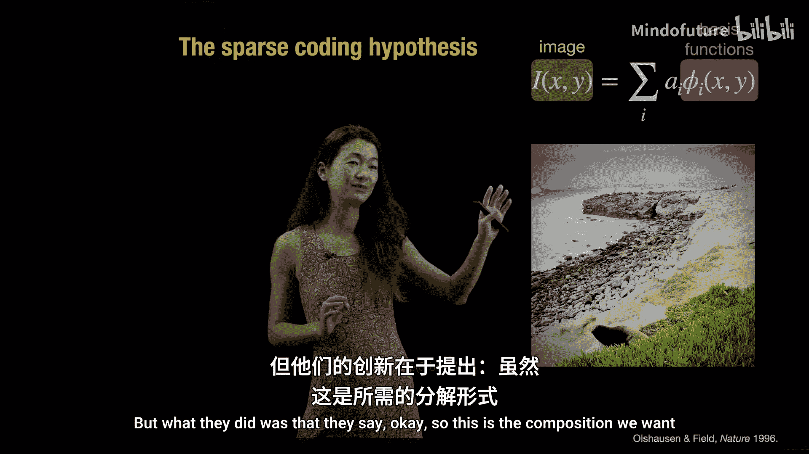

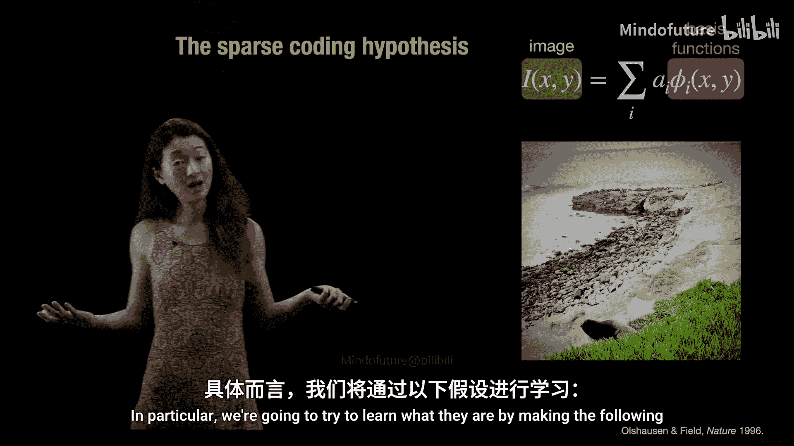

The following loss function， we're going to say that I'm going to learn a set of basis functions so that it's as sparse as possible。

 In other words， I want one that's very simple so that for any picture I possibly want to represent I want to activate as few neurons as possible。

 I don't want everyone to be active and have a saying what this picture is I want as few of those bases to be activated as possible And so to write that down here was this is just the mathematical formalism they used this is again in 1996 cells in a field。

 they minimize the following loss function。 they first had a reconstruction error。

 so of course the basis function has to be able to represent the image it can't be something that's incapable of representing images。

 and then they had the sparseity promoting terms here。

 and they tried a couple of different sparsity of promoting neuronss writing now one of them here which is some of the absolute value of all of the coefficients that went into representing the basis function and reconstructive the image So this is loss function that they had to that they were trying to minimize。

 you want a。Error， And we also want a small sparsity。 so far， so good， right， Okay， cool。

 So what's going to happen now is that I'm going to train something to do this。

 And I can either train it on random images， or I can train it on images from natural scenes。 Now。

 we talked a little bit earlier about computing receptive fields from random images and how that's a really good idea if you don't want to correct for statistical dependencies。

 Now， this is true here in this also also in a field。😊。

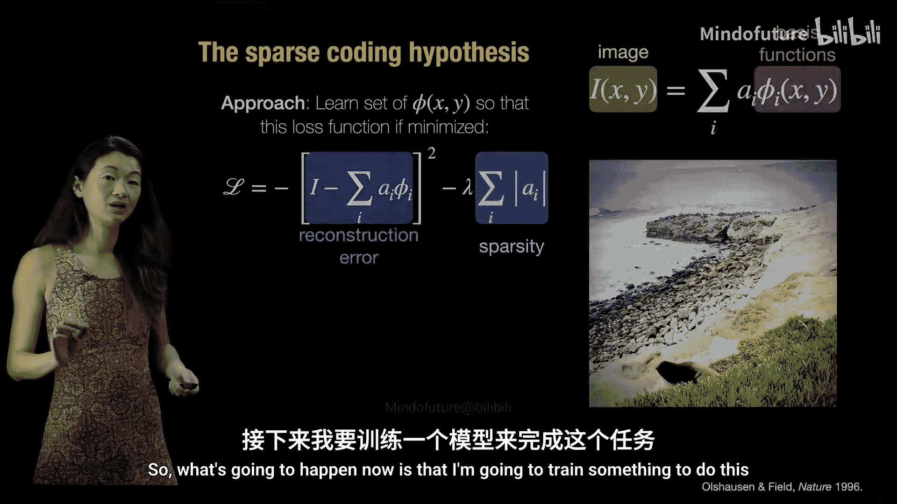

All those in them field formalism as well， so what they showed is that if you train on random images。

 the receptive fields， the basis functions you get out of it are basically just dots， okay？😊。

But in a really clever set of logic， they reasoned and then demonstrated that if you trained this loss function。

 not on random images， because we never see those images walking around the world。

 like when was the last time you saw one of those except in a man-made thing right if you walk around in the world。

 you'll see trees and animals and oceans and skies and clouds and stuff like that。

 if you use those tos of images to train a network to minimize to train a basis function to minimize this loss function。

 what you'll get。Is a set of receptive fields that look a heck of a lot like exactly what we see in visual cortex。

 These receptive fields are oriented bars that look like some kind of like gaor filters and they look a lot like what we actually see in mammalian V1 which is a really interesting insight into why they are that way right so this is a kind of a demonstration by construction that mammalian V1 may be trying to form each of these cells in the V1 is trying to form a basis that is as sparse as possible so when you're walking around in the real world and you see natural images that have natural image statistics you can represent that information in V1 using as a few activated cells in V1 as possible so kind of a cool result there's lots of follow-ups。

 but I think this sparse coding hypothesises has been one of the more influential ones not only in visual science but also in all of neuroscience as well we'll be talking about the sparse coding hypothesis in and a couple of weather sensory remote dial。

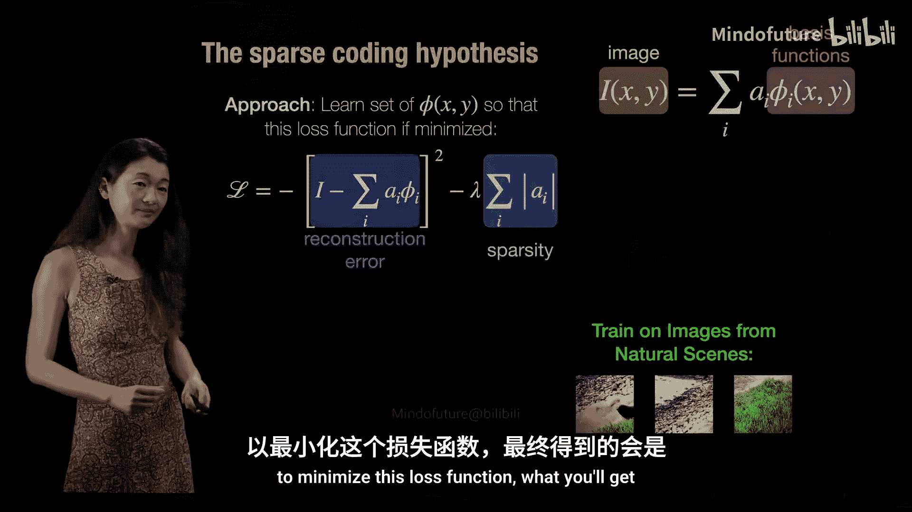

And this idea of activating as little as possible in the nervous system is again。

 a theme that you'll see because cells are expensive。

 activating and maintaining neurons is expensive， and so if you can get away with not doing as many of them as possible。

 this might be a good thing that is selected for in over evolutionary time as well。

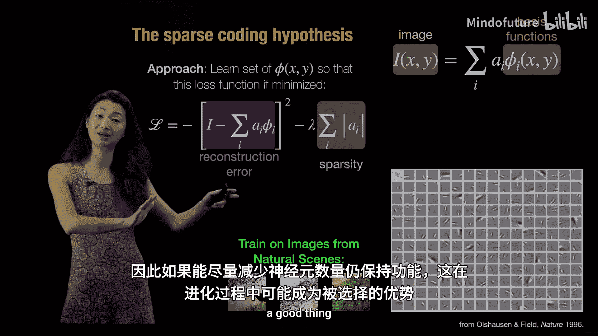

Okay so that's kind of an introduction to visual circuits where I've also pointed out a couple of common features。

 not only for visual circuits but other types of circuits that we see in neurobiology as well。

 So the key concepts are theres these circuits are made out not of identical cells。

 but often there's different cell types that are important because different cell types have different functions。

 some of them are positive， are negative and if you wire them together in just the right way you can accomplish remarkably few parts some pretty sophisticated computations we call these features receptive fields each part of the process we can summarize what's actually happening to between the external stimulus to what's are happening in that cell in terms of the receptive fields we talked about on receptive fields off receptive fields。

 these oriented bar receptive fields etc， etc。 So that's kind of a terminology that's important to remember these things are called receptive field and we can compute them Now retinal ganglion cells are the ultimate outputs from the retina。

 the rest of the brain none of the other cell types in the retina really out。putut anything at all。

 and that's why we pay so much attention to the retinal ganglion cells because if we understand what they're doing。

 how they're upting to the rest of the brain， we get an indication of at least what's coming into the rest of the brain because there's no feedback from the rest of the brain back to the retina。

And retina ganglion cells are typically summarized either on receptive fields or off receptive fields。

 depending on whether they like a spotlight in the middle or they like darkness in the middle。

 they're not really pixels at all。 And this level of processing。

 this way of drawing these little circuit diagrams and reasoning through how we can actually compute receptive fields in LGN in V1 and even higher visual areas is something we can continue doing and the general trend is that as you go farther and farther in the visual processing pathway。

 more and more complex receptive fields emerge So at higher visual areas you'll start getting things like motion also sensitive to motion there are things that are sensitive to faces farther on of course you have bars and then you have movement and then you have circles and then you have faces so on and so forth。

 And so more and more complex receptive fields are emerging from simple parts because after all。

 if you want to be sensitive to of face， you might want to have a triangle detector for the triangle between the eyes and the nose in the mouth for example。

 you might want circle detectors for eye。So by looking at receptive fields and building them up in levels of complexity and wireir them up in clever ways。

 you can kind of get an intuition for how we can build up these more complicated visual areas so that we can actually see things that ares not just dots and lines。

 you can build up more complicated things like faces。😊。

