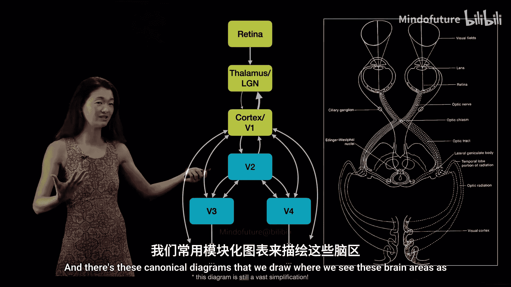
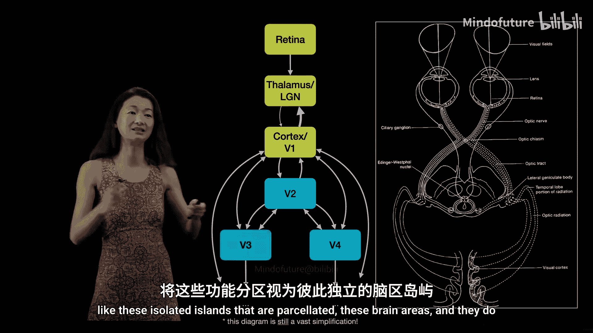
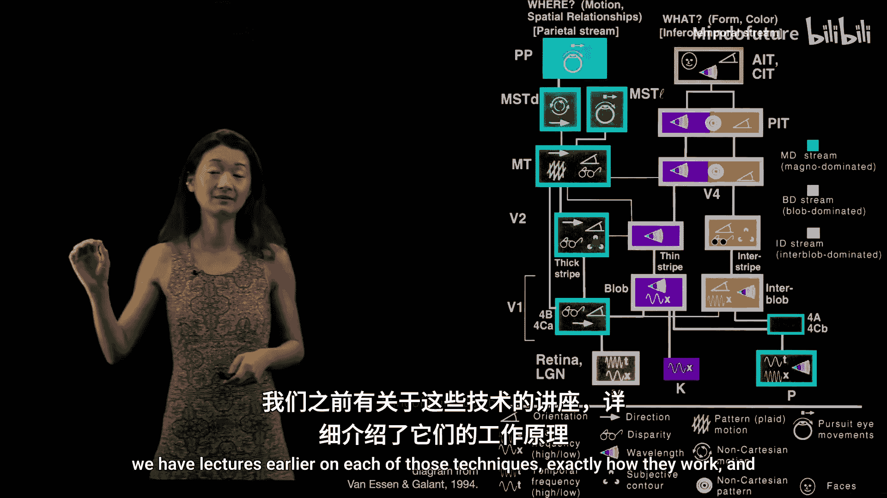
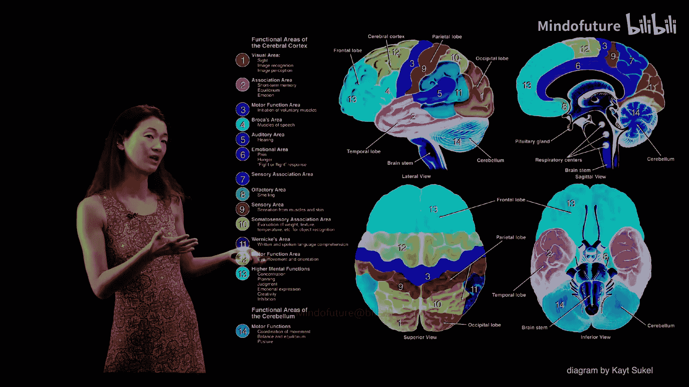
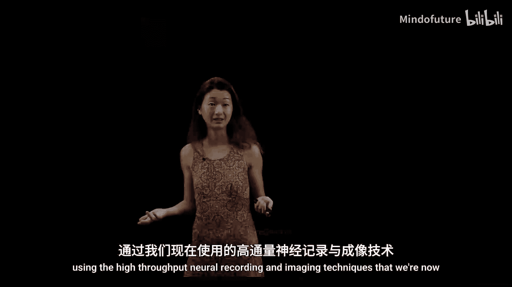
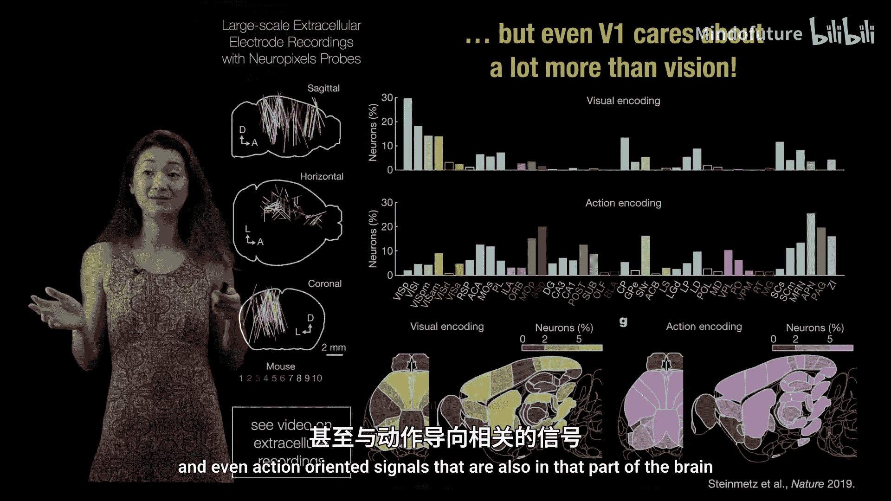
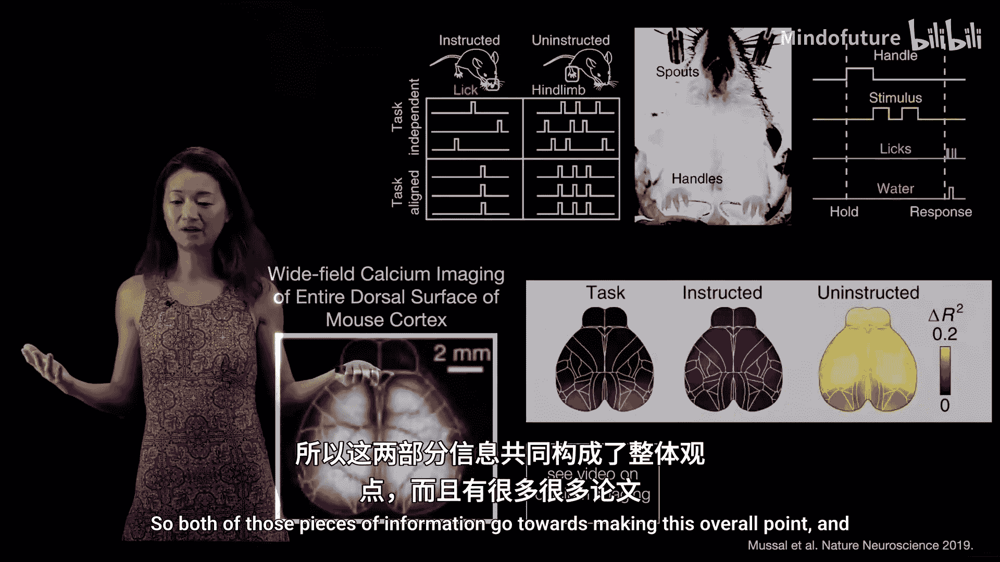

# 【华盛顿大学】神经科学入门 ｜ Introduction To Neuroscience ｜ Bing Wen Brunton p20 P20_为何万物遍布(大脑各处) -BV1i3qWBXEDH_p20-

Before we leave the visual system series of this lecture series on introductiontro to neuroscience。

 I wanted to use the visual system as a way of conveying a much larger concept that's only now emerging in neuroscience and I've really seen it talked about almost everywhere now over the last couple of years I just wanted to share that with you so in the previous couple of lectures we talked about visual processing and these very canonical circuits where we go from the primary since areas like the retina to some kind of sabic areas like LG and the visual sense and then it goes to the cortical areas like V1 it goes to V2 V3 etca。

 etc ce etc。 and there's these canonical diagrams that we draw we see these brain areas as blocks like these isolated islands that are parceated and these brain areas and they do things like they are vision areas and auditory areas and so on and so forth So in the visual areas people have over the years drawn these lovely diagrams of the different visual areas and what they do so for example here's kind of a really nice summary of one from 1994。

by David Man Esen and Jack Galant where they parscelllate out there's these retina LGN layers at the very bottom。

 they detect things like like different spots of light they go to V1 that starts detecting things like different oriented bars and then we haven't talked about it yet in this video series but if you go to these higher order visual areas you'll start seeing selectivity for fancy and fesier。

 larger and larger scale things that are not localizing spaces much and more things that are kind of more general like face no matter where the face is in the picture so people have drawn these pictures a lot and using different experimental techniques。

 including single cell recordings and different types of functional magnetic resonance imaging。

 fMRI so theyll have lectures earlier on each of those techniques exactly how they work and if you use those techniques you'll often see if you look up just like how does your brain work you'll often see it diagram like this one you。

These very nicely delineated pieces of your brain with labels of names and also what they do。 Okay。

 so like there's these colorful areas and a little summary of this is the part that's associated with higher origin of decision making because your frontal cortex。

 That's where decisions are actually being made。 Now， the reality is that。

It's becoming very clear in the last couple of years。

 especially using the high throughput neural recording and imaging techniques that we're now using that that story is at most very incomplete So it's just going to show you a couple of examples of what I mean by it really incomplete in this paper next time it's and colleagues decided to put a bunch of neural pixels probes into a series of mice brains and so if you want to know more about these neural pixels probes。

 they're super duper cool。 they're like basically currently the highest density probes we can put into the brain。

 they have thousands of sites So instead of recording from single neurons we can record from thousands of10fts。

 thousands of sites at the same time and see lots and lots of simultaneous activity from lots of different brain areas。

 lots of different parts of the brain circuit So there's a video on extracellular recording techniques if you want to review what those are like and why they're so awesome。

 So one of the things that they did here is to use these probes to look not only at single。😊。

Cell in V1 but lots and lots of cells in V1 and lots of lots of cells not only in visual areas。

 but every other brain area as well。 And what they found is that even in V1。

 even in what we consider to the canonical first stop in the visual processing pathway。 Yes。

 there's representation of vision。 what's actually being seen。

 but there's actually cells there that are representing and processing and reflecting other things including action。

 so it's not like there's this strict parcelation between vision and action and decision making in the way that some of these diagrams will lead you to believe。

 Here's a direct evidence that even in V1 what consider to be the pure primary sensory areas for vision there's lots of other sensory things and even action oriented signals that are also in that part of the brain。

 So it's not so simple。 Here's another another piece of evidence along the same lines here。

 Muel and colleagues decided to do a similar。

Experiment but instead of doing high throughput neuropixels probes。

 we actually did that as well in this paper， but this is a wide field calcium imaging of the entire dorsal surface of a mouse cortex now the mouse cortex。

 unlike the human cortex is actually a flat sheet which is maybe poor for them but really good for us because we can image all of at the same time because it doesn't have gyrations So here what they did is kind of like a classic classic experiment that we might do in a behavior experiment for a mouse where they are looking in response to some stimulus and here they tested visual stimulus as well as auditory stimulus Now the classic way of analyzing data set is that you look for signatures of representations of either the visual stimulus with the auditory stimulus and whatever brain area you happen to manage to have gotten a couple of probes into Now the beautiful thing here is that instead of having to choose which brain area to monitor using calcium imaging they can actually do wide field imaging that monitors the entire cortical surface of the brain so now we're not really biased to looking at single or even。

A few different brain areas。 we can look at all of it in cortex。 Furthermoremore。

 we're not biased towards cells that we can actually spikes were from we can just see kind of bulk average activity from all of them Now because they're not restricted it only analyzing responses in response to what they know they gave the mouse they were able to track not only what the mouse got as input。

 they also tracked lots of video features basically had a high speed video of the mouse's face so how it was twitching its whiskers they tracked its hind limbs to see what it was doing with its back pause when it was supposed to be doing this vision and auditory task and what they found you're either surprised or not surprised depending on what you thought about animal behavior before you read this paper do remember reading this paper for the first time yes I knew it and what they found was that the parts of the brain that represented the task the thing that we as experimenters told the mouse to do flashing lights。

 sounds， etca etc ce。 was actually a very small part。what the brain was actually doing。

 what it was largely doing is uninstructed things like I'm sitting here I'm like playing my little mouse video again and I'm going scratch my hind limbs of my left paw I'm gonna scratch scratch or oh I smelled something because somebody walked into the room where somebody didn't clean this room same way today as they did yesterday and so I'm gonna That's more interesting than the sounds and the flashes of light my experimenter is presenting to me Now I know I'm anthromorphizing a lot。

 but that's sort of the interpretation here like this brain is doing so much more than just representing receptive fields for vision and for audition in the way that we can easily control as an experimenter So both of those pieces information go towards making this overall point theres lots and lots of papers。

 especially recently making a similar point that the brain is not nearly as neatly parceated as our diagrams show you see all these diagrams。

 this is auditory cortex。 This is parietal cortex。😊。

This is prefrontal cortex and we can draw these lines as if they were real things it's as if we were planting tulips and skys like purple tulips go over here and pink tulips go over here and you will not cross this line because I put you there that is not at all how the brain works the brain is a lot messier than that because there's a lot of feedback because all of these brain areas actually talk to each other in ways that we are just only beginning to understand we also don't quite understand why this is happening why is it that the brain is not nearly as parceated as our diagrams what is the point of having everything be everywhere well it's becoming clear that it is increasingly true that everything is everywhere but what we don't know is quite why so I just wanted to tell you that because and share a couple of kind of new emerging areas and I think this is a really interesting point to make in part because it really showcases the way that our understanding of brains。

😊，Follows to some extent are development technology。

 So those two new papers that I highlighted these relatively new results coming out that was only recently possible because of technological advances in the ways that we can measure and record and also eventually manipulate neural activity and so this view that everything is in fact everywhere and kind of all at once we know it now to be true in a way it is more nuance than we knew before。

 What we're trying to work on now is why why does this happen。

 What is it good for I have no answers to these questions but I'm very interested in the answers and so hopefully this is something that a lot of people will be working on and we'll have more nuanced answers in the future。

