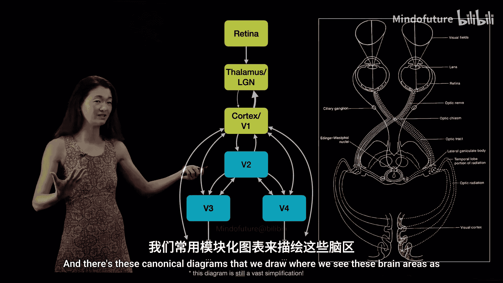
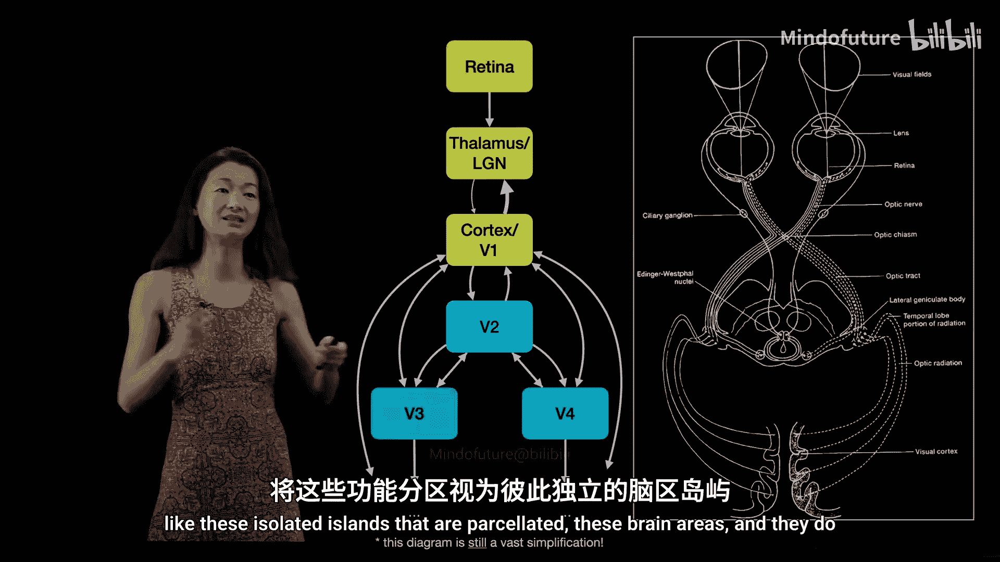
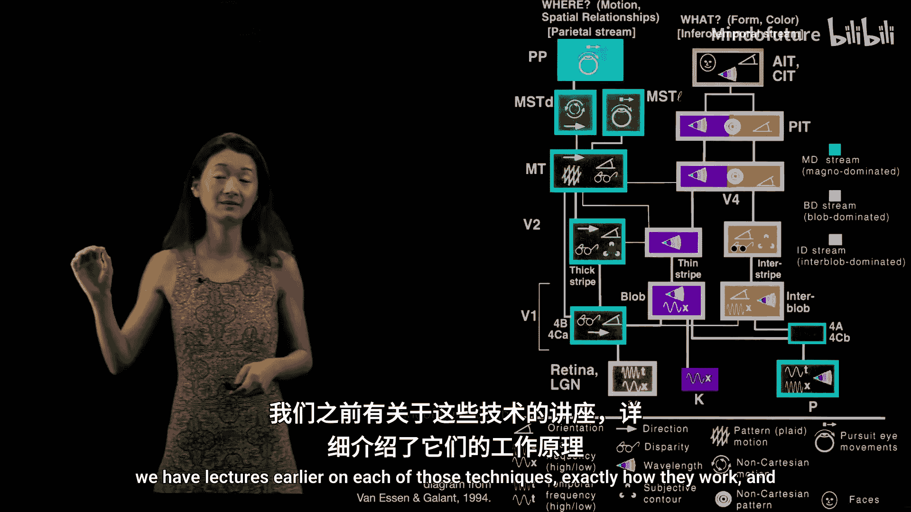
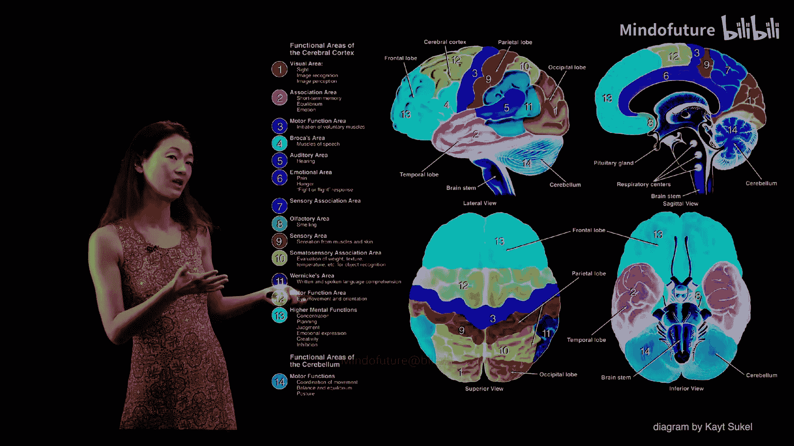
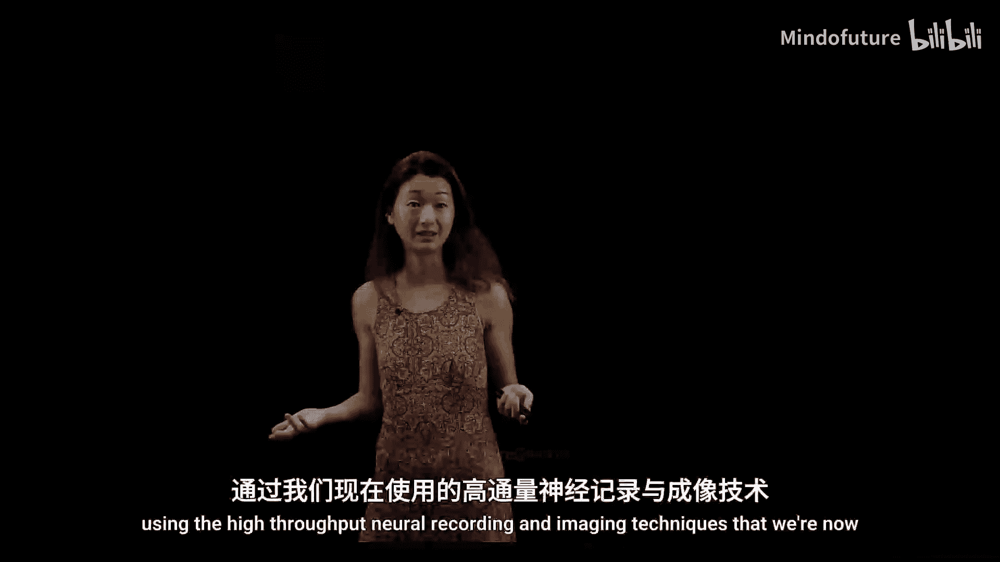
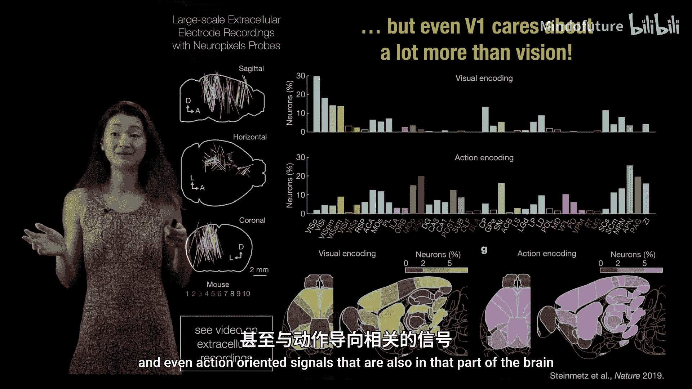
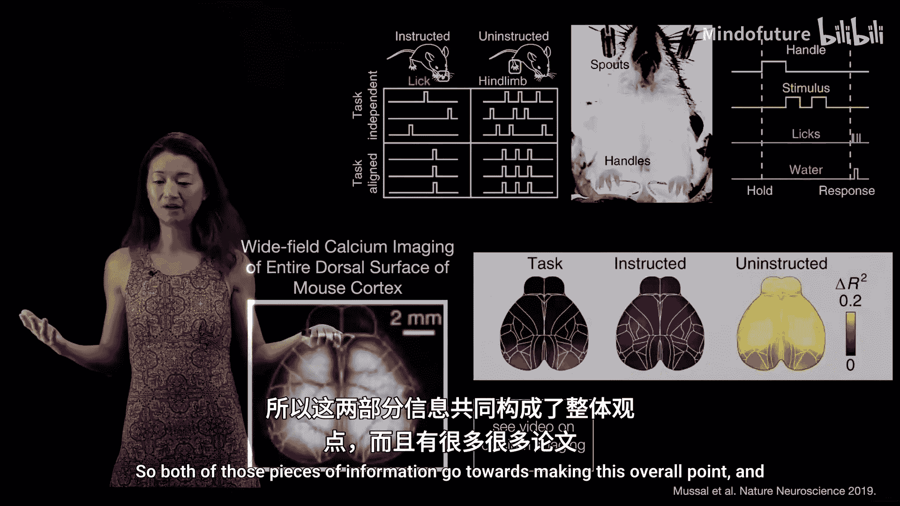

# 神经科学入门：P20：为何万物遍布（大脑各处） 🧠

在本节课中，我们将探讨一个神经科学领域正在兴起的重要概念：大脑功能并非像传统教科书图表那样严格分区。我们将以视觉系统为例，说明即使在初级感觉皮层，也存在多种类型的信息处理。本节将结合最新的高密度神经记录技术的研究发现，揭示大脑功能的“万物遍布”特性。

在之前的几讲中，我们讨论了视觉处理，以及从视网膜到外侧膝状体，再到初级视觉皮层V1，并最终到更高级视觉皮层V2、V3等的经典通路。我们通常将这些大脑区域描绘成独立的模块或岛屿，每个区域负责特定功能，例如视觉区、听觉区等。

多年来，研究人员绘制了许多精美的图表来展示不同视觉区域的功能。例如，下图是David Van Essen和Jack Gallant在1994年提出的一个经典总结。

图表底部是视网膜和外侧膝状体层，它们检测光点。信息传递到V1，开始检测不同朝向的条形。虽然本系列视频尚未深入讨论，但如果继续研究更高级的视觉区域，会发现神经元开始选择性地响应更复杂、更全局的特征，例如面孔，而不论面孔在图像中的位置。

人们利用多种实验技术绘制了这些图表，包括单细胞记录和不同类型的功能性磁共振成像。如果你查阅大脑工作原理的资料，经常会看到类似下图的描绘。

这些图表将大脑划分为色彩鲜明的区域，并标注名称和功能。例如，额叶皮层通常与高级决策功能相关联。

然而，现实情况是，尤其是近年来使用高通量神经记录和成像技术后，我们越来越清楚地认识到，上述故事至多是非常不完整的。接下来，我将展示几个例子来说明这种不完整性。

在Steinmetz等人2019年的研究中，他们将多个Neuropixels探针植入小鼠大脑的不同区域。如果你想了解更多关于Neuropixels探针的信息，它们非常酷，是目前我们能植入大脑的最高密度探针，拥有数千个记录位点。这意味着我们可以同时从数千个位点记录，观察大脑多个不同区域和电路部分的大量同步活动。本系列有关于细胞外记录技术的视频，可供回顾其原理和优势。

他们利用这些探针不仅观察了V1区的单个细胞，还观察了V1区的大量细胞，以及视觉区以外其他脑区的大量细胞。研究发现，即使在视觉处理通路的经典第一站——V1区，虽然确实存在对视觉刺激的表征，但实际上也存在处理和反映其他信息的细胞，包括与动作相关的信号。这表明，视觉、动作和决策之间并非像某些图表所引导我们认为的那样严格分区。这是直接证据，证明即使在被认为是纯粹的初级视觉感觉区V1，也存在大量其他感觉信息甚至动作导向的信号。所以，情况并非那么简单。

另一项研究提供了沿相同思路的证据。Musall等人2019年进行了一项类似实验，他们同样使用了Neuropixels探针，但在这篇论文中，主要采用了宽场钙成像技术来观察小鼠整个背侧皮层表面。与人类大脑不同，小鼠皮层是一个平坦的薄片，这虽然对小鼠可能不利，但对我们非常有利，因为它没有沟回，我们可以同时成像整个皮层。

他们进行了一个经典的小鼠行为实验，测试小鼠对视觉和听觉刺激的反应。传统的数据分析方法是，在恰好植入探针的脑区寻找视觉或听觉刺激表征的签名。而这项研究的妙处在于，利用宽场钙成像，他们可以无偏地监测整个大脑皮层表面，而不仅限于单个或少数几个脑区。此外，他们也不局限于记录可产生动作电位的细胞，而是可以观察所有细胞的整体平均活动。

由于他们不局限于分析已知刺激的反应，还能追踪大量视频特征（例如通过高速摄像机记录小鼠面部、胡须抽动、后肢动作等），他们发现，大脑中表征实验者指定任务（闪烁的光、声音等）的部分实际上非常小。大脑主要在进行大量非指令性活动，例如抓挠后肢、因环境气味变化而产生的反应等。这些自发活动比实验者呈现的声音和闪光刺激占据了大脑更多的处理资源。当然，这里进行了很多拟人化解读，但核心观点是：大脑所做的远不止以我们实验者易于控制的方式表征视觉和听觉的感受野。

以上两项研究都指向一个总体观点：大脑远不像我们的图表所显示的那样整齐划分。近年来，尤其是最近，有大量论文提出了类似观点。我们看到的所有图表都标明这是听觉皮层、那是顶叶皮层、那是前额叶皮层，我们画线仿佛它们是真实存在的界限，就像种植郁金香时规定紫色郁金香种在这里，粉色郁金香种在那里，并且不能越界。但这完全不是大脑的工作方式。

大脑比那混乱得多，因为存在大量的反馈连接，所有这些脑区都以我们才刚刚开始理解的方式相互交流。我们也不完全理解为什么会这样：为什么大脑不像我们的图表那样分区？让“万物遍布”有什么意义？越来越清楚的是，“万物遍布”很可能是事实，但我们还不知道确切的原因。

我之所以分享这些，是因为这代表了神经科学中一个新兴的领域。这部分内容之所以有趣，是因为它真正展示了我们对大脑的理解在某种程度上是跟随技术发展而演进的。我重点提到的这两篇新论文及其相对新颖的发现，只有在神经活动测量、记录乃至操控技术取得进步后才成为可能。

现在我们知道，“万物遍布”以及“一切同时发生”的观点在更细微的层面上是真实的，这比我们过去的认知更为复杂。我们现在努力研究的是：为什么会发生这种情况？这有什么好处？我目前没有这些问题的答案，但我对答案非常感兴趣。希望未来会有许多人致力于此，我们将得到更细致的解答。

本节课中，我们一起学习了大脑功能“万物遍布”的新兴概念。我们回顾了传统的严格分区模型，并通过两项利用高通量神经记录技术（Neuropixels探针和宽场钙成像）的最新研究，看到了即使在初级视觉皮层V1，也存在多种非视觉信息的表征，并且大脑大量活动用于处理实验指令之外的自发行为。这揭示了大脑各区域通过密集的反馈连接高度整合，其功能划分远比教科书图表复杂和模糊。理解这一概念有助于我们认识到，对大脑的探索随着技术进步而不断深入，而“为何万物遍布”正是当前神经科学面临的前沿问题之一。