# 【华盛顿大学】神经科学入门 ｜ Introduction To Neuroscience ｜ Bing Wen Brunton p21 P21_化学感觉_味觉与嗅觉 -BV1i3qWBXEDH_p21-

The next step on our adventure together is taste and smell。

 We're gonna follow our nose and talk next step about the chemical senses。 Now。

 this set of lectures is really fun， not only because I really like foods I really like talking about it。

 but also because an animal's ability to detect the chemical environment around us is something that is an ubiquitous and evolutionarily important behavior。

 For example， if you are a fish in the ocean， you might want to be looking at the odors that you can detect in water around you to find out which stream you spawn from and where you're going go back to order to lay your own eggs or if you might be an insect flowing around in the olfactory environment。

 looking for pieces of rotten fruit on which you might eat and feast and lay the next set of eggs that you are going to lay as humans。

 this idea of following our nose is and figuring out where the next meal is going to be is something that's not strange to most of us if we smell something good you might want to go over there saying oh what's cooking over there that's what I want to eat next So our chemical senses are usually broken down into gustatory senses for taste and。

😊，Senss for smell。 There's a couple of differences I'm going to point out here。

 although these are not exactly completely distinct rules。

 the gustatory receptors tend to detect water soluble molecules。

 we think of them as being five different types for sweet， salty， bitter sour and ami。

 Uami is our sense of savory。 There's not a more distinct word for it in English。

 and so the ami was a word that we had borrowed in English from Japanese to indicate savouriness。

 Foods that tend to be rich in proteins have a lot of ami for olfactory receptors。

 tend to detect volatile airborne molecules that are floating around in the air。

 So if you are a waterborne animal， this would be something that is a volatile molecule that's floating around in the ocean。

 Now there are too many of these olfactory receptors to name。 humans have hundreds of them。

 There are other mammals that have thousands of them。 So that's really complicated set of receptors。

 and we'll get to that in the second lecture in the series。

 So gustatory receptors and olfactory receptors are distinct。

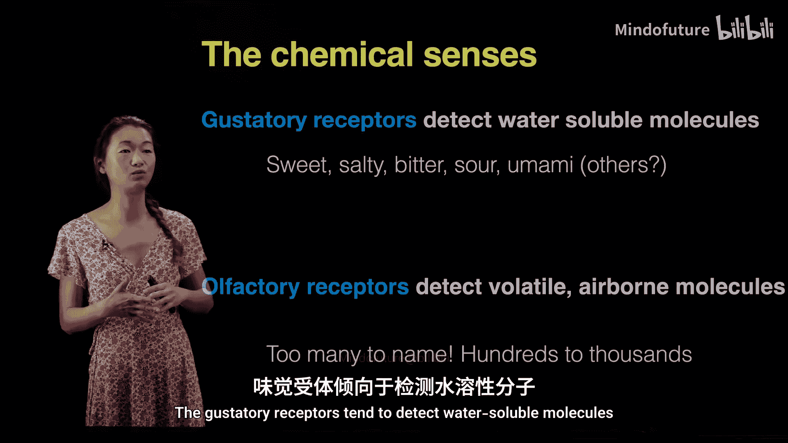

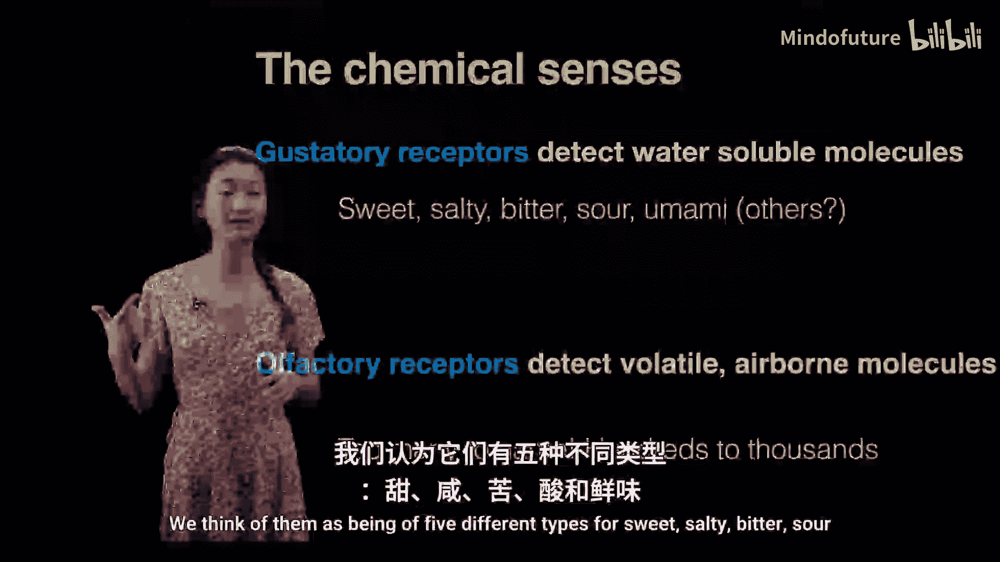

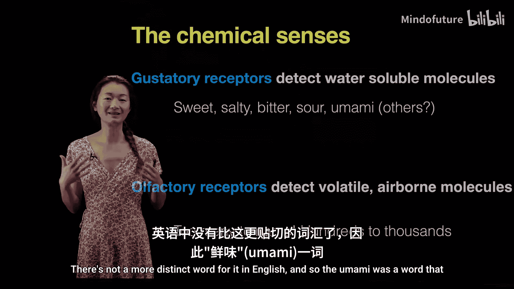

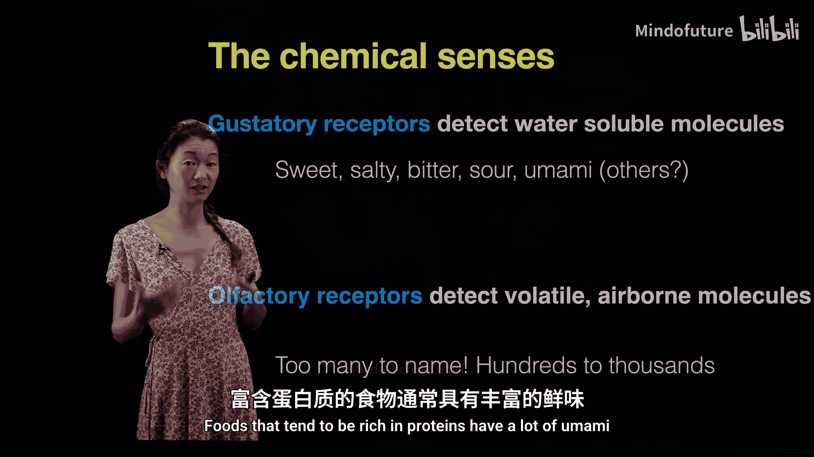

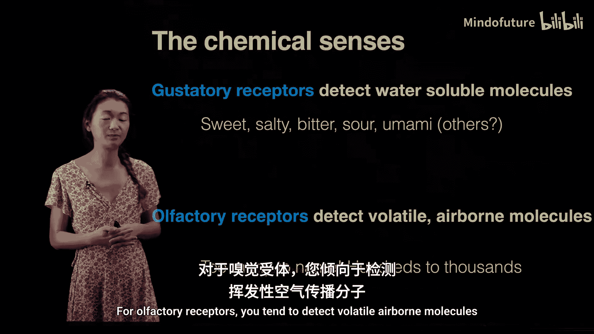

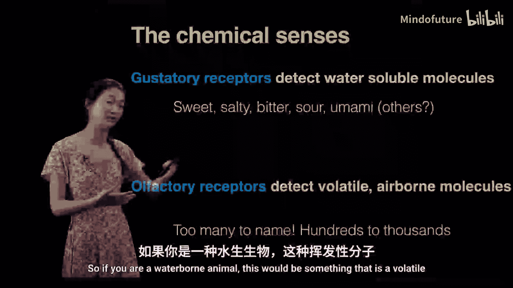

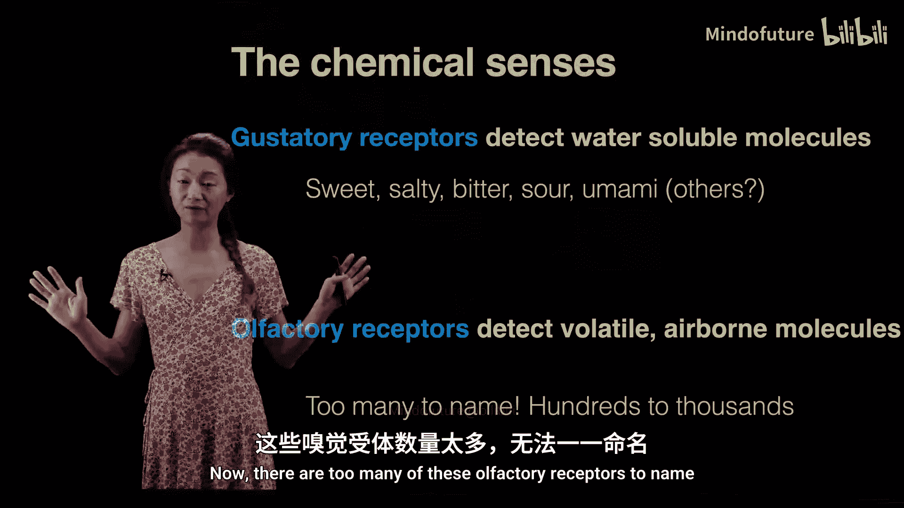

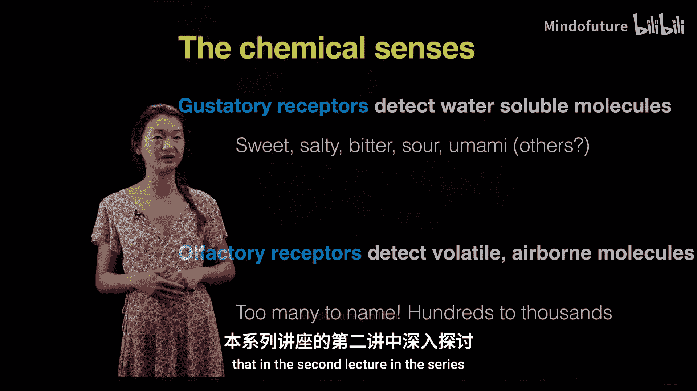

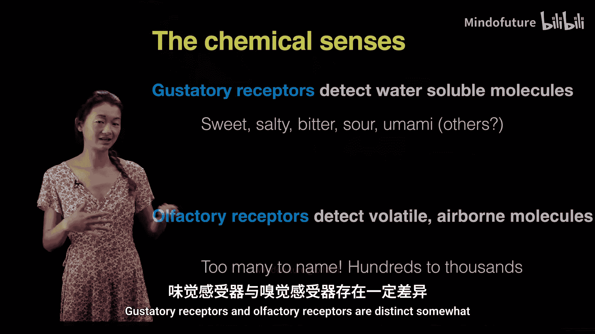

Somewhat， but they're also closely associated with each other as anatomical structures。 For example。

 both of them are in this facial area that it's in your nose， slash mouth。

 the tongue has a lot of the gustatory receptors it goes up to the palate and the nasal cavity where you inhale air through your nose is where a lot of the olfactory receptors live as well。

 but there is a opening passage in the back of your mouth that goes up to your nose。

 and so these two senses， the gustatory senses and the olfactory senses are not really separate。

 they're not separateable either in lots of different animals and some examples that we'll see a little bit later。

 to make that point we're going to start this lecture with a demo。

 So I encourage you to follow along and do this yourself。

 So I'm I'm going to tell you what to do I'm going to do it and then I hope that you find a piece of candy and you can do it yourself。

 So the point we're trying to make here is that when you ever you think of something you say this word the taste of lemon the taste of something。

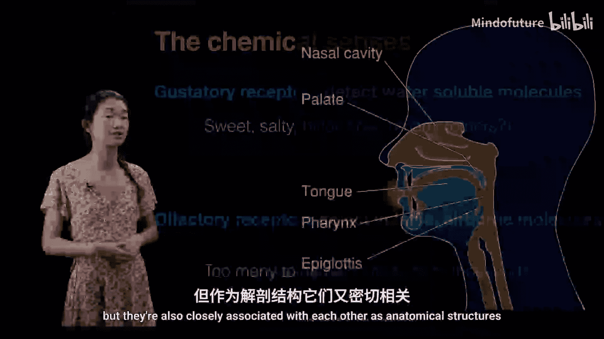

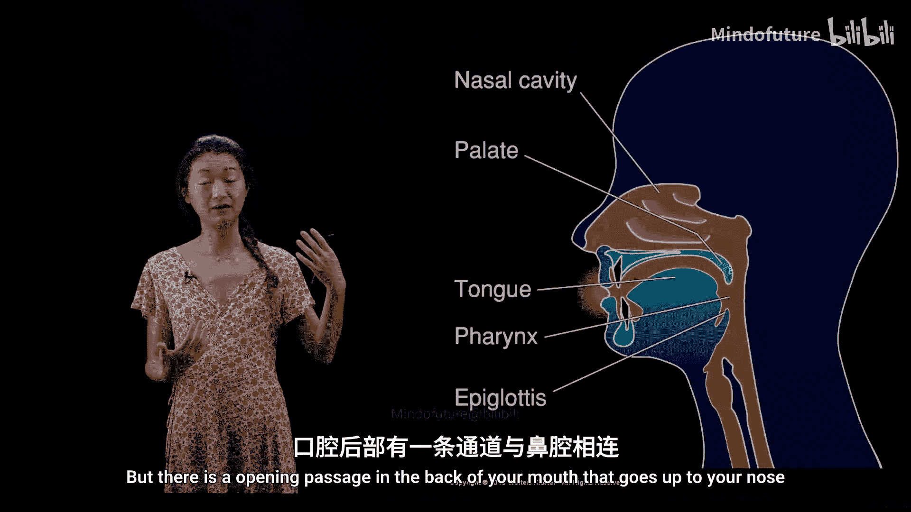

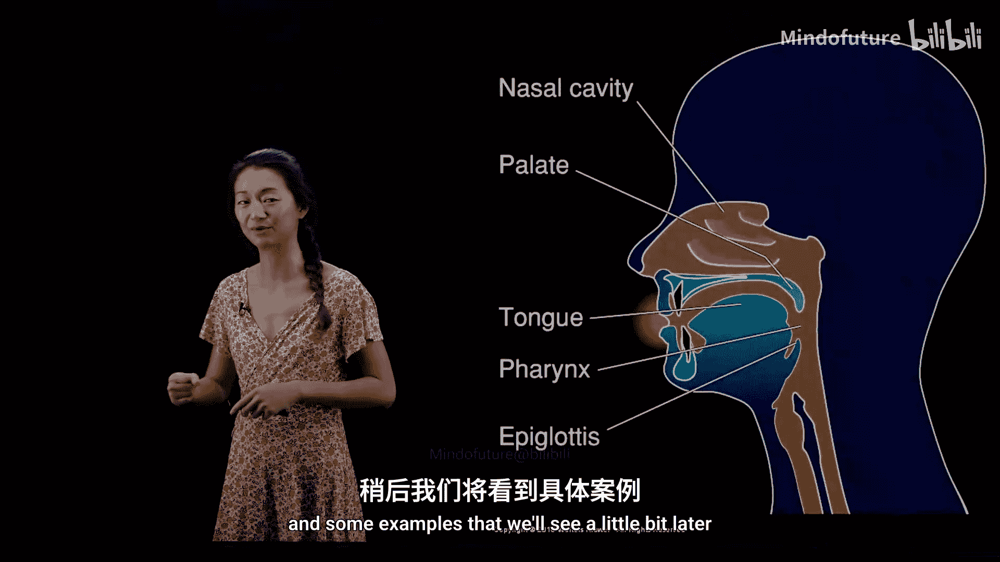

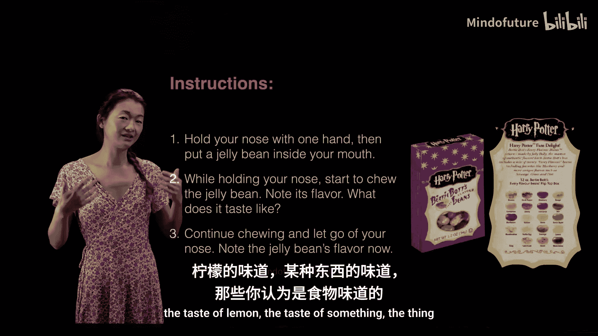

That you think of as the taste of food is very often not actually its taste it's its taste plus its smell to make that point really distinct what I want to do is find a jelly bean of some kind okay so I don't actually have a jelly bean right now but I do have a piece of violet flavor candy and so what you're going to do is you're going to take your jelly bean or your candy and you're going to hold your nose closed preventing air from going in and out of your nose so it's preventing your sense of smell from being activated and you're going to put the candy your mouth and chew on it and note what it tastes like okay。

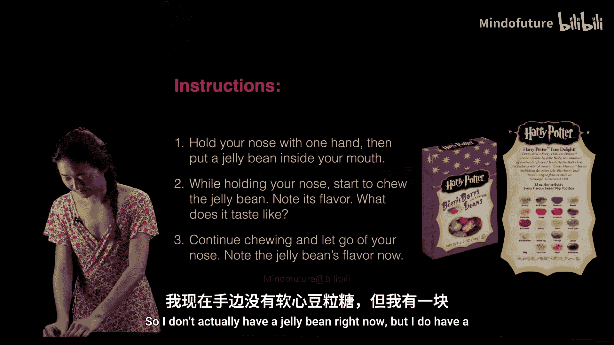

What it should taste like is it should taste like sugar because it's a piece of candy now as you continue chewing on it。

 you're going to let go of your nose and note the changes in the flavor makes sense All right I'm going to do this with the violet candy and you can do your own demo for yourself at home I'm going to hold my nose I'm going to put the candy in my mouth。

Okay。I know it probably sound weird。It tastes like sugar。I going to let， oh， I knows。

And as soon as you got a whiff of it， it suddenly floods my naal cay and it tastes like violet candy。

 God， that's what you should be noting。Depending on what jelly bean that you are choosing， man。

I've done this a lot。And it still surprises me how well it works every time Now I will note to you that citrus jelly beans work really well Now I have a violet candy that works really well there are a couple of flavors of jelly beans for which this demo does not work well for example cinnamon does not work well if you get a spicy jelly bean this also doesn't work well why that is you have to hold on for the rest of the lecture and also integrate the knowledge between this lecture and the somematoisonization lecture I'm going to end this video here and then get right into the guscitro receptors and the olfactory receptors for the next two videos but we're going to pause here so that you have a chance to do this demo for yourself。

😊。

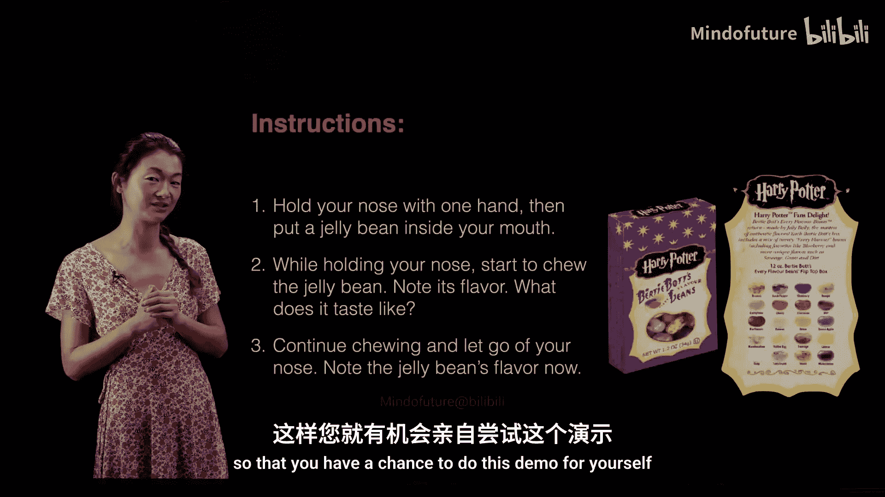