# 【华盛顿大学】神经科学入门 ｜ Introduction To Neuroscience ｜ Bing Wen Brunton p22 P22_味觉感受_味觉受体的神经生物学 -BV1i3qWBXEDH_p22-

This lecture is all about taste we're going to start at the beginning with your primary sensory neurons in the gustatory system and talk about how it detects different tastes。

 chemical senses and how that information gets passed on to the rest of your nervous system so starting at the beginning let's talk about taste receptor so they are as you may expect located in your tongue so if you zoom into your tongue and look at it under microscope you'll notice that it has all of these little bumpy structures if you zoom into the bumpy structures you'll see individual taste buds and inside each taste bud is a bundle of cells that contains all your taste receptor cells TCs the middle of your taste bud has a hole through which the taste po allows chemicals that are dissolved in the chemical environment like whatever youre eating or drinking at the time to pass into and have access to the TRCs and these taste receptor cells will then detect whatever chemicals they will detect and pass that information on through the gustatory nerves that goes through your tongue and projects towards the rest of your nervous system。

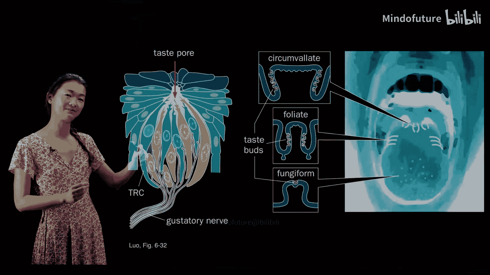

So let's talk about these taste receptor cells and zoom in for a little bit more these taste receptor cells are super cool and this architecture you're seeing here should not be a surprise to you because in terms of the organization these local primary sensory neurons that then project to some kind of ganglion cells that project the rest of the solar system is exactly what we saw in the retinal system too it's a little less complicated because there's fewer layers of cells in between it basically just goes between the primary sensory neurons and the ganglions in the case of the retina we have the photorecepts a bunch of different bipolar cells and amicrine cells and horizontal cells and then they get passed onto the retinal ganglion cells and so the computation that goes on in the retina is substantially more sophisticated and complicated than what's going on here in the taste system but it's sort of a similar idea it a little bit simpler in this way so we have our primary taste receptor cells and the taste receptor cells don't actually have any axons themselves they detect taste like sugar for example or bitterness or whatever it is we'll talk about exactly how。

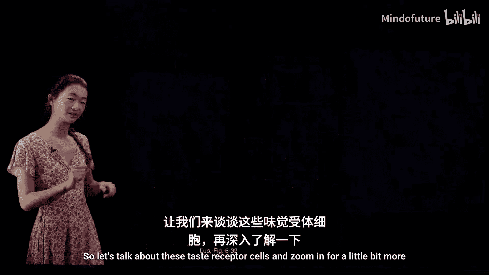

That works later in the molecular basis of it， but regardless of whatever they detect。

 they're going to then activate by releasing neurotransmitters at that base to activate the gustatory ganglion neurons and these ganglion neurons just like retinal ganglion neurons are the only ones that project the rest of the nervous system so nothing about the primary taste receptors themselves or is ever actually passed on the nervous system it's only through activation of the ganglion cells in the gusttro system are they passing information on the rest of your nervous system funny fact about these taste receptor cells we know ATP everywhere as biologists we know ATP well because it is the primary way in which the cell uses energy and passes that around and uses to power a lot of the cellular machinery in our dev and various different cell types in this particular case taste receptor cells actually use ATP as a neurotransmitter kind of a funky neurotransmitters to be using at this moment but if you think about how well this is a preview but your ami taste receptors are actually activated by glutamate as a ligand。

So when you have glutamate in the environment， it tastes savory to it because that's one of the amino acids。

 so it not may not be that much of a surprise that you can't actually use glutamate as a neurotransmitter when your receptors are trying to detect glutamate in the environment so here they use ATP okay kind of a cool fact。

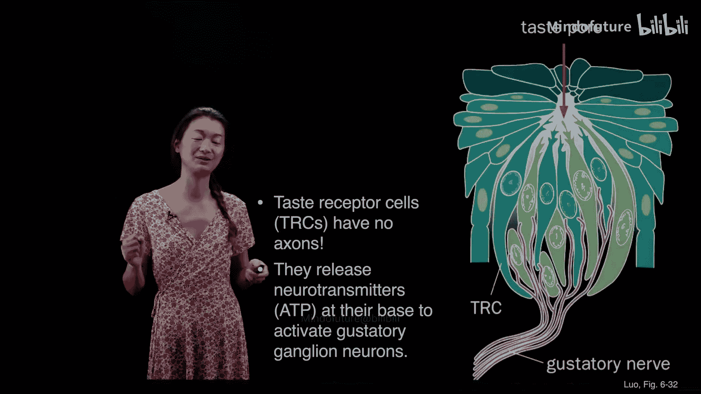

So I don't know about you， but I remember distinctly when I was in elementary school I had to do an exercising science class one day where I had to color something of this kind。

 there was a map of the tongue and I had to color in the different parts of it that were responsible for the different tastes Now I thought this was true for years I thought this was true。

 you can imagine how angry I was the first time I learned that this was in fact not at all true it doesn't work like this at all in the gustiatory system In fact each of your taste buds each of your little taste buds contains receptors for all five of the chemical senses and so the localization of your taste buds does mean that different parts of your tongue are differently sensitive to taste but there's absolutely no evidence that there's localization of different types of tastes in different types different parts of your tongue So I know people who definitely claim that there's a right way of eating certain types of you have to put it in different parts of your mouth maybe that has to do something with texture or with a flow of air or whatever whatever else it is I know it is not because there is。

😊。

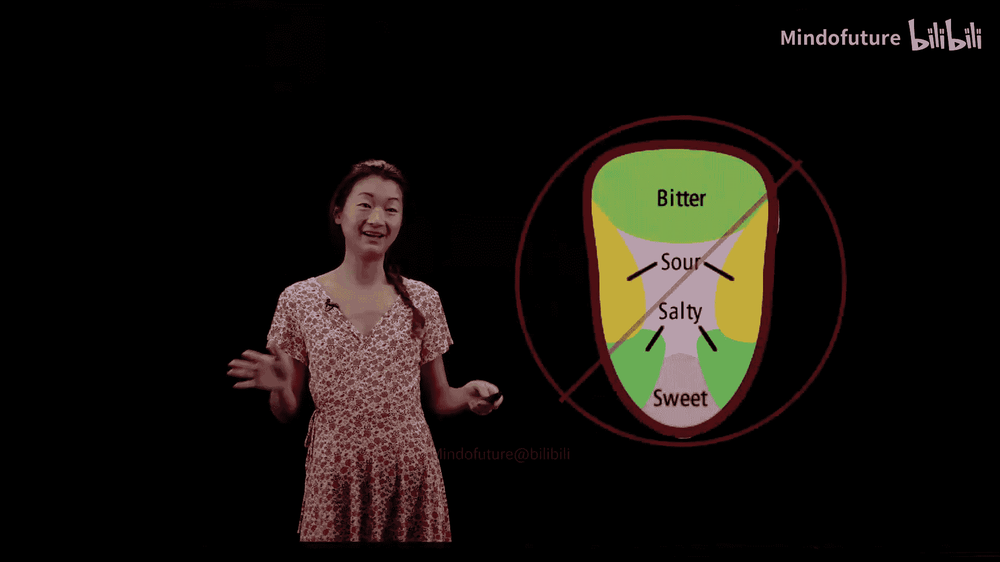

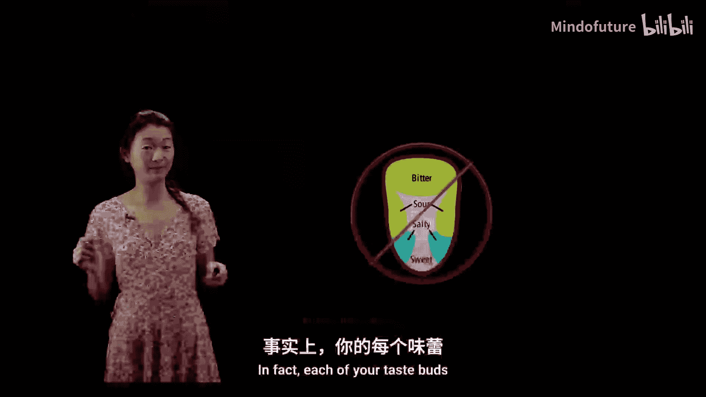

Loization of different types of gocitro receptors or your tongue it just doesn't work like that but let's talk about how that does work so here are your gusciatory receptors I'm only showing you four of them we'll get to the fifth one in a little bit because it's kind of a special case I'll talk to you about separately so we have ami sweet and bitter and these three senses are mediated by not surprisingly GCs G protein couple receptors rear their heads once again because they are super duper important for view of what they are you can go back to the lecture that we had earlier on metabatroic postynnatic receptors that's where we introduced GPCs for the first time and we also saw GPCRs in the vision lectures because roopins the proteins are responsible for detecting light and photons in our visual system are also GCRs so it's not really surprising that they're rearing their head here again because something that we see all the time in all different parts of not only our nervous system but the rest of the cellular molecular biology of our bodies as well。

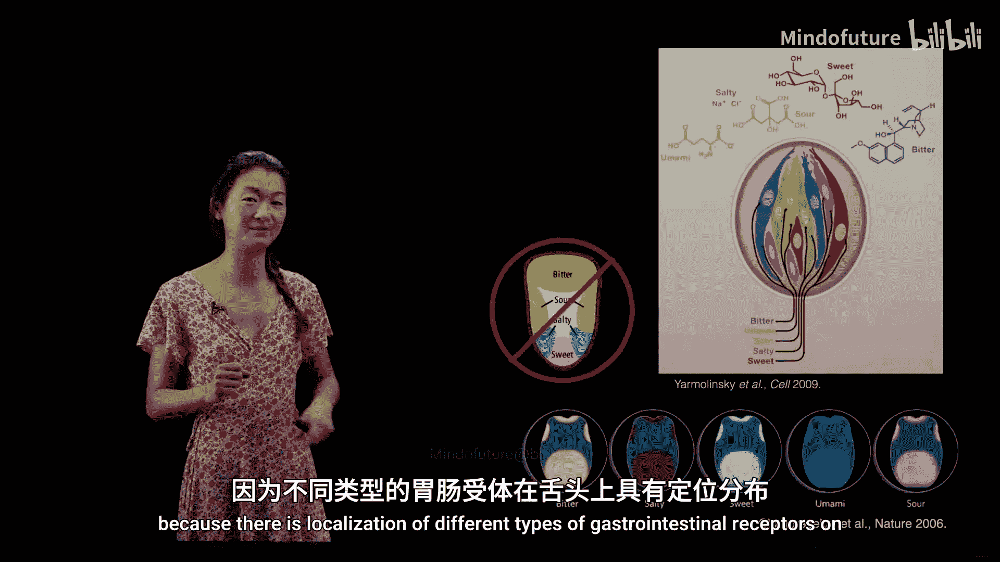

So Uumami detects kind of savory tastes that your and sweet text sweet tastes。

 and so both of these are thought of as attractive gustatory receptors because usually you're seeking food that tastes good。

 you want something that has highlychic content and isn't going to kill you。bitittter receptors。

 on the other hand， are GCs that usually have the opposite effect on your body。

 They are aversive for most mammals。 and it's because there tend to be things that are that are toxic and poisonous to your body。

 So for example， there are things like quinine stch9 and aropine are all perceived as being bitter because we have bitter receptors in our tongues that are binding to them。

 So let's first talk a little bit more about the ami and the sweet receptors there are GCs and there are actually three genes that form two different types of protein heteros that underlie your sense of ami and your sense of sweet。

 Your ami taste， like I said earlier is things like that are protein rich and so glutamate is one of the amino acids。

 And so you might want to have a taste receptor that is sensitive to glutamate。

 including mono sodium glutamate MSg to make foods taste more savory。

 Now the umami receptor is hetero of T1 R1 as one of one of。

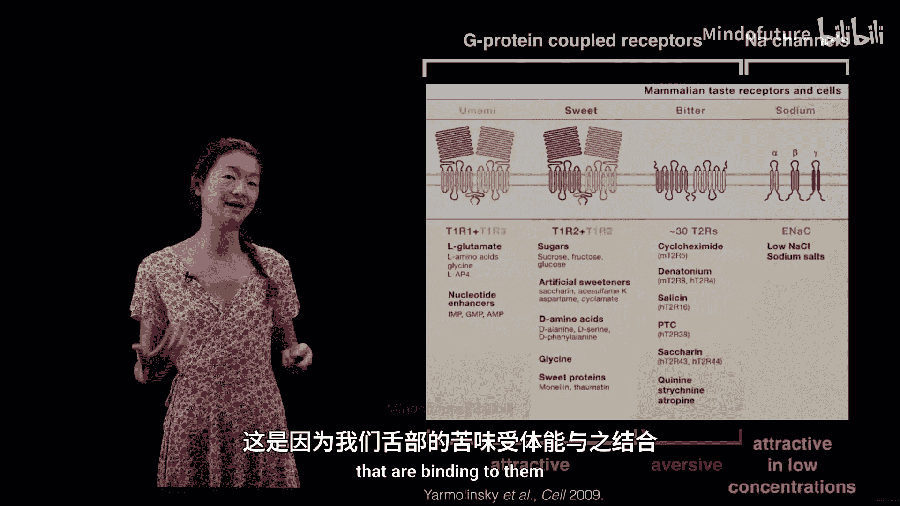

Components and T1 r3 as the other component if you instead take T1 r3 and glue it together with T1 r2 you have a sweet receptor so these two genes。

 these three genes that form these two different receptors are closely related and they are able to form different configurations with each other to underlie your sense of ami and your sense of sweet Now your sweet receptors are sensitive to things like sucrose fructose and a couple of other types of sugars as well like lactose for example。

 there's a couple of different other naturally occurring molecules that bind to receptors。

 as well as a variety of different artificial sweeteners that are engineered to bind to these sweet receptors as well。

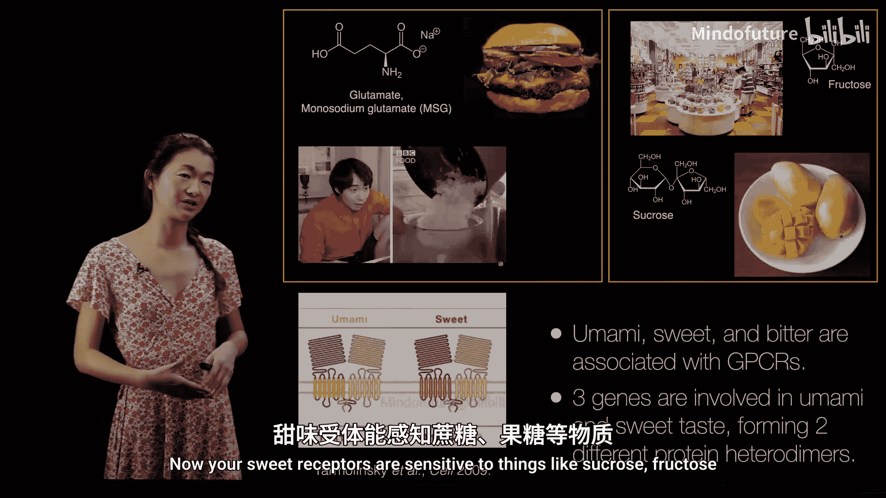

Okay， so now that we have talked about these two closely related gustatory senses and the genes that underlie them。

 I want to through a thought experiment， so here are two animals here's a tiger and a panda they're both over the order connira。

 and so the question is if you had to guess which taste receptor is missing in which of these animals given what you know about their food habits。

So you can think about it for a second if you want to， I'm going to keep talking。

 so tigers are connivorous animals， they don't eat anything except meat okay so really have a they don't have a taste for sweets。

 and so in fact， if you look in their genome， you will find that tigers have lost the sweet receptor gene they don't have them anymore。

Pdas on the other hand， even though their connievers have lost the taste for meat。

 they are vegetarians， they eat they only eat bamboo and so they in fact have lost their taste receptors for rumumami。

 they just don't have a taste for rumumami anymore。

 they do actually have a ton of extra receptors for bitter because that's something that's relevant for their dietary habits。

So this is a lovely story in convergent evolution as well of red pandas and giant pandas they are evolutionarily distinct lines here and you can see that even though they're not related to each other。

 they have independently evolved mutation so that they no longer have their ami taste receptor they have become these pseudogene that are no longer active in both red pandas and giant pandas。

 so this is a really lovely paper here because not only do they have this convergent evolution in their umami taste receptors。

 there's some anatomical convergent evolution as well because of their dietary habits and that's something that ties together a lot about our knowledge of sensory neurobiology as well as the evolutionary niches and the habits of different animals。

 so this all kind of makes sense if you take it together。

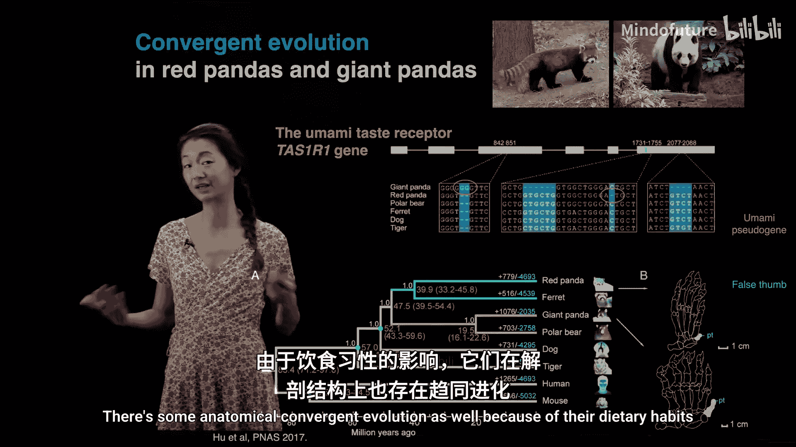

So let's move on then to the bitter receptors， bitter receptors as I said or GCs as well。

 but unlike the ami and the sweet receptors， which is one ami taste receptor and one sweet taste receptor。

 there's actually dozens of different bitter receptors and it's because there's just a variety of different compounds in our environment that you may consider not eating so if you eat something you chew on it two seconds later like oh that takes kind of bitter。

 you still have time to spit it out so there's a variety of different compounds and so we have actually a variety of different bitter receptors that are sensitive to them however unlike sweet and ami it doesn't actually matter in terms of what I do with that piece of food that tastes bitter to know what type of bitter it is and so these T2R genes of which humans have 30 of them have a much lower threshold so my threshold for tasting bitter is much lower than's sweet I can taste tiny amounts of it so I can sp the food out really fast I think it's gonna be bad for me and they're also coexpress。

On single taste receptor cells， which means that it doesn't kind of matter which of these receptors is being activated。

 they only all I know as the rest of the nervous system in order to guide my behavior is that something tastes bitter I don't know what type of bitter it is and it doesn't matter because what I'm going do about it is I'm going to spit it out So we talked about this in the intro lecture on sensing in action and thinking about the organization of sensory systems because all that really matters if you think about the goal of the nervous system why you have a brain and nervous system in the first place is to guide your behavior and to guide your decision making in the future so any information that is irrelevant for what you're going to do next as an organism is tends to be somewhat ignored so we saw this in the visual system when we're talking about contrast and on and off cells that are in your visual system like the retal ganglion cells as well as the oriented bar cells that are in V1 So they don't actually tell you what's going on they filtered reality in such a way because all the rest of it doesn't matter the contrasting。

hansing cells because you want to pay attention to what's changing your environment rather than what is actually there because that's just too much information I don't care。

 This is a similar concept we're seeing in the bitter receptors there's basically a convergence where it doesn't actually matter which type of bitter it is what matters is what I'm going to do about it spit out the food and so we have all of these different T2R genes that are expressed in the same taste receptor cells because it doesn't actually matter so bitter is usually aversive because you have all of these horrible compounds with terrible names that you definitely don't want to eat like strchine and kinine and atroine however humans because we're very creative creatures have actually learned to really enjoy bitter in limited contexts and this is very much learned behavior usually kids don't like bitter foods but we can learn to enjoy eating and drinking different types of bitter substances。

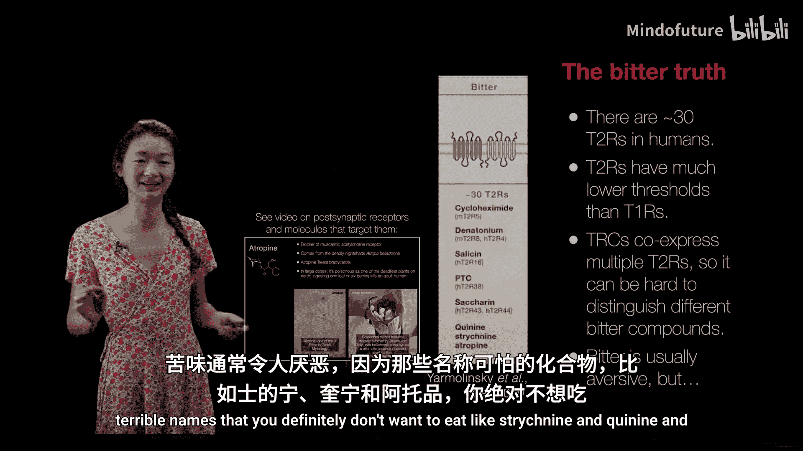

So。The story about sour is also a fascinating ones。

 We're moving on to we talked about ami sweet and bitter。 The sour receptor， as far as we know。

 is not a GCR。 And when I looked up the molecular basis of a sour taste reception in humans and a mammals。

 I was shocked to realize that it was only in 2019 was the receptor。

 the molecular receptor for sour taste and mammals conclusively found This is just think about it like how long have we known about photorecepts。

 How long have we known about touch sensors all of these things it's absolutely amazing to me that our knowledge of the gusttro senses is it's so fundamental to how we interact with our environment every day and yet there's so much that we still don't know about them。

 So as far as we can tell， this is the latest that I've been able to find in the literature。

 sour taste receptors are a class of molecules that are called operons and their cion channels。

 maybe not surprising。 So this is not a GcrR， but actually a caion channel。

Now autoto patronrons were previously identified to be involved in gravity sensing in the vestibular system of the inner ear。

 and that's where they were previously found， and now they've been found in the ghostatory system to be expressed in taste buds。

 and so there's a beautiful set of experiments where they was demonstrated that they were not only necessary but sufficient for evoking sour behaviors in a mammalian system。

 I think that's really cool。

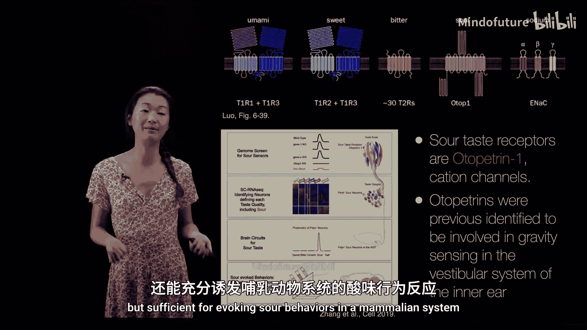

So here is one way you can hack your gustatory system。

 there is a fruit that is known as the miracle berry。

 it looks like the followings is a little little red berry okay and it contains a molecule inside which is a glycoprotein by the name of Moraculin here's its molecular structure。

 but where miraculin does is it has a really funky it gives you a gustatory illusion。

 basically it's a gustray hallucination if you' chew on the berry for the next half an hour or so anything that would usually be sour actually ends up tasting really sweet。

I'm going to say that one more time。If you basically suck on a lemon after you shoot chew in the miracle berry and then you suck on a lemon。

 a lemon is usually quite sour。 Okay It tastes like the best lemonade you've ever had。

 So what happens to the molecular level。 is that this miracul。

 the sclyco proteintein binds to the sweet taste receptors in your taste buds。

 So it binds to those T1 R1 T1 r3 hetero dims。 And then in the presence of acid。

 it activates the sweet receptors。 That's what thelycoprotein does。

 It's a really funky sensory illusion。 I think it is actually possible to buy this in a pill form。

 So if you don't have access to if you don't happen to have access to friend who grows a miracleberryrry tree。

 it is possible to acquire this molecule in kind of a pill form。

 I think So that's kind of a fun experiment to do if you wanted to do that as a party trick。😊。

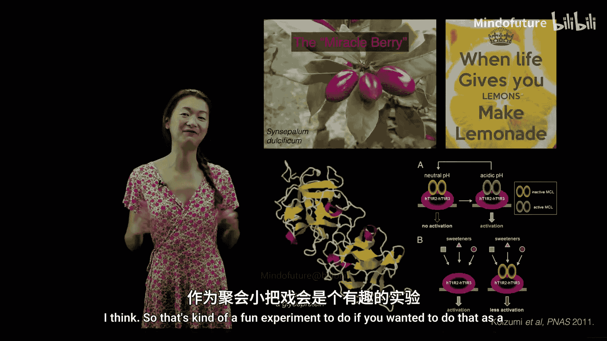

Okay， so we talked about ami sweet bitter and sour， now we've come to sodium。

 which is perhaps actually despite the fact that it's just salt and salt salt is life。

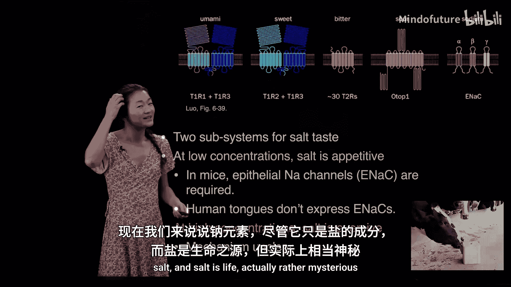

Actually rather mysterious， it's still unclear to us as neuroscientists。

 what is the conclusive fundamental basis for salt tasting in your respiratorysti system we don't actually know what the molecules are involved are and part of it that makes it kind of complicated is that amaami and sweet are appetitive。

Bitter is aversive， although outside's say1 you can learn to like it。

 Sour is a little more complicated。 and so is sodium。

 sodium is complicated because of low concentrations， salt is very much repetitive。

 If you've ever had food that was under saltalted doesn't taste very good。

 if you add just the right amount of salt， it tastes great。 but at even higher concentration。

 salt is very much aversive。 if you've ever gone swimming the ocean and snorted up if salt water。

 it is it's pretty horrible。 like salt is not aambiguously positive in higher concentrations。

 So we do know that there is a set of cine channels that are expressing mice。

 these epithelial sodium channels and they are required for mice to taste salt。 However。

 we know this doesn't quite explain everything because for humans。

 at least our tongues don't express this protein。 So we don't really know what's happening in humans and no ability to taste salt。

😊，Furthermore， we don't know what the molecular mechanisms are for salt aversive properties at higher concentrations are they mediated by the same channels。

 are there different channels are there different systems that are involved it is a computation that happens after the tongue these are all questions that kind of still remain unclear in neuroscience and remains to be figured out I also will point out here that beyond these five different gustatory receptors。

 people also think about other types of taste and sensory information that you can gather from your mouth and your tongue that are not on this list like the taste of water for example。

 where even the smell of water there's a couple of papers floating around and people are increasingly starting to work on these things and you can imagine it's really difficult to to work on something like what does water taste like but water in fact does taste like something it's not just the stuff that's in there's a taste of water really hard to study but I'm telling you here at least what we do know about theami and the soup receptors。

Receptors are pretty well studied， the sour receptors we're starting to furing it out， sodium。

 let's start working on it， these are very key to our sense of what foods taste like and at least what it tastes like when we put it on our tongues。

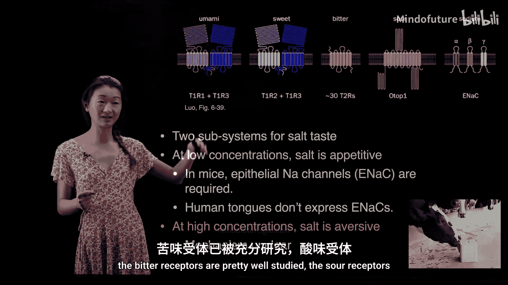

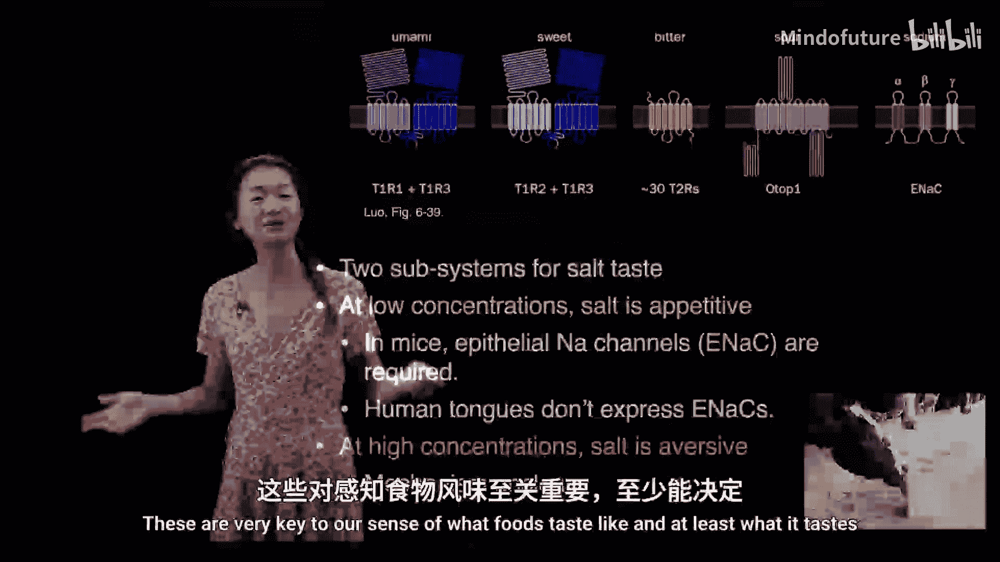

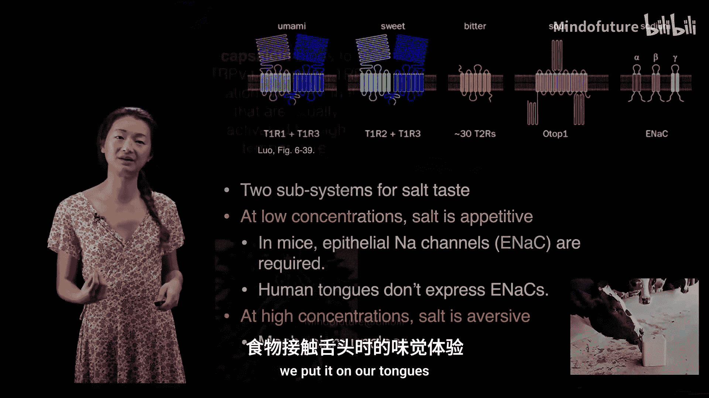

OkayThe other thing that we really enjoy in food are things that don't actually taste receptors this is something that is I personally enjoy like I like spicy food and so spicy food is is foods that have this molecule called capsacin capsacin is of this class of molecules that are this particular molecule that's made by different types of chili peppers for example。

 now chilies produce capsaicin， a capsacin tastes spicy we say it tastes spicy we use that word but it doesn't actually hit any of the gusciatory receptors it hits something else all which is a tripuvan channel and tripV1 channels are cationion channels that actually found all over your tactile system in a somatoensory system so whatll get to that a little bit later in the somatoensory lecture' just treeviewing it here because when you taste spicy food it's not hitting any of the taste receptors it's actually hitting this somatoensation receptor and trip V1 channels in particular。

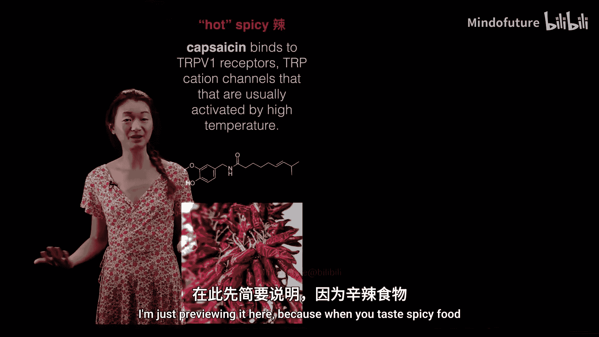

is one that's usually activated by high temperature Now， if you know Chinese food。

 you'll also know that there's actually a separate word for things that are not actually hot spicy。

 but also numb spicy， this is man la okay nu spicy is mediated by an entirely different unrelated molecule that doesn't look anything like keptpsiscin it's a molecule that's known as alpha hydroxy sandful。

And this molecule is not made by these capsascin plants， but is made by this ceal peppercorn tree。

 that was mine， actually I used to have a big one in my front yard I love this thing。

 and it actually activates just like3V1 channels activate capsacin。

 that activates tactile sensors that are sensitive to vibrations。

 it's a couple of papers talking about the molecular mechanisms that exactly what is the difference between the sensors that are activated by the numb spicy receptors。

 the maw receptors and the law receptors。

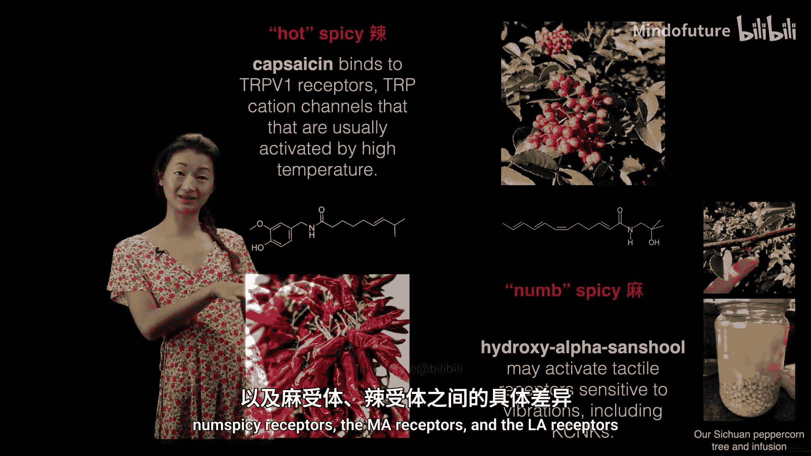

Okay， so you might be asking yourself， this is kind of an interesting evolutionary question here because animals like to eat fruit and fruit make different yummy things for us see because they want us to do them the favor of dispersing their seed so this is why a lot of fruits make fructose and fructose is sweet and we really like fructose we eat it and we eat these fruits and we do them the favor of see dispersal。

 So that makes sense for most fruits， but that does not explain why fruits of the capsasum branch make capsacin because it's actually quite aversive in high concentrations。

 again， as humans， apparently we can learn to like anything。 we can learn to like pain。

 but it is painful And to most small animals， capsascin is aversive。

 So why as a fleshy fruit in the capsacin family， why would you bother to make something that make your fruits less appetitive for small animals to eat。

😊。

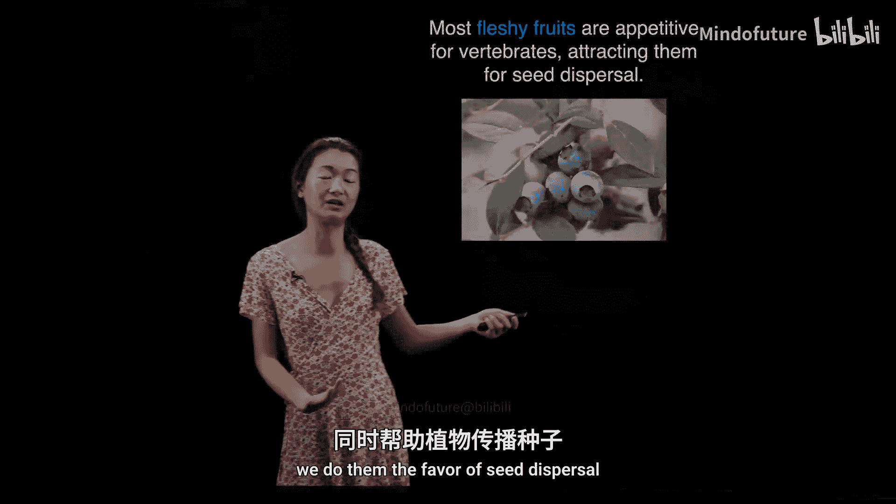

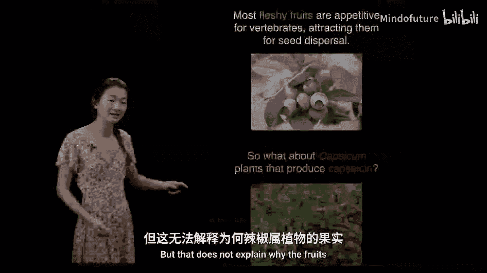

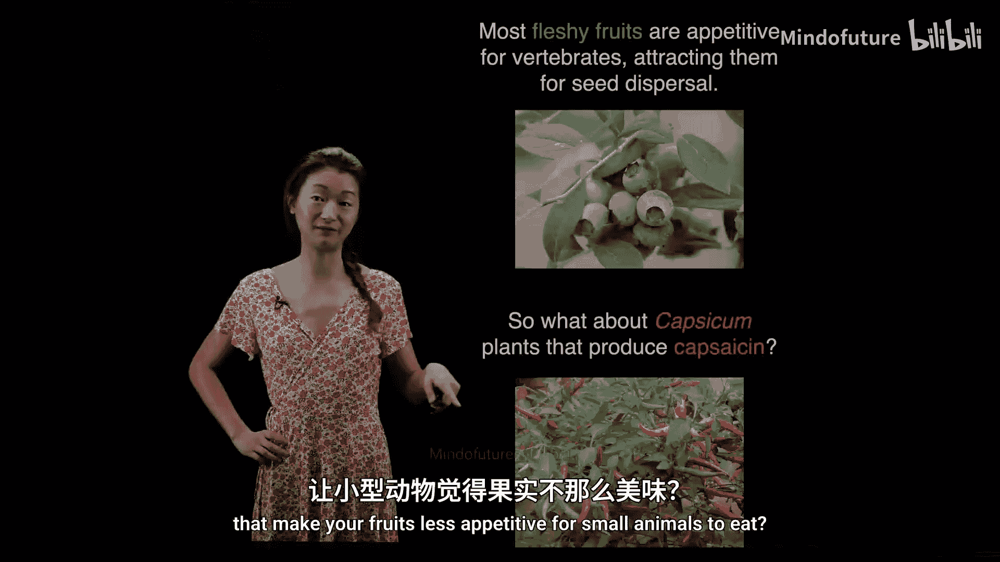

The interesting story here has to do with the difference in between small mammals and birds and how we eat fruit。

 so here's an experiment where what they did is it was really a clever experiments where they did was they compared three different types of animals so it's a cactus mouse a pack ratt and the threher。

 a type of a type of fruit eating bird and they fed them， three different types of fruits。

 the hackberry， non pungent chilies and finally pungent chilies。

 chilies that are quite spicy and what they found is that the small mammals avoided the pungent chilies。

 but the birds ate all three in equal concentrations so birds will eat a spicy chili just as much we eat a blueberry。

 they really don't care they like them all where small mammals like the cactus mouse or a packra are actively avoiding the really spicy chilies。

So capsacin chilies is now understood to be a directed deterrent and so that the avian Tri V1 channel is insensitive to capsacin。

 birds literally can't taste spicy and they don't have the receptor for it。

 their tripvan receptor is something else and is not sensitive to capsacin and the reason the chili pepper did this is the following is because small mammals when they're eating a fruit will chew it up。

 we chew it and then for the capsacin plants when a small mammal choose up their plant and then choose up the seeds。

 it is no longer able to germinate when it is dispersed at a far location whereas birds will swallow the whole thing whole and so birds are actually excellent at dispersing capsaum seeds and so the chili peppers evolved capsacin as it direct a deterrent。

 it can't keep small mammals from eating them as whole except by directing molecularly this chemical compound capsacin。

So that the mouse can't eat it， but the birds are perfectly fine with it。

 and so I think this is another lovely story of chemical warfare。

 especially between plants and different types of small animals。

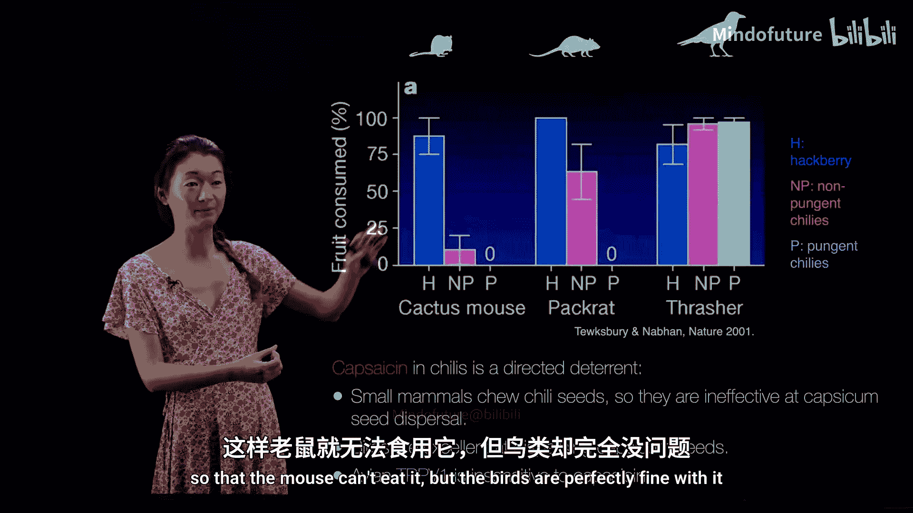

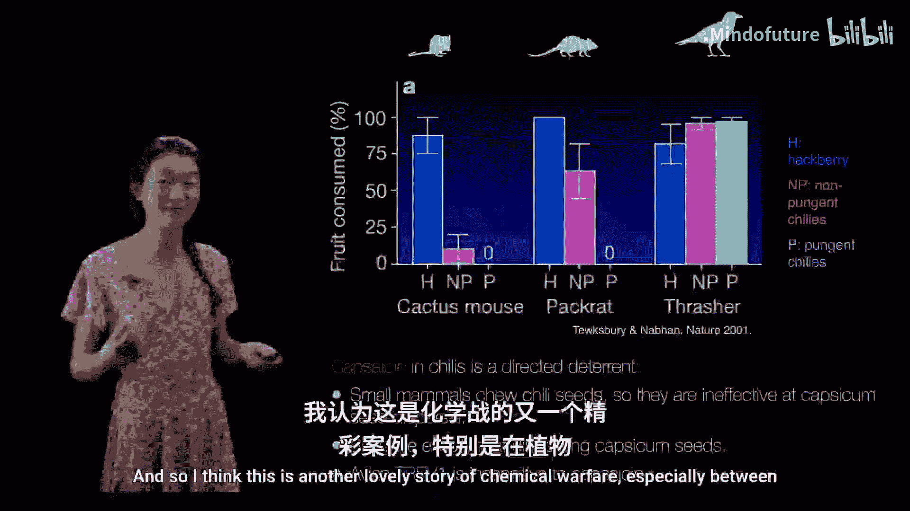

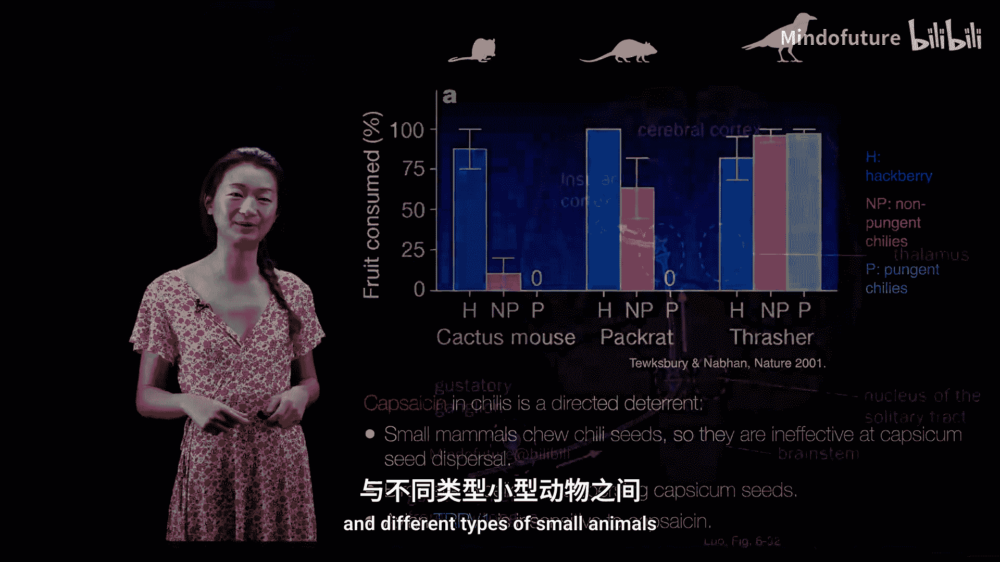

Okay， so we talk all about the taste receptors and the gustatory ganglion。

 the gustary nerve from the tongue projects to the brainstem through the nucleus and the solitary tract and then goes up to the thalamus just like it did for vision and from thalamus goes to cortex just like vision did。

 so this again is a canonical pathway where the primary afferins a primary sensory neurons project to the ganglion cells and the ganglion cells sometimes with a stop or two go to the thalamus and then from thalamus goes to a part of cortex this is the same thing that we're going to see over and over again through all of the different sensory systems with a couple of exceptions。

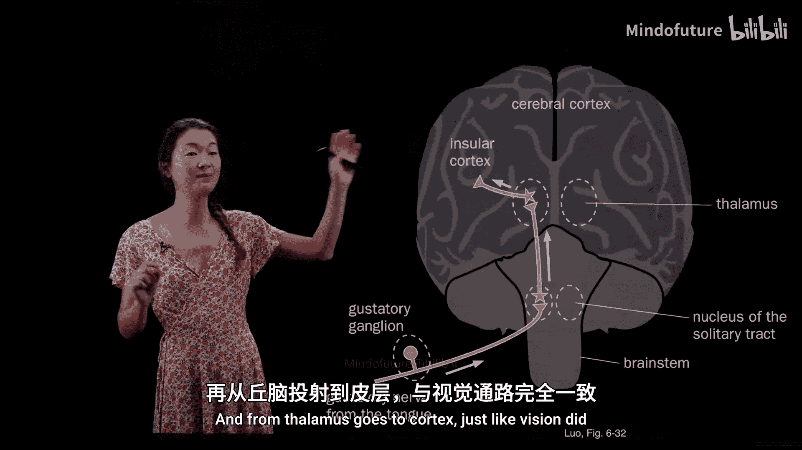

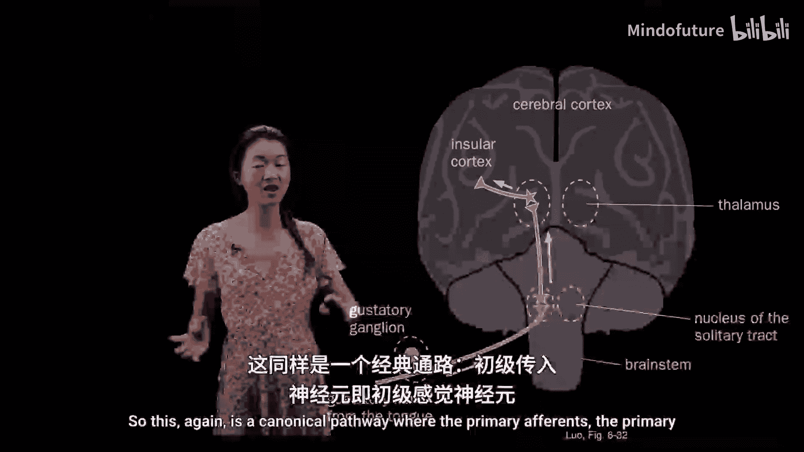

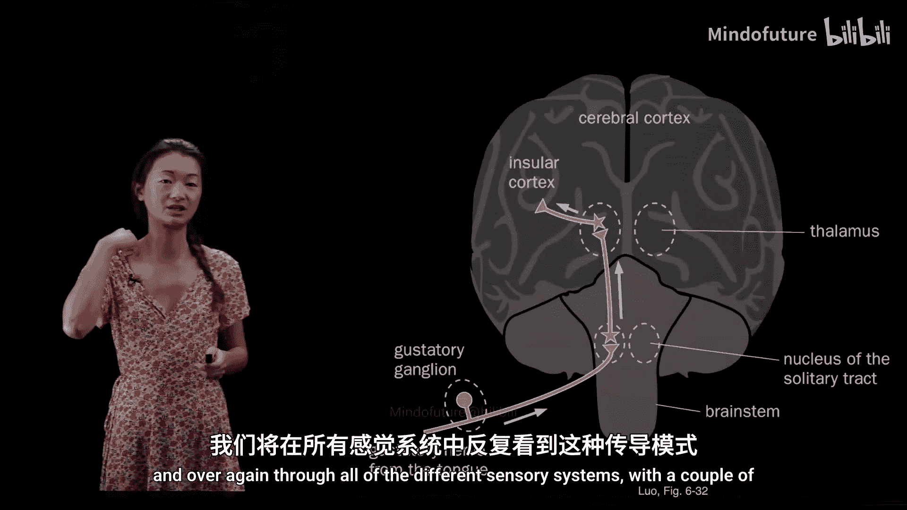

And so food unlike unlike vision， for example， is something that a lot of us like like I really like food in my family we always we like hotpot and this is a tradition for us especially in Chinese New Year and so food like lots of other sensory modalities I think has this really special ability to elicit memories and nostalgia and this is especially true of foods that are not necessarily aetitive to everyone so this is a picture of a piece of stinky tofu and some blue cheese I happen to personally like both of them but again I realize that some of this nostalgia is because I grew up eating these types of foods and I learned to like them and they're not really all that。

😊，A lot of people don't like these types of foods but for certain people。

 tastes and smells has a special ability to be deeply nostalgic and you might smell a soup or something walking into someone else's kitchen and he suddenly retransport it back to your grandma's kitchen because it smells exactly like something that she would use to cook and so I think this ability of foods and taste and smells to elicit very powerful emotions and memories is something that that's quite interesting in terms of how the neuralpaths that underlie these powerful emotions and memories are so there's a really interesting paper that I'm going to I'm going to highlight here just because it's something that I think is really interesting to bring this together between the sensory capabilities in the gustatory system and the ability for us to form these very powerful memories and the valinence and the value that we assign to these different tastes and smells so I told you that gustriter projects via some different waypoints of thalam。

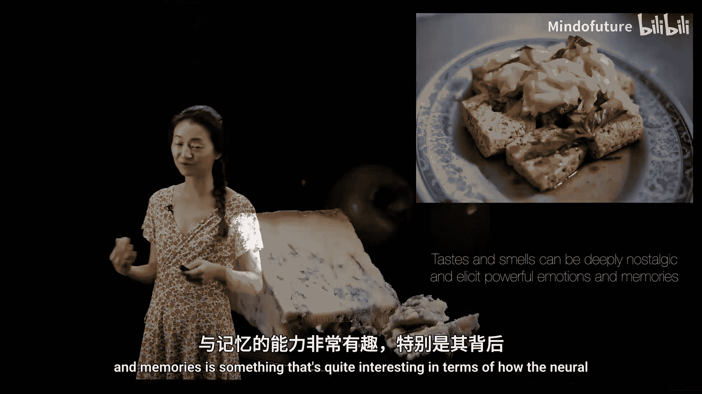

which then projects the gustatory cortex The gustatory cortex has an organization where there's this part of it that's responsible for sweetness and a part of it that's responsible for bitterness S cortex and bitter cortex just like there was tootoppi in the visual cortex where there's different patches of it that responded to different parts of the visual space here in gustatory cortex。

 you similarly have this kind of topographic organization where sweet tastes are in one place and bitter tastes are in a different different place and you can see that they're anatomically distinct。

 you kind of separate them。😊。

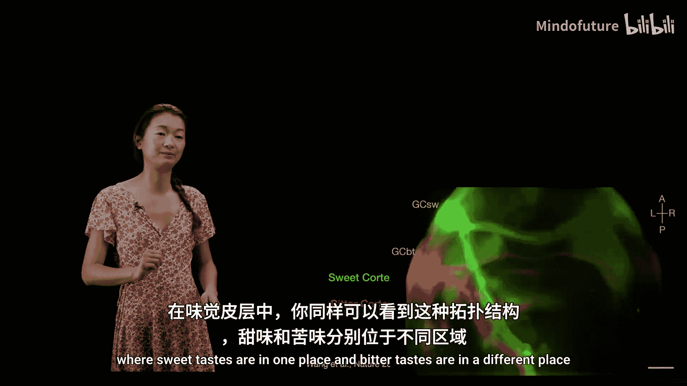

Now what this paper demonstrated is that if you look at where the gusatory cortex then projects to the next place that it projects to。

 it projects to a place that is called the amygdala now I haven't talked to you about the amygdala before so I'll just do like a one or two sentence summary here about the amygdala the amygdala is a structure that is in the middle of your brain it's a very deep deep structures part of the limbic system and we think of it as being associated with fear and memory and different types of aggression so it's a very like primal feeling oriented part of your brain and what they demonstrated here is that the sweet cortex and bitter cortex actually projected different places in the amygdala as well so the experimental methods they used here are pretty interesting。

 I'm going to take a moment to go through them with you so what they did here is they injected。

A aav virus， and a dentaleno associated virus。That is expressing c and it's an entergrade AavV virus I'm going to break down those terminology AAV a deneno associatedsociative virus is not actually an a denenovirus it's totally different virus it just has that name so it's a virus that infs the nervous system if you inject it into the brain what's going to happen is it's going to get sucked up by the neurons and this particular one is an entergrade AAV which means that it's going to get sucked into the neurons and they get transported in the same directions as the axons so in this case if you're injecting it into gustatory cortex it's going to get into all the cells and the gustatory tor test。

And then all of those cells are going to then transport these AAV viruses in the same direction as the axons。

 not backwards forwards， that's what entergrade means， they're also retrograde viruses。

 this particular one is an entiregrade one， so it's going to follow those axons and go to where those gusatory receptor gustatory cortex neurons are going and they're going to go towards the next place that they synapse onto。

They're going can't transport it all the way down the axon and hop to the next neuron that that neuron was projecting to as synapses。

 and because of the c system， they've engineered this mouse so that the ce turns on at the next postynaptic cell。

A GFP， well it's a red fluorescent protein that's a tiD tomato， so it's red， but it's like a GP。

 it's a fluorescent protein that gets expressed whenever that cell is a postynaptic partner of the cell through which you injected the AAV。

So this is a kind of viral track tracing here it's kind of a really cool technology so you inject you engineer this mouse that has this property that the TD tomato this red fluorescent protein gets only turned on when it receives cr and you deliver the c not by actually delivering it above to a totally different brain area and then so then only the projections that are between area A in area B receive that c and causes the cells in the amygdala in this case to glow red and that's how they were able to demonstrate that if you injected aV cr in the bitter cortex it goes to one part of the amygdala。

 and if you inject the same virus in the sweet portion of gasssteratory cortex。

 it projects to a totally different parts the amygdala。

 suggesting that there might be a possibility that these two different channels。

 information bitter and sweet can be associated with different feelings， different ether wfiing。

 but associated with different ways in which respond to stimulus that are sweet or bitter。😊。

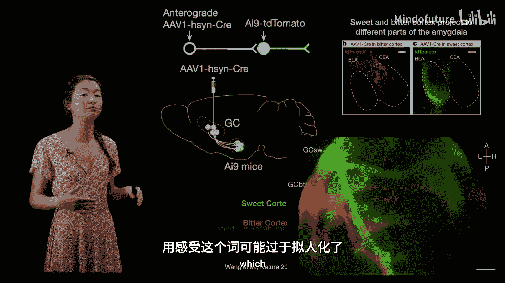

AndThey further went on to demonstrate this with an optogenetic experiment。

 So optogenetics is a subject of the video。 if you want to review the video on optical methods in modern neuroscience there's a lecture where I talk to you about the basics optgenes。

 how it works。 the short version is that we can turn cells on and off with light if we can get the right proteins in them。

 And so here we're doing is we're going instead of having this c system。

 we're going to have an AAV that is expressing that is carrying the channel adoptopsson protein。

 we're going to inject that into gustatory cortex。 and then instead of shining light at the guciatory cortex。

 we're actually going to shine light at the amygdala。

 And so it's only the cells that projected from where where I injected my virussome that's projecting to the amydala that are going to get activated。

 And what they found is that if they inject it into the sweet cortex。

 and then they shine the laser in the amygdala。😊。

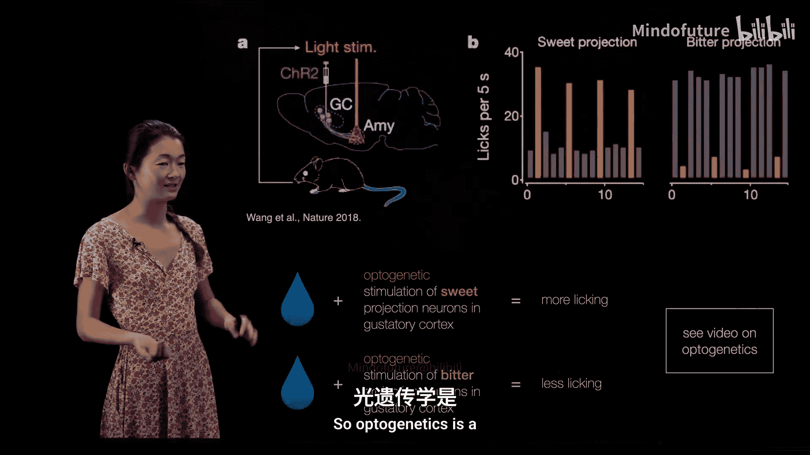

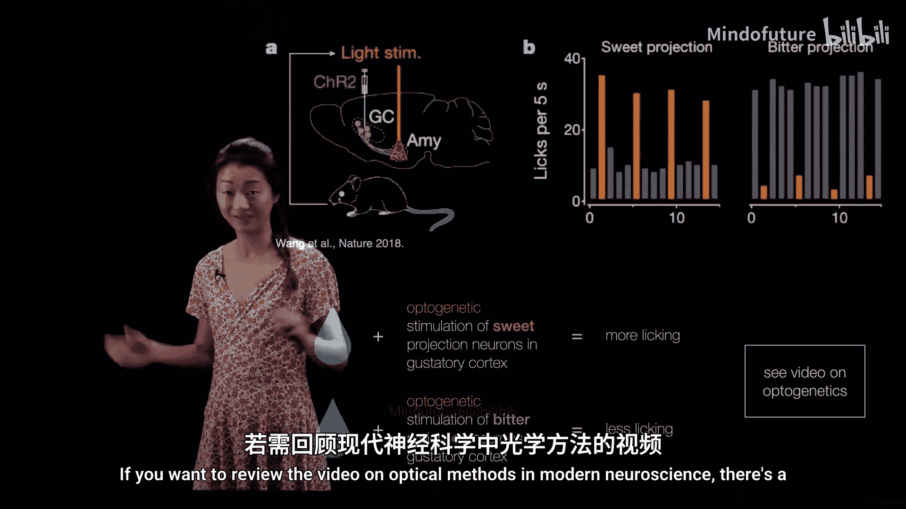

When the mouse is licking water， just water， the water is the same， it will lick more。

Whereas if they injected the virus into the bitter part of Gostatory cortex and shine the light on in the amygdala。

 the bitter projections in the amygdala cause the mouse to actually lick less right In other words。

 it's not the identity。Of the stimulus， whether or not the water actually was sweet or was bitter or whatever。

 But the fact that you're activating this amygdala limbic system area of the brain that made it so that the mouse actually behaved differently in response to the same stimulus。

 So it gets a little complicated So kind of think about the logic here。

 So there's there's a way in which we identify different parts of the stimulus。

 the oxygen environment， is it red Is it green， Do we have emotional feelings about this。

 Is it bitter， Is it sweet， What do I do about it， And so in this paper。

 this using this really clever technique of viral delivery of optgenes。

 targeted a different areas of your different neural circuits。

 they were able to disambiguate some of these this ideas about， how do you know what something is。

 and what is the valence of that thing， How do you feel about it， What are you going to do about it。

 so that's something that's really clever。 Okay， so key concepts to understand our sense of taste。

 we got really far， We went from a very basic。😊。

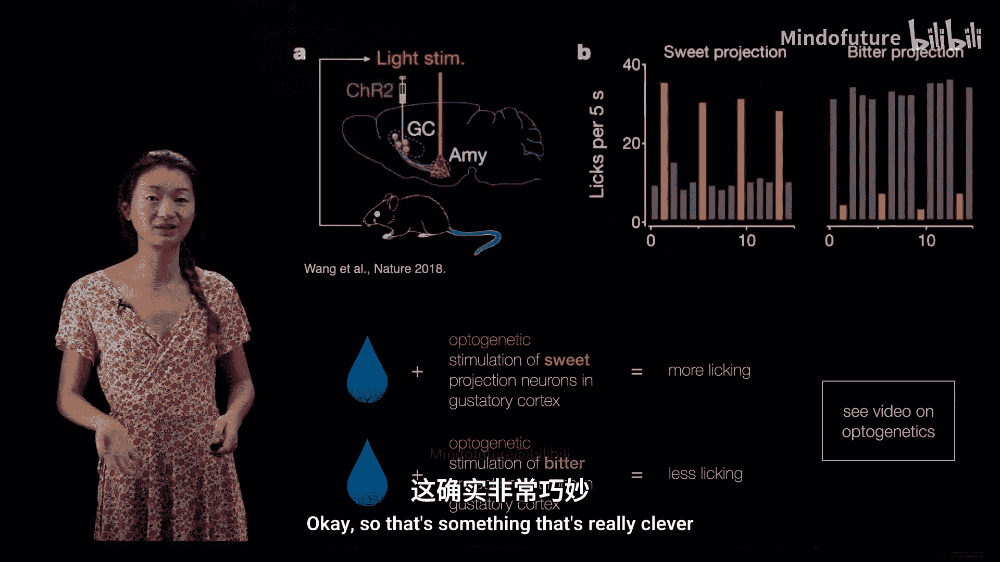

Taste receptor， neurophysiology to some very modern techniques using optgenetics that Isect these complicated circuits。

 including our fears and our tastes。 So we have taste receptor cells， and they are found in the。

 taste buds。 They are mixed and do not localize the different parts of the human tongue。😊。

They are don't have axons， they in fact activate gustatory ganglion cells just in the same way that in your retina。

 the photoreceptors activate real ganglion cells， so the gusttroric ganglion neurons project to the rest of the gustatory pathway。

 including going through the thalamus and then going to cortex and from cortex to other places unknown。

They are the sweet and the ami and the bitter receptors are all GPCRs which is hopefully not a surprise to anyone at this point。

 so GPCRs this is not the last time you'll hear about GPCRs because the next lecture is going to be about your sense of smell and you will also not be surprised to hear that our GPCRs in the smell system as well。

