# 【华盛顿大学】神经科学入门 ｜ Introduction To Neuroscience ｜ Bing Wen Brunton p23 P23_嗅觉感受_气味受体__嗅觉环路 -BV1i3qWBXEDH_p23-

We come now to the topic of smell， it is unavoidable。

 it is all around us and it is something that is so fundamental to the way that we live and interact with our environment and when we lose it。

 it could be quite quite dramatic and traumatizing as well so your sense of smell is something that your nose。

 your nose nose we start the nose and the smells start by sensory receptors that are in your olfactory epithelium and so when you inhale the air your nose you put the volatile organic molecules that are in the olfactory environment around you into your olfactory epithelium and inside your olfactory epithelium are these primary sensory cells。

 the olfactory system， your olfactory receptor neurons not surprisingly what I'm going to tell you in a couple more slides is that these olfactory receptor neuron then project it to a different parts place in the olfactory bulb and the olfactory bulb that has ganglion cells that project to the rest of your brain so this architecture that we have seen now over and over in a couple of different sensory systems is something that we're going to see over and over。

So the primary sensory structures is something we're going to talk about for a little bit here because it's a little bit unique in every different system。

 But first let's dispel some myths here so we have this feeling that humans have a poor sense of smell and we think that other animals are better at it now they are different but I do want to address directly this idea that humans have a poor sense of smell。

 it may in fact be a myth of 17th century and something that been propagated and promaggated through time and is not necessarily true。

 So it is true that relative to the rest of our brains。

 humans have a relatively small olfactory bulb So this is a human olfactory bulb and this is a mouse  orfactory bulbs as you'll see the human' brain is quite massive compared to the olfactory bulb whereas for the mouse。

 it's a much larger fraction of its brain。 However。

 the human olfactory bulb is quite large in objective coordinates。

 it's actually a large a structure that is not small if you look at it compared to the olfactory bulb of a rodent that we think of as being more of a sy。

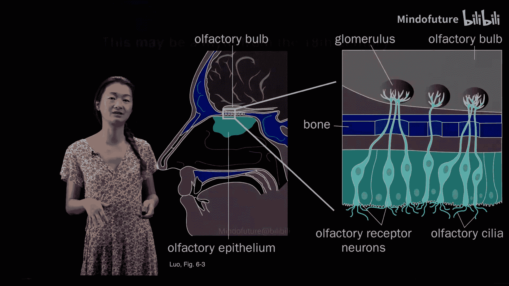

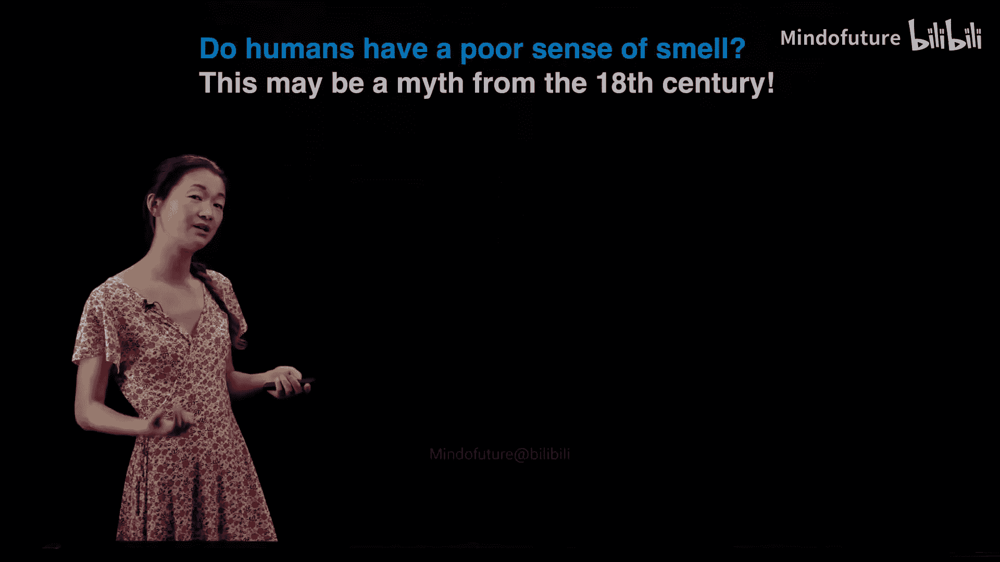

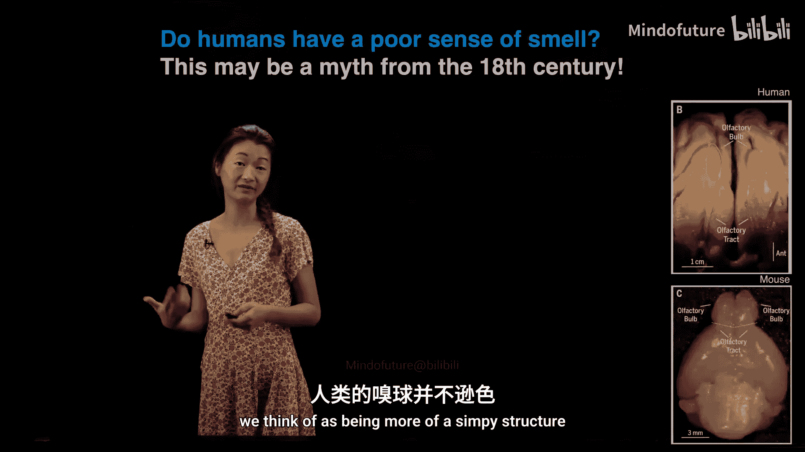

And so another piece of evidence here is that they have done a lot of tests with different humans in terms of how much humans are able to detect small concentrations of various different kinds of chemicals and so that's kind of what the graph shows here what we're looking at on the horizontal axises are different kinds of chemicals these are different chemical compounds to which your factory system might be sensitive and they test it a mouses a spider monkey。

 a different non-human primate as well as a human and a variety of different humans for what is the lowest concentration of that chemical that is detectable by that animal and when you can see here in the circles the squares in the triangles is that for all of these different chemicals the human threshold for how much you have to present to the human for the human detect it is comparable with these other animals with the mouse and the other non-human primate In fact for one of the three chemicals a three mecapto3 methylbutal format。

 humans have the highest sensitivity among these three。

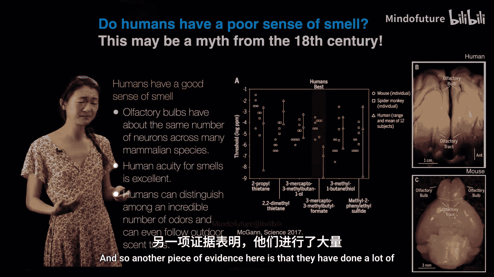

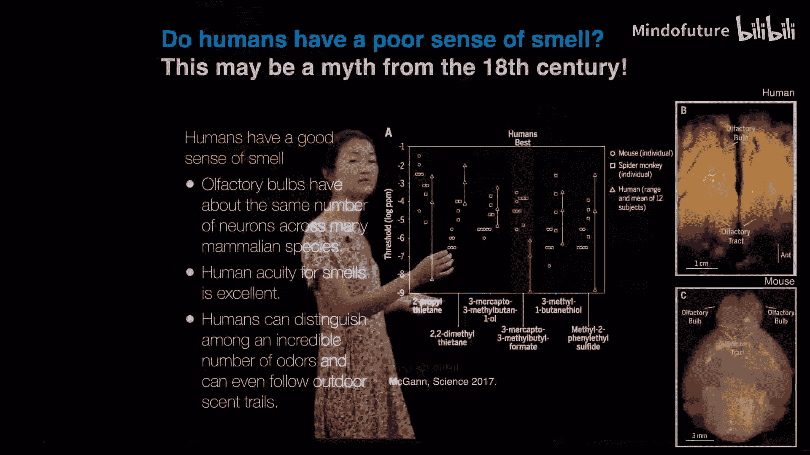

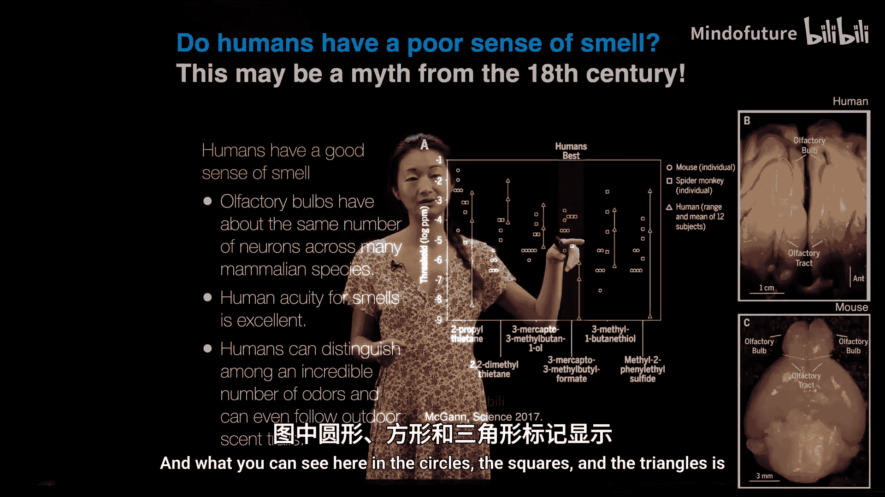

Different types of animals that are tested。 So that's one piece of evidence。

 Our acuity for smells is excellent。 all factory bulbs。

 in fact have about the same number of neurons as lots of other mammalian species。 Furthermore。

 functionally speaking humans when we have to can distinguish an incredible number of odors and even follow outdoor scent trails Now the following experiment is kind kind of lovely if you ever have a chance to do it I've never done it before I wanted just want to see what I can do because we're such visual creatures that I don't really think to do this but what humans actually can do is if we force us to by blindfolding us and restricting a lot of our other senses that all we have left is orolfactory sense can in fact track scent trails on the ground so in this paper what they did was that they compared the strategies a dog uses for following a pheasant scent trail so they took a pheasant and dragged it through the grass and let a dog follow it And here humans not so at tracking pheasants。

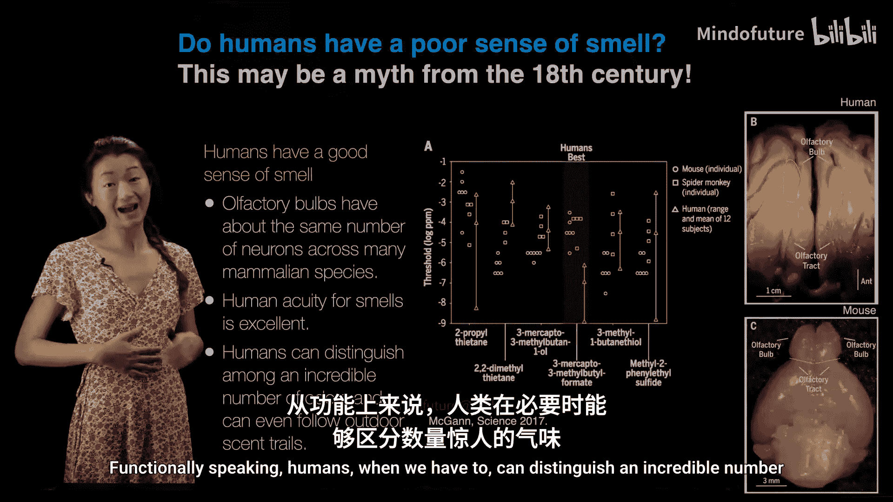

chocolate scent trail so they laid a chocolate scent trail in the grass and this human subject here this human participant here is blindfolded and has only access to their olfactory environment and you can see there that not only are they able to follow the chocolate scent trail they also use this cast and surge strategy that is known to be a pretty robust strategy for tracking not only terrestr scent trails but also airborne and waterborne scent trails for lots and lots of different animal species and so when that is all we have。

 humans actually have a pretty good sense of smell and we are perfectly capable of using it if that's all we have。

😊，So that's kind of a interesting thing On the other hand。

 there are very distinct differences between the ways that lots of animals for whom the olfactory sensory environment is a larger part of how they experienced the world compared to humans and a lot of that has to do not exactly with the neuralbiology of the olfactory system but with the morphology of the nose so here is a really lovely lovely paper where what they did here was they didn't use a real they didn't use a real dog。

 they 3D scanned a dog， they put a I think it was golden retriever in an MRI machine and scanned the morphology of their nose okay then they 3D printed the 3D morphology of their low nose and use that morphology to sniff and inhale and exhale and there's a bunch of engineers that did it and so I think it's actually kind of lovely here panels B and C in this paper or actually ser an imaging of airflow as it goes in and out of the nostrils of the 3D printer。

😊，now what they discovered is this really interesting observation that because the morphology of the dog's nose。

 because of the different channels that the dogs have that we don't have when we inhale and exhale。

 let's say I'm pretend I'm sniffing my little laser pointer here if I'm inhaling and exhaling as I'm exhaling。

 I'm blowing the smell away from myself so I'm inhaling I can smell something。

 but because I have to breathe， I have to exhale every time I exhale。

 I'm blowing air at thing that I'm trying to smell so that I don't get to sample it multiple times not true for the dog。

 the way the dogs knows is organize its morphology makes it so that when it exhales。

 it actually blows away from the object so that in multiple sniffs the dog is in fact capable of establishing this pattern of continuously sampling。

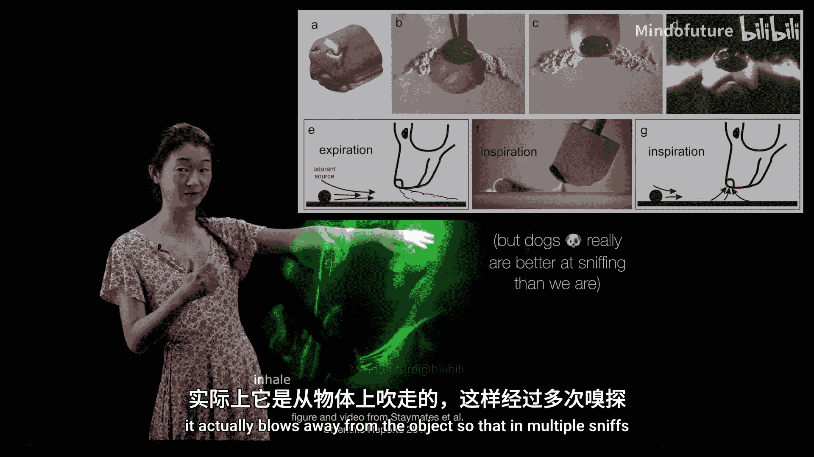

Taking more and more repeated samples from the object that it's the target that is the odorant source。

 so it's able to inhale and exhale backwards and then take in more olfactory information into its nose。

 And so the fact that the dog is in fact a better stiffer than we are is in part because if the morphology and the way that it ins and excates and not necessarily because it has more older receptors and has a better olfactory ball or whatever it is。

 So for this and many other really lovely stories about sensory capabilities。

 the sensory environments of a variety of different animals。

 I strongly recommend this book and immense world by at Young and Young is one of my favorite science writers and science journalists and so I highly recommend to read that book this is where I got this story from among many of other really fascinating ones。

 I really recommend you read that book if you're interested in how dogs experience the olfactory world and how jumping spiders have vision all of that really cool stuff。

😊，So the other thing that animals do that I think humans do less so is they smell in stereo now this is something that is pretty widespread in the animal kingdom insects like ants smell with the antennae so they have olfactory receptors that are on their antenna because they don't have noses and they have two of them and they actually stick them out on left and right and so ants among many other types of insects are known to smell in stereo they can use the olfactory information detected by the left versus the right antenna take a difference and know something about the directionality of where that odor had come from this is also one of the leading theories for why the exceptional specialization when see in hammerhead sharks so where they two nostrils or two nas are pretty much as separated as possible from each other the idea is that they can smell in stereo and get an indication of the locality and the directionality of odors by taking the difference between what they can smell on either side of their noses。

This also explains as one of the bleeding explanations for why snakes have fork tongues Now we talked about gustiatory senses earlier and how in humans we have taste buds in our tongues it turns out that steaks don't really have taste buds in their tongues and if you think about the way in which they eat this kind of makes sense right so as mammals we eat food humans will chew food we chew it and then we swallow it so there is a moment。

During the chewing process where you can still decide， oh man， this tastes really bitter。

 this is kind of yucky I don I don't want tona eat it anymore you spit it out snakes don't really do that。

 the way they eat is that they swallow their prey whole and so if they's something bitter in there and maybe they regretted it by the time they swallow it is kind of too late and so snakes don't really have gustatory receptors on their tongues what they do have in fact are olfactory receptors on their tongues and so one of the ideas about why snakes have fork tongues the same reason that ants have two antennae and hammerhead sharks to have two nostrils that are really far separated from other they can use the two tips of their tongues to actively sense the odorant environment in their environment and take the difference between the two different the two different tips to make a difference and get an indication of the localization and the directionality of the odor molecules where they're coming from that's really cool。

 the other thing that's kind of really cool about these snakes is that they have what's called a monomono nasal organ Now the monononna。

organgon is something that most vertebrates have and humans are actually in the exceptions humans and a couple different types of primates don't have a monono nasal organ it's an organ that's kind of in the back that's back of the mouth and up above the palate we don't have one so I can't tell you what it feels like to have one these snakes have them lots of other animals do and it is sensitive to Al receptors and have a localization and have an interesting sort of computations that they perform so snakes instead of having gusteral receptors in their tongues instead have olfactory receptors in their tongues just like the antennas of insects and one idea for why they have forked tongues is that they can localize the locations and directionality of owners by using their tongues instead of their noses。

So back to mammals now we' back in the olfactory epithelium this is something that's more typical of mammals。

 including mice rats and humans， for example， so what we have are a set of olfactory receptor neurons that live in the olfactory epithelium and they are actively sampling the olfactory environment。

 different molecules， volatile organic molecules that are dissolved in the air floating by and they bind to one of many different types of on receptor molecules we'll talk about exactly what those are in just a second but let me get you the lay of the land kind of where the search tree is going next not surprisingly the primary sensory or sensory cells project to a second layer of cells and this these second layer of cells that are the ganglion cells that project to the rest of the brain so in the case of vision this was so here that the analogy would have been that there was a photoreceptors the photoreceptors then a couple of stepspss on the line activate the retal ganglion cells。

 retinal ganglion cells project to the rest of the brain here it's olfactory。

Receptor cells project to a part of the brain called the olfactory bulb okay and the olfactory bulb actually does a nontrivial computation it's like a little miniatureature brain and then these cells that are called the mitral cells the glomeri project to the rest of the brain we're going to break that down a little bit and talk about the computations that happen in here but for now I wanted to tell you that each receptor neuron and the olfactory epithelium。

Expresses a single odor receptor。Talk about them in a second。

 and then they're kind of arrayed in a random way so in your olfactory epithelium。

 you have a bunch of these olfactory receptor cells。

 they all express some random single oant receptor and these on receptors are then assorted because every single oant receptor cell that expresses that single on receptor will sort and project the same glomeris。

😊，Let's use a color analogy here because it's a little bit complicated to explain using oant receptors because we don't really have words for the different oant receptors。

 let's say that you have a blue oant receptor protein and a purple odorant receptor protein they'll be like you 100 purple cells and then 100 blue cells and they're all mixed up together in the olfactory epithelium。

 but all of the blue cells are project to the same part of olfactory bulb being a blue glomers and all of the purple ones project to the purple part of olfactory bulb being the purple glomeris。

And then there'll be a purple output cell， the miralol of the purple glomeryls that projects to the rest of the brain。

 and similarly there will be a blue miralce in the glomers that projects the rest of the brain so that's how those channels' information are assorted the analogy would be and this is not what happens in the visual system like all of your you short wavelength blue photoreceptors will go to one place and all of your long waveleng red photoreceptors go to the other place again that's not what happens in the visual system but that's kind of the color version of the analogy here what happens in the yourfactory system。

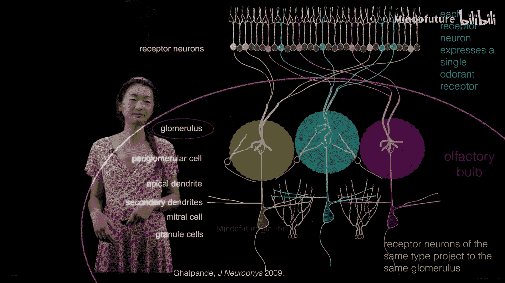

These odorant receptor proteins are not surprisingly either a gigantic family of GPCRs。

 these G protein coupled receptors or something we've seen over and over。

 we saw them in the postsynaptic metatrobic receptor system。

 we saw them in vision we saw them in gustatory systems here they are again in the smell system is in fact one of the largest gene family in the mammalian genome that mice have over a thousand of them。

 humans have a few hundred of them and you can see here there's a diversity of them that are expressed in a large array in a variety of different animals and they're really really crucial on coming such complexity in part because they are so important in our ability to interact with olfactory environment around us and so we have a large variety of them and each of them has member of this gene family so we can identify them we know kind of the signature them we can look for them in a novel genome and each of them has special properties in terms of how they bind to specific odorant molecule specific chemicals that it might be encountering so what happens in an odor receptor。

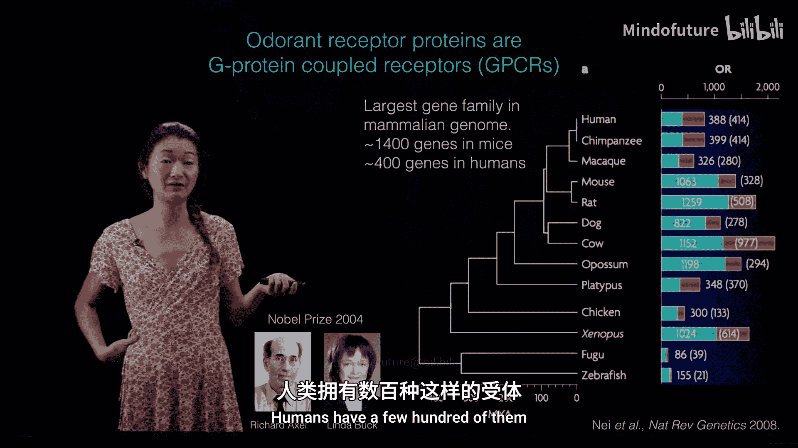

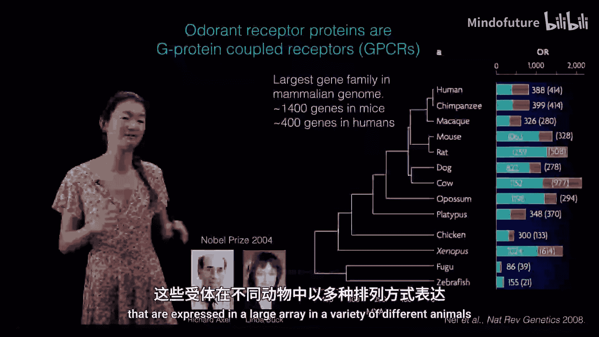

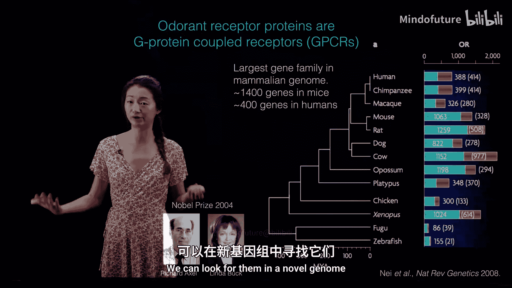

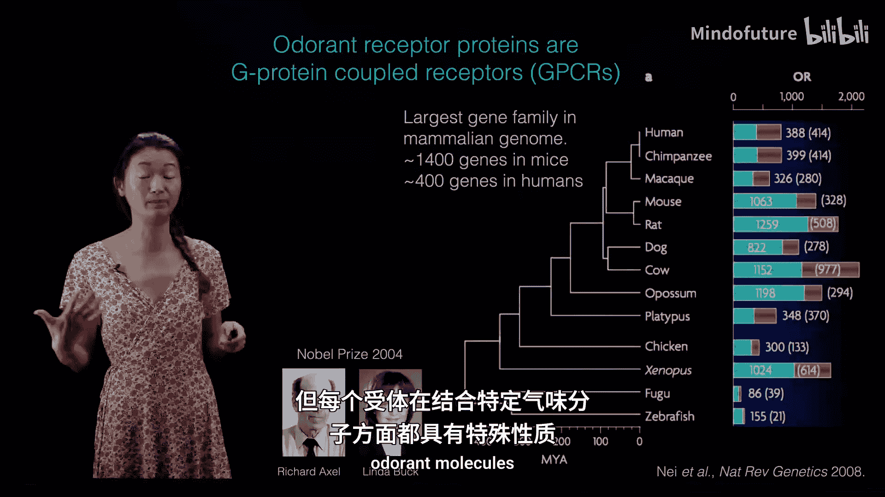

Neurn is that it has a dendry， which is these little cilia that are sticking out okay and inside the cilia are the variety of these on receptors。

 again each on receptor neuron has a single one that it expresses they don't mix everyone has their own you pick one and you express it and upon binding to the odorin molecule this GPCR activates the G protein and the G protein a couple of steps down the cascade activates a sodium and calcium channel that opens and so that's that's kind of the same molecular mechanism that you've seen over and over now many different times。

 we talked about it in the passive and active properties of cells and how synapps their form。

 it's the same thing here。 we have a sodium and potassium。😊。

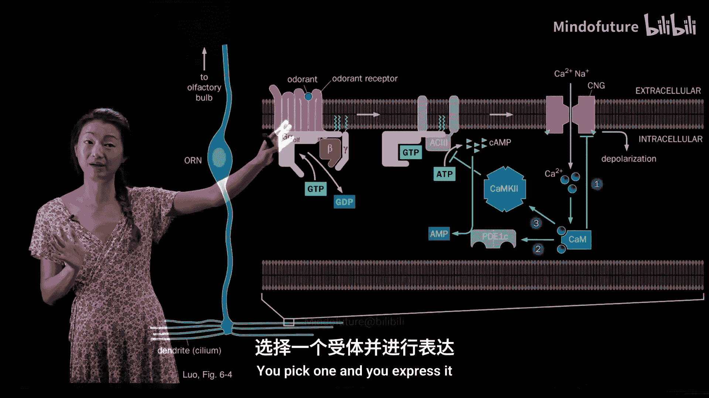

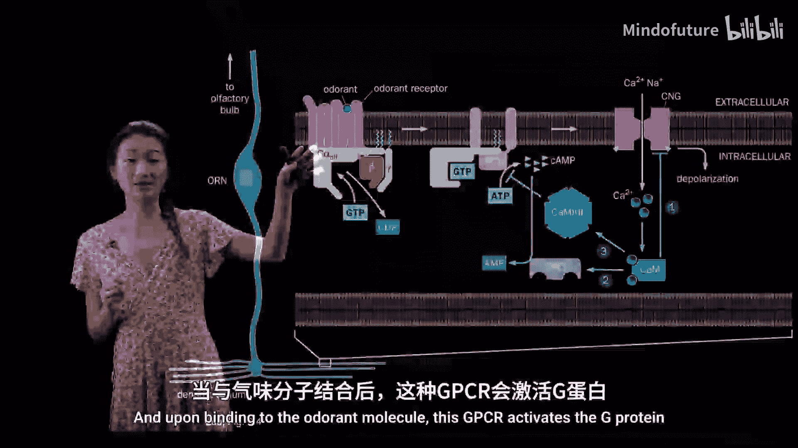

No， sodium and calcium cion channel that's activated by a GPCR that is ligan gated。

 ligan here being the odord molecule that this receptor would be binding to in the environment。

 and that causes the depolarization of the olfactory receptor neuron and that depolarization is then project to the olfactory bulb headed towards whatever glomeruluis that this particular odorR receptor is supposed to be going to along with all of its friends。

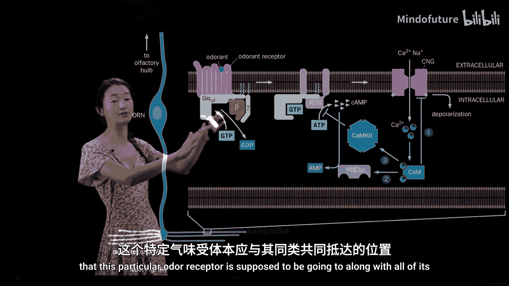

Okay so that's what happens at the receptor neuron level now we're going to dive down into what actually happens to when you have a particular odor that's expressed that's puffed to the animal what we're looking at here is's on the the vertical axis are all of the olfactory receptor cell here we have a bunch of them like a few dozen of them and what we're going to do in instance experiment is that they systematically gave these olfactory receptor cells。

 a bunch of different odors and that's all of the acronyms that are on the three letters up there so each column here is an odor in each row is a cell and the dot is proportional to the dot size proportion of the spike rate of that on receptor neuron in response to that odor。

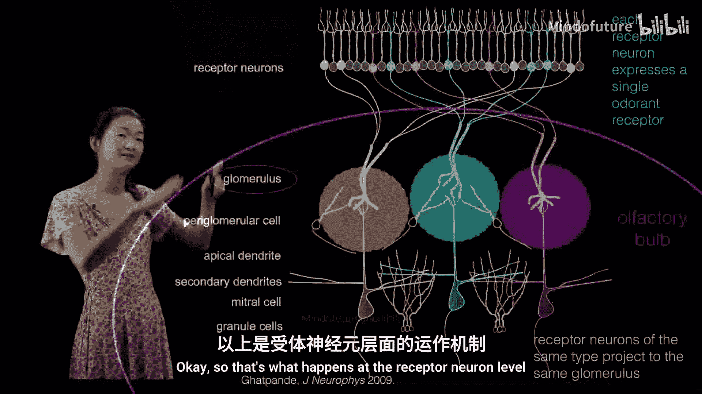

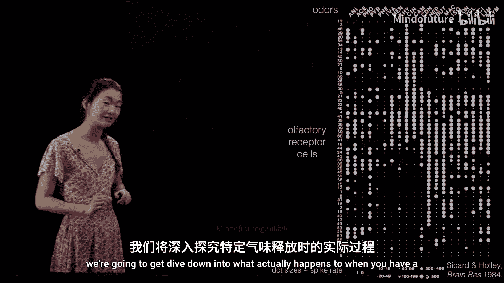

OkayI'm going to say that one more time， the gigantic matrix of how every singlefactory receptor neuron cell responded to every single odor molecule that was puffed at it。

And so what you can see here is that this is the equivalent of a large multidimensional representation of odors so for each one of these odors。

 let's just look at this first one here right'll just pick one in the middle like butane。

 okay butane BT butane， if you look down the column and you see butane。

 you'll see that it's not like there's a butane receptor neuron it far from it。

 butane activates a bunch of different receptor cells a different receptor types。

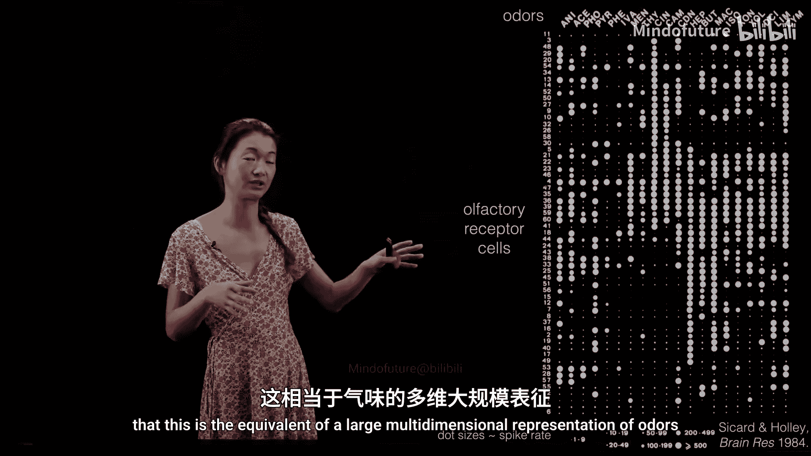

Same thing for almost every other molecule that is on this chart。

 all of them activate a bunch of different olfactorual receptor cells。

 but they activate a different set of them and they activate them to different amounts that's because all of these olfactorual receptor GPCRs are differently sensitive to different chemicals so it's not like they're super selected to only one molecule they only bind to this one like we talked about some of the glutamate gCs glutamate postynaptic receptors they're only sensitive to glutamate but not to a lot of other molecules here。

 this is not true because theyre all of thesevol organic molecules in the air and they're actually activating a bunch of different olfactory receptor cells in the olfactory system and so if you ask yourself is it possible to tell which odor is present with an individual olfactory receptor neuron the answer is no because if you look at every single one of these receptor cells look at each row of this matrix here you'll see that every cell is also activated by a variety of different compounds to slightly different degree。

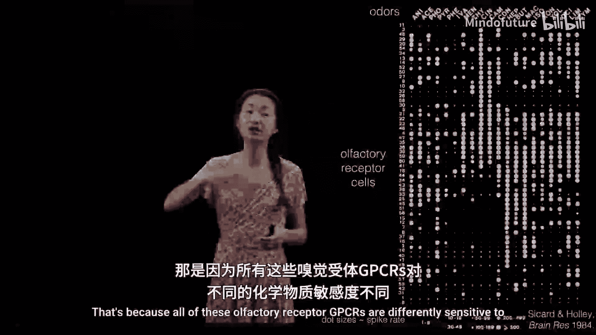

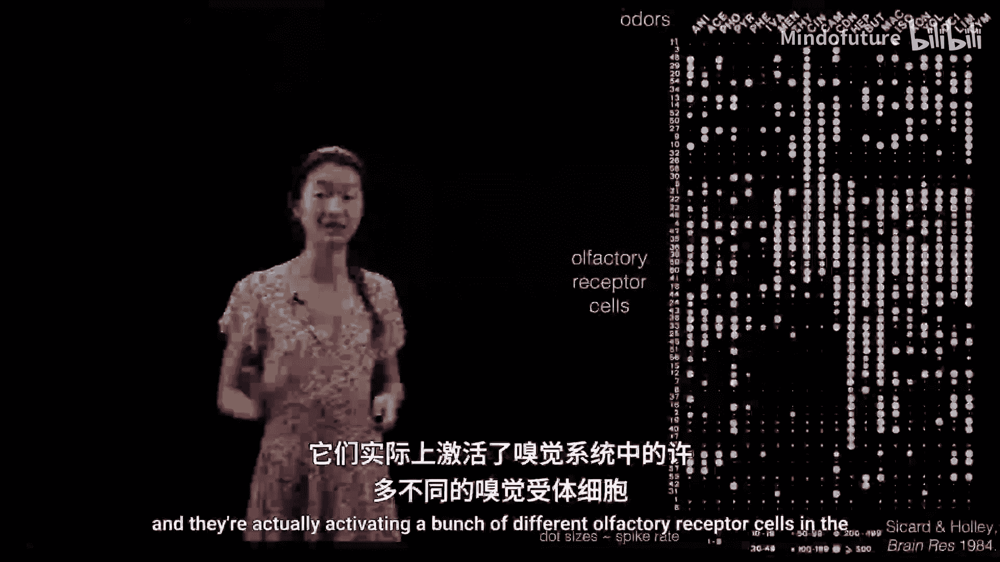

And so in this case， it's rather clear that the brain uses what's called a population code。 Now。

 this phrase refers to the fact that it is only by looking at the combination of responses from a large number of olfactory receptor neurons and their activation。

 Can you identify individual odors。 In other words， there is a let's say a fingerprint。

 There's a signature of activation across all of the different olfactory receptor cells that is indicative of any particular compound or even a okayque of different compounds。

 And so they are uniquely identified by the population but by not by anyone in particular。

 this is a really key concept not only in the olfactory system， but in fact。

 a really key concept in all of neuroscience and neuropopulation codes as well。

 because there's just so many cells in the brain and one of the questions a neuroscientists ask cells from a theoretical perspective is like what's up with all these cells。

 Why do we need so many of them and do you have a cell that represents a thing like is there a grandmother cells there's a cell in your brain that's like。

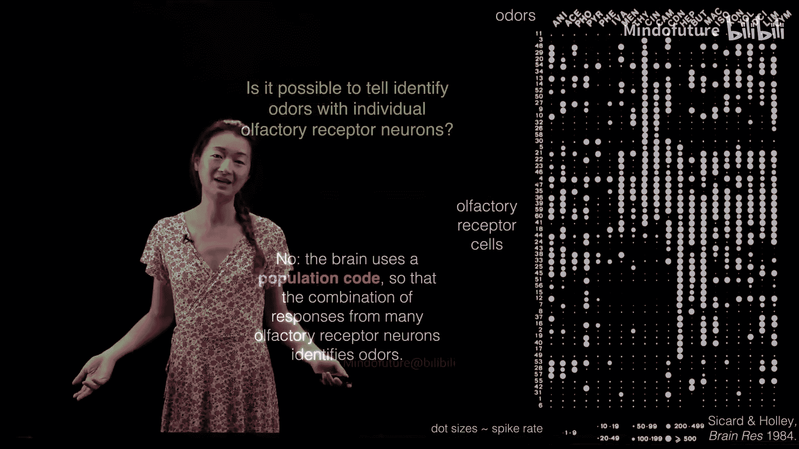

motherother cell， it's solely responsible representation of your grandmma。 Well。

 the truth is that just like in the olfactory system where you really need the population of activation of a bunch of different cells to represent a particular odor or the odor of a row。

 for example， the same thing for lots of other things that you might want to represent like who is your friend here like the memory the locker that you had in high school。

 for example， so it's almost certainly the case that a lot of different concepts and functions in your brain are represented by the population of neurons rather than by any particular neurons so that's not really the level description that that is probably relevant in lots of different things that we think about in the nervous system Now this may be something that are representing here talking about explicitly for the first time in the olfactory receptor cell system but in fact。

 if you think back on our video about color vision and how we have these three channels of information in color vision they're retina so the long medium and short wavelength photoreceptors。

And how if you can't actually tell what the wavelength of incident light is by based on any one of those alone because of this absorptioned spectrum it can't tell the difference between medium activation here and medium activation here。

 you have to look at the other photoreceptors to be able to tell so that's kind of a  three-dimensal version of the concept I'm talking about here in light in color vision。

 it's three dimensional because you have three sensors so you're really looking at the population of three sensors to figure out what the wavelength of light。

 what color of light are we looking at here in the case of odors。

 it is now a you know probably a few hundred dimensional system in the case of humans or at least a thousand dimensional system in the case of mice that have1 thousand olfactory receptors so it has as many dimensions as you have different types of receptors in color vision。

 it was three different types of receptors， so it a three- dimensional system in olfactory receptor cells because we have like 300 olfactory different receptors then it's a 300 dimensional population code。

 but the concept is actually rather the same if you can kind of reason through with yourself。

It is you need all three of these channels to distinguish the difference between violet and light blue。

 then the exact same concept applies here in understanding the population code as it applies to olfactory receptor cells and olfactory codes。

OkayThe other thing that we have in common is I wanted to point out the commonality between the olfactory system and the visual system in terms of the processing that goes on at the level right after the primary sensory neurons in the case the visual system。

 we have older receptor cells and then before it gets the retinal ganglion cells。

 the ultimate outputs the rest of the cortex you have these horizontal cells and amicrine cells you can review the lecture on olfactory on visual circuits for an explanation of how that worked in terms of visual circuits that we had an explanation of this idea of these horizontal cells being basically increasing contrast in the sensory representation by activating by when one cell is active it inhibits its neighbors。

 the same exact circuitry motif is found in the olfactory system the names of the cells are different so I know the anatomy is a little bit confusing。

 so instead of photores we have older receptor neurons and instead of horizontal cells that are in。

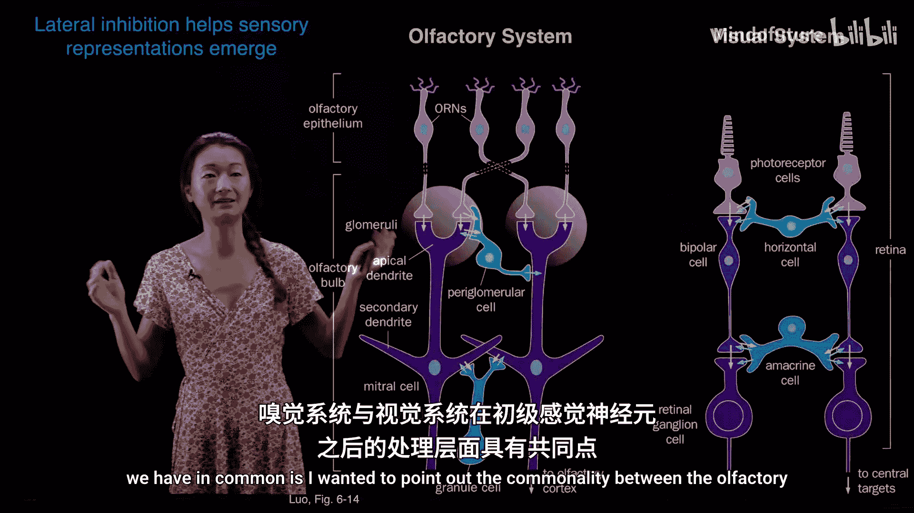

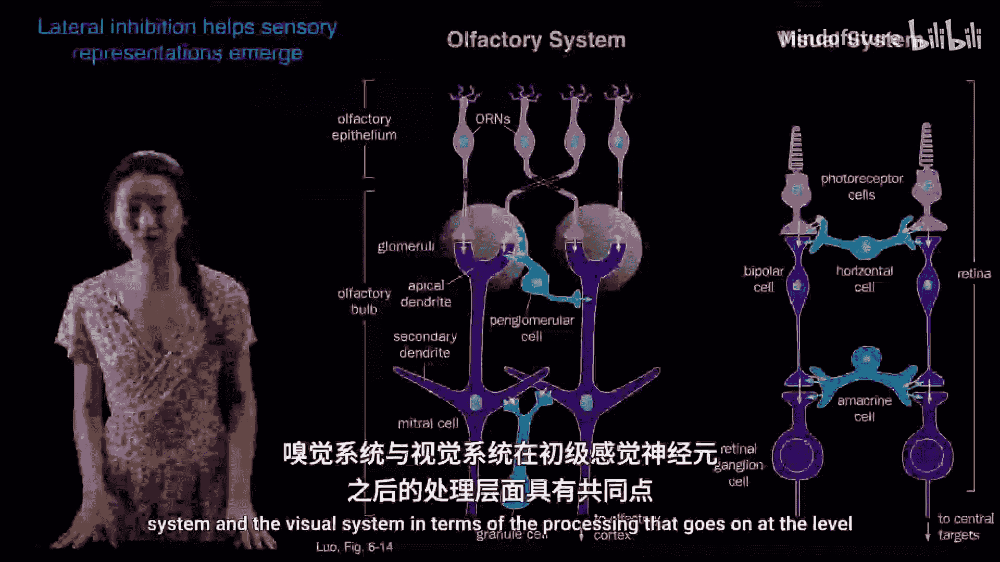

Retina we have paraloomerlar cells and granule cells that are this time theyre found in factory bulb but computationally speaking。

 we can think of them in a similar way now remember I told you that inolfactory system。

 these glomeri of different channels so like all of the purple all the purple smells are here all the blue smells are over there and these paragloomerular cells are actuallyact mutual inhibition so that when there's a lot of activation of one goomers it's actually going to inhibit the neighboring glomeri thereby increasing contrast so that when you have a really strong smell in one dimension there might be some noisiness like noisy activation of the other smells。

 if one smell is strong enough it will have mutual inhibition a lateral inhibition of all the rest of them thereby increasing the contrast that this one is actually active and it makes it easier for to detect it in the presence of whatever else is going on in the environment this type of lateral inhibition now we've now seen twice in the visual system and a mufactory system。

😊，It's going to pop up in a couple of other places as well。

 because this is a really powerful and useful circuit motif to enhance contrasts and to process information in sensory and motor systems。

😊。

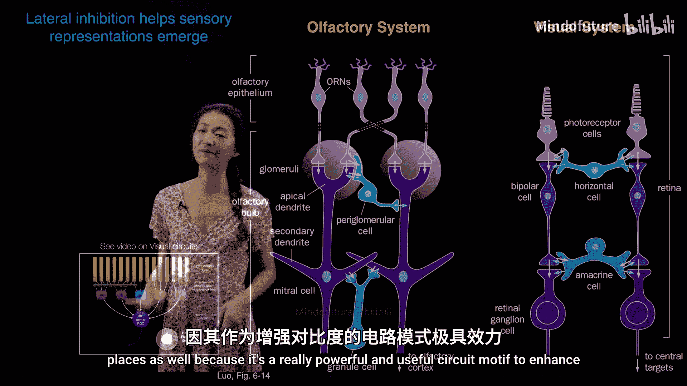

So we talked about the olfactory epithelium where olfactory receptor neurons live。

 they projector the olfactory bulb where they assaultsort by different types into a different glomeri。

 each clomerus has a single type of output cells they're called a mittriral cells and these mitral cells are the ones that then project to the rest of the nervous system now here is a difference between the smell system and basically every other sensory system here that we're going to talk about including the gustary system and the visual system that we just talked about smell does not go to the thalamus smell goes directly to cortex kind of a funky thing。

😊。

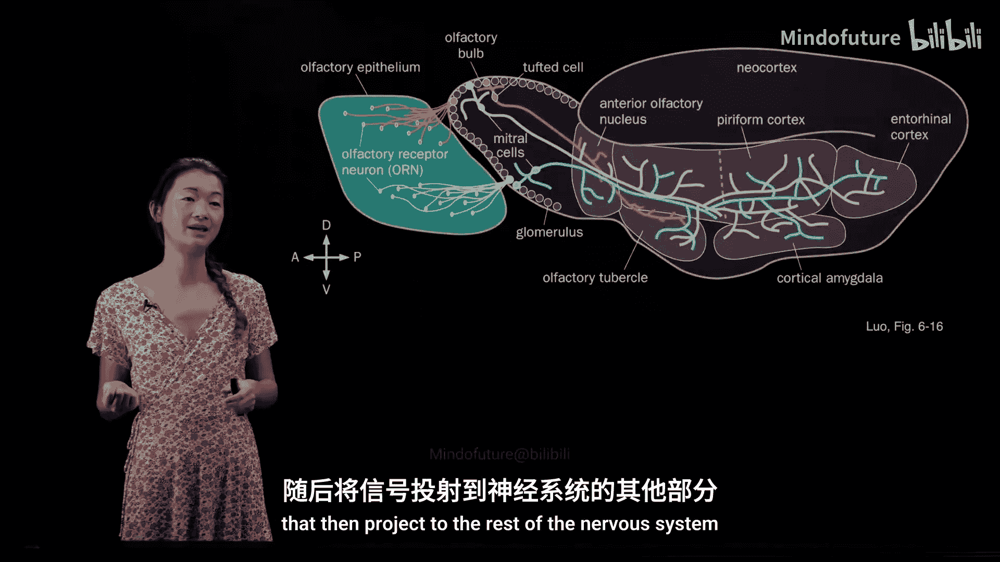

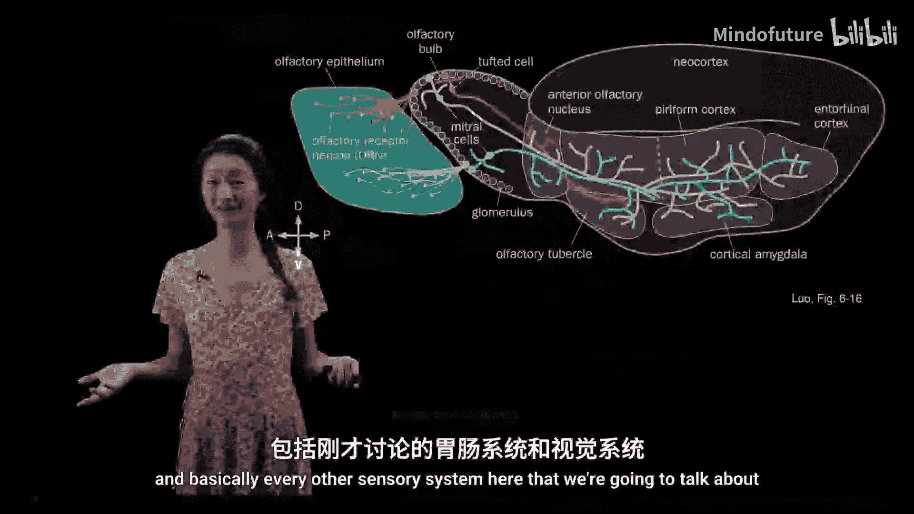

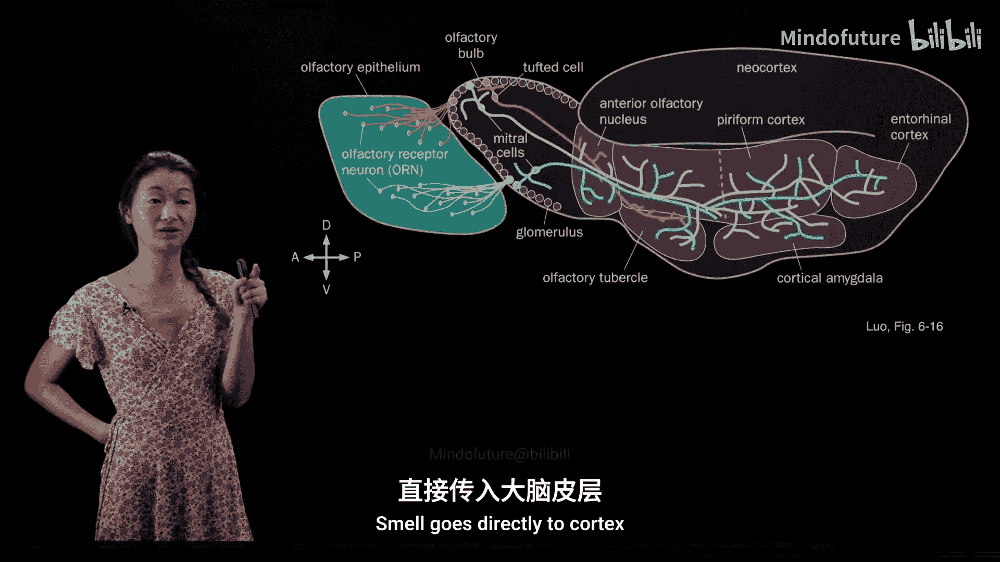

It doesn't have that architecture so the smell signals from the olfactory bulb project directly to a part of cortex called peerform cortex so just like visual information goes to visual cortex。

 gostatory information goes gostatory cortex， smell information goes to peerform cortex which directly receive outputs of natural cells of theolfactory bulb。

 it does not go to the thalamus， it just doesn't go there Or at least it does go there。

 but it doesn't go there is an intermediate step Now the peerform cortex。

 one of the reasons this might be an interesting thing it' kind of I don't know。

 these are just kind of interesting facts that are kind of all correlated with each other。

 the peerform cortex in fact does not look like other parts of neocortex so I haven't told you yet in this lecture series。

 but neocortex including all of the other cortices like like visual cortexolfactory cortex。

 Gostatory cortex prefrontal cortex， motor cortex， all of them are rather similar in their set of architecture。

 they have a six layered architecture where if you。😊。

Slicing half is the thickness of a credit card two millmeter thick right you see six layers of cells and they have some things in common across all of those different cortical areas but the pure from cortex as well as the hippocampal cortex are different because they only have three layers instead of the six usual layers that you have in the rest of the cerebral neocortex so the six layer cortex we call neocortex and pure from cortex and hippocampus hippocampaltex cortex it's not neocortex。

 it's archacortex and paleialcortex instead and they are thought to be more evolutionarily ancient and the other thing that they have in common is a pureform cortex and the hippocampal cortex are common origins of seizures it's just it's an observation that that's a lot of where seizures are origin when seizures are have a localization in the brain they are commonly found in pure from cortex and the hippocampal cortex as well and so in seizures in a pi from cortex because it is olfactory cortex and cause olfactory hallucination。

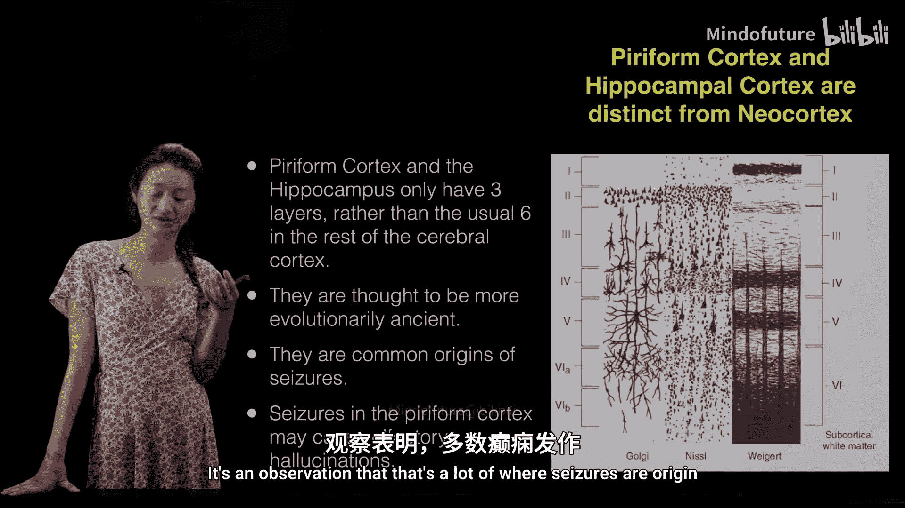

So this is a symptom of a common symptom of stroke， for example。

 people just standinging around when there is not breakfast being made and say oh。

 I smell toast so sometimes that's a symptom that something is happening。

 that's an abnormal electrical activity in your peer from cortex。Okay。

 so we talked a lot about smells and taste， I started this lecture by talking about candy and so we're going to end by talking about ice cream so the demo in the beginning was that smell and taste are one and they both contribute to our feelings about how what food actually tastes like but if you think about the neuroscience of food it's actually a lot more complicated than that as well so this is I was fascinated to find this interview with Ben and Jerry of Ben and Jerry's ice cream because Ben。

😊，Contrary to what you might think as somebody who is well knownn for having invented a large class of foods that people love。

 never had a really good sense of smell and so if you don't have a good sense of smell as our demo showed。

 you also don't have a really good sense of taste and so for Ben。

 because he never had a very good sense of smell， you don't have a good sense of taste and so for them a lot of the innovations in them their creation of Ben and Jerry's ice cream is to add crunchiness and texture to their ice cream。

 something that other ice creams didn't have at time and so creaminess and crunchiness a really important to people who can't taste and it's casually important to something we enjoy as well even if we can't smell and taste and so that made put them on the map so to speak back in the day when this was invented。

 and it was something that was an innovation in ice cream technology because it didn't just smell and taste like something it actually had this tactile sense as well。

Okay， so that was there was a sense of smell， here's a couple of key concepts that I'm going to review for you before we part today。

 olfaction is the primary sensory neurons in olfaction or olfactory receptor neurons。

 they live in the nasal cavity of your nose in the olfactory epithelium。

They express olfactory receptor proteins， which is a large family of G protein coupled receptors。

 We keep hearing about them。 They're really important。

 Each olfactory receptor neuron expresses a single type of olfactory receptor protein。

And olfactory receptor neurons that express the same protein also project the same graomers in the olfactorary bulb。

 that's the next step in the process that goes from thetoc cavity to olfactory bulb to pair from cortex。

And because theres so many olfactory receptor neuronss and different types of olfactory receptor proteins that can be expressed。

 it is only the combination of them at a population level， population。

 not popular code could be popular。 It is also popular identifies unique odors and odor bouquets。

 That's how we are able to pick out the scent of a row。

 even if it's far away for its close bites by that combination of different odorant receptors that get activated。

 do we know which odor it is。 and just like we saw in the visual system。

 there's lateral inhibitory start getting the olfactory bulb。

 and bilateral inhibition where activation of one one。

Gluomeryls in the olfactory bulb inhibits its neighbors do we sharpen this representation and allow the information to be processed in such a way that that by the time it gets past to the rest of the brain。

 the outputs of the glomerylis， these mitriral cells already have preprocessed information that makes it easy to identify unique bouquets of odors that are a relevance and something that we can act upon in the remainder of the nervous system and so that's it for mitral cells。

Okay， that mattress also these outputs， what we're going to talk about next is how the smell and taste and vision integrate with other different sensory systems and motor systems and how all of those actually work together in the rest of your brain to give rise to natural behavior and sensory motor loops。

