# 【华盛顿大学】神经科学入门 ｜ Introduction To Neuroscience ｜ Bing Wen Brunton p24 P24_躯体感觉-触觉__本体感觉__温度觉-痛觉-痒觉 -BV1i3qWBXEDH_p24-

Welcome back to the next video in introduction to neuroscience。 Now in this class。

 we don't have a track record of shying away from touchy subjects and we are not about to start now。

 This video is going to be all about somato sensation。

 then sensing of your body Now somato sensation can be broken down roughly into three different classes of senses and they have slightly different mechanisms in different pathways that are involved in nervous systems we're going to be talking about each of these in turn We'll start out with your sense of touch move on to your sense appropriate session。

 how do you know where your body and in space and then we're also going to be talking about temperature。

 pain and itch as a slightly separate category of senses in somato sensation Now somato sensation is one of the more complex and least well understood of the senses and relative to our understanding of things like vision and auditory senses there's just relatively little that we know about somato sensation and there's a couple of reasons why this is true。

😊。

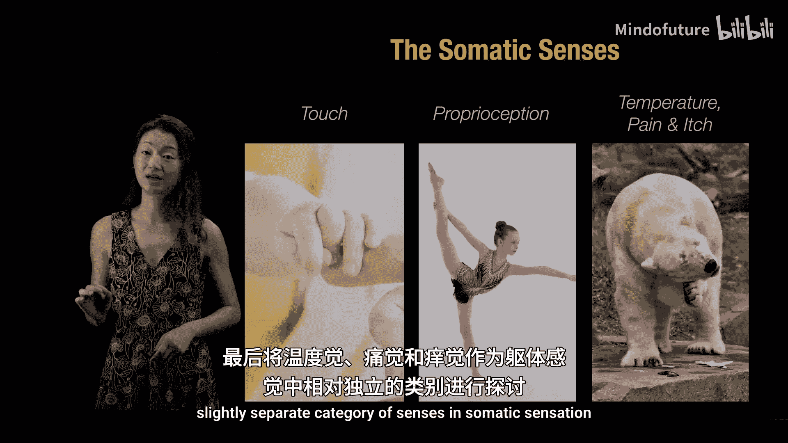

The first reason is， as I said earlier， somato sensation is about sensing of the body and so rather than having localized sensors that are in one place like all of your photoreceptors are in your retina。

 all of your hearing cells are inside your cochlea sensors involved in the somatic sensors are distributed all over your body and not only are they distributed all of your skin over your body they're also inside your muscles and this also includes sensing of the internal organs。

 something if you hear the term interreception that's something that's about the somato sensation of the internal organs and so this is a difficult topic in part because the primary sensors involved in somato sensation are distributed in wide a lot of different places and not only are they found in all of these different places on your body they also involved a lot of different types of sensory neurons again in contrast to photoreception we know that in humans at least there's rods and cones and there's three different types of cones but even among those four different types of photoreceptors especially in your retina they all relatively similar in the grand scheme of things。

Rooppin and they all involved in this cysttotrans retinal photo transduction pathway。 In contrast。

 as you'll find out in the remainder of this lecture。

 there's a ton of different sensory neurons and different sensory proteins that are involving some of sensation。

 so that makes it really challenging in the study as well。The other reason， as you'll see。

 is we talked a lot about in the beginning of the set of lectures on sensing in action about how it's actually not sensing and action。

 but a tightly integrated sensory motor loop。 Now， this is also true in vision because， you know。

 after all， there's active vision， you can move your。😊。

Body around actively to seek more visual input and also seeing something allows you to guide your movements in the future。

 but this is this type of tight coupling between sensation of movement is nowhere more obvious than in the somato sensory senses and it's because the movement of all the different types of different neurons are in tight feedback loops with your motor system one of the most rapid senses and it feeds back onto the motor system with a short latency and it's also something that we don't really consciously think about very much like if if you're hiking and you step over a rock and you trip over something really quickly and you correct it's something that you do without really thinking about it and it happens in a very very rapid time scale and so that makes it so that it's really hard to study somato sensation when the animal is immobile as you know from the lecture on electrical and optical methods are we using modern neuroscience the vast majority of those methods involve the animal being relatively inmobil if not。

Completely immobile than at least somewhat restricted to a small arena and so having a sense that is so tightly coupled with movement makes studying it more challenging to a technological perspective and it also makes it so that it is recordings done when movement is happening is prone to all kinds of different artifacts so even electrical artifacts。

 optical artifacts associated with a body moving around。

 all of these are kind of technical challenges associated with studying somato sensation that makes it so that we can do it。

 but it really involves a whole brand new set of different tools。

 both technological tools as well as computational tools that really deal with the type of data that we're getting out of studying of the somatoenstry system。

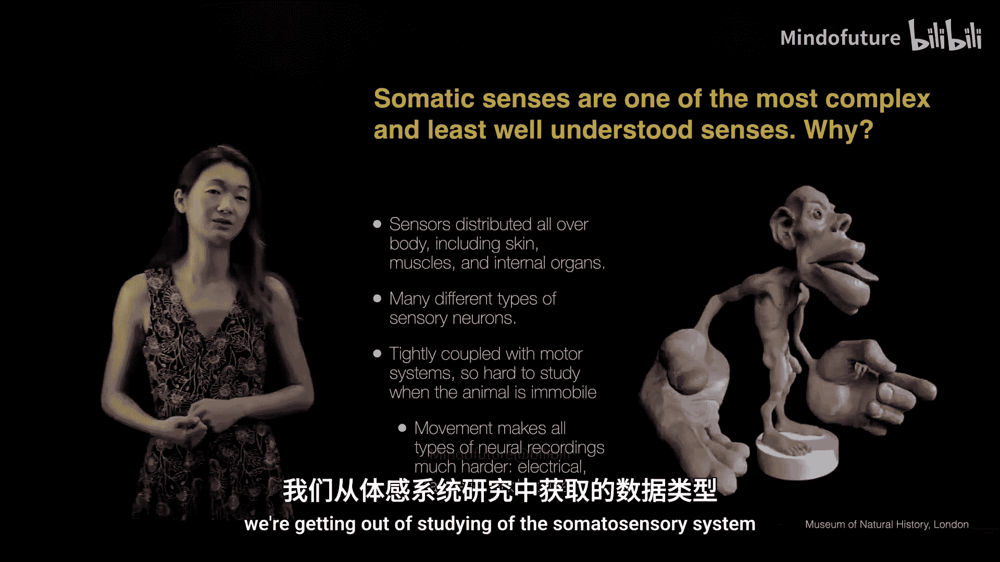

But we do know more than just a little bit so I talked about the three different types of somatoensory senses touch per perception。

 temperature pain and itch now a majority of these are associated with a mechanical stimulus so this has to do with forces stretch and strain for example they come with different kinds of peripheral endings and our different proteins that are involved in each of those different types of cells some of those cells have very interesting geometric specializations that make them suitable for detecting that particular type of mechanical force there's a lot of geometry and morphology involved in study of somato sensation in the case of temperature there's also there's some sensation of heat and cold and chemical senses and so that's a whole new different class of molecules that are involved in that detection and they're often found as free nerve endings and on your skin as well as in internalal organs and so the study of somato sensation is kind of lumping all of these things together and so we'll see throughout this next couple of lectures what they have in common as well as what are some details。

😊。

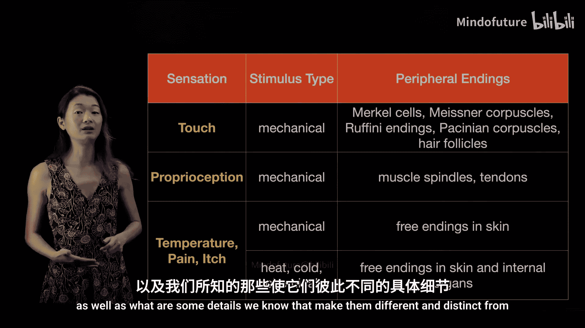

We note that make them different and distinct from each other。

Okay so I told you that amount of sensation is a sensing of the body and so how is the nervous system of the body organized。

 We mentioned this a little bit in the lecture on the organizational nervous system。

 but I'll bring it up here one more time to tell you a little bit more about the details So your brain and your cerebum' up here and the whole thing kind of projects down through your spinal cord and what happens is that you have these vertebrae that on your spine and there are these nerves that come out in between every single one of these vertebrae and they go and innerte the rest of your body going outwards now they're organized in the following way there's some words that I'm going to tell you about with which we refer to these vertebrae So there's the cervical vertebrae thoracic having to do with the middle part of your body lumbar kind of the back and then sacral kind of towards where you would have a tail of human head tails。

 but this is where a dog or horse that have a tail that kind of the sacral version segments of the spine。

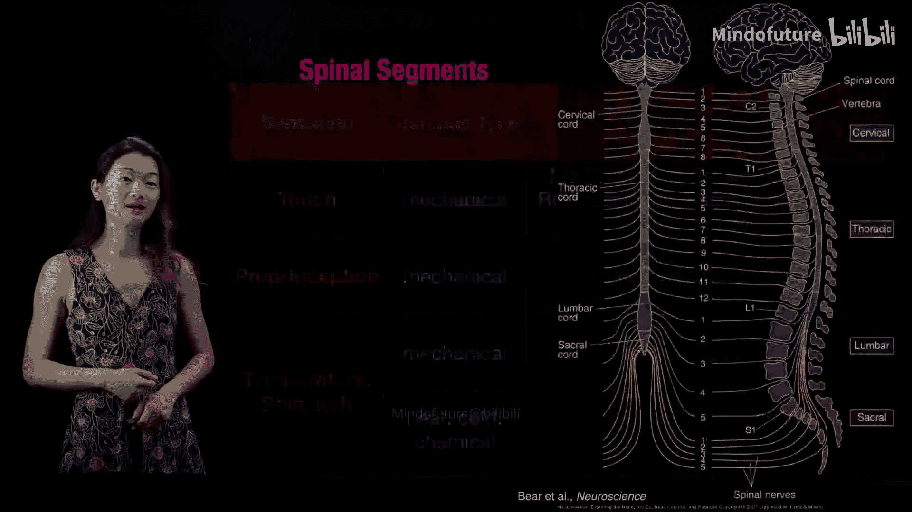

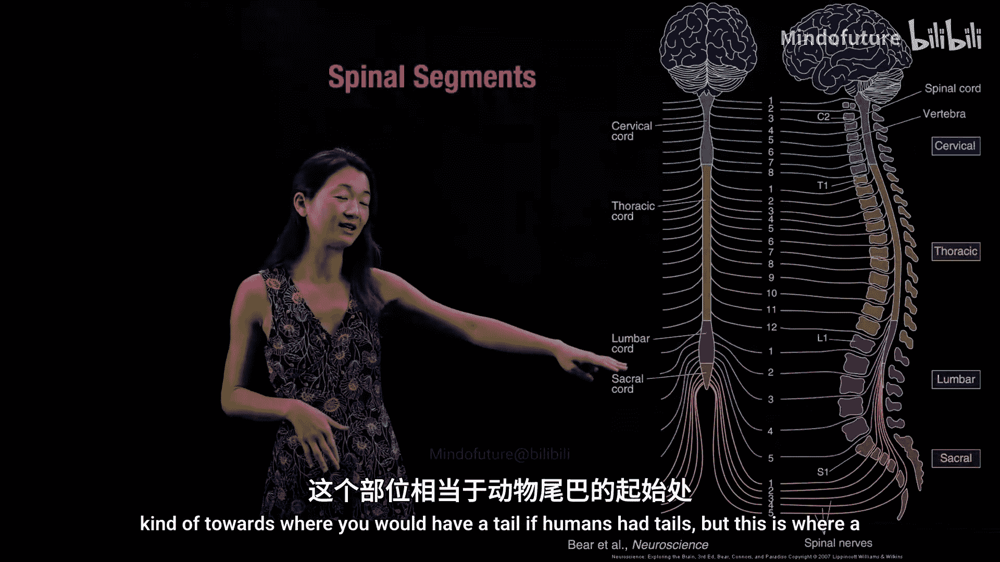

There are canonical versions of these and they all have numbers they start with one and they go towards whatever they are right in humans these are the numbers that apply in the human case。

 but there's course of substantial variability depending on the animal you're talking about one funny fact that I thought was really interesting is the vast majority of mammals have seven cervical vertebrae so those on a vertebrae that go from the very the first one that's right underneath your brainstem to the first to the last one that's right above your shoulders so you and I each have seven cervical vertebrae and all mammals have seven vertical vertebrae including this gigantic giraffe here so if you've ever seen a giraffe in a zoo or say let's a giraffe in a museum you can actually notice that they have seven gigantic cervical vertebrae they're each like this big it's really crazy to look at in contrast in avian species they also have really long exaggerated next but among the avian species the number of cervical vertebrae can vary anywhere from 11 to 25 so there's a lot more variability。

In terms of the organization of the cervical vertebrae in avian species。

 which a couple of other really funky spinal specializations of birds that I love learning out about。

 maybe I'll tell you about that on a separate occasion。

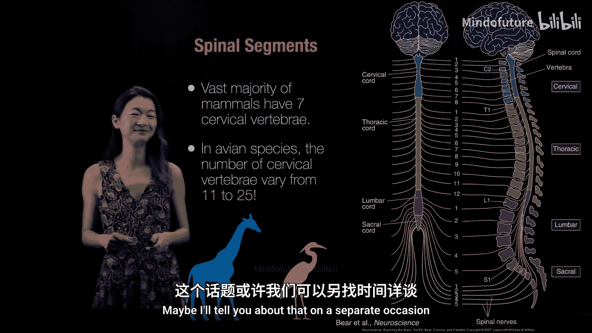

Okay so that's the organization of the different segments of your spine。

 Now each segment has the following organization and it kind of repeats right so it's not exactly the same。

 but each canonical spinal segment has the following structure it is bilaterally symmetric as you may expect and so there's a midline and there's what's called central canal down the middle through which cereral spinal fluid flows and it has a left half and it has a right half there's a bit of white matter through which all of the cables run up and down towards your brain and away from the brain and it has what's called a dorsal root ganglion in the DG and the dorsalal ganglion is where the cell bodies of all of the sensory cells that the rest of your body live So it's one of these funky cells where the cell body actually lives in the spine in the dorsal root gangion in the spine。

 one end of it goes to the patch of skin or muscle that it inters and the other end of it projects all the way up towards the bottom of your brain stem So the dorsal gangion。

Lceral ganglline is where the cell body， the sensory cells live。

 as you'll find out in one of the later lectures， the ventral root is where all of the motor cells live。

 but by the time you get to these nerves that are leaving the spinal cord。

 the sensory and motor nerves are intermingled kind of in the same bundles。

 you can no longer distinguish them that way by the time you have a bundle of nerves。

 leaving each of the spinal segments。

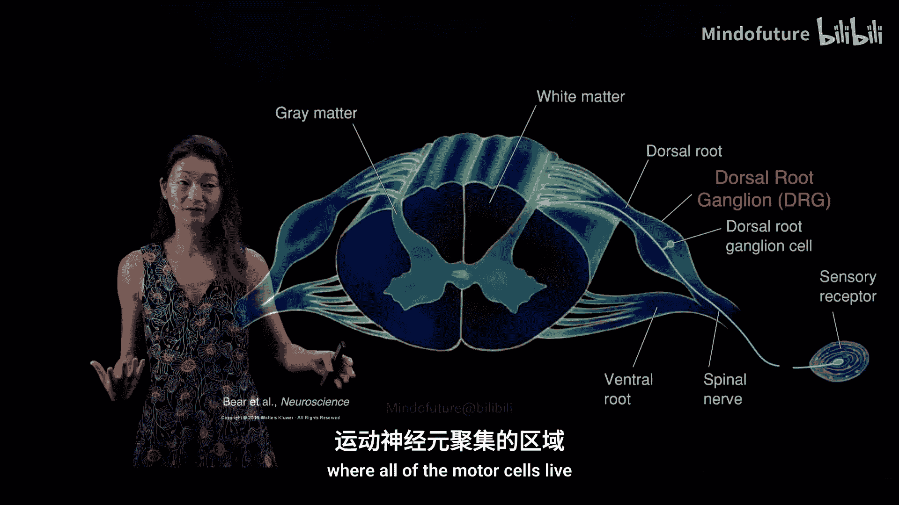

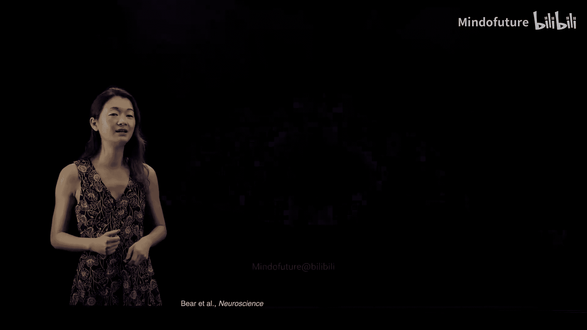

A bit more organization here That is a consequence of this organization of the human spine。

 you can kind of map the patch of skin to which each of the spinal segments go to and draw a map of the following way it's called a dermatoome because it is a map of the patch of skin that go to the same go to the same spinal nerve so for example here we were talking about the cervical nerves before so you can see C1 is what actually know C1 whatever it starts with C2 C2 C3。

 C4， C5， C6 and7 and they are all responsible for inervting strips of your skin starting from the neck and the back of the head and then all the way going back down to most of your arms the majority of your arm is invated by the cervical cervical spinal nerves and the only one that is innervated by T1 the first thoracic segment is this strip of skin right here and you can kind of see what it looks like on the back of。

YouIn your kind of upper back area as well。Now these deermatoomees are interesting。

 not only because because they're true， this is interesting， it's actually how it works。

 the other consequence of the dermatoomes is if if you think about a viral infection like chickenpox now chickenpox is a type of herpes virus that makes you really itchy。

 I caught it when I was a kid and what happens after you recover from the major primary symptoms of chickenpox is that those this herpes type virus a herpeszoster virus actually starts take subre in all your peripheral nerves like in the nerves that go from that patch of skin to the spine and it kind of just hangs out there and it lives there for the rest of your life until and if you are usually as an older adult or under a tremendous amount of stress。

 sometimes people get these an immune compromise they re-emerge as a shingles surprise distribution of shingles because of the fact the viruses live in your peripheral nerves will often。

Highlight one of these dermatos， like you'll have somebody who has shingles。

Not everywhere on their back， but one strip that corresponds to like T3 or T4 or whatever it is。

 it'll have that geometric organization that highlights exactly delineates the dermatoome on that individual Because it's the herpes viruses that are reactivated in that particular peripheral nerve that flared up and caused shingles So it's kind of kind of interesting but not exactly charismatic way of visualizing these dermatomes The other question you might be asking yourself is this is kind of weird like why is it like this。

 Why is this one strip of T1 that innervavates like your forearm area and why is it that the front of your leg is innerervated by all of these L and an S segment。

 the back of your legs is entirely different， this makes so sense and it really doesn't make sense and it only makes sense if you think about it in terms of animals that are not bipedal like we are and so if you do one of these if you do one of these moves where you try to touch your toes you will see that your dermatoomes that line up almost。

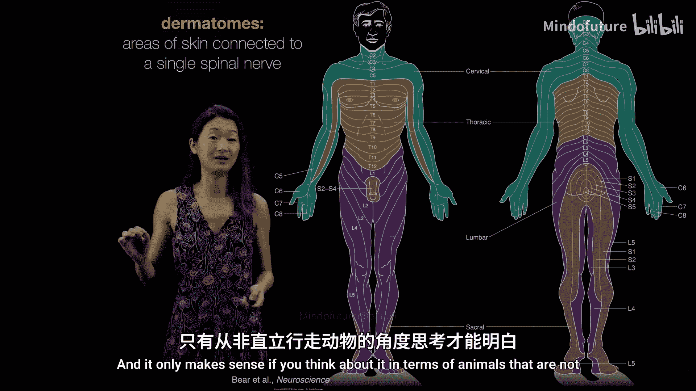

In terms of the anterior to posterior access of a quadruped animal and so just like the orientation of the brain in terms of what is anterior and what a coronal section is and what is front and back in the brain versus the rest of the body in the spine。

 the organization of the gerome can be explained by the fact that they were established when we we were not a bipedal species and so totally make sense in that context going think about where they are。

 why those strips are where they are， that's the reason why they are， where they are。

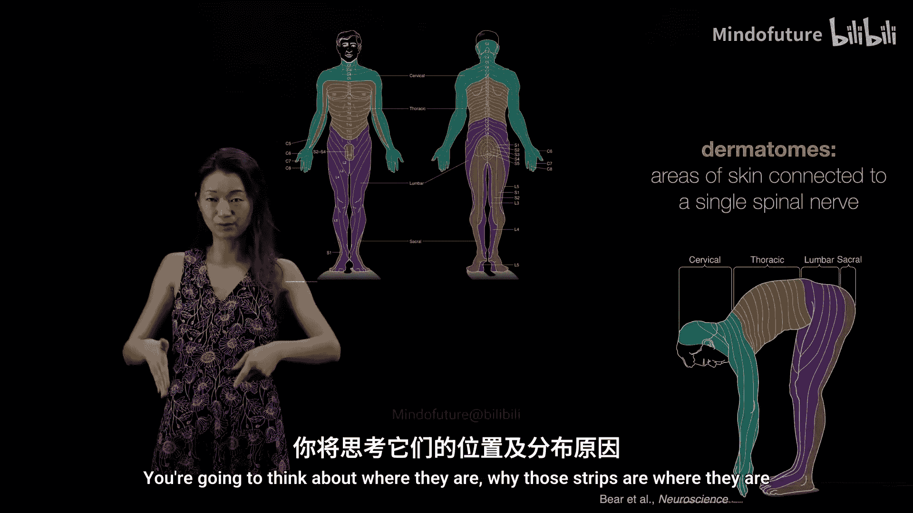

Okay so we talked about the dorsso ganglion cells and these are the sensory cells that innervate your skin as well as your muscles so there's a couple of different things that I wanted to highlight here about a little more finer detail organization of the dorssoro ganglion I'm highlighting here that there's different classes of sensory somatosensy neurons who cell bodies live in the dorso ganglion and they one end is the primary sensory ending and they go to different parts of your skin and comprise it a large class of different touch sensors we'll get into exactly what they are later there's also a preview of what's coming up in the next section of the video about proprioceptors these are proprioceptor spindles。

 muscle spindles that are actually embedded in the middle of your muscle and they are responsible for measuring the length and rate of change of your muscles and so every time your muscle gets longer or shorter these spindles will fire in proportion to the length and the rates of change and so all of these mechanicalchansensy neurons are going。

To be projecting to the dorsal root ganglion cell。 but they are not all the same and one of the ways in which they're different is the extent to which they are myelinated Now if you remember back to the lecture about the cable equation and conduction by myelinated and unmelinated axons I told you I previewed a little bit there that not all of your axons are myelinated and in fact the ones that are myelinated or usually the more important ones where you have to get that information really。

 really quickly and then some other axons are in fact unmyelinated because you don't care about getting that information very quickly。

 it doesn't really matter where it actually may be advantageous for you to receive that information more slowly well this is the biggest best example of that。

 So among all of the nerves that go to that go come from your dorsal ganglion cell is a variety of different axons some of which are heavily myelinated and some of which and they have different names are not at all myelinated。

 If you look at the ones that are heavily myelinated they include these propreceptor neurons and the propreceptor neurons have to project very。

 very quickly as quickly as possible。Well， to your spine because this is your sense of update of where your body is。

 this is the only way if I close my eyes that I know where my arms are and so these propreceptor neurons and muscle spindles are one of the more heavily myelinated parts of your nervous system because it is so crucial that they get the information to where they're going very quickly。

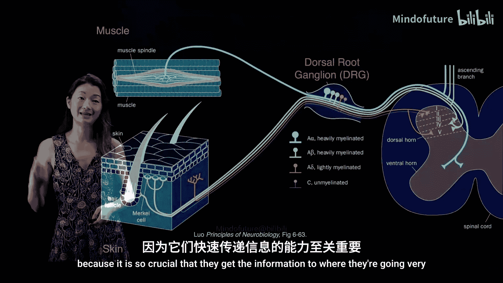

Okay， so we talked a lot about these types of neurons and so now we're going to start characterizing them in the same way that we characterized visual cells in terms of the receptive field。

 we're going to expand on that topic here and use the same terminology in the same approach to describe somatoensory neurons like visual neurons somatoensory neurons have a spatial extent of their receptive field now the receptive field in this context literally means what part of the skin do you have to po on do you have to touch to get that somatoensory touch receptor to fire so it is a receptive field in this actually a physical map that has a picture of that part of your body and with a dot on it and it says okay this is this is my receptive field of this tactile neuron here and it means if I poke at it that's when it's going to fire very。

 very intuitive， it's very like literal spatial receptive field on the space of your hand just like we had spatial receptive field for visual neurons which was usually a location and visual space like flash of light here I'm going to act。

one neuron flash of light here。 I'm going activate a different neuron similar here。 If I poke here。

 I'm gonna activate this one touch receptor neuron。 And if I poke somewhere else。

 it's going activate a different receptor neuron。 Now。

 I've shown you pictures here of two different touch receptor neurons and they're both touch receptors。

 but they're different types。 they have names that are named after some of the individuals who are first responsible for describing them。

 So we have these messen corpuscles and painian corpuscle and you'll see immediately that these two different types have overlapping receptorive fields there's parts of your skin that are innervated by both of these types of tactile receptors。

 However， they are really different in terms of how large receptor fields are。

 mess corpuscle have very small spatial localization， they're very sensitive。

 they're only referring when you poke that very precise piece of the skin。

 whereasas Pacini corpuscles have these gigantic receptor fields。

 which just like half of my hand So you can have these spatial receptorive fields that describe how sensitive and which areas of your。

😊，Of your skin， these different touch receptors are sensitive too。

Now different neurons talked about having different recipient field locations and sizes。

 so that's an illustration of those they also can have differences in what is the threshold intensity that causes them to fire an action potential so you can have as a property of that tactile neuron as a part of its receptive field it's sensitive so some of them may be really sensitive you'll barely scratch it and is going to fire there might be other ones that are relatively insensitive you have to really hit that piece of skin before a fire is an action potential the other way in which the receptive fields of these tactile neurons differ is a timescales of adaptation now adaptation refers to that the fact that when in the absence of change in the stimulus a lot of neurons will adapt and stop firing when nothing is changing so it's reporting a change in the stimulus rather than an absolute value or intensity to stimulus and that is also very much true in different types of tactile neurons will have neurons with different timescales of adaptation some of them only fire。

RightWhen you touch something others will continue firing as long as you're continuing to touch something。

 And so we have a variety of different receptive fields and these are all the different ways in which they can be different。

 and these are features that we would characterize when we talk about them in terms of what's their favorite stimulus how do you present a stimulus to this neuron to get it to fire for you So these are a couple of different features。

 we talked mostly about spatial features but these neurons also have temporal features because after all it's not just the location of the touch that matters。

 it's also the frequency So here again we're talking about the same two different touch receptors。

 the messen corpus skull and the painian corpus skull and you'll see that on the horizontal axis here。

 we have the stimulus frequency So this is interrogated when you basically get a a little vibrating probe and and you you find your little probe you put it on the piece of skin and you vibrated different frequencies and that's logarithmic axis up there so you can see that every time the tick part。

Goes up， it's actually going up by several fold orders instead of in the linear scale 10 hertz means 10 cycles per second that means I'm pushing down 10 times per second and 100 hertz means 100 times per second。

 which is 10 times faster than 10 per second okay now on the vertical axis we're plotting there its a threshold amount of skin indentation that caused that particular。

ItRecept fire， so also in logarithic coordinates， right this is in microns now。

To unpack all of that information， the lower the threshold。

 the more sensitive it is right so the very bottom part of that sensitivity curve means that that particular tactile sensor is most sensitive at that frequency。

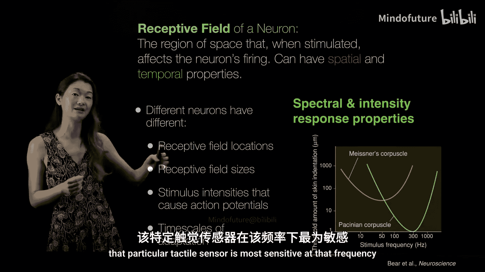

So the lowest threshold that activates one of these orange receptors is right here around 50 Htz。

 That means that's its favorite frequency。 if you hit that frequency。

 it will have a very low threshold it's very easy to get into fire whereas for one of these gigantic perinian corpuscles it is super duper sensitive。

 you'll notice that the difference here is it's over a tenfold is almost 100 fold difference in terms of sensitivity。

 So these perinian corpuscles have gigantic spatial receptive fields。

 they can't localize where the stimulus is in space but they're significantly more sensitive and they're sensitive at a higher frequency。

 So it's peak frequency。 like sensitivity frequency， it's a 300 Htz rather than a 50 hertz。

 So we see for the other types of corpuscle So those are all the different ways that we can describe a receptive fields and these tactile neurons so to summarize different neurons have different receptive fields and these receptive fields you can characterize it in terms of a lot of different dimensions and none of this is complete no one dimension of characterization of receptive fields is complete It's really a combination。

😊。

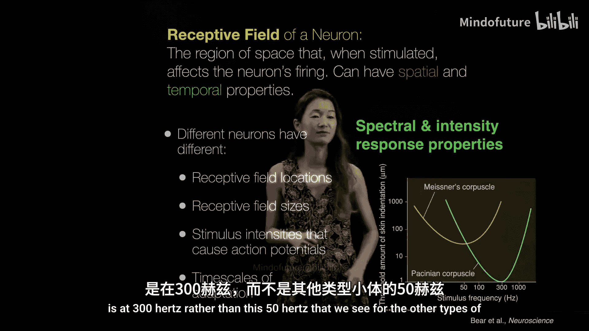

Thesese properties that makes it so that we can fully characterize what are the features that these particular tactile sensors are sensitive to and we have to pay attention to both space and time I talked already about pcini corpuscles and they're quite lovely also' partially they're lovely because their reive fields are so large that they're actually macroscopic and so if you look online you can find videos of hand surgeons where you can dissect out pciian corpusscle。

 they have this really cool shape where it's like just like a myeld axon with all the glia wraps it's all these these little wraps and so these kind of like a squishy gel pack and that's how it achieves the exquisite sensitivity that it has in detecting different very high frequency vibrations。

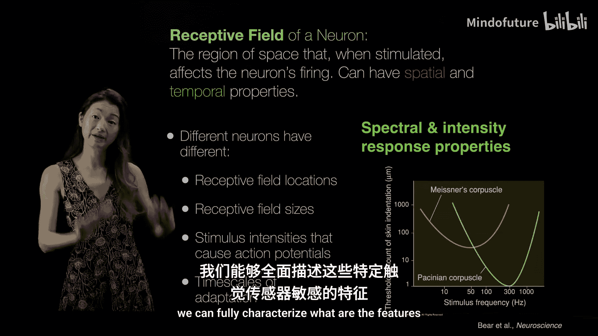

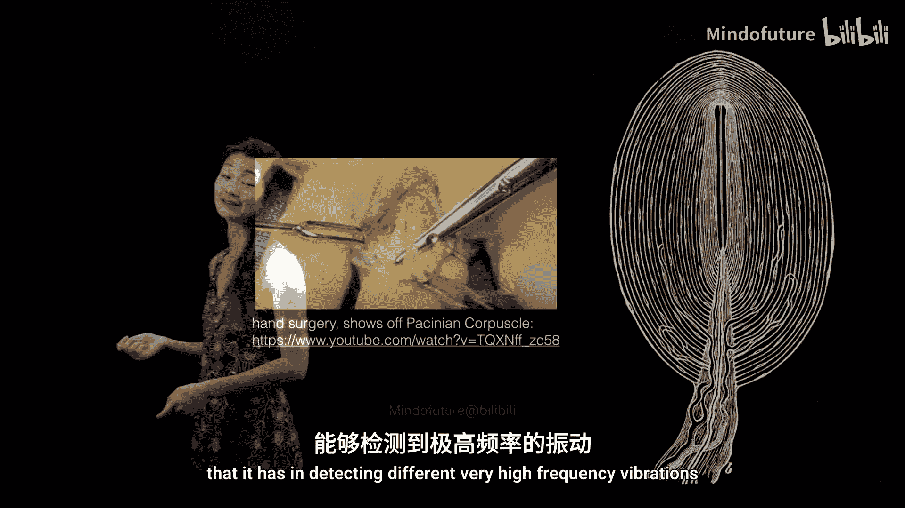

The procii coros is also a really good example of what I'm going to call embo computation。

 so in neuroscience we talk a lot about neural properties。

 but of course if you dig down into into the properties the mechanisms of transuction if you have to get down to the level of proteins。

 chemicals as well as biophysics in terms of the photoreceptors we talked about。

 we spend a lot of time talking about the biochemistry of the retal。

 also the way that it's stabilized by the rhopin molecules thats surround it because that is the basis in which it can detect photons similarly if we're talking about receptors that are embedded in your body。

 we're really then talking about the biomechanical trans channels。

 that interact the biomechanics of the cell， as well as the biomechanics of the tissue in which is embedded so all of these touch receptors are embedded in your skin and that means the stiffness。

 the elasticity of your skin as well as how much your muscles are bending and how the relative orientations of your bone。

 those biomechanical details are very much。Important because they are the ones determining the stimulus in terms of forces that actually make that particular cell fire。

 so what I mean by body computation here is that the receptive field of that neuron is not solely a neural property or a protein property or a chemical property。

 it's very much a property of all of those things and the mechanics of the limb in which it happens to be embedded。

 and we need to know all of that in order to figure out what's going on。

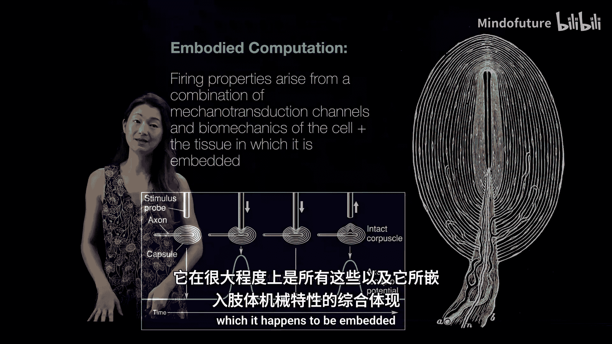

All right， want to keep digging in， take a little bit more details about the mechanicalensory touch neurons。

 they have a bunch of different types and they're all embedded in slightly different places in your skin。

 so there' are some of them that are in your epidermis。

 there' are some of them that are in your dermis and they have different names and so we're just going I less concerned about new learning the names of these exact these exact receptors but we are going to talk a little bit more about their properties and the different ways that their receptive fields are different and so here we have five different mechanensory touch neurons and they have letters and numbers let's not worry about that for now just go with me for a little bit there's five different types of touch receptors that are colocalized on your hand on your skin and here is how they respond to the same stimulus so my stimulus is a probe that's going to go down push on the skin and then come back up that's this curve down here I' going to push and then let go okay so you can already see immediately that these five different types of receptors are going respond very differently to the same stimulus。

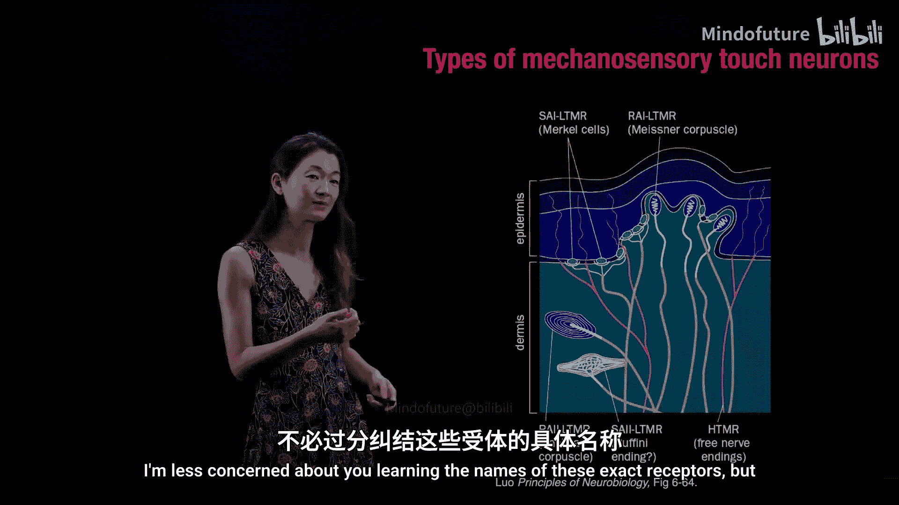

We'll have ones that are relatively slow adapting， where they're really responding by firing faster to the indentation。

Okay。So they don't really adapt。 They're actually persisting firing faster when you push harder on them。

 On the other hand， we have， and among them， we have the small receptive fields and the large receptive fields。

 but they are both slowly adapting， okay。We also have what are called rapidly adapting cells。

 also with the other two different types， small receptive fields and large receptive fields。

 and they're rapidly adapting because yes you can see they're only really firing action potentials as you're pushing down and then they stop even if you're holding and then they fire again when you let go because they're really respond to that change rather than the intensity of the indentation so we can call them like movement detectors and also vibration detectors。

They can also come in different types in terms of how sensitive they are。

 these four are all considered low threshold and mechanicalreceptors， they're relatively sensitive。

 their threshold for firing is pretty low and you just have to barely touch them on they'll fire。

And then we have ones that are relatively high threshold mechanical receptors and those have slightly different properties and you can see that they fire in response in this very slowly adapting way。

 but they're different in that they have a higher mechanical threshold and in terms of the circuitry of where they projected next and what information your body is getting from the sensor and what it does about it that's sort of like at downstream circuit level question that will get you in a couple of lectures so that was your sense of touch and the different receptors that are in your skin that are responsible for your tactile sense Next we're going to move to the next somatic sense which is proprioception I've already talked a little bit about propriocception because you can't really separate the propreceptive neurons from the touch receptor neurons in your nerves so we already had a diagram where you can already see that there were these muscle spindles that are all wrapped up together with your touch receptors and they all go to the dorsso regain gang glion cells but proprioception is a word that is a well it's a less common English word than touch everyone knows what touch is but most。

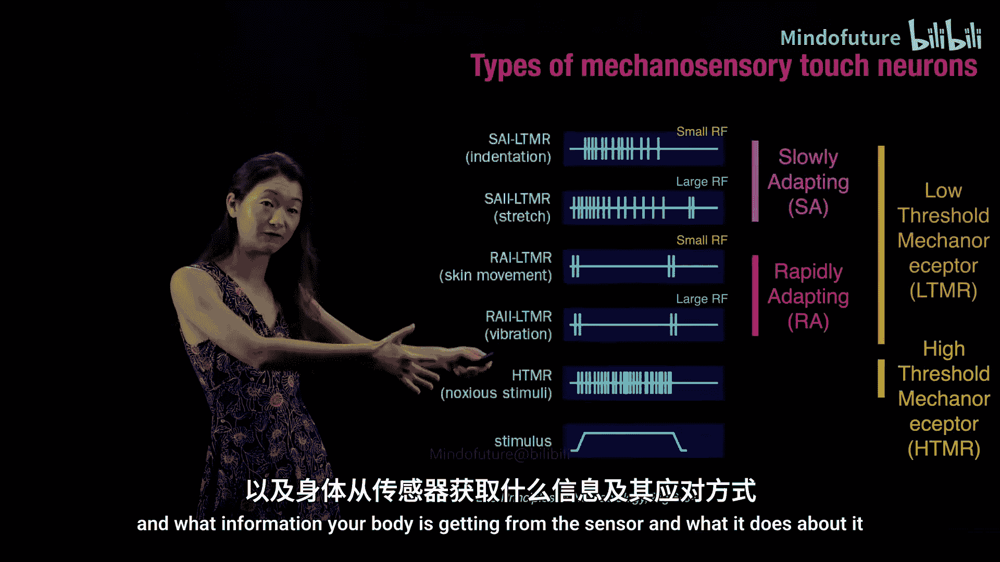

People until they take a class in neurobiology don't really know what propriception is。

 I think it's worth taking a moment here to just demonstrate exactly what I mean by propriception Proception broadly wri is defined as your sense of how does your brain and your nervous system know about where your body is without looking at it So the classic demo is the following So I want you to do is I take your two index fingers and with your eyes open you're going to make them touch each other hopefully this is something that is possible for you to do then the next thing I want you to do try to do exactly the same thing but with your eyes So now I don't really see my fingers kind of missed there。

 but I got close that was pretty good my fingers are touching each other leastre getting close to touching each other So for me to accomplish that task without vision requires that my nervous system my body know about where this arm is and where this arm is in space So that's my sense of propriception It's a set of mechanicalchanss that allows my nervous system and my central。

And peripheral nervous system to estimate the exact angle and kinematic trajectory of my arms。

 even when I'm not looking at it Now per perception is a sense that is， I think。

 pretty underrated because we don't really think about it。

 we take perperception for granted and you only realize how bad it is when you don't have it because there's a couple of rare different neurological disorders for a couple of individuals have lost selectively only their preperceptive neurons and they basically can't do anything。

 I mean they can't basically can't move their muscles are fine。 the touch receptors are fine。

 their vision is fine。 everything is fine but to do even simple tasks like picking up an object requires that you have this rapid feedback from your muscles and your joints about where that arm is and if you don't have that it's really hard to do it without staring at your arm and so there are individuals who have after a long trial and error learned how to walk again because when you're walking you don't really look at your legs you just walk know your。

Know where they are。 And they do their thing。 It's distributed。 But if you don't know where they are。

 because you've lost your sense of propriception， then you can only walk by staring very intently and concentrating on where your legs are。

 So it is possible to walk without propriception。 but per perception is absolutely vital for coordinated movements for the types of very fluid。

 very natural movements that we all enjoy。 Okay， so that's why prop perception is and why it's important。

 Let's dig a little bit more into the different types of propriceptive neurons。 in my mammals。

 they come in three rough different types。 And they're all important。

 and they do slightly different things。 I've already told you about the muscle spindles。 Now。

 muscle spindles are。😊。

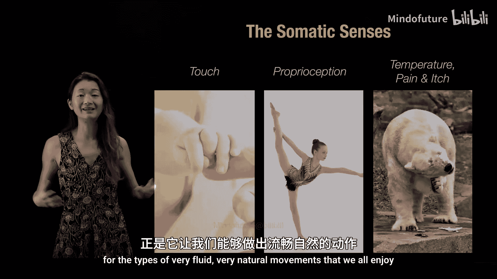

The cansensory neurons that are embedded inside your muscles and they are there so that when the muscle changes lengthly you're contracting or you're extending your muscles。

 the muscle changes length and as the length of that muscle changes either stretches or contracts and changes length in the muscle spindles are responsible for sensing the length of that muscle and its rate of change so in other words it's measuring both a position and derivative of your muscles and you have these muscles that you have these skeletal muscles in which the muscles spindles are embedded now all of your muscles have spindles but a large number of the skeletal muscles that are responsible for moving your joints do have spindles you also in your arm had what are called Ggi tendon organs are located as you may expect in the tendons they sense muscle forces and its rates of change So if you remember from physics length is position rate of change is DxTT and enforce force is going to be proportional to acceleration so it's going to be the。

One more derivative it's going to be a second derivative position is going to be proportional to the force and so these goer tendon muscles are sensing muscle forces and its rate of change In addition you have what are called joint receptors that are actually embedded inside the joint so where in your elbow joint there's two bones that they fit together and the joint receptors are actually inside that interface and they're usually there to sense extreme joint positions kind of when you hit the very end you're fully extended this joint can't go any farther that's when the joint receptors are going to be activated Now these three classes the mechanical sensory per receptor neurons have different biomechanical mechanisms and they also connect to different pathways in terms of how they go to your spinal pathways as well as where your body does with the rest of information how does it compute on this how does it actually use that to determine how you're moving your arms how are you walking how you're locomoting stuff like that。

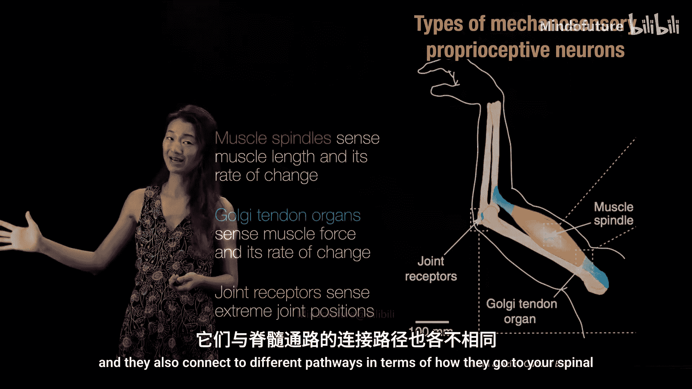

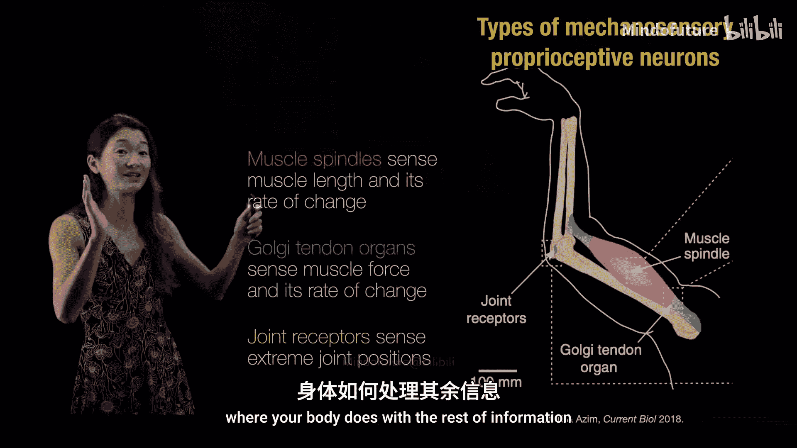

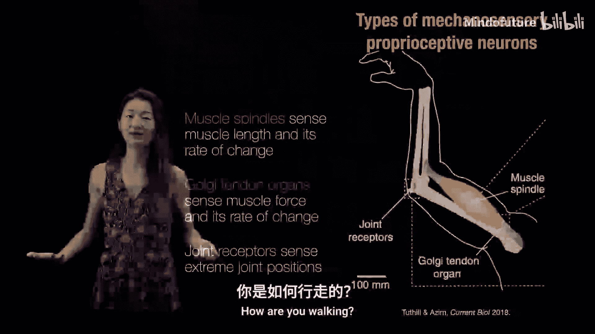

This is the mammalian version， but interestingly there is actually an analogous version of every single one of those receptors in the invertebrate system。

 then the names are all different and the mechanical mechanisms actually are different as well。

 but there's analogous structures for the spindle， the tendon organ as well as a joint receptors if you're looking instead at an insect leg rather than at a mammalian or vertebrate limb。

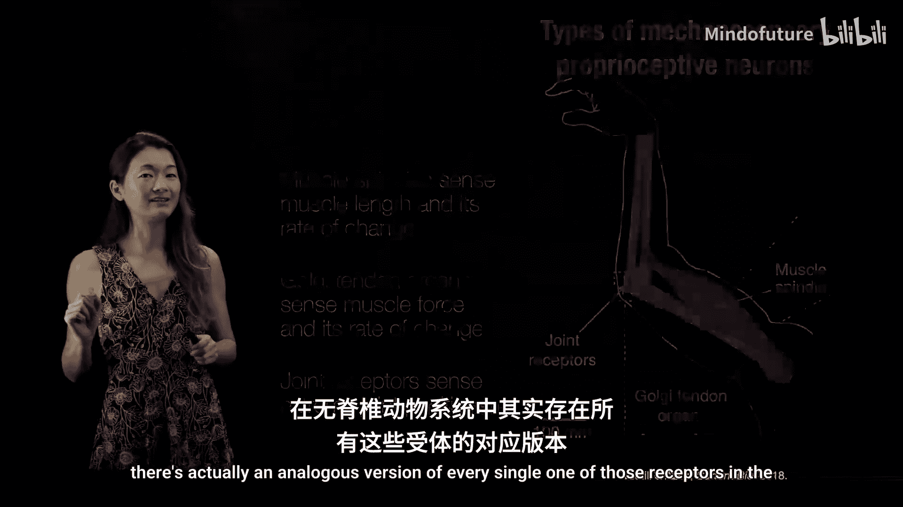

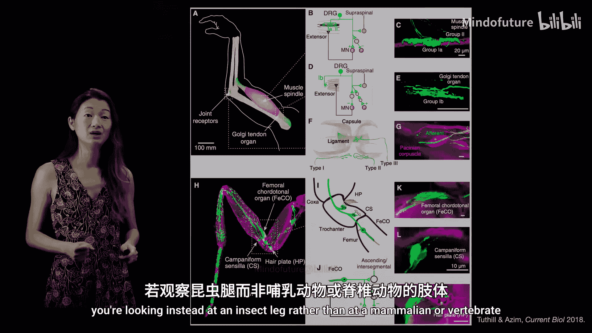

Okay so mechanical sensation in mammals had a heyday had a giant celebration a couple of years ago because Arum Pattoputian was awarded in the Nobel Prize a couple of years ago for his role in the characterization discovery of a class of proteins that turned out to be absolutely crucial for mechanical transuction in mammals and the protein's name is pieazzo the pies piezo1 and pieazzo2 there's a couple of different types and they're found all over the place absolutely vital for sensing of mechanical transuction in mammals and so you see there is is a demonstration of that when you have a mechanical stimulus that is defleion of some kind with pieazzo the cell is able to fire a current if you knock out pieazzo2 the no more current。

 this is the necessary and sufficient for detecting mechanical deflections when you have a mammalian cell now as you may suspect like we talked about in basically every single lecture。

 this is a cion channel and is a mechanically gated nonselective cion channel。

The course of these lectures we have seen voltage gated cion channels。

 we have seen liend cion channels， we have seen photo activatedivated cion channels here is a mechanically gated nonselected caion channel it is not the only non-selected caion channel that's mechanically gated。

 there's actually a variety of them that other species that are not mammals have but this is the one that is vital in mammals so that's the one that we have to do all of the things that we need to do that involve mechanical forces and stretch and strain and stuff like that。

😊。

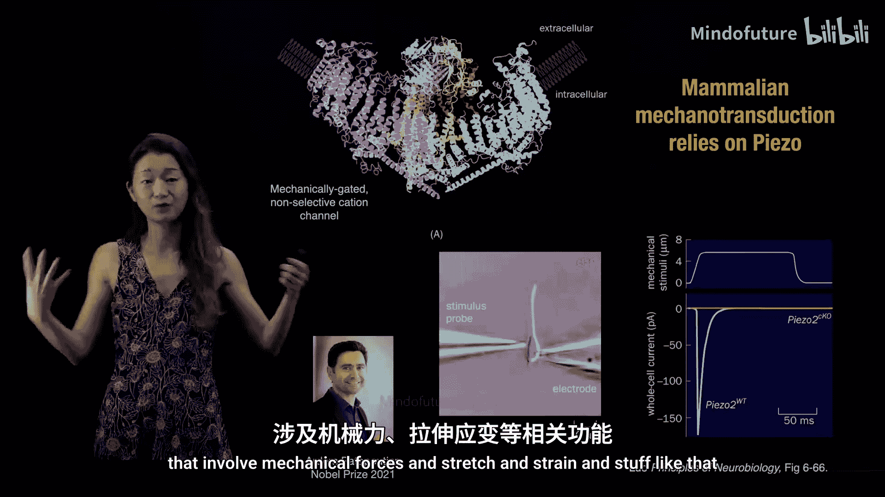

It is also involved not only in what you normally think of in terms of movement。

 it's involved in a lot of different interoceptive systems so here。

 for example there is a paper that demonstrated that pieazzo2 is necessary for the proper function of the bladder so it's inside the bladder these cells are in the bladder because when the bladder becomes full。

 you have that sensation of oh man I I got to go so pieazzo is the protein that lives in the sensory cells of the bladder and gives you that sense of urgency and completely changes your behavior when you feel like your bladder is full and you have to go take care of the situation before you can do anything else and so it's not just found kind of these like gross anatomical movements but also in interoception as well so if you have like a sense of things moving around in your gut maybe if you ate too much。

 maybe sometimes you feel things inside your inside your inner organs there's variety of different nervous systems。

Inside your internal organs， I'm not really mentioning them here。

 but they're actually super du important， and so piezo and a class of proteins that are related to piezo are all involved in those pathways as well。

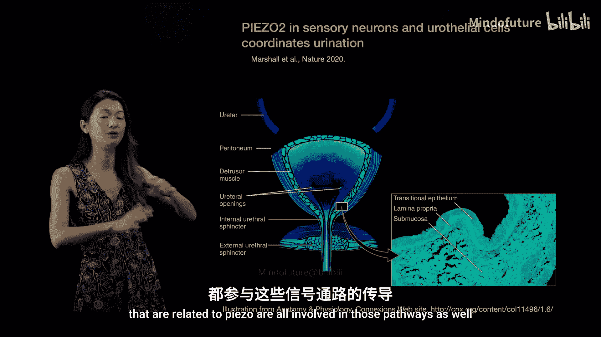

Okay， so that was proprioception kind of your sense of where your body is and also what's happening inside your guts next we're going to turn to the next set of somatic senses and these are a set of sensors that sense temperature。

 pain and itch。

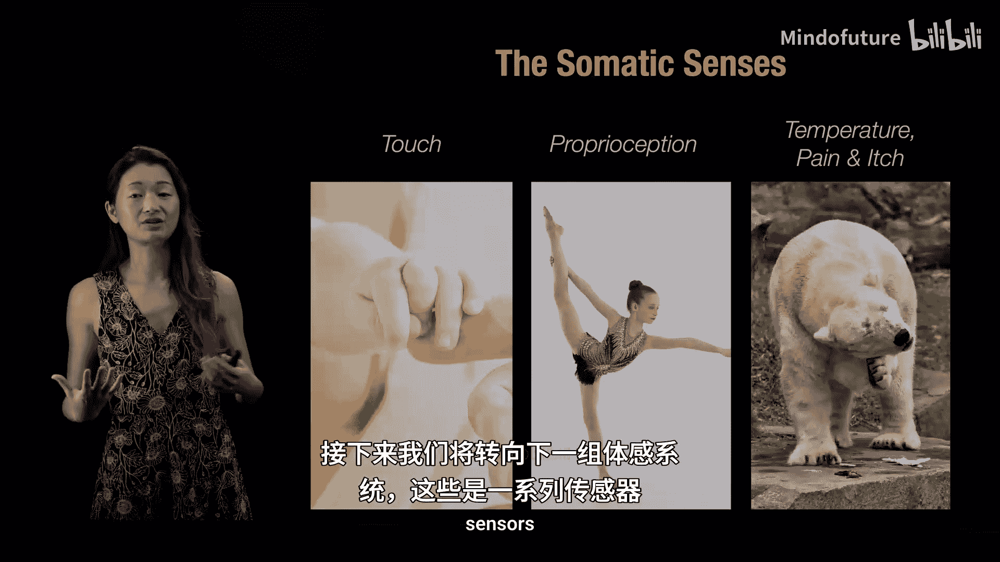

Now the same year， the Nobel Prize was awarded to Art andpatropputti and he was also awarded Ja Julius for his role in the discovery of trip channels and not only sorry he didn't discover trip channels but he discovered the role of trip channels in mammalian sense of pain and temperature so trip channels are a very large class of proteins that are found everywhere there are lots of different types of these proteins that are everywhere and trip kind of stands for this kind of I know not very explanatory name the transient receptor potential channels now trip channels are cool because they sense heat and coldness so there's a couple of different types of them I'm highlighting two of them here。

 there's trip V1 which senses heat and then trip M8 is one of the one that cus cold so you kind of see the potentials here in terms of what happens with the currents when you apply cold Tri M8 has an inward current if you apply heat。

 the opposite happens interestingly not only are they sensitive。

To cold and heat in these different temperatures。At the same time they are activated by a variety of compounds that you are probably familiar with so for example menthol activates the cold trip channels and capsaiin activates the hot trip channels this is why when you are chewing on a piece of mint or has minty gum that you're chewing on and actually feels cold it has its cold sensation in your mouth it's literally because it's activating the trip M8 channels。

 the same channels that are activated by cold temperature similarly when you are chewing on a chili pepper and it's really hot and it's actually kind of painful it's the same thing as being burned right so the reason we call hot foods hot is because it's literally hot it's actually activating the same trip we went channels that also respond to hot temperature I talked it a little bit about this in a previous lecture when we were talking about gustatory senses and so the taste of spiciness is something we mentioned I told you the reason that it was not that it was not exactly gustatory sense is something we'll talk about ismato sensation。

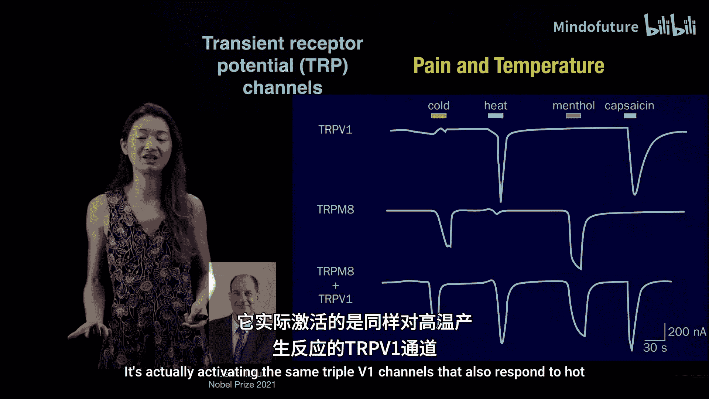

Here we are talking about it in the Madison syninstein lecture Here is a variety of different trip family of channels and you'll see that they actually tile the space in terms of the temperatures to which they are sensitive all the way from very cold to very hot and also they are activated by a variety of naturally occurring compounds that we see in in herbs and in foods including we've already talked about chili and we've already talked about mint so mint activates trip M8 which is a cold receptor and then chili capsacin and chili activates trip v1 it also activates trip v2 which is even hotter it's reive field in temperature is even hotter than trip v1 Now if you think back on that demo I did with the jellybean in the chemical census lecture I told you that there's some jelly beans where this demo does not work and the reason that it doesn't work is because the flavor of that jellybean is not activateivating and olfactory receptor and it's not activating a olfactory receptor and I told you cinnamon was one of the ones where it doesn't work and the reason cinnamon does。

work is because cinnamon is not activating aolfactory receptor。

 it's actually activating a cold trip receptor instead。

 and so if you did the same demo but using a cinnamon jelly bean and you held your nose。

 it still tastes very much like cinnamon because that has nothing to do witholfactory reception。

 it's actually the taste of cinnamon has to do with these trip channels that are being activated in the skin of your mouth。

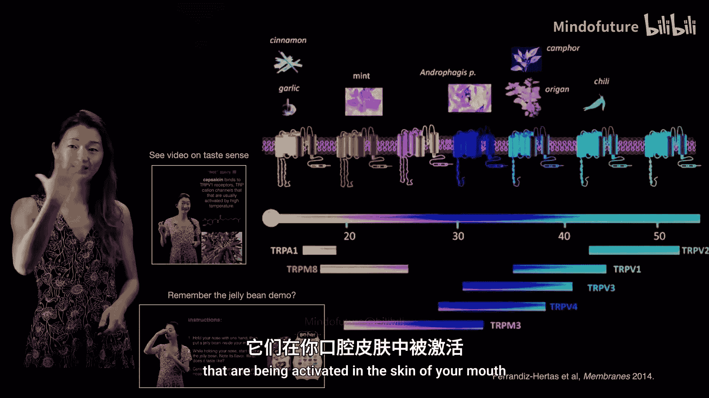

Cder cool。Okay so we've already talked a little bit about pain because we find very high temperatures to be aversive。

 they're really painful and so for a long time， at least when I was learning about this as an undergroundgrad。

 I thought the conventional wisdom was that we were a little confused about pain versus itch so we kind of thought that these were both kind of mechanical senses on the skin and then itch is kind of just like a low grade pain it's now become clear that they' are in fact slightly distinct pathways and so there's a pathway that has to do with pain and so this is mediated byP1 positive neurons or are no suceptive。

 no seceptive which just means pain sensitive and so that goes to one different it's one circuit pathway goes to a certain type of places in the spinal cord。

It has its own separate pathway now the mechanicalchan transsection molecules are not distinct。

 it also uses TriV1 as the primary sensory transducing molecule。

 so it's the same one that senses mechanical forces as in pain。 however。

 it has a couple of other properties and is actually distinct cellular population and so the itch cells are not the same as the pain cells in particular it expresses one of these proteins called MR GPRA3。

The name doesn't really matter， but I do want you I'm just going to put a pin on that protein because that pathway and that family of proteins is going to come back in a little bit in the next lecture and so I want you to notice that there's other aspects of the circuitry besides the identity of the primary sensory trans protein that matters in terms of our perception so in this case whether or not you perceive something as being painful or itchy。

Has the same primary sensory instruction protein，1V1。

 but because they are they are activating different pathways， the sensation。

 the perception of pain versus itch can be distinct and they have distinct pathways starting from how it gets to the spinal cord and of course and how it gets processed in other parts of your body。

 One more thing I'll point out here that's kind of interesting that's kind of interesting about this pathway So you'll notice here that they are actually talking to each other right So there is a there's a pathway here where the pain pathway comes down here and this neuron is glutamching neuro that's going to release neurotransmitters acting activating doesn't matter what the cell that is called this blue cell right here and this cell is going to actually inactivate the itching pathway。

If you've ever had a really itchy patch of skin and felt the urge to kind of slap it to get it to stop itching。

 this is why it works， it's because the pain pathway， if you can cause a small amount of pain。

 it actually inactivates the itch sensation in that same patch of skin， so that's kind of cool。

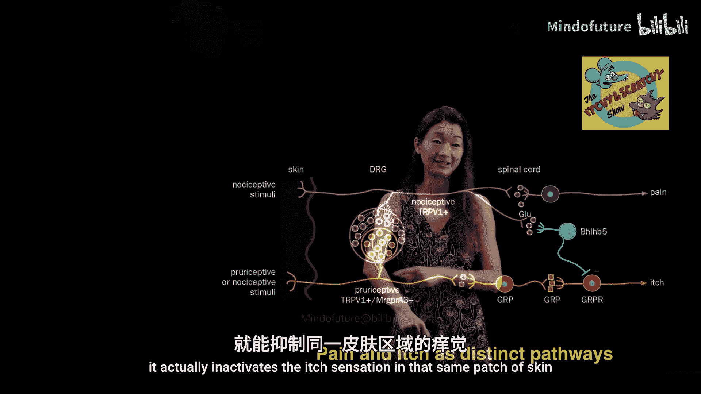

All right， so key concepts to understand somatic sensation。

 we've gone all the way from the primary sensors mostly all the way to the respective of spinal segments to which that somatic information goes and so our somatic senses we learned includes our senses of touch propperception as well as temperature itch and pain and we learned that they project to their corresponding spinal segments in the dorsal roots of the spinal segments and vent roots in the sake segments innervate the muscles in the same parts of the body。

 establishing what are called dermatomes， these kind of map of your skin that different patches of your skin and muscles that go to the same spinal segments。

 so it has a little architecture like that， that makes sense if you imagine yourself being a quadruped instead of a bipedal animal。

These tactile transse receptors have receptive fields and we talked to all about all the different ways you can actually characterize the receptive fields。

 these are the features of the physical stimulus in this case touch that activate that particular class of neurons and they can have not just spatial property but temporal as well as spectral properties as well depending on what the neuron actually is propriceptive neurons directly measure limb angles and muscle strength and this is how if you especially if you it's most obvious when you close your eyes。

 it's happening all the time， even if you don't close your eyes。

 but most obviously when you close your eyes， it's responsible for how do you know where your body parts are and this is absolutely vital for coordinated movements of all kinds if you lost your sense of propriocception。

 it would be extraordinarily difficult to move around the world with any kind of fluidity and coordination。

And mammalian transuction relies on the pieazzo protein and the tro family of proteins under temperature and pain sense。

 this is the subject of the Nobel Prize in medicine a couple of years ago and so those are the key concepts for understanding some medicine station next up we're going to keep going on that pathway what happens after you hit the spinal cord right the pain just keeps going up。

