# 【华盛顿大学】神经科学入门 ｜ Introduction To Neuroscience ｜ Bing Wen Brunton p25 P25_体感系统-感觉侏儒图-幻肢-橡胶手错觉 -BV1i3qWBXEDH_p25-

In this lecture we're going to pick up what we left last time。

 which is at the place where your touch receptors， your appropriatereceptor receptors and your pain and itch and temperature receptors got to the place in the spinal cord。

 so in somatosensy systems we're going to take those signals from the spine and all the way up to the central nervous system。

So the pathways that connect your dorsal ro ganglion sensory cells to the rest of your central nervous system going up are the following。

 So canonically there's a couple of different pathways and they have different names。

 So we have the dorsal columnlyical pathway and then you also have the anteriorlateral columnar spinal thallamic pathway。

 Now those are just words So let break this down a little bit and think about what's happening here。

 So there's one pathway that's usually has all of the information about touch and proprioception。

 and this goes on dorsal column pathway。 Important。

 one of the themes we talked about in terms of the organization of your entire nervous system is that things are contralateral and flipped upside down so your visual field on the left goes to the right side of your brain up and then becomes down。

 we talked about how the control of your left arm is actually in the right side of your body so you have already a hint now that's something about the touch。

and propricept receptors on your left side is somehow have to go to the right hand side。

Interestingly， in the dorsal column minusscal pathway， this crossing does not happen immediately。

 it actually comes on the same side of the body so on the left side of your dosteror goes on the left side of your spine all the way up to the brainstem and it only crosses over to the contralateral side at the brainstem In contrast in the interlateral column pathway carry information about pain and temperature。

 it crosses over to the other side of your spinal cord immediately at that spinal segment it then follows the pathway up to the rest of your brain on the contralateral side and so it then goes up and projects to a couple of areas that are kind of lowered down over here and then in both cases these two pathways lead to the same contralateral side of the thalamus remember this is a theme here we have to go from the primary sensor to the thalamus and then from there it goes to the somatoensory cortex S1 is a primary somato。

cortexAnd so the information in a funny turn does not cross the midline at the same place。

 but they do all end up on the contralateral thalamus and the contralateral S1。 So again。

 this is just a recapitulation what I just said there's this pathway that we see over and over。

 Sometimes I draw this upside down where you have visual pathways going from the retina to the thalamus in the LGN all the way up to V1 similarly here we have the sensory neurons going up to the spinal cord to the thalamus to S1。

 So this kind of theme is something that we've seen over and over。😊。

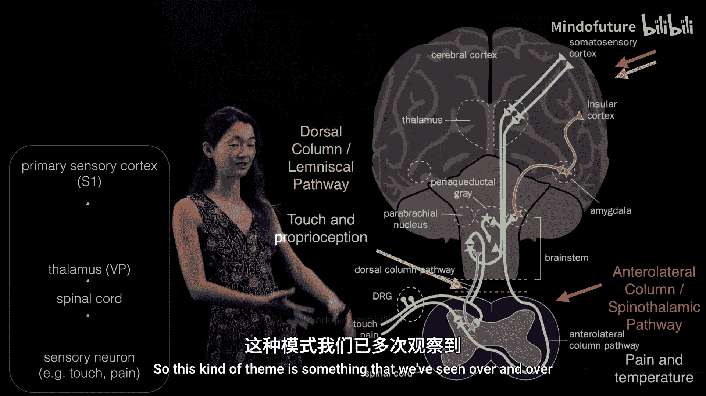

So there is a really interesting observation here about just looking at the morphology of the human spinal cord。

 so I found this paper and I thought it was really cool because they actually accomplished something that took a lot of technology to accomplish they scanned at an extraordinarily high resolution a postmtem human spinal cord so this is an ex vivo scan it was done postmortem on a 91 year old female postmortem and in order to get the resolution that they got they had to use a very strong magnetic field so this is a nine Tesla magnetic field much stronger than a regular one that you would normally be using in a lot of different scenarios and it took 30 hours so again postmortem X vivo it's okay to have this be in nine Tesla scanner for 30 hours and so interestingly what they ended up analyzing one of the things they ended up analyzing was relative volume of gray matter versus white matter in this particular persons spinal cord so what you're seeing here is。

😊，The rostr roll to autoal axis of this particular spine so front to back okay top to bottom。

 so this this part is closer to the head and that one is closer to the tail。

 what would be the tail And what you can see here is the gray matter iss kind of where the local neural processing happens in the spine and the white matter are all the wires and they're white because it's myelinated。

 there's a lot of myelation going on here If you look at the relative ratio the white of the white matter to the to the gray matter areas you'll see that there is a relatively large increase here in the cervical regions followed by a lot less。

And then a lot more in the lumbar regions Now this makes sense because the cervical regions are innerervating your arms and those couple of portions of your lumbar and a little bit in the sikal regions innervate your legs。

 and so this is where we need a lot of local processing in to in order to produce things like movement of your body and movement of your legs for locomotion reaching all of these different movements that involve coordinated movement of your limbs now obviously when you are doing something with your arms or walking or reaching or lifting or something you are very much using your back and your front muscles in your thorraic regions as well so there's non-zero going on there。

 but relatively speaking， there's a bit less of it there than in the cervical and the lumbar sal regions。

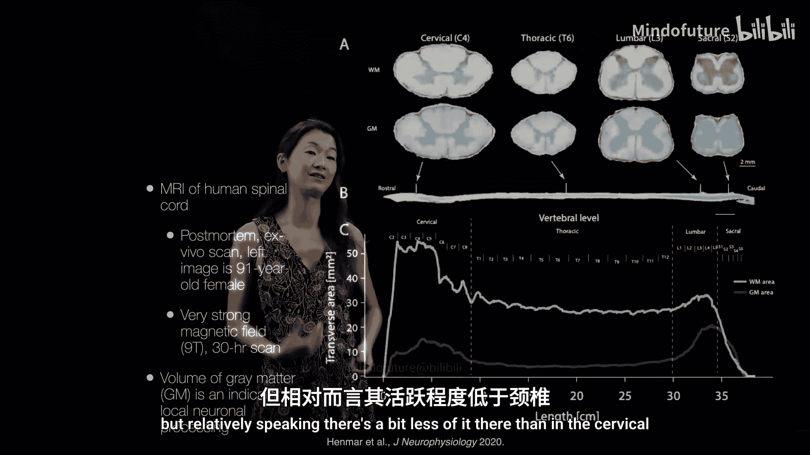

The sensational news is that this is a bit of something that I've been involved in a little bit of the research in this is that we think about mechanical sensation as something that is in the limbs's it's on the arms。

 it's in the muscles it might be in your guts and the spinal cord is mostly responsible for gathering information doing some local computations and sending it up to the brain so in a line of research that's recently been emerging。

 there's actually really convincing evidence now that there' is in fact sensation inside the central nervous system and so show you a couple of examples here。

 but beyond the examples I'm showing you here， there's actually lots of great evidence that there's parts of your hypothalamus that will sense temperature。

s independently of temperature sensing of your skin。

 there's temperature sensing inside your brain similarly the spinal cord not only takes information about mechanical sensation it also has primary sensors in the spine as well these two papers on the righthand side there are。

😊，Two different descriptions of different sense mechanicalensy systems in the spine in both cases they happen to have used fish as a model organism and so there are these glysonrggic neurons in these spinal segments of of the zebrafish and here we're called cerebral spinal fluid contacting neurons that are actually touching the central canal of the spinal coording these fish and both of them are implicated in sensing of bending not just sensing of the bending of the body。

 but the bending of the spine in itself because these are sy neurons that live inside the spine In another line of evidence there is a really interesting set of observations that again full disclosure。

 I am a co-author on this paper where we are discovering that there might be an avian organ for balance and this is kind of a bird thing they're not found fish and they're not found mammals。

 unfortunately but there is some evidence here that the avian spine also has capabilities of doing doing mechan sensation and we believe this to be implicated in balance and coordinating and the gaze。

so that's a whole separate story and that I have to tell you on a different day because it's a really fun story to be to tell So back to the mammalian system。

 we have information this spine and ultimately I told you that it goes back up to the thalamus and thalamus it goes to the primary somatoensy cortex the primary somatosy cortex on the human is found directly posterior to the central suulcus and so humans have this have this canonical scus it's kind of like right here in your brain kind of comes down kind of a fold most of us have right behind that is primary somatosensy cortex right in front of that is primary motor cortex。

 we'll get to in the next lecture So generally speaking in terms of the organization of the brain a lot of the stuff in the back happens to are more sensory and as you get towards the front it gets more motorary It gets more like action oriented executive functions。

 action planning and stuff like that and so directly behind the central scus is refine the primary somato。

😊。

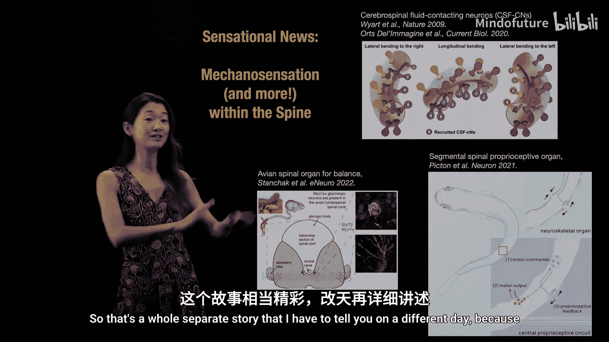

Now， in the same way that we talked about the visual cortex having retinainotop。

 it has this organization that reflects the visual field as you see it in your retina。

The somatos sensory cortex similarly has a non-ran organization and it has an organization that recapitulates the different parts of your body。

 not surprisingly kind of upside down so the very bottom part the ventral part of your somato sensory cortex has a representation of most of your facial features there's a large representation of the tongue and the throat because there's a lot of mechanical sensors in there。

 face and lips are pretty largely represented as there's a lot of nerves that are innererving this kind of cranial facial region okay。

😊，Keep going down， we have neck， thumb， ditches， hand， etc cetera， et cetera。

 all the way back down to your trunk and then leg and your feet and your toes。

This picture is really carerismatic is a fun picture to have。 It's called a sensory homunculus。

 It's basically a picture that is the anatomy of that individual where the relative sizes and proportions of the features are exaggerated proportional to how much they're represented in S1 So that's kind of what a homunculus of a human might look like you'll see that rather than having regular human proportions。

 you'll know what that looks like the head and the tongues and the lips are greatly exaggerated because they're overrepresented in S1 Similarlyly we have a ton of sensors and our hands and so our hands are gigantic because we do a lot of stuff with our hands and thenre relatively speaking。

 there's very few sensors in your arms because our arms are not that sensitive and similarly so on and so forth。

 there's a representation of the trunk and so of like the middle of your leg for example。

 it just is not that well represented in sensory homunculus in a sensory cortex Now this picture also appears as a couple of art exhibits。

 So this one is exhibit that was in。😊。

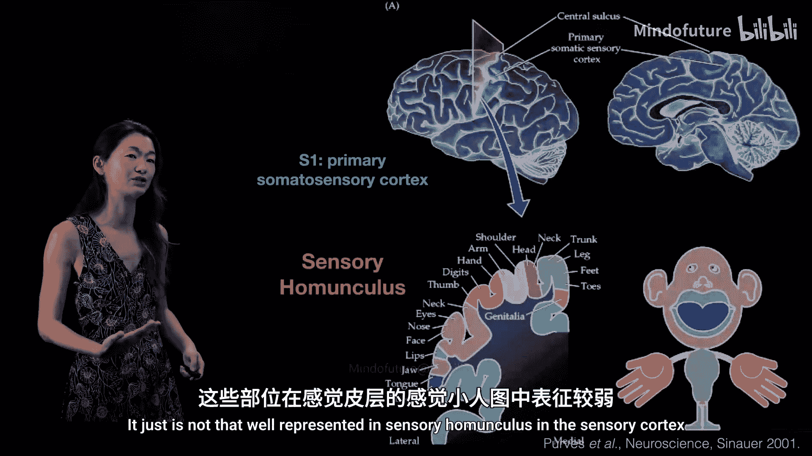

The Museum of Natural History in London where this is kind of like a three dimensionmenal representation of the sensory homunululus I told you that S1 is directly posterior to the central soulcus and motor cortex is immediately anteriorage to the central sulcus you can make a very similar version of the sculpture of the sensory homunculus and make one of the motor homunululus Now this is a representation of the relative sizes of cortical representation of that part of the hand for controlling the hand right so you don't have the strongest muscles the muscles that exert the largest force on your hands but you have a lot of dexterity in your hands there's a lot of numbers of muscles that can be individually actuated so that you can have very fine motor control of your hands more so than you have fine motor control of your knee for example。

 and so you can kind of see there that the motor cortex is vastly overrepresented by hands and look at those skinny legs it's because there's not as much representation of your legs in motor cortex you walk really well。

 there's huge muscles there but in terms of the dexterity and the fine。😊。

Motor control that's required to operate your hands versus operating your legs that is reflection of the relative importance of those regions in m1。

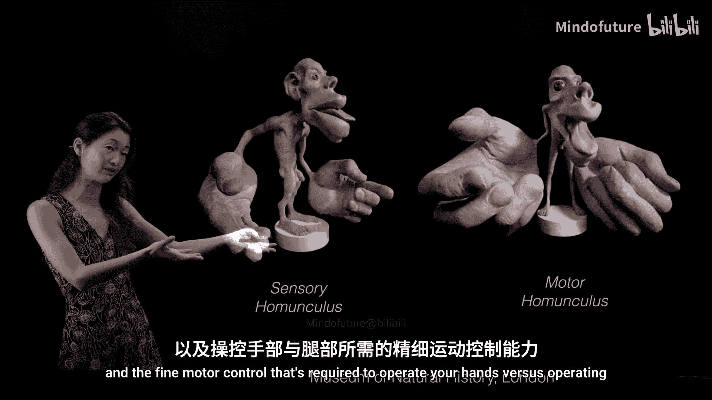

Now the history of the homunculus is kind of an interesting one and it's actually not without its own controversy so the first homunculus appeared in 1937 and it was authored by Roger Penfield and his colleague Bdry so it's an old paper from 1937 that describe the first homunculus Now different versions of this got redrawn and eventually we had something that we can all look at and we have art exhibits about it but it was not without controversy and so part of the reason is because the method in which they came upon this cortical picture of the relative representation of the different body parts so we talked in the lecture on electrical simulations there's lecture on electrical recording as well as electrical simulations we want to review these techniques you can go back there and review that I told you that the same electrodes that you can use for recording electrical activity you can also pass current through them to elicit activation of those neurons。

 but it has a couple of drawbacks， one of the drawbacks is that you don't really know what you're doing。

Just activating everything in the area， including fibers suppress passage are passing through So all those caveats aside。

 this is what Penfield did and he did a series of studies on a few dozen individuals in open brain surgery and what he did was the following they opened up the brain and the brain doesn't have any pain receptors and so these individuals are awake they're like probably have some anesthesia in their scalp but they open up the scalp usually shave opened up the scalp open up a what's called a cranioomy where you drill into the bone of the skull and open it up so then you can then have open exposed brain surface so this part of the brain S1 is now exposed on these individuals and they're awake they're kind of sitting there usually at least inmod is I don't know what they did in the 1930s there's a sterile field so everything kind of in front is not sterile and everything in the back of the surgeon is is sterile and then what Penfield and his colleagues did was they took small stimulating electrodes and they zapped these individuals in the。

Spots one at a time just moving the electrodes over and as they zapped it。

 they asked these individuals what did you feel and then they wrote it down Okay。

 so that's how they made these maps They did this for dozens of individuals。 And so， for example。

 in one of the experiments， maybe they would have their electrodes and they zap right here。

And the person would say， oh， I feel like an hchiness in my nose and they would write that down okay and then they would move over a little bit and then they would say。

 oh， I felt that in my like index finger and they would write that down。

 And so this picture of the sensory homunculus is made based on electrical stimulation of the human brain and then selfreported perceptions。

This is important。 This is important because if you think about what we havet talking about about the receptive fields。

 nowhere in our characterization of visual receptive fields or taactal receptive fields。

 did we actually say that there is a receptive field when you stimulate the parts of the brain。

 This is a different experiment than the experiment that we talked about in characterizing visual receptive fields where you're actually presenting。

Physical stimulus， sometimes randomly， and then back computing what the stimulus thatlicited the responses were。

This is a different thing altogether and so there's a couple of different versions of the homunculus that have been repeated sent and there' like this is a really charismatic way of looking at the organization of S1 but it has a couple of downsides and there's were limitations of the technique they used one of the limitations that you can only really do this in humans there's no way of systematically simulating a rat brain and asking it so did you feel that in your whiskers and they won't tell you you can do it。

 but they won't really tell you and so not only is this technique only possible to do in humans。

 it also suffers from a lot of the intrinsic limitations of electrical simulation as a means of mapping the somatoensy cortex because as we just talked about。

 there's quite a few synapses in between your primary sensors of tactile sensation on your arm and S1 and so what does it actually mean that you feel like your arm got got simulated when you pushed that's kind of a different question the other thing that was somewhat controversial about this whole line of research and this is not something that's when you。

Unique to our studies themato sensation， but really for most of biomedical science until pretty recently is that this was always done for male individuals so these homunculus。

 as you can see there has a representation of male genitalia this has been reied by a couple of individuals so here's a couple of figures with two versions of the homonculus where an attempt was made to map not only Penfield's homunculus you can see that in a gray dotted lines here。

 but mapping various parts of female genitalia as well and characterizing the sexual dimorphism of human S1。

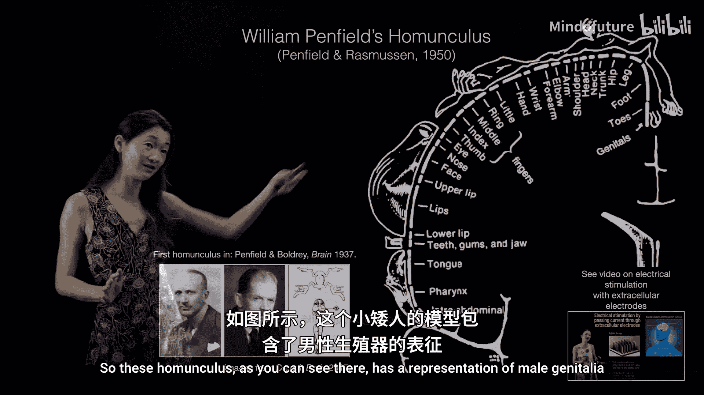

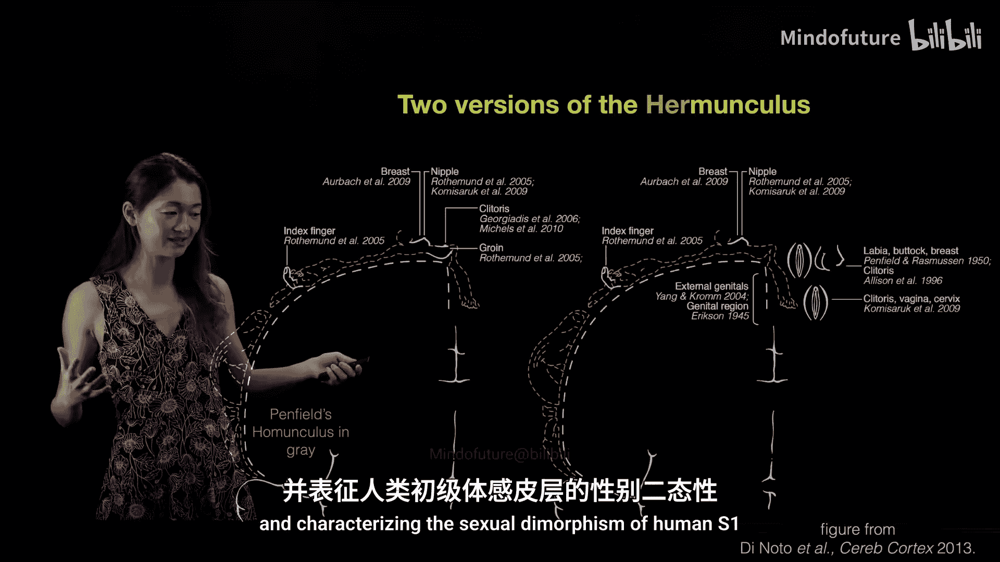

Okay， so humans have S1 because we represent all the parts of our body。

 If you are not human and you have other parts of your body that are really important to you。

 then you will have representation of that in your S1 as well。

 So for a lot of small mammals that have whiskers。 The whisking sense is something that is really。

 really vital to the way that they experience the world。

 and so not surprisingly in whisker cortex and the S1 of a small rodents like a rat or a mouse you will see what are called bar cortex。

 Now this bar cortex is gigantic because for a mouse or rat， this is super du important。

 It's a huge part of how they experience the world。

 and it has this like upside down and back course representation exactly like what we expect from the remainder of the organization of the nervous system as it objects from the body onto the cortex。

 So you may not have ever thought about this so far。

 So I'm just going to tell you that the rat has a canonical number of whiskers that are extremely well described。

And they're in an array like we have them names like A1， A2A3， B1， B2 B3， et cetera， et cetera。

 and you can see a representation of every single whisker mapped onto the barrel cortex in the rat S1。

 you can kind of see this in the staining here like each of these little blobby things corresponds to one whisker on the rat。

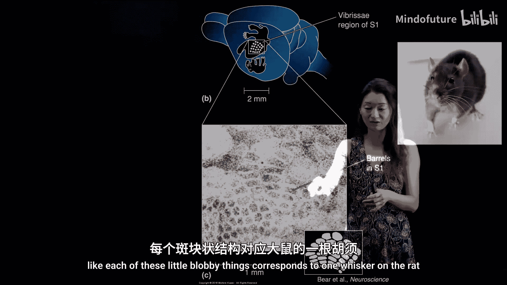

If you you can have a mouse and you can also make a version of a mouse Ccuulus。

 I don't know how to pronounce that word， but that's whatever that is。

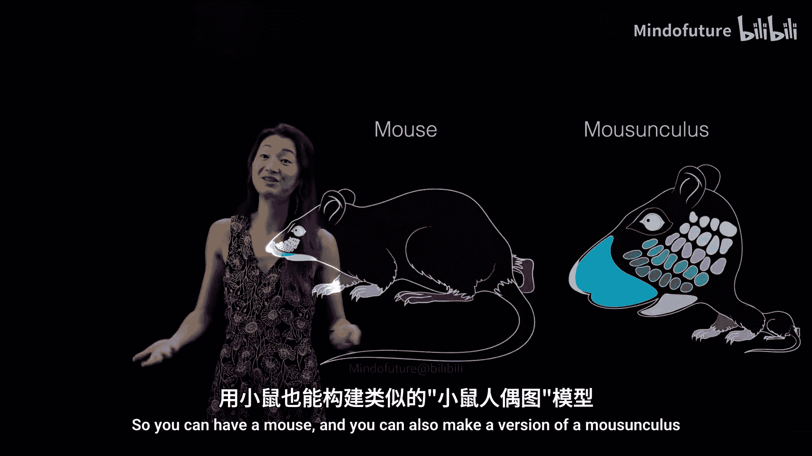

So that's cool。 If you are looking at more diverse animals。

 there's like a variety of other small mammals that also have whiskers。

 but have other parts of their say， sensory capabilities。

 So tactile sensations and the way that they represent it in their respective S1s。

 exaggerate their anatomy。 So for our star nose no mo， for example。

 because they do a lot of sensation through their through their through their mouth parts。😊。

And they also are very tactile and they do a lot of sensations through their claws because they're digging a lot。

 you'll see that there's a huge overrepresentation and exaggeration of those parts of their morphology and anatomy in their representation of S1。

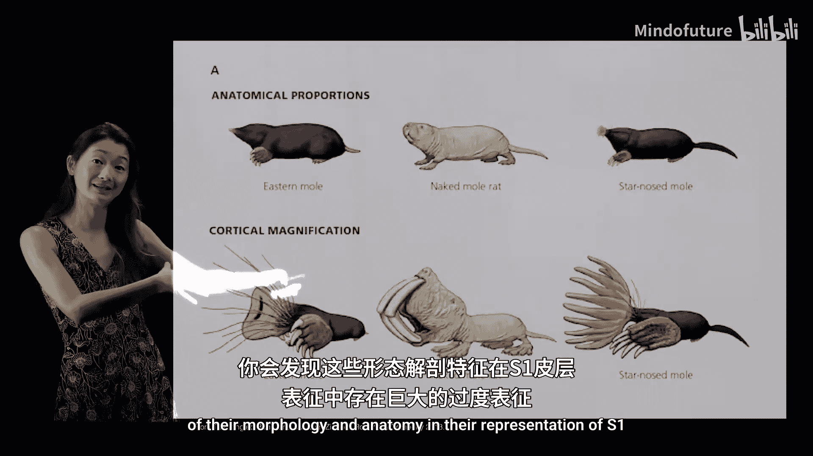

Okay， so the organization of S1 in terms of kind of this homunculus picture of S1 also helps explain some rather mysterious clinical observations as well。

😊，In particular， there is a there's a rather just stressing to the individuals who express it this idea of a phantom limb。

 So after an amputation， for example， if you one were to have their arm be amputated for whatever reason。

 it leaves the nerve endings that would have innervaated that part of the arm kind of just dangling there。

 and got cut off And so those nerves would they would still be in those cervical spinal regions and they would still go down your arm as far as they would go and then they would just kind of sit there and be stopped there。

 So phantom limb is。could be a sensation of anexorable pain where like can itch。

 you can't scratch because let's say that if my arm more amputated here， for example。

 I might feel like my forearm is itchy and I might want to scratch it。

 but I literally can because it's not there anymore， it could be really distressing。

 And so this explains some of the organization of the very mysterious phantom limb sensations people have felt because if you look at the sensory representation of that one the representation of the thumb and the digits and the arm is actually right next to the representation of your cheek your cheek is not actually innererated by any of the spinal segments it goes directly to your central nervous systems through cranial nerves if you look at in the previous lecture you saw the picture of the dermatomeess you'll see that none of them go to your faces because your face is innererated by cranial nerves instead of those spinal nerves but same thing they goes to that one so the remapping of this hand sensation onto the face could make it so that you feel like you're scratching your arm。

Even if you're touching your face， or that you can kind of partially alleviate some of the itchiness or the pain you feel in your arm region that for an arm you no longer have by touching those corresponding parts of your face instead。

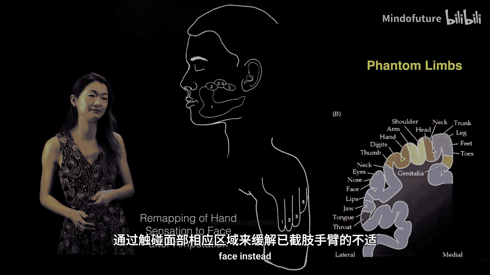

So this technology is a really cool clinical technology that I heard about a couple of years ago and I thought I would share with you because it's on this topic of nerve amputations and so there's a lot of a lot of studies that are really interesting so there's one thing that's called if you have a neuroma which is kind of like an abnormal growth that sometimes causes you pain in different parts of your body like get the neuroma between your toes。

 for example， so those nerves pathologically growing a growth and then causing you pain and just abnormally doing stuff like that。

 usually the neuroma surgery involves cutting out the neuroma because it's just a piece of mass but it's not really all that effective because typically what happens is after a few years。

 the same spot will grow another neuroma so you kind have to do it again and so what they pioneered is a procedure where instead of just severing the neuro。

 which just cut sitting half in the raw nerve endings like doing crazy things。

 the surgeon will then reattach those nerves。Onto a patch of skin or muscles。

That you maybe could slightly do without for a little while so they're instead of having raw nerve endings that are not attached anything because' cut off because you cut it off neuroma。

 it actually does attach to another part of your body And because those nerves that have something to attach to this is much more effective in alleviating the symptoms of the neuroma。

 this pain itchiness that people would feel in neuroma。

 Now in this experiment they're doing a very similar thing。 And this time。

 instead of doing it with the neuroma， they're doing it on an individual who has an amputation so you can kind of see a picture of them here。

 they have an amputation just below the shoulder joint so they don't have the elbow anymore and this makes it really hard for to fit them with a prosthesis because a lot of the biomechanical prosthsesis are actually operated by what remains of your elbow so let's say the amputation or below the elbow。

 then there's a variety of very effective prosthesis that one can be fitted with that has a lot of functionality because you can still actuate a part of your muscles right here you can actually。

These muscles and then have this joint right if you don't have the elbow joint。

 then arm prosthees became more challenging because there's kind of no muscle that you can natively move in order to move the robotic or the prosthetic arm。

 So in this attempt what they did was the following。

 they took the nerves that would have innervaated。 So let's say the amputation right here right right below the shoulder they took the nerves that would have innerervated your hands。

 this individual's hands and instead they very carefully dissected them and reattach them to muscles on the chest。

You can kind of see what's happening here。 Each of these dots is on a grid， right so they reatched。

the nerves that it would have innervated those parts of the arm that are no longer there onto a couple of muscles that are on the chest。

 you kind of lose those chest muscles， but you know sacrifices anyway so what happened here was that after they did this Now remember I told you in the nerves you can't actually separate the motor nerves from the somatoensory nerves so the nerves are like a combination of motor nerves should-driven muscles and touch receptors and propperceptors and so on and so forth。

 And so they just attach these nerves， they separate and the attach them And then what they did was they were able to do EMG to electromyography directly of those nerves on the chest it's really really difficult to do nerve recordings because they're so thin and they're so small and they have a variety of different signals that are going out everywhere else the clever part about this experiment was that by attaching those nerves onto the muscles。

 the muscle fibers on this chest region what they basically did was use the human muscle as an amplifier。

of those electrical signals Now it's much easier to record from those signals because the muscles are going to be amplifying those signals。

 we're going talk about that in a lot more detail in the next lecture on movement control but I just wanted to preview that little bit of here because it's really hard to talk about about a sensation without talking about movement I'm clearly failing to do this so after they've done this revation targeted nerve reinration experiment what they could then do is go back and map the sensation of the hand that no longer exists because it has been amputated onto this grid that is on this individual's arm okay so they can basically then use this information to build a haptic feedback device to convince the individual that they're feeling things on their on that no longer have and they can also use the EMG recordings the recording from the muscles that are kind of newly innovated by these nerves that used to control the hand that don't longer exists to operate something like a robotic hand and that's a really cool experiment that they can。

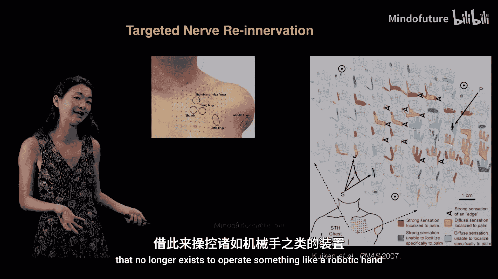

so you can kind of use these nerves that are retgeted towards the muscles and you can record from them and use that in a computerized device to operate a robotic arm。

Okay， the other thing that's really cool about thematoensy cortex is a set of illusions that we actually all experience。

 so if you ever operated a motor vehicle， if youve ever learned how to drive a car or a tract or anything like that。

 play a video game even sometimes when you're controlling a avatar of an individual that's not's controlling a body and the movement of body through the world that's not yours。

 you have effectively learned a representation of that new object in your brain in a similar way that you represent in your own body。

 so like my body has representation of my brain has representation of my body。

But if I'm driving a lot， then there is basically a model of the car and the physics of the car in the which I control the car in the way I push on the gas pedal。

 I shift gear。 I turned the ceiling whatever it is。

 I have a representation of that in my brain as well。

 So our brain has this amazing ability to learn to represent things that are not us one consequence of this is this really really kind of cool illusion that I unfortunately cannot demo with you online。

 but I will tell you about it， and I encourage you to look for videos of this effect demoed onto other people。

 there's plenty of them if you search for it。 It was first reported in a paper from 1998。

 by Matt botminick and John Cohen， and it's called the rubber hand illusion So I'm going to describe what it is。

 and I strongly encourage you to look up a video of what this looks like。

 And if you ever if anyone ever offers you the opportunity to try it out。

 I strongly encourage you to take them up on it。 So what's happening here is that what I'm going do。

😊，I I'm going to try to convince this individual。 so the person sitting closer to us is the experimenter and they're going to convince the participant that this rubber hand。

 this fake rubber hand you can get from the Halloween store。

 is their hand and they're going to do the following so the person in the blue shirt is looking at one of their arms and the other arm is not their arm。

 This is a rubber arm their real other arm is on the other side of this cardboard partition。

 it does not have to be fancy here。 just as long as the person in the blue shirt can't see it okay so the person has two left arms。

 one arm that they can see that is the rubber arm and the other arm。

 which is their real arm that has all the touch sensors on it and they can't see it So what the experimenter is going to do is the following。

 they're going to take usually two paintbrushes。And they're going to very slowly and synchronously。

 this is important。 stroke the same parts of the skin。

 So like let's start with the thumb right you're going to touch both thumb thumbs and then touch both fingers。

 the index fingers， touch the middle of the back of the hand， etc cetera， et cetera， et cetera。

 You repeat this。😊，For a few minutes， five，10 minutes， sometimes it takes a while。

 and what happens is that the person in the blue shirt is going to adopt this rubber hand as their own。

 they're going to be convinced that the thing that they're looking at that rubber hand that was bought from the Halloween store is their hand。

What happens after that is that you can then do a series of manipulations on the rubber hand and the person will feel that it's their hand。

 So a lot of these videos， if you go look them up， they'll do something very suddenly like take a hammer and then just slam it into the rubber hand and the person will report not only surprise。

 but they will feel pain because they have owned this hand。 Think about that。

 you feel pain in a hand that you have adopted through the coincidence ofactile tactile sensation and you feel pain。

 you will experience a perception of pain， even though none of the pain receptors on your real hand have been harmed。

 It's really this rubber hand that got hit by a hammer kind of cool。

 people will also done this with a tongue， which sounds awful to me。

 it's called a butcher's tongue illusion。 you can look up videos of that too these things are they get really wild There's also versions of this that people have done in virtual reality。

 so you can actually convince people that they' are actually bigger or smaller by playing with the perspective where they're looking at like。

😊，caa that's behind you and I'm looking at a VR headset。

 I can see the back of myself from the back like from the perspective of a mouse。

 you can kind of trick your brain into adopting all kinds of different perspectives and parts of either a mechanical device or rubber hand or a VR avatar that is not your own it's actually our brain is actually remarkably flexible in that way to be able to adopt parts of not ourselves as ourselves and feel things that are not real。

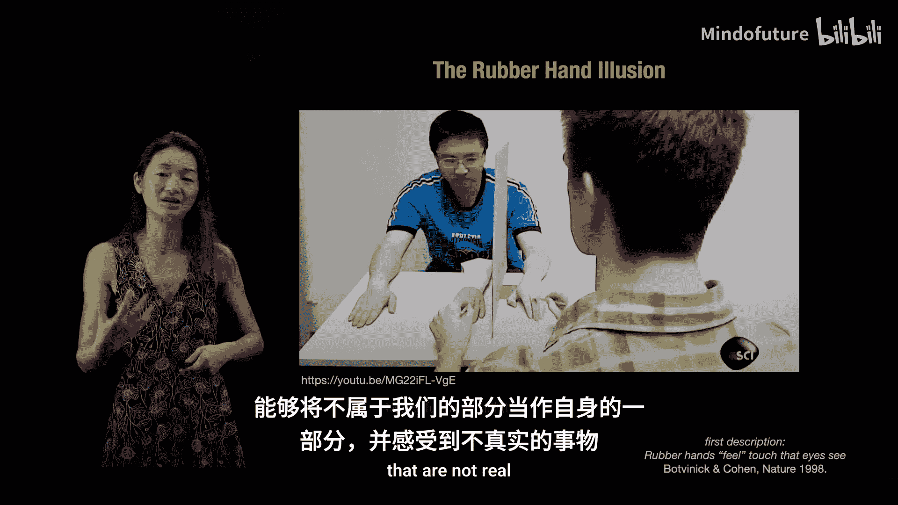

Okay， so the other thing that I'm going to tell you about on the concept of somato sensation is exactly this topic of prediction。

 okay so I started out the section about sensing and action by telling you about the sensation and action loop right and how the purpose of your brain to some extent is to predict what what have happened。

 given what I did and then measure the difference。 I'm trying to predict the difference between what I sense and what I was expecting to sense Now in this really charming experiment that was published in 2003 it's called it's called the force escalation experiment and the idea there is that's two eyes for an eye So the story is the following。

 let's say your two kids in the backseat of a car to siblings and you start to fight right one of them punches the other the second one says al and punches back and then so on and so forth and soon they're full out punching each other and both of them。

😊，Claim that I'm just punching them as hard as they're punching me。How is this possible。

 So this experiment demonstrates how this is possible。 They did the following experiment。

 The two individuals are both instead of they're not punching each other。

 This is not a punching experiment。 This is a touch sensation experiment。

 both of them are pressing down on a lever so individual one presses down a lever and however hard they press down that force is given to the second individual。

 So they feel so one person presses， the second person feels exactly how hard they press in force in Newtons。

 and then they're asked to reproduce it。 they're asked。

 okay so now you're going to try to press down on the lever again。

 exactly as hard as you thought they press down on you。 So then they do that。

 and this gets back to the first person。 and we'll see here in this diagram of the two individuals taking turns。

 So there's one individual which is open dot， the other person is in the closed dot。

 you'll see that very quickly after the third and fourth and fifth and six turns。

 there's an escalation in how hard they're pressing down on the lever on each other。

Even though they were explicitly told to only push down as hard as you were pushed now。

 how does this make sense， the only way this makes sense is that your feeling when I'm saying when you tell me to push down as hard as I felt。

My sensation of how hard I'm pushing is how hard I'm actually pushing minusness。

 how much I was expecting it to be pushed。 So my ability to estimate how hard I'm actually pushing down on something in terms of reproducing that force is really poor because I can't do it。

 In other words， my perception of these tactile forces has very little to do with the objective。

Force that is felt by these hacktail sensors on my fingers。

 they're measuring something closer to reality， but my perception is very much different。

 and that explains this2 eye for an eye experiment where even though everyone is trying to be fair and only punch back to your sibling as hard as they punch to。

 you have this force escalation that is happening。

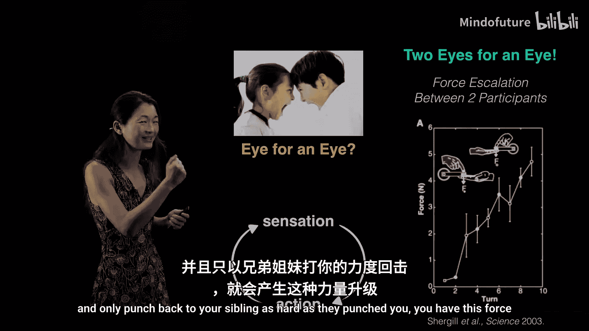

Another cool experiment that I'll share with you， this is a very recent publication is the study of not only touch perception。

 but touch perception in a way that is relevant for particular behaviors that are relevant for the individual here they studied touch neurons that are specific for pleasurable touch and sexual receptivity in mice so for a review of some of what's going on here I encourage you to review the lecture on recreational drugs in the brain。

 we talked a lot about the dopamine and the pleasure reward system that's exactly the same thing that they're trying to study here because for these particular mice they not only express touch receptors。

 there's a specific class of touch receptors that expresses also the MRG PRB gene。

Now you've seen a version of this gene before when we talked about pain versus itch sensation because the same difference here。

 the touch， the primary touch transaction might be the same， but it different population of cells。

 this particular population of cells is responsible for sexual receptivity and dopamine release。

 and so when these particular touch cells are activated， the animal releases dopamine。

Okay and they can show that this protein that the cells that express this protein。

 this lineage of proteins that express this particular cell marker are activated by optgenetics and can review the lecture and optgenetics if you want to when they are activated by optgenetics the female mice has behaves as if she were receiving pleasurable touch and is sexually receptive if you instead do the opposite experiment and ab that lineage of cells so this individual males here no longer has this class of cells they can sense touch just fine it's not their touch tactile senses that that are missing it's just that they don't have this lineage of cells that are responsible for pleasurable touch they instead adopt a combative behavior and no longer release dopamine in the same types of social encounters and so that's sort of the really lovely story where really then teasing apart all of the different pathways all of the different circuits all the way from the primary touch receptors。

to how those receptors in different cell populations are then passed up the behavioral pathway and then interpret it differently by the animal depending on which pathway they came from and very much guides even very complex behaviors such as social interactions and courtship and mating。

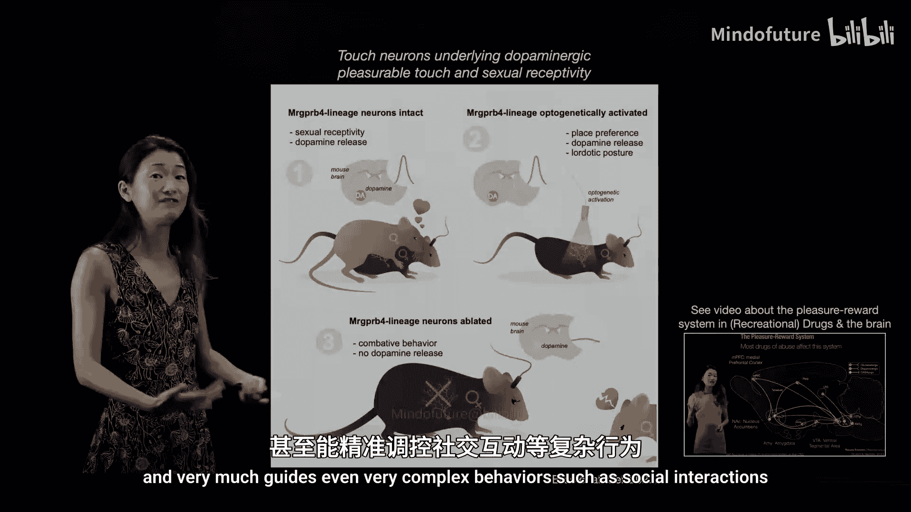

Okay， so next， we're going to do a review。 The next video。

 I'm going to zoom out a little bit from somato sensation and review for you what I consider to be the key concepts in sensory neurobiology。

 So we're going to synthesize some of the topics we've talked about here in tactile and somato sensation and try to compare。

 contrast what it has in common with the other sensory systems we talked about。

 including vision and audition and olfaction。 That's up in the next video。😊。

