# 神经科学入门：P25：体感系统：感觉侏儒图、幻肢与橡胶手错觉

在本节课中，我们将继续学习体感系统。上一讲我们介绍了触觉、本体感觉、痛觉、痒觉和温度觉的感受器如何将信号传递到脊髓。本节中，我们将追踪这些信号从脊髓向上传递到中枢神经系统的完整通路，并探讨体感皮层如何映射身体各部位，以及由此产生的有趣现象，如幻肢和橡胶手错觉。

## 体感上行通路

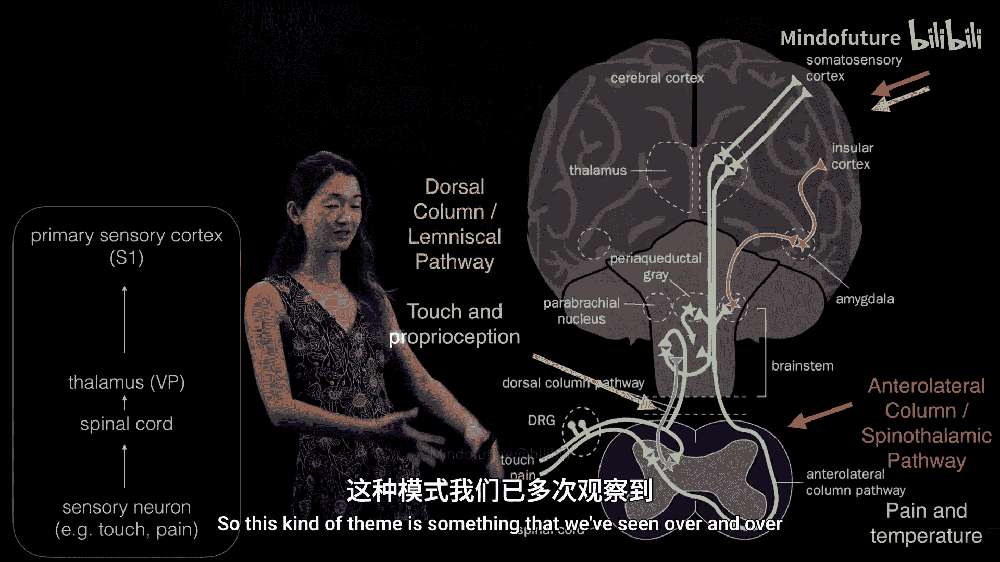

上一节我们介绍了感受器如何将信号传递到脊髓。本节中我们来看看这些信号如何继续上传至大脑。连接背根神经节感觉细胞与中枢神经系统的上行通路主要有两条。

以下是两条主要通路及其特点：

*   **背柱-内侧丘系通路**：主要负责传递**触觉**和**本体感觉**信息。这条通路的一个关键特点是，信息在进入脊髓后**并不立即交叉**到对侧，而是沿着同侧脊髓上行至脑干，在脑干处才交叉到对侧。
*   **前外侧柱-脊髓丘脑通路**：主要负责传递**痛觉**和**温度觉**信息。与背柱通路不同，这条通路的信息在进入脊髓的相应节段后**立即交叉**到对侧，然后在对侧脊髓中上行。

一个重要的组织原则是，神经系统通常是**对侧支配**且**上下倒置**的。例如，左侧视野的信息会传递到大脑右侧，并且上下颠倒。体感系统也遵循这一原则。有趣的是，尽管这两条通路交叉的位置不同，但它们最终都将信息传递到**对侧的丘脑**，再由丘脑投射到**对侧的主要体感皮层**。

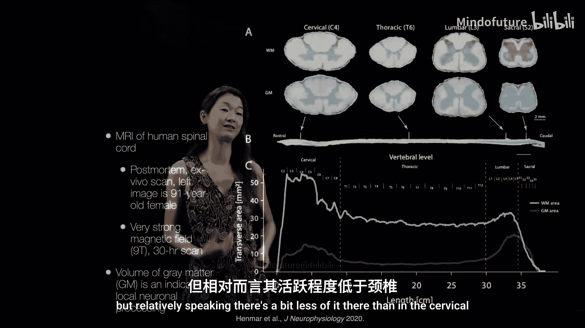

这种“感受器 → 脊髓/脑干 → 丘脑 → 初级感觉皮层”的通路模式，我们在视觉系统（视网膜 → 外侧膝状体 → V1）中也曾见到，是感觉系统的一个普遍主题。

## 脊髓的形态与功能

在深入大脑皮层之前，我们先来看看信息中转站——脊髓的形态。一项使用超高分辨率9特斯拉磁场对一位91岁女性尸体的脊髓进行扫描的研究，揭示了脊髓灰质与白质的体积分布。

以下是沿脊髓头尾轴（从颈部到腰部）灰质与白质的相对体积变化：

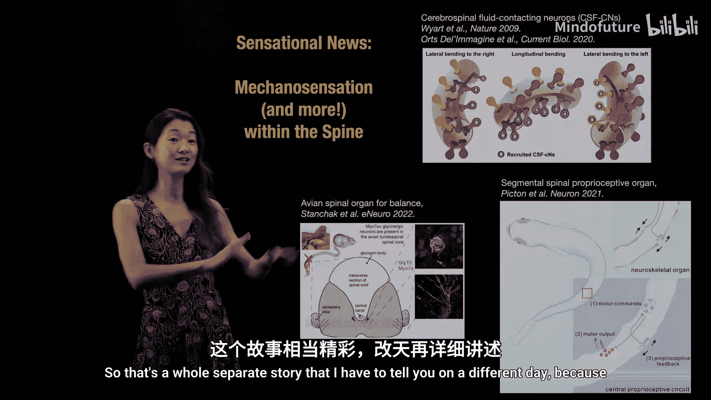

*   **颈段区域**：白质比例相对较高。这是因为颈段脊髓需要处理和控制**手臂**的大量感觉与运动信息，涉及精细和协调的动作。
*   **胸段区域**：白质比例相对较低。虽然躯干肌肉也参与活动，但相对于四肢，所需的局部信息处理和协调较少。
*   **腰段和骶段区域**：白质比例再次升高。这些区域负责**腿部**的感觉与运动，对于行走等 locomotion 行为至关重要。

传统观点认为，机械感觉（如触觉、本体感觉）主要发生在四肢和躯干，脊髓主要负责收集信息和进行局部计算后上传至大脑。然而，新近研究表明，**中枢神经系统内部也存在感觉能力**。例如，下丘脑有独立于皮肤的温度感受神经元；在斑马鱼等模式生物中，发现脊髓内存在能直接感知脊柱弯曲的机械感觉神经元。这些发现拓展了我们对“感觉”发生位置的理解。

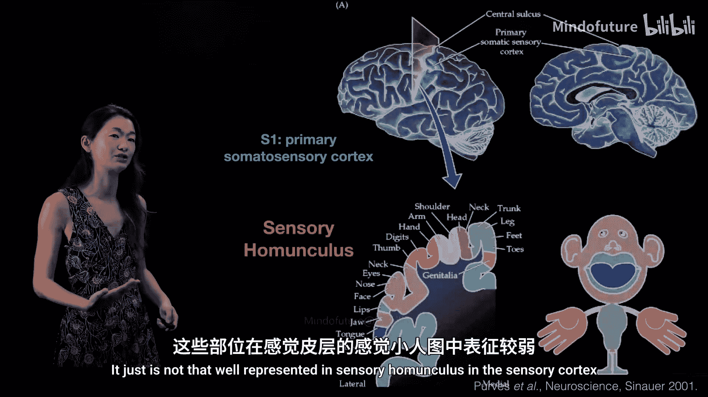

## 主要体感皮层与感觉侏儒图

信息最终到达大脑的**主要体感皮层**。在人类大脑中，S1位于**中央沟的后方**。中央沟前方则是主要运动皮层。大脑的组织大致遵循“后部更偏向感觉，前部更偏向运动和高级执行功能”的原则。

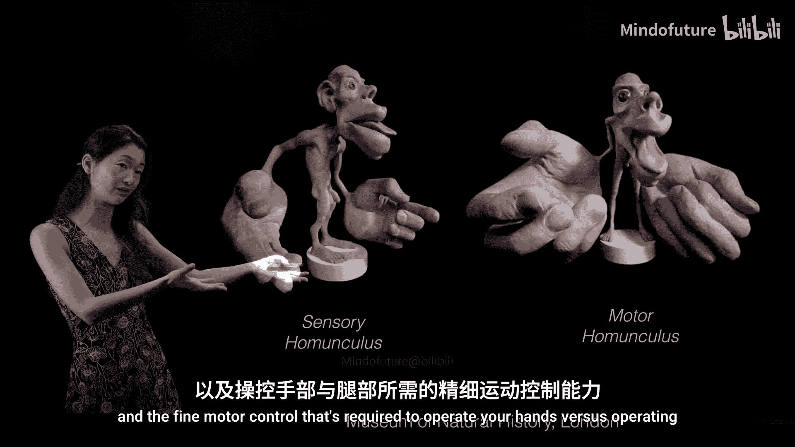

与视觉皮层具有**视网膜拓扑图**类似，体感皮层也具有**躯体拓扑图**，即身体各部位在皮层上有规律的代表区。这个图谱是上下倒置的：

*   皮层最下方（腹侧）代表**面部、舌头和喉咙**，这些区域由于神经密集、感觉敏锐，在皮层中占据的面积非常大。
*   向上依次是**颈部、拇指、手指、手部**的代表区。
*   再向上则是**躯干、腿部、脚和脚趾**的代表区。

为了直观展示这种代表区大小的不成比例，科学家绘制了**感觉侙儒图**。图中身体各部位的大小与其在S1皮层中所占面积成正比。因此，你会看到嘴唇、舌头和手被极大地夸张了，而躯干和腿部则相对较小。这反映了身体各部位感觉敏感度和神经支配密度的差异。

与S1相邻的主要运动皮层也有类似的**运动侙儒图**，其中手部的代表区也异常巨大，这反映了手部运动需要极高的精细控制能力，而非单纯的力量。

## 感觉侙儒图的来源与争议

感觉侙儒图的概念最早由 Wilder Penfield 等人在1937年通过一系列开创性实验提出。他们的研究方法是在患者进行开颅手术（患者保持清醒，因为大脑本身没有痛觉感受器）时，用电极直接刺激暴露的脑皮层表面。

以下是其实验方法与局限性：

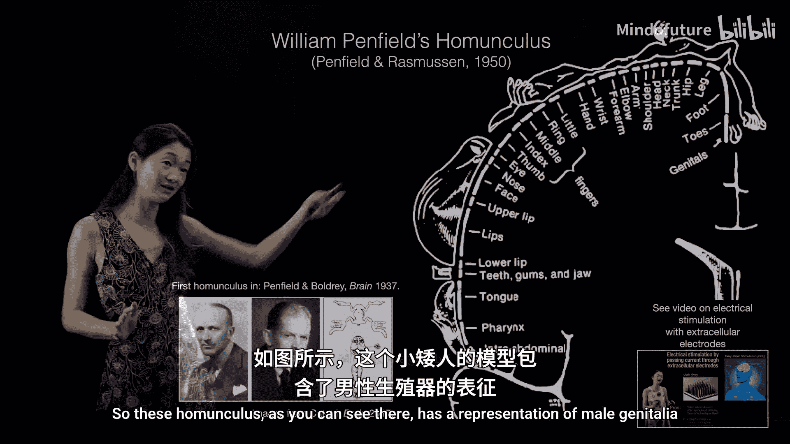

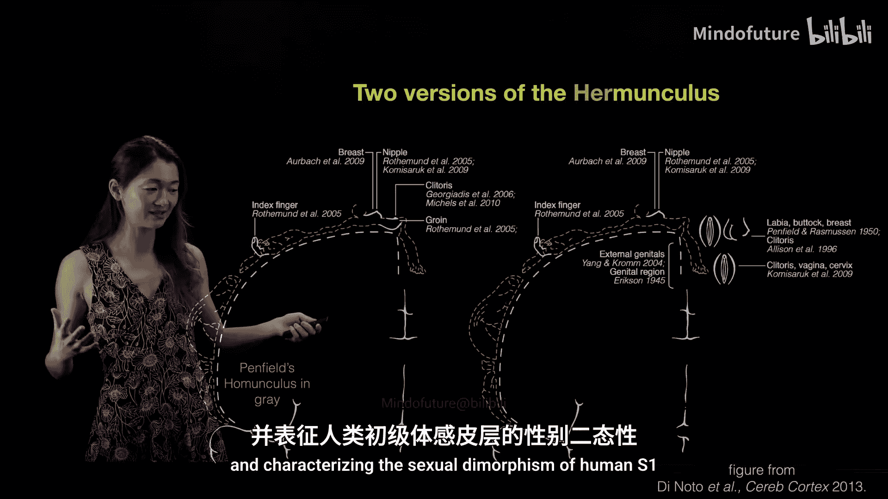

*   **方法**：用小电极依次刺激S1皮层的不同点位，并询问患者感受到了什么（如“鼻子痒”、“食指有感觉”），从而绘制出身体感觉在皮层的对应图谱。
*   **局限性**：
    1.  这种方法本质上不同于我们之前定义“感受野”的方法（通过呈现物理刺激并记录神经反应）。它是通过刺激皮层来“读出”感觉，存在技术干扰（可能激活路过纤维）。
    2.  该研究仅在人类中进行，无法系统性地在动物模型上验证。
    3.  早期研究受试者均为男性，绘制的侙儒图包含男性生殖器代表区，未能体现性别差异。后续研究才尝试补充绘制了女性体感皮层的对应图谱。

## 不同动物的体感皮层特化

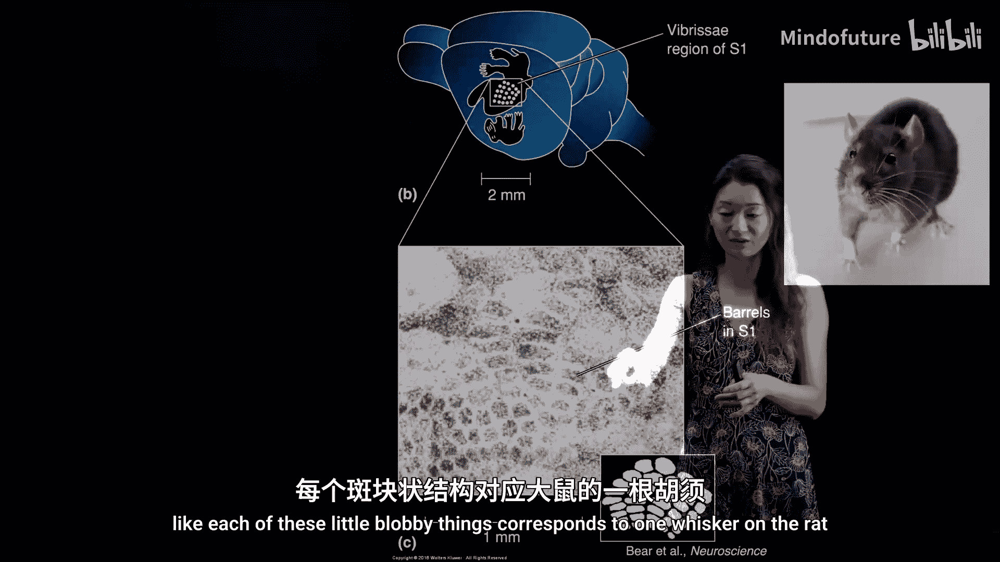

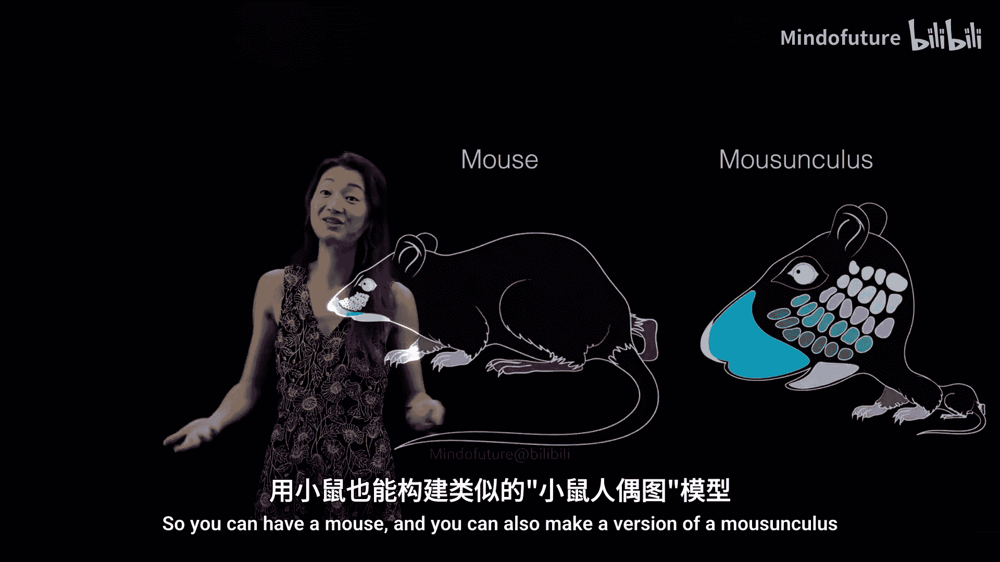

感觉侙儒图反映了对生物最重要的感觉器官在皮层中获得最大的代表区。这一点在不同动物中表现得尤为明显。

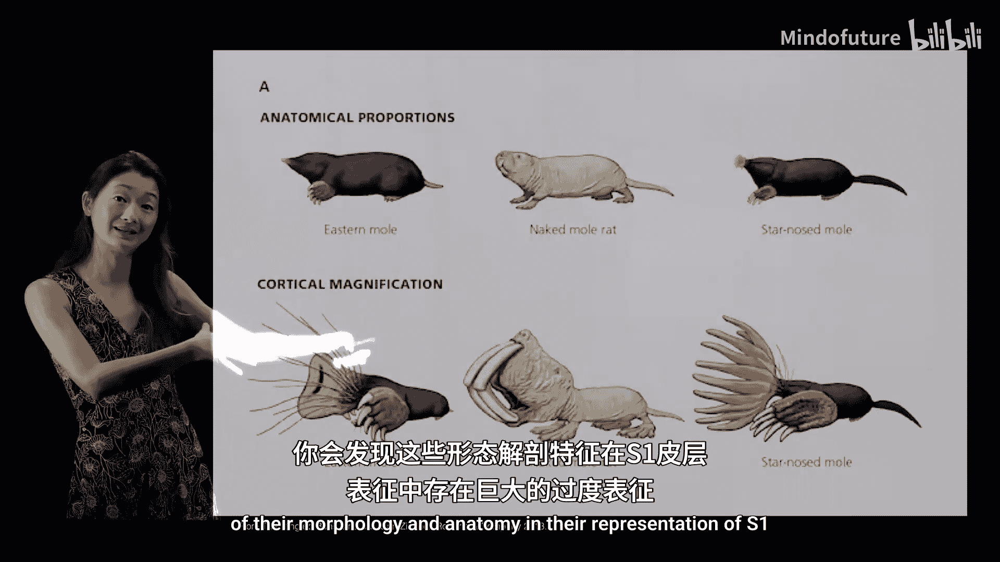

以下是几个例子：

*   **啮齿类动物（如大鼠、小鼠）**：它们的胡须是至关重要的触觉器官。因此，在其S1皮层中，有专门巨大的**桶状皮层**，其中每一个“桶”对应脸上的一根特定胡须。
*   **星鼻鼹鼠**：这种动物依靠鼻尖的星状附器进行高度灵敏的触觉探索，同时前爪也用于挖掘。因此，其S1皮层中，鼻部和前爪的代表区被极大地夸张了。

## 临床应用：解释幻肢现象

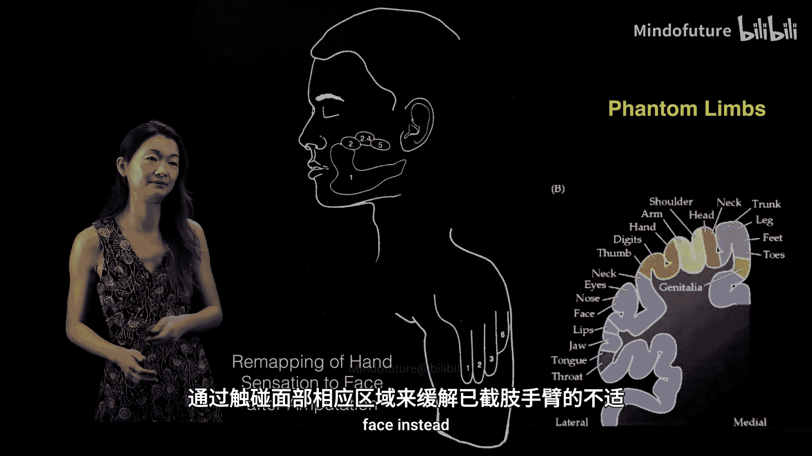

体感皮层的拓扑组织有助于解释一些神秘的临床现象，最著名的就是**幻肢**。截肢后，患者常常感觉到已被切除的肢体仍然存在，甚至产生无法缓解的剧痛或瘙痒。

这可以用感觉侙儒图来解释：截肢后，原本支配已失去肢体的神经在脊髓中的信号输入消失了。而大脑皮层中，**手部的代表区与面部的代表区相邻**（面部由颅神经直接支配，而非脊髓神经）。随着时间的推移，大脑皮层的可塑性可能导致面部代表区的神经元活动“侵入”或激活了邻近的、已闲置的手部代表区。因此，当患者触摸自己的脸颊时，可能会被大脑解读为是在触摸已失去的手臂，从而部分缓解幻肢感。

## 神经重定向技术

基于对神经可塑性的理解，科学家开发了创新的临床技术。对于截肢者，传统假肢控制是个挑战，尤其是肩部以上截肢的患者，他们缺乏用于控制假肢肘部的残留肌肉。

一项称为**靶向肌肉神经支配**的技术提供了解决方案：

1.  **原理**：将截肢后残留的、原本支配手部的神经，仔细分离并重新连接到胸部的肌肉上。
2.  **优势**：
    *   神经有了新的连接目标，减少了神经瘤和幻肢痛的发生。
    *   胸部肌肉充当了神经信号的“生物放大器”，使得通过肌电图更容易记录到这些微弱的神经信号。
    *   这些信号可用于控制机械假手，同时通过在胸部对应区域施加触觉反馈，可以让患者“感觉”到假手正在被触摸。

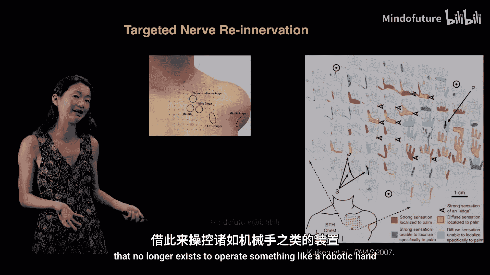

## 感知与自我：橡胶手错觉

我们的大脑不仅能表征自己的身体，还能将外部物体纳入自我表征中。**橡胶手错觉**完美地证明了这一点。

以下是该错觉的经典实验设置：

1.  参与者将一只手藏在挡板后（看不见）。
2.  将一只橡胶手放在参与者面前，位置与其真实手部大致对齐。
3.  实验者用两支画笔，**同步、同节奏地**同时刷拭参与者的真实手（藏在挡板后）和可见的橡胶手的相同部位（如拇指、食指）。
4.  几分钟后，大多数参与者会产生橡胶手就是自己手的强烈错觉。

一旦错觉形成，对橡胶手的威胁（如用锤子砸）会引发参与者真实的恐惧和痛觉感受。这个现象表明，多感官信息（视觉看到触摸与本体感觉到的触摸在时空上同步）的整合，可以重塑大脑对身体归属感的判断。类似的错觉也在虚拟现实中被广泛验证。

## 体感预测与感知偏差

体感系统并非被动记录外界刺激，而是积极参与预测。一个有趣的实验——“以眼还眼”力觉升级实验——揭示了这一点。

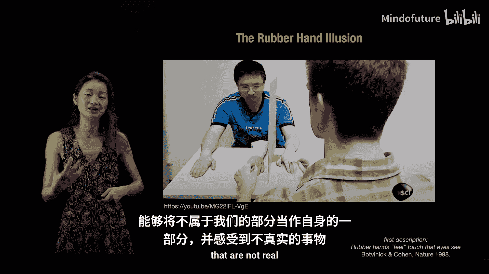

实验要求两个人通过操纵杆互相传递力度：A用一定力度推操纵杆，B感受到这个力度后，被要求用**完全相同的力度**回推。结果发现，经过几个回合，双方使用的力度会不断升级。

这背后的原理是：当B回推时，他感知到的自身发力大小，等于**实际发力**减去**他预期会受到的反作用力**。由于他预期会受到一个力，所以他对自身出力的感知被低估了，导致他实际上用了更大的力来回推。这种感知与现实的偏差，正是大脑内部预测模型在起作用。

## 特定行为的触觉通路

体感信息的不同通路可以导向完全不同的行为输出。一项近期的研究在小鼠中发现了专门介导**愉悦触觉和性接受行为**的触觉神经元。

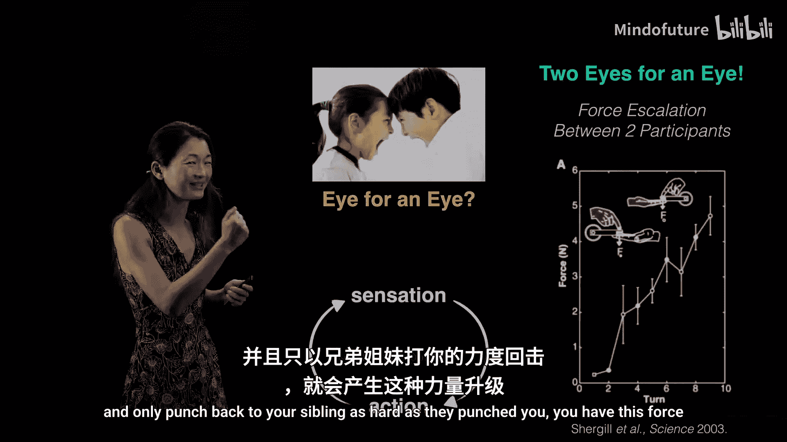

*   这类神经元表达特定的分子标记（如MRGPRB基因）。
*   当用光遗传学激活这些神经元时，雌性小鼠会表现出类似接受愉悦触摸的行为并变得性接受，同时释放多巴胺。
*   如果敲除这类神经元，小鼠的普通触觉依然正常，但在社交接触中不再释放多巴胺，并表现出攻击性行为。

这项研究清晰地表明，从初级触觉感受器开始，信息就通过不同的细胞群和通路进行分流，最终被大脑解读为不同的含义，从而引导诸如求偶、交配等复杂的社会行为。

## 总结

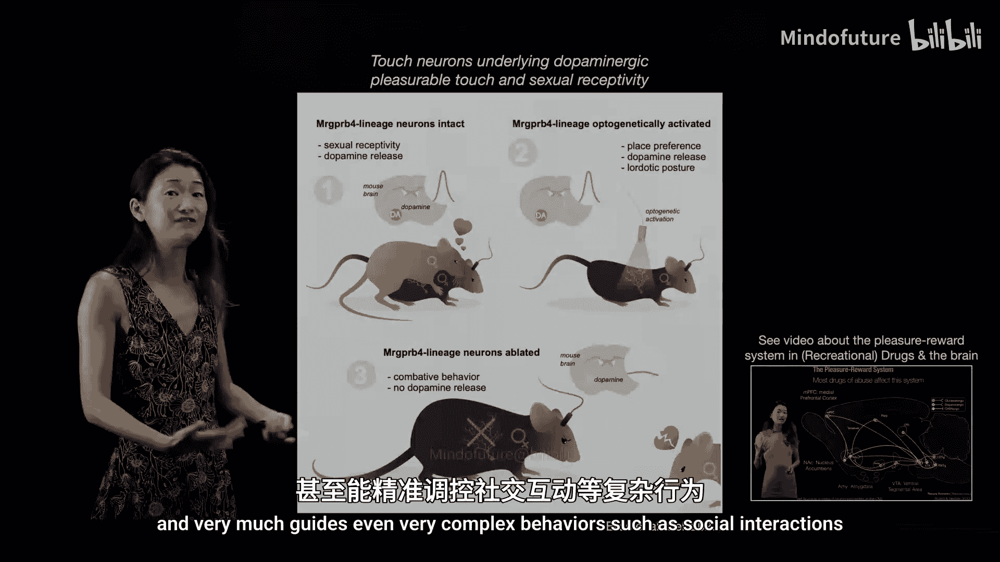

本节课中，我们一起学习了体感信息从脊髓到大脑皮层的两条主要上行通路（背柱通路和前外侧通路），了解了主要体感皮层以**感觉侙儒图**的方式拓扑表征身体各部位。我们探讨了这种表征如何解释**幻肢**现象，并看到了通过**靶向神经重定向**技术帮助截肢者的创新应用。通过**橡胶手错觉**，我们认识到大脑对身体表征具有惊人的可塑性。最后，我们了解到体感感知受到内部预测的影响（如力觉升级实验），并且特定的触觉通路可以专门驱动如社交愉悦等复杂行为。这些内容共同描绘了体感系统如何不仅传递物理刺激，更深刻地参与构建我们的身体意识和行为决策。