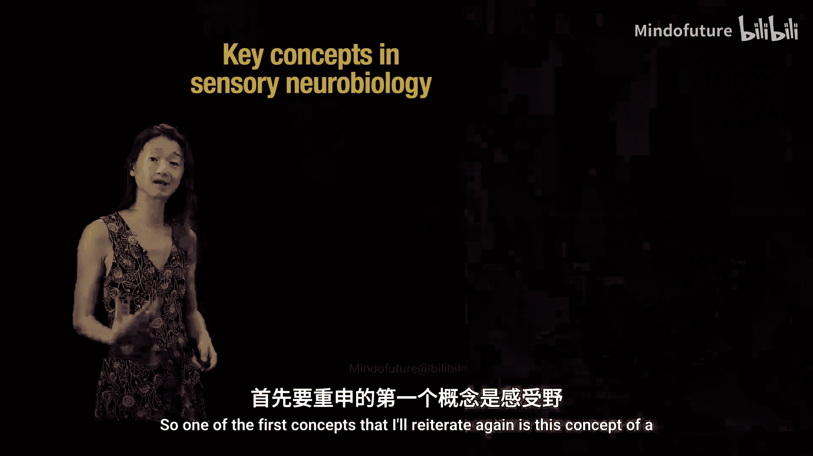
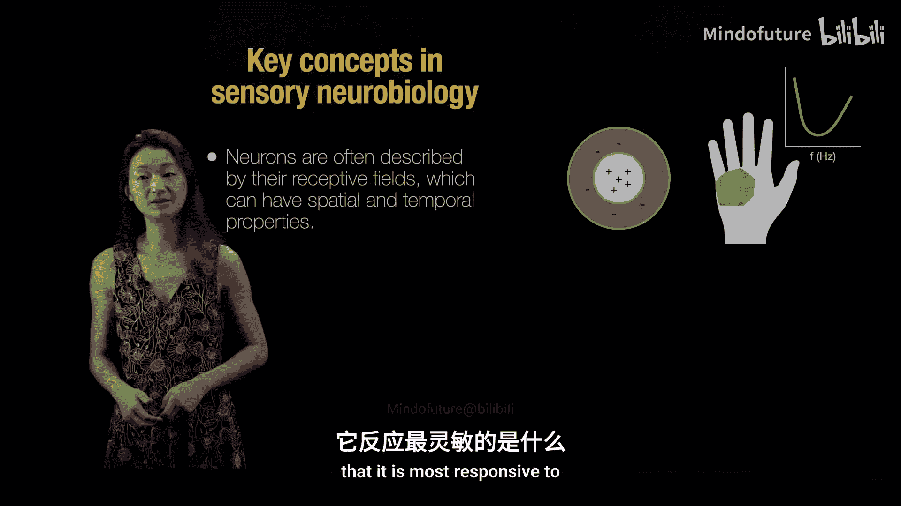
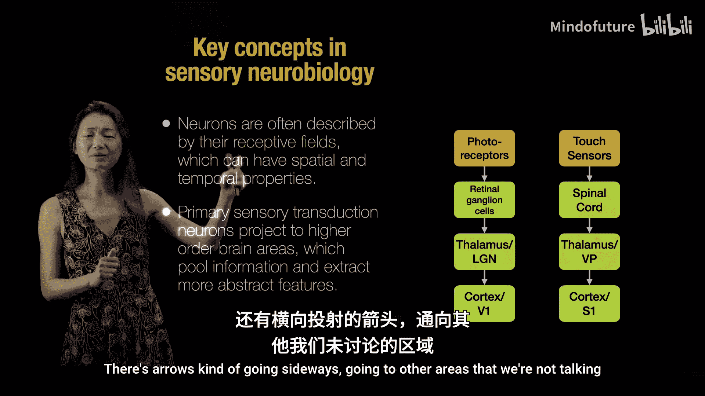
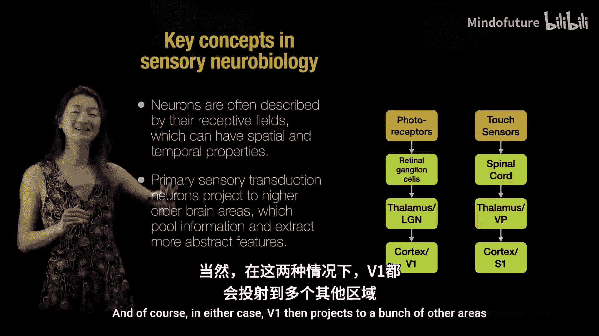
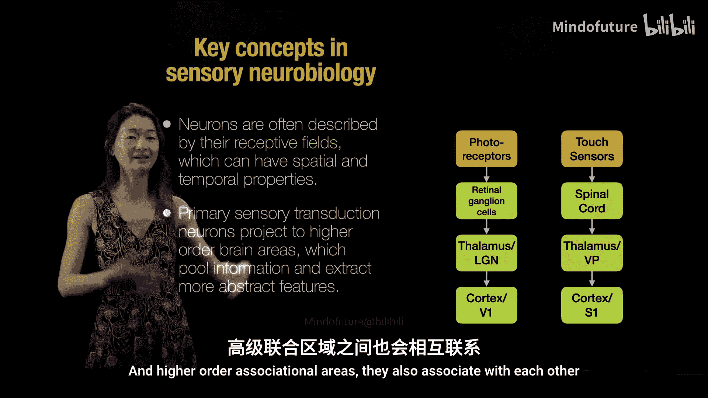
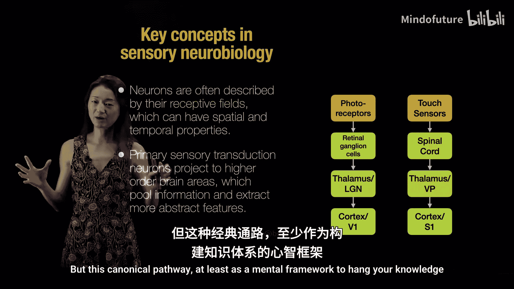
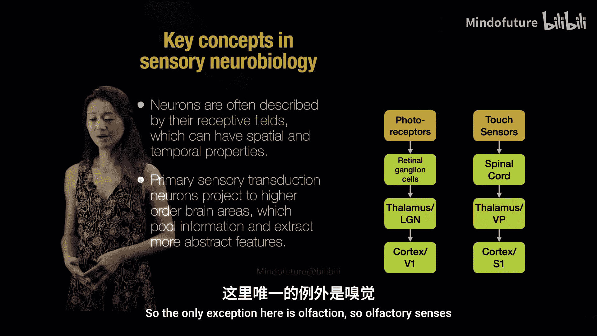
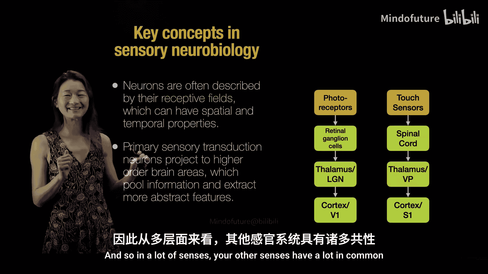
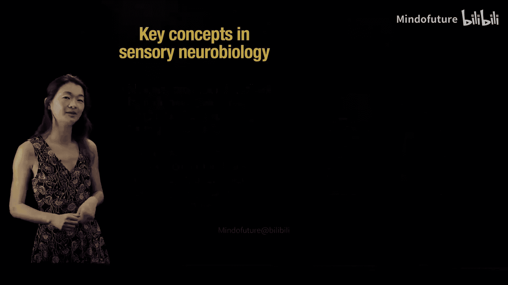
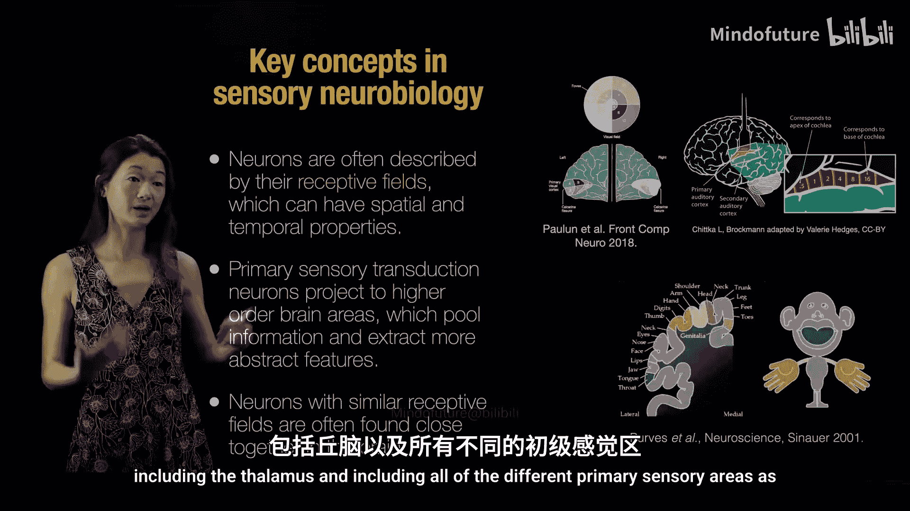

# 【华盛顿大学】神经科学入门 ｜ Introduction To Neuroscience ｜ Bing Wen Brunton p26 P26_感觉神经生物学通用概念 -BV1i3qWBXEDH_p26-

In this video we're going to be synthesizing a lot of what we learned so far about the various different sensory systems to extract some principles that organize neurobiology of how we perceive the external world so one of the first concepts that are'll reiterate again is this concept of a receptive field this is a really important concept because this is the tool with which neuroscienceists use to describe what kind of sensory cell it is so for example if it's a visual cell we can say that it has a receptive field in this part of my visual field it's a receptive field is here or we can say this receptive field is sensitive to light of this particular band wavelengths so in this language what we're doing is correlating the stimulus。

 the stimulus from the physical world that comes into the body and what the optimal features of those stimulus are that triggers this cell so it's kind of a reverse correlation kind of description so the neuron can have receptive field to have spatial or temporal or even spectral properties over there I'm showing you a reminder。

of a receptive field of a retinal ganglion cell in this case。

 this was an oncure retinal ganglion cell it really likes a spotlight in the middle with a ring of darker stuff along the side of it and the spatial receptive field of this on retinal ganglion cell can have a location in your retinal field it can actually be in the middle it can out to the side a little bit those are all features of the stimulus of the photon input in the world that makes that retinal ganglion cell fire so that's how that's how we can extract information about the external world using that particular visual neuron at the same time before talking about a totally different type of neuron that's like a touch recept neuron that's on your hand for example in that particular case because it's a tactile neuron its receptive field is going to have a spatial extent that is mapped on on the visual field but on your hand so my little diagram here that receptive field would be this part of your hand and anytime you touch that part of the hand that neuron is going to fire action potentials and spike and tell you something is touching。

But it only knows that it's touch somewhere here。 It doesn't know where exactly inside that receptive field it is so the receptive fields can also have those are spatial properties a receptive fields。

 we can also have receptive fields that have temporal properties。

 it could be sensitive to a certain change in the stimulus， for example。

 or can it be sensitive to a spectral change So a lot of sensitive neurons are sensitive to particular frequencies of vibration So when you have a little probe that's kind of vibrating rapidly back and forth it would be sensitive to a certain frequency of vibration like 100 hertz for example。

 or two hertz rather than something that's higher or lower and that's really significant in the case of tactile neurons because the vibration is important when you're dragging your fingertips across the surface with kind of texture that gets translated into bumpiness in time and that gets translated into frequencies of oscillation as tactile neurons are being are being vibrated up and down so these receptive fields is a general language that we use not only to describe。

Pary sensory neurons， but we can also use them describe higher order sensory neurons as well so for example。

 we can compute the receptive fields of V1 neurons or S1 neurons for example and I'll also point out that the concept of the receptive field is a very common one and we talk about receptive fields of sensory neurons all the time。

 however， it is not the case that a visual neuron has to have only a visual receptive field as we saw in the lecture on on why everything is everywhere we're in cortex and the reason that we don't know why there's a lot of neurons that are in classically primary sensory areas to the cortex that do have responses in other modalities so it's entirely possible for a sensory cell to have receptive field in like let's say a visual receptive field as well as an auditory receptive field could be a multisensy neuron in that sense so that's entirely okay as well Nevertheless this concept of the receptive field is something that comes up over and over again in sensory neurobiology and it's a language that we want to be familiar。

In trying to describe what it is that that particular neuron does， what is it happy doing。

 and how do we stimulate it if we wanted to give it something that it is most responsive to。

The second concept in sensory neurobiology is this idea that there are these canonical signal transduction and processing pathways that have a lot in common between the different sensory pathways so here once again I've shown you examples from the visual pathway as well as the somato sensation pathway and besides the fact that all of the cells in here in the brain areas are actually different the ordering which information proceeds from the phototransduction to the primary cortical area responsible for vision and from the touch sensors and to the primary cortical areas responsible somato sensation。

 the pathways are pretty similar so the canonical thing that happens is that there is a primary sensory neuron in the case of vision it's the primary photoreceptors in the case of touch those are touch receptors they then project to some kind of intermediary ganglion cell in the case of photoreceptor that happens locally in the retina goes to the retinal ganglion cells and retinal ganglion cells of the ones that then project up to。

thalamus in the case of vision， this is the area called LGN lateralgenicoculate nucleus and then the LGN projects two cortex startinging with area of V1。

 Similarlyly， there's a very similar hierarchy that we see in tactile sensation well the tactile sensors projects to the spinal cord and the spinal cord then projects all the way up and goes to the thalamus in the case of tactile sensation it's area of EP and then VP projects the primary somatosensory cortex which we call S1 Now this pathway I'm oversimplifying quite a bit there's a lot here that I'm not showing there's arrows going backwards there's arrows kind of going sideways going to other areas that we're not talking about and of course in either case v1 then projects a bunch of other areas and S1 also projects a bunch of error areas and higher order associational areas also they also associate with each other and there's multisensory integration as well but this canonical pathway at least as a mental framework to hang your knowledge on is something that we see for a lot of different areas So the only exception here。

is olfaction so olfactory sense does does not go through a thalamic cortex it goes entirely from the almost it goes from the olfactory receptors to the olfactory bulb and the olfactory bulb action projects directly to cortex but as I mentioned in the lecture on olfaction olfaction is kind of exceptional too because the neo olfactory cortex pureform cortex is not a part of neocortex it does not have this six layered architecture。

 it has instead a more evolutionary ancient three layer architecture and so in a lot of senses your other senses have a lot in common and olfaction is a bit of an exception in a couple of different ways as well。

The third key concept that we want to talk about in sensory neurobiology is the idea that neurons with similar receptive fields are often found in similar places along the brain that they're geographically co-located with each other in terms of where the receptive fields are next to each other on the brain。

 we saw this in the case of tootoppi in the visual system。

 so adjacent areas in your visual field will project to adjacent areas on your LGN and also in V1 similarly for somato sensation。

Close by places on your arm will project to similar places。

 close by places in S1 in the case of the auditory cortex， it's a little more abstract。

 it's more like in the cochlea sounds are decomposed into the frequency components and so adjacent places in tone project adjacent places in the auditory cortex in an organization that we call tootopby but the general feature is the same they have similar receptive fields in the primary sensory areas。

 they're close to each other either in physical space or in conceptual space and then those neurons are also going to be found close together what by the time they get to higher order brain areas。

 including thethalamus and including all of the different primary sensory areas as well。

The last thing I wanted to emphasize is this idea of adaptation and change。

 and this is something that we see all over in every single sensory area。

 neuron responses tend to adapt when something is happening constantly and cells are often responding to change rather than absolute value I'll say that one more time so if you are walking into a room and it smells either really good or really bad it actually doesn't really matter very quickly afterwards you adapt to and you stop noticing it Now that level of adaptation happens not only at the primary olfactory neurons。

 but also higher happens in higher order areas as well and so this is the general concept you can adapt to high conditions when you walk outside you very very quickly adapt and of course happens to the variety of adaptations not only the neural level because the dilation and the constriction of your pupils but nevertheless neural responses also tend to adapt we also see this in somato sensation as well right so there's a lot of different touch receptors on your finger。

in your hands where they only fire upon touching something and upon taking off or something but not when you're constantly pushing on something。

 So this concept， but adaptation and change rather than sensing up absolute value is a common common concept in sensory neurobiology but also in all of neurobiology as well and this is because your nervous system is more concerned with things that change rather than the things that are staying the same from the perspective of the animal and what the animal actually cares about in its daily survival you can think about it in terms of of when things are constant。

 you don't have to pay attention to it because you don't have to do anything but when there's a sudden change that's when you have to pay attention when there's an edge on a cliff and you want to fall off of it or don't want to fall off of it you dont want to pay attention to that if there's a sudden change in sound because loud noise is over there maybe you don't want to pay attention to that but if there's a constant loud sound you kind of adapt to it and you don't notice it for a long time so these are the four key concepts that I can。

up with that integrates our knowledge of all of the different sensory neurobiological systems I hope you can understand that this is not specific to any sensory system。

 but version that this can be adapted and applied to all of the different sensory systems that we talked about with exceptions because this is after all biology so I can think of exceptions every single one of these key concepts nevertheless from a introduction to neurobiology perspective。

 I think these are good concepts to keep in mind in our knowledge of sensory neurobiology。

