# 【华盛顿大学】神经科学入门 ｜ Introduction To Neuroscience ｜ Bing Wen Brunton p27 P27_运动与运动控制-肌肉-节律性运动与中枢模式发生器 -BV1i3qWBXEDH_p27-

One of the things that's special about animals is that we move around and are able to control where we are in the physical world and so the topic of movement and motor control is really central to our understanding of the nervous system we're not simply passive devices that are just sitting in one place waiting for things to happen to us and responding to it。

 we can in fact take a lot of ownership over our own future and plan where we can do next and plan for the future so the concept of movement and motor control is something that we previewed a couple of lectures ago in thinking about sensing and action and these sensory motor loops so we talked about this in the beginning in terms of how different sensory information is integrated to guide our next set of actions we actually even preview these topics quite a bit more succinctly in the lectures on somato sensation because the same nerves that go to your muscles to control the motor neurons and proor muscles to control the movement of your muscles are also co-located with the same nerves that carry sensory information back from your brain。

And so it's this loop between sensation and action that we are really going to start to dig into a little more succinctly today in terms of what are the molecular mechanisms that enact those actions。

 what are the features of the system in the organization of the systems and then later on we'll also get to how they're integrated with sensory perceptions in different hierarchhual ways so let's get started by thinking about the outputs of the brain so so far we've had a bunch of lectures in different sensory systems and sensory systems again in this kind of engineering diagram kind of way are inputs the systems。

 these are things that we measure so the outputs of your brain are if you think about it the only thing the brain actually does。

 everything is sort of everything else is on the inside and we can measure it if you're an experimenter。

 but the only thing the brain actually does is outputs and these are the different ways that that the brain can output we can output through the motor systems through the skeletal muscles you can also have outputs from the nervous system in autonomic nervous system this includes smooth muscles and your internal organs like your heart。

 your bladder other internal organs for example。

博。There's also outputs that are mediated and controlled by aspects of your nervous system。

 including the neuroendocrine systems， so that has to do with regulation of hormones。

 regulation of digestion， circadian rhythms， stuff like that。

 and so all of these are really really important in interconnected systems for the purposes for today though so we're really thinking about movement and motor control we're mostly going to be focusing on the output of the brain that is mediated by skeletal muscles in the motor systems that generate kinematic movements and kinematic trajectories and looking at the dynamics of those movements in animal movement。

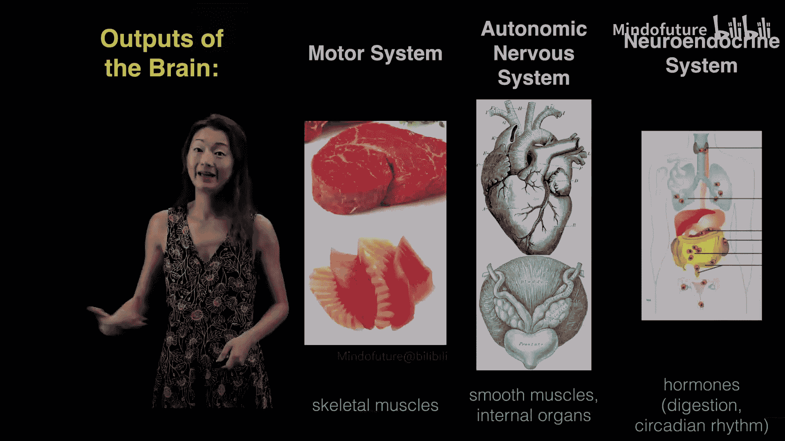

And so I'm going to start out by sharing this quote with you。

 which is kind of a like slightly snarkier way of saying what I just said。

 which is that to move things is all mankind can really do for such it's a soul exundant is the muscle。

 whether in whispering a syllable or in felling and forest and so no matter how small the movement is if it's really little or really big。

 really at the end of it， the thing that interacts between our nervous system and the external world。

 including communicating with each other or moving objects around in the world is mediated by the muscle and so any serious discussion of motor control starts with the muscle so we're going to spend a couple of slides just thinking about the muscle and thinking about the molecular and cellular mechanisms。

 so how it is that a cell in your body is able to generate so much mechanical force that it is able to move a largeish body like your arm。

 for example。

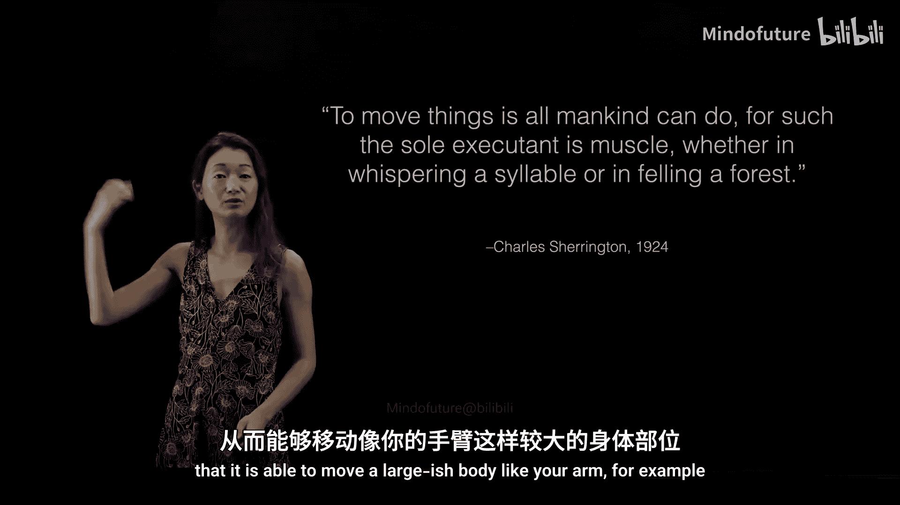

Okay， so the move and control system has an architecture that parallels a lot of we were talking about in the sensory systems。

 not surprisingly， but it has a major difference， which is that it's descending as opposed to ascending so here we're looking at motor neurons as opposed to sensory neurons so sensory neurons are over there。

 the sensory neurons project up。And then the motor system projects down okay so these motor neurons and the local circuit neurons are at the level of the spinal cord。

 similarly for the sensory neurons that are also at this level of the spinal cord so the sensory neurons are measuring things in the body by for example。

 there's muscle spindles that are inside your skeletal muscles。

 you can also have sensory neurons that are embedded in your skin for your sense of touch and temperature and pain etc cetera。

 things like of that nature， so there's a parallel sensory pathway that we talked about in somemato of sensory lecture。

 now we're kind of looking at similar parallel architecture。

 except now the information tends to be flowing down instead of lots of recurrence of course so going up from the level the spinal cord。

 you have the braint。And then about that is a set of neural systems that we'll get to in the next lecture。

 including the thalamus， the cerebellum， the basal ganglion and then also the motor cortex and things even higher up than the motor cortex and so in order to start there。

 we're going to talk first about the muscles because it is the thing that actually does all the work when you're moving your body around。

😊。

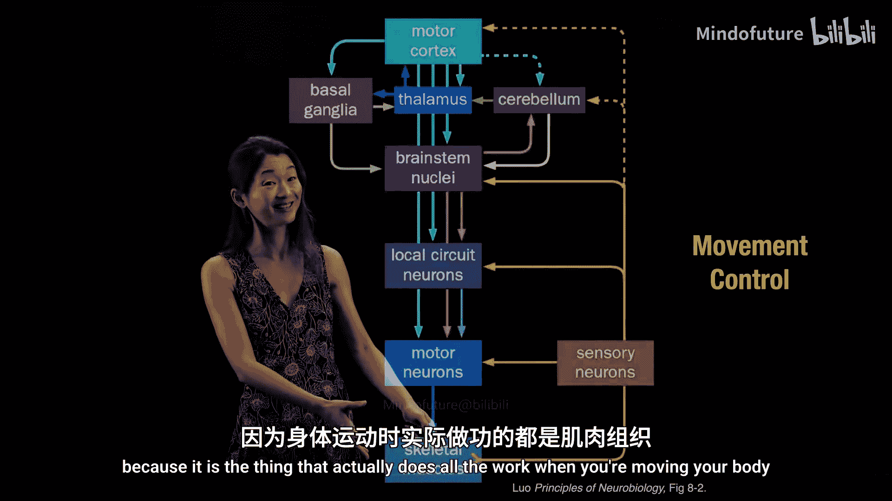

Your muscle is invated by motor neurons， so motor neuron is just a way we call neurons that project directly onto the muscle so if you're a neuron that where the terminus of your axon is a muscle then you are a motor neuron the organization of the mammalian vertebrate motor system rather is the following each muscle fiber is ind by a single motor neuron but each motor neuron cant innovavate multiple muscle fibers and so one motor fiber can actually terminate at multiple muscle fibers to make them all contract at the same time。

 but every muscle fiber is only receiving input from one motor neuron。

 it can't be receiving conflicting pieces of advice is only being commanded by one motor neuron at a time。

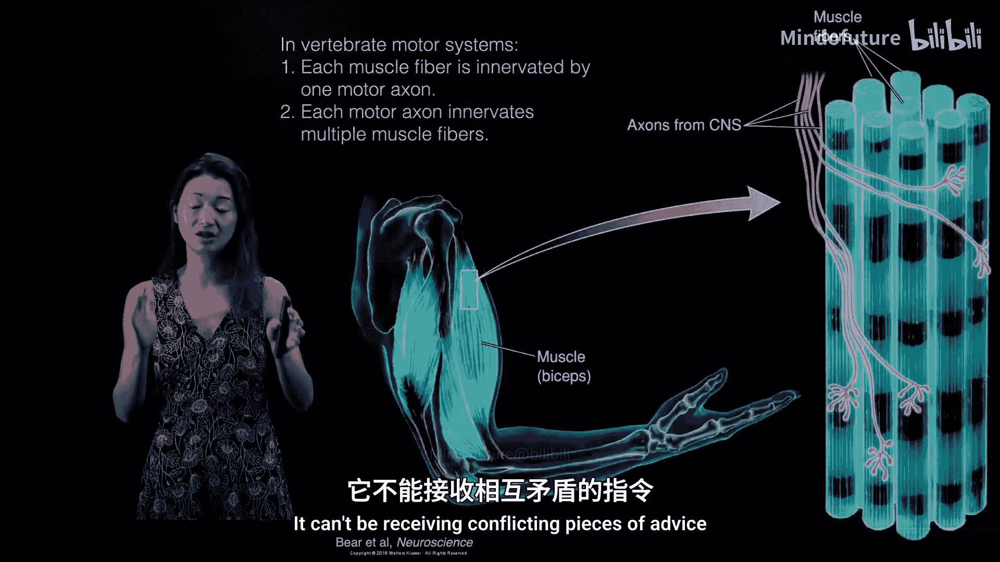

So muscles the topic of how muscles generate force is both fascinating as well as well beyond the scope of this particular course。

 I can do a whole separate lecture just on the biomolecular biophysics of how muscles work but I'll do a short version here just so you have at least kind of like a conceptual cartoon of how muscles work so here is an electro micrograph of a section of a skeletal muscle the first thing you notice that it is has this really beautiful crystalryline repeatable structure skeletal muscles are striated and that's why they have those little stripy things you can kind of see it under microsco。

 it's even somewhat visible microscopically as well you see this like different levels of organization so the striations in your skeletal muscle is a reflection of the biophysical organization of the different molecules are involved and what's fundamentally happening here is that when a muscle is contracting that microscopically at a molecular level。

😊，Of these different strands are being pulled by small motor proteins called myosin。

 And so what you're imagining here is basically like a stretchy substance with many different segments and their microscopic right so that's two micron sizescale down there very。

 very small when the muscle is contracting it's actually pulling those little segments together thereby decreasing the overall length of that entire things。

 you repeat this over and over and over for many， many。

 many of these little striations and then also threedimensally over a volume。

 then you end up with a maccroscopic decreasing the whole length of the muscle and that's what muscle contraction is。

Again， super high level， very， very simple version of the cartoon， the details are fascinating。

 but beyond the scope of this one lecture。Now what makes a muscle cell fire， Well it is a synapse。

 just like lots of other synapses that we talked about in the lecture on the synaptic transmission。

 so it is a chemical synapse in particular where already talked about the type of synapse it is the mammalian nervous system uses acettocholine as the neurotransmitter of choice in the neuromuscular system and so the motor neuron is an acettocholine neuron that terminates at these junctions where they form synapses called neuromuscular junctions with the muscles and so the process of events of a motor neuron causing a muscle fire is a close parallel to everything we talked about chemical synapses in the central nervous system so an active potential travels on the motor neuron it releases acettocholine and the neuromuscular junction which is the synapse acettocholine then activates sodium channels in the muscle。

 the muscle depolarizes and this depolarization triggers the release of calcium from a specialized subcellular compartment called circularropplastic matticulum。

So the SR then releases calcium into the cytool of the cell and the elevation in calcium potential causes muscle contraction by the release of these myosins right so the myosin then pulls and and is able to contract and this whole thing happens very。

 very reliably and very quickly as well there's a couple of reasons it's so fast one of the reasons is so fast is is because the release of the de the depolarization of the sodium channels happens in these Ttebrals and the t pberals are kind of these like wrggly things that kind of go inside。

 they're not kind of on the outside of the muscle bundle kind if we imagine kind of a cylinder right and there's like a giant bundle。

 these striaces with the little myosins that are pulling on the inside you want the information from the nerve conduction of the motor neuron to get to the rowing of the myosins as quickly as possible so the T tubes are actually very。

 very close to where the myosins are and thus。The release of calcium。

 is triggered even more quickly because of the cellular organization of this part of the muscle cell。

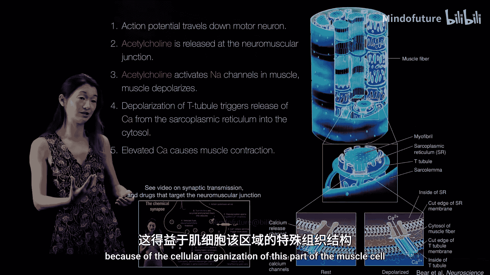

So I said that motormuscular reaction are very reliable synapsis this is incredibly important because this is how you move your body around what are some important behaviors that are mediated by releasing the muscles while running from predators is one of them and chasing prey is the other one So if you think about the evolution of the nervous system the ability to get away from something that's trying to eat you or to chase something that you want to eat is one of the biggest reasons why we have nerve conduction and nervous system in the first place and so if you can't trigger your muscles of fire reliably and accurately and quickly then the whole thing is not what's the point of passing all that information down avid an axon or squid giant axon if you can't contract your muscles so these are incredibly reliable synapsis and you can see that not only are they not do you have this specialization that allows the contraction of the contraction of the muscles very quickly you'll also see that this one motor neuron terminates at each of these muscle fibers at several locations each of these black dots is actually what is like。

chemical synapse and so this motor neuron is making a bunch of them with the same muscle fiber thuss greatly increasing the chances that the muscle wearing fat fire when the motor neuron fires an action potential because instead of having one synapse。

 it could be kind of stochastic gets noisy sometimes if you have like 30 of them。

 then the chances of at least one or several or you 1 of them firing is much much higher and so that's another reason why these neuromuscular junctions are so important and they happen so reliably and also fire very very quickly as well。

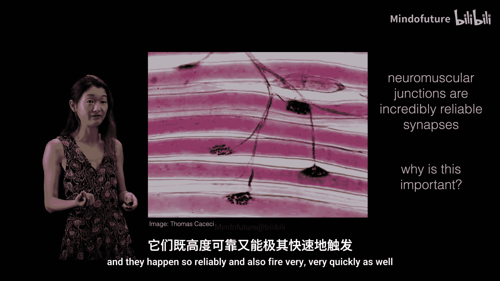

So we talked about muscles and how they're innovativeted by motor neurons and we also previewed a little bit about these motor neurons in the lecture on somato sensation because we talked about the dorsal root ganglion cells which are the sensory cells and then we also talked about the ventral root cells which are the corresponding motor neurons they go in the same spinal nerve and so by the time you have these spinal nerves you actually have a ton of fibers and it's really difficult to to apart which one is which so it's a mixture of sensory neurons and motor neurons so the ventral root has the cell bodies of the motor neurons and they project through the dorsal root and go into these mixed spin nerves and eventually terminate in the fibers again we're traveling up the pathway going from the primary forcegene cells of the body。

 the muscles we're going back up and up the spinal nerve and now we've traveled all the way back up to the ventral root of each spinal segment。

😊。

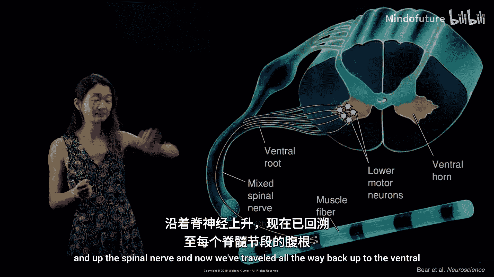

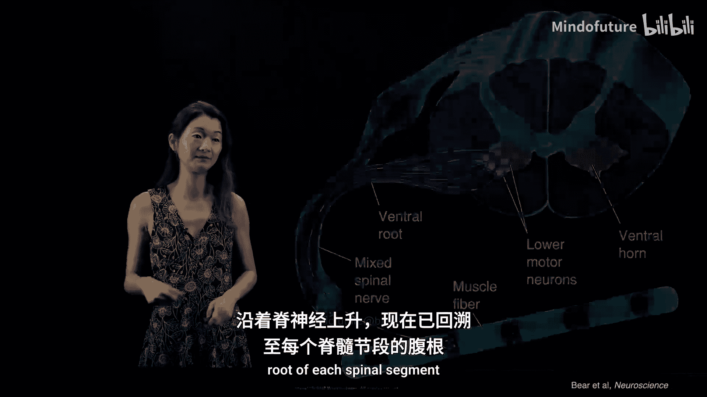

So the organization of these motor neurons is interesting here。

 So we talked to how about how one motor neuro might make one muscle fiber fire。 But of course。

 to have coordinated movements， you actually have to have coordinated movements of different types of muscles。

 So the muscles If you think about bio muscle mechanics。 there's a lot of details that are really。

 really important here。 So here's a really simplified diagram where you have a one degree of freedom joint。

 So there's the stiff thing in the middle is probably the equivalent of let's say this part of your arm。

 right，s let's do my other arm over here。 So I have an arm that's coming down。 there's one joint。

's say an elbow joint has one freedom。 It can either flex or extend。 That's extension infleion。 Okay。

 so in order to do this the minimum you need is one flexor that goes up。

 And then one extensionor that that it makes it that I can go back down。

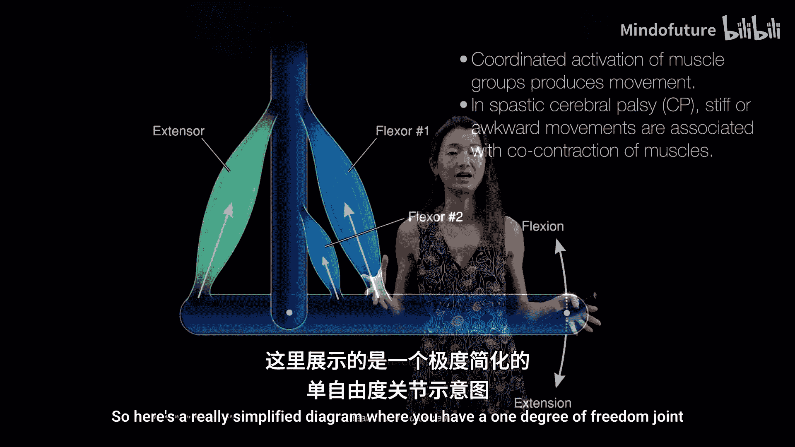

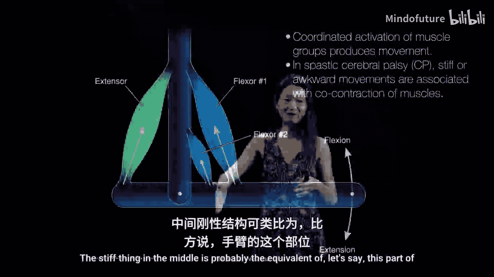

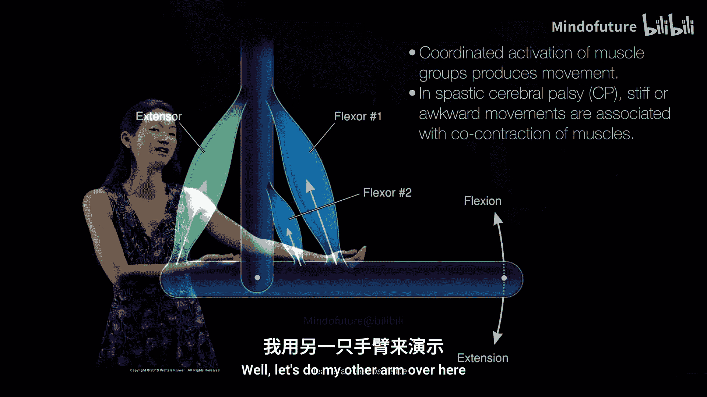

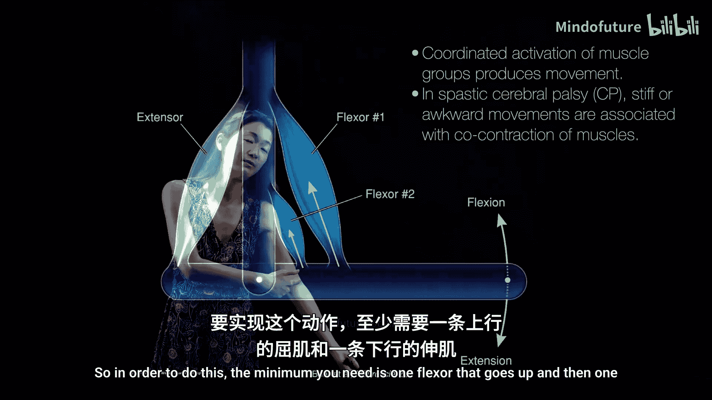

In reality， you have a lot more than that。 you have a whole set of different flexors that are working together and a whole different set of extensors depending on which joint you're looking at。

 a lot of your joints also have more than one degree of freedom。

 we talked about the elbow having approximately one degree of freedom but if you think about it you can actually move your arm this way as well without changing this angle or' changing this rotational angle here and so this elbow actually has an additional rotational degree of freedom as well so it's not one degree of freedom system it has this degree of freedom as well your shoulder of course。

 has more degrees of freedom because you can actually go all the way around it doesn't just go up and down。

 you can go all the way around and so in order to control all these degrees of freedom of movement of the mechanical plant of your body。

 you need a corresponding minimum number of muscles that are attached at the correct places so that when they contract they're able to move the limbs in those particular ways and so having having nonspastic movement。

 having coordinated movement is all。About not just moving your muscles and having them move quickly but coordinated activation of muscle groups。

 it's extraordinarily important that the groups of muscles are working together instead of against each other when you are trying to do something like w or reach or pick up an object or something like that。

 especially especially if the object has let's say you're trying to pick up an object that's kind of an unpredictable weight you need to very quickly adjust to what's happening if it's sloshing a little bit if you're trying to carry a rock versus an equivalent weight of sloshing drugg of water。

 then youll have to kind of adjust your entire coordinated movement of your entire body。

 including a lot of your core muscles on your back and your front in order to execute the movement of moving that that jug of water so the coordination between these muscles is really important and the lack of coordination is what underlies a lot of a lot of neurodegenerative disorders and also neurodevelopmental disorders。

For example， in aastic a type of cerebral palsy called spastic cerebral palsy。

 the symptom is that individuals with this type of CP have stiff or awkward movements and sometimes they holding their limbs at an atypical angle like my arm is relaxed sometimes you'll see individuals with CP who are unable to hold their limbs at an angle that most of us do and it is also these symptoms are often associated with lack of coordinated movement of these muscles and they're associated with co-contraction of muscles So what co could crashing means here is that because I have this lever here where I have flexors on one side and excsors on the other side when I flex my flexors I actually relax my exsors so they kind of always opposite of each other right。

In CP because the lack of muscle coordination， they are both activated and co-contracting at the same time and these individuals are unable to relax and contract the opposing muscles in a way that leads to coordinated movement and so that's one of the reasons they have these stiff and awkward movement and are unable to execute coordinated movements in the way that the individuals without CP are able to do so co-contraction of muscles in this context is undesirable it gets in the way of a coordinated movement。

 but coordinated movement is not just movement， because even when you're not moving at all。

 even when there's no kinematic change to your body。

 you in fact are very actively contracting and then co-contracting and then changing the coordinateordination pattern of your muscles。

 even when you're doing something relatively easy。Seems easy like standing still and not falling over。

 right Like I'm an inverted pendulum。 So are you presumably when you're standing up right in you' bipedal position。

 you can't see， but I am now standing on one f。I'm not really moving。

 at least I'm trying not to move。 I hopefully I'm succeeding and not moving very much。

 but in this pose， where I'm not really moving very much。

 I'm very actively coordinating the muscles in my legs and in my foot and other aspects of my core as well。

 in order to continue to stand on 1 foot and not fall over。

 And so this type of movement is called an isometric movement， right。

 because I'm not actually moving my body。 My body is， if I'm succeeding， not actually moving。 but。

In order to not move， I have to be able to coordinate the contraction of a large group of muscles all over my body to achieve not moving。

 This is the goal of yoga， for example， is to hold these poses and then be still and then not move。

 This in fact takes quite a bit of practice and a lot of coordinated movement of your movement and motor coordination system so back to walking we're no longer doing yoga anymore we're walking and running So the question that people had asked for a long time because of this hierarch organization of the motor system where you go from you go from the spinal cord to the brain sal up and up do you actually need a brain to walk or run right so this is a question and the question was answered kind of earlier on a series of kind of bizarre experiments。

 So for example， can you get a fruit fly walk by cutting its head off and the answer is yes。

 will definitely walk without its head。 you can't really do that with a mammal you cut off the head of a mammal mostly just dies So that's not a good experiment。

 but what they did do is。

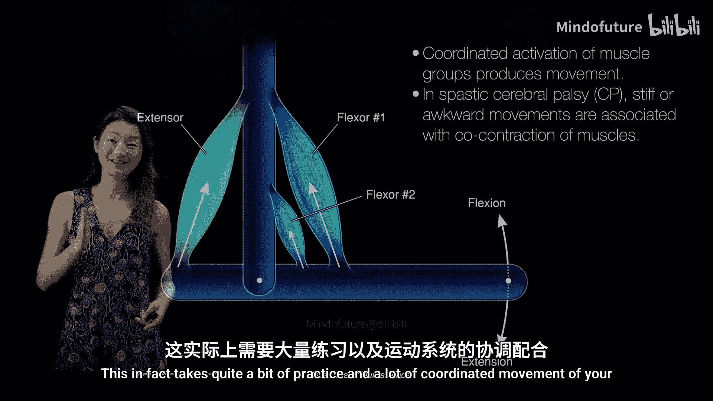

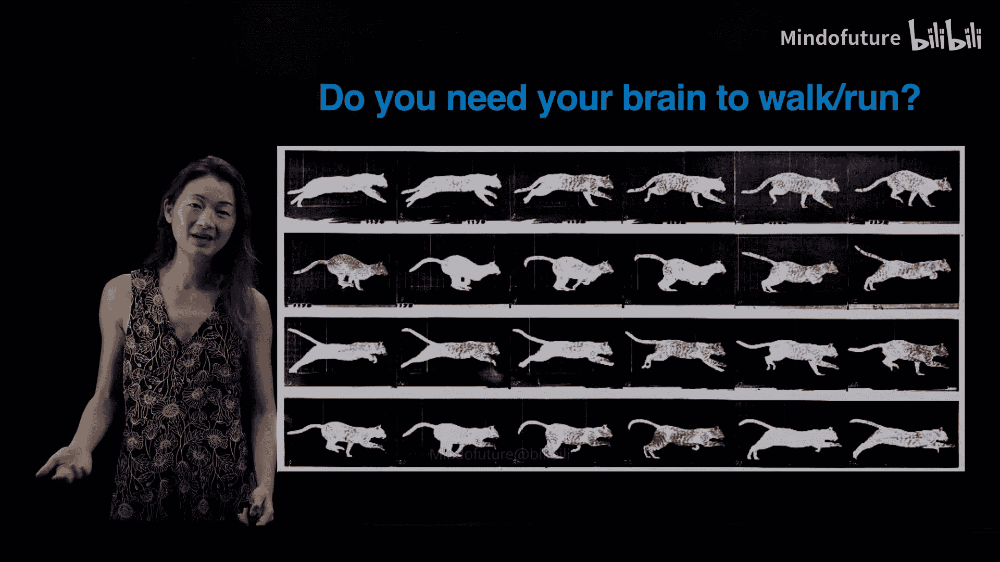

Decerroate a cat so how does that work it means that they didn't cut off the head of the cat we don't do these experiments anymore as you can tell this is a really old experiment so what they did was they went into the spinal cord and then severed the connection selectively severed the spinal connection between the head and the rest of the spinal cord of this cat and so the cat really isn't able to control its movements using its brain anymore。

So won't walk， Okay， But what they did do。 And this is a cool video of it。

 I'm not able to play it here， but you can kind of look up these videos。 I encourage you to do so。

 They're really interesting to look at is they put this cat in a little little harness。

 Just to hold it up。 So it's upright。 Otherwise， just not move。 It's ttraplegic at this point。

 and then they put it on a treadmill。 So when the cat is stimulated with the movement of the treadmill belt。

 it does walk。😊，Wwhich demonstrates that the brain may be important for the initiation of the walking movement。

 but it is not necessary for the maintaining of the walking and they also do this at various different speeds and you can see what they saw the cat does in fact it walks slowly and it can actually almost run if you run the treadmill fast enough without the ability of the brain to communicate with the limbs so in short you don't actually need a brain to just continue walking Now how does this work the leading theory that's been around for a couple of decades is a set of models that are known as a central pattern generating models a CPG models and the abstract idea is the following somewhere in your spinal cord there's a set of cells that are just selfgene a rhythmic movement So it's like a clock circuit。

 a clock neuron or clock circuits。 This is an abstract idea right now let's not talk about exactly what literally neurons are so the idea is the following somewhere in there there's a couple of neural。

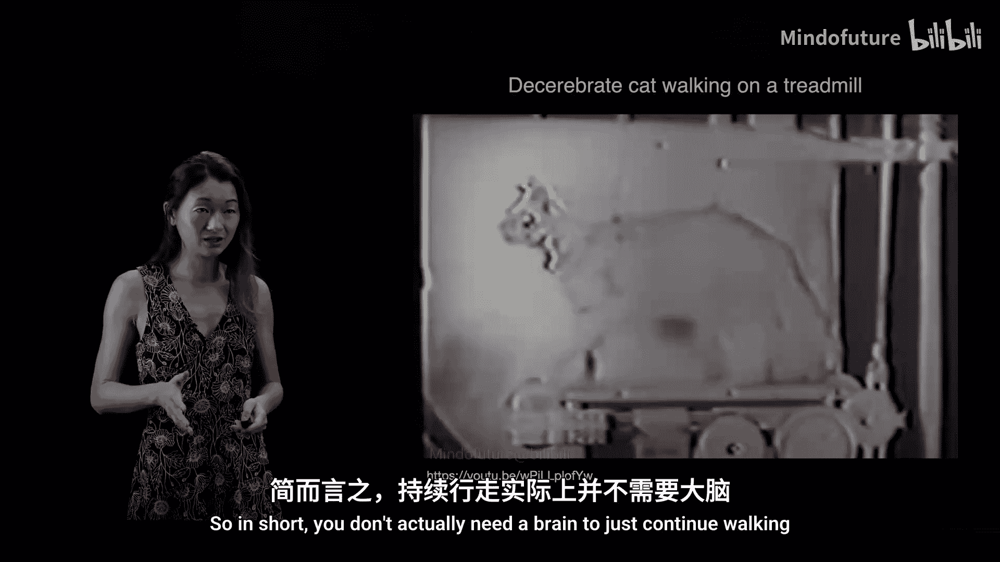

OscillAnd so here in the diagram， you're we're showing this as there's a neuro ocillator here and a neuroosscillator there。

 So one for the left side and one for the right side of this and this's kind of in the spine。

 kind of where this is supposed to be right And they are just clocks and they're just running they're generating the rhythmic movement by themselves。

 if you hook them up So that one side commands the flexor of the right leg and the other side。

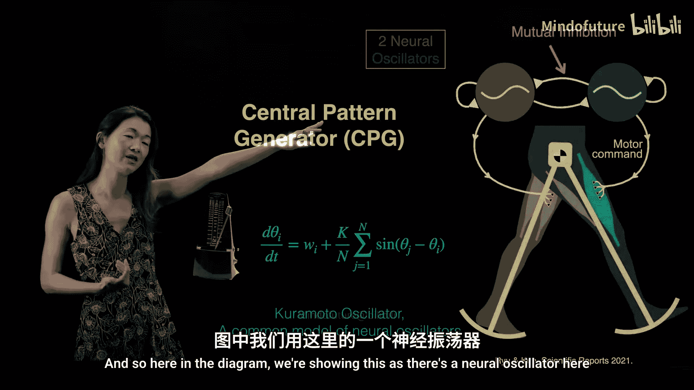

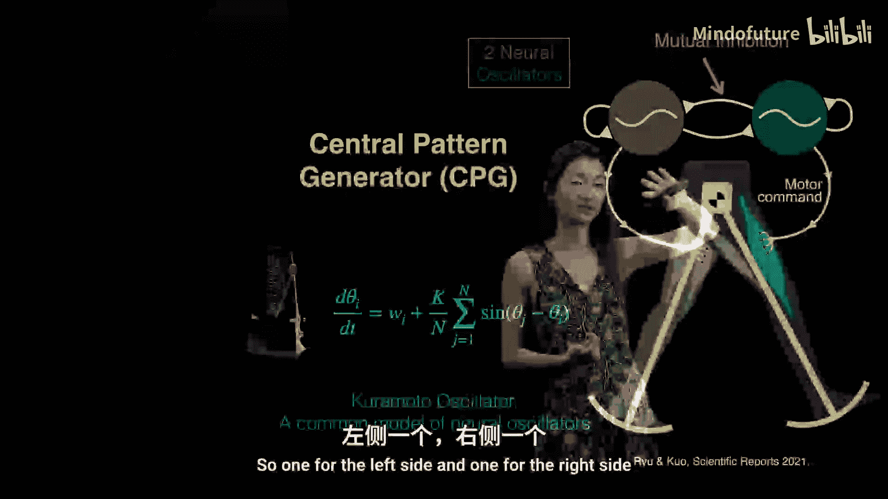

Controls the flexor of the left leg and you then hook them up so that there's mutual inhibition。

 So one shuts off the other。 What's going to happen is that they'll become antiphase。

 So one is going to be up and the other is going be down and they're going kind go like this up down up down。

 That's how they're going to start oscillating。 They're going to go antiphase。

 They're going to train on each other at the same frequency and they're gonna go antiphase and if you drive the motor command of the leg that way in my simplified stick model of a walking of a walking foot there's no joints or's nothing else is just stick then you can get moving you can actually get something like that if you built a little stick device that's driven by mutual inhibition of a couple of neuroscillators hooked them up to contraction muscles。

 then you can generate very rhythmic movement of the legs and you can get moving Now the central pattern generator is interesting because there's a lot of different models that have been worked on to simulate the behavior of the central pattern generator So one of the more popular ones and ones that we've used and we search is what's called a chromromo osll。

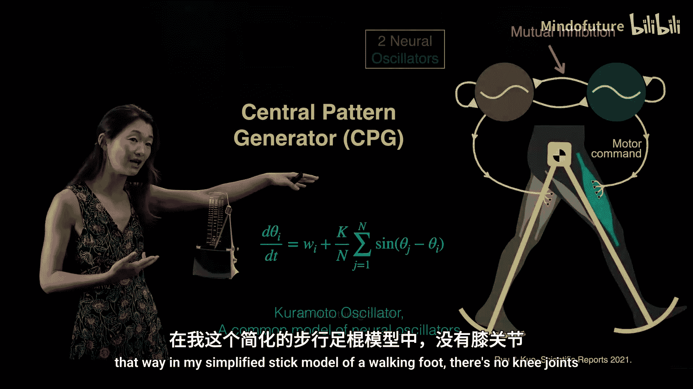

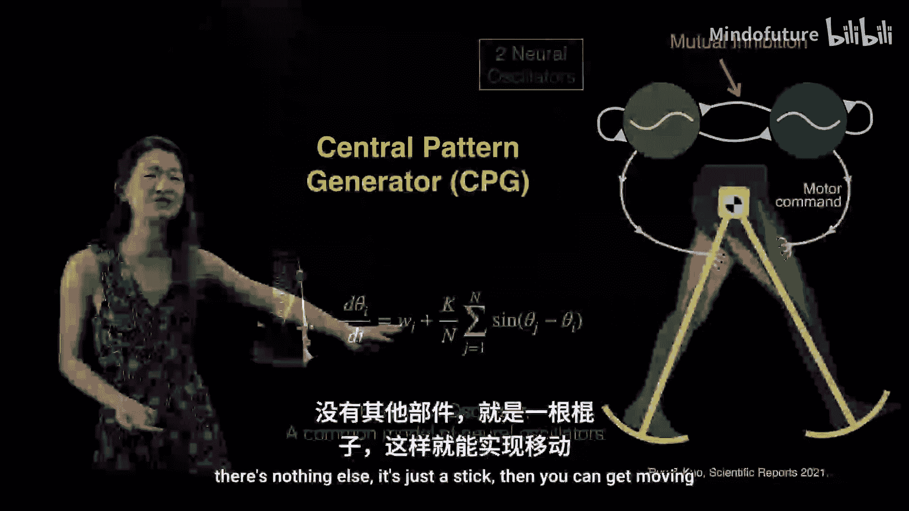

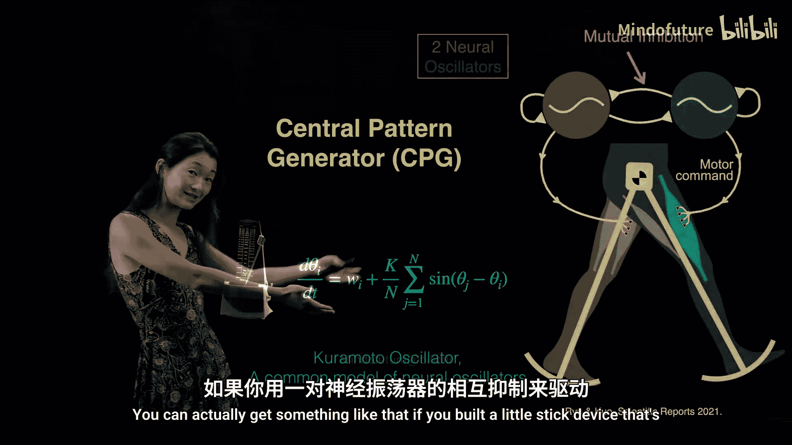

This thing is super common using a lot of different systems to model all kinds of different things。

 One of the things that we can use a chrom model ocillator to model is a central pattern generator and so the idea here is that it's basically a model of a metronome so this is something that intrinsic has an intrinsic period of oscillation left by itself it just back and forth and back and forth actually goes in a circle but it's kind of like a metronome in that way but the equivalent thing that's happening here so I have two oscillators in that diagram theta1 and theta 2 so we're left and right respectively and it's equivalent of having these two metronomes that are weak coupled to each other so let's say you have them kind of on the same rickety table so if you have two metronomes on the same rickety table and at approximately the same frequency first they're going to do their own thing after a while because they're weak coupled by the same rickety table that they're on they're going to start oscillating at exactly the same frequency they're untrained to each other and they'll kind of go at the same frequency this was observation that was first made。

At least the anecdote that I heard first made on a ship where the captain observed that they were two kind of grandfather clucks that were on the wall and they were a couple because they were on a ship and the ship was kind of swaying and invariably the periods of oscillation of the clocks within train and they end up going at exactly the same they would kind of going in synchrony What's happening with mutual inhibition is that they train at the same frequency but they train and opposite phases So that's kind of the mathematical model of what's going on there in this kind of entrain and when you get this antiphase behavior。

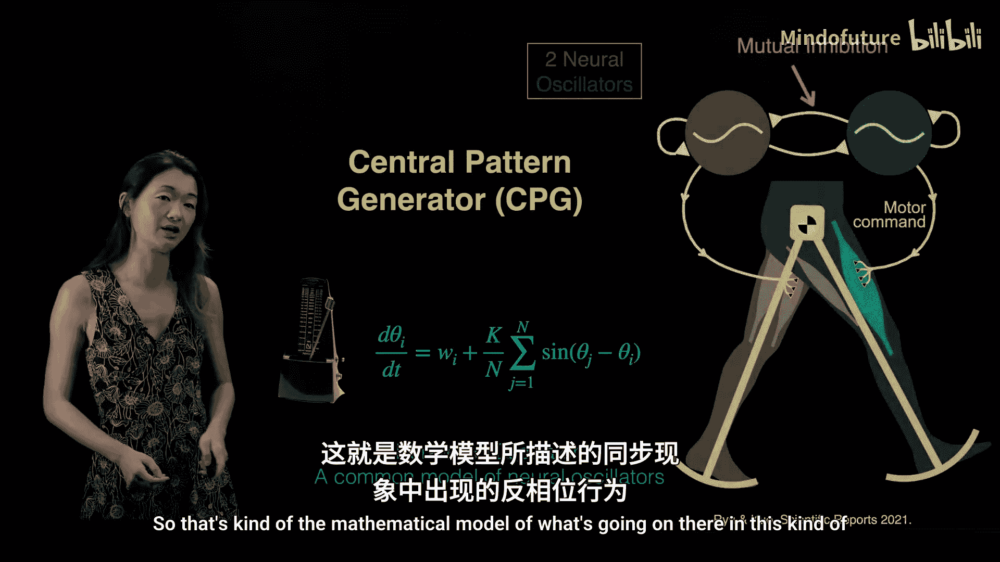

What we do know is that the CPG by itself is not sufficient to explain naturalistic walking。

 You can get walking。 It's really easy to get walking。

 You can get something that has two legs and it will just go forward like back and forth back and forth。

 not terribly hard to get a model of something that happens like that。

 but a model like that is purely feet forward， it's only commanding the motor commands。

 it's not receiving any sensory feedback， which means if anything happens that was not expected like the surface was slightly uneven or you kicked into a small rock of some kind。

 the whole thing is going to fall apart because it's just going to fall over that had no ability to respond to unexpected environmental changes So what is much closer to the actual reality situation is almost certainly a picture that's more like the following。

 There's a CPG that has some kind of rhythmic movements This generates the underlying period of oscillation that underlies me stepping forward and walking back and forth。

But at the same time， there's also sensory feedback and you kind of think about this as like propriocepttic feedback from the skeletal muscles。

 for example， that's kind of the simplest case of it。

 And so if you hook up a system like that where it's driven both by feet forward central pattern generator。

 as well as responding to some sensory feedback from the limbs telling you on the ground what's actually happening and you can adjust to that。

 then you can actually make a set of walking and running etc for models that are able to both walk forward and adjust to unpredicted environmental conditions such as kicking a small pebble。

 for example， or having having the ground be slightly lower than you were expecting。

 you can kind of adjust to that and keep walking。

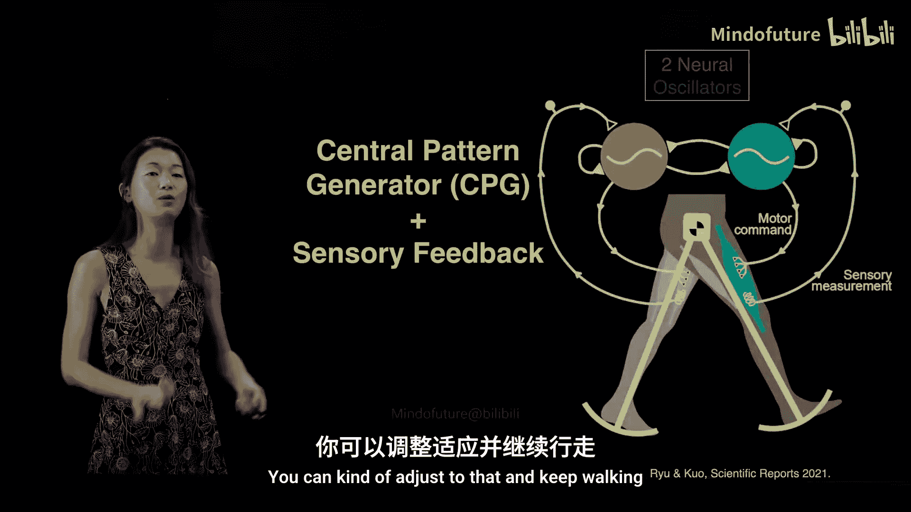

So a funny consequence of some of these models is that we've used the mathematical formalism of what's called optimal control theory to solve for not only that it can work but what ought to work right what is the optimal best solution given the constraints。

 or perhaps you want something that's stable and you want something that is energetically favorable。

 So a lot of the gates that we adopt are energetically favorable。

 so I don't know if you remember being a kid， I remember being a kid。

 I remember I really liked skipping when I was a kid I don't skip anymore。 I still can。

 I tried my kids were skipping and I skipped with them， so Im physically capable of so skipping。

 but I no longer the spirit no longer possesses me to skip but apparently。

It's because we're small children， the skipping gate is energetically favorable because they're small lows of the ground and the skipping gate for adults is no longer energetically favorable。

 except if you're on the moon and there's low gravity This is in fact。

 what happened so there's a lovely series of papers where they showed by analyzing the footprints of astronauts on the moon that they both tried to run but a lot of them actually decided that the skipping gate this alternation where you kind of go left and right and you're alternating in a way that is very different than walking and running is something that that they kind of just naturally felt right to them。

 nobody told them to do it， but they just did it because just felt like the right way of getting around and there is possible to ride from the biomechanics and this idea of a central pattern generator and the mechanics of gravity that skipping would be the preferred more optimal gate if you were walking around on the moon So that's another way in which our understanding。

😊，Of the nervous system and also biomechanics combined together and so it it''s like a lovely neuromechanical story if you happen to be on the moon next time you'll know not to try to run because you might fall over it's not that great。

 try skipping instead you have a much better time getting around。

Now we talked a lot about bipedal locomotion， which is lovely for us because we happen to be a bipedal animals。

 most of us， but the vast majority of the other animals on earth are not so what happens if you had multiple pairs of legs you might be a dog and you might be a quadrup head you can be an insect with six legs there's other types of arthropods that have a lot more than six pairs of legs and in the extreme of the infinite number of legs where there's not really legs at all you can also have slithering motion when you have these traveling waves that are going down and so you can actually learn a lot about locomotion by thinking about and also studying animals of these different kinds and thinking about how they walk and how they generate rhythmic movements and coordinated movements of not just two legs but multiple legs some answers are easier because if you are a stick insect and you have six legs for example。

 you're not constantly at risk of falling over like a human is I'm bipedal I'm literally always falling over unless I'm trying。

 but if you have six legs and you can stand at at least three of them and。

You're like you have a tripod and you can actually stand right and so some of the challenges are easier。

 but some of the challenges are also harder because you have to coordinate not just the movement of two legs but multiple joints on multiple legs and in the case of the snake you're actually activating and coordinating the contraction of the muscles on either side of your body as a come contact with the ground and so this is kind of an interesting thought exercise and something that is very much an active area of research in neuroscience。

 the neuroscience and motor control and also neuromechanics is really thinking about what happens if you have two four。

 six or many， many different pairs of legs。This is something that's also quite important for robotics and so a lot of different robotics companies have built a variety of different robots there's bipedo robots which are not shockingly really hard to build you can build quadrupett robots which are a lot easier because they're not at risk of falling over as much and people have also built a lot of variety for insect inspired hexapod robots for example。

 so if you look so this is the Boston dynamicsmics is one company robotics company that has probably they have a really great team making really charismatic videos for them and so if you haven't seen any of these videos yet I encourage you to check them out because they're really cool to see just the state of the art in terms of what is possible in engineered systems and thinking about how you would use the coordinated activation of these motors in in engineer system to accomplish coordinated movements so that's how you make movement and movement generation and I've told you that。

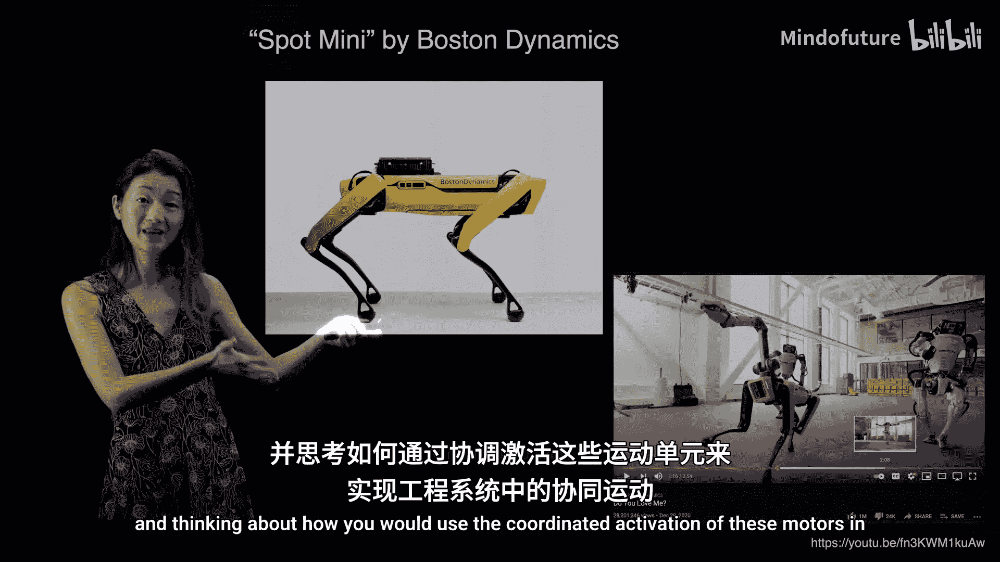

You don't really need a brain to keep walking， you can deroate a cat and would keep walking so the next video is going to be again going back up that pathway and thinking about not can you keep walking。

 but how do you initiate movements and how do you plan for movements in the future okay so that's what we're going to be talking about in the next video how do you get started walking in the first place。

