# 神经科学入门：P27：运动与运动控制-肌肉-节律性运动与中枢模式发生器 🧠💪

在本节课中，我们将要学习运动与运动控制的核心概念。我们将从肌肉如何产生力量开始，探讨神经系统如何协调复杂的动作，并深入了解节律性运动（如行走）背后的神经机制——中枢模式发生器。

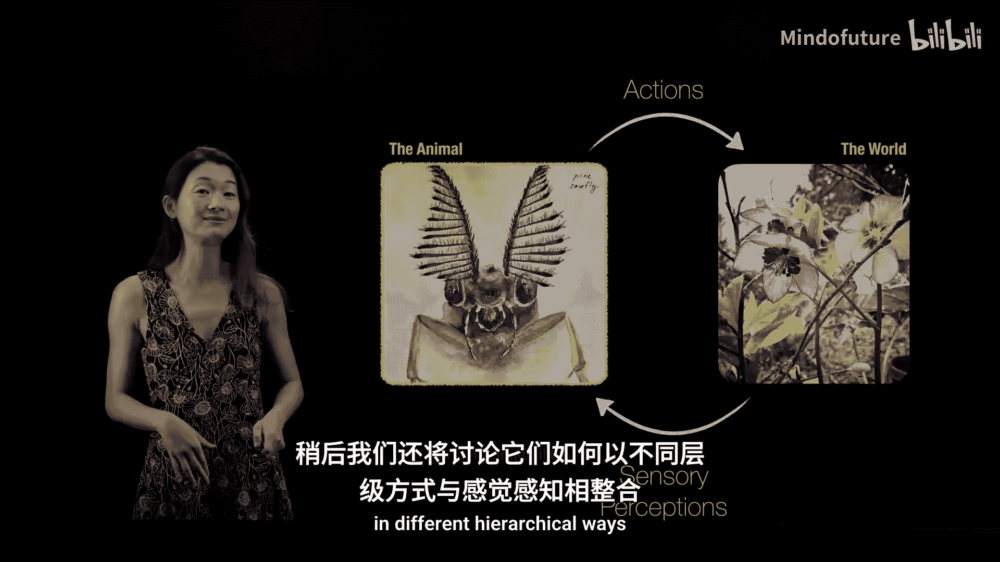

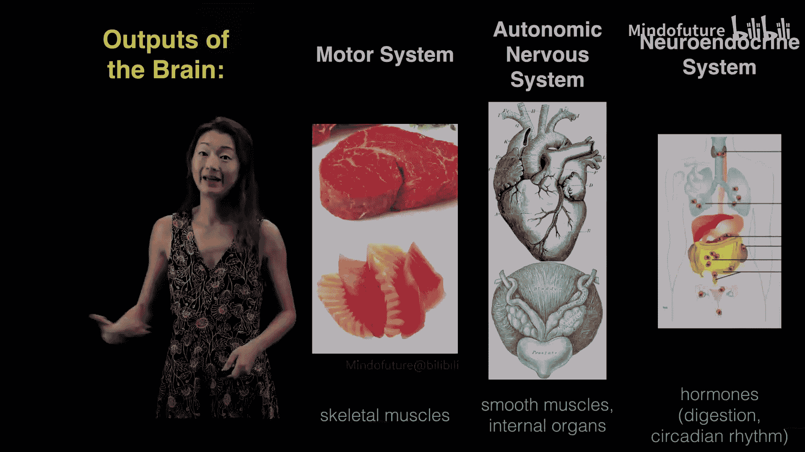

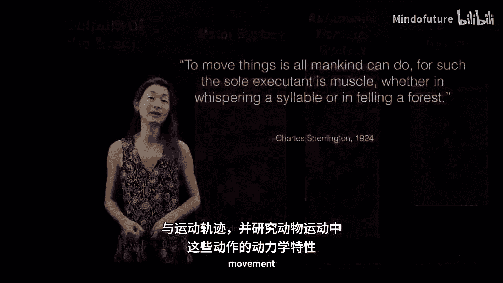

动物的一个特殊之处在于我们能够四处移动，并控制自身在物理世界中的位置。因此，运动与运动控制这一主题对于我们理解神经系统至关重要。我们并非只是被动地待在一个地方等待事情发生并做出反应。事实上，我们可以对自己的未来有很大程度的掌控，计划下一步行动并为未来做打算。

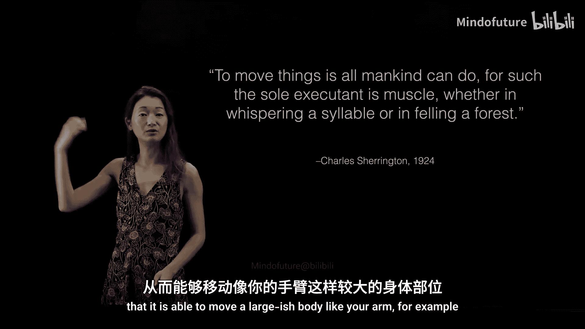

我们在几节课前思考感觉与行动以及感觉运动环路时，已经预览了运动与运动控制的概念。我们最初讨论了不同的感觉信息如何被整合以指导我们下一系列行动。实际上，我们在躯体感觉的课程中更简洁地预览了这些主题，因为控制肌肉运动的运动神经元所在的神经，与将感觉信息传回大脑的神经是共存的。

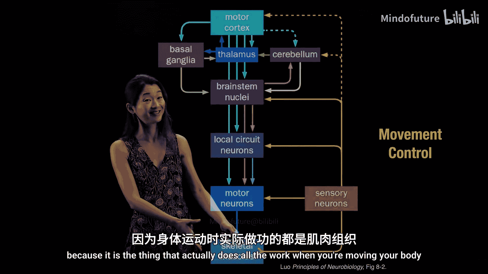

因此，我们今天将更简洁地深入探讨感觉与行动之间的这个环路，具体来说，是执行那些行动的分子机制是什么，系统的组织特征是什么。之后，我们还将探讨它们如何以不同的层级方式与感觉知觉整合。

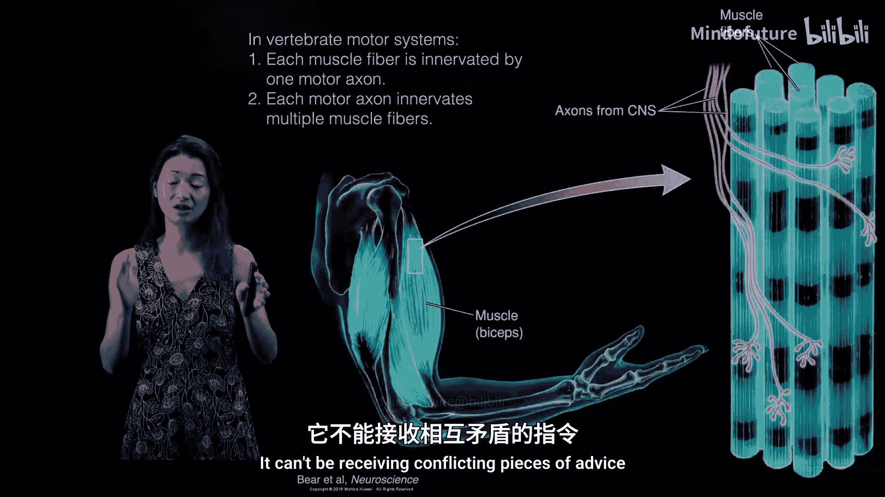

让我们从思考大脑的输出开始。到目前为止，我们已经学习了许多关于不同感觉系统的课程。以这种工程图的方式来看，感觉系统是输入系统，是我们测量的东西。大脑的输出，如果你仔细想想，是大脑实际所做的唯一事情。其他一切都发生在内部，作为实验者可以测量。但大脑实际做的唯一事情就是输出。大脑可以通过多种方式输出。我们可以通过运动系统、通过骨骼肌输出。神经系统也可以通过自主神经系统输出，这包括平滑肌和你的内部器官，如心脏、膀胱等。还有一些输出是由神经系统的各个方面介导和控制的，包括神经内分泌系统，这涉及激素调节、消化调节、昼夜节律等。

所有这些在相互连接的系统中都非常重要。然而，就今天的目的而言，我们主要思考运动和运动控制，我们将主要关注由骨骼肌介导的大脑输出，这些输出产生运动学运动和运动轨迹，并观察动物运动中这些运动的动力学。

我将以分享这句话开始，这是一种略带讽刺的方式来表达我刚刚所说的：移动事物是人类真正能做的一切，因为灵魂的延伸就是肌肉，无论是低语一个音节还是砍伐一片森林。因此，无论动作多么微小或多么巨大，最终，我们的神经系统与外部世界（包括彼此交流或在世界中移动物体）之间的互动都是由肌肉介导的。因此，任何关于运动控制的严肃讨论都从肌肉开始。我们将用几张幻灯片来思考肌肉，思考其分子和细胞机制，即你体内的一个细胞如何能够产生如此大的机械力来移动像你的手臂这样较大的身体。

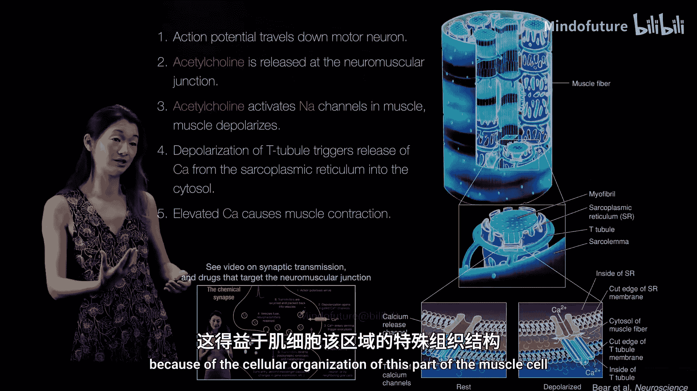

运动控制系统有一个与我们在感觉系统中讨论的许多内容平行的架构，这并不奇怪，但它有一个主要区别，即它是下行而非上行的。这里我们看到的是运动神经元，而不是感觉神经元。感觉神经元在那边，它们向上投射。而运动系统则向下投射。这些运动神经元和局部环路神经元位于脊髓水平，感觉神经元也位于脊髓水平。感觉神经元通过测量身体内部的情况，例如骨骼肌内的肌梭，或者嵌入皮肤中用于触觉、温度觉和痛觉等的感觉神经元。我们在躯体感觉课程中讨论过平行的感觉通路。现在我们正在看类似的平行架构，只是现在信息倾向于向下流动，当然也有很多循环。从脊髓水平向上，你有脑干。在那之上是一系列我们将在下一节课中讨论的神经系统，包括丘脑、小脑、基底神经节，还有运动皮层以及比运动皮层更高的区域。为了从这里开始，我们将首先讨论肌肉，因为当你移动身体时，真正完成所有工作的是肌肉。

你的肌肉由运动神经元支配。运动神经元是我们对直接投射到肌肉上的神经元的称呼。如果你的神经元的轴突末端是肌肉，那么你就是运动神经元。哺乳动物脊椎动物运动系统的组织如下：每个肌纤维由单个运动神经元支配，但每个运动神经元可以支配多个肌纤维。因此，一个运动纤维实际上可以终止于多个肌纤维，使它们同时收缩。但每个肌纤维只接收来自一个运动神经元的输入，它不能接收相互矛盾的建议，一次只能由一个运动神经元指挥。

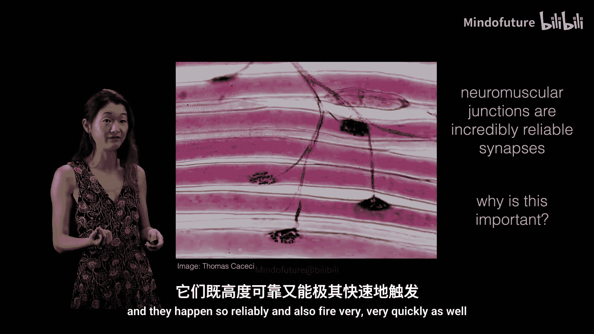

肌肉如何产生力量这个话题既引人入胜，也超出了本课程的范围。我可以就肌肉工作的生物分子生物物理学单独做一整节课，但我会在这里做一个简短的版本，以便你至少对肌肉如何工作有一个概念性的卡通图。这是一张骨骼肌切片的电子显微照片。你首先注意到它具有这种非常美丽的晶体状可重复结构。骨骼肌是横纹肌，这就是为什么它们有那些小条纹，在显微镜下甚至肉眼也能看到一些。你看到这种不同层次的组织。骨骼肌中的横纹反映了所涉及的不同分子的生物物理组织。从根本上说，当肌肉收缩时，在分子水平上，这些不同的链被一种叫做肌球蛋白的小型运动蛋白拉动。你可以想象这里基本上是一种有弹性的物质，有许多不同的节段，它们在微观层面上非常小。当肌肉收缩时，它实际上是将那些小节段拉在一起，从而减少了整个东西的总长度。你在许多、许多这样的小横纹上重复这个过程，然后在三维空间上重复，最终导致肌肉整体长度的宏观缩短，这就是肌肉收缩。

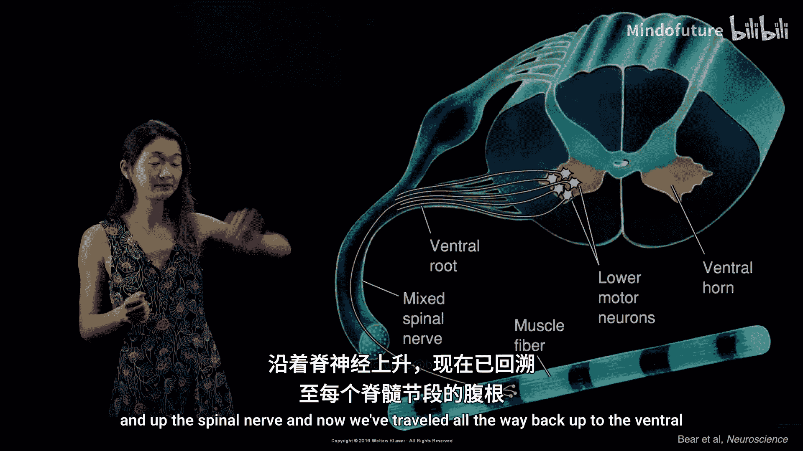

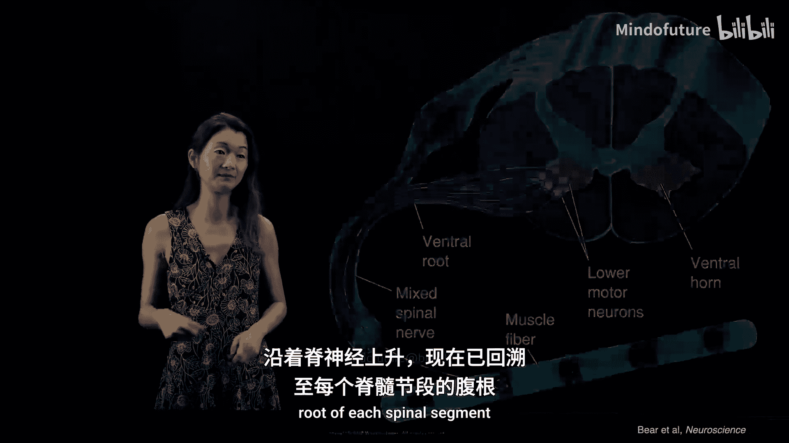

同样，这是非常高层次、非常简单的卡通版本，细节很迷人，但超出了这一节课的范围。那么，是什么让肌肉细胞兴奋呢？它是一个突触，就像我们在突触传递课程中讨论的许多其他突触一样。具体来说，它是一个化学突触。我们已经讨论过它是哪种类型的突触。哺乳动物神经系统在神经肌肉系统中使用乙酰胆碱作为首选神经递质。因此，运动神经元是一种乙酰胆碱能神经元，终止于这些连接处，它们与肌肉形成称为神经肌肉接头的突触。因此，运动神经元引起肌肉兴奋的事件过程与我们在中枢神经系统化学突触中讨论的一切非常相似。动作电位在运动神经元上传导，它在神经肌肉接头（即突触）释放乙酰胆碱，乙酰胆碱然后激活肌肉中的钠通道，肌肉去极化，这种去极化触发钙离子从称为肌质网的特化亚细胞区室中释放。

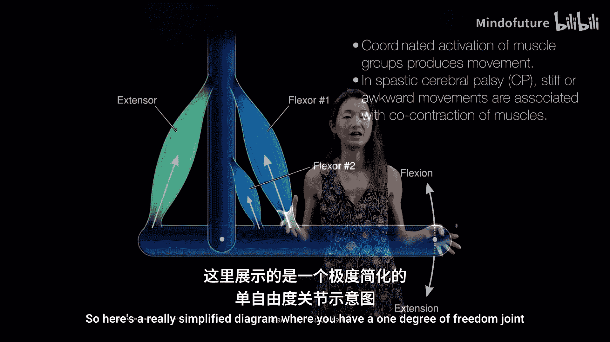

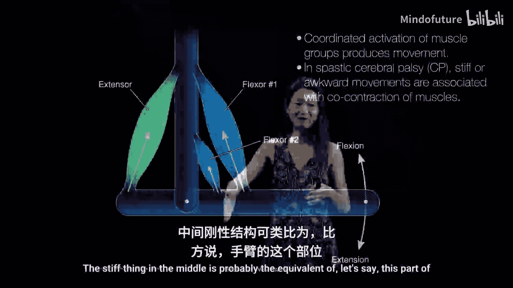

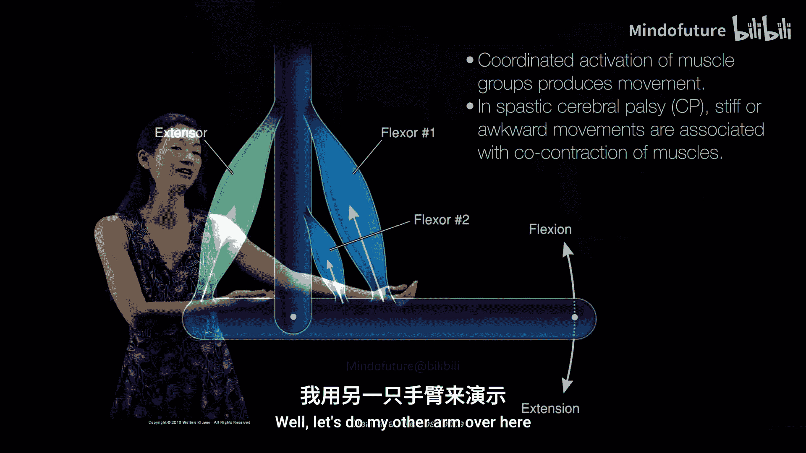

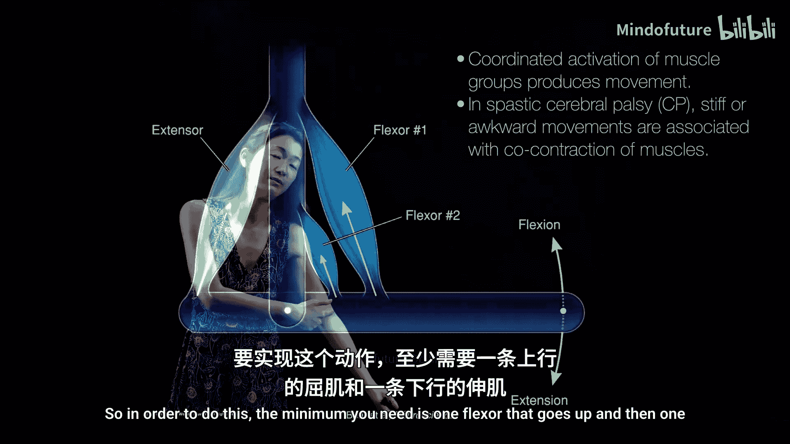

然后，肌质网将钙离子释放到细胞的细胞质中，钙离子浓度的升高通过释放这些肌球蛋白引起肌肉收缩。肌球蛋白然后拉动并能够收缩。整个过程发生得非常可靠和迅速。它如此迅速的原因之一是，钠通道的去极化发生在这些T小管中。T小管是这些蜿蜒进入内部的东西，它们不在肌肉束的外部。如果我们想象一个圆柱体，有一个巨大的束，这些带有小肌球蛋白的横纹在里面拉动。你希望来自运动神经元神经传导的信息尽快到达肌球蛋白行。因此，T小管实际上非常靠近肌球蛋白所在的位置，从而钙离子的释放因为肌肉细胞的这部分细胞组织而触发得更快。

我说过神经肌肉反应是非常可靠的突触。这一点极其重要，因为这是你移动身体的方式。有哪些重要的行为是由释放肌肉介导的？逃离捕食者是其中之一，追逐猎物是另一个。如果你思考神经系统的进化，能够逃离试图吃掉你的东西或追逐你想吃的东西，是我们首先拥有神经传导和神经系统的最大原因之一。因此，如果你不能可靠、准确、快速地触发肌肉兴奋，那么通过轴突或乌贼巨大轴突传递所有这些信息又有什么意义呢？所以这些是非常可靠的突触。你不仅可以看到这种允许肌肉收缩非常快速的特化，你还会看到这个运动神经元在每个肌纤维的多个位置终止。这些黑点中的每一个实际上都是一个化学突触。因此，这个运动神经元与同一个肌纤维形成了许多突触，从而大大增加了当运动神经元产生动作电位时肌纤维兴奋的机会，因为与其只有一个可能有时是随机的、有噪声的突触，不如有大约30个，那么至少有一个或几个兴奋的机会要高得多。这是神经肌肉接头如此重要、发生如此可靠并且也非常快速兴奋的另一个原因。

我们讨论了肌肉以及它们如何被运动神经元支配，我们也在躯体感觉课程中预览了一点关于这些运动神经元的内容，因为我们讨论了背根神经节细胞（感觉细胞），然后我们也讨论了腹根细胞（相应的运动神经元），它们进入相同的脊神经。当你有了这些脊神经时，你实际上有大量的纤维，很难区分哪一个是哪一个，所以它是感觉神经元和运动神经元的混合。腹根有运动神经元的细胞体，它们通过背根投射并进入这些混合脊神经，最终终止于肌纤维。我们沿着通路向上走，从身体的主要效应器细胞——肌肉开始，我们沿着脊神经向上回溯，现在我们已经一路回溯到每个脊髓节段的腹根。

这些运动神经元的组织很有趣。我们讨论了一个运动神经元如何使一个肌纤维兴奋。但当然，为了有协调的运动，你实际上必须有不同类型肌肉的协调运动。如果你思考生物肌肉力学，这里有很多细节非常重要。这里有一个非常简化的图表，其中有一个单自由度关节。中间僵硬的部分可能相当于你手臂的这个部分。假设我有一个手臂垂下来，有一个关节，比如肘关节，有一个自由度。它可以屈曲或伸展。这是伸展和屈曲。为了做到这一点，你至少需要一个向上的屈肌，然后一个伸肌让我可以再放下来。

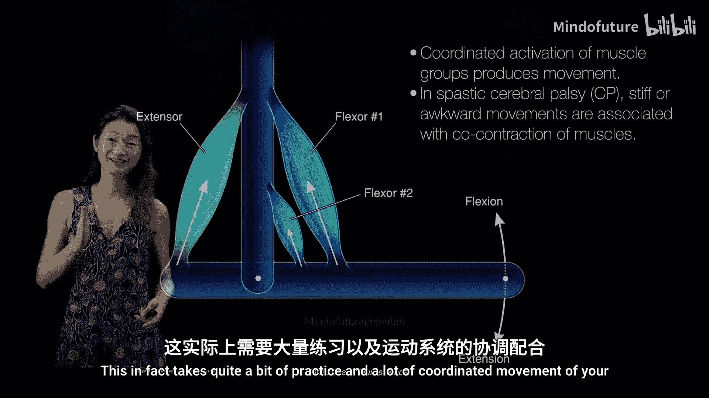

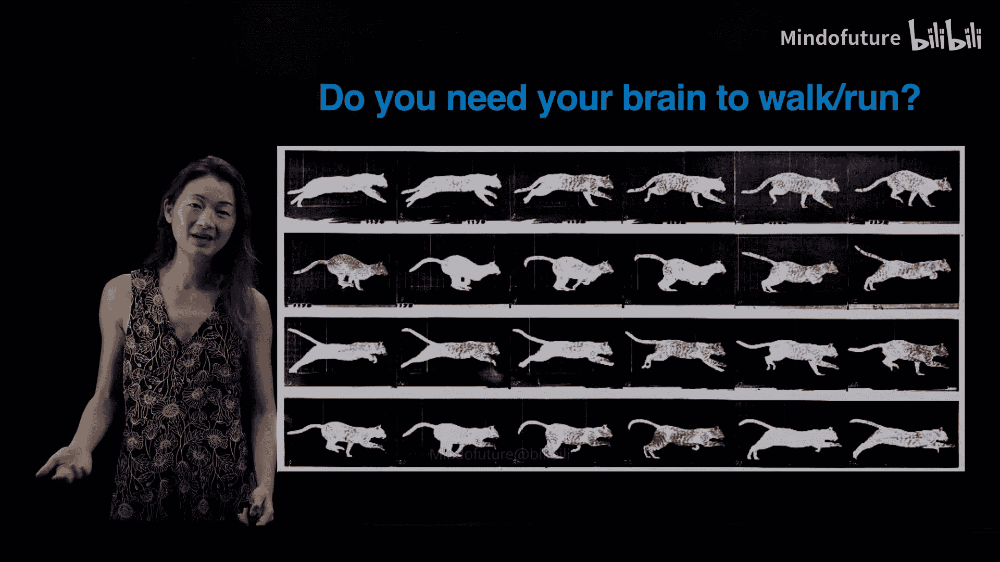

实际上，你拥有的远不止这些。你有一整套不同的屈肌协同工作，还有一整套不同的伸肌，这取决于你观察的是哪个关节。你的许多关节也有不止一个自由度。我们讨论过肘关节大约有一个自由度，但如果你仔细想想，你实际上也可以这样移动手臂而不改变这个角度或这个旋转角度，所以这个肘关节实际上还有一个额外的旋转自由度。因此，它不是单自由度系统，它也有这个自由度。你的肩膀当然有更多的自由度，因为你实际上可以全方位移动，不仅仅是上下移动。为了控制你身体这个机械装置运动的所有这些自由度，你需要相应数量的最小肌肉，这些肌肉附着在正确的位置，这样当它们收缩时，能够以特定的方式移动肢体。因此，拥有非痉挛的运动、协调的运动，不仅仅是移动你的肌肉并让它们快速移动，还包括肌群的协调激活。当你试图做像行走、伸手或拿起物体这样的事情时，肌群协同工作而不是相互对抗是极其重要的，特别是如果物体具有不可预测的重量。如果物体有点晃动，如果你试图拿起一块石头与同等重量的晃动的水壶，你必须快速调整整个身体的协调运动，包括背部和腹部的许多核心肌肉，以执行移动那个水壶的动作。因此，这些肌肉之间的协调非常重要，而缺乏协调是许多神经退行性疾病和神经发育障碍的基础。

例如，在一种称为痉挛性脑瘫的脑瘫中，症状是患有这种类型脑瘫的个体有僵硬或笨拙的运动，有时他们会以非典型的角度保持肢体。我的手臂是放松的，有时你会看到脑瘫患者无法以我们大多数人保持的角度保持肢体。这些症状通常与这些肌肉缺乏协调运动有关，并且与肌肉的共同收缩有关。共同收缩在这里意味着，因为我这里有这个杠杆，一侧有屈肌，另一侧有伸肌，当我屈曲屈肌时，我实际上放松伸肌，所以它们总是相反的。在脑瘫中，由于缺乏肌肉协调，它们同时被激活并共同收缩，这些个体无法以导致协调运动的方式放松和收缩对抗肌。这就是他们出现这些僵硬笨拙运动、无法像没有脑瘫的个体那样执行协调运动的原因之一。因此，在这种背景下，肌肉的共同收缩是不可取的，它会妨碍协调运动。

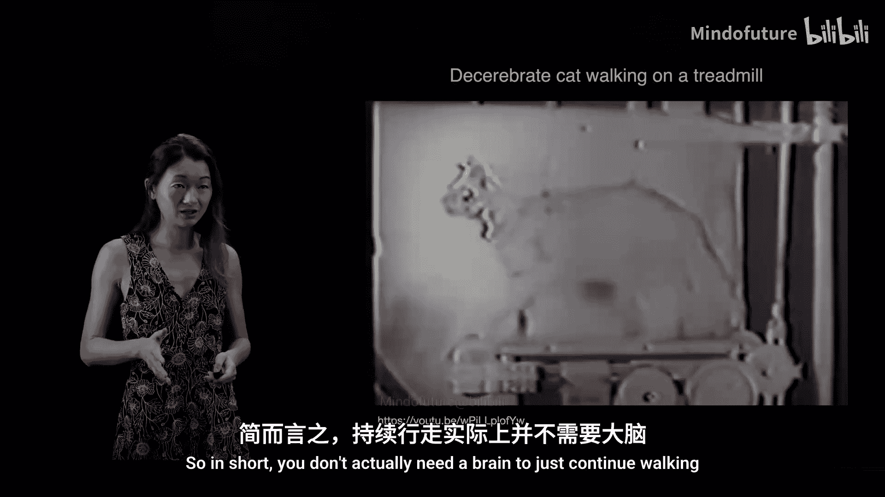

但协调运动不仅仅是运动，因为即使你完全不动，即使你的身体没有运动学变化，你实际上也在非常积极地收缩、共同收缩并改变肌肉的协调模式，即使你在做相对简单的事情。比如静止站立而不摔倒。我是一个倒立摆。当你直立站在双足位置时，你看不到，但我现在正用一只脚站着。我并没有真的移动，至少我试图不移动。我希望我成功了，没有移动太多。但在这种姿势下，我并没有移动太多，我非常积极地协调我腿部、脚部以及核心其他部位的肌肉，以便继续用一只脚站立而不摔倒。这种类型的运动称为等长运动，因为我实际上并没有移动我的身体。如果成功，我的身体实际上没有移动。但是，为了不移动，我必须能够协调全身一大群肌肉的收缩来实现不移动。这是瑜伽的目标之一，保持这些姿势，保持静止，然后不动。这实际上需要相当多的练习和大量运动与运动协调系统的协调运动。

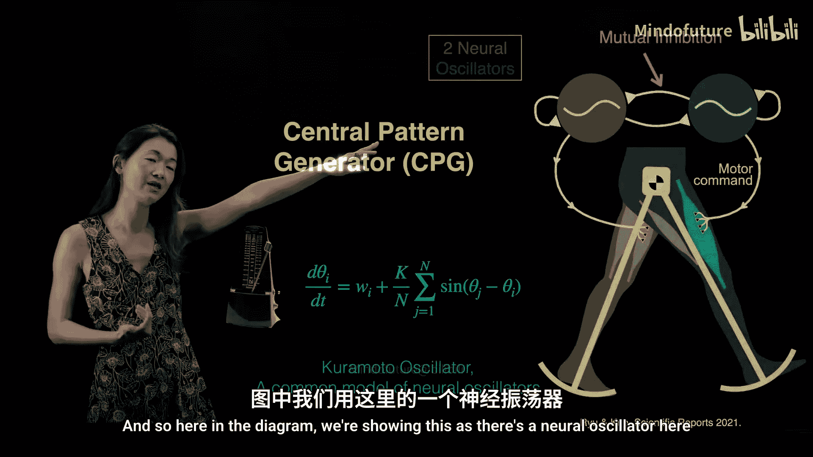

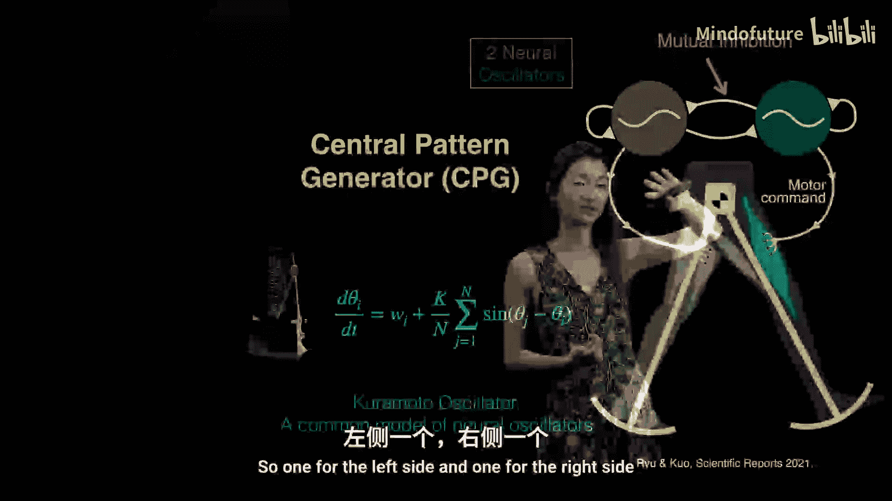

回到行走，我们不再做瑜伽了，我们在行走和奔跑。由于运动系统的这种层级组织，你从脊髓到大脑向上走，人们长期以来一直问的问题是：你实际上需要大脑来行走或奔跑吗？这个问题在早期通过一系列有点奇怪的实验得到了解答。例如，你能让一只果蝇在切掉头后行走吗？答案是肯定的，它肯定会在没有头的情况下行走。你不能对哺乳动物这样做，切掉哺乳动物的头大多会导致死亡。所以这不是一个好实验。但他们做的是去大脑猫实验。这是如何工作的？这意味着他们没有切掉猫的头，我们现在不再做这些实验了，你可以看出这是一个非常古老的实验。他们做的是进入脊髓，然后选择性地切断猫头部与脊髓其余部分之间的连接。因此，这只猫真的无法再用大脑控制它的运动了。它不会行走。但他们做了什么？这是一个很酷的视频，我无法在这里播放，但你可以查找这些视频。我鼓励你这样做，它们看起来真的很有趣。他们把这只猫放在一个小吊带里，只是为了把它撑起来，让它直立。否则，它不会动。此时它是四肢瘫痪的。然后他们把它放在跑步机上。当猫受到跑步机皮带运动的刺激时，它确实会行走。这表明大脑可能对行走运动的启动很重要，但对于维持行走并非必需。他们还在不同的速度下进行了实验，你可以看到他们观察到的现象：猫确实会行走，如果跑步机足够快，它甚至几乎可以在大脑无法与四肢沟通的情况下奔跑。简而言之，你实际上不需要大脑来继续行走。

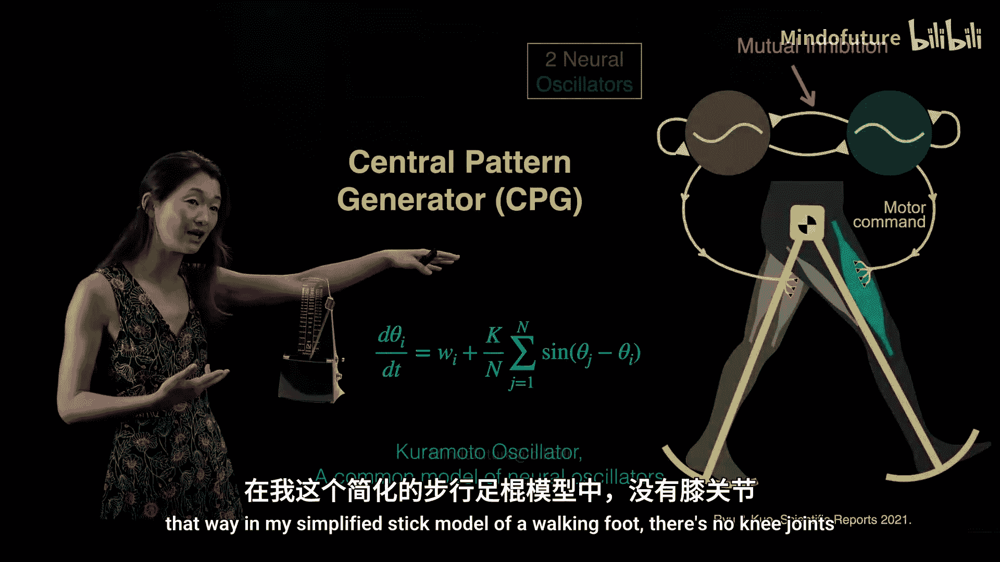

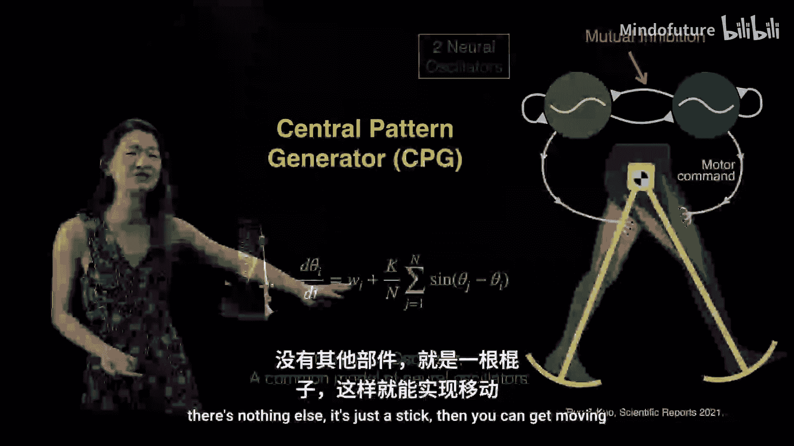

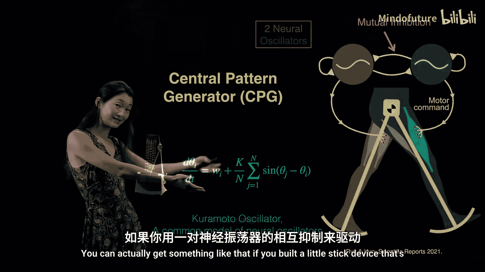

这是如何工作的？几十年来一直存在的主导理论是一组被称为中枢模式发生器模型的理论。抽象的想法如下：在你的脊髓某处，有一组细胞只是自我产生节律性运动。就像一个时钟电路，时钟神经元或时钟电路。这是一个抽象的想法，现在先不谈具体是哪些神经元。想法是：在那里某处有几个神经振荡器。在图表中，我们在这里显示为一个神经振荡器，那里一个。所以一边是左侧，一边是右侧，这大概在脊柱里。它们只是时钟，自己在运行。如果你把它们连接起来，它们通过自己产生节律性运动。所以一侧指挥右腿的屈肌，另一侧控制左腿的屈肌，然后你连接它们，使它们相互抑制。所以一个关闭另一个。将会发生的是，它们会变成反相位。所以一个会上，另一个会下，它们会像这样上下上下。这就是它们开始振荡的方式。它们会变成反相位。它们会以相同的频率相互训练，并且会变成反相位。如果你以那种方式驱动腿部的运动指令，在我简化的行走脚棒模型中（没有关节，只是棒），你实际上可以得到类似的东西。如果你建造一个由几个神经振荡器相互抑制驱动的小棒装置，将它们连接到收缩肌肉，那么你可以产生腿部非常有节律的运动，并且可以开始移动。

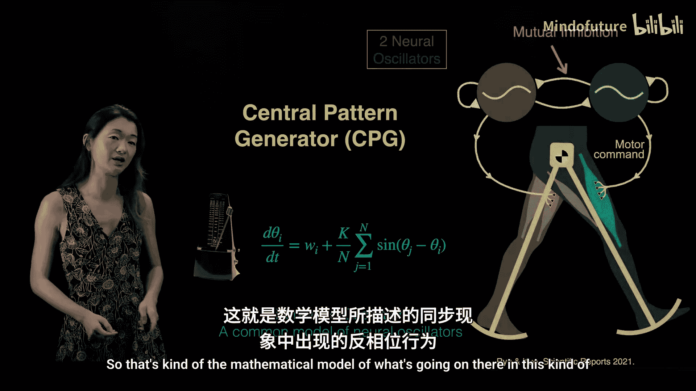

中枢模式发生器很有趣，因为已经有很多不同的模型被用来模拟它的行为。其中一个更流行且我们使用和研究过的模型叫做Kuramoto振荡器。这个东西在用于模拟各种不同事物的许多不同系统中非常常见。我们可以用Kuramoto振荡器模拟的一件事就是中枢模式发生器。这里的想法是，它基本上是一个节拍器模型。这是一个本身具有固有振荡周期的东西，如果放任不管，它只会来回、来回地运动，实际上是在绕圈，但在那种方式上有点像节拍器。但这里发生的等效事情是，我在那个图表中有两个振荡器，θ1和θ2，分别代表左右。这相当于有两个弱耦合的节拍器。假设你把它们放在同一个摇晃的桌子上。如果你有两个节拍器放在同一个摇晃的桌子上，并且频率大致相同，起初它们会各做各的，但过一段时间，因为它们被同一个摇晃的桌子弱耦合，它们会开始以完全相同的频率振荡，它们会相互训练，并且会以相同的频率运动。这个观察最初至少是我听到的轶事是在一艘船上，船长观察到墙上有两个祖父钟，因为它们在一艘船上，船在摇晃，钟的振荡周期不可避免地会相互训练，最终以完全相同的方式运行，它们会同步运动。相互抑制发生的情况是，它们以相同的频率训练，但以相反的相位训练。这就是那里发生的数学模型，在这种训练中，当你得到这种反相位行为时。

我们所知道的是，中枢模式发生器本身不足以解释自然的行走。你可以得到行走。得到行走真的很容易。你可以得到一个有两条腿的东西，它只会前后、前后地走，建立一个像那样的模型并不太难。但像那样的模型纯粹是前馈的，它只指挥运动指令，不接收任何感觉反馈，这意味着如果发生任何意想不到的事情，比如表面稍微不平，或者你踢到一块小石头，整个系统就会崩溃，因为它只会摔倒，没有能力应对意外的环境变化。因此，更接近实际现实情况的图景几乎肯定是更像下面这样的画面。有一个具有某种节律性运动的中枢模式发生器。这产生了我向前迈步和前后行走的基础振荡周期。

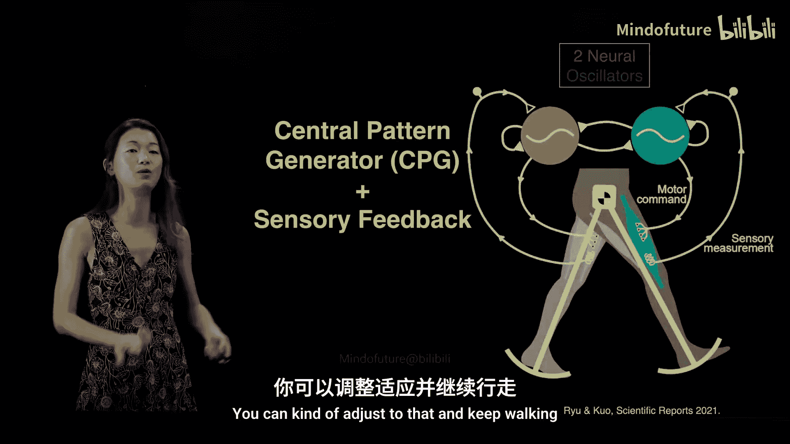

但同时，也有感觉反馈，你可以把这想象成来自骨骼肌的本体感觉反馈，这是最简单的例子。因此，如果你连接一个像这样的系统，它既由前馈中枢模式发生器驱动，又响应来自肢体的某些感觉反馈，告诉你地面上实际发生了什么，并且你可以据此调整，那么你实际上可以制作一套行走和奔跑等模型，这些模型既能够向前行走，又能够适应不可预测的环境条件，例如踢到小卵石，或者地面比你预期的稍微低一些，你可以调整并继续行走。

这些模型的一个有趣结果是，我们使用了称为最优控制理论的数学形式主义，不仅解决了它可以工作的问题，还解决了什么应该工作的问题，即在给定约束条件下最优的最佳解决方案是什么。也许你想要一些稳定的东西，以及一些在能量上有利的东西。我们采用的许多步态在能量上是有利的。我不知道你是否记得小时候，我记得我小时候真的很喜欢蹦跳，我现在不再蹦跳了。我仍然可以，我的孩子们在蹦跳，我和他们一起蹦跳过，所以我身体上能够做到。但蹦跳的精神不再支配我了，但显然，因为我们小时候，蹦跳步态在能量上是有利的，因为他们离地面低，而成人的蹦跳步态在能量上不再有利，除非你在月球上，重力低。事实上，情况正是如此。有一系列可爱的论文，他们通过分析宇航员在月球上的脚印表明，他们既尝试了奔跑，但很多人实际上决定采用蹦跳步态，这种左右交替的方式与行走和奔跑非常不同，他们只是自然而然地觉得这样做是对的，没有人告诉他们这样做，但他们只是做了，因为感觉像是四处走动的正确方式。从生物力学、中枢模式发生器的概念以及重力力学来看，如果你在月球上行走，蹦跳将是更优选的、更优化的步态。这是我们对神经系统和生物力学的理解结合在一起的另一种方式。因此，这是一个可爱的神经力学故事，如果你下次碰巧在月球上，你会知道不要试图奔跑，因为你可能会摔倒，那并不好，试试蹦跳吧，你会更愉快地四处走动。

我们讨论了很多关于双足运动的内容，这对我们来说很好，因为我们恰好是双足动物。但我们地球上绝大多数其他动物并非如此。如果你有多对腿会怎样？你可能是一只狗，可能是四足动物；你可能是一只昆虫，有六条腿；还有其他类型的节肢动物，腿的数量远多于六对。在腿的数量无限多的极端情况下，实际上根本没有腿，你也可以有滑行运动，当你有这些向下传播的波时。因此，通过思考和研究这些不同类型的动物，思考它们如何行走，如何产生不仅仅是两条腿而是多条腿的节律性运动和协调运动，你可以学到很多关于运动的知识。有些答案更容易，因为如果你是一只竹节虫，有六条腿，例如，你不像人类那样总是有摔倒的风险。我是双足的，我实际上总是在摔倒，除非我努力保持。但如果你有六条腿，你至少可以用三条腿站立，你就像一个三脚架，你实际上可以站立。因此，一些挑战更容易，但一些挑战也更难，因为你必须协调不仅仅是两条腿的运动，而是多条腿上的多个关节。在蛇的情况下，你实际上是在激活和协调身体两侧与地面接触的肌肉收缩。这是一个有趣的思考练习，也是神经科学、运动控制以及神经力学中一个非常活跃的研究领域，即思考如果你有两条、四条、六条或许多许多对不同的腿会发生什么。这对于机器人技术也相当重要，因此许多不同的机器人公司已经建造了各种机器人。有双足机器人，毫不奇怪，它们真的很难建造。你可以建造四足机器人，这要容易得多，因为它们摔倒的风险没那么大。人们还建造了许多受昆虫启发的六足机器人。例如，波士顿动力公司是一家机器人公司，他们可能有一个非常棒的团队为他们制作非常有特色的视频。如果你还没有看过这些视频，我鼓励你去看看，因为它们真的很酷，可以看到工程系统可能达到的技术水平，并思考你将如何在工程系统中使用这些电机的协调激活来完成协调运动。这就是你如何产生运动和运动生成的方式。

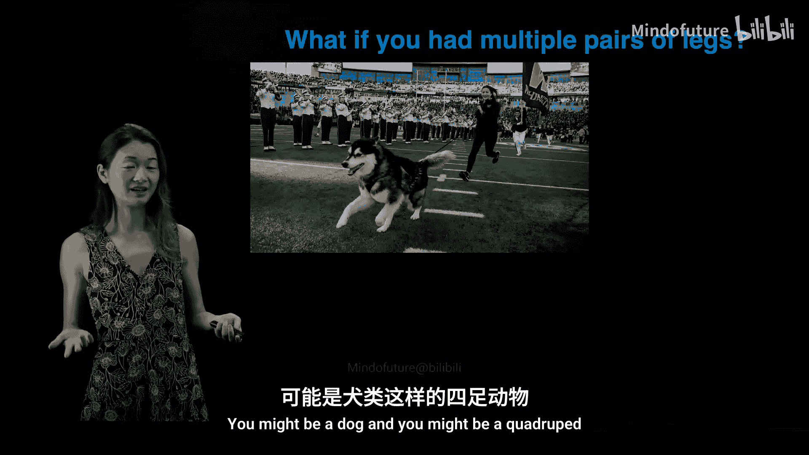

我已经告诉过你，你实际上不需要大脑来继续行走，你可以对猫进行去大脑处理，它会继续行走。所以下一个视频将再次沿着那条通路向上回溯，思考你如何启动运动，以及你如何为未来的运动做计划。这就是我们将在下一个视频中讨论的内容：你首先如何开始行走。

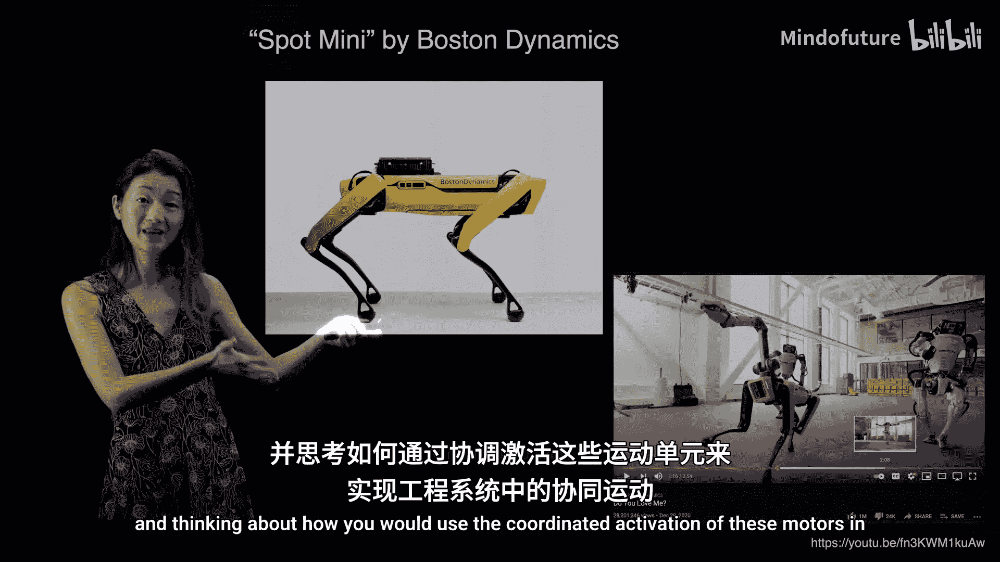

本节课中，我们一起学习了运动控制的基础，从肌肉收缩的分子机制开始，探讨了运动神经元的组织方式，以及协调运动的重要性。我们深入了解了节律性运动（如行走）背后的中枢模式发生器理论，并讨论了感觉反馈在调整和维持稳定运动中的作用。最后，我们看到了这些原理在不同动物运动模式以及机器人技术中的应用。