# 【华盛顿大学】神经科学入门 ｜ Introduction To Neuroscience ｜ Bing Wen Brunton p28 P28_运动启动-自主运动-帕金森深部脑刺激疗法 -BV1i3qWBXEDH_p28-

In the last video about movement and control， we talked about how muscles work and how the organization of the motor neurons as they innervate these muscles can lead to rather。

 I'm going to call them unconscious movements like when you're taking a walk outside and you're let's say having a conversation with a friend or just kind of spacing out and thinking about something else that you're doing the next day you don't really think about your walking per se right you just walk and so there's a level of behavior control where you can really flexibly do a lot of different things with your body without paying much attention to how you're doing it but of course at the same time we can use the same limbs and the same muscles and control them in entirely different ways by executing volitional movements and voluntary movements so for example even if running to get to the soccer ball doesn't take much thought you're just running。

 you're thinking about the ball you're not really thinking about how you're moving your legs when you go kick the ball and kick it with a very point of purpose trying to get it into the goal then you。

Do have to think about okay so how do I move each and every one of my leg muscles so that I can execute this particular maneuver in such a way that I accomplish a goal I want and so even though we're talking about muscle control and it's the same muscles and it on the same limbs and it's even mediated by the by the same motor neurons the concept of how do you initiate movements and how do you control movements in a planned and volitional way requires a bit more of a higher order control that goes beyond the level of the spinal cord goes beyond the level of the DScertic cat so we talk mostly down here in the previous lecture about the local neuron circuits and motor neurons we talked about how if you hook up a small circuit with a central pattern generated and a little bit of sensory feedback more perreceptor you can actually get pretty robust walking it is possible to get perfectly fine walking even with perturbations if all you had or neurons that are down here we're going to be focusing on the next couple of layers up now in thinking about volitional movement and。

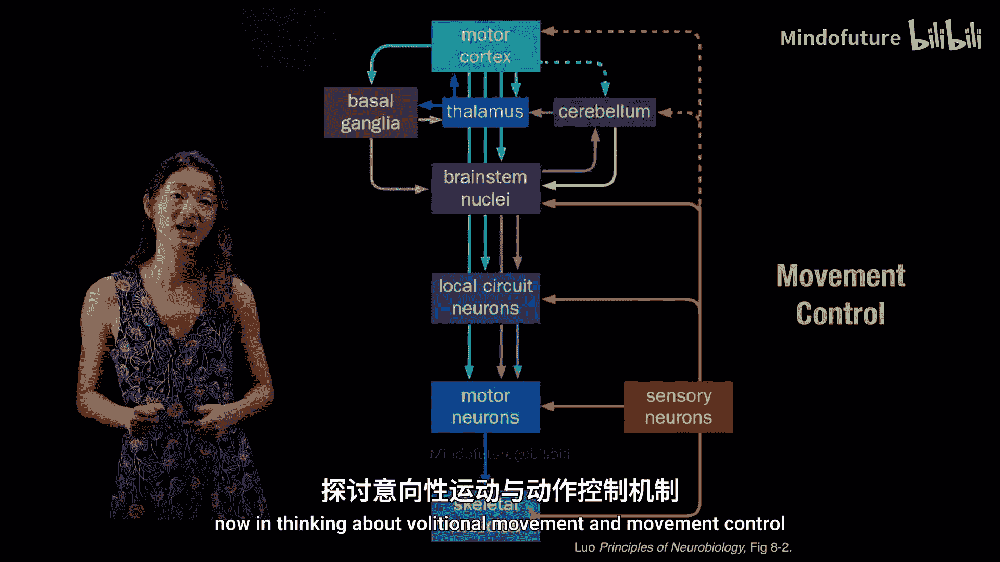

control。The first area we'll talk about is the cerebellum so the cerebellum is super cool and it's also this really beautiful geometric structure that is in the very back of your head。

 it's tucked below the cerebellum it's often overlooked just because it's not on top I think this is a bit of a snobbery on the part of a lot of neuroscientists because it's kind of on the bottom and frankly it's really hard to get to and so sometimes we study things because we can get to them not because they're like more important than the deeper structures。

 This is the thing that happens So the cerebellum is down there and one of the reasons we know it's important is because we know it's required for fine control of movement so when you have an animal with cerebellar defects they exhibit aaxia abnormal abnormal behaviors in coordinated movement so what you're seeing here is the kind of tiny little footprint of a mouse that's a normal mouse。

 a wild type mouse that you can see that it footprints are evenly spaced and there's this very beautiful perfect alternation pattern when it goes left right left right。

😊，Left right， that's what's supposed to happen。 We're walking。

A mouse instead with a defective cerebellum has the following symptom。

 it is no longer alternating between its left and right paws with an even spacing。

 you can see some of these left left left spacings are closer together and some of them are farther apart it's unable to maintain going forward even though I think it's intending to do so it's kind of drifting to the side and then drifting back you can also see by the imperfection of this little footprint so I think the way that first of these experimentsms is literally put like it's like fingerprinting they put the paw of the mouse in some ink and then they had it walk on a piece of paper and so you can kind of see by the way that these paw prints over here are really smudgy and you don't see all of the little tosies on the little mouse is because it's holding its footweirs holding it at an angle and so it's unable to walk forward and it's unable to alternate correctly and it's also unable to hold its foot and have it contact the ground in the way that it's really supposed to and so all of those are symptoms of a cerebel defect so we know the cerebellum。

Is required for fine control of movement in terms of humans， you can have a similar symptom as well。

 where we see that individuals with cerebellar abnormalities are unable to execute smooth pointing movements。

 And so for example， if I am instructed to lift my finger and then point at a spot in front of me like a light lights up I can point at it。

 So that's what's happens when a normal individual theres there's an acceleration and then I slow down right before I touch the point and that's what you're supposed to do。

 if you had a cerebellar defect。 then the symptom is that these individuals might be attempting to do the same thing。

s first of all there's a delay in the initiation of that pointing movement。

 And then if you track the trajectory of their movement。 it is it appears to be uncoordinated。

 it doesn't go straight there。 and in fact， takes's manandering path and is kind of slow and unable to follow the smooth trajectories。

 So these are all pieces of evidence telling us that the cerebellum is required for fine。

Control of movement。

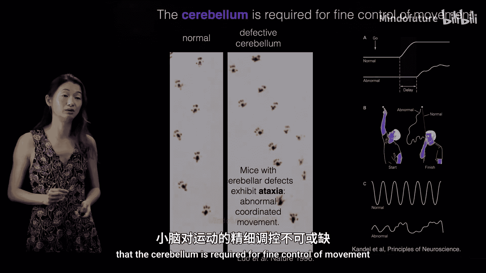

The cerebellum like I told you is the structure at the very bottom of the brain it's kind of tucked underneath the cerebral。

 if you ever have a chance to look at the anatomy of a cerebellum， it's absolutely beautiful。

 it's one of the brain structures that have the most regular structures so it's just really pretty look at that's what it looks like if you cut into it here is one of the major cell types in the cerebellum it's called a perkene cell this is a drawinging by ramonhu of a perkene cell and mean back then I think he cut it open and realize how beautiful it was you can see this gigantic cell with this massive massive dendritic arborization and it's kind of one dimensional there's these sheets of perkine cells and the repetition of these sheets is what underlies the kind of fractily structure that is in the cerebellum。

😊，There's quite a bit known now about the cellular circuitry of the cerebellum。

 You have these prokengeji cells。 is so this is a bunch of them all lay on top of each other。

 Their cell bodies are all in the same layer lined up above them is what's called a molecular layer underneath is what's called a granuial cell layers another different types of cells。

 And so the circuitry that's repeated over and over and over in the cerebellum at nausea filling the entire space of it is the following architecture。

 You have inputs They come in through the cerebellum and vestibular nuclei。

 and then there's these perkinji cells this massive cell that's here and they're innerervated by these parallel fibers and they also have what's called a climbing fiber that's climbing on top of here。

 It's like a snake climbing up a tree。 That is a gigantic inhibitory set of synapses。

 And so this climbing fiber cell from the inferior or all over nucleus is able to shut down a prokengeji cell very。

 very reliably。 And so there's a lot of theory。

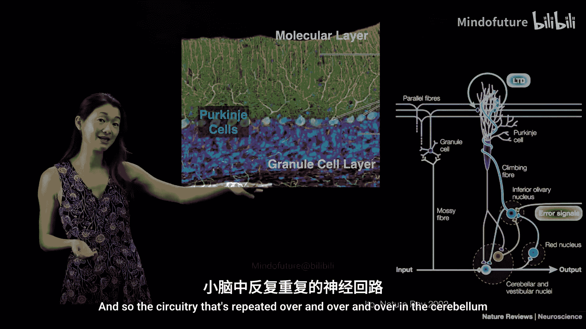

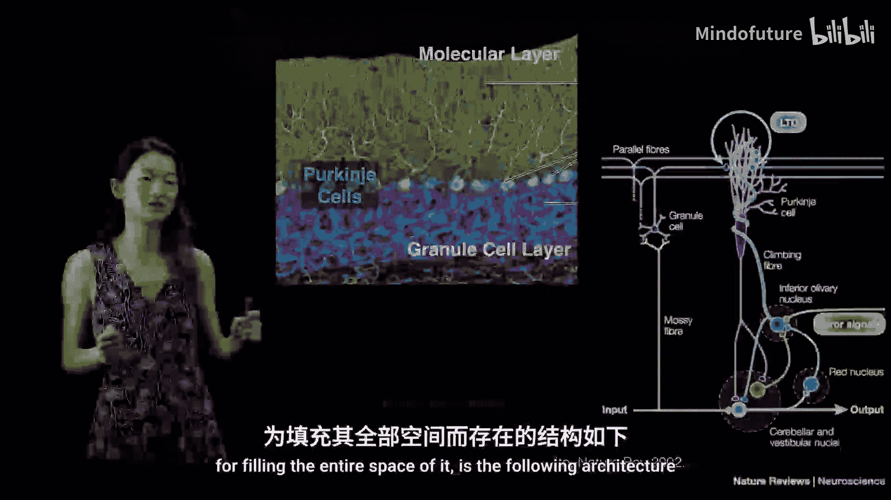

The learning that happens in the cerebellum that's mediated by this very fine circuitry that a lot of which we understand right now。

 talking the details about it is beyond the scope of this particular lecture。

 but I did want to mention that this is a very active area of research thinking about the computations in the cerebellum as well as what are the implications of the cellular architecture and the cellular circuitry for the role that we know the cerebellum to play in fine movement control。

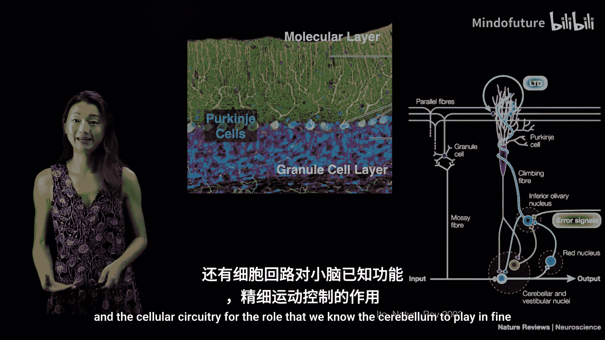

So moving up we have an area of the brain called the basal ganglia and the basal ganglia we also know is roughly speaking kind of waving the arms down a lot important for the initiation and selection of motor programs and so this is kind of a deeper part of the brain it's not in cortex is kind of lower down it's kind the next layer of cells down it's called basal ganglia and it has a lot of different sub areasas that have different names and so the point I'm trying to make here is that don't worry for now about the specific names of those specific brain areas but they are there and there's quite a bit of localization of modularity in the basal ganglia not only in terms of anatomical segregation of different cell types and functions but also in terms of cell types so there's dopamine cells down there there's serotonin cells down there there are all kinds of local inhibitory neurons that are down there the cellular architecture and the cell types in the basal ganglia is super interesting and kind of really complicated unlike the neocortex we talked about。

The cerebellum then we talked about different areas of the basal ganglia are not at all repeats of each other。

 It's not like you just made a bunch of copies and put them next to each other parts of neocortex look like that and parts of the cerebellum most certainly look like that that is not the case with basal ganglia that has a lot of different nuclei and they seem to have distinct roles and do different things in different parts of motor program initiation and other different functions notably there are two different diseases that are both disorders of the basal ganglia so Parkson's disease and Huntington's disease are both disorders of the basal ganglia but looking at the differences between Parkson's and Huntington's is really interesting because it tells us a little bit more about how the basal ganglia works so here's another picture Now instead of looking at a human basal ganglia we're now looking at a rat basal ganglia and this is a satal slice of the basal ganglia So anterior is over here pastiorors over here dorsal was up ventral is down you can see the neocortex is up here Necortex as project。

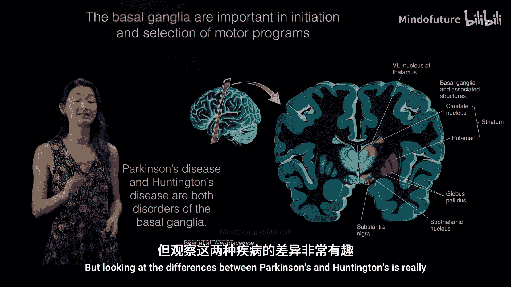

down to the stratum and the basal ganglia and the basal ganglia is projecting back up these giant arrows of lots of pipes of information going up and down。

In particular， there is two different pathways called the direct pathway and the indirect pathway they are illustrated there by the two different shades of blue in this diagram and what they do is that they actually invert the sign of the dopamine modulation one of them is a pos is positively modulated by dopamine and the other one is negatively modulated by dopamine now exactly how this works it's certainly beyond my ability to understand to explain to you on one slide。

 but I do know that this is again， once again an area of extremely active research in terms of dissecting the fine circuitry of exactly how this works now one thing I also put pin so just to make a connection for you in case it didn't occur to you already by yourself although we probably did we're talking about dopamine here and and we talk about motorcont movement。

The last time you heard about dopamine， it was in terms of pleasure and reward and the error signal。

 we mentioned this several different times we mentioned it in the lecture about drugs and recreational drugs and drugs of abuse。

 having having to modulating having to do with the dopamine system Now this is the same dopamine system。

 it's the VTA right there， the ventralte mental area and a substantial ni or the SNC。

 same brain areas， same dopamine。 Now how does this work。

I'm about to tell you about the role of dopamine dysfunction in motor control and the last time you heard about the same dopamine same brain areas。

 it was about an error prediction error prediction and and addiction how to reconcile these two very real roles that dopamine plays in your basal ganglia great question I can't answer it right now this is something that I might make a future video about after frankly after I educated myself a little more it was always kind of confusing to me I know both of these things are true and there's giant communities of people studying both exactly how they're reconciled how they're the same thing I don't quite understand right now so I'm just you know admitting my ignorance here。

 yes， there's a connection， yes it dopamine， but we do not I don I do not understand exactly how they're connected and how they're working together but in the context of motor control we're going talk a little bit more about direct in the indirect pathways and we do know is that in Parkson's disease it is a disease a neurodegender of the disease where the person。

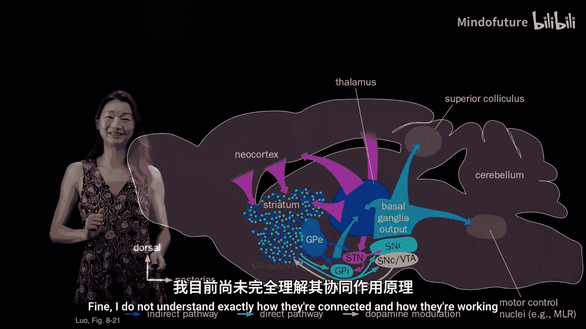

hass difficulty initiating movements and they have resting tremors so even when they're intending to not move。

 sometimes you'll have a resting tremor where they're unable to keep their limbs still you can imagine this makes it quite difficult to execute everyday tasks like picking up a spoon and fitting yourself will be difficult if you have a resting tremor individuals might also have trouble talking for example。

 so we know that Parkson's disease is associated with loss of dopamine neurons in the substantial niagara and this imbalance this loss of dopamine neurons causes an imbalance in the direct pathway so because it's caused by loss of dopamine neurons。

 one of the therapies for compensating for the symptoms of Parkinson's disease is's actually treating it with a dopamine precursor L dopa L dopa can be administered as ever pharmaceutical the body then metabolizes it into dopamine that's compensating for the loss of dopamine in the substantial niaggra there's also ways of electrically stimulating。

Area of the brain by surgical， electrical implants， we'll talk about that in one second。

So on the other side we have Huntington's disease which is an imbalance that favors the direct pathway as opposed to favoring the indirect pathway。

 so it's also a motor movement initiation disorder。

 but it has a slightly different set of symptoms we have instead uncontrolled movement of limbs ahead in the torso and it also associated with certain types of cognitive impairments Hunt sees as one of the more well- studieded genetic diseases as autosomal dominant we know exactly which gene it lies on and how it is inherited and so the loss of st or neurons in the case of hunting's disease preferentially favor the indirect pathway and so to some extent they have slightly overlapping symptoms in Parkinson's and Huntington's are both motor disorders where you have uncontrolled and undesirable movements of the body that the patient cannot control but the way that they balance the indirect direct pathway。

And the basal ganglia are opposite to each other unfortunately as of right now。

 at least that i know of， there is no known treatment for huntingington's disease。

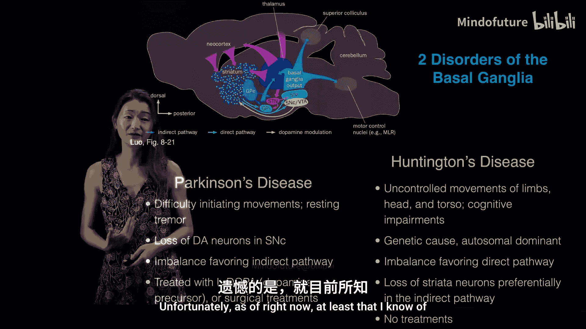

So I'm going to talk a little bit about of the one of the really cool ways cool and neuroscience is not cool for the people who suffer from Parkson's disease of treating the symptoms of Parkson's disease so I talked about aldopa as one of the treatments and that actually works really well for certain people unfortunately just like every other part of your nervous system adapts a new conditions so if you have a loud sound after a while you don't hear it anymore if you have a noxious smell after a while fortunately you don't spell it anymore similarly here the body kind of maintains a homeostasis and so after you get a treatment of aldopa sometimes it causes only a temporary alleviation of the symptoms because your body then adjusts the new level of aldopa and then that no longer alleviates a symptoms Park diseases anymore so another really successful line of treatment for Parkson's disease is what's called deep brain stimulation this is a technology that I mentioned already in lecture on electrical recordings and also electrical simulation techniques in sensory and systems neuroscience。

Just talk about it once or more again here， So you have what's called the DBS electrode。

 the deep brain simulating microelectros microelectro usually has something like four different contacts on it and it has to go pretty deep into the brain so it goes down like 10 centimeters or so because the area that's being targeted in a basal ganglia is quite a deep structure friend who is a neurosurgeon who is telling me that they actually spend an in order amount of time trying to figure out exactly how they target such a deep structure because if you get unlucky。

 these basal ganglia structures are so small that if you deviate by small number of degrees on the way down。

 the electrode actually end up in a completely different place and will be ineffective in treating Parkson's disease and so they get really nerdy they're nerd out about the small angle approximation where they're trying to go down the electrodes and they're kind of floppy they're really small because you don't want to be too big you get too big then they're going damage structures along the way so you kind of want to compensate for the fact that they're really small and thin and floppy but then try to target them really precisely so you get to。

The right part of the brain for the treatment of Parkinson's disease so anyway DBS okay so you have these CBS electrodes and therapy goes the following so the electrodes are going to be then passing pulses of electricity targeted at this area in the basal ganglia to power this what usually happens and that this is a me device made by the electronic biopharmaceutical company metronic and they make this device where they're using the same technology that powers pacemakers for for heart surgery the heart transplants where there's a chest implant simulator that holds the battery pack and also is able to program the exact series of pulses like how frequently they come how large they are all these parameters for the simulation pulses and they wire that up goes under your scalp and then goes into the DBS electrodes and so through this device usually there's some kind of inductive chargers you can kind sit there with a little charging pad just like you charge your phone on the little charging pad same thing do that with your chest。

Iplanted simulator， charge it and then program it this is something that is sometimes done by the user they can kind of modulate their own implants if they want to turn it on and off。

 for example， and then the magnitude and frequency of the simulation is something that one wouldn't usually discuss with one' clinician and through trial and error they would find out maybe so like I said usually there's four electrodes and so sometimes they would say oh let's simulate only through electrodes1 and2 and maybe for some other people because they're off by a little bit during the implants they do say okay let's do two and three so that's kind of a trial and error process in terms of which electrodes they're simulating how long。

 how often and what the magnitude of the simulation is。

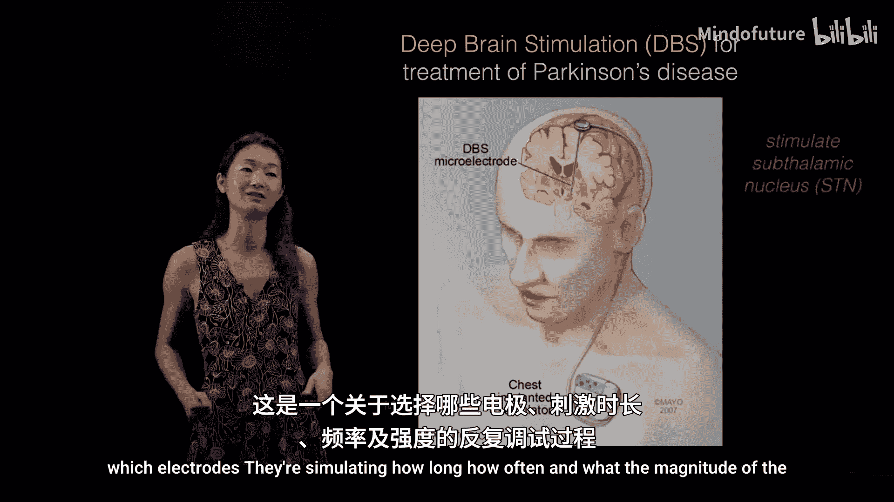

So here is a video of the almost miraculous effect of DBS in treatment of Parkson's disease。

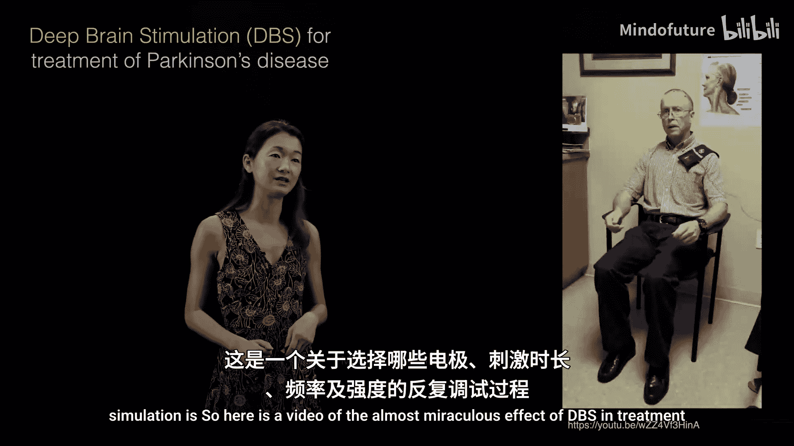

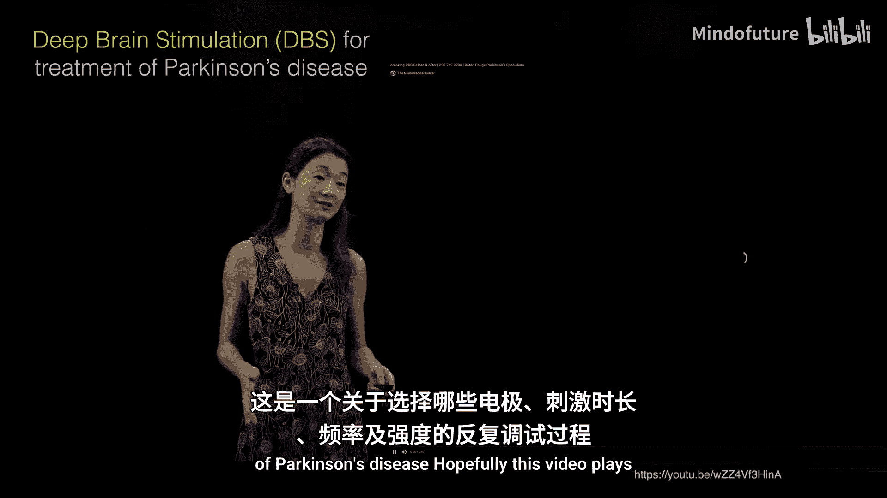

Hopefully this video plays the and we're seeing is here's an individual with a Parkson's disease exhibiting these essential tremors。

 they're trying not to shake， but they can help it right， so they have this tmor of the arms。

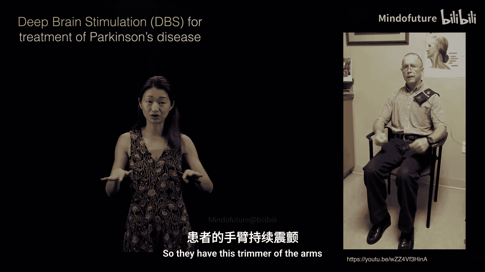

Now we're just going to turn it on and you'll see that。

The clinician is now going to turn on the simulation。

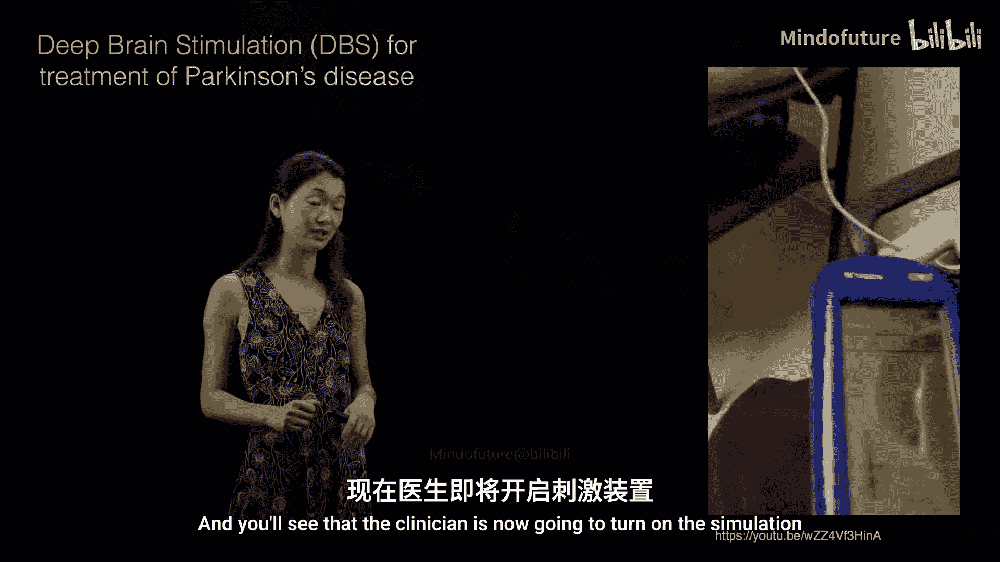

Takes a second to press the button， fingers hit the button there we go。And nearly instantaneously。

 the tremors stop。Not only do they stop。The patient is now able to speak and control their arms with an astonishing amount of precision that they clearly did not have before。

 the transformation is instantaneous and absolutely remarkable so deep brain stimulation has been successfully used for treatment of Parkinson's disease as well as slightly more experimental。

 but people have also experimented with DB for treatment of mental illnesses， for example。

 including including bipolar and major depression so the mechanism of exactly why this works for treatment of Parkinson's disease is actually hard to explain。

 like I talked about in the lecture about electros simulationimulations。

 we don't really know which cells are being simulated when we pass current into the brain。

 it absolutely does work。 this is now been done for enough individuals that it clearly does work in treatment of Parkinson's disease symptoms。

 we don't understand exactly why。

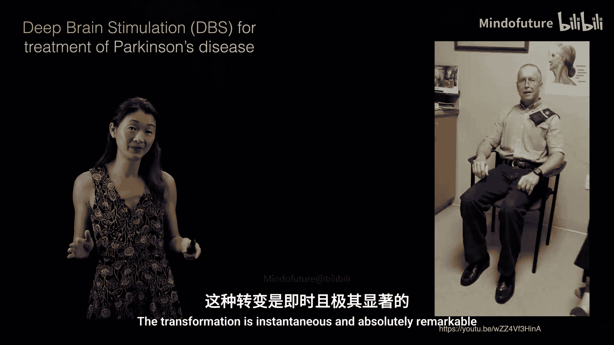

So that remains to be understood。Oh okay so we've talked about now the lower parts of this pathway which I'm kind of labeling here as the execution pathway so once you've decided what to do。

 this is the part of your nervous system that goes ahead and does it so if you've decided I'm going to walk now so you stop thinking about it and it executes the plan of walking forward and not falling over so that's mediated by your skeleton neurons which arenerrted by your motor neurons which come from your spine these spinal circuit kits。

 we've now gone up to the level of the basal ganglia and the cerebellum which I think of as like the tactical centers of the brain in terms of movement we're talking about initiating movements figuring out when the movements are supposed to be and then also inhibiting unnecessary and undesirable movements if that is what's appropriate for the circumstances if you keep going up we get to the area of strategy and planning so the way that I think about this is using an analogy that I heard from a colleague which is kind of the mountain biking analogy so if you're mountain biking down a trail。

Right。The bumps in the road are coming at you way too fast for you to actually thinking about it。

 just like when you're hiking， yourre trail running， for example。

 if you're running on an uneven surface， the bumps are coming at you way too fast。

 You just have to execute and then deal with the bumps as they come。

 And that is something that happens at the level of per perception and tactile sensation and spinal circuits。

 You just execute， but。What's happening up here is a strategy in planning layer。

 So if you're mountain biking， you might see ahead of you that there's a giant rock and it's going to be really horrible if you hit it and so you're going to hit it in about five seconds。

 which means you have to plan for the future。 you have to like veer slightly to the right and then maybe tilt your weight left or something so that you don't hit this rock that you can see Now that level of planning requires a much slower sensor modality。

 Vision per perception is super duper fast。 Vision is much slower we're talking about milliseconds versus hundreds of milliseconds here。

But the vision gives you information about the future in a way that's inaccessible from your somatoensory system。

 You just can't feel that rock that is 10 feet ahead of you。

 you can only see it so the advantage areas that you can see stuff that's ahead of you and plan ahead that disadvantages is much slower。

 so you have to plan for how to deal with it before it comes So that involves the cortical areas。

 not only motor cortex， but also higher association areas。

 and this includes parts of premotor cortex and parietal cortex。

 a couple of other different areas that are doing this multi-sensory integration。

 integrating information from multiple modalities like vision and somato sensation， for example。

 and then also solving the problem of among all the different ways I can avoid that rock that's coming up。

 which of them do I actually execute and that depends on things like experience like I know my bike and I know what it can do and I know what it can't do。

 I know I know my own strength right Like I know how much faster or。😊。

or I can pedal I know how fast I can break this bike and so all of those are going to inform your planning of what you're doing at the next stage in your execution of these movements。

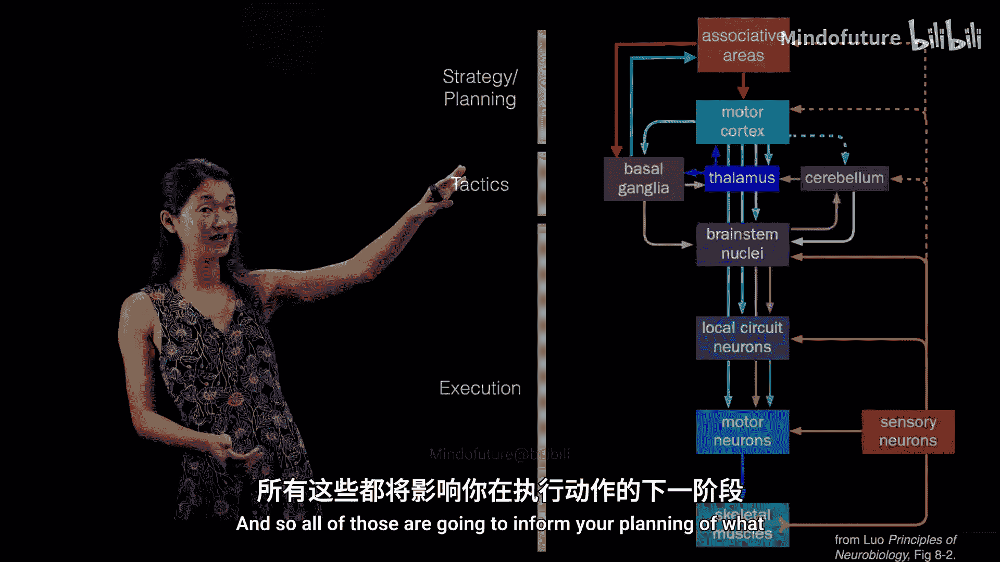

So I talked to you in the last lecture about somato sensation about the cortical organization of the somatoensy system。

 I told you that there's this giant chasm in the side of your head。

 one on each side called the central socus all of us have one right behind it is somato primary somatosy area S1 right front of it is the primary motor area M1 now this is the crossing over point where sensory information over here soprial areas kind of high order associational areas to do multisensory integration and then go to the front。

 the more the front you go， these are more like the execution planning areas M1 these are supplemental motor areas。

 prefrontal cortex， all of those are correlated with planning of movement and then thinking about decision making like deciding what to do right and then once。

These areas decide what to do。 They then send that command down to the level of othalamus。

 the basal ganglia and the cerebellum， which then send commands all the way to the brainstem。

 which goes down your spine and it ultimately ends up as a coordinated movement of your muscles Now there's an important point here。

 which is that it turns out in the motor cortex this idea of a motor receptive field just makes absolutely no sense at all people were thinking about it in this way for a long time and there's a gigantic fighting and literature for decades because each individual neuron in M1 a motor cortex They tried simulating it。

 they did a bunch of experiments。 and I never quite found the map between one motor neuron and one muscle contraction movement on the contralateral side。

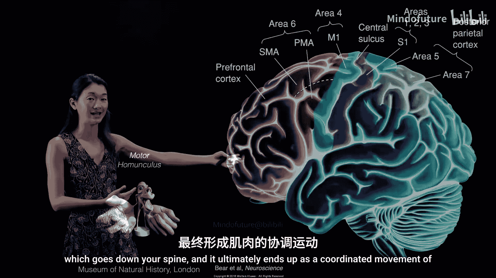

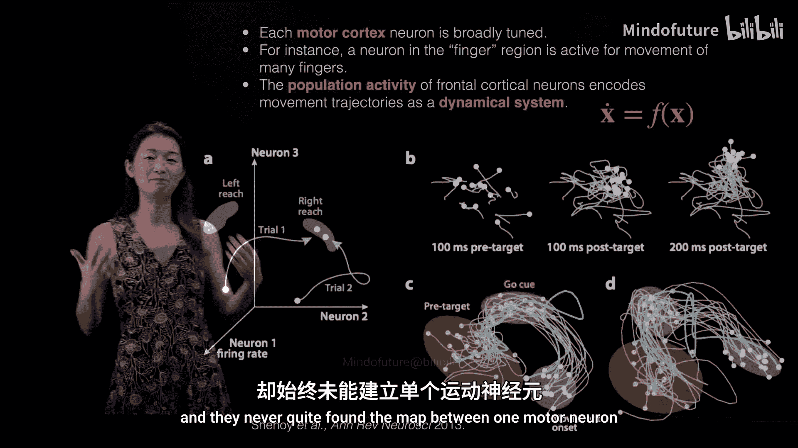

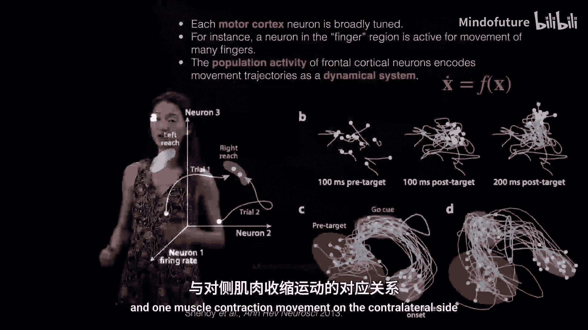

The most parsimonious explanation for this is that it actually doesn't exist。

 We talked about population codes already in a couple of lectures ago。

 we talked about population code in terms of three dimensional representation of color vision or you have to know the population activity of all three of those photoreceptors to figure out what the light is we also talked about population codes and olfactory cortex because you have hundreds of olfactory receptors and they all bind a little bit to a bunch of different odors so the only way you can tell which one is it is it ar or if it's a pile of stinky fish is by looking at the population of activity of all of the odorn receptors。

 similar idea here， although it's kind of the opposite the oppositeness is that it's the population activity of all of the neurons in motor cortex that drives the decision of what's going to happen in planning movements。

 and so by looking at each a single one of these neurons。

 you don't gain that much information about what the plan is that you don't get signature。😊。

cision is going to be what is a kinematic trajectory that we're planning That's not what it represents。

 So it's kind of like a receptive field except for a motor neuron And so instead of having a receptive field of a neuron because again that like intellectual picture just doesn't make sense in this context this perspective instead says it's the population activity of these frontal and motor cortical area neurons that encodes these movement inter trajectories as dynamical systems a dynamical systems I mean that in the mathematical sense where you have DxDt as a function of X and so it's this kinematic trajectories in the population activity that you can very cleanly and beautifully demonstrate that it's decoding of that dynamical system that gives us a clue of what the animal is planninging because we can we can decode from that activity and figure out what it's going to do next so another application of the idea that thats one of the reasons you have so many cells in your brain is because it not like it's not each single one actually matters there's no。

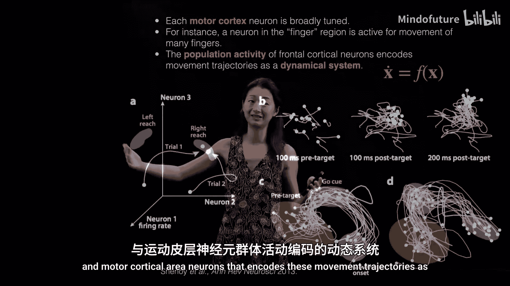

One motor neuron that matches to one muscle that's just not how it works。

 You don't think about which muscles do you move。 you think about where you're going。

 you think about okay I want to reach a coffee mug over here and I'm just I'm going go for it I'm gonna to plan my trajectory of reaching for the coffee mug at no point did I actually think about all the different muscles in my arm and my back that need to move for me to execute this movement that's delegated to the execution stage of the motor pathway I'm just thinking about the path I'm thinking about I'm going to go to the coffee cup and I can decide to go this way or I can decide to go this way so I do decide that that's something to which I have conscious access but I don't have access no do I need to have access to the execution phase of that movement。

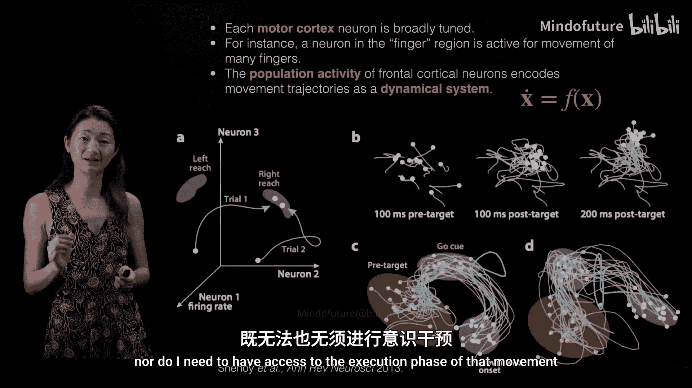

Okay， so I'm going to summarize here by talking about some of the themes that I hopefully have brought up over and over。

 not only in this lecture about motor control， and motor initiation of planning a movement。

 but you have seen a lot of these themes in a lot of different lectures in the section of sensory motor control。

😊，I started out by telling you about these action perception loops and how this type of feedback is absolutely crucial to understanding the functions of the nervous system and behavior and so what I've shown you in terms of the neural circuitry of not only the sensory but also the motor systems is that feedback is absolutely central not only between the animal and the external environment but within the nervous system at every scale description。

 we've seen feedback loops from propceptive neurons onto motor neurons。

 we've seen feedback at the level of local circuits in the spine and there's feedback at the level of basically every single scale of description all the way up this is similar true for sensory systems the only place that there's not sensory feedback is between the retina and the thalamus。

 the thalamus doesn't project back to the retina but that's it like everywhere else there's a ton of feedback there's feedback between different sensory systems there's feedback between different motor systems of sensory systems that we can。

These signatures of movement in even what was previously thought of as sensory areas。

 So feedback is a really crucial feature of all of systems neuroscience and one in which we cannot ignore if we wanted to understand how it works as a whole。

The second feature that we cannot ignore is this idea of hierarchy we talked in the summary of the sensory neurobiology lecture about these canonical pathways of sensory information going up from the primary sensor the thalamus to the cortex and then back in the motor system down to the thalamus。

 the brains stem to the spine going back and down so all of these systems are hierarchical and they differ by time scales the lower down ones tend to be obsessed with executing things they're super low latency really fast you often don't have access to the consciously you don't think about it you just do it and then there's these higher cognitive areas where you do things that are slower they require more deliberation but are kind of commanding the lower down areas but a lot of it is delegated。

 you don't think about exactly how you're moving the muscles in your arms you think about that you want to do it and what you want to accomplish instead and so that is the feedback and the hierarchy and these are just。

we see a lot in systems neuroscience at every scale description in both sensory and motor systems。

The last thing I'll emphasize here is that we talked a lot in separate lectures about the different sensory systems。

 but I hope you already noticed in this lecture in particular about motor control like I told you about the mountain biking example that for real behavior for you to actually interact with the world in the way that you normally do requires multisensory integration so very quickly after all of this information guess into your strength or nervous system they all get mixed up and all of the different sensory streams are modulating each other and they are combining with each other to allow us to form a full sensory perception of the world on which we're going to make decisions about what we're going to do next and so this is happening in higherkuuk way and with feedback and so perhaps on theme these three themes are not really separate either because the way in which we execute multisensory integration is through higher cook systems that feedback on each other so those are the themes。

I hope that this has been a fun journey through the sensory motor systems。

 there's a lot more to talk about here， but the next time you are walking down the stairs I strongly encourage you to not think about which muscles are moving in what order。

 I tried doing that one time first the first literally the first time I learned about muscles and how muscles actually work and muscle control I tried thinking about why legs are' doing as I walk down the stairs and I almost fell so don't do it don't think about it just do it。

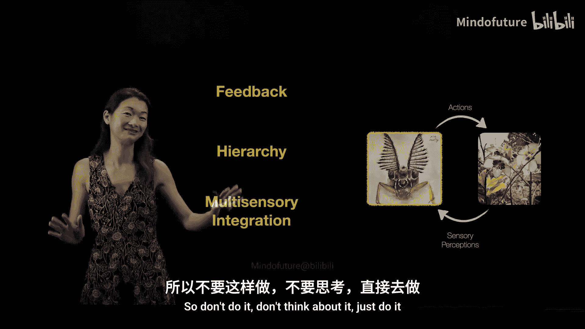