# 【华盛顿大学】神经科学入门 ｜ Introduction To Neuroscience ｜ Bing Wen Brunton p29 P29_导航__寻路之道 -BV1i3qWBXEDH_p29-

In this video， we're going to be digging into the neuroscience of navigation and this is one of the core capabilities of animals because we get to move around and be mobile in this wide world。

 so we have to know where we are and how do we get to the place that we'd like to be next。

 Now the art of finding your way is sometimes easier than others。 for example。

 let's say I plop you down in a city and here's what you see I'll give you a second to look at it now many of you may realize that this is downtown Manhattan。

 New New York City and New York City happens to be one of those cities for which the avenues and streets are in a grid system and they're labeled sensible things like1。

2 and3 or A B and C And so if you know the intersection that you want to get to and you know where you are then you can kind of plot a path going on the grid to go from where you are to where you want to be this's relatively simple as long as you're in a grid。

 but of course many cities are not in a grid。 So let's say we plop you down the city that's looking more like this。

😊，Let me give you a second。 Many of you may realize that you are in fact， in London。 Now。

 London is one of these older cities for which city planners did not realize that they wanted to put the streetss in the grid。

 And so in in order to know where you are in in New York City versus where you are in London are orders of magnitude different in terms of how challenging they are as navigational problems。

 But let's bring it a little closer to home for a little bit。 So wherever you are right now。

 you may be at home， you may be at school， you may be watching from your mobile phone somewhere in transit。

 I don't know。 But let's say that wherever you are right now。

 imagine how would you know how to get from wherever you are to your favorite restaurant。

 Just imagine that path。 Okay Go ahead and imagine it。😊。

So there's a lot of different ways you could potentially solve this navigation task the first one is you can look around for cues。

 you may look around and say oh， I'm on such and such street。

 I know that the restaurant is on this other street and I know their relative relationships。

 you kind of know where to go from here。Now the strategy includes smelling the environment so if might you might know what your favorite restaurant smells like and so you might be following your nose and this might be not that effective if you're really far away might be a little more effective as long as you're on the same block and a little bit closer you can also listen for surrounding sounds so now we're using our auditory senses you might know that your favorite restaurant is in the part of the city where it's really bustling and there happens to be a train station nearby and so you might be listening for sounds at the train station and busyness as one of the cues of knowing that you're getting close。

D is a really interesting one， which is remembering how you got where you are now。 Okay。

 so presumably， you may have navigated the path between wherever you are now to your favorite restaurant more than one time in the past。

 So the memory of how did you get there last time is something that I can recall that doesn't actually actively use any of your sensory cues of the curves and Mo to figure out where you are。

 You're really remembering how you got there。😊，Now， if you wanted to be a little more creative。

 you can also use touch touch sensing in your environment。

 This is something that might be useful if you are in a really dark scenario unless you're navigating a dark hallway for example。

 maybe this is one of those restaurants where there's no lights I don't know you can use your spy sense just kind of feel your way there and like many of us in our modern smartphone rich environment。

 you can also use the oracle Aka consult the GPS on your phone to figure out how do you navigate from wherever you are to wherever your restaurant is Now all of these are except for F relatively valid ways of knowing where you are and how do you get from here to where you want to be in this case in the scenario it's your favorite restaurant and so the point I'm trying to make here is that we can use all of these cues and so it gets really really confusing to study and so there's'm going show you one story of a relatively charming story where this has been investigated in the case of an ant now in a particular case ant is a desert an。

😊。

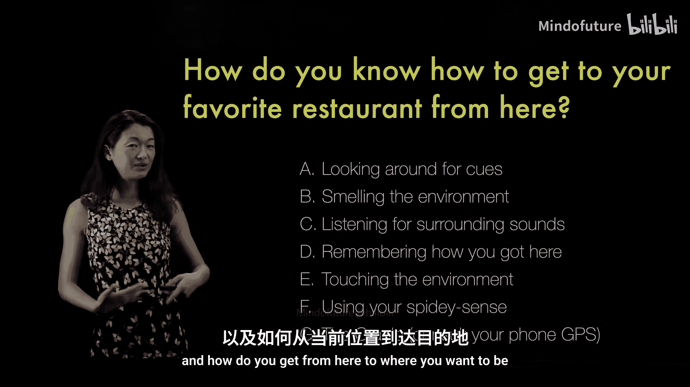

So it actually lives in this featureless hot desert where there are no queuees。

 like there's no trees， there's no grass。 It's all a flat landscape。

 And so this ant really doesn't have much when it's trying to solve this problem of how do I get home so it's foraging around trying to find food once it's found food needs to go home and go back to its nest。

 And so the question is， how does this particular ant do it in this particularly impoverished neighborhood where lots of the sensory cues we talked about in the previous page do not actually apply to it。

 So there's a couple of hypotheses So there's still a sun but of course。

 the position of the sun changes depending on the time of day as well as the season。

 The other hypothesis was by measuring how long they've traveled Now it was unclear how they would do so。

 but it seems at least plausible that they might remember how they got to where they are by having a memory of how far they've traveled。

 So here is the observation of what the data looks like。 I'm going break this down for you。

 We're going to look at this graph。 What they've done here。

 it's tracked the path of an ant over a pretty large distance。😊。

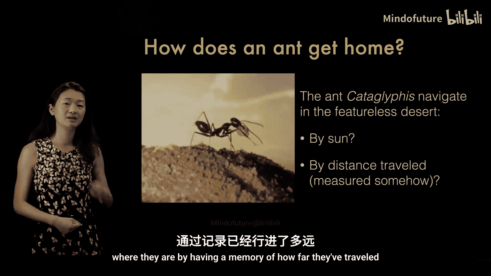

this bar down here is 100 steps。 so100ces ant it's gonna to get pretty far okay what we're doing to do is on the outbound。

 the ant is gonna start out in the nest at that blue triangle over there and it's gonna to meander around because it's basically looking around for food eventually it circles around loops around a few times finds the food once it's found the food it wants to bring the food back to its nest Now what we observe is that instead of re'tracing the tracks again。

 remember this is a featureless flat desert， no trees。

 no visual cues of any kind except the moving sun no scent cues because presumably the scent cues to be laid along the path that that it had just travel and instead heads directly back to the nest in the straight line and we can observe the ants doing this over and over and over again one way of positing how they might do this is that somehow they're integrating the information of these mandanderaring path。

 including see these little loopies here where it actually turned around 360 and it went this way again somehow it's integrating the information。

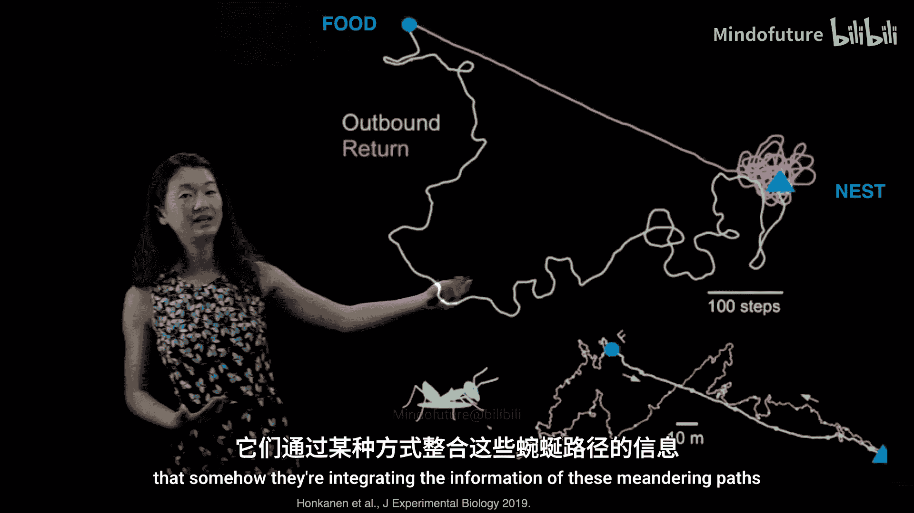

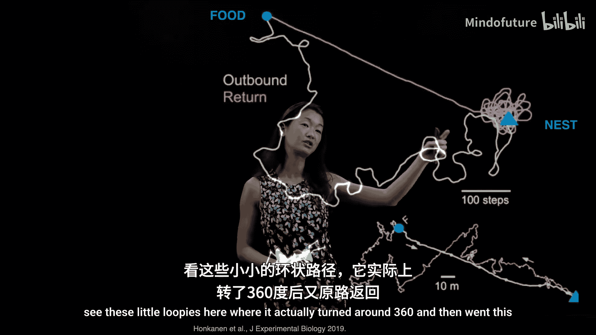

About where it's pointing at all times it。Seems like it has a memory of where the nest was in which orientation it was。

 Some humans are better this than others。 And it also knows how far it is。

 because you can see that once it heads back to the nest is not only heading the right direction。

 but once it gets close to the nest。 Remember， this is not a visible nest。

 It actually circles around for a while， because it I think the opening to the nest is somewhere around here。

 I feel like I'm close。 So the ant will circle around for a while until it actually identifies the opening of the nest。

 So you can see where its it knows how far it knows the nest is by the fact that it's circling right around the area where the nest is。

 So the question is， how does it do this。 How is it because it keeping track of something is it keeping track of the sun is it counting steps。

 is it integrating something。 how would you know this。

 So in a really clever experiment Here is what the experiment look like。

 This is the famous ant odometer experiment。 And so they took these ants that perform form there really marvelous behavior。

 And they made the following couple of manipulations。 They took the normal ant legs。

 which looks like that。 couple of the segments。😊。

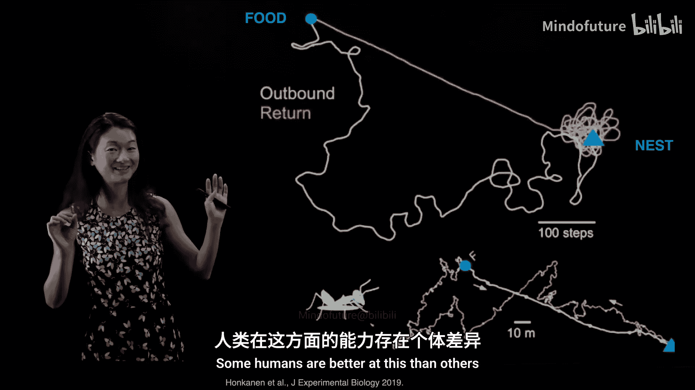

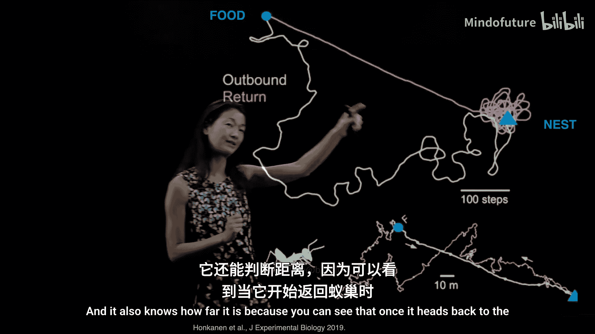

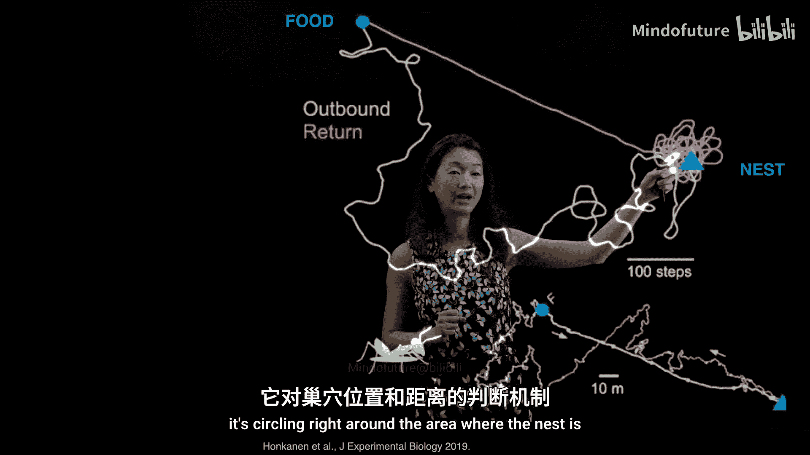

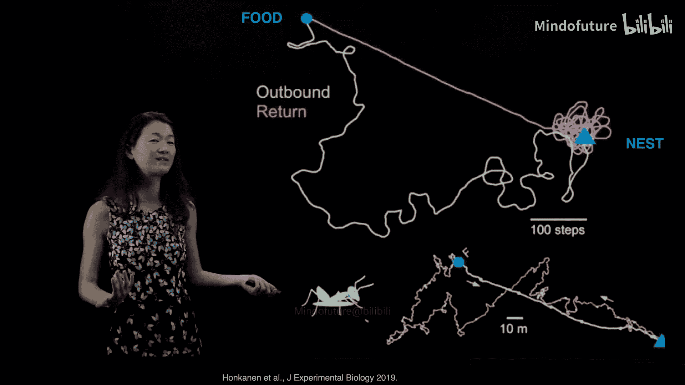

And they amputated the ant legs。 And so you have shorter stumps and slightly longer stumps。 Now。

 both of these stumps1 and stumps two are shorter than the normal leg。

 So the ant's legs are shorter than this normal length。 Now， before you worry about it。

 this is actually a relatively normal thing that happens to insects out in the wild。

 especially in the hot sand of the desert。 So I'm not saying that they don't feel pain。

 they do have pain receptors， but in this manipulation that the amputation is something that know if you saw a wild ant walking around。

 it would not be abnormal to see an ant that's missing parts or even the whole one of its legs。 Now。

 here's the really cool part。 Not only did they make the legs of the ants shorter artificially。

 they also made them longer。 Then way they did this is by taking these like one of these like bristly brush apparatuses。

 and they took these stiff bristles。That they took from one of these brushes。

I made tiny little ant stilts， so they glued these bristles from the brush onto the legs of the ants。

 thereby artificially making them longer。 So now we have both manipulations。

 we have normal ants and we can compare what the normal ants do return directly to its nest and circle around until it finds it with ants with shorter legs than they expect and longer legs than they expect。

 So here's what we found All right， so let's look at the data for a little bit and this is a slightly complicated graph。

 and so I'm gonna to show you the results。 I'm going to break it down。

 let's look at this one on the lefthand side first， this panel of results。

 So what they did was that they release the ants at the nest let them circle around presumably they're integrating in their head the entire time integrating around until they found the food at the feeding site and then they did the manipulation at the feeding site。

 So after the ant has found the feeding site they either make the sumps shorter or even shorter or they glued the stilts onto the ant's legs and made them longer and then they release them at the feeding site and just watch what they did。

 So the ants were trying to go back home。😊。

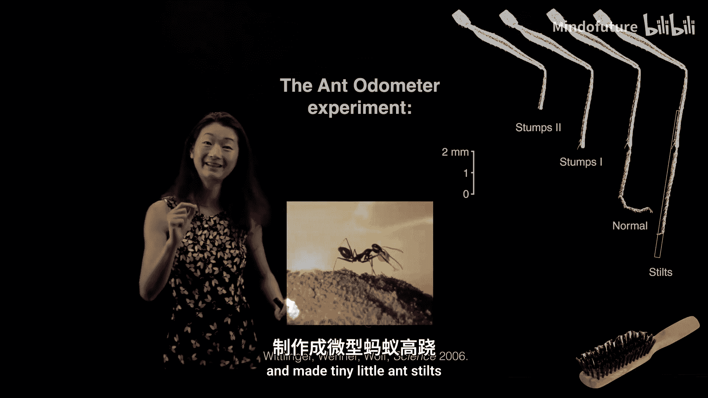

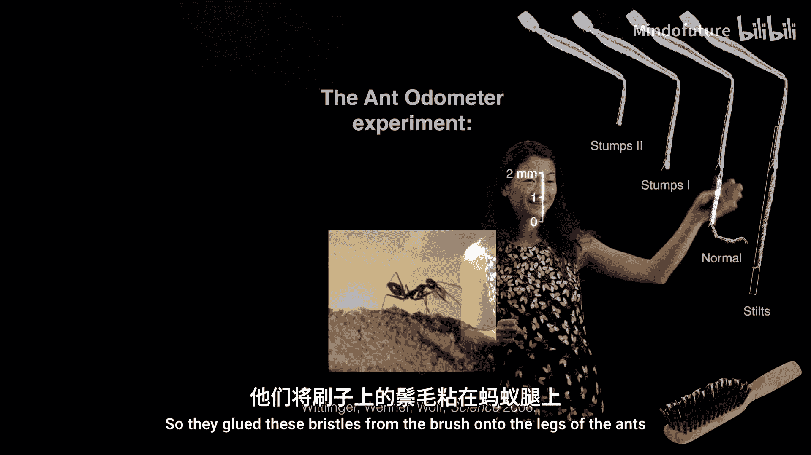

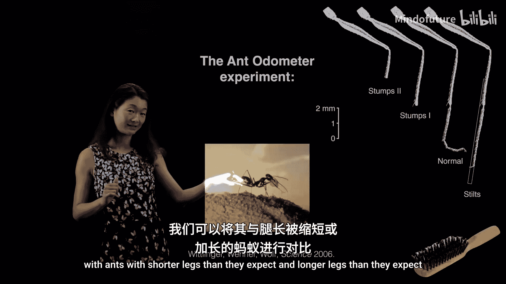

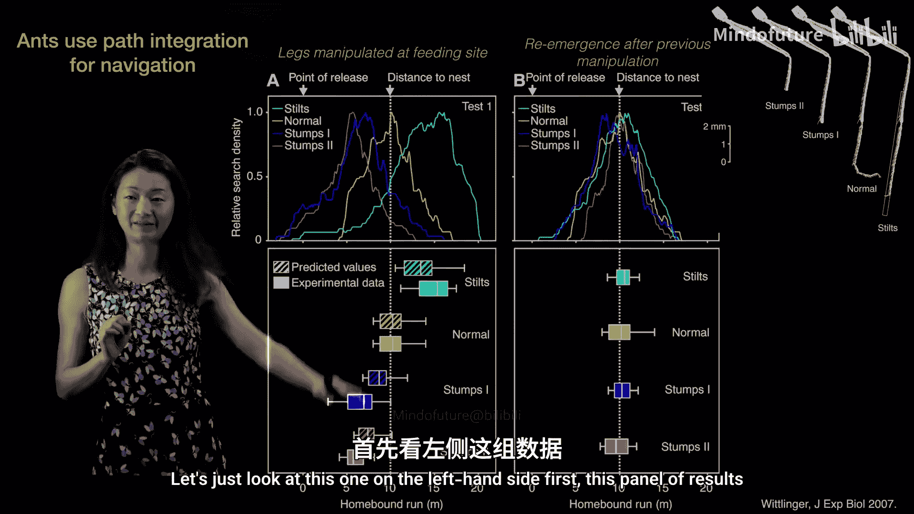

う？On the unmanipulated ant。 this is the yellow line here， you can see that on average。

 the ants go directly to the nest so this home this is a distance of about 10 m。

 and so it goes straight back to where it was supposed to be and finds the nest there if the stumps of the legs or shorter than they were supposed to be。

 you see the ants undershoot the position of the nest they stop short of the nest and are searching around a place that is more like 5 m from where it was supposed to be rather than 10 me and in an absolutely fabulous result。

 the ants would stilt like where the legs are a little longer than they were supposed to be totally overshot totally overshot the nest they went farther than they were supposed to and are searching instead for the nest at like 15 me or so from the feeding nest and so all of this taken together really does paint a picture that the ants are somehow counting the number of steps so that does not however。

 this is not explain how they。😊。

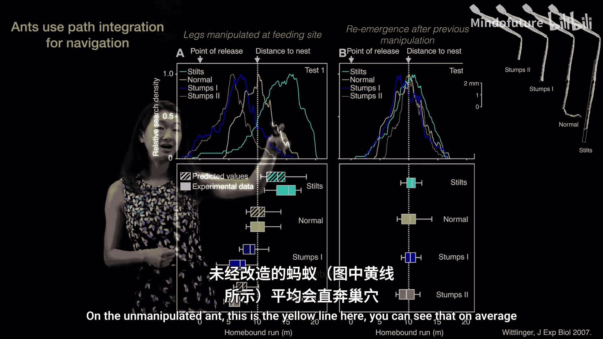

The orientation of where they're going， Because remember。

 there were two things that were happening when it was homing in on the nest。

 It knew exactly which way to head， what direction to head and it knew how far to go。 Now。

 this counting observation really only explains how do they know how far to go。

 It does not explain where they know where they were headed Now， for the answer to that question。

 I'm just gonna to ask you to hang on to one of the later videos and we're going to come back to this point of how we think insect species like ants know where they are headed and how do they know to head back directly to their nest instead of wandering around in a different direction。

 But I'm going to keep going on this graph for a little bit and talk about how there's another experiment that the experimenters did in the same in the same paper where they。

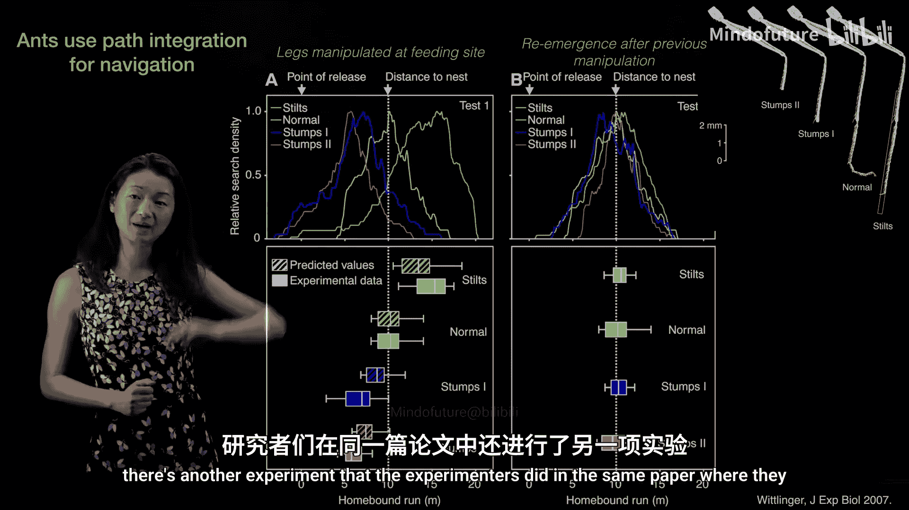

Saw that after the ants got used to it in the reemergnce， after the previous manipulation。

 the ants now in all four groups are able to go back on the homebound run and go back to the N。

 and so they have then learned how long their legs are and are able to perform the task again in the way that theyre really supposed to and how they were intended to。

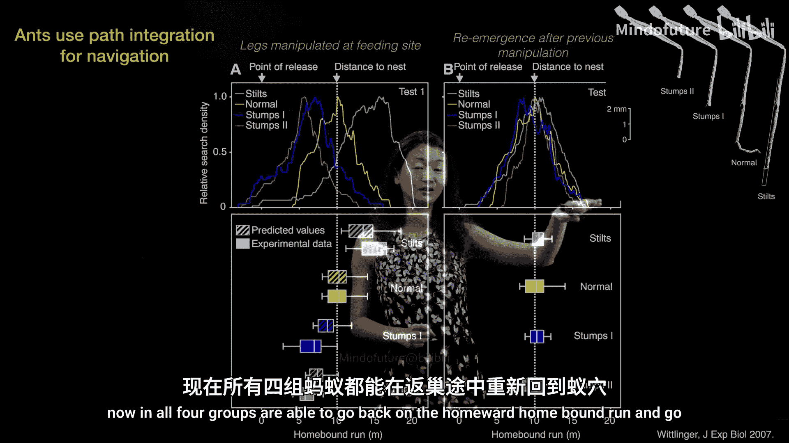

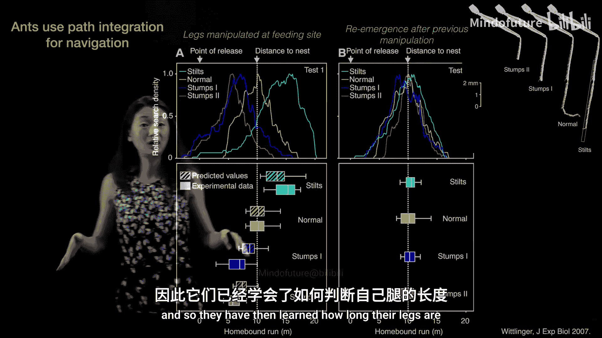

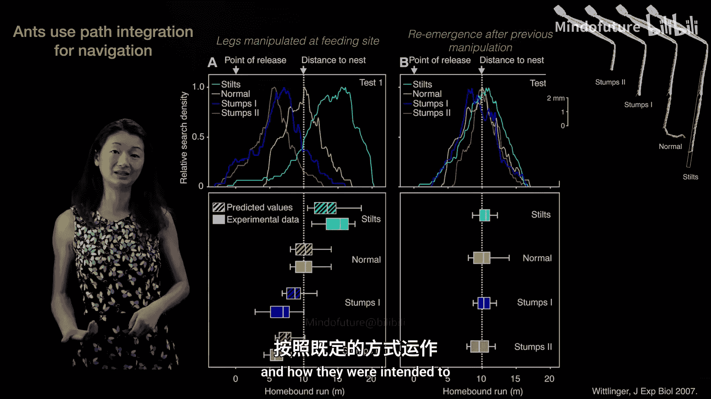

And so the art of finding your way in the next couple of videos。

 we're going to go through some of the neuroscience and the neurobiological systems that underlie the art of finding your way。

 but I hope you have learned already so far by a combination of introspection by thinking about how we get to places and we want to get somewhere and also looking at to this experiment of the anton stilts that it really requires the integration of multiple sensory modalities。

 this is not a sensory this is not a sensory tasks that is okay to do with only vision。

 the ants had no vision， for example， you can't do it with only memory because it not totally accurate。

 involves decision making and of course， because you're moving around and controlling your body in the external world。

 it requires motor control。 and when you fu some motor control like making your legs longer than they's supposed to be。

 then there are ramifications in your ability to find your way。

 So this is a really interesting topic navigation， and not only because it's important。

 but because it's a really important opportunity for us to synthesize a lot of the knowledge that we have about the other sensory systems and motor。

😊，In service of a task that is super duper important for animals and their survival。

 so from the perspective of the animal， this is something that it really needs the nervous system to do and these are capabilities they are to finding your way that are not possible without the integrated effects of your entire nervous system okay so the next couple of videos we're going to dig into exactly how this works in a variety of different animals and I hope you'll come back and join us。

😊。