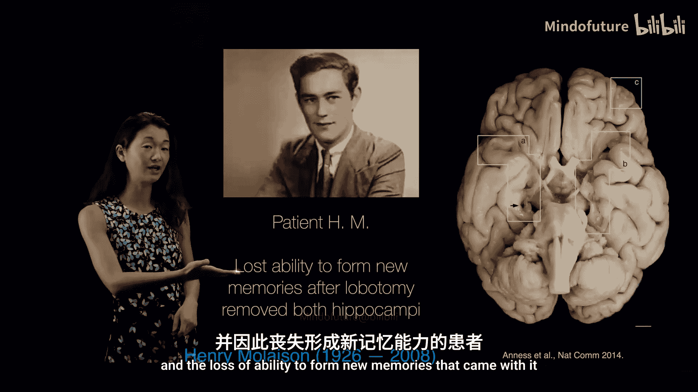
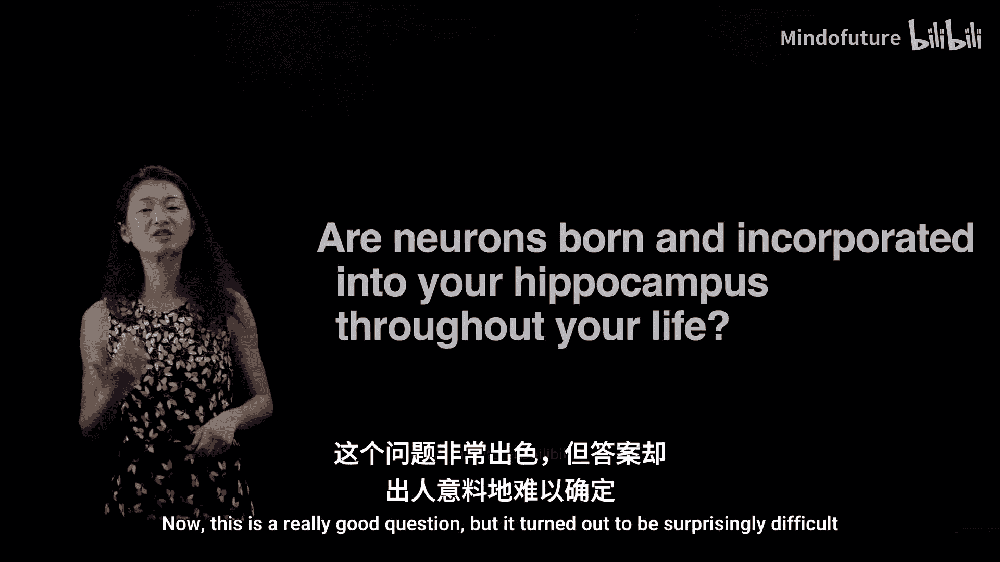
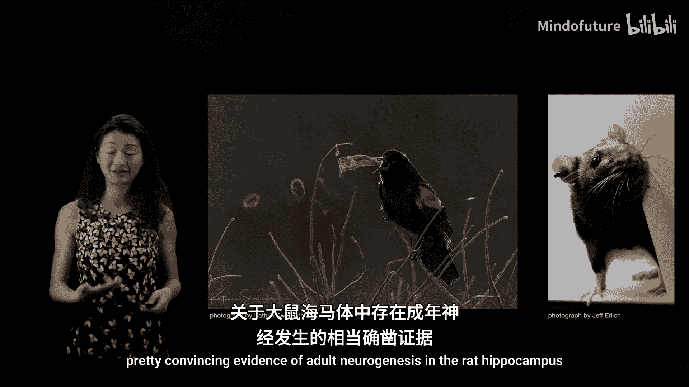
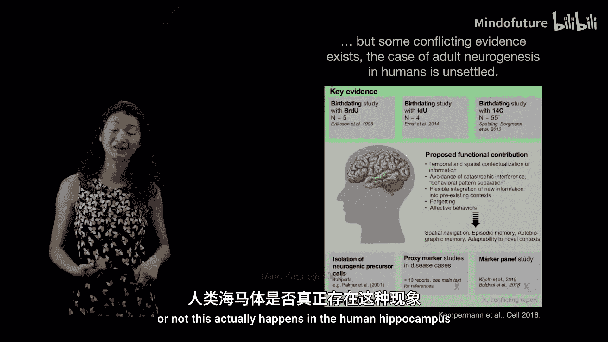
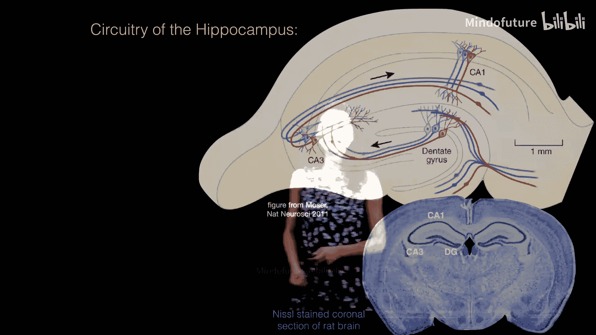
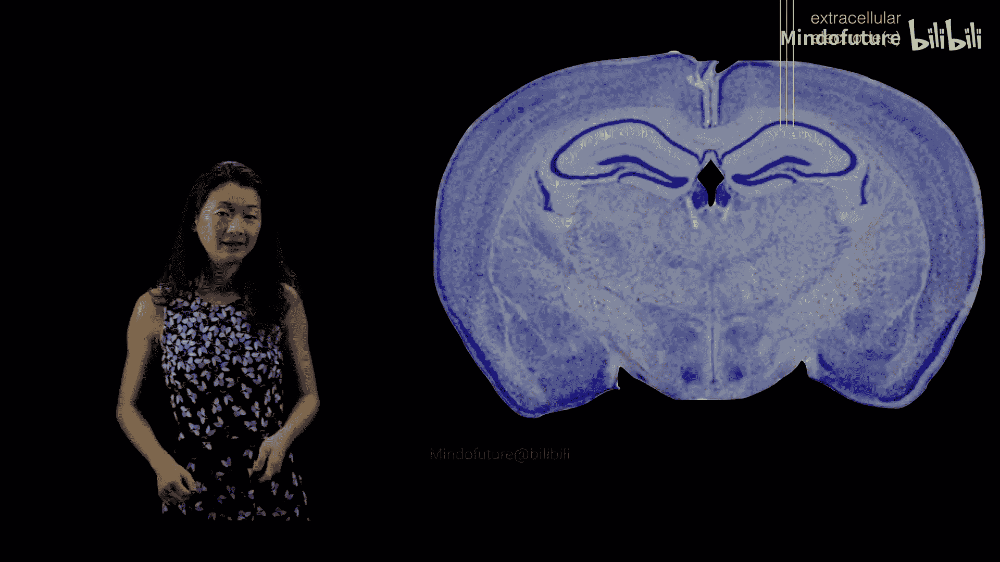
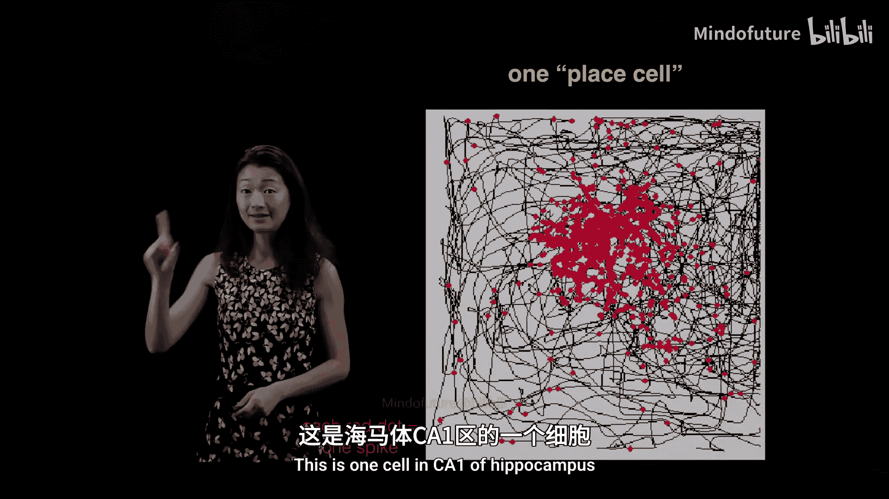
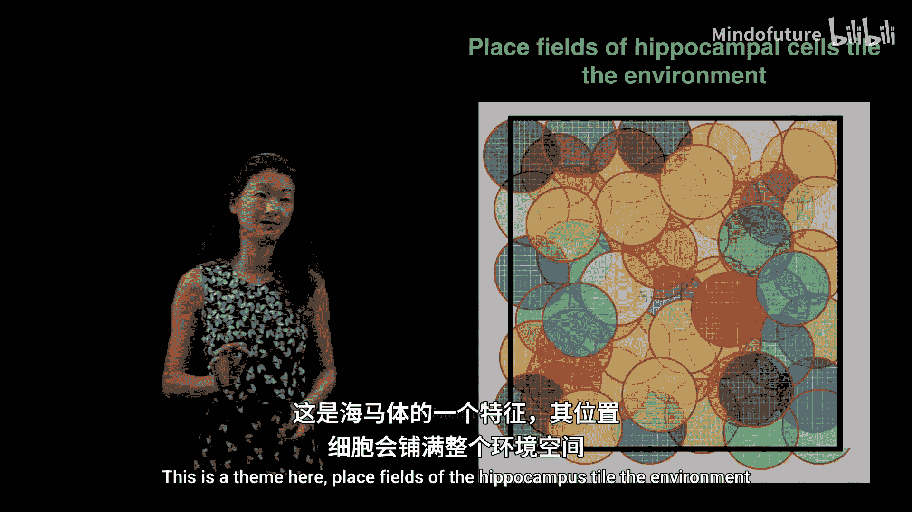
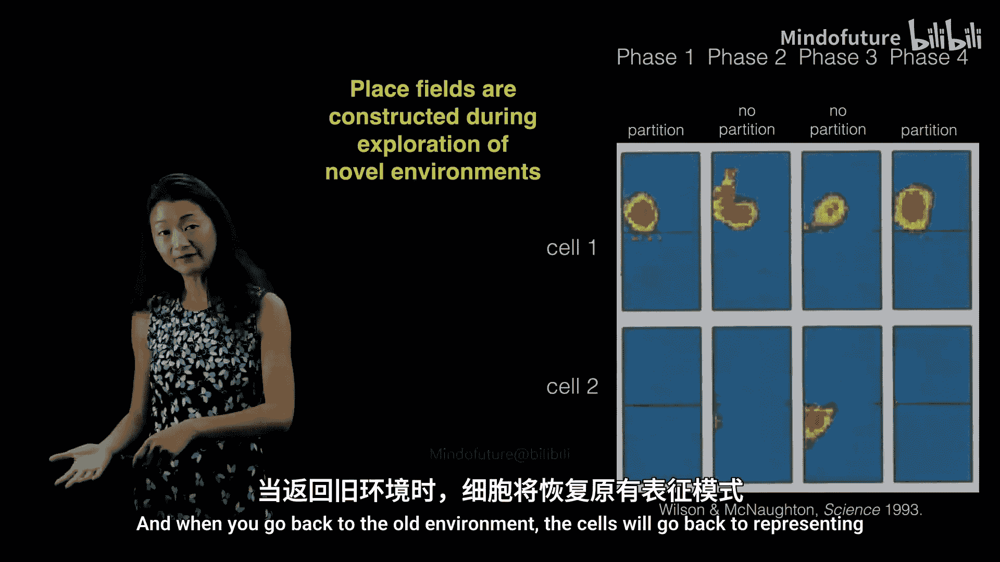

# 【华盛顿大学】神经科学入门 ｜ Introduction To Neuroscience ｜ Bing Wen Brunton p30 P30_海马体-位置细胞 -BV1i3qWBXEDH_p30-

A big part of figuring out how to get where you want to go is knowing where you are in the first place。

 What is your place So in this video， we're going to be introducing the concept of what are called play cells in a part of the brain that is a little bit new to us in this course on introductional neuroscience called the hippocampus or the hippocampal cortex I'm going to introduce to you this part of the brain why we think it's super important and some really interesting properties of cells in the hippocampus that gives us a really good clue into how the brain keeps track of where it is This concept of how do we know where we are in space was this topic of the Nobel Prize a few years back which was awarded to Edwardard Moser mybet Broser as well as John O'Keffe and so we'll be going over the results that they and their many colleagues and also academic progeny have been digging into in the time since。

So starting with a hippocampus， the hippocampus is sometimes called the working seahorse of navigation and memory Now why do I call the working seahorse。

 it turns out that the hippocampus is this really deep structure in the center of your brain that's not part of the neo course because you can't see it from the outside you actually have to dissect it out of the half of your brain if you really wanted to see it in the human the shape after you dissect it out this is what a human hippocampus looks like and so in a charming in a charming a bit of naming convention some people named the structure the seahorse after the Greek word for seahorse hippocampus because of its resemblance to a seahorse and so the hippocampus is this really interesting and quite unique structure that is something that underlies what what we think we know about navigation and memory now there's a couple of clues into why we think the hippocampus is really important for navigation and memory and one of the first clues was this individual that was known for a very long time is patient HM Now patient HM。

Is one of the most famous individuals in all of neuroscience for the story that I'm about to tell you。

 So patient H， who passed away in 2008。 And so after he passed away， we actually know his real name。

 Henry Mullison Henry。😊，Was a person who in his early 20s was suffering from such severe epilepsy that he underwent an experimental procedure at the time the neurosurgeon Bill Scoville went into his in his brain and removed a couple of key pieces of the brain in the attempt to control his incurable epilepsy now in his particular case the story actually goes back a little bit further。

 he suffered a traumatic brain injury when he was a child and it was only after that is epilepsy started so he has a particular type of epilepsy that was almost certainly a consequence of this early traumatic brain injury so what Bill Scoville did is that he went in and removed both sides of Henry's hippocampi and a couple of the associated coreses ever since and so that's kind of highlighted in box A and B over there you can't exactly see it because the hippocampus is actually underneath all of that stuff this is the ventral view of Henry's brain you can kind of kind of infer。

The hippocampie would be because it's underneath all of that neocortex that's above there。

 What was not entirely clear until after Henry passed away and his brain was examined a little more closely is that there was an additional piece of damage to his brain in his prefrontal cortex。

 There was a little piece of prefrontal cortex here that got nick a little bit along the way of the surgery。

 And so that's actually caused a lot of controversy。

 This is a longer subject of the long story of Henry Muesson。

 exactly which part of the brain was damaged at what point by either the traumatic brain injury or by the surgical manipulation where both of his hippocamp were removed。

 But what we do know is after the surgery Henry in his early 20s。

 woke up from surgery and had obviously had a severe loss of ability to form new memories after he lost both of his hippocampie。

 Now， what does this mean， It means that he perpetually was unable to form any new memories he talked to him。

 he would respond and。Answer in a reasonable way。 but after you know seconds to minutes。

 he would completely forgot that you've had his interaction and you can probably see everyone experiencing the world completely new every couple of seconds two minutes。

 So this is called entiregrade amnesia the inability to form new memories as they go Henry also suffered from a bit of retrograde amnesia where he forgot parts of his life that was immediately before the surgery。

 so he remembered being kind of a young child and young adult。

 but he didn't really remember what happened immediately before the surgery。

 but the really astonishing part of the amnesia is the entire grade part。 And so for this reason。

 patient HM was the subject of a large set of studies over the many decades of his life after the surgery had happened。

 And I remember when I was in graduate school Henry had finally passed away。

 And so so his brain was being preserved for scientific study and it was being sliced and so they had actually live。

Streamed the slicing of HM's brain。 I remember for a couple of days。

 none of us got any work done because we were just glued to our laptops。

 watching the slicing of patient HM when it was happening at the time。😊。

So HM is not the only person who have ever had this type of damage to their hippocampi and the loss of ability to form new memories that came with it。

 another really famous person who had this condition is Clive wearing there's a really interesting set of videos that you can watch if you want to see this feels like what it seems like to be this person who is unable to form novel memories now Clive like Henry had lost both of his hippocampie unlike Henry Clive lost it because he contracted encephalitis now before the encephalitis Clive was actually a musician in the UK unless year really a rising in a very successful composer after contracting encephitis which happens to have damaged both of his hippocampie he had profound entergrade amnesia as well as a little bit of retrograde amnesia for him it was so profound that he essentially wakes up every 30 seconds or ago he is unable to hold a coherent conversation for more than 30 seconds sometimes。

Shorter than that but I think up to 30 seconds is as far as he goes so you'll be having a conversation with him and so you can watch these videos of what it's like when his wife or his friends or his clinical care professionals are coming in to talk to him。

 he would be super excited to see you know his wife walked out of the room for one second came back in and hed be super excited to see her as if they hadn't seen each other during decades and he would hugg her and say all these really wonderful things and then 30 seconds later he's completely forgotten this interactions has happened and does it all over again over and over and over for years and years and years it is a really fascinating as well as I'm sure very devastating condition for himself and those around him so there's a couple of other people that I have read about who have this condition some kind of selective damage to the hippocampus and the interroggate amnesia that comes with it unless severe cases there's a couple of individuals who actually have come up with ways of using their digital devices to compensate for their lack of memory for example there's a。

😊，One individual who again suffers from some kind of viral infection of their brain and this lost a lot of the function of their hippocamppi and so he would actually he actually drive around。

 try to get to places， but how do you drive around if you can't remember where you're going while you put it into your GPS on your phone so he puts his phone on his dashboard he starts driving mid driveve。

 he's completely forgotten where you're supposed to go。

 he looks at his phone which tells him he's supposed to go and he will get there so there's another way in which we can use technology to compensate for some of the abilities how we may have lost with different types of neurological disorders and brain damage。

Okay so that's with hippocampus being completely gone Here's another really interesting result In the previous video we talked about how challenging it is to navigating London because it doesn't have a grid。

 it's just these winding roads and if you don't know where you are and exactly where you're going it's going to be really hard for you to get there is nothing there's nowhere more true that in the case of London taxi drivers now London taxi drivers unlike taxi drivers in New York City have to actually pass a rigorous curriculum and a test sometimes takes two whole years to get a license to drive a London taxi because it is so challenging to navigateg in London streets and so in a study that was published over 20 years ago there was this correlation that was found where they did structural imaging of a bunch of taxi drivers and measured the size of the respective hippocamppi just by volume this is a non-invasive MRI procedure and what they discovered was a correlation by how much time the individual had spent as a taxi driver how many months they've been working is a taxi driver over here。

Have people who have been working as a taxi driver for over 10 years。

 15 years over here we have individuals who have only been driving a taxi in London for a couple of years and you can see that there's this really interesting correlation where the longer you've been driving a taxi in London。

 the larger Eurohici tend to be kind of interesting result but again I will note that this is merely a correlation it is not suggest a causation by itself。

So。How do hippocite can possibly get better Well how does it actually get better Like how do how do you get bigger brain areas。

 So there is this controversy that I'm going to just give you a taste of right now。

 there's just been a decades long controversy about how are neurons born and incorporated into your hippocampus throughout your lifetime。

 Is it true that there are more cells being born and incorporated into your hippocampus as you get older and as you grow up Now this is a really good question。

 but it turned out to be surprisingly difficult to answer。

 What we do know is that this type of adult neurogenesis， neurogenesis。

 meaning the genesis of new novel cells inside of your brain neurourogenesis is well of establishing some species like reptiles it was significantly harder to establish in verebrates such as birds and mice And so it became really obvious in birds especially some different species of songbirds that parts of their brains in a seasonal basis well increasing size up to about twice as big So some of these songbirds are they sing in the spring。

😊。

Becauses mating season and so in the spring， then the males。

 this particular part of the brain associated with producing the songs will swell up and become twice as big。

 and then after that mating season is over， a lot of those neurons go away and then the brain area becomes half the size that it used to be so that became obvious that this is okay this is a thing that happens quite normally in birds it took a little bit longer to establish the similar thing happens in rodents and in particular。

 there was pretty convincing evidence of adult neurogenesis in the rat hippocampus。

 this is an area that we'll come back to in a little bit Well with significantly less clear and this was like people were arguing about this for a really long time。

 including up until the present moment is that there's actually conflicting evidence whether or not adult neurogenesis in humans exists So what this article attempts to summarize I won't go into the details here is that there's actually a number of studies using completely different experimental approaches but support either for or against the case of adult neurogenesis in humans there's some evidence that it might exist there's also a lot of evidence that it doesn't。

So the jury is still out。 we know that it does happen in lots of other vertebrates。

 It is unclear whether or not it does happen in humans。 if it doesn't happen in humans。

 the question remains what about this result within Ly taxi drivers maybe needs to be replicated So what I'm trying to impart to you here is that this is a normal part of science is that we gather evidence we oppose hypotheses and the best case scenario is that we encourage our colleagues to look at the evidence for themselves design their own experiments and so it is only the consensus of the field do we then feel like something is either true or not true in the case of adulturogenesis in humans。

 the case is unsett I mean I don't haven't found a conclusive consensus so far but maybe in the following years more evidence will come out and we' have a better answer to whether or not this actually happens in the human hippocampus。

😊。

What we do know is the circuitry of the hippocamp perhaps at least among mammals is relatively wellconserved。

 What I'm going to show you here is what the circuitry looks like in a rat。

 and I'll show you a couple of different mammalian species later and the short stories that looks really quite similar to what I'm about to show you slightly different。

 but like the circuitry is very similar So this campoccampus lies beneath the neocortex So the very dorso part of your brain is covered by the by the neocortex in the humans and other types of mamalian species where haverinkly brains is under like a bunch of layers of wrinkles of brains in the case of the rat which have smooth cortices because there areas not that big you'll see that it's the neocortexes up here right underneath that is the hippocampus and so this is a nest stain coronal section of the rat brain or coronal slice means I'm slicing this way。

 do it again， slicing this way， slicing it back。😊，From kind of like up and down parallel from the snout back。

 okay？So this is what the hippocampus looks like from the coronal section of a rat brain if you did it for the human brain it would be slightly different。

 but concept is almost exactly the same and slaying right underneath neocortex is in fact not connected to the neocortex is a separable structure in my class we do a sheet brain dissection and so one of the exercises is actually going to be how do you dissect out and intact hippocampus if you're really careful you can actually separated from the rest of the brain it not attached to the neocortex above it so the parts of the hippocampus that are relevant justt tell you the names of them they're historical reasons why they're called this is the dente gyrus which receives inputs from the rest of the brain the dente gyrus projects the part of the area called CA1 and CA1 then projects a sorry Ca3 and then Ca3 projects a CA1 historically therere used to be a CA2 but we now recognize it is not actually distinct separable parts of the hippocampus but the numbers remain so dente g is a CA3 and Ca3 to CA1 that's kind of the canonical。

Of the hippocampus Now this is a diagram of it and you can kind of see here that the brain areas are biologicalally symmetric。

 you have the den dryers medialy how it has its canonical shape right it goes to Ca11 then goes Ca3 I really can't read Ca3 and then goes to C1 now when I'm about to show you are electrical recordings from spiking cells in Ca1 the way we do this is by taking an array of extracellular electrodes you can review the lecture on electro recordings of the brain for a reminder of that type of technology。

 how it works and also the variety of different ones that we've been using including multi multielect arrays。

tetro arrays， neuropels probes and whatever is's coming up next in this really exciting area of technology but whatever type of extracellular layer electrode you are using。

 you're going to stab it into the brain go through whatever parts of newcortex you have to go through and then we're going to end up we're going to try to end up at the cell layer。

😊。

CA1 and that's the blue line that's outlined there。

 So it has a structure where there's a layer of cells right where those blue lines are in the Nle stain。

 I'm going to try to end up with the tips of my extracellular electrodes right at the C1。

 Here's what happens when I measure cells and how they're activated in Ca1 now this is what it looks like on the rat so you you build these little heads stages you put your wires inside the brain and then there's a little electrical plug kind of like it's not a USB plug。

 it's much smaller than that is also more specialized that has more channel but whatever。

 a little plug the same plug that might use to plug your phone into when you plug your phone into the computer where you plug your computer into a monitor。

 something like that is a little plug where I can plug my heads stage that connects to the extracellular electrodes in the rats brain and plug it to my computer from which I can actually record the electricalactivity。

Okay， so here's the experiment， okay。Step one， get a box。Step 2。

 get some chocolatecoal sprinkles and sprinkle chocolatecoal sprinkles randomly in the box。 Now。

 rats love chocoless sprinkles。 And the reason I'm gonna have trackless sprinkles all into my box is because this is going to make this shy rat who has just ended up in this strange rocks motivated to just explore to go around because otherwise you might just huddle on the corner。

 not do anything。 Okay， so you have a box。 You have chocolatecoal sprinkles in the box。

 You have a rat with a head stage。 We have his electrodes in the C1。

 Let's watch one of these neurons and what it does。😊，Okay， that was supposed to be a video。

The video did not play， which is completely okay because I gave you the link to it。

 Now what you would have seen is a video of a rat that was running around this rectangular or square shaped arena and as it ran around occasionally one of this Ca1 cells would fire an action potential。

 So what I'm showing here is the summary of what that video would have looked like and what you would have seen is that the path of the rat is traced out in these black lines。

 you kind of see it just kind of moving around randomly eating chocolate sprinkles。😊。

And if you plot it on top of its path， every time the cell fired。

 I'm going to put a red dot where the rat was when it fired。

 And I hope what you can see is that this cell has a preference of where it fires。

 It only fires when the rat is kind of right here in this middle part of the box。

We're going to call this a play cell。Because when the cell fires， we know the rat is in this place。

This is one cell in C1 of hippocampus。 Here's what it looks like for many cells in Ca1 of hippocampus。

 Now I'm not no longer plotting individual dots for individual spikes。

 Instead I'm now plotting the spike rate。 So red means lots of spike and blue means no spikes。

 and instead of plotting one circle。 I mean， one rectangle square。 I need to go back to kindergarten。

 one square。

I'm going to plot many， many squares where each square is a cell in CA1。

 Now what you're going to see here is that there is， let's look at this cell right here， okay。

 this cell has a place field in the left bottom corner of the box because that's where the cell fires a lot。

This cell here above it has a place field that's kind of in the in the edge of the right hand side of the box right here。

 This one has a place field that is in the top left corner and so on and so forth。

 This one has a giant。Place field is kind of in the middle。

 but a little bit above center right this one has a place field that's in the bottom。

 kind of in the middle of the bottom edge of the box。In other words。

 place cells in CO1 of hippocampus have place fields that are different。

Each cell kind of has its own preferred location where it fires。

 thus having this correlation where the rat， if it knew， which cell is firing。

 it would have a pretty darn good idea of where it actually is。

You will notice that there are some cells that don't fire at all， like the cell right here。

Totally blue， it just kind of didn't spike ever when the hours was exploring。

 we'll come back to that later。And then their cells like this where just fires a whole lot。 Now。

 these are not place cells。 These are inhibitory cells of Ca1。

 And you'll see several of them in these recordings。

 And so they fire a lot of spikes but they don't have a distinct place field and they're not excitatory cells of C1。

 So place cells in C1 to the hippocampus have place fields that tile the environment。

 So this is a cartoon to what I mean by that。 So the previous graph was a smattering of random cells that were measured from in this one particular experimenting Ca1。

 The concept here is that if you could sample from all of them。

 You would see that every cell has its own place field。

 And the place fields are overlapping and eventually tile the entire environment that if you knew which cells were firing。

 you can then infer where the animal is in this box。😊，Okay this is a theme here。

 place fields of the hippocampus tile the environment but they are also able to change。

 they're not immutable because after all how does the rat construct a new one when you put it in a new box so in this experiment the experiment is the following and you have two cells of CA1 cell1 and cell2 in the beginning I have three four phases of this experiment in phase one。

 there's a partition and so the rat's only able to explore the top half of this box cell one has a place field right here。

Seell2 doesn't fire at all。It's just gone， it has no firing whatsoever。In phase two。

 I'm going to remove the partition， so now the box is suddenly a little different。

 it's much bigger than it used to be。Sell one still has a very similar place field。

 it's still like the shape is a little bit different。

 but it's still relatively active kind of the cell when the rat is right here。

And you can see the emergence of a place field for cell2 in phase two。

If you keep the partition open for longer， what emerges is that cell2 forms a representation of this part of the box right near the partition。

The representation for cell1 is in the same place still。

 we're not going to make too much of the fact that it's slightly weaker than it used to be。

 it seems to be relatively stable here， so cell1 hasn't changed。

 cell2 has formed a new place field in the presence of a novel environment because the box has changed。

Phase four we're going to put the partition back in， the rat is back on the top。

 cell two stops firing and cell one is going back to where it was before。

And so these place fields are in fact plastic， they can change and this also accounts for how you know where you are depending on you know if you put you in a different city。

 it's not like you're totally lost， all your place cells are in New York。

 but you're in London that's not what happens when you're in a novel environment and exploring the novel environment part of you figuring out where you are is constructing the set of place cells that represent and keep track of where you are in this novel environment and when you go back to the old environment。

 the cells will go back to representing where you are in the old environment as well。

Okay， so that's kind of a quick summary of decades of Nobel Prize winning research in place cells。

 there's a lot more details to it， but I'm just going to summarize the key concepts here。

 place cells are in the hippocampus and the hippocampus is a deep brain region crucial to memory and navigation because navigation after all requires you remembering where you are in space when it come back to this point a little bit。

😊，There are cells in the CA1 region of the hippocampus that are called place cells and we call them place cells because they tend to fire whenever the animal is in a particular spot。

 a particular place in the box and this picture of where it is active when the animal is there we call it the cells a place field this is a bit of terminology that's kind of like talking about the receptive field of sensory neurons。

 this is the instead of talking about receptive field of sensory neurons play cells are not sensory neurons but we are going to characterize with a picture that summarizes where the animal is when the cell is firing so we're going to call it instead of receptive fields we're going to call it place fields because it's a place cell。

Place field can change in novel environments， if yeah I plop you down and virtually transport you to somewhere totally new。

 you'll form a new set of place field representations of the novel environment。

And place fields tile and environment， and so if you knew where you are any given if you knew which cells。

 which of these place cells are firing at any given moment。

 you should be able to infer where you are in that environment as well， so that's place cells。

But this all kind of begs a rather obvious question。

 which is this is a representation of how the animal knows where it is。

 but how did it construct these place fields？Right， because you don't just get this out of nowhere。

 We talked about integration of path。 We talked about this， what how the ans me have been doing。 And。

 we thought about how we would do it。 if we were trying to navigate from somewhere another trying to construct a map of a novel environment。

 This is kind of where the representation， the memory of the place would be， But how do we get there。

 How does your nervous system construct one of these place fields。

 That's the subject of the next lecture。