# 神经科学入门：P30：海马体与位置细胞 🧠

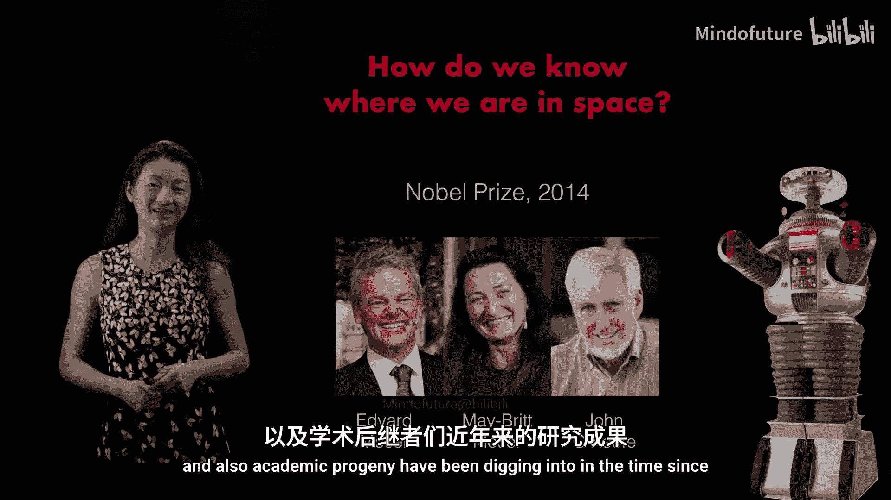

在本节课中，我们将学习大脑如何追踪我们在空间中的位置。核心是介绍一个名为**海马体**的脑区，以及其中一种被称为**位置细胞**的特殊神经元。这些细胞的发现曾获得诺贝尔奖，它们为我们理解大脑如何构建“地图”和形成记忆提供了关键线索。

## 海马体：导航与记忆的“海马” 🐚

上一节我们探讨了导航的基本挑战，本节中我们来看看大脑中负责处理空间位置和记忆的一个关键结构——海马体。

海马体是位于大脑深处的结构，因其形状类似海马而得名（希腊语“hippocampus”意为海马）。它不属于新皮层，因此从大脑外部无法直接看到。海马体在导航和记忆中扮演着至关重要的角色。

以下是证明海马体重要性的早期线索：

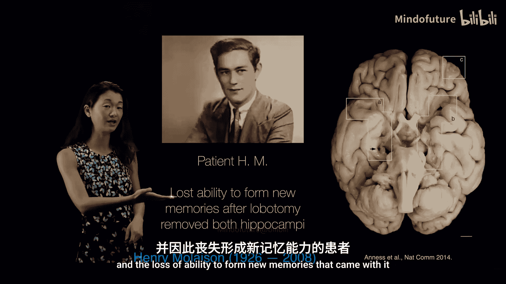

*   **患者H.M.（亨利·莫莱森）**：他因严重癫痫在20多岁时接受了手术，切除了双侧海马体。手术后，他患上了严重的**顺行性遗忘症**，即无法形成新的记忆。他能够进行对话，但几分钟后就会完全忘记这次互动。他的案例表明海马体对形成新记忆至关重要。
*   **患者克莱夫·韦林**：他因脑炎损伤了双侧海马体，也患有严重的顺行性遗忘症。他的记忆只能持续约30秒，不断重复“刚刚醒来”的状态，无法进行连贯的长时间对话。
*   **科技代偿案例**：一些海马体受损的患者会利用GPS等数字设备来补偿空间记忆的缺失，例如依靠手机导航驾驶，因为他们无法记住目的地。

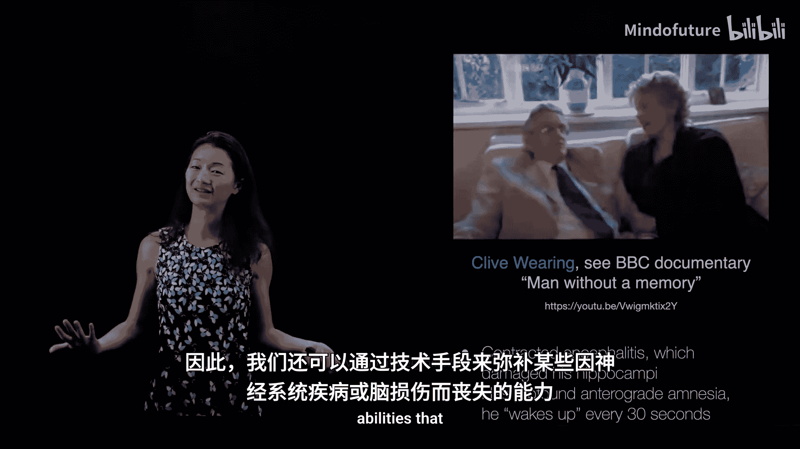

## 海马体的可塑性：伦敦出租车司机研究 🚖

我们已经看到海马体损伤的后果，那么海马体能否变得更强呢？一项关于伦敦出租车司机的研究提供了有趣发现。

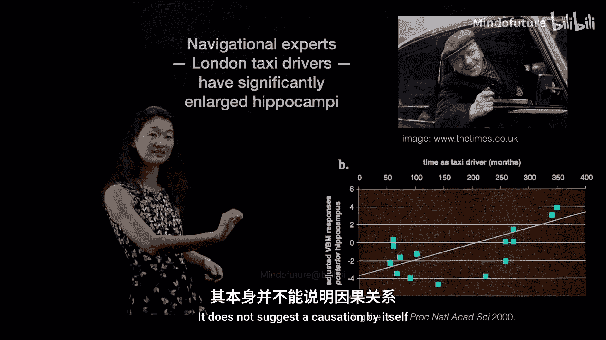

伦敦街道错综复杂，出租车司机必须通过一项极其严格的测试才能获得执照。一项超过20年前的研究发现：
*   研究者通过核磁共振成像测量了出租车司机海马体的体积。
*   结果发现，司机从事该职业的时间与其海马体后部的大小存在**正相关**。
*   驾驶时间越长（例如超过10-15年），海马体相关区域往往越大。

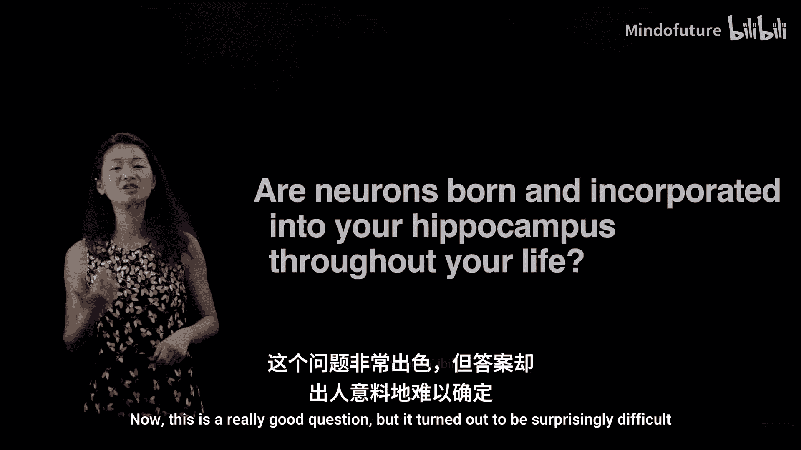

> **注意**：这仅是一种**相关性**，并不能直接证明因果关系。可能是更大的海马体使人更擅长导航，也可能是长期的导航训练改变了海马体。

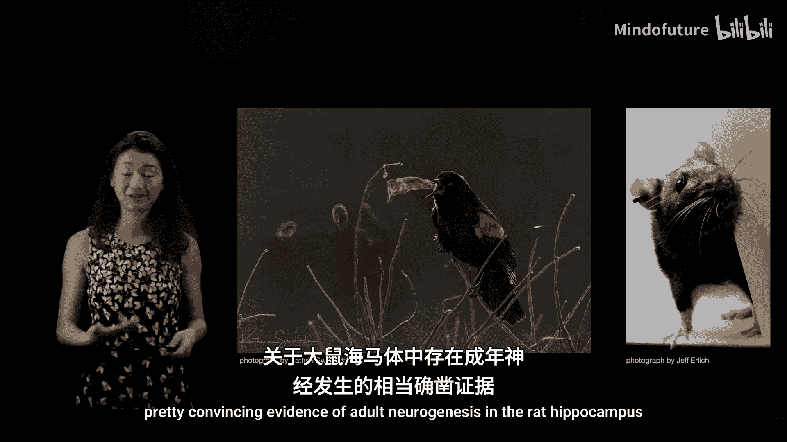

## 成年神经发生：一个未解之谜 🔬

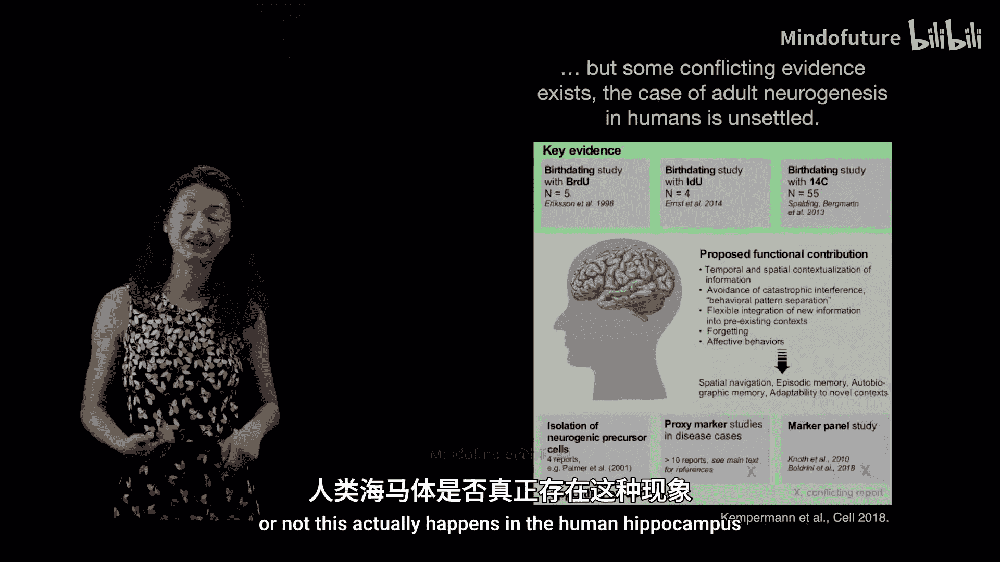

上一节我们看到了海马体可能发生变化的证据，本节中我们来探讨这种变化可能的生物学基础——成年神经发生。

成年神经发生是指成年大脑中新生神经元的过程。这在某些物种中已得到证实：
*   **鸟类**：一些鸣禽在繁殖季节，与鸣叫相关的大脑区域会增大一倍，季节过后又会缩小。
*   **啮齿类动物**：有令人信服的证据表明大鼠海马体中存在成年神经发生。

然而，关于**人类**海马体是否存在显著的成年神经发生，目前科学界仍有争议。不同研究使用不同方法，得出的结论相互矛盾。这是一个正常的科学过程，需要更多证据和领域共识来最终确定。

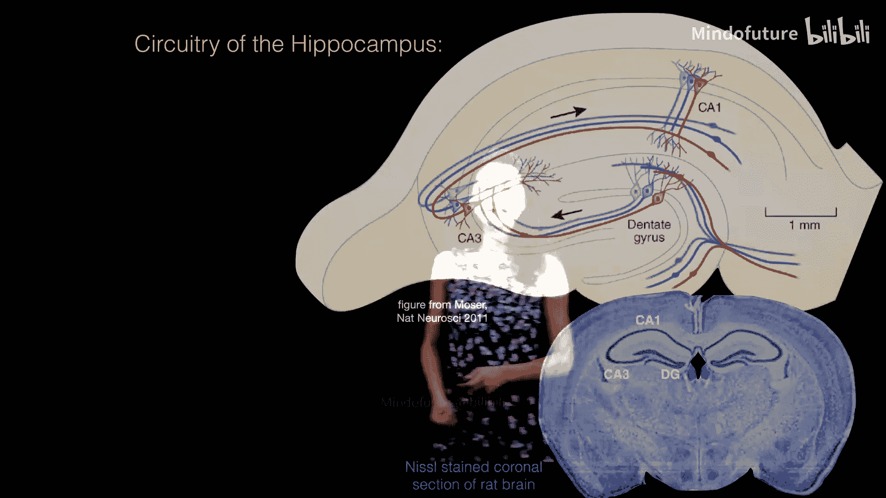

## 海马体的结构与位置细胞记录 🧪

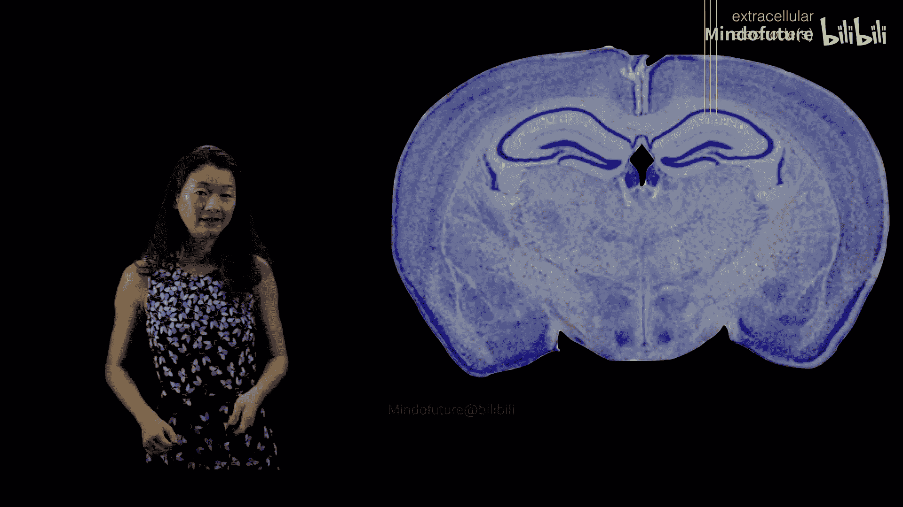

无论神经发生与否，我们知道海马体的神经回路在哺乳动物中相对保守。接下来我们看看它的结构以及如何记录其中的细胞活动。

海马体位于新皮层之下。在大鼠脑的冠状切面上，可以看到海马体包含几个主要部分：
1.  **齿状回**：接收来自大脑其他区域的输入。
2.  **CA3区**：接收齿状回的投射。
3.  **CA1区**：接收CA3区的投射。这是研究位置细胞的关键区域。

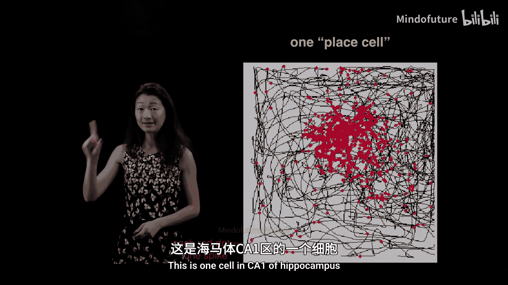

记录位置细胞的典型实验步骤如下：
1.  将包含多个电极的阵列植入大鼠脑内，使电极尖端位于海马体的CA1区。
2.  将大鼠放入一个撒有巧克力碎（奖励）的方形盒子中，让它自由探索。
3.  通过头戴式装置连接电极与计算机，记录CA1区神经元在老鼠探索时的放电活动。

## 位置细胞的特性：大脑的“空间地图” 🗺️

现在，让我们看看实验记录揭示了什么。以下是位置细胞的核心特性：

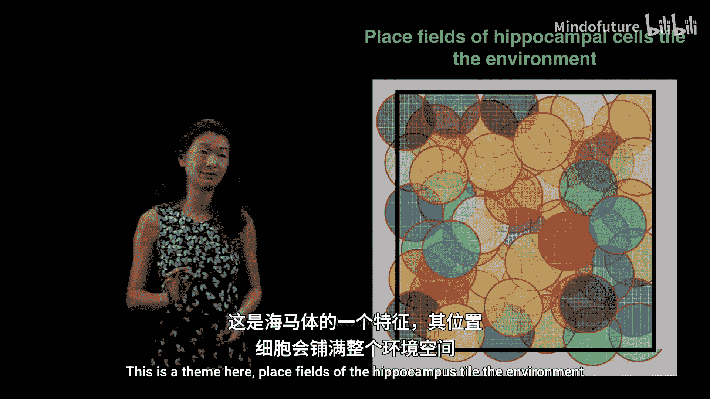

*   **位置野**：当记录单个CA1细胞时，你会发现它只在老鼠跑到盒子里某个特定位置时才放电。这个细胞偏好的放电区域被称为它的**位置野**。这个细胞就是一个**位置细胞**。
*   **覆盖环境**：如果你同时记录许多CA1细胞，会发现每个细胞都有自己独特的位置野。这些位置野相互重叠，共同覆盖了整个盒子空间。公式化描述如下：
    > 如果已知哪些位置细胞正在放电，就可以推断出动物在环境中的具体位置。
*   **可塑性**：位置野不是固定不变的。当环境改变（例如盒子变大），一些原本不活跃的细胞会形成新的位置野来表征新空间；当环境恢复原状，细胞的放电模式也可能恢复。这解释了为何我们进入新环境时能构建新的心理地图。

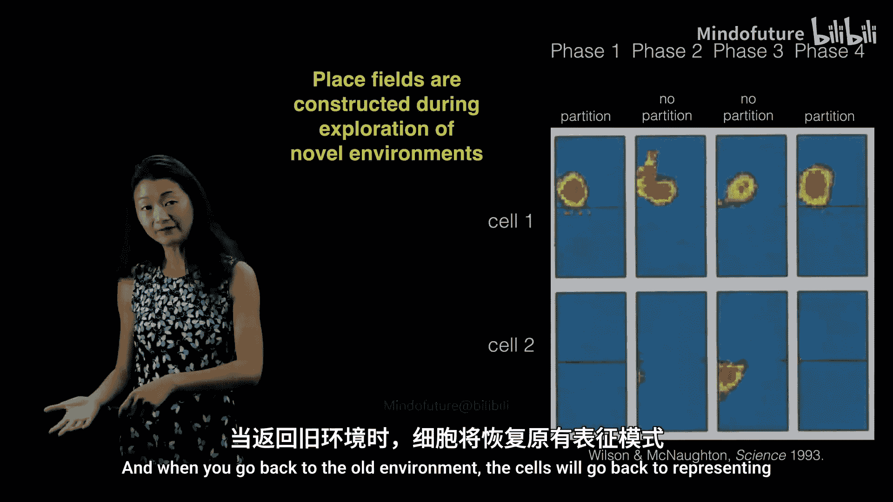

## 总结与展望 🎯

本节课中我们一起学习了：
1.  **海马体**是大脑深处对记忆和空间导航至关重要的结构。
2.  海马体损伤会导致严重的顺行性遗忘症。
3.  海马体具有可塑性，例如伦敦出租车司机的研究显示了其结构与经验的关联。
4.  在海马体CA1区存在**位置细胞**，它们通过特定的**位置野**放电来表征动物在空间中的位置。
5.  位置细胞的位置野能**覆盖整个环境**，并且具有**可塑性**，能够根据环境变化进行调整。

然而，这引出了一个更深层的问题：大脑是如何在第一时间构建出这些位置野的？神经系统如何整合感觉信息、自我运动信号来形成空间地图？这将是我们下一节课要探讨的主题。