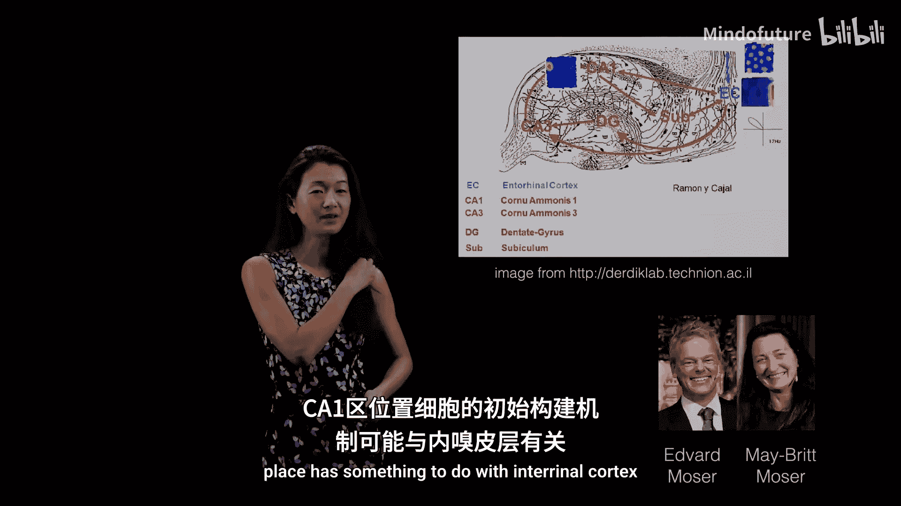
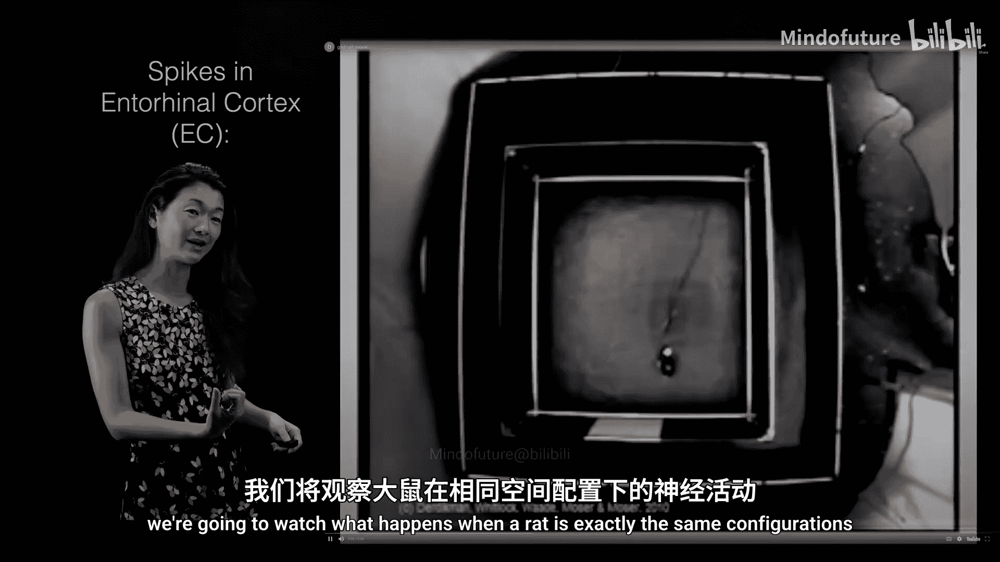
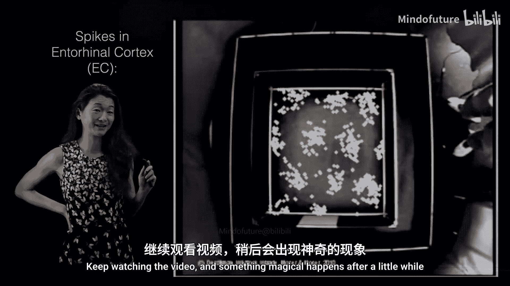
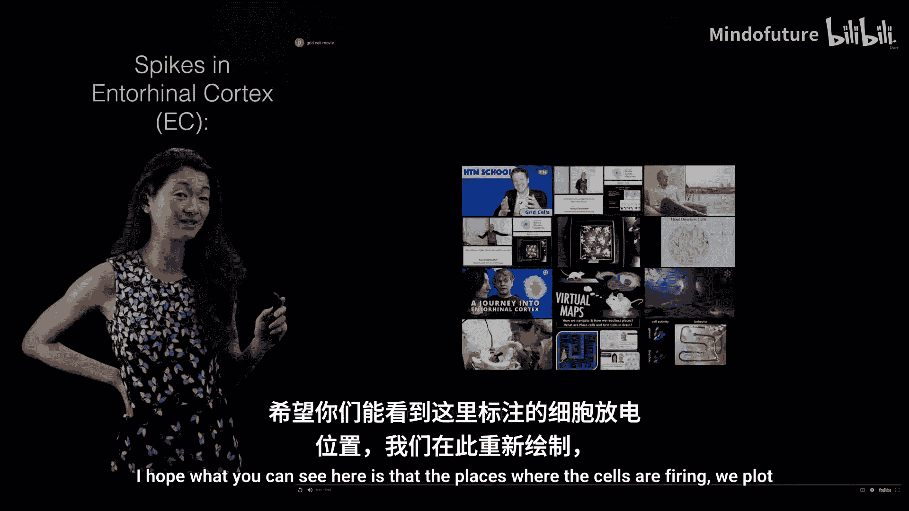
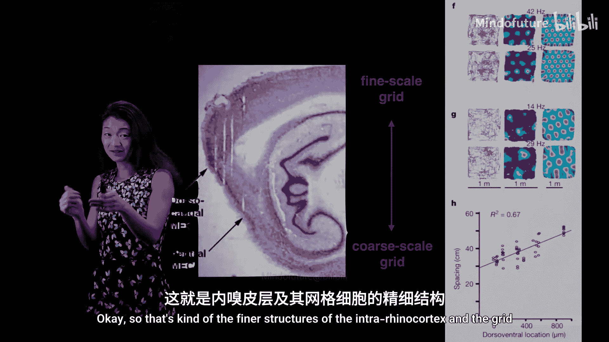
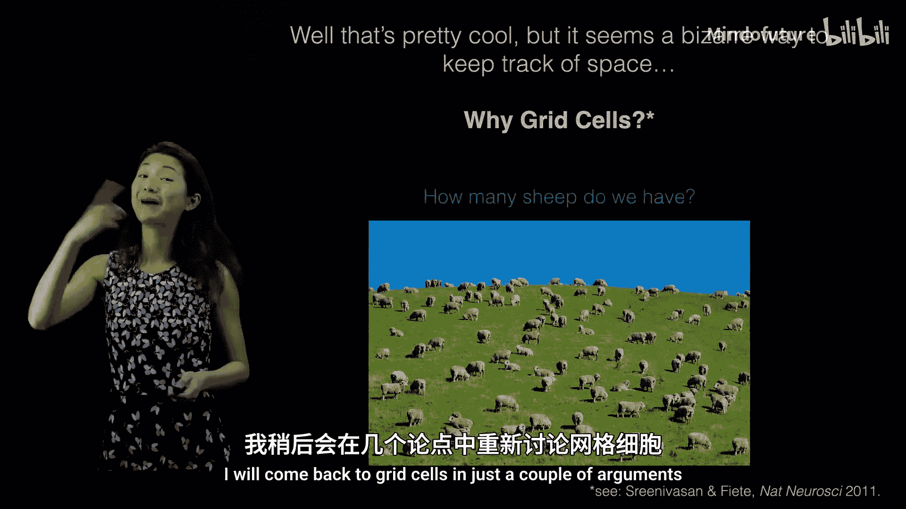
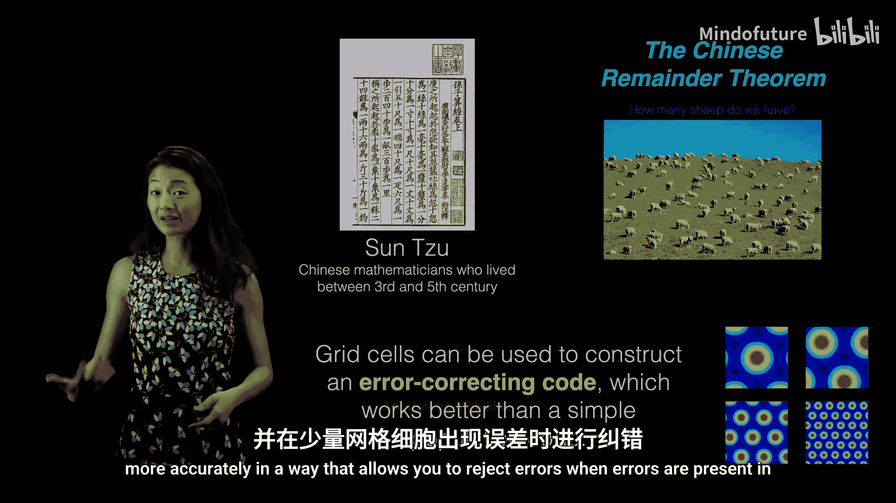
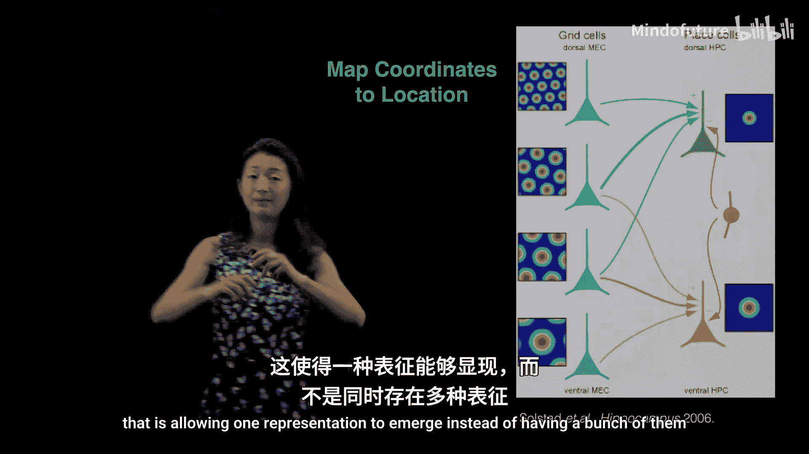
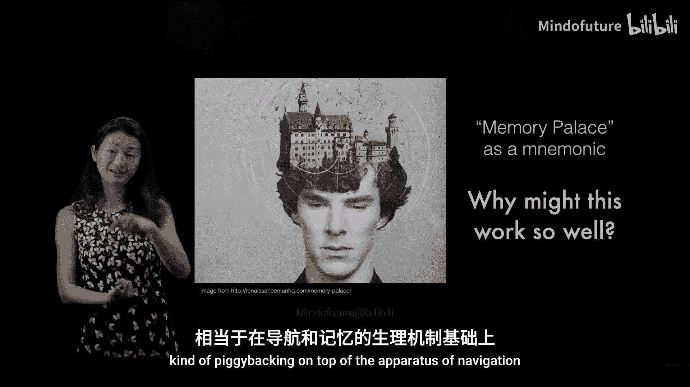

# 【华盛顿大学】神经科学入门 ｜ Introduction To Neuroscience ｜ Bing Wen Brunton p31 P31_内嗅皮层网格细胞 -BV1i3qWBXEDH_p31-

In the last video we learned about place cells in the hippocampus。

 which is a representation of where the animal is in some kind of spatial arena。

 but we left off at thinking about how the place cells got there。

 how does the brain in the hippocampus know where the animal is in space so the next part of this video we're going to try to peel that back a little bit and solve a bit more of the mystery by talking about grid cells of the interriino cortex now this story is pioneered by the work of Edwardardard and mi roser who went hunting after the observation that they were place cells in the hippocampus in Ca1 and so in this diagram here we're looking at is all the different places the Ca1 connects to and receives information from because after all the hippocampal cortex is actually pretty deep and high up on the hierarchy is not really receiving raw sensory information from any of the sensory modalities and so by looking at the places that projected into the hippocampus。

 the Mosers basically started to reason that this information about place cells must。

Come from somewhere and so they went hunting What you can see here is that one of the places that projects to this hippocampus is this part of cortex called Entorino cortex Entorino cortex projected dente gyrus dente gyrus also projects a Ca3 intertorino cortex has direct projections of Ca3 and it also has direct projections to CA1 so the Mosers undertook a series experiments where they systematically uplateed and surgically lesioned each little part of cortex that actually projected and gave input to the hippocampus and then watched for when the play cells disappeared and when they lesioned this place called the Entorino cortex lo and behold。

 they found that the play cells totally got mushy and disappeared。

 thereby reasoning that may something about how these play cells in Ca1 were constructed in the first place has something to do with Enino cortex so they went about with a bunch of their colleagues and recorded from interino cortex so when'm going to play this video which hopefully plays and we're going to watch what happens when a rat。

Is exactly same different exactly the same configurations before now this time。

 instead of having electrodes in their Ca1 in the hippocampus。

 this particular rat has electrodes in their intraino cortex。

 So you can see it running around in a box。 There's an experimenter。

 you can see their feet on the right hand side over there and they're sprinkling chocolatelet sprinkles into this box。

😊，Video now speeds up a little bit so that we can see what the rat is doing now again。

 every time the cell fires， this adduronnal cortex fires。There's a dot on the screen。 Now at first。

 what you see is holy moly， what is going on。 This makes no sense at all。

 It seems to be firing all over the place， right It's not localized at all。

 It seems to be firing everywhere in the box。Keep watching the video。

Something magical happens after a little while。

I hope what you can see here is that the places where the cells are firing。

Re plotud it again here。All of those red spots where I see spikes are in a grid。

 not only are they in a grid， they're in a hexagonal grid。

 much in the same way we see hexagons in other parts of nature。

 like the packing of spherical objects and the packing of honeybee combs。

 so grid cells are named grid cells because they fire in a grid。

Every time the rat is on the vertex of these triangular intersections。

 the cell fires and so when you know that this particular endino cell grid cell is firing。

 all you know is that it must be at one of these vertices so you don't know exactly which one it is but you know it's at one of these vertices Furthermoremore if you measured from different parts of inortroino cortex you'll see that these grids will persist but there are not the same size on a dorsal to ventral axis in the rat in the rat andtorino cortex what we observe is that there are grids that have different spatial frequencies。

 they have different lengths at one end of intertorino cortex。

 the grid is super small and really close together and as you travel along and go to the other end closer and closer to the other end of intertorino cortex the grid is kind of the same it has the same hexagonal structure but the spacing between the grid points becomes larger and larger and larger and so that's this piece of data down。

😊。

Here where you see that as a function of dorsal ventral location as you get more down the dorsal ventral axis。

 the sizing of the grid， its spacing between the grid points gets larger and larger well so fine scale grid to core scale grid and that's kind of shown here as a demonstration because you have a variety of grid cells that have different spacings。

 The other thing that's really cool about the organization of the grid in this intranal cortex is that neighboring cells that are close by tend to have similar spatial frequencies。

 but it has slightly different spatial phases and so you might be a grid cell that has a spacing about this big the cell next to you might have exactly the same spacing but rotate a little bit。

😊，So that's kind of the finer structures of the intratornal cortex and the grid cells that are in the intranal cortex。

 Now Mi browserser in my favorite dress that was ever made for the Nobel ceremony wore a grid cell dress that was designed by a designer Matthew Hubble and iss actually possible to go on Matthew Hubble's website and by various versions of herald that is inspired by the grid cell designed for the Nobel ceremony。

 So all of this is pretty cool， but it actually begs another question。

 So we know that there's place cells and that kind of makes sense because you want to know where you are in space You have these grid cells and we know that the grid cells somehow gave rise to the place cells。

 but why would you do it that way， why these grids it's really a bizarre way of keeping track of where you are in space。

 Why don' you have a grid system that has coordinates for something Maybe that's why it would have invented but grid cells are there and this is the way that nature does it at least in these mammals。

 these rats that we've been recording from and so why grid cells So here is a very kind of a handway but I think intuition building set of arguments about why we have these grid cells。

😊。

So I first heard about the story from a colleague Ella Fiet who published his paper and made the following analogy。

 and so it has to do with how we count sheep。Doesn't make any sense of you。 It's totally okay。

 I'm going to explain why the way that we count sheep is related to why grid cells are the way that we keep track where we are in space。

 Okay， so bear with me for a little bit。 I will come back to grid cells in just a couple of arguments。

 So first， we have a reminder about the remainder。 This is probably something that you last saw in great school and haven't really seen sense。

 I'm just trying to remind you what that's like。 Let's say you have8 Lego mini fake figures。

 and you want to share it among six friends。 So8 mini figures to share my six friends。

 That means everyone gets one。 and then you just have two left over。

 You can't really cut them in half。 There's no fractions here。 I mean， you can cut them in half。

 but you don't want to do that because who wants just a leg。😊。

Okay he like goodbye all that you have eight things and you can't really separate。

 you're gonna share them among six friends and so what you're going to do is you' everyone gets one and then there's two left over and so the way you express that as a mathematical equation is that8 divided by6 equals one with a remainder of two。

😊，The way you would write that in a more formal mathematical language is by saying 8 mod 6 equals 2。

 In other words， when you do 8 divided by 6， you get whatever the answer is and the remainder is to。

 Okay， that's the terminology，8 mod 6 equals 2。If it's nine mot6。

 it would equal three because the remainder would be  three and so on and so forth， okay？

So let's do the following exercise。 Let's say that I give you the following information。

 I have a number N， and you don't know what n is。 But I do know that n mod 5 equals 2。

 So n divided by 5 gets you a remainder of 2。And Mo 7 is one， and Mo 11 is2， zero。

What is the smallest N such that all three of these constraints are true。

I'm going to give you a couple of numbers to think about here。And the answer。

 if you just go through the exercise， reminding yourself remainders actually mean in the way that I'm writing it here。

 you'll realize that the smallest n that satisfy all of these equations is 22- 22 must be the answer for n。

 it's not the only answer， but it's smallest answer that satisfied this series of remainder equations。

This method of counting is also what is known as the Chinese remainder theorem。

 It has been variously attributed to many different mathematicians， and it's named after the Chinese。

 It's named the Chinese remainder theorem because one of the first records of its publication was by Chinese mathematicians Sanzu。

And it was， I don't know if the story is true or not。

 but I'm just gonna repeat it here because it's a charming story。

 It's a way of shepherds counting how many sheep we have because if you have two sheep。

 you can just go count your sheep 12 if you have 10 sheep。

 you can count up to 10 totally fine if you have a lot of sheep and you want to know how many sheep you have you go out there and then by the time you counted them you've already it's really easy to make a mistake when you counting up to a few hundred And so the Chinese remainder theorem was a way of counting how many sheep you have without actually counting to a very high number because people are bad accountinging to really high numbers。

 the algorithm goes the following way what you can do is say that you instead of one person going out and counting the sheep。

 let's send out a couple of different folks and have them all go count sheep but I'm going to have them not count how many sheep they are。

 but I'm gonna to have them count the remainder and I'm going say one person goes out and count the remainder of 7 So they're gonna to count 1。

2，3，4，5，6，7，1，2，34，56，7 keep counting。Come back and tell me the remainder They counted all the sheep all the way up to 7。

 Keep looping around。 the remainder is4。 Okay so they come back and say I counted the remainder of 7 and I count 4。

 The next person goes out and counts to 11。 So theyll count up to 11 and then one to 11 and then one to 11。

 They'll come back and tell me the remainder in the same way we could figure it out n by giving all of those equations of n mod a bunch of different numbers and what the remainder ended up to be you could find out and figure out how many sheep you had by sending out multiple people who are all counting out remainders of relatively prime numbers coming back reporting the remainder we can infer how many sheep are actually on the pasture。

 how many sheep do we own So in other words， this is a way of counting to a large number keeping track of something using a population code。

 the population be the number of people you sent out there to count the sheep with the remainders but it is an error correcting code。

 It has the property that if one person comes back with a remainder that doesn't really make。

Sense with everyone else's numbers is you know that they're probably wrong。

 but the other people are right because all of their remainders are concordant and consistent with each other。

 So grid cells kind of the analogy of why we want these crazy grids of different sizes to keep track of where we are getting space is that it can be used to construct not only a population code。

 simple population code but an errorcoring population code by knowing where the population of grid cells are firing。

 we can infer where the animal actually is in a way that is error correcting and is not allowing the error in any one particular modality to be propagated and end up having a wrong estimate where you are Now simple population code。

 we have seen this several different times already we talked about it in the visual system in terms of the population code the three different photoreceptors and how you have to know the population the activity of each of those photoreceptorss to figure out how much the wavelength of light actually is we talked about population codes in the olfactory system because you have hundreds of。

Receptors， they all respond to a bunch of different odors and so you have to know the population of how they're firing in order to know what is going on and which odors are actually present in the environment we also talked about population codes in the motor cortex in M1 in the lecture about motor control because that was a population code where each individual neuron in M1 doesn't actually correspond to something that's interpretable。

 it's not like one neuron to one muscle or even one neuron to one joint。

 nothing like that it was really the population activity。

 the the dynamic population activity of all of the cells in M1 that seems to represent a dynamic trajectory of the reaching or the set of kinematic tasks that the animal will be performing next and so we've already seen examples of population code before this population code in the entertorno cortex with a grid cells is yet another one that has this funky property that it might have something to do with a way that we can use the Chinese remainder theorem to count in the number of sheep you have more accurately in a way that allows you to。

Reject errors when errors are present in a small number of these grid cells。

 So the way that this would literally kind of work again。

 this is just cartoon would be the following。 You have these grid cells in the mediaolatorranno cortex。

 the dorsal ones in the rat are close together and then the ventral ones are farther apart。

 The analogy here would be that these are the numbers that we are counting the remainders of right So this would be like count up to 7。

 Tell me the remainder。 count up to 11。 Tell me the remainder。 count up to 19。

 Tell me the remainder and so on and so forth。 And by combining them。

And in their projections to the dorsal hippocampal cortex， we can form place cells。

 we can infer that if you add all of these together right if all of these cells are active at the same time then the rat must be in some place that is the coincidence of all of these different place the grid cells and similarly if you add together a different population of grid cells than you can then infer the rat is in fact in a different place I'm going to point out one more feature of this diagram here which is something that we have already seen over and over I told you about this in the context of the sensory system。

 but I also previewed for you that lateral inhibition is a really common theme that we see in a lot of neural circuits and you can see that in this diagram here as well these place cells have lateral inhibition place cells will inhibit each other right so if multiple place fields are all kind of active and one of them become slightly more active they will actually inhibit the other ones allowing one place field to emerge as the winner I'm here。

I'm not over here and in that way the place field come to a kind of a coherent representation of where it thinks the animal actually is。

 rather than having a bunch of different ideas， be active at the same time so that's a theme in the navigation system and in keeping track of the animals as a way of keeping track of where it is in space uses this idea of lateral inhibition just in the same way it is used in sensory systems to come to a consensus about what the odor is。

 or where the light is coming from， increasing contrast including consensus and figuring out the representation of what is happening in the real world in a way that is allowing one representation to emerge instead of having a bunch of them that are equally likely。

😊。

Okay so one more really cool connection here is the idea of a memory palace this is a trick that's used really commonly by people who professionals who memorize things and so for example。

 these are' these competitions that people would enter into where you get a shuffled random deck of cards of 52 cards in a player deck and it's shuffle is totally random and you'll be shown once what the ordering of the cards was like a seven of Jack and then two of hearts and et cea。

 etctera， etc cea and you have to just memorize after seeing a one time the exact ordering of this so a common way people adopt to be able to memorize something kind of arbitrary like this is a trick called the memory palace where they first associate every card with a place or a set of objects so for example they would say something like the ace of hearts is is a grandfather clock。

And so when they see the card， the of the ace of heart。

 they will then instead of trying to memorize ace of heart， so trying to memorize。

Grandfather clock as they are walking through an imaginary corridor and he's like， okay。

 I see a grandfather clock and the next card would be like， I don't know。

 two of two of club and the two of clubs is actually a green vase。

 And so the next thing they would imagine seeing in this virtual corridor is a green vase。

 And so you would say grandfather clock green vase。 And so that tells you the ordering of this cars。

 The reason this might work really well is because the way that your memory works in your brain is super well tuned for memorizing places。

 There seems to be all of these systems in your brain where they seem to have evolved with the capability of knowing where you are in space and what you have just seen and having this memory capability for space is something that animals are really good at because it is a key survival characteristics。

 animal that doesn't know where it is and doesn't know where it's going iss probably not going to make it for that long So this is a really important thing for the memory system to get really good at。

 So tapping into a system that your brain is。😊，Already good at to do something that is sort of artificial。

 I mean， like you know humans didn't involve to memorize a deck of cards。

 but tapping into the system that humans are really good at and lots of other animals are really good at is a really good way of using that as an mnemonic。

 kind of piggybacking on top of the apparatus of navigation and memory in order to perform a trick like memorizing a deck of cards。

😊。

