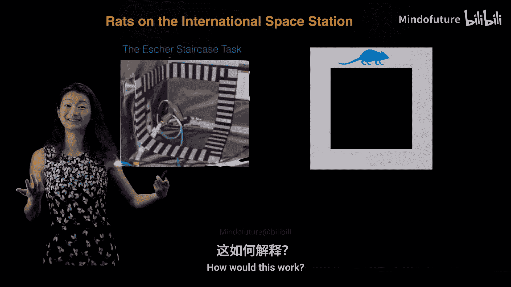
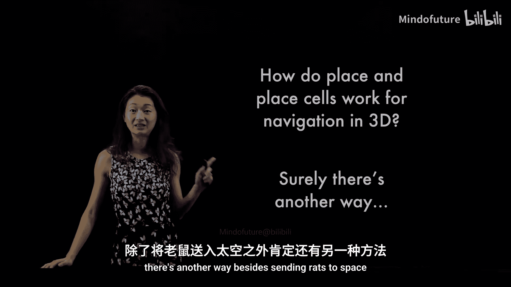
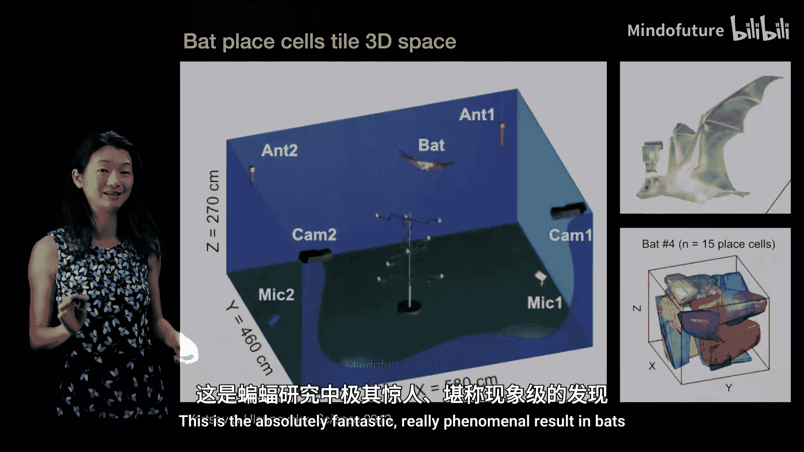
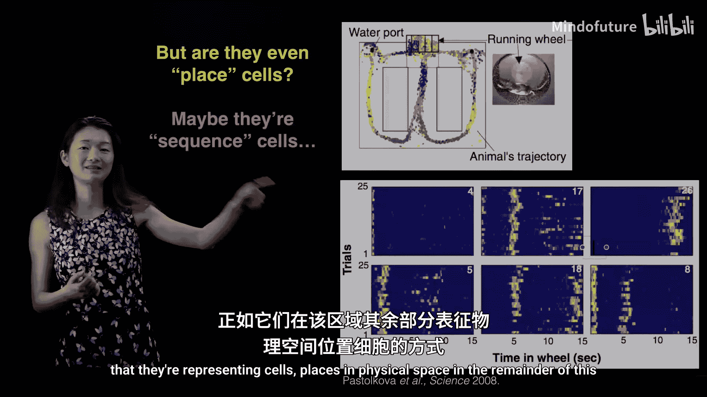
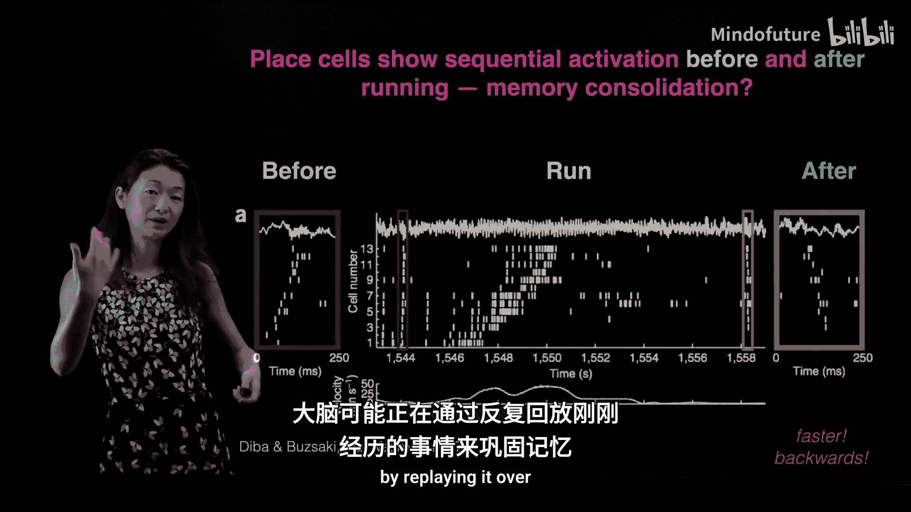
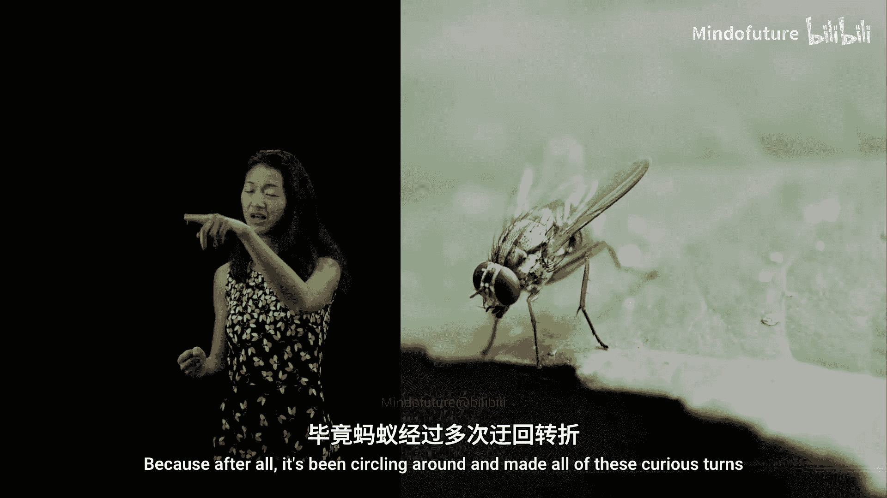
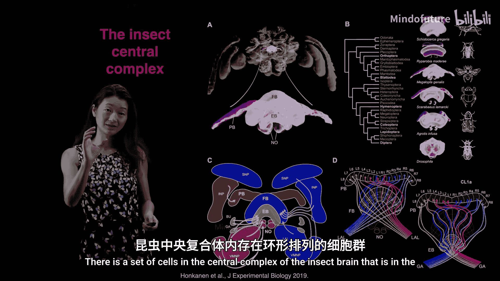
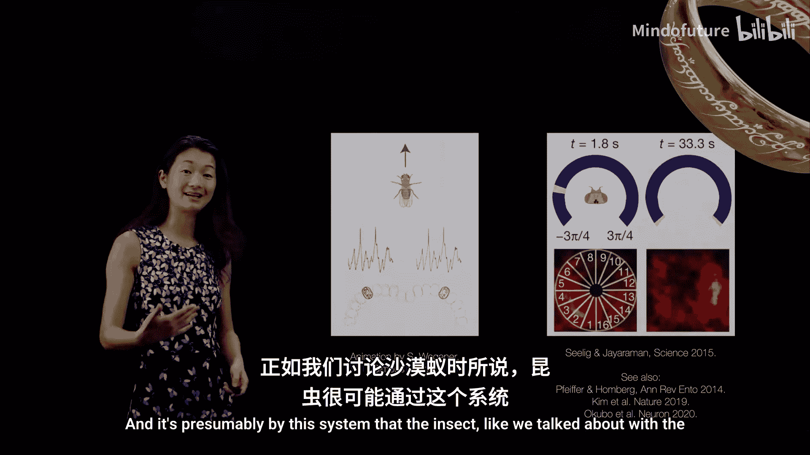
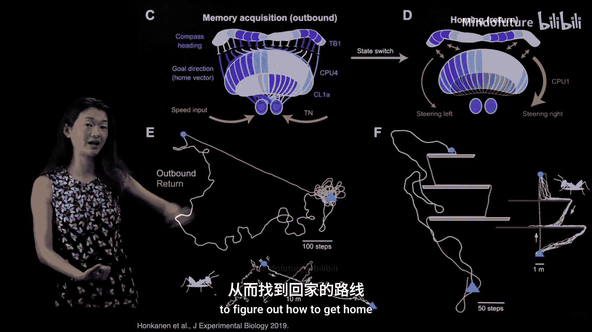

# 【华盛顿大学】神经科学入门 ｜ Introduction To Neuroscience ｜ Bing Wen Brunton p32 P32_啮齿类之外的记忆与导航 -BV1i3qWBXEDH_p32-

In the set of videos we've been talking about the neuroscience and navigation and in the last couple of videos we learned all about play cells of the CA1 in hippocampus as well as grid cells of the interrial cortex Now this is a lot of what we understand about navigation but it actually is not all the questions we have about navigation So in particular in this video I'm gonna go through a series of questions that might still have about navigation that are not well answered by the experiments where planting electrodes in rats and having them run around in a boxal chacoal sprinkles so it's some really cool stuff that people have done to really dig into this subjective navigation in really creative and diverse ways One of the first questions and we might want to ask is how does this work in threedimenal space After all animals very much do navigationvigating 3D space but they don't really do so as long as they're tethered to your heads stage and then running around a box of chacoly sprinkles so there's a set of experiments that was kind of a heroic and very very interesting set of experiments that involved putting rats on the international。

😊，SpSo I'm going to walk you through the logic of why this was done。

 what they were hoping to accomplish and a slightly tragic tale of what actually happened instead。

Let's start a two-dial space for now where you have a rat and is running around and let's say this kind of a linear track here we can run around on a square pedestal and it's on this platform and so what the rat can do is because it's going run around and it has representation from its space cells where it is on this track so if you are a rat and you're running around on one of these raised platforms on this track and you're walking forward what you're going to do is you're going to turn right one time。

Two times， three times， four times by the time you've made four right turns0 with 90 degrees each。

 you're back at exactly the same place。 So presumably your brain is somehow integrating this information that okay。

 so by the time I've made four right turns， I've turned completely around and I'm in the same place facing the same direction。

This is true as long as you're on flat ground。The reasoning for the proposal for putting rats in the International Space Station is that this is not necessarily true when you're in space on zero gravity because we can build what is called the Esher staircase task now bear with me this is kind of a mad experiment so here's the logic now in this Esher staircase task what they were imagining was the following if you build not a flat staircase right but one of these crazy esher staircases and let's say the rats started out right here in this corner I'm pointing to and they're going to go that way okay they're going to go this way they're going to go up。

😊，They're going to go and then go up， make one right left turn。Go over here。

 go all the way to the end， make the second left turn， keep going， keep going down here。

 make the third right turn now three left turns later。

 not far you're facing the right direction and in exactly the same place on twodimenal ground you have to make four right turns in Eher staircase task you only have to make three right turns end up in exactly the same place facing the same direction and so the question was how would a rats place cell system deal with this really crazy staircase and theyre try to try to convince the rats to do this in an international space station under zero gravity because otherwise gravity would be a cu of where it is on this box you can kind of you can do it like ra will walk wall to some extent where you can find some other animals that can。

 but the question was what would happen if gravity were not a queue and suddenly after three right turns instead of four。

Your head is integrated okay so it' 90 plus 90 plus 90 that is not 360 but I'm back in the same place How would this work that's the experiment and the experiment was a successful proposal and over the course of many years a lot of people worked really hard to actually put this up in an experiment that went to the international space station they sent up three or four implanted rats with the so the surgery was on the ground they went up already implanted they trained several of these very talented individuals there on the righthand side who are part of this experiment in rat electrophysiology so they can plug in the rats in and out and collected the data and they came back down and they analyzed the data and in a set of tragic accidents a bunch of the data actually got lost and then the other thing that kind of was tragic that happened is that when the astronauts plug the rats and their head stages into into their computers and they set them loose on the international space station in this esher staircase task the rats first they would sit there。

😊。

On this linear track， they would start moving a little bit。

And maybe you're not surprised at what I'm begun to say next。

 then instead of running on the airhore staircase， they just let go and floated around they went we。

Rats apparently really like floating around in zero gravity。

 They did not want to do this airstar staircase s。 so this experiment was a really wonderful。

 so such a creative idea that yielded surprisingly few results。

 This is one of the few papers I could find that was a publication of what play cells look like on the Ere staircase Act。

 This is literal data that was collected from a rat in Ca1 on the International Space Station。

 So for how much effort and probably cost All of this was It was probably a little underwhelming as a way of answering the question what do play cells look like in 3D。

 Now， what people should have realized and maybe was。😊，Obviously。

 in retrospect is that surely there's another way besides sending rats to space because there are mammals that are really good at navigating threedimental space like bats。

 bats are mammals that fly。 And I've shown you the coronal slices of a couple of different a couple of different hippocampus coronal sections before。

 we can see the characteristic kind of like curvy shape where there's a dente gers followed by Ca3 and Ca1 has this really curly kind of characteristic shape。

 Okay， it turns out that if you do the same thing for the bat brain。

 the anatomy looks remarkably similar on the right hand side。

 Well you see there is the hippocampus of an Egyptian fruit bat。

 it looks heck of a lot like the hippocampus of a rat Now here are mammals that naturally fly around。

😊。

And so in a series of experiments， the place cells of a couple of different species of bats were characterized now over the many years。

 technology kind of improved and so this is also a story of how technology has really enabled us to ask questions and new andc questions that were impossible to ask before the first couple of papers that came out it were place cells in these bats and they were done still in 3D but they were done with rats kind of hanging upside down on kind of a wire enclosure where instead of flying around because they still had to be attached with a wire。

 they were kind of crawling around still in the twodial space but hanging upside down and so these were some of the first place cells that were found in the hippocampus of a non rat organism mice have them too lots of people do play cells mice as well but that came a little bit later。

😊，What happened a couple of years later is that the technology for doing wireless recordings came online and this was a total game changer。

 especially for bat researchers， because now instead of having having been having to be tethered by the wire and potentially having this wire get horrendously tangled up anytime the bat flew around。

 you could have bats flying around more normally because the head stage does not have to be plugged in to a wire so in this experiment what they did was you can see the enclosure now is actually quite a bit larger than that little cardboard box the routes are running around in so this box is now many meters。

Cubbe and they put what is kind of like a wire frame version of a tree in the middle。

 hoping that the bats will circle around and。 that's indeed what they did in this arena。

 So if you do exactly the same analysis that was done with a place cells in Ca1 of rats and a flat and you do that analysis by characterizing the place field of Ca1 neurons in the bat hippocampus you'll see that this bat bat number four here has 15 place cells。

 so they were able to manage to recording this one experiment that together tile threedial space just in the same way that we observed place cells in the rat to tile twodial space。

 This is an absolutely fantastic， really phenomenal result in bats。😊。

You could also see that monkeys have representations of visual space inter rhino cortex。

 and so bats I haven't shown you a picture， but there are also gridit cells in bats as well because they're super quite similar to rats in many。

 many ways， except they just happen to be flying around。

Getting grid cells in monkeys was a bigger challenge。 Again。

 this was partially an experimental challenge because the rats are smaller creatures。

 And so the box you have to run have them running around in could be smaller。

 Where it's getting your recordings in monkeys has。But to the present moment。

 traditionally been done in a head fixed perhaps。 So the monkey is sitting still in a chair where they're restraining so they can't move around freely。

 And， and so they're really passively， not comp passively， but they're able to look at things。

 but you can't really。Record from interryal and the hippocampal cells of monkeys just freely running around The other thing is that they're very dexterous and they don't particularly like being plugged in and so there's always a risk that they'll kind of unplug themselves if they had the ability to use their hands to do whatever they want and reach the place on their head where your electrodes are actually plugged in okay so here。

Is a really cool experiment where instead of having inter intraal cortex representing a grid cells in physical space。

 where seeing grid cells in this monkey monkey visual space where instead of having to be running around in physical space it's actually looking around a scene So here we're tracking where the monkey is looking so each dot。

 the yellow dot is where the monkey kind of sco it to and stared at for a little while and the path between the different places where it's stared at is in this yellow lines right here and if you summarize this information。

 So the analogy here is that instead of having the monkey run around an arena。

 we're having it look around a visual scene。 but if you analyze the data in much the same way by looking at the path of where they looked around and then putting a little red dot where the cell fired。

 you'll see that there is a gridlike representation and it looks a heck of a lot like the grid cells。

😊，We saw in the intertorino cortex of rats as they were running around and so this way of representing space。

As we've seen now in these monkeys。Seems a hint at the fact that the representation that we saw in the grid cells in the place cells in the rat is not necessarily a kind of a navigation in space thing per se。

 because this is not a navigation in space， this is navigation of a visual scene and it really begs the question are the place cells even place cells at all。

 Do they have to represent something in place I it actually have to be a physical place in space。

 Now in this experiment still back to rats， but this is a really clever experiment in rats where they did the following instead of having the rats run around in the box。

 they had it run around on this figure 8 maze figure8 maze is kind of a glorified way of saying theres there's a raised platform and the rats were trained to just walk around this raised area。

 so you can walk around this side and it could also walk around this other side Now the trick is the following。

If you just had them walking around that raised platform。

 you'd expect that there will be a bunch of place cells in CA1 and that's exactly what they see。

 so each of those colored dots is the place field of one of these CAA1 cells and you'll see that there's a bunch of them。

 all the different colors kind of tile your space just like we expect so far so good， right？

But the rats are actually trained to do one more thing。

 They're trained that every time they go down the central arm of this figure it ma。

 they're going to go to the very top of it， and instead of turning and keeping going immediately there is a running wheel here and they are trained to go run there for like 2030 seconds and then keep going。

Okay。The clever bit here is that by adding this extra component of running on a water wheel。

 we have disentangled this idea of space per se from sequence of actions that get me to the place where I'm going。

Because when they're running the water wheel for these 10，15 seconds。

 they're not actually changing location in space， they're in exactly the same positioning space。

 but in the sequence of actions they have to perform in order to go around the figures and get their water reward。

 they have to spend that much time running in space in same place in the running wheel so if you look in CA1。

And look at the place field and the way that it tiles space。

 you will see cells that actually tile the time that it takes the rat to rerunning on this wheel。

In other words， play cells may not be place cells per se， but sequence cells。

 the sequence of actions one has to take and so this time your're there's a sequence of virtual places that rat is actually occupying when it's running around this water wheel。

 even though it's not changing places in physical space that is represented by a bunch of CAA cells in exactly the same way that they're representing cells places in physical space in the remainder of this arena。

Furthermore， even these sequence cells don't have to be sequences in space In this paper what they did here is instead of having these sequences be in space or even in time。

 they had to be sequences in sound by mediating it with a bunch of different sound frequencies where it's either changing sound frequencies very slowly or very quickly So without going into the details。

 the punchline of the paper is that see one cells fire in a sequence in a way that represents where you are in the sound that you are playing So if you' ever had that thing happen where you sometimes you hear the beginning of a song play either on the radio or you walk into a store and you hear like a tiny bit of a song that place and you immediately can fast forward that song in your head and go to like the last part of the song you can play in your head。

 it triggers a sequence of song that you can play in your head So that's sort of the analogy of what is happening here。

 I'm not saying the rats are literally doing that with the sounds。

 but that's kind of like what's happening。😊，There is a representation in terms of the sequence of sounds that the rat knows is's going to hear and it kind of stretches in space depending on if it's going more slowly or faster。

 and so CA1 cells that these canonical play cells may not be even sequence cells because the sequences don't have to be in space。

 they could be in time and they could have something to do with sounds also。😊。

So I told you in the beginning about the hippocampus and how we know it has something to do with memory because patient HM as well as a couple of other individuals with very traumatic damage to the hippocampi lose the ability to be able to form new memories and consolidate new memories but then I told you all about space cells and navigation and all all of this stuff and so the question is how do they fit back together so one of the biggest clues of how they fit together is this astonishing set of observations that show us that during the run。

😊，During the rat doing a task of some kind where it's running around in the world。

 there's this sequence of place cells that fire in a sequence right so this is the tiling of physical space that happens where all of these cells you can order them depending on so you're running first cell one fires and then cell two and cell three。

4， five， six， etcter， so they fire in this particular order corresponding to their place fields in physical space。

 this is what happens when it's actually running now what's happening here is if you keep recording from the same cells。

After the running session and you can also do it again and so there's also a corresponding before。

 what we see here is that place cells， the exact same place cells that are activated with these place fields when they're running are activated in the same order when the rat is not running at all。

I'm going to say that again because that's one of the coolest things I've ever heard of。

The same cells that represent the sequence of running when the rat is actually running has a virtual replay。

In exactly the same sequence。When the rat is not running。At the risk of anthromorphing。

 you can kind of think of this as the imagination， right。

 You can kind of see the rat is looking forward to what it's about to run。 It's replaying。

What think is about to happen in its mind before and after actually doing it and we think that this has something to do with memory consolidation。

 This has to do with how the rat experiences the world and a sequence of events and a series of places it's experienced in the world and what we also know is that of course consolidation after having a memory like going to sleep resting for a while。

 this is really crucial we have a lot of evidence in humans and learning for example this is a really crucial part of memory consolidation having the space to think about what happened and let that memory sink in a little bit。

 I know I'm using metaphors here but this is kind of like the neuroscience equivalent of being able to watch a memory sink in so you see that there's replay exactly sequential activation before and after running the other cool thing that happens after the running is that it's in the same sequence but it's actually backwards So instead of activating themselves from cell once a cell 13 it's actually activating it backwards from 13 first all the way back to one and it's being。

Re playeded faster it's not going at the same time so so in actual time the rat takes a couple of seconds。

 you know to run through all of the stuff to go from cell1 to cell 13 in the replay before and also the backwards replay after the running not only is it going backwards after it's also going way faster than it would actually happened as if the rat were imagining the sequence of events but imagining it faster and sometimes also recalling it backwards in terms of what happened in the past all of these again we can't ask the rat what it was actually thinking about like what were you thinking about when you had this backwards and faster replay event in the after consolidation of your run can ask it that but it certainly seems consistent with memory consolidation and how the brain might be consolidating the memory of what it had just experienced by replaying it over and over and over thus consolidating that memory in the sequence in which it was experienced。

Now that's all good for mammals， we've spent a lot of time talking about mammals and so I promise you we come back to insects and so we were coming back to insects because we started out this section of lectures by talking about the desert and how it can actually integrate evidence where it's been in the past to then really home in to the nest right after finding the food now in the stilt experiment we talked about in that introlect to navigation we talked about how the stilt experiment really demonstrated pretty convincingly that it was a pedometer that kept track of how far away the nest was。

 but I left as a question at the time how does it know the direction the nest was in because after all it's been circling around they made all of these security turns and so by the time it got to the food。

 how does it know in what direction to go home。

Okay it turns out that just like in the mammalian system。

 there is a system inside the insect brain that keeps track of which way the animal is pointing you can call these head direction cells。

 for example， and that's something that is present in the mammalian system as well。

The neurobiology was fascinating because even though the functions are parallel。

 the neural substraterate of it is entirely specific to the individual insect species。

 so a lot of insect species have a really cool part of their brain called the central complex。

 this is one of the more well-conserved parts of the insect brain。

 so lots and lots of different insects across many different orders of insects all have this central complex area and it kind of has this canonical circuitry and it also has a canonical shape and in a absolutely astonishing turn in neurosciences absolutely did not have to happen。

 there is a set of cells in the central complex of the insect brain that is in the shape of a ring。😊。

And the ring， its position of activity on the ring。

 which cells are active along the ring of the central complex is corresponding to the direction of where the insect is pointing the central complex takes in multisensor information so as a smato sensorory information。

 tactile information， propriocept information， wind direction information， smell， vision。

 all of it and integrates that into an integrated representation of where the animal is actually pointing right in other words there's one ring that rules them all and it is presumably by this system that the insect like we talked about with the desert ant probably integrates information from the speed input and also where it navigated with its legs as it's。

Doing the circuitous thing of searching for food so all of that information is probably being fed into this compass network in the navigation system。

 the central complex of the insect brain so that the animal knows exactly how much it has turned it has added up all of the turns it is made So in nodes which way it's heading And so by the time it's time to go home it knows exactly what direction the home is in So in the state switch from acquisition of this memory it's kind of adding up all of things so I turned left at two degrees I turn right by 72 degrees。

 whatever it is is adding it up and representing that on the ring attractor of the central complex。

 and then it can read out that output and use that information to figure out okay so now that I'm done I found my food home is right over there and I can then use the counting of the footsteps because this councils counted。

 how many footsteps is taken in each of those directions to figure out how to get home。

So that is a little short trip of kind of just a couple of cute examples of navigation working in diverse brains so we learned a lot of what we know in rodent species but there's a lot to be learned in a lot of different diverse brains as well because after all like we said in the beginning navigation is one of those foundational tasks at all animals perform because being able to move around in the world figure out where food is and go back to where home is。

 these are all things that we all perform and that makes us different than plants and how well we can do it is also something that's super important for survival and so that's why a lot of different solutions have been come upon by different animals that's solve it。

 but there's also some common things as well and so the common themes include keeping track of directions by figuring out where you are in space and keeping track of reor it seems that this is implemented in different ways in mammalian brains versus insect brains but even though the details of the circuitry are entirely different there's a lot of common themes that are involved so we're talking about memory。

 multisensory integration。Dality and then consolidation of memory after practice。

 so those are all the themes that we have talked about in the v set of lectures on navigation。😊。

