# 【华盛顿大学】神经科学入门 ｜ Introduction To Neuroscience ｜ Bing Wen Brunton p33 P33_Bing历史AI第一课_v1 -BV1i3qWBXEDH_p33-

Hi everyone。 My name is Be Bttont， and I'm a professor at the University of Washington to Seattle。

 It's hard to walk around nowadays without hearing about AI seemingly at every quo that we turn。

 It's a technology that was pervaded our lives， it's made our lives easier。

 sometimes more productive and sometimes just a little bit sillyier。

 Let's look at some examples So back in 20 2021 or so a set of technologies came out this is an early version of G or a large language model that's capable of writing text like humans do。

 So in this example we're seeing here is the first five lines is a famous poem that was written by a classic poet。

 Samuel Taylor Coridge the famous Xadu poem and the story goes that Courridge wrote the first five lines of this poetry and then passed out in opium Indu Stupor。

 And when he woke up yet absolutely no idea what he was doing and never finished the poem Here。

 G3 and product from open open AI。😊。

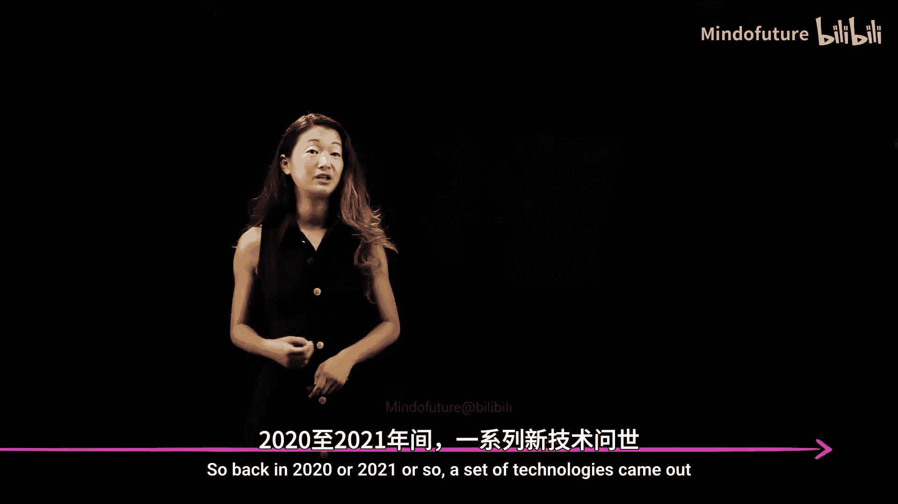

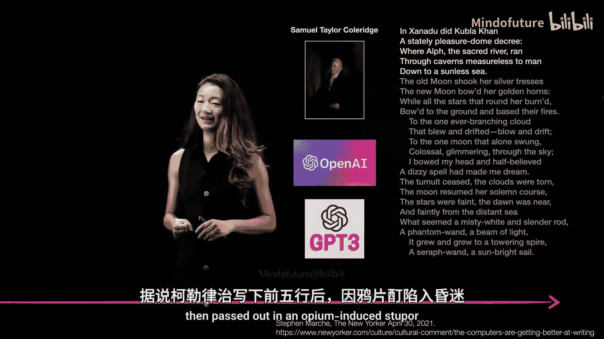

And finish the poem for him Now I'm not going to read the poem out loud， but if you read it。

 you'll realize that it's not great， but it's actually not bad。

 which is pretty remarkable given that it was written by an AI even had his turns of phrase the indentation works。

 and so this is really remarkable technology that came out around 20202021 or so very quickly afterwards。

 this idea of having AI that's able to generate new content that people have not been created before came out in the way of Dolly too and a variety of different generative image technologies of the same kind。

 So here's my favorite example of this， the prompt was a photo of a confused grizzly bear and calculus class so we all saw this flurry of generated images on the internet and it made things easier like making illustrations they made things a little bit sillier。

 and it also made it a little more confusing when you're looking at a photo or a video whether or not it's real or not。

 Of course now it's the year 2024 and so the technology。😊。

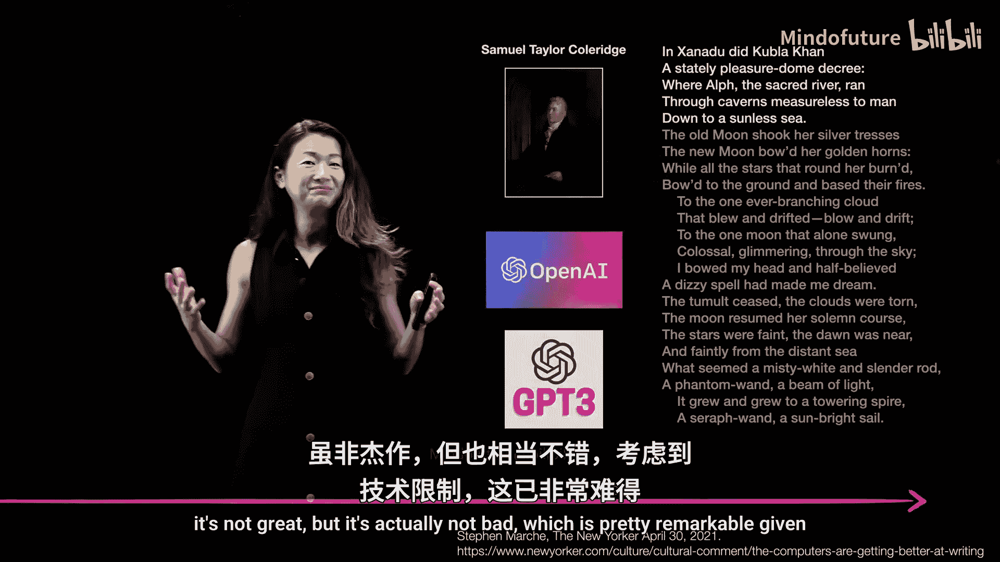

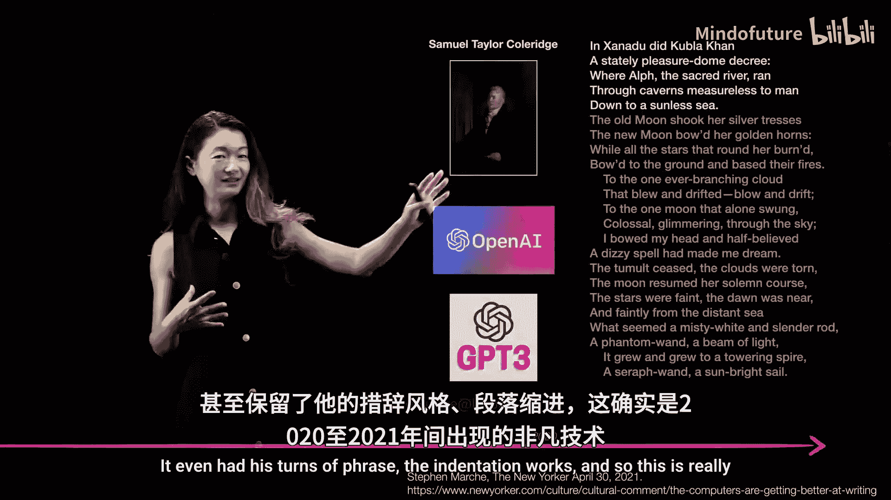

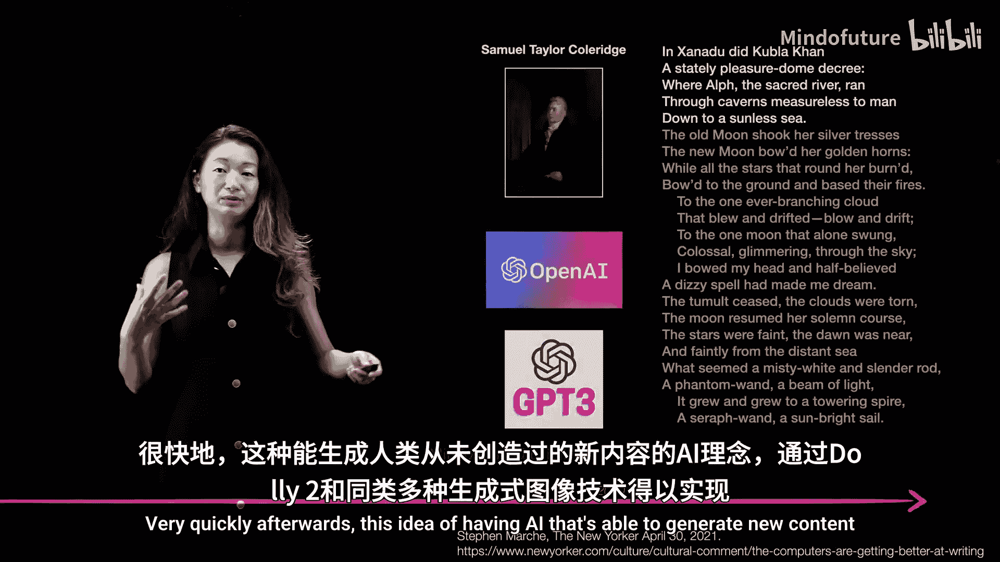

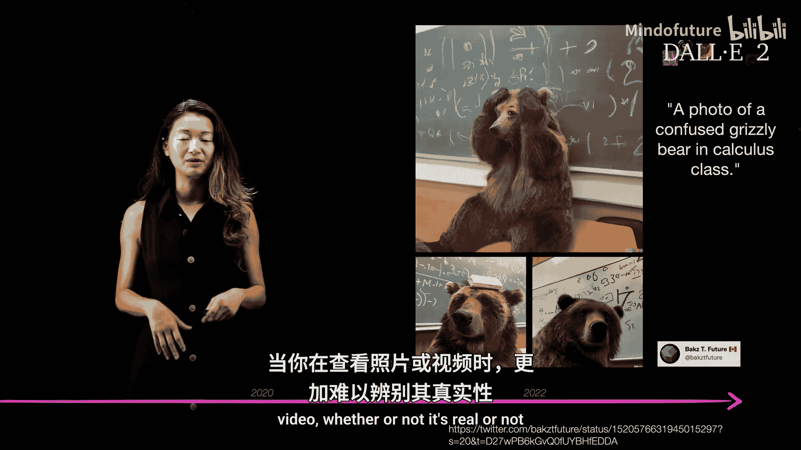

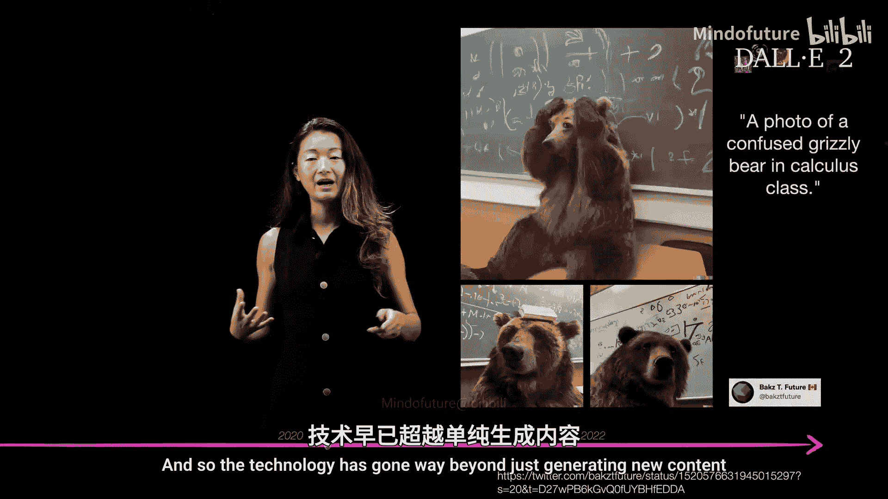

Ha goneone way beyond just generating new content， but generating interactive abilities。

 So here in an article written in the New York Times。

 the journalist Kevin Ross decided to make some AI friends as companions for a month and tried it out and he had meaningful conversations with some of the A is these AIs and and not with others。

 and the front that the we can do this。 if we take a moment and pause here is just absolutely astonishing。

 I think nobody could have really predicted that this is where we would be in the year 202410 or 15 years ago。

 it was I think a technology at the pace of technology has gone way beyond what many people had predicted So it seems by many people like this almost came out of nowhere。

 Like how did we even get here。 how is this the world that we live in right now。 Now。

 unless you've been living under Iraq rock。 You probably not only heard about AI but the phrase neural networks。

 And so what I'm talking about here today in the next set of。

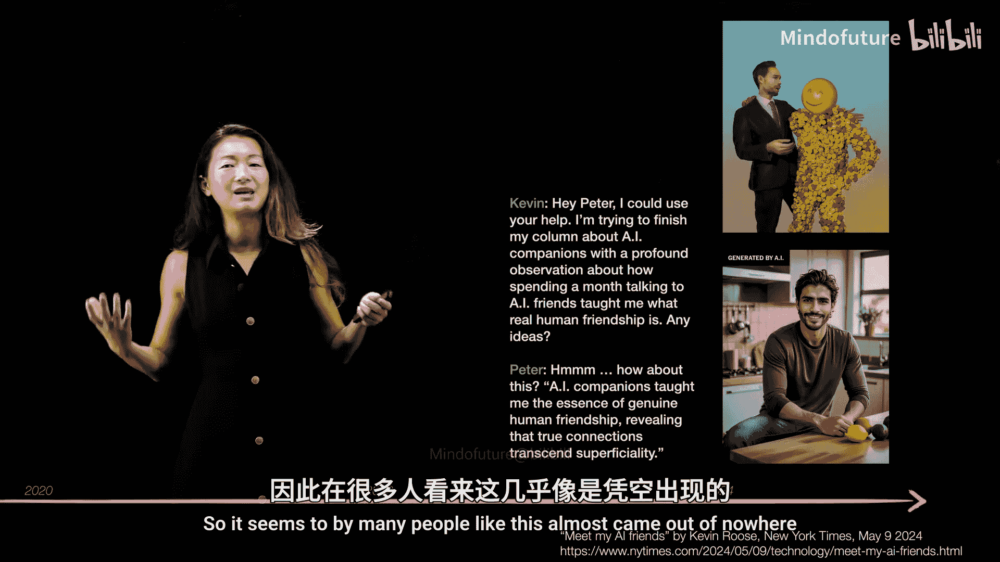

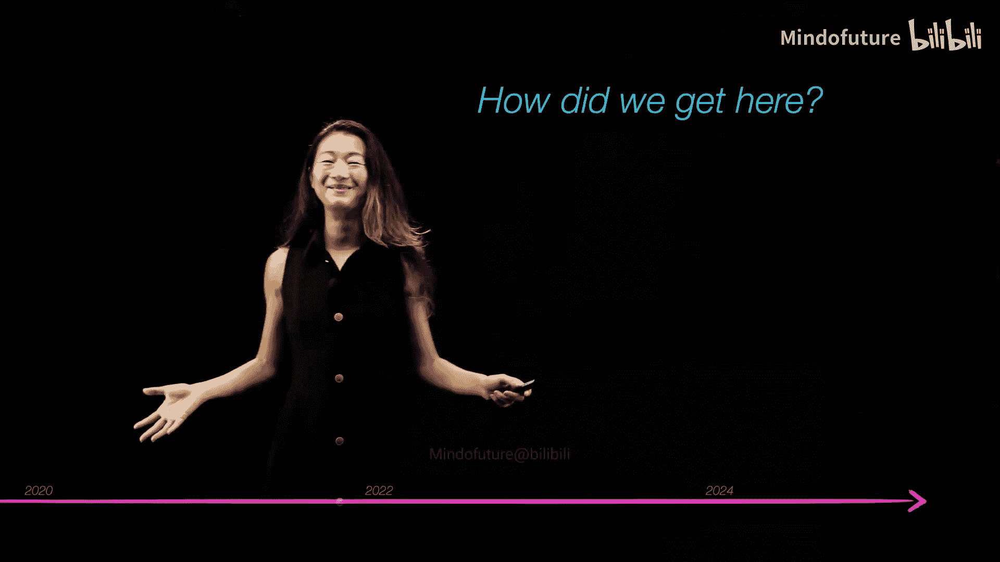

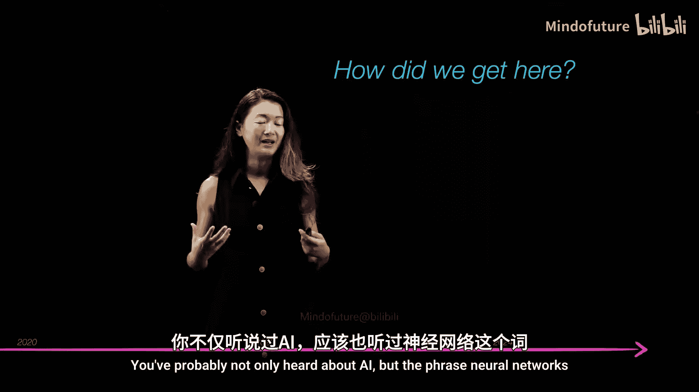

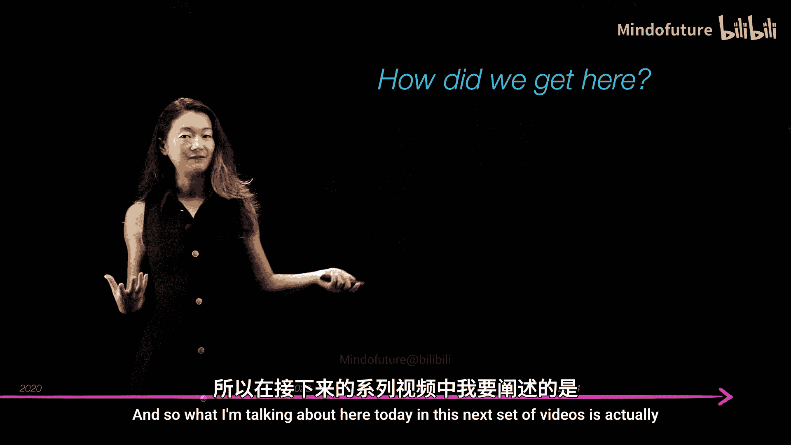

Videos is actually explaining why these neural networks are called neural networks why do they have something to do with neurons and brains this is not hyp in isolation this is not just a cute turn of phrase to talk about an artificial intelligence in fact。

 we're going to be talking about neural networks， minds and machine intelligence and the rich intellectual history going back over 1 hundred0 years at the heart of neurobiology。

 mathematics and computing and how all of these interdisciplinary fields have mutually informed and inspired each other in a really fascinating historical story of how all of this happened。

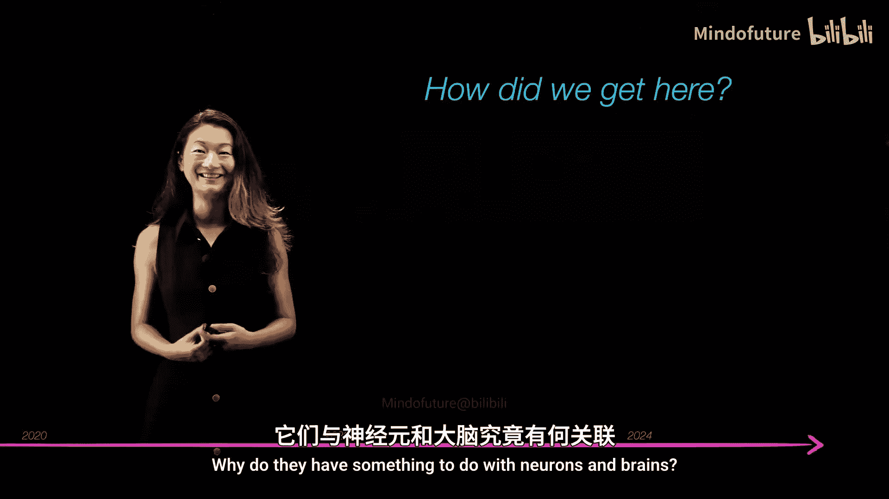

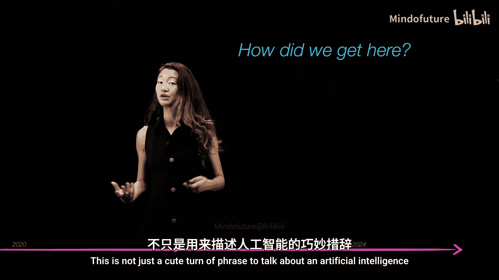

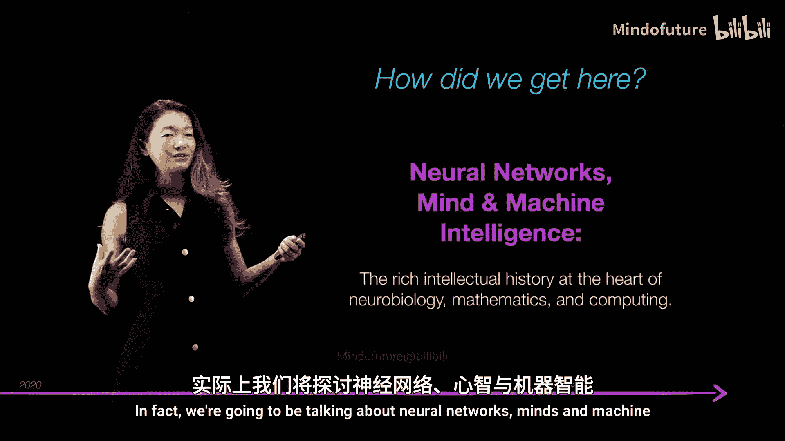

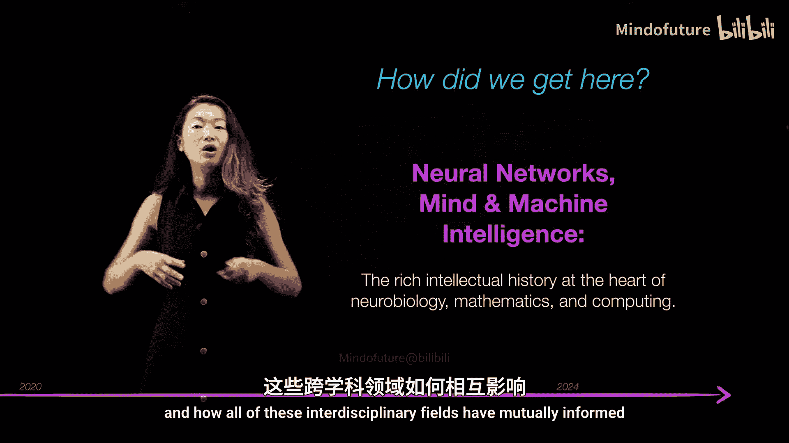

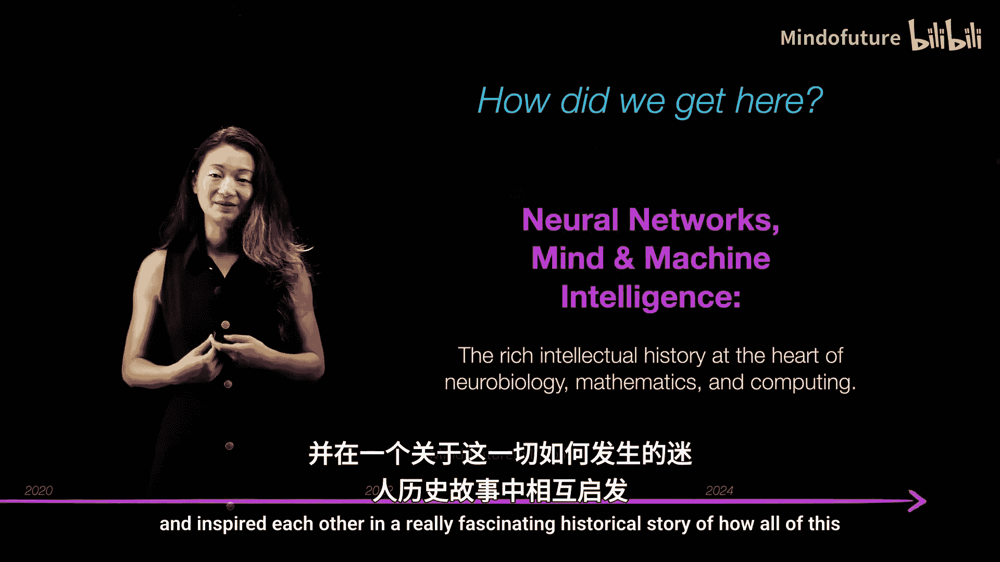

So if I me make an analogy here and this is something that I like talking about is a neural network in the way that it powers modern AI right now is kind of like if you built a facsimile of New York City but you built it in Minecraft It's pretty sophisticated。

 It has lots of the same parts as actual New York City but you sure can't get yelled at by a cab driverver as you're eating a bagel that's not something you can do in Minecraft so it has a lot is really sophisticated but it's also missing a lot of the complexity and richness and the things I make New York City actually in New York City。

 I'm going to take the analogy a step further and say that you often hear about neurons or neural units or nodes in a neural network So a neuron in the way that it's conceived of in a neural network an artificial neural network is to a cat as a picasso is to an actual cat。

 it capture a lot of the essence and features of a cat but it's really like just a sketch of an actual neuron And so what I'm going to be talking to you about over the next several videos is this idea that。

There's an interwoven history here and the history。

 as I've already alluded to goes back over 100 years and what we can see here is that as knowledge in neurobiology。

 a scientific discovery of how brains nervous systems actually work in humans and other related animals has progressed through the last century or so there has been a commenssurate amount of progress as inspiration goes back and forth between neurobiology and computing and mathematics in terms of how we eventually got to the modern technologies we have now in generative AI。

 these artificial neural networkss， that power things like chatTPT and Dolly and a variety of generative technologies like that so we're going to spend a little bit of time going through these technologies and the different scientific and scientific discoveries that underlie it for further reading a highly。

 highly recommend this book， models of the mind by Grace Lindsay there's a lot more details in there and reading this book has taught me a lot about this history as well so the plan going forward is。

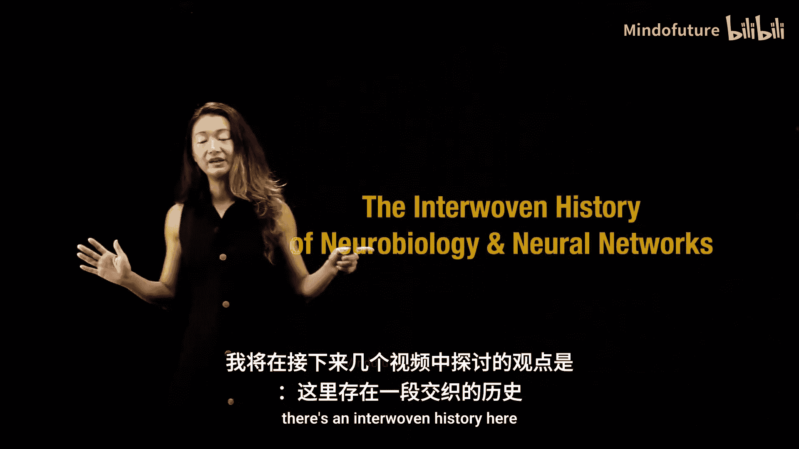

Here's the itinerary， here's going to do okay we're going to go through the early history of neurobiology。

 this idea that we even have a brain and brain is actually important in terms of how we think and there are four key insights in neurobiology that have percollate through and then eventually culminated in the development of modern AI and modern artificial neural networks and we're going to go through each of them I'm going to summarize them here and they are the fact that neurons can compute this is some kind obvious to us now that the neurons are computational machines it was not obvious back then and it was really revolutionary discovery and insight at the time。

 we then discover that these networks of neurons， not neural networks。

 networks of neurons can learn and adapt by changing their connections This is something that you can very much observed in yourself anytime you learn a new skill your brain and nervous system is capable of acquiring new capabilities if you experience them and the way in which biological learning takes place has also percolated into the theory of how we learn and train artificial neural networks in fields like reinforcement learning。

Now deep reinforcement learning。We know that brain circuits are not randomly connected。

 it's not just a ball of spaghetti， they actually have distinct architecture and so as a neurobiology。

 our knowledge of how brains have architecture， this architecture underlies the functionality of brains making it easier。

 more robust to learn things to survive things unexpected things like having a catastrophic injury for example these are insights that also percolated into the development of modern artificial intelligence and and and neural networkss as well and then finally at the end we'll talk a little bit about recurrence。

 the fact that there's one of this distinct parts of neuralarchit is that connections don't just go forward。

 they also come back so this kind of recurrence is an idea that is asiated in abstraction in modern recurrent neural networks and this is a really wonderful thing even though it makes things a little more complicated to train and learn because it implements memory and that is one of the key features of biological organisms we don't just respond instantaneously to the present we remember the past and we use our past and memory to。

Both form a sense of identity， but also to inform better decisions in the future。

 And it's very much a capability that we would like our artificial intelligence systems to have as well。

 That's why you can have a chat bot like a chat to BT that remembers your path conversations。

 remembers what you talked about yesterday and your trials and tribulation so it can be a better friend to you in the future。

 All right， So this is the plan。 I'm really excited to get started。 And let's get to the next video。

😊。