# 【华盛顿大学】神经科学入门 ｜ Introduction To Neuroscience ｜ Bing Wen Brunton p36 P36_Bing历史AI第四课_v1 -BV1i3qWBXEDH_p36-

So I left off the last lecture as sort of a cliffhaner。

 we got to the Rosenblt's perceptionceptron which was directly inspired by the way the biological neurons are capable of computing and it even implemented a rudimentary sort of learning algorithms so that the network can not only accomplish tasks it had also learn to correct from its own mistakes if you told it and to go in the right direction but then it hit a wall with the well-known extra problem funding was pulled。

 people were disappointed， things didn't really happen for a long time So what happened in this time since is that a small number of people toiled away and then kept working on this kernel of the idea of building artificial neural networks that are capable of doing certain things so what happened in the next three decades is that artificial neural networks was not popular in that most people didn't hear about it most popular certainly wasn't in the media no longer in the New York Times after Ronblt's promises were not fulfilled。

 but what。Is that neurobiology kept progressing， and so did the development of the computational mathematics of artificial neural networks。

So what happened in biology during those couple of decades is that people started being able to understand a lot more。

 not only about single neurons and how they function。

 but how networks of neurons are connected to each other。

 the architecture of the nervous system and what the computational implications of those things are So this is most well studied in the visual system people know a lot about others but I'm going focused on the visual system just because that also has the most directly connected in terms of inspiring the development of neural networks in artificial neural networks。

 and so in the visual system， you have neurons in your retina in your back of your eyeballs that are photo detectors capable of responding to physical stimuli such as a photons hitting the very back of your eyeballs So the circuitry of what happens after it hits the retina and the retina actually already has a bunch of neurons in it is that it gets passed on to a midbrain area called the thalamus in particular laterrogenic nucleus LGN。

 it then goes the back of your brain to the oipprotital cortex。

Right here in the very back of your brain， the1 stands for visual cortex 1。

The first place it goes and then it goes to a bunch of very creatively named places called V2 v3 and V4 etca。

 etc ce。 Now I will note that this diagram is a vast simplification。

 but this is sort of the picture that was emerging in those early decades when people are tracing these tracks looking at the anatomy of how the neurons in your eyeballs are connected to the rest of your brain and this is all in the very bottom of your brain just for simplicity's sake so that's actually a picture there of the bottom of your brain like if you took it out and then looked at it as if you were like staring up through your mouth that's what the bottom of your brain would look like it's really cool looking In fact it's really cool here because this is the optic nerves are actually cut off right here。

 these are your factory bulbs right here like right behind your nose。

 this is what's called the optic chaasm it's where the tracks。

 all the nerves from your left and right eyes cross because the left eye sees left and right he feels and it has to go to the opposite side of your brain Why acrosses like that really fascinating story that's a totally different topic but it does cross。

Okay， cool， so this is what's emerging in visual neuroscience at that time。 and furthermore。

 not only were people were doing track tracing and looking at the architecture of how the nervous system。

 all all of these neuro circuitrs are connected to other。

 They were also characterizing the computational implementation and computational implications of what each of these neurons at these different stages were capable of representing the technology that mostly drove this innovation at the time was what's called an extracellular reporting。

 I told you in the beginning about how neurons are electrically active。

 dont it's not wires and electrons these are movement of charged ions， sodium， potassium。

 for example， in and out of cells。 but nevertheless， that is electrical activity。

 And so we can use an antenna。 a wire stick it into the brain that does require brain surgery and be able to listen in on what cells are saying。

 We don't necessarily know what language they're speaking。

 but that's what people were about to find out in the 1950。

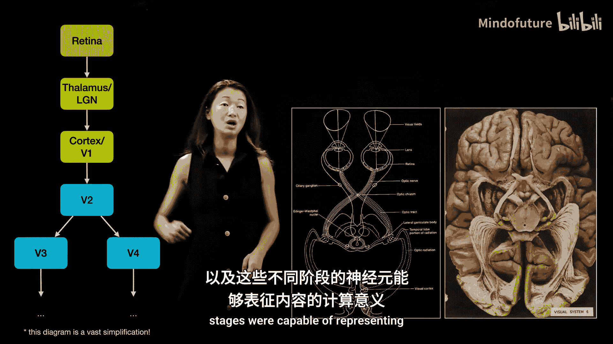

Cs in 70s， Okay， so a lot of technology development at this time that then accompanied much further understanding of what is happening in the visual system。

 How does it detect photon and how is that information being transded and understood into your perception of the visual world that is distinct from what would be gotten from a CCD from a photo detector。

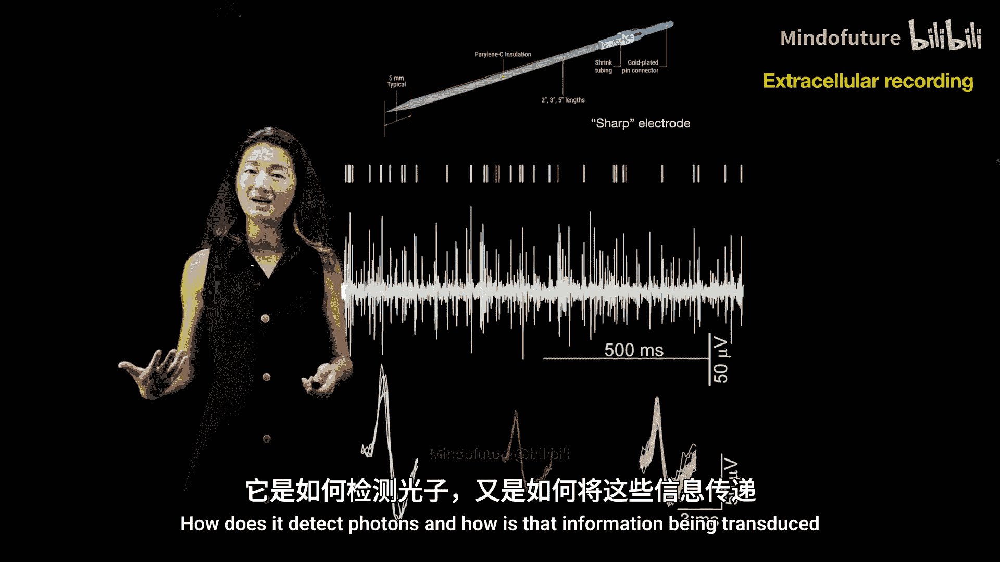

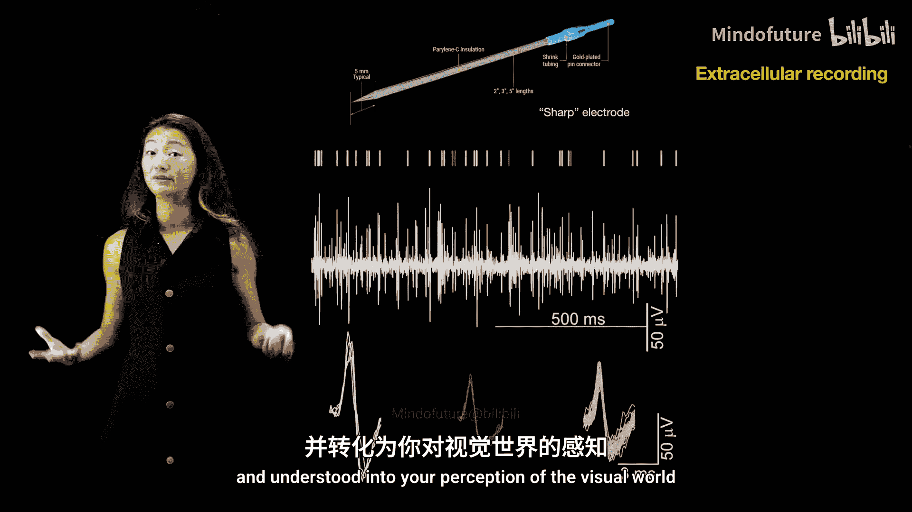

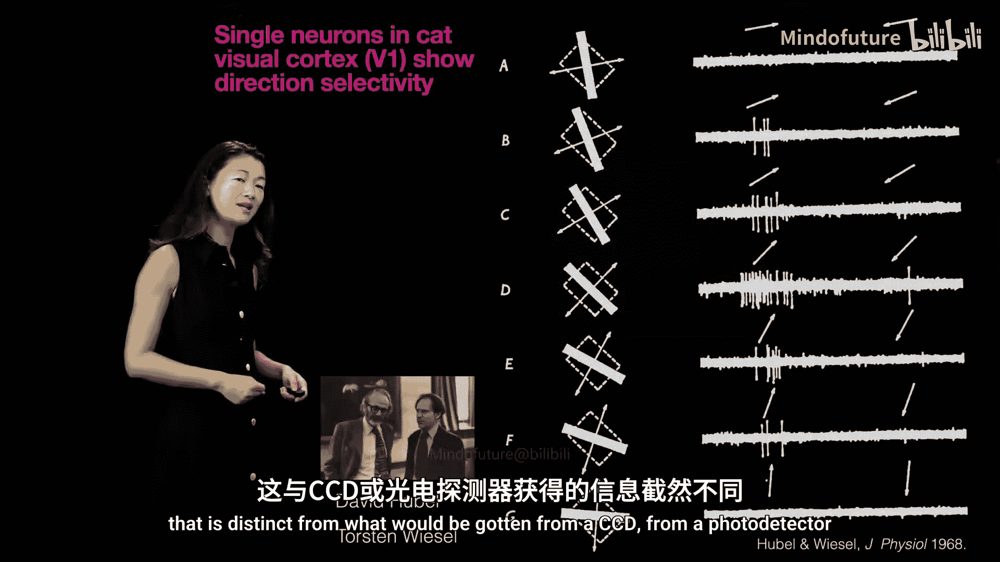

And so one of the key discoveries and this is a subject of a Nobel Prize by Hun and weasel is that single neurons in the primary visual cortex can already have pretty sophisticated computational capabilities。

 and so here's an early example of this one neuron in V1 of which you have like hundreds of thousands of them and it is able to detect a oriented bar that is moving in one direction。

 but not another， what we're looking at here is a trace by an electrode that's stuck into the cat's brain。

Of voltage as a function of time as it goes to the right and each of those little vertical lines here。

 that's one actual potential。 a single actual potential。

 So you can see here that this particular cell is talking a lot as long as the bar is oriented at this 45 degree angle and going up but the same bar going down made the cell not talk very much at all。

 and the closer the orientation of the bar is to that angle the more the cell talked。

 but not if it were moving in the opposite direction。

 So the computation here that underlies this direction selectivity is what was discovered in neurobiology and so people were doing recordings and making computational mathematical models of how this could possibly work And so this emerged the idea of what is called a receptive field which is that cells in the visual system。

 neurons in the visual system， they don't respond to everything and there's certainly nothing like pixels that's all I showed you that was directly sensitive to a moving bar。

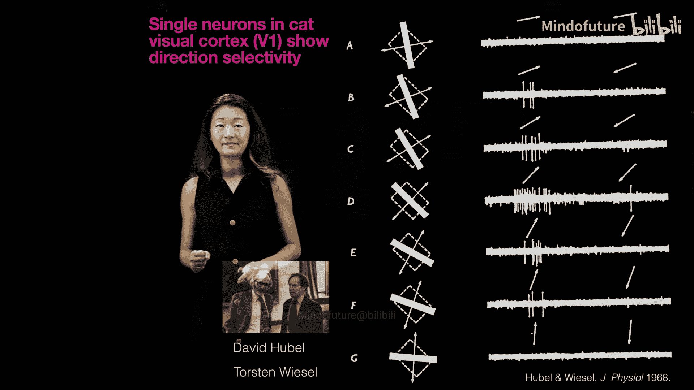

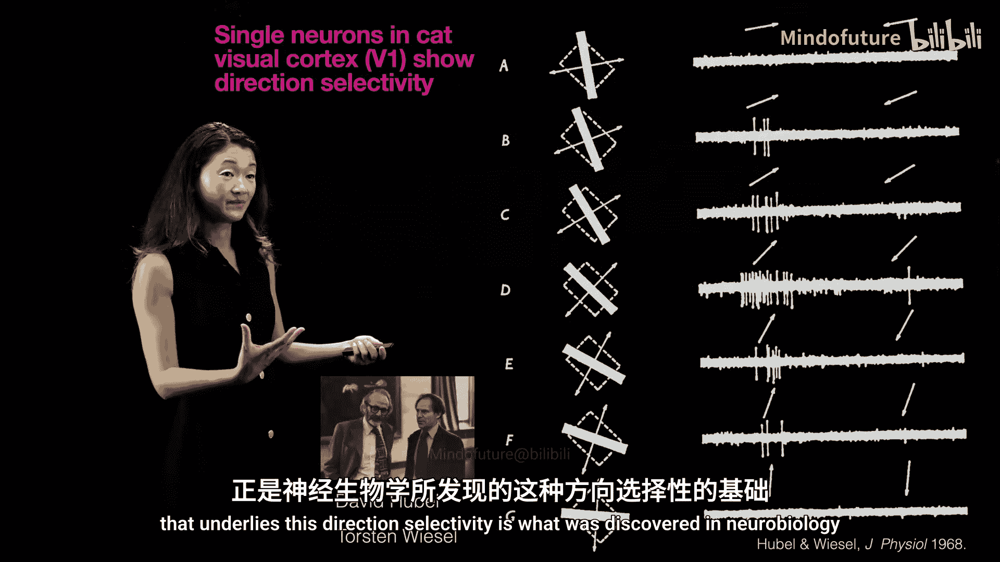

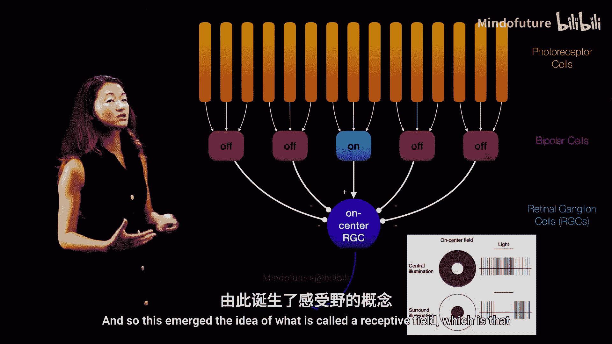

Not at all like a pixel that you would get off of a camera。😡。

And it's because the visual system is nothing more like nothing like a camera。

 even in your retina in the very back of your eyeballs。

 And so you have these photoreceptor cells that are capable of being active。

 they're activated that they can detect photons coming in and then there is already quite a bit of connection and a network just in the back of your eyeballs that's making computations。

 I'm going to simplify and walk you through some of the computations and the connectivity there show you how you can actually infer and model from the connection。

 the function of these cells。 So what's happening here is that there's a canonical circuit。

 the motif that gets seen over and over where the photoreceptor cells there's a bunch of them in the middle that gets activated into what's called an once。

 So the more these are active the more those are active and then it's surrounded by these off cells off cells are inhibitory and they all get summed remember addition subtraction summing into this what's called an。

cent retinal ganglion cell。 Now， importantly， this retinal ganglion cell is the only one that leaves your retina。

 All the rest of these cells do not directly talk to the rest of your nervous system。

 The retal ganglion cells， the only one that gets to say。 Okay。

 this goes to the rest of the nervous system。 And so by this architecture here。

 you can already tell the only way to get the retinal ganglion cell to say anything is that there's a spot of light in the middle。

 and there's no light on the surround。 So it's called a center surround cell。

 so if everything's active， it's actually， you know， they cancel each other out。

 So the most active that this retinal ganglion cell is capable of being。

 you can infer this from the activity is that if there's a spot of light in the middle of the correct size。

😊，And there's darkness on all the different sides of it。 So that's a on center field cell。

 If it were the opposite， if there's a dark spot in the middle and a light on the outside。

 that would be even worse， It would be even less active in that configuration。

And so this concept that you can infer this receptive feel。

 the function of the cell and that it's already summarizeizing the information from lots and lots of different inputs and making a decision and that this effectively it's a pattern matching。

 there's a little filter here that effectively convolves the inputs and then makes an output is a theme that we see in neural computationut over and over and over。

 this is basically the simplest example of it that we see in the retina。

 but this theme here gets repeated over and over。

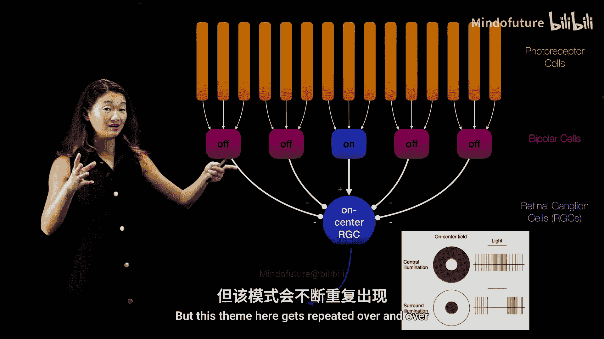

Okay so what we can see here is that is basically because that's one type of cell that exists。

 the opposite also exists what's called an offcenttinal ganglion cell where the it wants a dark spot in the middle that's surrounded by light Why do you want to do this Well it's actually really good for contrast and for change direction because you don't actually want to pay attention to everything that's in front of you equally you kind of as an animal would like to know when something is changing when there's edges that might be important。

 they might be trees， it might be predators and you want to know when things are changing in time as well and that's a different circuitry that' is responsible for that。

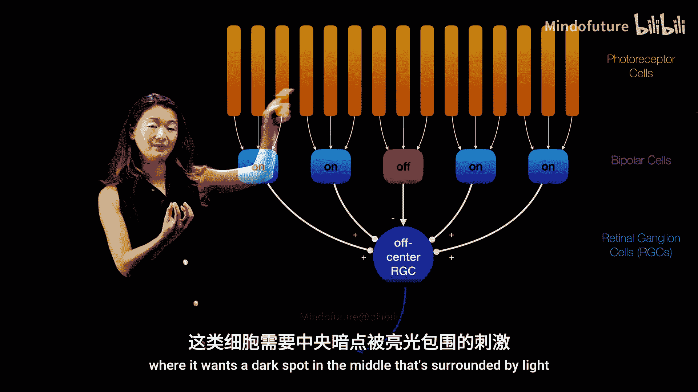

There's also what's called lateral inhibitions， so there's actually more cell types here that I'm totally glossing over and that helps reinforce this contrast selection。

 this contrast enhancing property of these retinal circuits。

 okay these are all filters that we can have in computers and Photoshop right but your eye already does it so by the time it leaves your retina。

 all of this is already done。

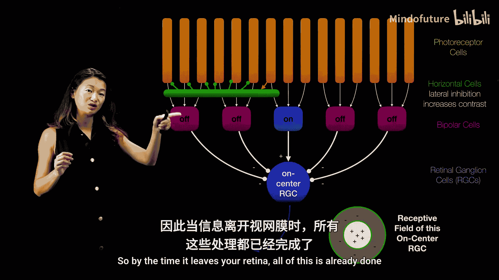

OkayThe consequence of this as we keep going down is that you have a bunch of these retinal ganglion cells。

 let's say they are a bunch of on center cells。 they then project the midbrain region in the thalamus called the lateralgeniculate nucleus and then they converge onto V1 and this is the known circuitry of the system people track traces。

 you can basically inject chemical tracers into these cells and you can kind of see where they go。

 this is where they go。 So retina goes to LGN and then they get a bunch of LgN cells and project onto the same V1 cell。

 V1 is where those direction selectiveive cells that he oweasal saw were now notice what's happening here is that if you do it this way。

 if there's a bar of light that hits the center of a bunch of these retinal ganglion cells。

 the V1 cell will turn on that will be maximally active。

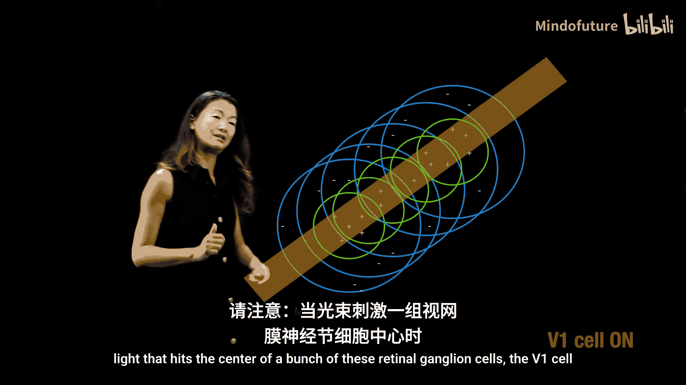

If it is a bit off， okay， then it's going to be off again。

 So only if the bar were right here and if it were at the correct angle。

Would the V1 cell be responsive so you basically both for yourself a convolution filter by the architecture and the connectivity of these retinal ganglion cells。

 Furthermore， if there is just broad illumination from everywhere。 similarly the V1 cell will be off。

 So it's really selective for a bar at this orientation。 That's the only way you can get it to fire。

 So that's the implementation of the convolution and what's happening here is that there's a bunch of convolutions。

 the convolution filters gets into the thalamus， and then they converge once again。

 So memory's already converging that goes on here， for the receptors horizontal cells goes to those things。

 you come evolve again， there's a pulling here。 I'm using these words on purpose。

 And the reason I'm using these words on purpose is because this is directly what started。

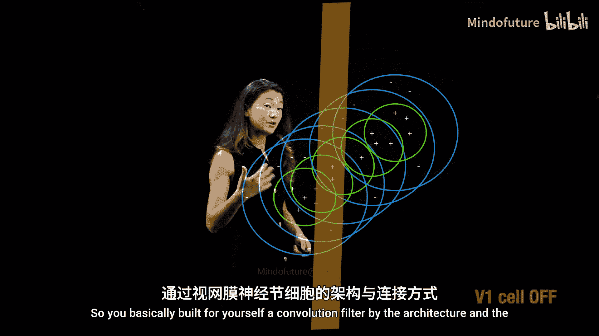

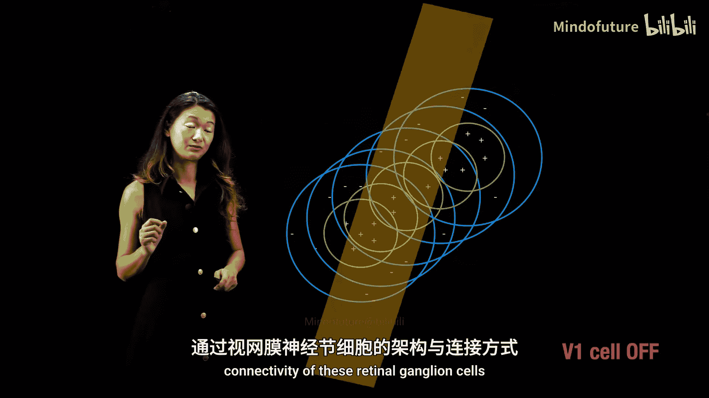

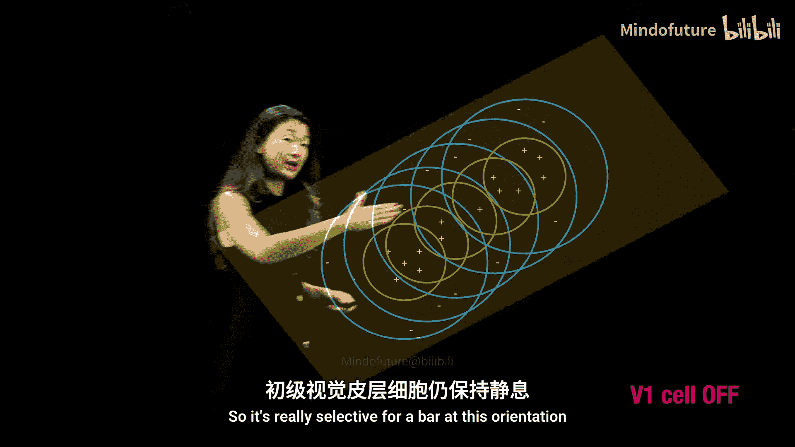

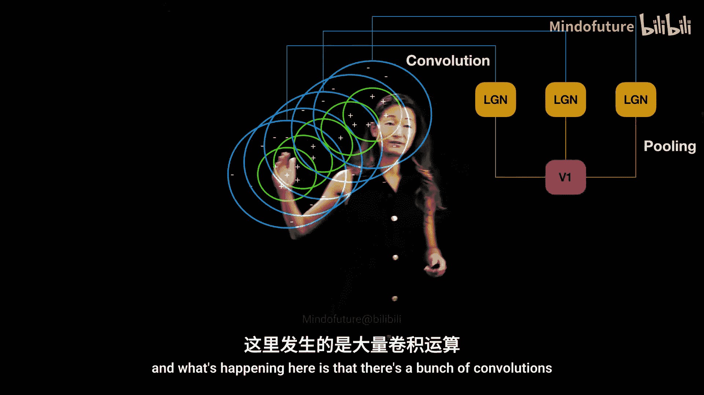

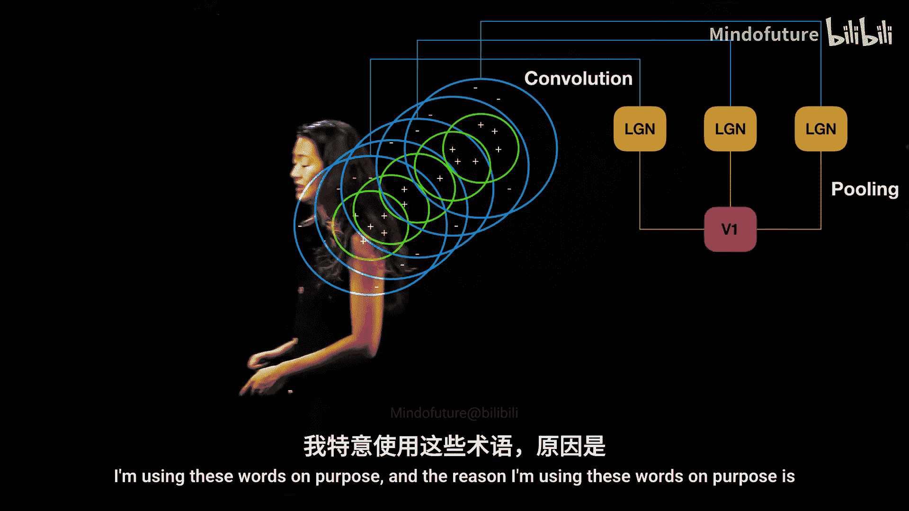

What inspired the first generation of convolution neural networks。

 The first convolution neural network is CNN。 This is a thing that underlies all of image recognition。

 Okay， this is a thing that recognize faces and calls out people's names。 This is the。

 this is the technology that makes us so you hold up your phone camera and immediately recognizes people's faces and even suggests that。

 is that your friend look over there。 This is it。 Okay。

 this is the first one that was ever built by Fukushima back in 1980。😊。

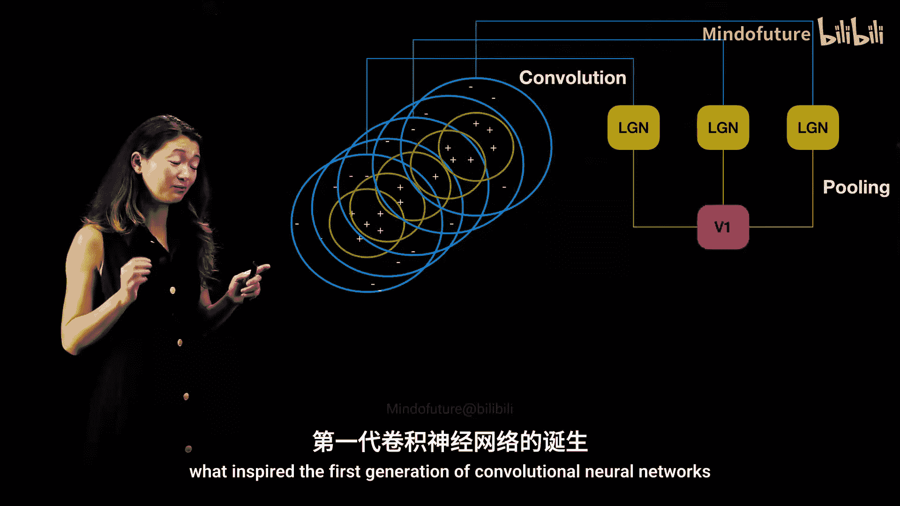

He was still working on it， even though lots of other people had given up hope。

 Fukushima did not give up hope and inspired by the insights were coming out of visual neuroscience around those couple of decades about these like pooling and convolutions。

 the different types of cells that had been described in V1， he built this architecture。😊。

It had multiple layers。 so with likeco perception in that it had units that were neurons。

 Each of these had many neurons， but then he had layers of them。

 And we know that he was directly inspired by visual neuroscience because he called these layers。

 S and C S is for simple cells and C is for complex cells。

 these were the cells that happened described in V1 around the time when this came out。

 And so this was directly inspired by the insights that were coming out of visual science and people trying to figure out how it is that your visual cortex works and how is it connected and how is it able to detect things that are happening in the visual scene like it is。

 okay now that's all well and good。 But I wanted to point out something that is super interesting。

 at least to me， which is that I told you before that this diagram is a as simplification。

 if you trace all the neurons， this is this does happen。

 these neurons do talk to those and they talk to those and they talk to those and they keep going and so on and so forth。

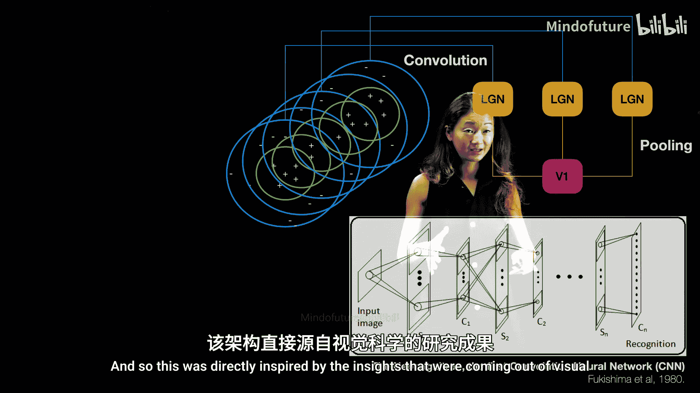

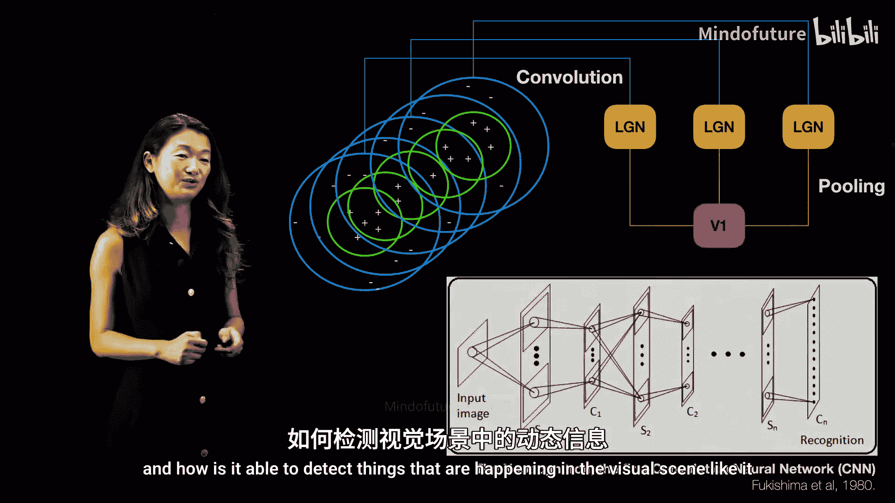

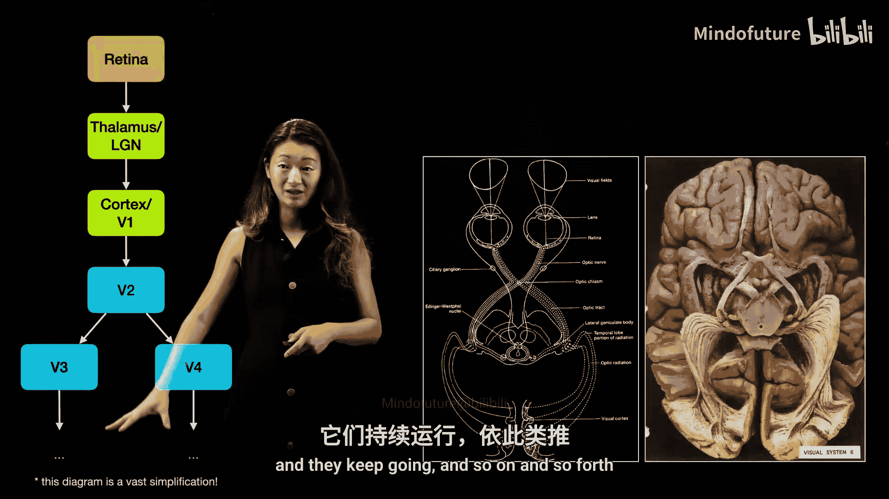

But the reality is quite a bit more complicated。But we're gonna to ignore that for now because like I said in the beginning。

 all we really want to do is we want to be Picasso。

 Everyone to be Picasso right when we' look at a cat and be like you know。

 we're not going to draw every hair， it's not actually important we're just to skip over it and only draw the things that captured the essence of the cat so between 1980 the first Necognaron the first convolutional network that was made and down here to 2012 with Alex Ne 2012 is when I would consider this to be the beginning of the modern AI age between 1980 and 19 and 2012。

 approximately 30 years a lot of things happened but not very quickly but here a couple of key things that happened。

 Y Lacoon at all published well Laco'snet capable of solving problems like handwriting recognition this is a version of the convolutional neural network and he developed also a algorithm。

A really， really efficient algorithm for training neural networks that we still use today。

 the concept is called back propagation and then in 2009， Feiei Lee and colleagues。

 they decided to collate the most gigantic at the time collection of data about natural images。

That they found on the Internet， But then they did the work， the really。

 really hard and needed work of collating it and labeling it。

 So the availability of the CNN technology， this idea of having multi layersers of architectures。

 of convolution and and doing that many， many times stacked in a row。

With an efficient algorithm for training convolutional neural networks。

 some mathematics and computational insights had to be worked out。

 and then the availability of the largest data set that was high quality and curated of images at the time。

 that came out。All of that had to happen along with the development of GPU technology。

 so graphical processing units at at the same time。

 these couple of decades were just getting stronger and stronger and getting more and more better。

 faster， smaller， cheaper。And that was not driven by science。

 it was not driven by obscure scientists toiling away at conferences that were not nearly as well attended now as they are now。

😊，But that was driven by the video game industry and so at that time。

 this has also been called the hardware lottery hypothesis， all of this would not have happened。

 would not have culminated in the success of 2012 if the algorithms。

 the insights were neurobiology and the hardware from the video game industry hadn't all converged at exactly the same time to make this insight possible。

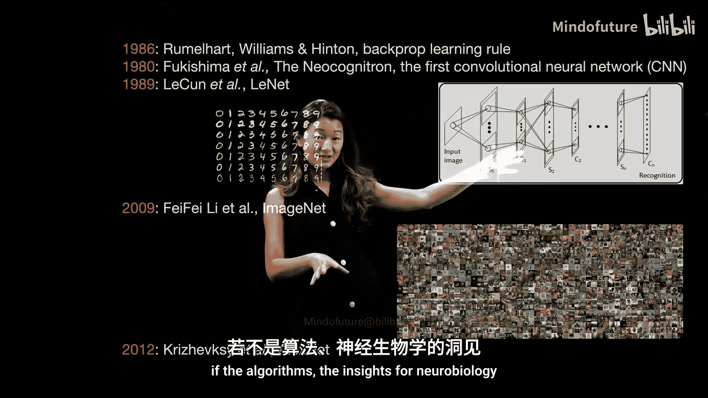

And so in summary， what happened in these 30 years was that a lot of things to happen at the same time。

 right， We needed lots of data。 We needed a lot more compute。

 We needed better network architectures and better optimization algorithms。

 After all of that happened。 The rest essentially is how we entered the modern era of artificial neural networks。

 After 2012。 Alexnet essentially blew every other image recognition algorithm out of the water。

 Like it wasn't even close you go to these conferences and year after year。

 sometimes the best papers like 0。1% better in the previous year。 And so people were making progress。

 learning things， doing lots of great work。 and then neural networks came along after all of this。😊。

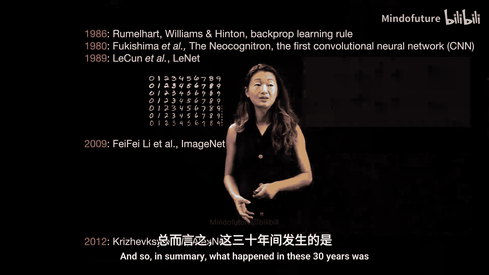

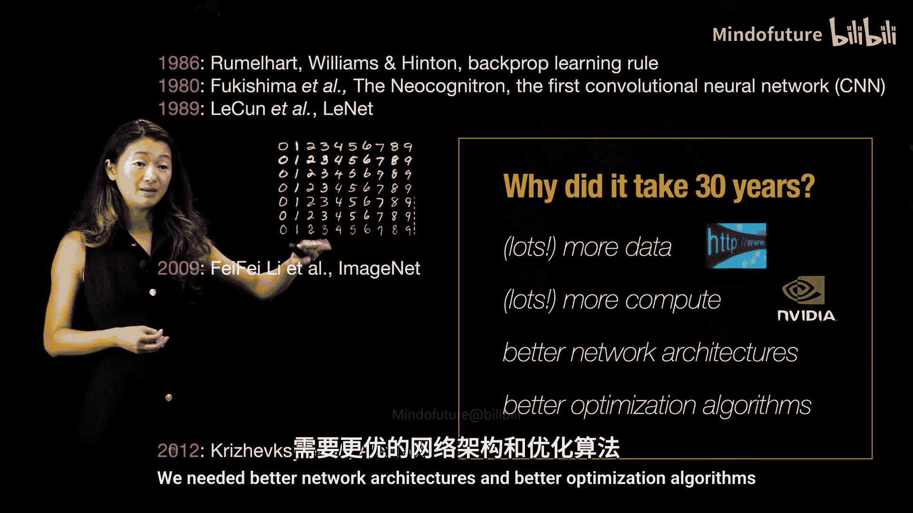

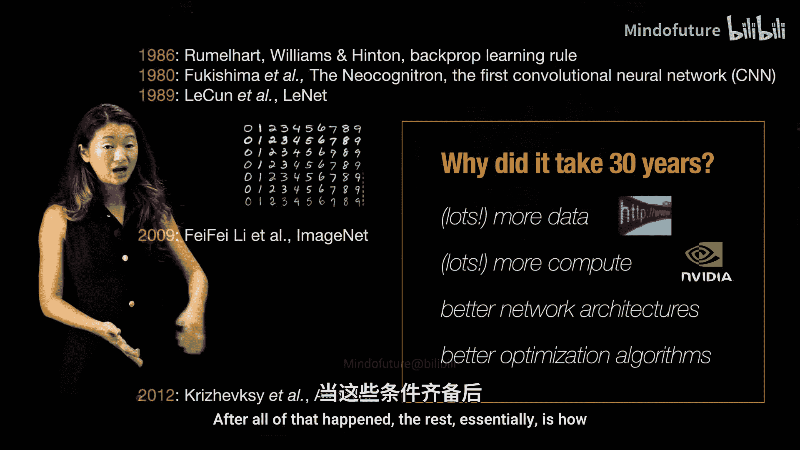

And was just way better than anything else than anyone else is doing。 And within a couple of years。

 no one else in image computer vision was doing any type of research besides neural networks。

 Everyone else had to pivot and abandon what they were doing and work on neural networks instead。

 because it was just a way better approach to doing computer vision and now lots of other things but I did want to point out that it took 30 years。

 and it took 30 years from the first CNN and it took 20 years before that before the modern convolutional neural network came from the first perceptron so it took a really long time。

 but the history was there。 the groundwork was there。

 and it took a lot of work by a lot of different people who were communicating who were talking to each other and who were taking inspiration from biology as well as contributing new tools for the understanding of biology for all of this to culminate in the story that starts the modern era of AI in 2012。

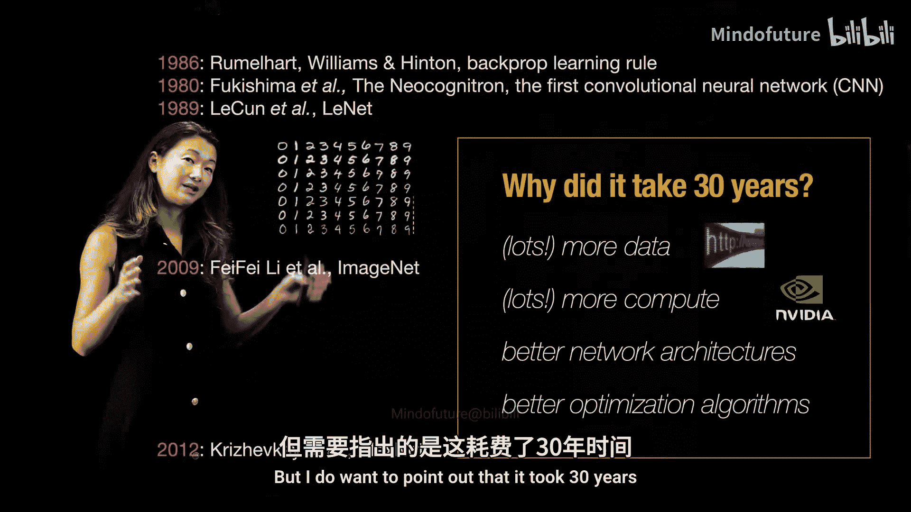

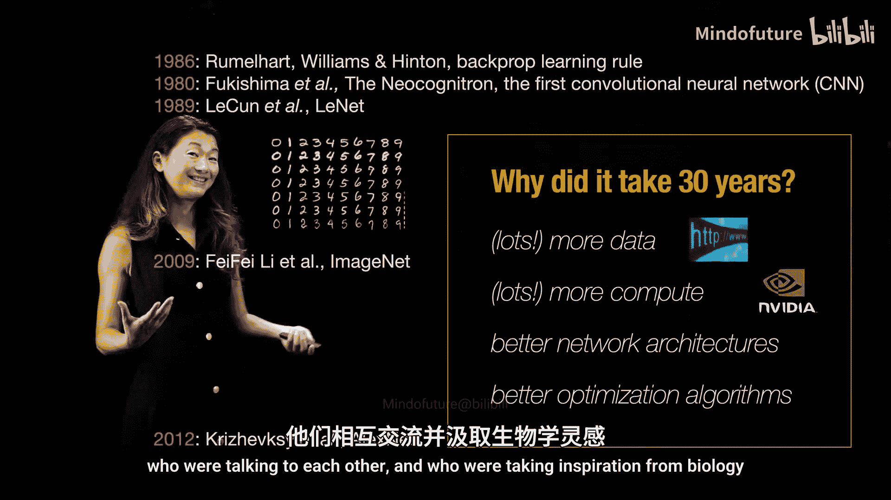

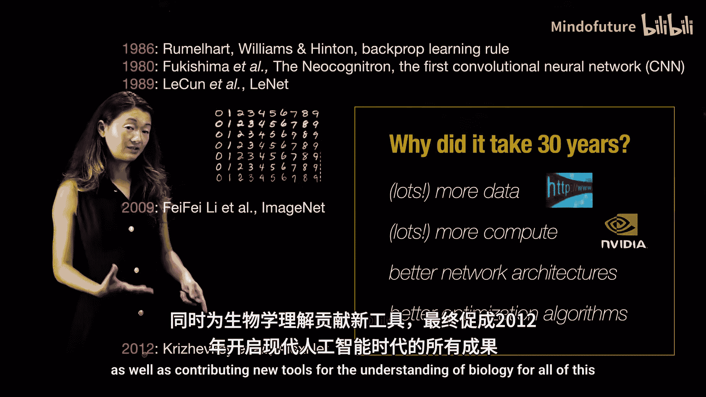

So we'll go into it a little bit more because the story is actually a little more interesting than that right We talked a lot about inspiration from neurobiology to the development of convolutional neural networks。

 but then people start looking at okay so what the heck are these convolution neural networks doing and it turns out that that had a lot of coincidence in common with the not only the architecture and the connections of the visual system but what the early visual system is doing as well So we talked about how the retina goes to the LGN LGN goes to the V1 and what happens when you have all of this pooling all of the convolution and pooling is that you go from detecting spots to detecting to detecting spots of light with contrast and you can put those together to detect bars and then you can put those together detect oriented bars that are moving stuff like that right it turns out that that's exactly what happened with the CNNs that werere being trained So if you look at the earlier layers here are the effective filters that the CNNs were learning by the way。

 it was inspired by vision but。

Didn't actually use the knowledge。 I just said it was detecting things like， oh， look at that。

 This is like an off center surround surround cell， right， It's got a dark thought in the middle。

 and it has a ring to it。 And you see all of these like stripy things and things that have curves to it。

 So that's what was detected in the first couple of layers of the CNN。

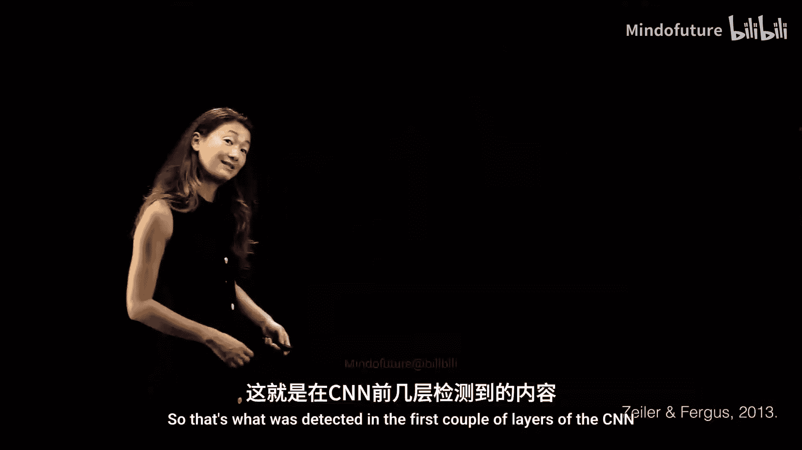

If you keep marching forward， you'll see things that are more composites。

 you'll seeing patterns like these little hexagonal circular patterns here。

 you're seeing things like intersections that are being detected and you're seeing things like this one here which is kind of like an oriented bar or sometimes little stripes with different spatial frequencies that's what's being detected in layer 3 if you keep marching forward once again we start seeing things that are known to be what's in the later and later parts of the visual system So after you get past V1。

 you get to V2 V3， V4 etc ce， etc ce and a lot of those higher visual areas for example。

 we have ones that detect faces， like a part of your visual system that totally lights up anything。

 anything looks like a human face， including if it's just a rock in the mountain you're like face over there。

 I see it。

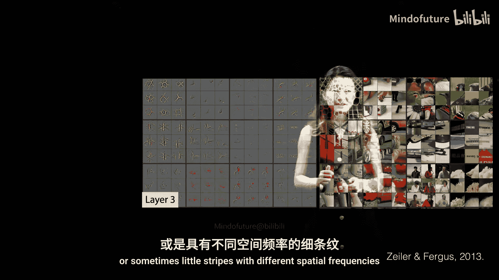

Dog， okay， you get dog neurons， you get lip neurons， you get circle neurons。

 you get like feather neurons。 okay and these are things that look a heck of a lot like what is happening in the mammalian visual system。

 almost as if it were an inevitable consequence of the architecture and the way that the network happened been trained。

 And so these patterns of commonalities can be overinterpreted。

 But no one can deny that it was really， really interesting that this happened that way。 And in fact。

 neural networks， the story that I've been telling you。

 I think is a really great example of how life imitates life。

 life imitates art far more than art imitates life。

 And so there's a lot of inspiration from biology that got into the development of modern ANNs。

 but people are also using ANNs as a way of understanding biology as well。 And in fact。

 this is one of the most modern indispensable tools in the study of neuroscience as it exists right now。

 using artificial neural networks as a tool as one of many many tools to help us understand what is happening in the。

😊，Nervous system。Here's a couple of examples of that。

 So theres is a paper by Dan Yemens and Jim De Carlo。

 where they use deep learning artificial neural networks of many layers as a model of understanding sensory cortex。

 how it is that we can go not only from the retina to L GN to V1 here， you can kind of keep going。

 all the way down to behavior because after all， the nervous system in the brain。 don't just go。

 They don't just sit there perceiving things。 It also generates action。It decides what to do next。

 and what you're doing next has a direct influence on what you perceive next。

 because if I decide to walk a little bit over here。

 it changes the input to my retina at the very next instant。 Okay。

 so using deep learning as as a way of understanding sensory cortex。

 but also then using deep reinforcement learning to understand what's happening in action generation。

 because this diagram is still too simplistic。

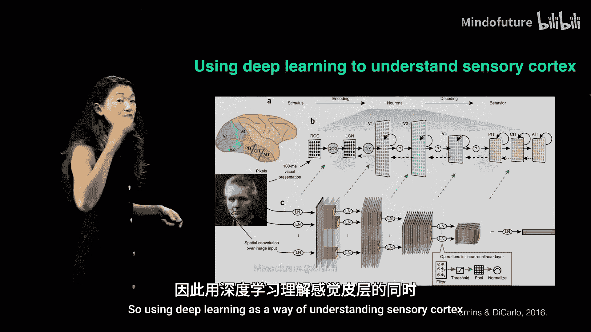

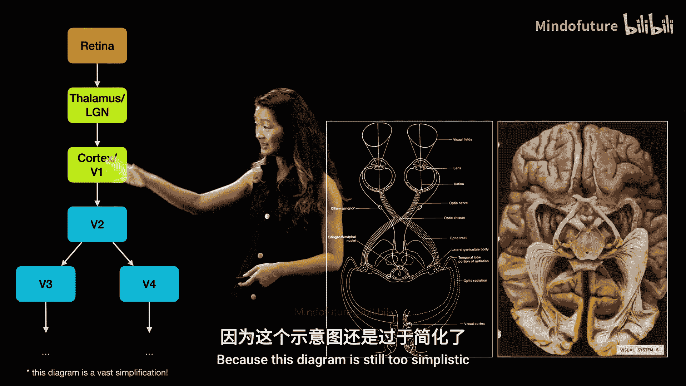

In reality， what happens is that there are a bunch of recurrent connections。

 The only one that is truly feed forward is that there is， in fact。

 only feed forward connections between the retina and the thalamus。 This doesn't go back。

 every other block in this diagram has connections to almost every other diagram。

 the arrows are not all equally thick but they exist。 And this is how biology works。

 The thing that is really the thing that blew my mind， the first time I heard about it。

 is this observation here， we have this canonical picture of the thalamus projecting to V1 but if you count the number of wires from thalamus to v1 versus the number of wires are going back。

 There are far more of them going back than they are going forward。

 And so the approximation that this is a feed forward system that information just gets passed down in the CNN is not only a simplification is kind of the opposite it what's true。

 And even this diagram is still a vast splification of what is actually happening。

 So really embracing the recurrence of the neural network。

Is something that is very much a part of active research， for example。

 with the use of deep reinforcement learning to understand brain and behavior。

 to really embrace the fact that this also happens in feedback not only with other parts of the neural circuit。

 but with the environment and so a lot of really cool stuff going on in deep reinforcement learning。

 both in terms of artificial intelligence， development of computational tools with ties to robotics and neurobiology and lots and lots of other different fields as well。

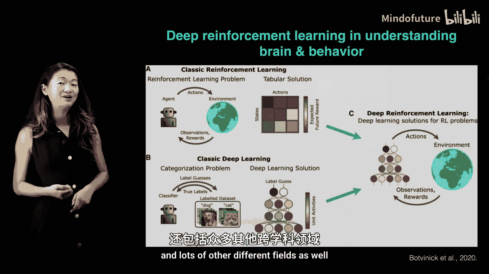

So here we are 2024， when I'm making this video， I don't know what's gonna to happen next year。

 it could be lots of different things， but I did want to say that to me。

 this is one of the really interesting things about trying to predict the future is just trying to look backwards and realize how unpredictable things are so there was the rise of formal logic in neurobiology the building of these artificial neural networks。

 the first one over promise underdelivered I didn't do much for you know I didn't do much people worked a lot。

 but it wasn't really popular and didn't really live up to that promise until 50 years later。

 and 2012 is the first time when people started really talking about artificial neural networks as a credible tool going forward and the progress that we have seen in a decade sense has been absolutely astonishing。

 I wouldn't even pretend to venture I guess about what's happening next。

 except to tell you that I'm incredibly optimistic that this is a technology where we have not even begungu to see the end。

Of what it could possibly do the scale of the system nowhere approaches the complexity of biological neural networks。

 we have so vastly simplified lots and lots of things that we know biological agents capable of doing in the way that we compute has not yet been implemented in artificial neural networks。

 I'm not suggesting that we built a virtual facsimile of the brain not at all。

 like I'm not saying just add in all of the known biology and things will be better。 In fact。

 quite the opposite。 However， I do have a lot of hope in this technology and the fact that not only are we are we going to embrace it。

 but just knowing that it didn't come out of nowhere that it actually came from this almost hundred year history。

 a scientific discovery and technology development to me makes it grounded in the context of engineering and technology in a way that gives me hope that we can proceed forward and and do what's coming up next。

