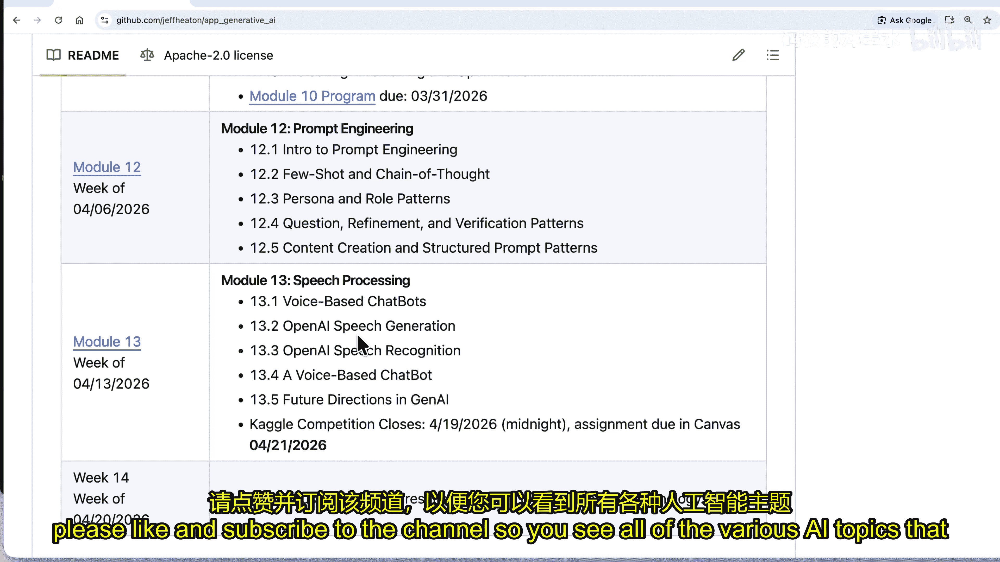

# 001：课程介绍与概述 🚀

在本节课中，我们将要学习华盛顿大学“生成式人工智能应用”课程的整体框架、学习目标以及核心内容。本课程将指导你如何使用大型语言模型和LangChain框架，开发能够执行各种自动化任务的智能体应用。

## 课程概述

欢迎来到圣路易斯华盛顿大学的T821559课程——生成式人工智能应用。本课程的核心内容是使用大型语言模型进行编程，特别是利用LangChain框架来开发智能体系统。你将学习如何运用这项令人惊叹的生成式AI新技术，来完成一系列自动化任务。

## 课程要求与工具

本课程的一个重要要求是，你需要购买一定额度的OpenAI API积分。建议为整个课程预留约100美元的预算，但根据以往经验，实际花费通常远低于此。具体金额取决于你完成各项作业时需要重新运行代码的次数。

为了保持课程的简洁性，我们将主要聚焦于OpenAI。然而，课程代码使用LangChain，它抽象了不同AI服务提供商的许多细节。因此，理论上你也可以替换使用GCP或Amazon Bedrock等服务。在本教程中，我将默认使用OpenAI进行演示。

## 课程平台与资源

本课程由华盛顿大学提供，因此会使用该校的技术平台来提交作业。如果你是通过网络自学本课程，虽然无法获得作业评分或学分，但所有教学视频都已发布在我的YouTube频道上，你可以自由观看。

课程大纲和所有资料都存放在一个GitHub仓库中。如果你是华盛顿大学的学生，可以通过学校的学习管理系统直接访问链接。我们使用GitHub是因为它是存储代码和资料的理想平台。

## 课程核心内容大纲

以下是本课程将涵盖的核心模块，每个模块都旨在构建你对生成式AI应用开发的完整理解。

### 基于提示的开发

首先，我们将进入基于提示的开发领域。这意味着你将学习如何通过编写有效的提示词来进行软件开发，这是与AI协作的基础。

### 大型语言模型基础

上一节我们介绍了提示工程，本节中我们来看看大型语言模型本身。我们将对LLM进行入门介绍，探讨文本生成和摘要总结等功能。你将学习如何通过LangChain向OpenAI发送提示并获取结果。LangChain帮助我们抽象了API调用的技术细节，让你无需担心不同服务商（如Bedrock、OpenAI、GCP）之间的差异。

### 聊天与记忆

大型语言模型本身并不具备记忆能力，它们很难进行持续学习。除非进行微调，否则你无法真正“教会”模型新知识（微调更多是调整其语气而非增加知识）。这与人类心智有显著区别。但这也带来一个好处：你可以轻松地让模型“忘记”内容。我们将展示如何为聊天实现记忆功能，使其能记住对话上下文，或者如何持久化记忆以便次日继续对话。

### 数据提取

数据提取是大型语言模型的一个重要应用场景。你可以利用LLM从非结构化数据中提取所需的信息片段。这比使用正则表达式等方法进行数据解析要容易得多。

### 检索增强生成

接下来，我们将深入探讨检索增强生成。尽管有人争论RAG在2026年是否还有必要，但它目前仍是关键技朮。RAG的基本原理是：将大量数据分割成多个块，让LLM能够将其作为参考来查找所需信息。这是让模型“记住”外部知识的主要方法之一。例如，如果你的公司有上万页的政策文档，并希望LLM能访问这些信息，就需要使用RAG。

目前，LLM的输入上下文长度已能容纳大约500页文档。因此，有时人们会采用另一种技术：直接将整个文档发送给LLM，并基于这份长文档提问。但这种方法有两个问题：一是每次调用都会产生高昂的令牌成本；二是LLM的推理能力在输入的前16000个令牌中表现最强，如果塞入整本书并要求其对末尾内容进行推理，效果可能会打折扣。

### 智能体

智能体是当前的热点，智能体软件已经风靡全球。本节将教你如何将传统代码、大型语言模型、RAG等多种技术结合起来，整合成一个完整的解决方案。这就是智能体的本质。我们还将介绍工具的使用，例如让智能体能够搜索网络，实现非常强大的功能。

### 核心作业：CAGal

本课程有10个编程作业，覆盖前10个模块，而CAGal作业则是重中之重。每个学期我都会为CAGal作业创建一个全新的数据集，因此你每次面对的都是全新的挑战。你可以使用任何你掌握的方法来争取在该作业中获得顶级排名。

### 多模态与文生图

多模态是指模型可以处理图像等多种输入。例如，你可以发送一张井字棋棋盘图片，询问“谁赢了？”，或者发送一张国际象棋棋盘图片，询问“白棋下一步怎么走比较好？”。模型能够识别图像中的文字，功能非常强大。文生图则是根据文本描述生成图像，例如“生成一张宇航员在海底插上任意国家国旗的图片”。

### 用户界面与Streamlit

Streamlit能帮助你为应用添加基本的用户界面，让用户能够有效地与你的AI应用进行交互。有趣的是，你通常也可以使用大型语言模型来生成所需的Streamlit代码。

### 微调

微调是指实际改变神经网络权重的过程。你可以通过微调让模型的输出语气更符合你的需求。但通常不会用微调来添加新信息（如公司资料），那更适合用RAG或嵌入技术来完成。

### 提示工程与语音处理

提示工程教你如何构建越来越好的提示词。语音处理则涉及将文本输出转换为语音，或从语音录音中提取文本。这样，你就能打造出真正能“说话”的聊天机器人。

### 课程总结与未来展望

在学期的最后一周，我们将总结整个课程，讨论一些技术未来发展方向，并最终完成CAGal作业。

## 总结

本节课中我们一起学习了“生成式人工智能应用”课程的完整路线图。我们从课程要求、工具准备开始，逐步深入到提示开发、LLM基础、记忆管理、数据提取、RAG、智能体、多模态应用、用户界面集成、模型微调以及语音处理等核心主题。本课程旨在为你提供坚实的实践基础，让你能够利用LangChain和大型语言模型构建强大的自动化智能体应用。对于华盛顿大学的正式学生，我们将在第一个周一见面并开始第一项作业。感谢观看，希望本课程对你探索广阔的AI世界有所帮助。