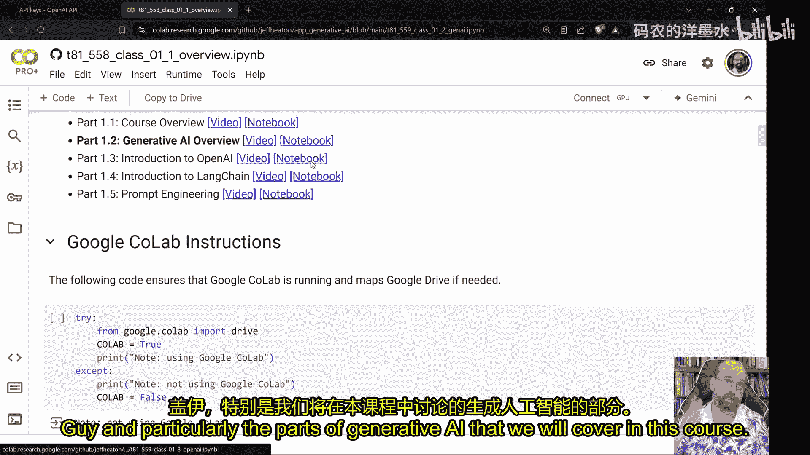
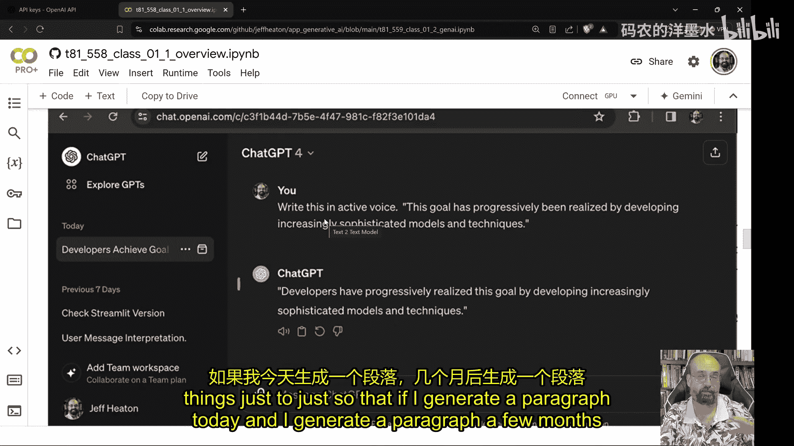
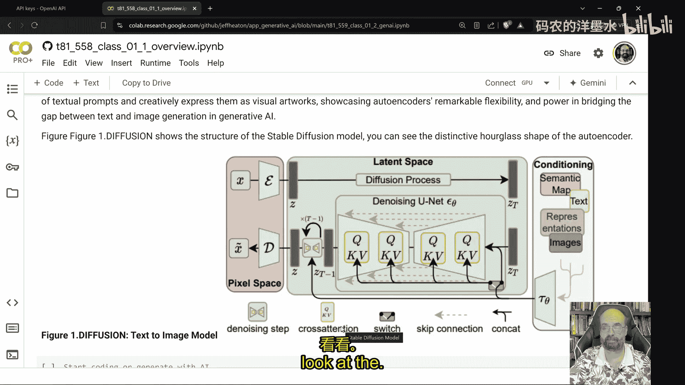

# 002：生成式AI概述 🧠

在本节课中，我们将学习生成式AI的基本概念、核心技术与应用领域。我们将从文本到文本模型入手，了解其工作原理，并简要探讨文本到图像模型背后的技术。

欢迎来到华盛顿大学的生成式AI应用课程。我们将继续生成式AI的介绍。我将首先展示第一部分的一些信息，然后直接进入第二部分，这是本视频的主要目的。我将直接在CoLab中打开这些内容。我提供的大多数模块在顶部都有一个“在CoLab中打开”的按钮。你现在在GitHub中查看它，无法直接在GitHub中运行或修改代码。但如果你在CoLab中打开，就会进入像这里看到的CoLab环境。

CoLab有几个付费等级，但本课程中我们将做的所有内容，你绝对可以使用免费版本完成。因为我们将运行的大部分内容，实际上会发送给另一个云服务提供商OpenAI。在下一部分，你将看到如何在OpenAI注册账户并在CoLab中使用它。你会在每一个模块的顶部看到这段代码。就像任何Python代码一样，你可以点击并运行它。

像CoLab Pro Plus这样的付费版本，我每月付费使用，它为我提供了额外的GPU等资源，但本课程你不需要这些。你完全可以只使用免费版本。

生成式AI已经存在一段时间了，但像许多事物一样，它只是在过去几年才真正兴起。主要是文本到文本模型，你可以访问像ChatGPT这样的工具，让它帮你做作业等，这对于本课程来说完全没问题，它会给你一些反馈。

生成式AI，顾名思义，就是生成内容的AI。如果你上过我的另一门课程（有些人可能同时在学），那门课我教你深度学习。深度学习模型接受一定数量的输入，然后输出结果。生成式AI本质上就是循环运行这种模型，在你获取对输入内容的响应时，它不断预测下一个字母或下一个标记。

本课程将使用Python。Python在人工智能和深度学习领域有很长的历史，而生成式AI很大程度上基于深度学习。该领域的两大主要框架是TensorFlow和PyTorch。我有一门完全独立的关于PyTorch的课程，当我们需要使用深度学习时，我们将主要使用PyTorch。

## 令牌与密钥 🔑

在本课程中，你将处理几种不同的令牌。这些是文本形式的数字，用于标识身份。

*   **作业提交API密钥**：你将通过电子邮件收到它，这是你提交课程作业的方式。这主要针对华盛顿大学的学生。如果你是通过互联网学习本课程，可能无法使用这些。但对于课堂上的学生，我将在第一节课上演示如何提交作业一。
*   **Hugging Face密钥**：这是免费的。你将在课程后期需要时注册它，最初不需要。
*   **OpenAI密钥**：你将立即需要它，因为这是我们实际运行生成式AI的方式。

我们将学习如何在你的计算机上本地运行文本到文本模型。这可以通过一些较新、更精简（即更小）的模型来实现，例如70亿或80亿参数的模型肯定可以在你的计算机上运行。如果你想检查Python安装，可以运行此代码。你可以将所有内容安装到本地计算机上，并在Mac或Windows电脑上正常运行。

我建议在本课程中使用Google CoLab，当然，Google CoLab的免费版本完全足够。

## 生成式AI概览 📊

现在，让我们看看生成式AI的概览，特别是本课程将涵盖的部分。

文本到文本模型是人们通常想到的生成式AI。这是你输入文本，然后返回文本的地方。一个很好的例子是ChatGPT。

本课程不要求你必须使用ChatGPT本身，但它肯定非常有帮助，并且肯定能帮助你完成作业。因此，你可能想看看ChatGPT，以便与课程一起使用。然而，我们将使用的是ChatGPT所基于的底层模型，即GPT-4o模型。因此，在本课程中，我们将大量使用GPT-4o及其变体GPT-4o Mini。

当你将来观看此视频时，随着新版本的发布，我可能会更改这一点。它可能不再是ChatGPT-4o和4o Mini，但你会看到课程材料更新为使用这些模型的最新版本。因为通常新模型不仅更好，而且更快，你总是希望更快，通常也意味着更便宜。

这里我使用了ChatGPT-4。我喜欢的一点是，当你让它为你撰写文本时，你可以指定写作风格。我经常告诉它用主动语态写作，并给它一些其他指示，这样如果我今天生成一个段落，几个月后再生成一个段落，它们看起来至少有一半的写作风格是相同的。

## 核心技术：Transformer 🏗️

那么，它利用了什么样的底层技术呢？它使用了一种叫做Transformer的技术。Transformer是一种深度神经网络层，可以作为更大神经网络的一部分使用。你使用的大型语言模型将具有层层叠叠的Transformer层，层数越多，就得到了他们所说的那些4000亿参数类型的模型，或者像70亿或80亿参数这样非常小的模型，这仅仅取决于它们配置了多少层以及有多少“头”等其他组件。

Transformer接收其输入。它进行编码，你看到那种正弦波，它编码那个正弦波只是为了给它上下文，让它知道在序列中的位置。它使用注意力机制。“注意力就是你所需要的一切”是一篇非常著名的论文，我相信我已经在那里链接并引用了它。但注意力基本上导致它对文本的不同部分给予不同程度的关注。这基本上创建了一种内部状态，然后解码器端（我们刚才看的是编码器）实际上一次一个字符地形成输出。它在生成过程中不断经历这个过程。

## 文本到图像模型 🖼️

另一个主要领域是文本到图像模型。这些模型非常惊人。这里我告诉它“一个学生正在学习生成式AI的正方形图像”。你需要告诉它是正方形还是宽屏，以便它知道你寻找的大致格式。你可以看到这里的学生在喝咖啡。是的，那杯咖啡是这次学习课程中最重要的东西。其次，他正在使用一本书。

他正在看所有这些令人惊叹的图表，我猜那些是他的笔记。他是一个非常好的笔记记录者，我一直对使用多种颜色和笔等工具做笔记的人印象深刻。

这也给你提供了一个很好的例子，说明在AI，特别是生成式AI中经常讨论的问题。如果你看我们生成的人，他是一个白人男性，我猜他大概20多岁？我不确定，我仅凭外表判断人的年龄非常糟糕。你没有告诉它你想要什么性别、种族、年龄。所以它会根据被要求生成时，在训练数据中最常见的图片来决定。这被称为偏见。因此，它确实对其训练数据中事物的普遍性存在偏见，这就是一个很好的例子。如果我们生成100个这样的图像，你肯定会得到一些变化。但一定要给它非常精确的指示，说明你想要什么。否则，它只会编造一些东西并让你感到惊讶。

现在，像这样的图像并不使用Transformer。这里使用了多种技术。这里使用的东西是自编码器。

## 核心技术：自编码器 ⏳

我在另一门关于深度学习的课程中更深入地介绍了自编码器。但你会注意到自编码器总是有这种沙漏形状的外观。输入进来，然后变窄、变窄、变窄，直到最终变成一个小的代码，传递到下一部分，然后扩展、扩展、扩展。所以这有点像编码器-解码器的情况，就像Transformer一样，编码器在这里，解码器在那里。

它基本上将你请求的内容压缩成一串小的数字。然后这部分学习解码它。这基本上就是这些图像实际生成的方式。当然，实际情况比这深入得多。但如果你想详细了解，可以查看关于稳定扩散的学术论文。

感谢观看本视频，请订阅频道，及时了解我在AI领域所做的所有其他事情，而不仅仅是本课程的内容。感谢观看。

## 总结 📝

本节课我们一起学习了生成式AI的概述。我们了解了文本到文本模型（如ChatGPT）和文本到图像模型的基本应用。我们探讨了支撑这些模型的两大核心技术：用于处理序列数据的Transformer架构，以及用于图像生成的自编码器结构。我们还讨论了AI模型可能存在的偏见问题，并强调了在使用时提供精确指令的重要性。最后，我们介绍了本课程将使用的工具和环境，为后续的实践学习做好了准备。