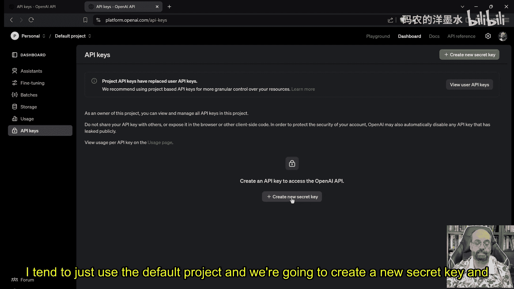
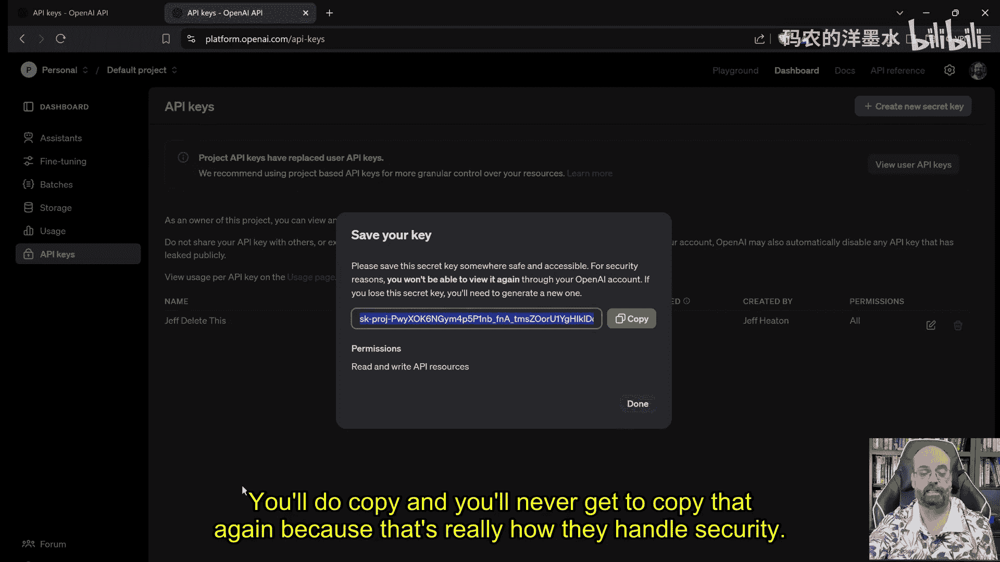
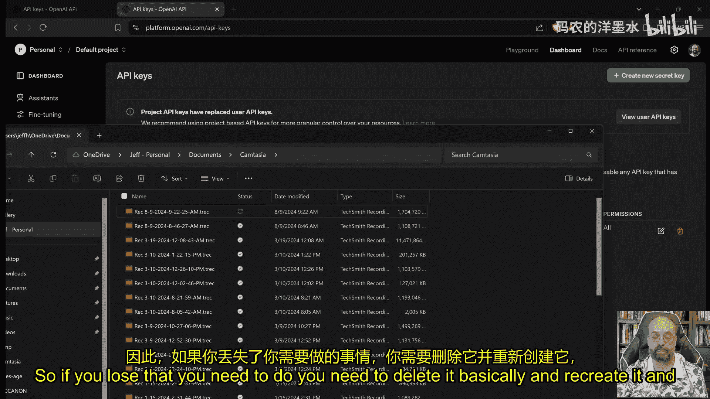
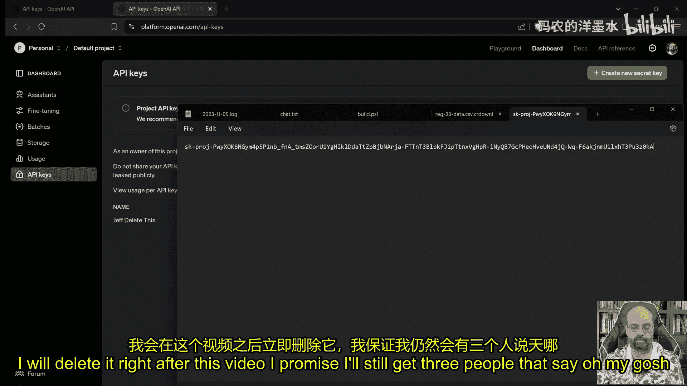
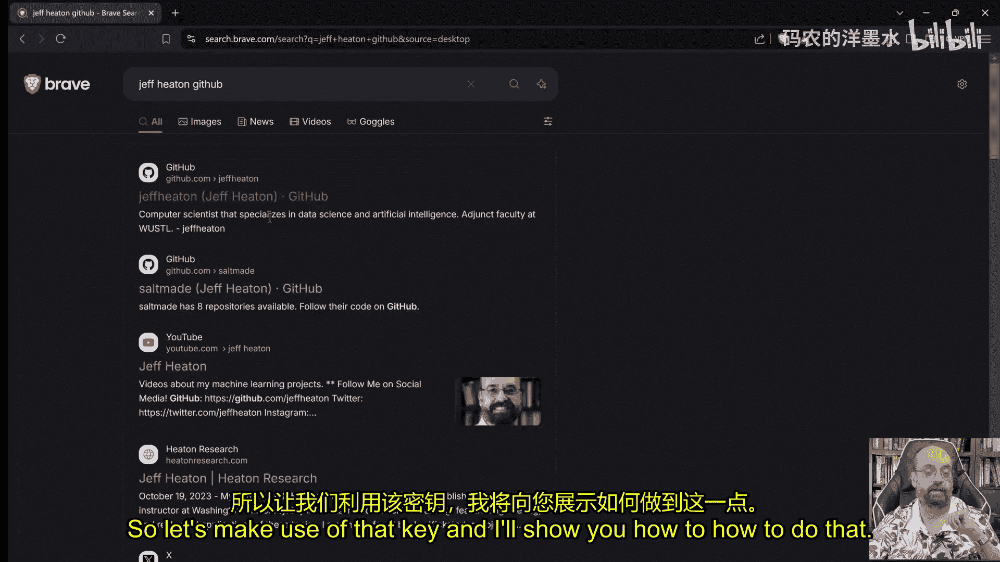
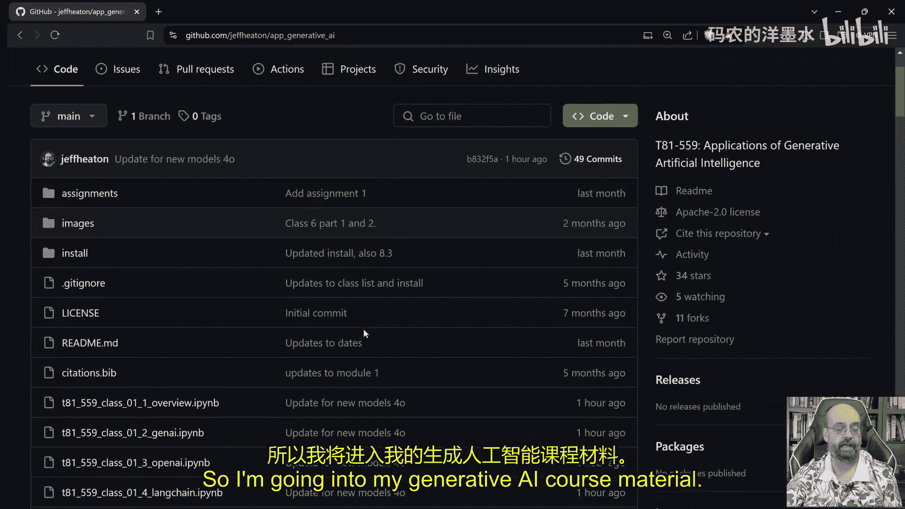
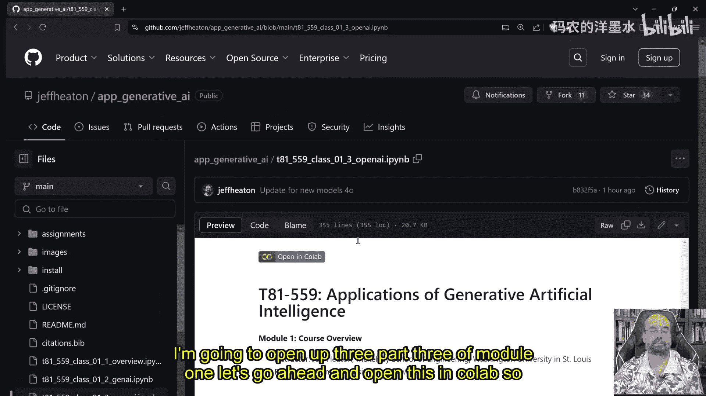
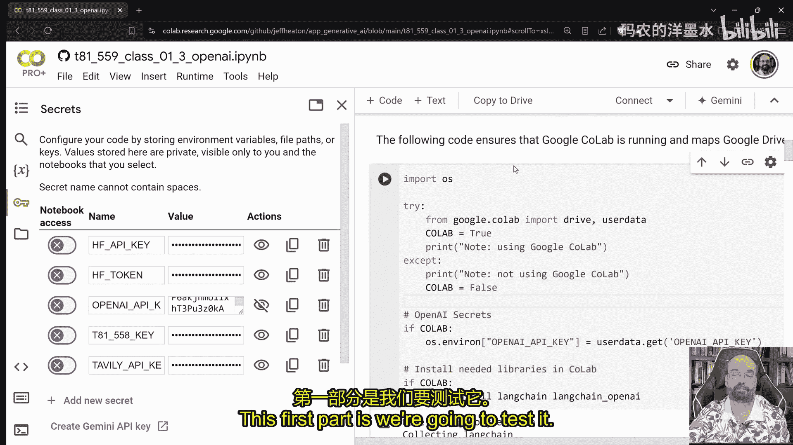
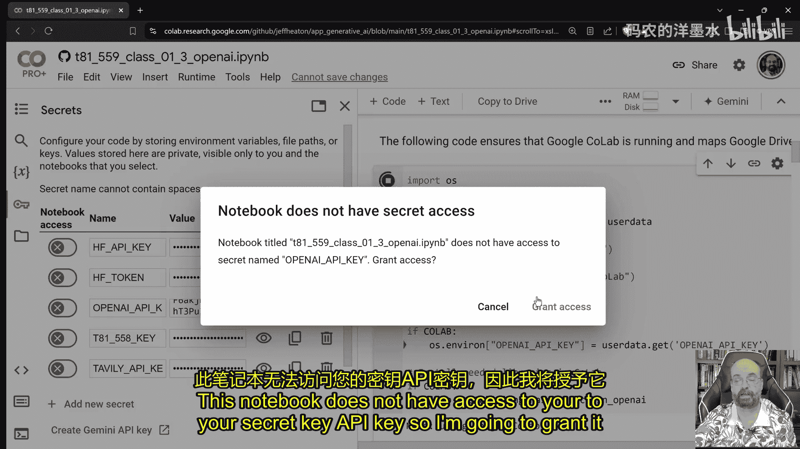
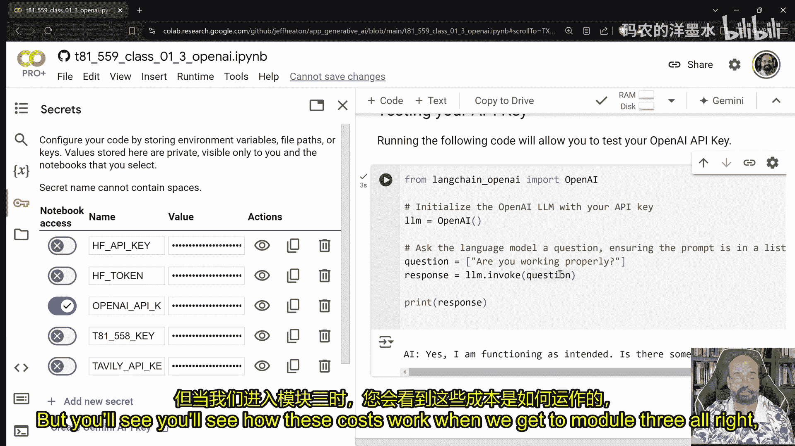

# 003：OpenAI入门指南 🚀

在本节课中，我们将学习如何创建OpenAI账户、获取API密钥，并完成必要的设置，以便顺利学习本生成式AI课程。

## 账户创建与登录

首先，你需要访问OpenAI的官方网站 `platform.openai.com`。网站会要求你登录。你可以使用Google账户登录，也可以选择其他认证方式。

登录成功后，你将进入一个名为“Playground”的界面。在这里，你可以与底层模型（如我们将主要使用的GPT-4和GPT-3.5）进行对话。不建议使用GPT-4 Turbo，因为它版本较旧、价格更高且性能不佳。

在Playground中，你可以定义系统提示词、输入用户消息，并配置温度、最大令牌数等参数。如果你想通过用户界面进行实验，这是一个绝佳的平台。

## 账户设置与账单管理

上一节我们介绍了如何登录和进入Playground，本节中我们来看看如何进行账户设置。

点击页面右上角的个人资料名称，进入设置页面。在这里，你需要首先关注“Billing”（账单）部分。

以下是账单设置的关键步骤：

1.  **设置付款方式**：在此处添加你的信用卡信息并设置信用余额。
2.  **建议使用按量付费**：我建议选择“Pay as you go”（按量付费）模式。这样可以避免意外产生大额账单，并能更好地控制支出。
3.  **控制充值金额**：无需一次性充值本课程建议的100美元全额。如果你发现信用余额消耗过快，请及时联系我（针对华盛顿大学的学生）。这是我们首次开设此课程，许多细节仍在摸索中。

设置完成后，返回个人资料页面。

## 获取API密钥

现在，我们来获取最重要的API密钥。许多教程会提到用户API密钥，但OpenAI现在更推荐使用项目API密钥。

以下是创建项目API密钥的步骤：

1.  在个人资料页面，找到并点击“Project API keys”。
2.  系统会显示“Default project”（默认项目）。对于个人学习，使用默认项目即可。如果你是开发团队或初创公司，可能需要创建多个项目。
3.  点击“Create new secret key”（创建新的密钥）。
4.  进行密钥配置。建议将其保留为“Service account”（服务账户）。我猜测这主要用于计算机调用，而非个人。
5.  为密钥命名（例如“Jeff”），并选择项目（默认项目）。
6.  设置权限。为了本课程的便利性，建议授予“All”（所有）权限。你也可以进行限制，例如设置为“Read only”（只读）。在后续的微调章节中，我们可能需要“Read & Write”（读写）权限。你也可以具体选择所需的API端点。
7.  点击“Create key”（创建密钥）。

**重要提示**：创建后请立即复制并妥善保存密钥字符串。**这个密钥只会显示一次**，如果丢失，你需要删除旧密钥并重新创建。

## 在代码中使用API密钥

上一节我们成功创建了API密钥，本节中我们来看看如何在编程环境中安全地使用它。

你**绝不能**将API密钥直接以明文形式写在代码或笔记本中。如果这样做，至少有两个风险：一是如果你将代码上传到公开仓库（如GitHub），密钥可能泄露，导致他人盗用你的信用额度；二是当需要更换密钥时，你必须在所有使用该密钥的文件中逐一修改。

正确的方法是使用环境变量或秘密管理工具。以Google Colab为例：

以下是安全设置API密钥的步骤：

1.  在Colab笔记本中，点击左侧钥匙形状的“Secrets”（秘密）图标。
2.  点击“+ Add new secret”（添加新秘密）。
3.  在“Name”（名称）字段输入 `OPENAI_API_KEY`。
4.  将你复制的API密钥粘贴到“Value”（值）字段中。
5.  在代码中，通过类似 `os.environ[‘OPENAI_API_KEY’]` 的方式读取这个环境变量。

这样，你的密钥就得到了安全的管理。当你运行需要该密钥的笔记本时，代码会自动从环境变量中读取它。

## 测试你的API密钥

设置好密钥后，最后一步是验证它是否工作正常。

运行一个简单的测试代码，例如向模型发送一个问候：“Are you working properly?”（你工作正常吗？）。如果模型能够正确响应，例如回复“Yes, I am functioning as intended.”（是的，我运行正常），则说明你的API密钥配置成功。

请记住，这是一个付费密钥。每次调用都会产生费用，但单次成本通常极低（远低于1美分）。具体的成本计算我们将在模块3中详细探讨。

---

本节课中我们一起学习了如何从零开始设置OpenAI账户：包括登录Playground、管理账单、创建并安全地配置项目API密钥，以及最后测试密钥的有效性。这些是开始使用OpenAI强大模型进行生成式AI开发的必要基础步骤。