# 005：提示词工程入门 🚀

在本节课中，我们将学习大型语言模型提示词工程的基础知识。提示词是与AI模型沟通的核心方式，良好的提示词能显著提升模型输出的质量和准确性。本节只是一个快速入门，在本学期后续课程中，我们将有专门的模块深入探讨提示词工程。

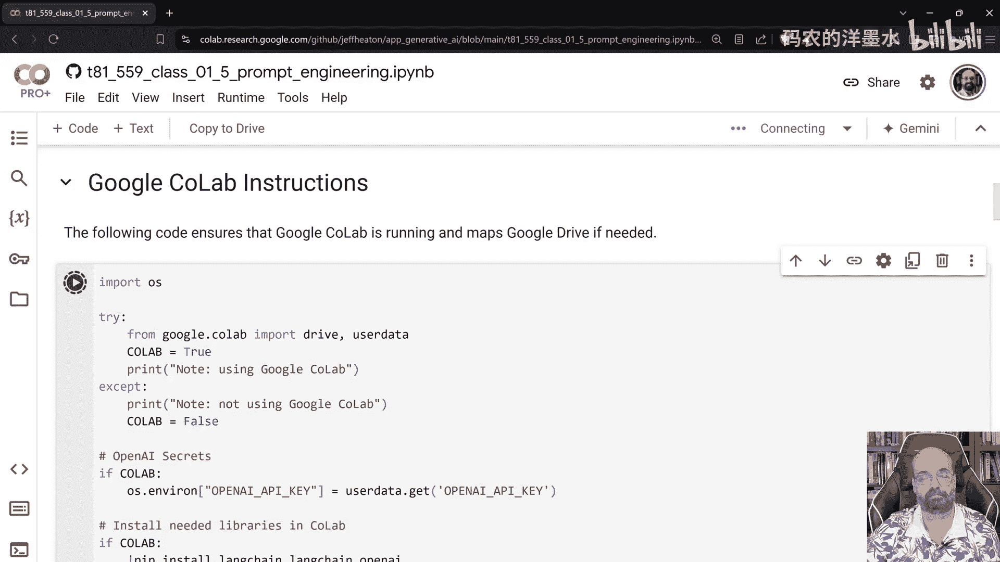

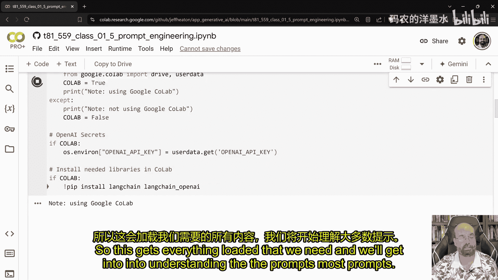

首先，我们需要在Google Colab环境中进行设置。请确保您已准备好OpenAI API密钥。

```python
# 加载必要的库并设置API密钥
import openai
openai.api_key = "YOUR_API_KEY_HERE"
```

运行上述代码后，所需的环境就已准备就绪。接下来，我们将深入理解提示词的构成。

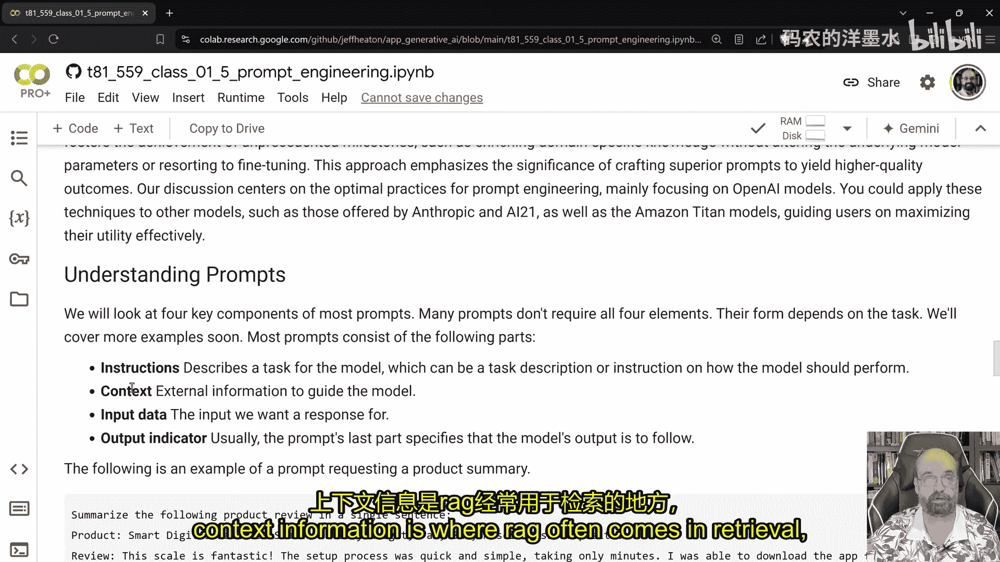

## 提示词的核心结构

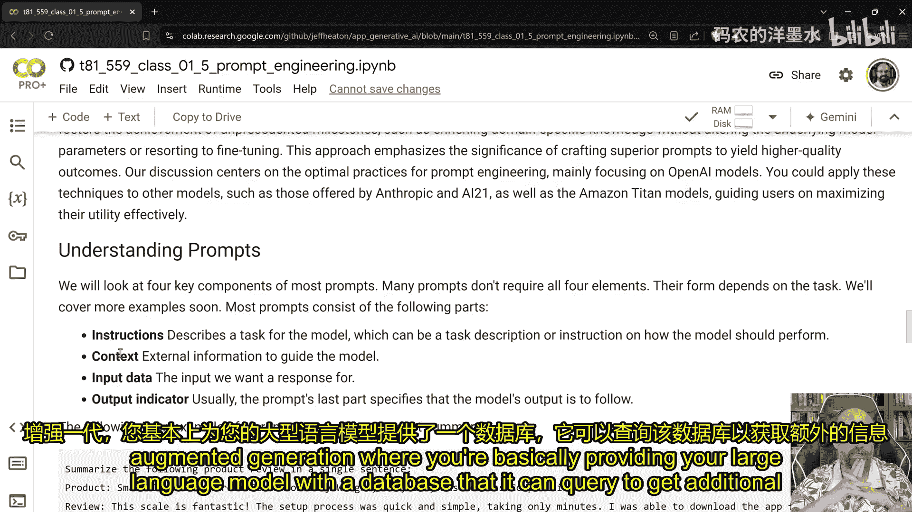

大多数提示词包含四个关键部分。理解这些部分有助于我们构建更有效的指令。

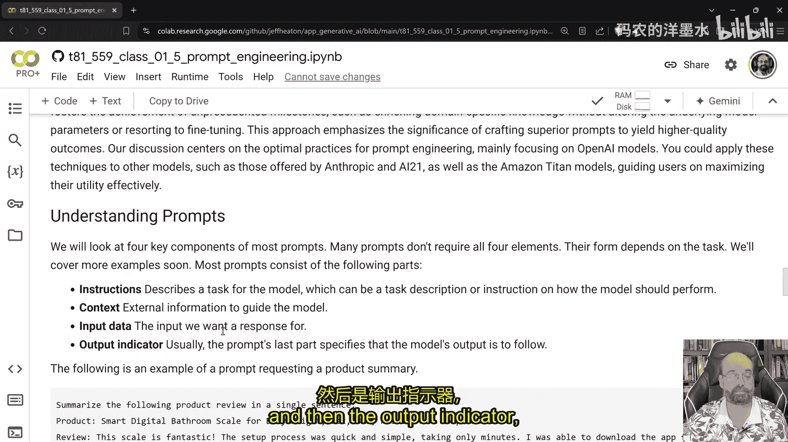

以下是构成一个完整提示词的四个要素：

1.  **指令**：向模型描述需要执行的具体任务。
2.  **外部信息/上下文**：提供模型基础训练数据中可能不包含的额外信息。检索增强生成技术常在此处应用，即通过连接外部数据库为模型提供专有信息。
3.  **输入数据**：模型需要处理并给出回应的具体内容。
4.  **输出指示器**：指定期望的输出格式或类型。

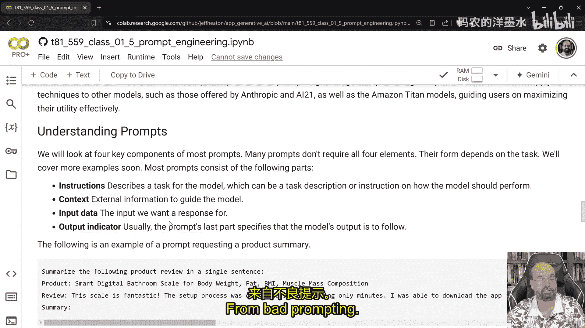

您可以省略其中某些部分，但模型会尝试自行填补空白，这通常会导致“幻觉”现象，即模型编造看似合理但实际不准确或无依据的内容。幻觉通常由提示词设计不佳引起。

## 提示词实例分析

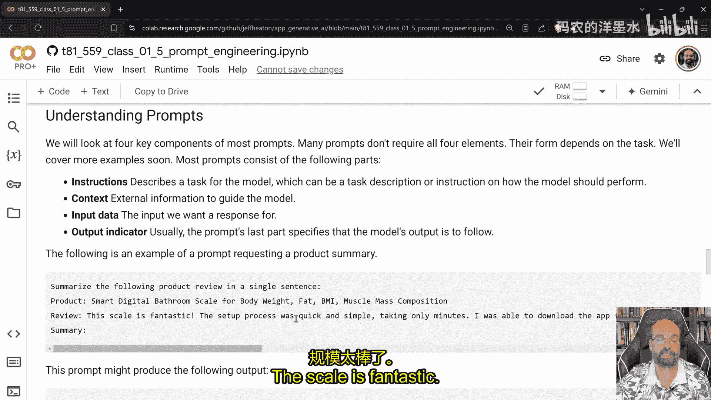

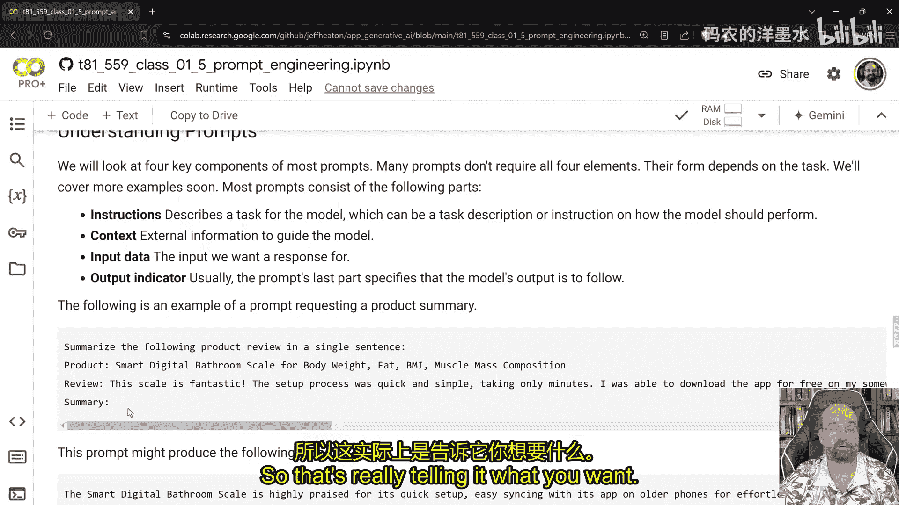

让我们通过一个例子来具体分析。假设我们想让模型总结一条产品评论。

**提示词示例**：
`总结以下产品评论，用一句话概括。产品：智能数字浴室体重秤。评论：这个秤太棒了！`

在这个例子中：
*   **指令**是“总结以下产品评论，用一句话概括。”
*   **上下文**是“产品：智能数字浴室体重秤。”
*   **输入数据**是“评论：这个秤太棒了！”
*   **输出**预期是一个单句摘要。

这就是本课程中我们将主要使用的提示词基础格式。

## 常见的提示模式

在学习和使用生成式AI时，您会经常听到以下几种提示模式。

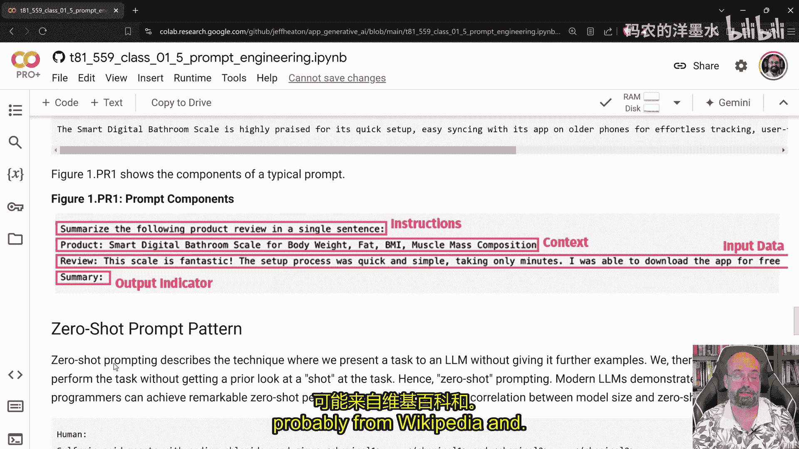

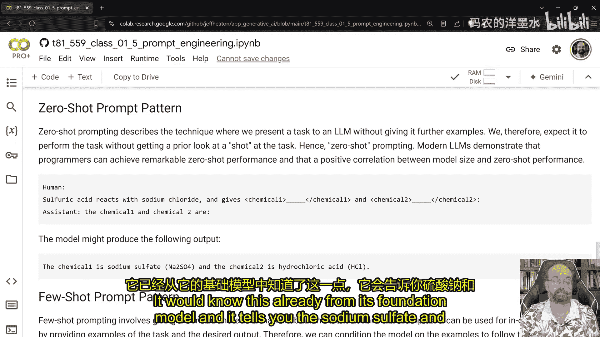

上一节我们介绍了提示词的基本结构，本节中我们来看看几种不同的“提示模式”，它们定义了您为模型提供示例信息的多少。

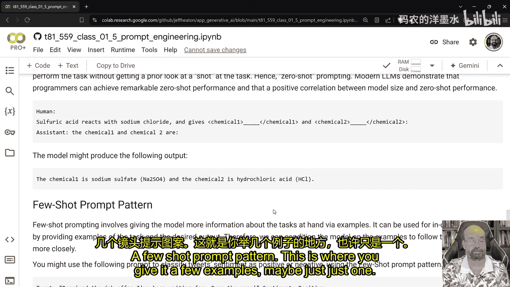

以下是三种主要的提示模式：

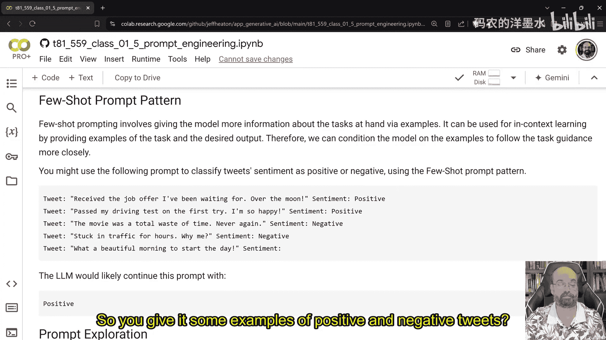

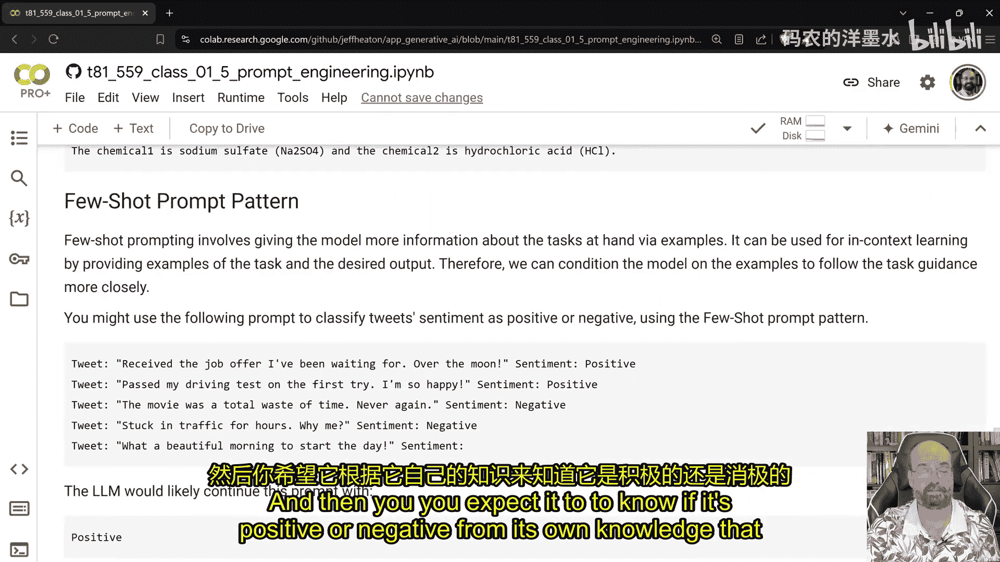

*   **零样本提示**：不提供任何任务示例，完全依赖模型在基础训练中获得的知识进行推理。
    *   **示例**：`硫酸与所有这些物质反应，缺失的两种化学物质是什么？` 模型需要凭借其化学知识直接回答。
*   **少样本提示**：提供少量（通常是一个或几个）任务示例，以帮助模型理解任务格式和期望。
    *   **示例**：先给出几个已标注“积极”或“消极”的推文例子，然后让模型对新推文进行情感分类。提供的例子能帮助模型更准确地把握分类标准。
*   **代码实验**：您可以使用类似OpenAI Playground的工具或编写简单代码来交互式地测试不同提示词的效果，观察模型的响应。

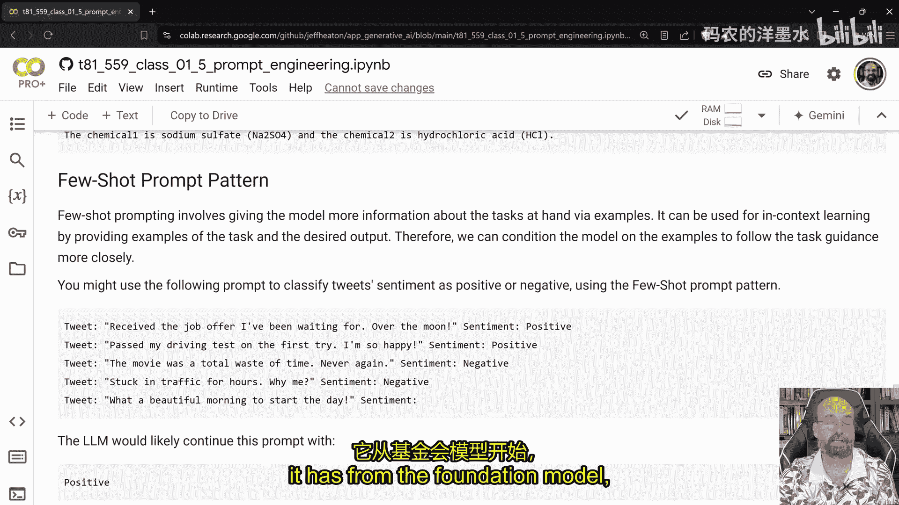

```python
# 一个简单的提示测试代码框架
response = openai.Completion.create(
  model="text-davinci-003",
  prompt="你的提示词在这里",
  max_tokens=100
)
print(response.choices[0].text.strip())
```

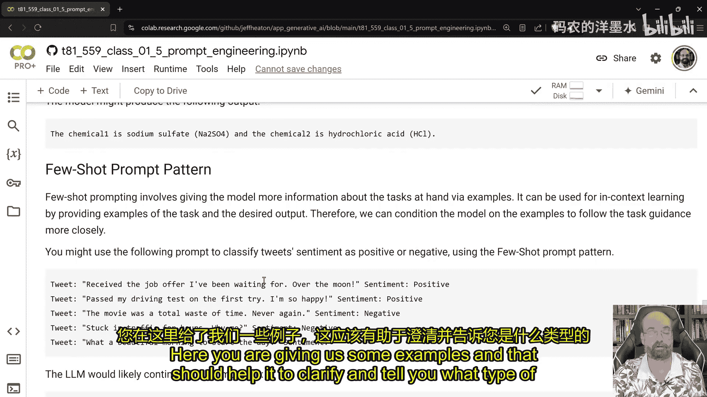

## 总结

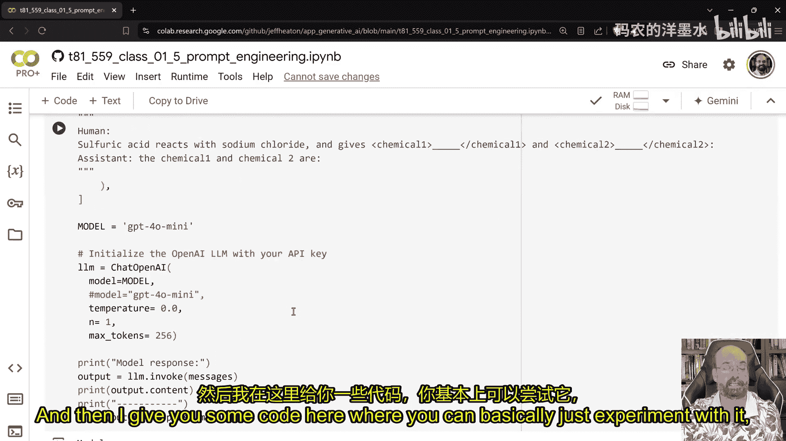

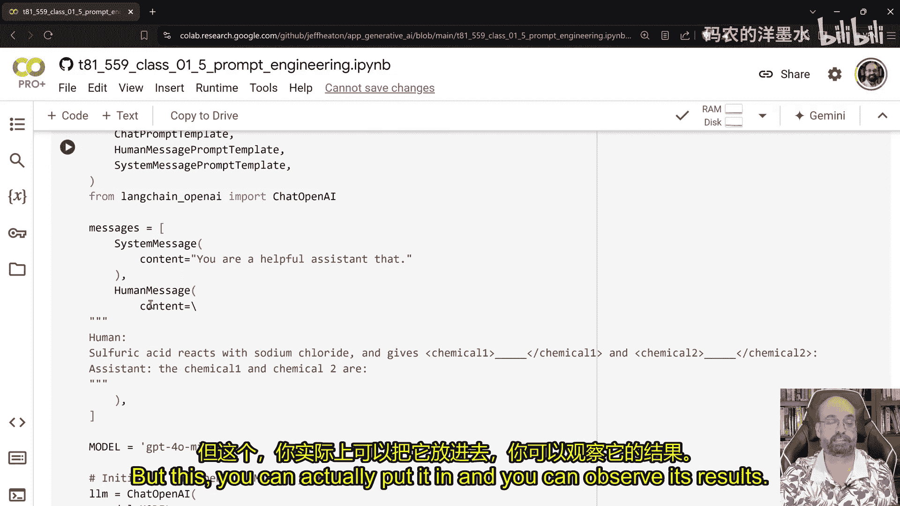

本节课中我们一起学习了提示词工程的基础知识。我们了解了提示词通常包含指令、上下文、输入数据和输出指示器四个部分。我们还探讨了零样本提示和少样本提示两种基本模式，并认识到设计清晰的提示词对于避免模型产生“幻觉”至关重要。通过实践和实验，您可以逐步掌握与大型语言模型有效沟通的技巧。

感谢观看本视频。请订阅本频道以获取关于人工智能及本课程后续内容的最新更新。