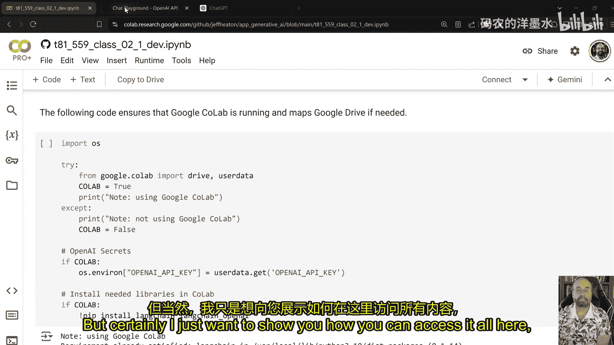
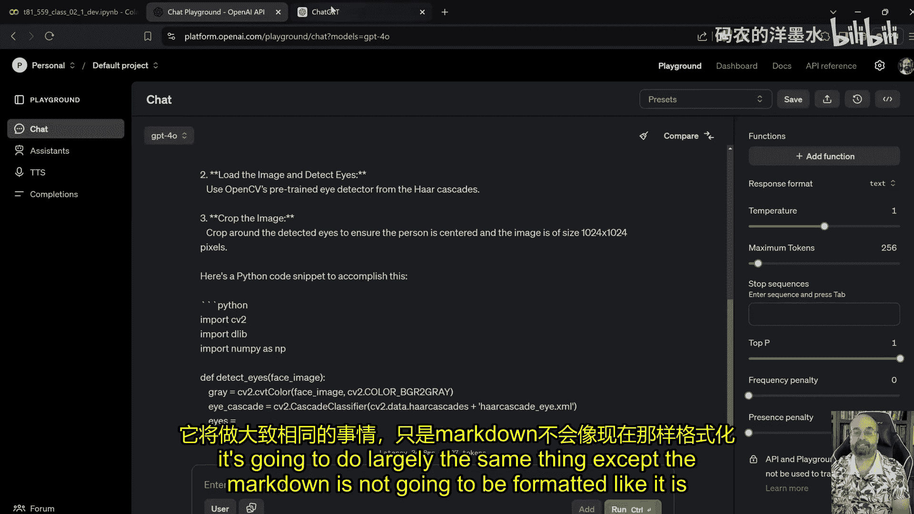
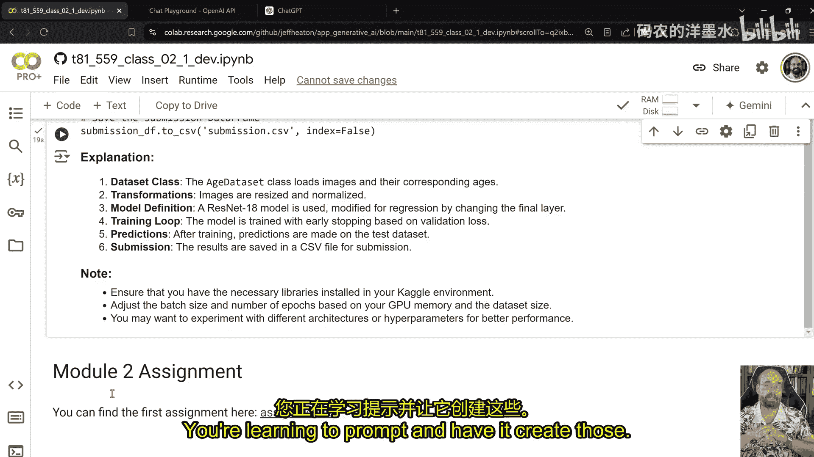

# 006：代码生成提示词

## 概述
在本节课中，我们将要学习如何使用大型语言模型进行代码生成。我们将探讨其基本使用方法、最佳实践、局限性，并通过具体示例展示如何编写有效的代码生成提示词。

## 课堂政策：使用ChatGPT
首先需要明确本课程关于使用ChatGPT等AI工具的政策。使用这些工具是否算作弊？答案是否定的。我们正在学习如何为大型语言模型编程，如果LLM能帮助你解决问题，当然可以使用。在未来的专业工作中，公司不太可能禁止使用LLM，尽管初期可能会有一些限制性政策。代码生成正逐渐成为软件工程师、数据科学家乃至任何需要编程的人员工作中不可或缺的一部分。现在，你可以用自然语言描述需求，然后让模型为你生成代码。



然而，代码生成也存在许多局限性。模型在整合大型程序方面存在困难，但在编写小型代码片段方面表现出色。如果你遵循测试驱动开发等现代软件开发方法，这将是一个强大的工具。对我而言，这是大型语言模型最有前景的应用之一。

## 代码生成平台
我们将介绍几种不同的代码生成平台。

以下是几种主要的代码生成工具：

*   **OpenAI Playground/API**：可以直接在OpenAI平台上使用，提供更多控制选项，但会消耗API额度。你可以设置系统提示词来指定编码风格。
*   **ChatGPT**：用户友好的界面，能很好地格式化Markdown输出，是代码生成的常用选择。
*   **GitHub Copilot**：专注于代码生成的领先产品。
*   **Amazon Q（原CodeWhisperer）**：亚马逊提供的代码生成工具。



在课程中，我们将主要使用OpenAI API，并通过LangChain框架进行调用以控制成本。

## 基础代码生成示例
上一节我们介绍了可用的平台，本节中我们来看看如何进行基础的代码生成。

我们将使用GPT-4o-mini模型，并将温度设置为0，以减少输出的随机性，确保代码的可靠性。首先定义一个调用模型的基本函数。

```python
# 示例：定义代码生成函数
def generate_code(prompt):
    # 使用LangChain调用GPT-4o-mini
    # 系统提示词："你是一个能编写可靠计算机代码的助手"
    # temperature = 0
    # 返回模型响应
```

现在，让我们尝试第一个提示词：“编写Python代码，返回由参数指定的斐波那契数列。”

运行后，模型生成了相应的函数。它甚至会在代码后添加一些描述性文字。在自动化流程中，这些额外的文本可能会造成问题。学术界曾发生过因不当复制粘贴ChatGPT生成的文本（如“当然，这是您论文的摘要”）而导致尴尬的事件。

## 编写精确的提示词
为了生成能集成到更大项目中的代码，我们需要更精确的提示词。

我们需要控制函数名、参数名等细节，以确保生成的代码能与其他部分协同工作。以下是一个更好的提示词格式示例：

“编写一个名为 `loan_amortization` 的Python函数，参数包括 `principal`（贷款总额）、`annual_interest_rate`（年利率）、`loan_term_years`（贷款年限）。函数应计算并返回一个分期偿还表。”

这个提示词消除了歧义，能产生更符合预期的结果。在自动化场景中，你还可以添加“不要有任何前言或其他文本，只输出代码”这样的指令。

生成的函数代码如下：

```python
def loan_amortization(principal, annual_interest_rate, loan_term_years):
    # 计算月利率
    monthly_rate = annual_interest_rate / 12 / 100
    # 计算总付款月数
    total_payments = loan_term_years * 12
    # 计算月付款额（等额本息）
    if monthly_rate > 0:
        monthly_payment = principal * (monthly_rate * (1 + monthly_rate) ** total_payments) / ((1 + monthly_rate) ** total_payments - 1)
    else:
        monthly_payment = principal / total_payments
    # 生成分期偿还表...
    return amortization_table
```

为了验证其正确性，我们应该用已知正确的案例编写单元测试进行验证。运行测试后，我们可以看到典型的贷款分期偿还表：在还款初期，月供中利息占比较高，本金占比低；随着时间推移，利息占比逐渐减少，本金占比增加。这种设计使得月供金额固定，便于预算管理。

## 复杂代码生成与局限性
现在，我们来探讨生成更复杂代码时的挑战。

尝试生成一个庞大的程序，例如：“创建一个用于Kaggle比赛的Python GPU加速神经网络，数据位于`./data/train/`，图像位于`./data/train_images/`。”

对于这种大型程序，单次提示往往不够。我们可能需要与模型进行多轮对话，逐步细化需求。目前我们使用的是单轮提示，后续将学习如何为代码生成进行多轮对话。生成大型程序通常需要多次迭代和调试。



## 总结
本节课中我们一起学习了使用大型语言模型进行代码生成的核心方法。我们明确了在课程中使用AI工具的政策，比较了不同的生成平台，实践了从基础到精确的提示词编写技巧，并了解了当前模型在处理复杂、大型代码项目时的局限性。请务必在完成作业时利用LLM，这将帮助你深入理解其优势与不足。作业的设计也考虑到了这一点，使用这些工具本身就是学习过程的重要组成部分。