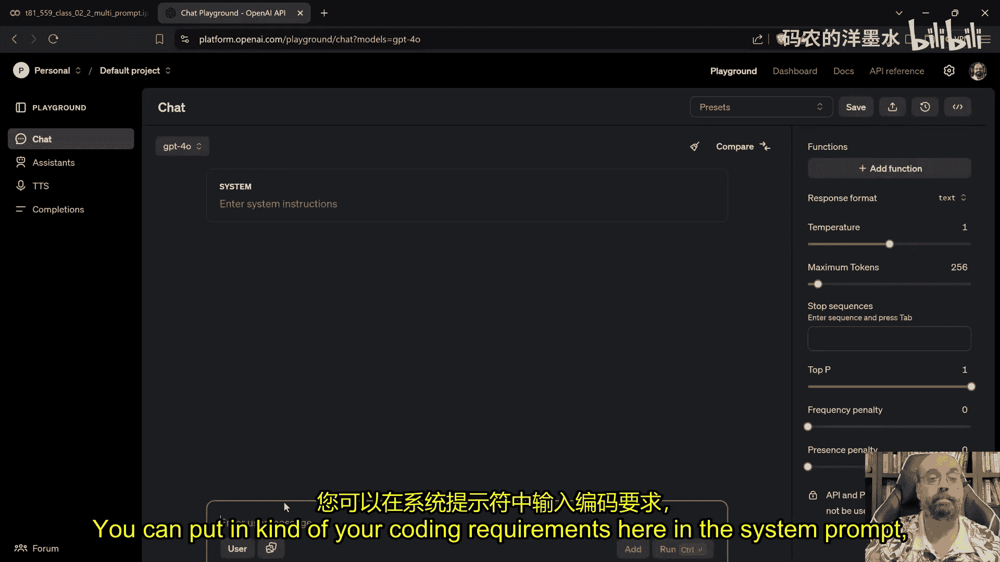
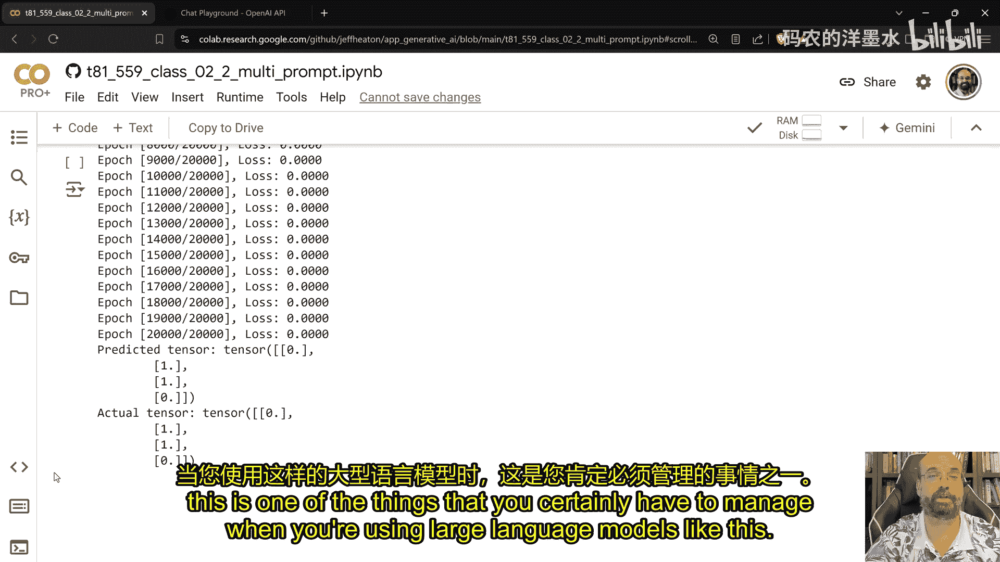

# 007：处理修订提示词 🛠️

在本节课中，我们将学习如何通过多个提示词来微调从大型语言模型（如ChatGPT、Copilot等）获得的创意和代码。我们将探讨如何通过迭代提示来优化输出，并确保最终代码符合我们的需求。

## 概述

上一节我们介绍了如何与大型语言模型进行基本交互。本节中，我们来看看如何通过一系列提示词来逐步优化模型生成的代码。我们将以创建一个XOR（异或）函数近似器为例，演示从初始提示到最终代码的完整修订过程。

## 使用多个提示词优化代码




通常，我们会先给出一个初始提示，让模型生成代码，然后通过后续提示来改进它。以下是几种常见方法：

*   **优化初始提示并重新运行**：有时我们希望得到一个“终极提示”，它能直接生成满意的代码，这样我们就可以将这个提示作为注释保存在代码中，而不需要保留整个对话历史。
*   **请求模型总结对话**：你可以要求模型总结整个对话，并询问：“什么样的单个提示词能让我直接得到当前的结果，而无需经历所有这些修改步骤？”不过，这种方法的效果有时并不稳定。

## 设置代码生成环境

以下是设置代码生成环境的步骤。你可以使用OpenAI的Playground，也可以通过Notebook直接操作。

1.  **定义系统提示模板**：首先，我们需要定义一个系统提示，来规范模型的响应格式。
    ```python
    system_prompt = """
    The following is a friendly conversation between a human and an AI to generate Python code.
    If you have notes about the code, place them before the code.
    Any notes about the execution should follow the code.
    Do not mix any notes with the code.
    Add proper comments to the code, sort imports, and follow PEP8 formatting.
    """
    ```
2.  **选择模型**：我们将使用GPT-4模型来生成代码。

## 案例：创建XOR近似器

现在，我们通过一个具体案例来实践。我们将要求模型使用PyTorch编写一个学习XOR函数的神经网络代码。虽然用神经网络解决XOR问题有些“大材小用”，但它常被用作神经网络的入门示例。

### 初始代码生成

我们给出第一个提示：“使用PyTorch编写学习XOR函数的Python代码。”

模型生成了代码，它定义了一个继承自`nn.Module`的类来实现神经网络。

### 第一次修订：调整代码结构

对于这样一个简单的网络，我更喜欢使用`nn.Sequential`结构，而不是定义一个完整的类。因此，我们给出第二个提示：“能否将其改为使用`Sequential`，而不是`nn.Module`类？”

模型响应了我们的请求，将代码修改为使用`nn.Sequential`。这引出了一个重要注意事项：**大型语言模型生成的代码风格可能不一致**。例如，在处理图像时，它可能一会儿用PIL，一会儿又换成OpenCV。因此，明确指定要使用的主要库非常重要。

### 测试与调试

我们将生成的代码粘贴到新单元格中运行。测试发现，模型的预测输出并不正确。这是因为对于这种小型网络，初始随机权重的敏感性很高，可能导致训练不收敛。

于是，我们进入调试环节。我们给出第三个提示：“你确定这个输出正确吗？看起来模型没有有效地学习。”

模型承认了问题，并自行提出了改进建议，例如增加训练轮数（epochs）、调整学习率、在隐藏层添加更多神经元、更换优化器等。对于XOR问题，有时只需重新初始化权重即可，但模型通过增加网络复杂度也达到了类似效果。

### 验证改进版本

模型根据建议生成了改进版的代码。我们再次测试，可以看到损失值迅速下降至科学计数法表示的极小值，并且模型的预测输出（0和1）也基本正确。需要注意的是，科学计数法可能让接近0和1的值看起来差异不大，但仔细检查后确认结果是符合预期的。

### 尝试获取“终极提示”

最后，我们尝试获取一个能直接生成最终代码的“终极提示”。我们询问模型：“能否提供一个能直接生成最后这段代码输出的单个提示词？”

模型给出了一个建议提示。但当我们使用这个新提示重新生成代码时，发现输出格式又发生了变化。这再次说明，**如果你不明确指定输出格式，模型的输出可能会不一致**。这就好比雇佣承包商，如果你不详细说明要求，他们就会按自己的方式来。因此，在使用大型语言模型生成代码时，管理输出的一致性是一项重要工作。

## 总结



本节课中，我们一起学习了如何通过多个提示词来迭代优化大型语言模型生成的代码。我们从生成一个简单的XOR近似器开始，经历了调整结构、调试问题、验证改进以及尝试总结“终极提示”的过程。关键要点是：明确指定需求、注意代码风格的一致性、积极测试并调试输出，以及理解模型行为可能带来的变化。掌握这些技巧，将帮助你更有效地利用AI辅助编程。