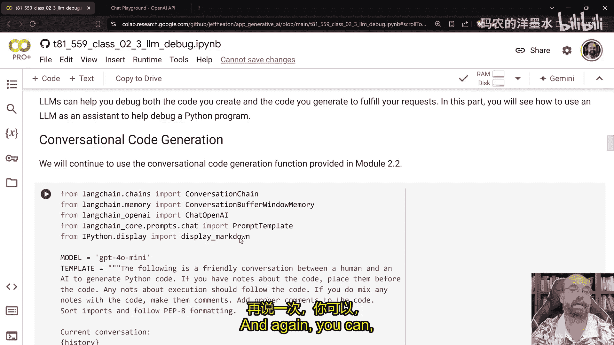
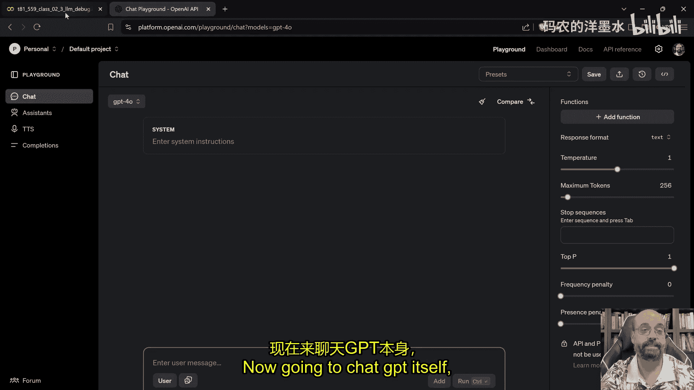
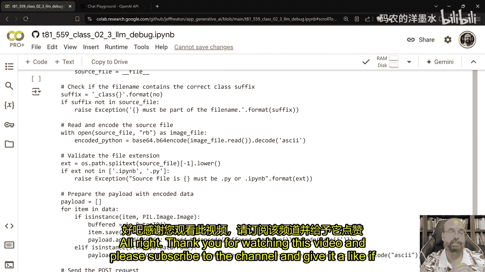

# 008：使用大语言模型辅助调试 🐛

在本节课中，我们将学习如何利用大语言模型来辅助调试代码。大语言模型在此方面表现非常出色。

## 概述

调试是编程中不可避免的环节。本节将展示如何将代码错误信息或复杂代码片段输入给大语言模型，以获得解释、修复建议甚至直接修复后的代码。我们将通过具体示例来演示这一过程。

## 使用大语言模型调试错误代码

上一节我们介绍了大语言模型的基本应用，本节中我们来看看它在调试中的实际作用。一个常见的场景是遇到运行时错误。



例如，在使用PyTorch时，你可能会遇到张量形状不匹配的错误，导致程序崩溃。这类问题非常普遍。



为了使用大语言模型辅助调试，你需要准备好OpenAI API密钥。如果你在使用Google Colab，建议将其存储在`secrets`中。

我们将使用之前构建的对话代理，当然你也可以直接在OpenAI的Playground界面中操作，设置好系统提示词（例如编码规范要求）并请求代码生成。

以下是一个存在错误的代码示例，它试图通过蒙特卡洛方法估算圆周率π的值：

```python
def estimate_pi(num_samples):
    inside_circle = 0
    for _ in xrange(num_samples):
        x = random.uniform(-1, 1)
        y = random.uniform(-1, 1)
        if x**2 + y**2 <= 1:
            inside_circle += 1
    return (inside_circle / num_samples) * 4
```

运行这段代码会产生一个错误：`NameError: name 'xrange' is not defined`。这是因为`xrange`是Python 2中的函数，在Python 3中已被`range`取代。

使用大语言模型调试时，我通常采取以下步骤：
1.  将错误信息和代码一起复制到提示词中。
2.  使用类似“我正在尝试调试以下代码”的提示语。

例如，我们可以构造这样的提示词：
> “我正在尝试调试以下代码。我遇到了一个错误：`NameError: name 'xrange' is not defined`。你能帮我修复它吗？”
> （附上上面的代码）

将这段提示词输入给大语言模型后，它不仅会指出`xrange`需要改为`range`，还可能发现代码中其他的潜在错误。在上面的例子中，模型同时指出了判断点是否在圆内的条件是`x**2 + y**2 <= 1`，这是正确的，但演示表明模型有能力进行综合检查。

模型会返回修复后的代码、修改说明以及相关注释。修复后的代码如下：

```python
import random

def estimate_pi(num_samples):
    inside_circle = 0
    for _ in range(num_samples):  # 将 xrange 改为 range
        x = random.uniform(-1, 1)
        y = random.uniform(-1, 1)
        if x**2 + y**2 <= 1:  # 检查点是否在单位圆内
            inside_circle += 1
    return (inside_circle / num_samples) * 4
```

测试修复后的代码，现在它可以正确运行并输出对π的近似值（如3.14...）。这表明大语言模型在调试方面非常有效。

## 使用大语言模型解释复杂代码

除了修复错误，大语言模型另一个非常有用的功能是解释复杂的代码逻辑。当你面对难以理解的代码时，可以直接请求模型进行解释。

例如，我可以提供下面这个（课程中用于提交作业的）函数，并要求模型解释：

```python
def submit(source_path, output_path):
    import base64, requests, json, os
    assert os.path.exists(source_path), f"Source file {source_path} does not exist."
    assert os.path.exists(output_path), f"Output file {output_path} does not exist."
    with open(source_path, 'r') as f:
        source = f.read()
    with open(output_path, 'r') as f:
        output = f.read()
    data = {
        'source': base64.b64encode(source.encode()).decode(),
        'output': base64.b64encode(output.encode()).decode()
    }
    response = requests.post('https://api.example.com/submit', json=data)
    return response.json()
```

构造提示词：“请解释以下Python函数的功能和实现步骤。”

模型会返回一个结构清晰的解释，通常包括以下几个部分：
*   **导入模块**：说明函数引入了哪些库。
*   **文件验证**：解释`assert`语句如何检查文件是否存在。
*   **文件读取**：说明如何打开并读取源文件和输出文件的内容。
*   **数据编码**：解释为何使用Base64对内容进行编码（为了便于通过HTTP传输）。
*   **网络请求**：描述如何将编码后的数据通过POST请求发送到指定API端点。
*   **返回结果**：说明函数返回服务器响应的JSON内容。

通过这种解释，即使是一个复杂的函数，其目的（提交作业到自动评分系统）和实现细节也会变得清晰易懂。

## 总结

本节课中我们一起学习了如何利用大语言模型辅助编程调试。我们看到了两个主要应用：
1.  **调试错误**：通过向模型提供错误信息和代码，可以获得精准的修复建议，模型甚至能发现并修复你未察觉的潜在错误。
2.  **解释代码**：对于复杂的代码块，可以要求模型逐步解释其功能和工作原理，这有助于快速理解陌生代码。



大语言模型已成为程序员强大的辅助工具，能显著提升调试和理解代码的效率。