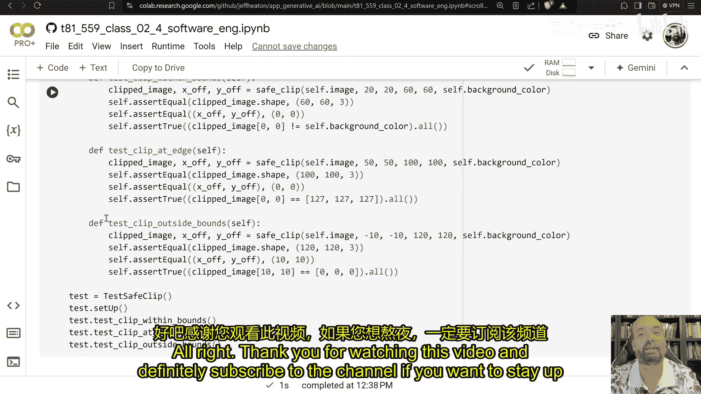

# 009：软件开发中的提示词追踪 🧑‍💻

在本节课中，我们将从软件开发的角度，探讨如何将生成式AI工具（如Copilot）集成到标准的软件开发生命周期中。我们将重点关注如何管理和追踪用于生成代码的提示词，以确保项目的可维护性和协作性。

## 集成生成式AI到开发流程

上一节我们介绍了生成式AI的基本应用，本节中我们来看看如何在企业级软件开发中实际使用它。作为一名软件工程师，当你使用大型语言模型生成代码时，会面临一个关键问题：如何管理生成代码所使用的提示词？

在团队协作和长期维护中，后续开发者需要理解你生成代码的意图，并可能对其进行修改。因此，捕获并记录这些提示词至关重要。

目前，像GitHub这样的代码管理平台可能尚未提供原生功能来关联提示词与生成的代码。因此，你需要手动管理它们。

以下是两种常见的做法：
*   将提示词保存为与源代码一同提交的独立文本文件。
*   将提示词作为注释，直接写在由它生成的代码附近。

## 构建一个代码生成示例

现在，让我们通过一个具体的例子，从头到尾演示这个过程。我们将使用基于LangChain和OpenAI API的代码，它可以轻松适配其他模型。

首先，我们需要设置环境并安装必要的依赖。

```python
# 安装依赖示例
# !pip install openai langchain
```

接下来，对于任何超出简单示例的实际项目，你都需要定义一个系统提示词。这个提示词应包含你的编码标准和项目规范。

```python
system_prompt = """
你是一个专业的Python程序员。请遵循以下规范：
1. 代码风格严格遵守PEP8。
2. 对于计算机视觉任务，使用OpenCV (cv2)库。
3. 对于HTTP请求，使用`requests`库。
4. 使用Python类型提示（Type Hints）。
5. 导入语句需要排序。
"""
```

定义系统提示词可以确保生成代码的一致性，避免在大型项目中混用不同风格的库（例如，有时用`urllib`，有时用`requests`）。

## 编写具体功能提示词

在系统提示词的基础上，我们需要为特定功能编写非常具体的用户提示词。这有助于锁定函数签名，防止后续重新生成时出现“破坏性变更”。

以下是一个创建图像裁剪函数的提示词示例：

```
编写一个名为`safe_clip`的Python函数，遵循PEP8风格。
该函数应接收五个参数：一个cv2图像`img`，整数`x`和`y`，整数`width`和`height`，以及一个表示背景颜色的元组`background_color`。
函数功能：从较大的`img`中裁剪出一个由(`x`, `y`, `width`, `height`)定义的矩形区域。
如果该矩形区域部分或完全超出图像边界，则用`background_color`填充超出的部分。
请为函数和参数添加类型提示。
```

这个提示词明确了函数名、参数名和类型，以及详细的功能描述。这样，即使未来需要重新生成，模型也不太可能更改这些核心接口，从而避免了破坏性变更。

## 测试生成的代码

生成代码后，如何验证其正确性？一个核心问题是：应该让大语言模型为你生成单元测试，还是应该自己编写？

一个有趣的方法是：如果你能编写足够完善和准确的单元测试，你甚至可以让大语言模型仅根据这些测试来重新生成功能代码。这反过来证明了你的测试用例是全面且正确的。

让我们测试上面生成的`safe_clip`函数。我们考虑以下几种边界情况：


以下是需要测试的几种关键场景：
1.  **完全在边界内裁剪**：裁剪区域完全位于原图内部。
2.  **部分超出边界裁剪**：裁剪区域有一边或多边超出图像范围。
3.  **完全超出边界裁剪**：裁剪区域完全不在原图范围内。
4.  **“L”形区域测试**：测试裁剪区域从四个不同方向部分超出边界的情况。

我们可以使用标准的`pytest`框架来编写这些测试。


```python
import cv2
import numpy as np
import pytest

def test_clip_within_bounds():
    # 测试用例1：完全在边界内
    # ... 具体测试代码
    pass

def test_clip_partial_out_of_bounds():
    # 测试用例2：部分超出边界
    # ... 具体测试代码
    pass
def test_clip_completely_out_of_bounds():
    # 测试用例3：完全超出边界
    # ... 具体测试代码
    pass

# 可以继续添加对“L”形等更复杂边界的测试
```

## 总结与回顾

本节课中我们一起学习了在软件开发中集成和管理生成式AI的实践方法。

我们首先探讨了将提示词纳入版本控制的重要性，并介绍了将其保存为文件或代码注释的实用方法。接着，我们通过一个图像裁剪函数的完整示例，演示了如何通过**系统提示词**定义编码规范，并通过**具体的功能提示词**精确描述需求以避免破坏性变更。最后，我们讨论了单元测试的策略，强调了编写全面测试用例对于验证生成代码和确保其可靠性的关键作用。



通过遵循这些步骤，你可以更系统、更可靠地在实际项目中使用生成式AI辅助编程，并让生成的代码易于团队理解和维护。