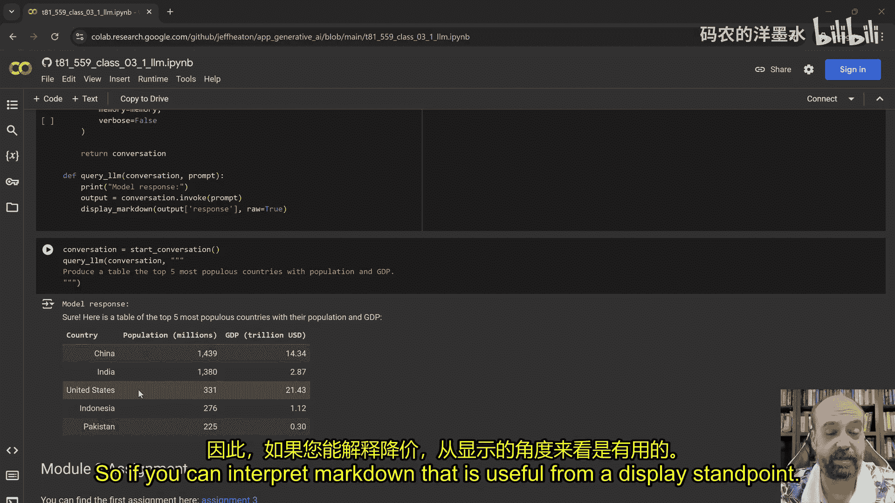

# 011：大语言模型基础模型 🧠

在本节课中，我们将要学习大语言模型，这是本课程的核心内容。我们将介绍相关术语、关键概念、如何评估模型以及实际使用中的成本考量。

---


## 概述

大语言模型是生成式人工智能的重要组成部分。本节将介绍基础模型的基本概念、关键特性、评估方法以及实际应用中的注意事项。

---

## 基础模型与术语

上一节我们介绍了生成式AI的概览，本节中我们来看看大语言模型的具体构成。首先需要理解一些核心术语。

**基础模型** 指的是如 Llama、GPT、Mistral 等模型家族。这些模型构成了大语言模型应用的基础。

在使用这些模型时，通常需要配置 API 密钥。例如，使用 OpenAI 的模型时，应将密钥配置在安全的位置，避免直接写入源代码。

```python
# 示例：从环境变量获取API密钥（建议做法）
import os
api_key = os.getenv('OPENAI_API_KEY')
```

---

## 如何评估大语言模型


面对众多模型，如何选择？以下是评估模型时需要考虑的几个关键特性。

**模型权重**：模型可以是**开源**（如 Llama）或**闭源**（如 GPT）。闭源模型通常只能通过 API 访问。

**权重数量**：权重数量常被视为模型能力的代理指标，但这一点正变得不那么绝对。更可靠的评估方式是使用基准测试。

**MMLU 基准测试**：这是一个广泛使用的基准，用于衡量模型的“智能”程度，类似于对人类知识广度的一种测试。

**Tokens（词元）**：模型处理信息的基本单位。对于人类，可以类比为字符，但词元通常是常见的词块。输入和输出的词元数量直接关系到使用成本。

**成本考量**：在本课程中，建议准备约 100 美元的 OpenAI 额度。为了控制成本，推荐使用 `gpt-4o-mini` 模型，它能力足够且成本较低。

---


## 常见大语言模型对比

以下是当前主流大语言模型的对比，涵盖了不同供应商。


| 模型 | 供应商 | 开源/闭源 | MMLU 得分 | 上下文窗口（词元） | 每百万词元输入成本（美元） |
| :--- | :--- | :--- | :--- | :--- | :--- |
| GPT-4o | OpenAI | 闭源 | 88.7 | 128,000 | 5.00 |
| GPT-4o-mini | OpenAI | 闭源 | 82.0 | 128,000 | 0.15 |
| Gemini 1.5 Pro | Google | 闭源 | ~91.0 | 1,000,000+ | - |
| Claude 3 Opus | Anthropic | 闭源 | ~90.0 | 200,000 | - |
| Llama 3 70B | Meta | **开源** | 82.0 | 8,192 | - |
| Mistral 7B | Mistral AI | **开源** | 60.1 | 32,768 | - |


**上下文窗口**：这是一个非常重要的参数。它决定了模型在一次交互中能“记住”多少信息（包括输入、输出和对话历史）。窗口越大，能处理的文档或对话就越长。例如，128K 词元大约相当于 93 页文本。


**模型大小与速度**：通常，模型会提供不同尺寸的版本。较小的模型响应更快、成本更低，但智能程度可能不如大型模型。

**动态发展**：这个领域发展迅速，模型排名和性能可能随时变化。例如，Gemini 模型凭借其巨大的上下文窗口正在引领新的竞争。


---


## 核心参数：温度（Temperature）


在调用模型时，你会遇到一个关键参数：**温度**。

**温度** 控制模型输出的“创造性”或随机性。其值范围通常在 0 到 2 之间。


*   **低温度（如 0）**：模型输出更确定、更一致。适用于需要事实准确性的任务，如数据提取或问答。
    *   `temperature = 0`
*   **高温度（如 0.8 或更高）**：模型输出更多样、更有创意。适用于写作、头脑风暴或生成故事。
    *   `temperature = 0.8`


---


## 实践示例

以下是一个调用模型获取信息的简单示例，展示了其输出格式。

```python
# 示例：请求模型列出人口最多的国家
prompt = “列出世界上人口最多的五个国家及其GDP。”
# 设置低温度以确保事实准确性
response = model.generate(prompt, temperature=0)
```


模型通常喜欢以 **Markdown** 格式输出，这便于显示和阅读。

> 1.  **中国**
>     *   人口：约 14.1 亿
>     *   GDP：约 17.7 万亿美元
> 2.  **印度**
>     *   人口：约 13.9 亿
>     *   GDP：约 3.2 万亿美元
> 3.  **美国**
>     *   人口：约 3.3 亿
>     *   GDP：约 23.3 万亿美元
> 4.  **印度尼西亚**
>     *   人口：约 2.7 亿
>     *   GDP：约 1.2 万亿美元
> 5.  **巴基斯坦**
>     *   人口：约 2.4 亿
>     *   GDP：约 0.3 万亿美元


---

## 总结



本节课中我们一起学习了大语言模型基础模型的核心知识。我们了解了基础模型的概念、评估模型的关键维度（如开源性、MMLU得分、上下文窗口和成本），并学习了控制模型行为的核心参数——温度。掌握这些基础知识，是有效使用和评估各种大语言模型的第一步。