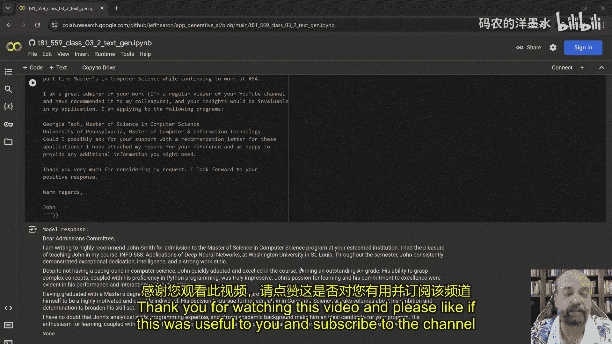

# 012：大语言模型文本生成 📝

在本节课中，我们将学习大语言模型的核心任务之一：文本生成。我们将通过一个具体的例子——撰写推荐信——来演示如何使用大语言模型，并重点介绍零样本、单样本和少样本提示这三种关键方法。理解这些概念对于有效利用大语言模型至关重要。

---

## 环境与代码设置


首先，我们需要设置运行环境。我们将使用 LangChain 框架，并需要配置 OpenAI 的 API 密钥。


```python
# 导入必要的库
import os
from langchain.llms import OpenAI

# 设置 OpenAI API 密钥（例如，在 CoLab 的 Secrets 中）
os.environ["OPENAI_API_KEY"] = "your-api-key-here"

# 初始化语言模型
llm = OpenAI(temperature=0.7)
```

这段代码是后续所有示例的基础。它初始化了一个语言模型，并允许我们通过系统提示词来引导模型的行为。你可以修改系统提示词，例如将其设定为“你是一位大学教授的助手”，以更好地适应特定场景。

---

## 文本生成模式：零样本、单样本与少样本

上一节我们完成了环境设置，本节中我们来看看文本生成中的几种核心模式。理解零样本、单样本和少样本学习的区别，是有效使用大语言模型的关键。这通常也是相关技术面试中的常见问题。

这三种模式的核心区别在于，你为模型提供了多少背景信息或示例来引导其生成内容。

*   **零样本**：你完全依赖基础模型已有的知识。你只给出任务指令和必要信息，不提供任何示例。例如，直接要求模型“根据以下要点写一封推荐信”。
*   **单样本**：你为模型提供一个具体的示例，让它参考这个示例的风格和格式来完成任务。
*   **少样本**：你为模型提供多个（通常为几个）示例，让它从中学习并归纳出完成任务的最佳方式。


---

## 零样本生成示例

现在，让我们通过一个具体的任务来实践。假设我需要为一名学生约翰·史密斯撰写一封积极的推荐信。


在零样本模式下，我直接向模型提供任务描述和学生信息，但不提供任何推荐信范例。

以下是使用的提示词：

```
生成一封积极的推荐信，对象是我的学生约翰·史密斯。他正在申请研究生项目。
以下是他提供的信息：
- 在我的课程中获得了A+成绩。
- 在课堂讨论中表现出色。
- 项目工作展现了出色的研究和分析能力。
请使用“他”作为代词。
```

模型基于这个提示生成了回复。回复的开头可能是：“我非常荣幸地为约翰·史密斯撰写这封推荐信...”。虽然内容通顺且包含了关键点，但其行文风格（例如，“我非常荣幸地...”这种措辞）可能与我个人习惯的、更简洁直接的写作风格不符。

---

## 单样本生成示例

为了改进结果，使其更符合我的个人风格，我们可以尝试单样本提示。


上一节我们看到了零样本生成的局限性，本节中我们来看看如何通过提供示例来引导模型。在单样本模式下，我们会在提示词中附上一封我过去写过的推荐信作为范例。

更新后的提示词结构如下：


```
生成一封积极的推荐信，对象是我的学生约翰·史密斯。他正在申请研究生项目。请使用Markdown格式。

以下是一封由我撰写的推荐信示例：
[这里插入一封我过去写的真实推荐信范例，例如以“致相关人士：约翰在我的课程中获得了A+...”开头]
以下是他提供的信息：
- 在我的课程中获得了A+成绩。
- 在课堂讨论中表现出色。
- 项目工作展现了出色的研究和分析能力。
请使用“他”作为代词。
```


通过提供一个示例，模型在生成新推荐信时有了参考。这次生成的回复在语气和结构上会更接近我提供的范例。然而，如果只提供一个例子，模型可能仍然无法完全捕捉到我写作中更细微的差异（例如，为仅有一学期之交的学生写的信，与为担任过助教的深入指导的学生写的信，两者风格是不同的）。

---

## 少样本生成示例

为了获得更精准、更符合个人风格的结果，我们可以采用少样本提示。

单样本提示已经带来了改进，但要模型真正掌握某种特定风格或复杂格式，提供多个示例通常更有效。在少样本模式下，我会在提示词中提供多封我过去撰写、风格各异的推荐信作为范例。

更新后的提示词如下：


```
生成一封积极的推荐信，对象是我的学生约翰·史密斯。他正在申请研究生项目。请使用Markdown格式。

以下是一些由我撰写的推荐信示例：
[示例1：为一门课程表现优异的学生所写]
[示例2：为一名研究助理所写]
[示例3：...]
以下是他提供的信息：
- 在我的课程中获得了A+成绩。
- 在课堂讨论中表现出色。
- 项目工作展现了出色的研究和分析能力。
请使用“他”作为代词。
```

通过分析多个示例，模型能更好地理解我偏好的行文结构、措辞习惯以及针对不同情况调整语气的方式。这样生成的推荐信，例如以“我写信全力推荐约翰·史密斯...”开头，其整体风格和感觉就会与我本人撰写的信件高度相似。


---

## 总结


本节课中，我们一起学习了如何使用大语言模型进行文本生成。我们通过撰写推荐信这个例子，深入探讨了三种核心的提示模式：



*   **零样本生成**：直接给出指令，依赖模型的通用知识。简单快捷，但结果可能不符合特定风格要求。
*   **单样本生成**：提供一个示例作为参考，能有效引导模型朝向特定的格式和语气。
*   **少样本生成**：提供多个示例，让模型能够学习并归纳出更复杂、更个性化的模式，从而生成质量最高、最符合需求的结果。

掌握这些方法，能帮助你更精准地控制大语言模型的输出，将其有效地应用于内容创作、邮件起草、报告生成等多种实际任务中。