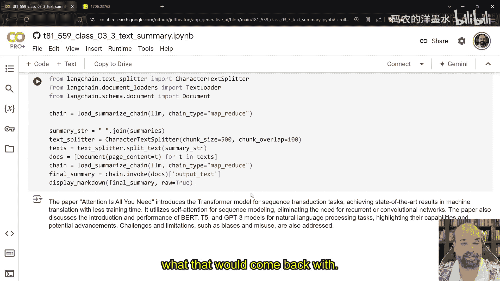

# 013：大语言模型文本摘要 📄

在本节课中，我们将学习如何使用大语言模型进行文本摘要。我们将探讨如何总结单个PDF文档以及多个PDF文档，并了解实现这一过程的核心技术。

---

## 概述

文本摘要是大语言模型的一项重要应用。本节将介绍如何利用GPT模型和LangChain框架，对学术论文等PDF文档进行自动摘要。我们将从总结单篇论文开始，逐步扩展到多篇文档的整合摘要。

---


## 单篇PDF摘要

上一节我们介绍了文本生成，本节中我们来看看如何将其应用于文本摘要。我们将使用GPT模型，并设置较低的温度值，以确保摘要内容准确且不过于发散。


以下是实现单篇PDF摘要的步骤：

1.  **加载文档**：使用`PyPDFLoader`加载PDF文件。
2.  **分割文本**：将长文档分割成较小的文本块。
3.  **创建摘要链**：使用LangChain内置的`MapReduce`摘要链。
4.  **生成并输出**：运行链并获取摘要文本。

```python
# 示例代码结构
from langchain.document_loaders import PyPDFLoader
from langchain.chains.summarize import load_summarize_chain

# 1. 加载PDF
loader = PyPDFLoader("attention_is_all_you_need.pdf")
documents = loader.load()

# 2. 分割文本
from langchain.text_splitter import RecursiveCharacterTextSplitter
text_splitter = RecursiveCharacterTextSplitter(chunk_size=500, chunk_overlap=100)
texts = text_splitter.split_documents(documents)

# 3. 创建摘要链
chain = load_summarize_chain(llm, chain_type="map_reduce")

# 4. 生成摘要
summary = chain.run(texts)
print(summary)
```

`MapReduce`策略的工作流程是：先将整个文本分割成多个小块并分别摘要，然后递归地对这些摘要进行再摘要，直到合并为一个最终的总结。

对于著名的论文《Attention Is All You Need》，模型生成的摘要可能是：“该论文介绍了基于注意力机制的Transformer模型，该模型在多项任务上超越了现有模型...”

---

## 自定义摘要输出

我们可以通过修改提示词来自定义摘要的输出。例如，可以指定摘要的长度、语言或格式。

以下是一个自定义提示词的例子：

```python
# 自定义提示词，要求生成西班牙语摘要
custom_prompt = "请用西班牙语撰写一份简洁的信息摘要。"
# 将此提示词传入摘要链
```

例如，当要求用西班牙语总结同一篇论文时，模型将输出完整的西班牙语摘要。这体现了大语言模型强大的多语言能力。理论上，你可以输入中文论文，用日语指令，并要求输出西班牙语摘要。

---

## 多篇PDF摘要

接下来，我们将把摘要能力扩展到多篇文档。处理多文档摘要时，`MapReduce`策略和分块策略显得尤为重要。

以下是处理多篇PDF的步骤：

1.  **加载多个文档**：为每个PDF文件创建加载器。
2.  **分割与合并**：分别分割每个文档的文本，然后合并所有文本块。
3.  **执行摘要链**：将合并后的文本块输入到摘要链中。

```python
# 假设有一个PDF路径列表
pdf_paths = ["paper1.pdf", "paper2.pdf", "paper3.pdf"]
all_texts = []

for path in pdf_paths:
    loader = PyPDFLoader(path)
    documents = loader.load()
    # 分割每个文档
    split_texts = text_splitter.split_documents(documents)
    all_texts.extend(split_texts)

# 使用摘要链处理所有文本块
summary = chain.run(all_texts)
```

在分块时，我们设置每个块为500个词元，并允许100个词元的重叠。重叠是为了防止重要的信息恰好被分割在两个块的边界处。处理多篇文档得到的摘要通常会比单篇更精炼，因为模型需要从更大量的信息中提取核心内容。

---



## 总结

本节课中我们一起学习了使用大语言模型进行文本摘要的方法。我们掌握了如何对单篇PDF文档进行摘要，如何通过提示词自定义摘要的输出（如语言），以及如何将这一过程扩展到多篇文档。核心在于利用`MapReduce`策略和有效的文本分块技术来处理长文本。这项技术功能强大，为快速理解大量文档内容提供了有效工具。