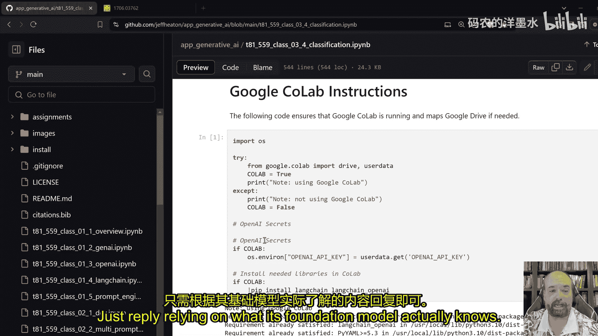
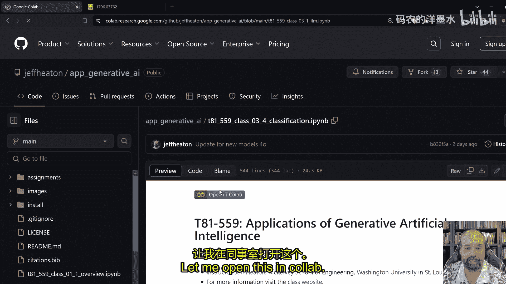
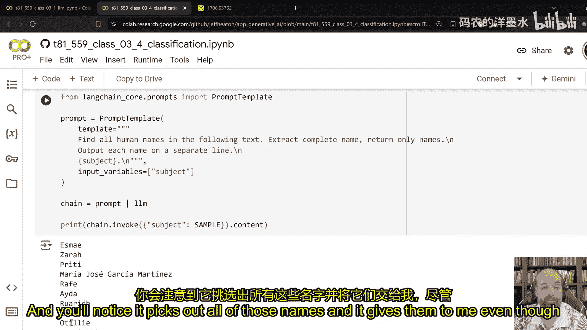

# 014：大语言模型文本分类 📧

在本节课中，我们将学习如何使用大语言模型进行文本分类。我们将探讨零样本分类方法，并了解如何利用模型的内置知识对文本进行有效分类，而无需提供大量示例。

---





上一节我们介绍了文本生成与摘要，本节中我们来看看文本分类。文本分类是指为一段文本分配一个或多个预定义类别。大语言模型彻底改变了这一领域，使其变得非常先进。

以下是进行文本分类的基本步骤：

1.  **准备分类类别**：首先，需要定义希望模型将文本分入的类别。
2.  **构建提示词**：设计一个清晰的指令，告诉模型需要执行的任务和可选的类别定义。
3.  **发送文本并获取结果**：将待分类的文本和提示词发送给大语言模型API。
4.  **解析模型响应**：从模型的回复中提取出分类结果。

---

## 示例一：电子邮件分类 📨

假设我们是一名大学教师，需要将收到的邮件自动分类。常见的类别包括：垃圾邮件、院系通知、学生求助、推荐信请求等。

以下是实现此功能的代码核心部分：

```python
# 定义分类提示词
prompt = f"""
请将以下电子邮件分类为以下类别之一：垃圾邮件、院系通知、学生求助、推荐信请求、其他。
如果邮件是学生关于作业的求助，请同时指出是第几次作业。

电子邮件内容：
{email_text}
"""
# 调用大语言模型API
response = openai.ChatCompletion.create(
    model="gpt-4",
    messages=[{"role": "user", "content": prompt}]
)
# 解析并输出分类结果
classification_result = response.choices[0].message.content
```

通过这种方式，模型可以准确地将邮件归类。例如，一封内容为“教授您好，我想请教关于第七次作业的问题”的邮件，会被分类为“学生求助”，并提取出“作业7”的信息。

---

## 示例二：命名实体识别（提取人名）👥

文本分类的另一个常见应用是从文本中提取特定类型的实体，例如人名。即使某些名字不常见或格式不规范，大语言模型也能凭借上下文进行识别。

考虑以下句子：
> “Sima和Zara自大学起就是朋友。毕业后，他们面试了Priti在XYZ公司的工作。”

以下是提取人名的提示词示例：

```python
prompt = f"""
请从以下文本中找出所有人名。

文本：
{input_text}
请以列表形式返回人名。
"""
```

即使“Sima”、“Zara”、“Priti”这些名字可能不在常见的名字库中，模型也能正确地识别出它们是人名，而不会将“XYZ公司”误判为人名。

---



本节课中我们一起学习了如何使用大语言模型进行文本分类。我们看到了两种主要应用：一是对整段文本进行类别划分（如邮件分类），二是从文本中提取特定类型的实体信息（如人名识别）。大语言模型通过其强大的语义理解能力，即使在零样本或小样本设置下，也能完成这些任务，为自动化文本处理提供了强大工具。