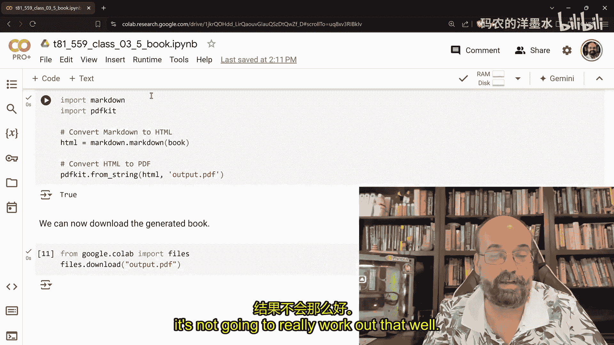

# 015：大语言模型写书 📚

在本节课中，我们将学习如何利用大语言模型撰写长篇文档，例如一本书。我们将通过一个具体的例子，展示如何生成一部包含完整目录的国际间谍题材小说，并最终将其输出为PDF格式。

上一节我们介绍了大语言模型的基本应用，本节中我们来看看如何将其用于创作更长的、结构化的内容。

## 概述与目标

本教程的目标是演示如何通过将复杂任务分解为多个对大语言模型的调用，来生成一本完整的书。我们将使用OpenAI的GPT模型，但方法同样适用于其他模型。核心步骤包括：生成随机书名、撰写内容概要、创建目录，以及逐章生成内容。

## 代码实现步骤

以下是实现“大语言模型写书”功能的核心代码逻辑。

### 1. 初始化模型与设置

首先，我们需要设置大语言模型。这里使用OpenAI的GPT-4o-mini模型，它完全足以完成此任务。在实际出版场景中，可能会选择更强大的模型如GPT-4o来生成最终稿件。

```python
import openai

# 初始化OpenAI客户端，需要设置您的API密钥
client = openai.OpenAI(api_key='your-api-key')
model = "gpt-4o-mini"

# 定义系统提示词
system_prompt = "你是一个协助写书的助手。"
```


### 2. 生成书名与概要

我们首先让模型为指定主题生成一个随机书名，然后基于这个书名生成内容概要。关键在于在提示词中严格要求模型只返回所需文本，避免多余描述，以便后续解析。

```python
subject = "国际间谍惊悚片"

# 生成随机书名
title_prompt = f"为关于{subject}的书想一个随机书名。只返回一个书名，不要任何额外文字。"
book_title = get_completion(title_prompt)

# 生成内容概要
synopsis_prompt = f"为书名为《{book_title}》的{subject}写一个概要。"
book_synopsis = get_completion(synopsis_prompt)
```

### 3. 创建目录

接下来，我们基于书名、主题和概要来生成书籍的目录。为了便于后续程序化处理，我们需要严格指定输出格式。

```python
# 生成目录，指定以“|”分隔的格式
toc_prompt = f"""
为书名为《{book_title}》的{subject}创建一个目录。
书籍概要：{book_synopsis}
请使用以下格式，不要章节编号，只用“|”分隔：
章节名称1|章节名称2|章节名称3
不要任何额外文字。
"""
table_of_contents = get_completion(toc_prompt)
# 将字符串按“|”分割成列表
chapters_list = table_of_contents.split("|")
```

### 4. 逐章生成内容

这是核心部分。我们遍历目录列表，为每一章生成具体内容。在每次调用时，我们提供完整的上下文信息，包括书名、主题、概要、目录以及前一章的内容（或至少是章节名称），以确保故事的连贯性。

```python
def render_chapter(chapter_number, chapter_name, previous_chapter_content=""):
    chapter_prompt = f"""
    你是{subject}《{book_title}》的作者。
    书籍概要：{book_synopsis}
    完整目录：{table_of_contents}
    前一章内容（结尾部分）：{previous_chapter_content}
    
    请撰写第{chapter_number}章：{chapter_name}。
    """
    chapter_content = get_completion(chapter_prompt)
    return chapter_content

# 初始化书籍内容
full_book_content = f"# {book_title}\n\n## 概要\n{book_synopsis}\n\n## 目录\n"
for idx, chap_name in enumerate(chapters_list):
    full_book_content += f"{idx+1}. {chap_name}\n"

# 逐章生成并拼接
previous_content = ""
for idx, chap_name in enumerate(chapters_list):
    chapter_num = idx + 1
    chapter_text = render_chapter(chapter_num, chap_name, previous_content)
    full_book_content += f"\n\n# 第{chapter_num}章：{chap_name}\n\n{chapter_text}"
    # 更新“前一章内容”为当前章的最后一段，以保持连贯性
    previous_content = chapter_text[-500:] # 取最后500字符作为上下文
```

### 5. 输出与格式转换

最后，我们将生成的Markdown格式文本转换为PDF文件，便于阅读和分发。

```python
import markdown
from xhtml2pdf import pisa
from io import BytesIO

# 将Markdown转换为HTML
html_content = markdown.markdown(full_book_content)

# 将HTML转换为PDF
pdf_buffer = BytesIO()
pisa.CreatePDF(html_content, dest=pdf_buffer)

# 保存PDF文件
with open(f"{book_title}.pdf", "wb") as f:
    f.write(pdf_buffer.getvalue())
```

## 总结与进阶思考

本节课中我们一起学习了如何引导大语言模型撰写一本结构完整的书。关键技巧在于将宏大的写作任务拆解为顺序执行的子任务（书名->概要->目录->章节），并在每次模型调用时提供充分的上下文信息以保证内容的一致性和连贯性。



这种方法不仅限于写书，也可用于生成长篇报告、系列文章等任何需要长篇幅、有结构的文本。一个更高级的版本可以预先生成角色档案和故事线，让模型在更丰富的设定下进行创作，从而产出更复杂、更具深度的作品。

通过本教程，你已经掌握了利用大语言模型进行长篇创作的基本框架。记住，清晰的指令、格式约束和上下文传递是成功的关键。